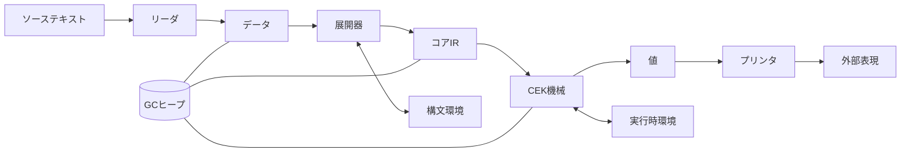
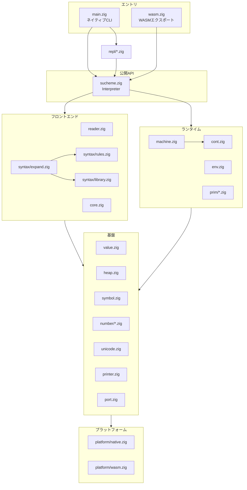

# アーキテクチャ

sucheme-zig は R7RS-small に完全準拠することを目標とする Scheme インタプリタである。ネイティブ実行ファイルと WebAssembly モジュールの両方を同一のコアから生成する。

本ドキュメントは全体構成と、実装者が必ず守る横断的な不変条件を定める。個別の詳細は [runtime.md](runtime.md)、[frontend.md](frontend.md)、[numerics-and-unicode.md](numerics-and-unicode.md)、[platform-and-web.md](platform-and-web.md) にある。

## 設計を決めた制約

次の4つが設計全体を規定している。順序は影響の大きい順。

- R7RS が完全な継続を要求する: `call-with-current-continuation` は多重起動可能で再入可能でなければならない。したがって継続はヒープ上の明示的なデータ構造である必要があり、Zig のコールスタックに評価状態を置くことはできない。
- R7RS が適切な末尾呼び出しを要求する: 末尾位置の呼び出しはスタックを消費してはならない。明示的な継続表現があれば「末尾位置ではフレームを積まない」という規則だけで満たせる。
- WebAssembly では保守的スタック走査ができない: wasm の関数ローカル変数は線形メモリ上に存在せず、GC が走査できない。したがって精密GC(ルートを明示的に管理するGC)が必須である。Zig の再帰で評価していると Zig スタックフレームに `Value` が隠れてしまい精密GCが書けない。
- 実装フェーズを複数のモデル・複数のセッションに分割する: 局所的な判断ミスがコンパイル時または単体テストで検出される構造が望ましい。網羅性検査の効く `union(enum)`、状態が1つの構造体に集約される機械、モジュール境界の明確化を優先する。

上の3つはすべて同じ結論に収束する。すなわち、評価器は明示的な継続を持つレジスタ機械(CEK機械)とする。この決定は [ADR-0004](../adr/0004-cek-machine-evaluator.md) に記録した。

## 処理の流れ

リーダは外部表現をデータ(S式)に変換する。展開器はデータを構文環境のもとで解析し、マクロを展開しながらコアIRに変換する。コアIRは R7RS 4.1 の基本式に `begin` と定義を加えた固定の節点集合であり、変数参照は字句アドレスに解決済みである。CEK機械はコアIRを解釈する。GCヒープはこれら全段階のデータを保持する。

展開と実行は分離されているが、`eval` と REPL のために展開器は実行時にも呼び出せる。`define-syntax` によって展開器が Scheme 手続きを呼ぶ必要が生じた場合(マクロ変換子の実行)は、機械を再帰的に起動せず、展開器自身を継続フレームとして機械に積む。

## モジュールマップ

依存の向きは上から下への一方向とする。基盤が上位を参照してはならない。`platform` は基盤より下にあり、ビルド時にネイティブ実装と WASM 実装のどちらかが選択される。

この規則に1つだけ例外を置く。GC 対象オブジェクトの構造体定義(レイアウト)は、フロントエンドでしか使わないものも含めてすべて `value.zig` に集める。GC はヒープ上の全オブジェクトを走査して子を辿るため、全レイアウトを知る場所が1箇所必要であり、それを基盤より上に置くと依存が逆流する。展開器とライブラリシステムのためのオブジェクト(構文環境、束縛、別名、マクロ、局所束縛、パターン変数、ライブラリ、エクスポート表)、コアIRの節点、動的点の経路も `value.zig` が定義する。対象は [runtime.md](runtime.md) のヒープオブジェクトの共通部分に挙げた4群すべてである。種別タグの全要素に対応するレイアウトが `value.zig` にあることを検査するテストを置く。

例外はレイアウトに限る。これらを操作する論理は上位のモジュールに置き、依存の向きは一方向のまま保つ。`value.zig` は構造体の形だけを知り、意味を知らない。

| ディレクトリ | 役割 |
| --- | --- |
| `src/` | Zig で書くインタプリタ本体 |
| `lib/` | Scheme で書く標準ライブラリ。ビルド時に実行ファイルへ埋め込む |
| `web/` | Web UI サブプロジェクト。依存パッケージを持たない素の HTML/CSS/JS |
| `tests/` | Scheme レベルのテストと、外部から持ち込んだ準拠テストスイート |
| `tools/` | Unicode テーブルの生成器、ドキュメントの検査など補助プログラム |
| `docs/` | 設計・ADR・計画・進捗 |

`lib/` に置く Scheme コードの範囲は「コア言語で表現できるものはコア言語で書く」という方針に従う。詳細は [frontend.md](frontend.md) の標準ライブラリの起動順序と [ADR-0006](../adr/0006-library-system-and-scheme-level-stdlib.md) にある。Zig で書く範囲の一覧は ADR-0006 が正である。

## 横断的な不変条件

実装中に判断に迷ったときは、この節が優先する。違反はレビューで指摘の対象とする。

- GC安全性: ヒープ確保を行いうる呼び出しをまたいで、生のヒープポインタや `Value` を Zig のローカル変数に保持してはならない。保持が必要な場合は `heap.zig` のルート登録APIを使う。理由は WASM で保守的スタック走査ができないこと。
- 確保点の一元化: ヒープ確保は `heap.zig` の API 経由のみとする。GC オブジェクトの本体だけでなく、そのヒープ外ペイロードも `heap.zig` の確保 API を通す。計上を1箇所で行うためである。対象の一覧は [runtime.md](runtime.md) の計上の対象が正であり、ここに複製しない。`std.mem.Allocator` の直接使用は `src/` の全モジュールで禁止する。モジュール名による例外は置かない。例外は `heap.zig` 自身と、ビルド時にテーブルを生成する `tools/` に限る。GC 対象でない補助データ構造(シンボル表の索引など)も計上の対象なので、`heap.zig` から計上つきのアロケータを受け取る([runtime.md](runtime.md) の計上の対象)。
- 評価の進行点の一元化: Scheme 式の評価を進めるのは `machine.zig` のステップ関数だけとする。Zig の再帰で Scheme 式を評価してはならない。末尾呼び出し・完全な継続・精密GCの3つが同時に壊れる。
- プリミティブの非再入: プリミティブ手続きから Scheme 手続きを呼ぶ必要がある場合は、プリミティブの中で機械を起動してはならない。機械にレジスタを書き換えさせて次のステップに進ませる。
- 末尾呼び出しの保持: R7RS 3.5 が末尾呼び出しを必須とする4箇所(`apply` の第1引数、`call-with-current-continuation` の第1引数、`call-with-values` の第2引数、`eval` の第1引数の評価)では、継続フレームを積まずにプリミティブ自身の継続を引き継ぐ。フレームを積むと、能動的な末尾呼び出しが無制限であるという要求を満たせない。詳細は [runtime.md](runtime.md) の機械操作プリミティブと末尾呼び出しにある。
- 値表現の隠蔽: `union(enum)` のタグ構造に直接依存するコードは `value.zig` に閉じ、他モジュールはアクセサ関数を使う。表現を差し替えられる状態を維持する([ADR-0002](../adr/0002-value-representation.md))。
- エラー表現の区別: Scheme プログラムの誤りは Scheme の条件オブジェクトで表現する。Zig の `error` は機械の外側の失敗(メモリ不足、ホストI/Oエラー、内部不整合)にのみ使う。両者を混ぜない。
- 仕様参照の明示: R7RS の規定に基づく非自明な振る舞いには、節番号を引いた `Why:` コメントを1行添える。
- テストが先: 新しい振る舞いは、失敗するテストを書いてから実装する。

## ビルド成果物

| 成果物 | ターゲット | 用途 |
| --- | --- | --- |
| `sucheme` 実行ファイル | ネイティブおよび [ADR-0010](../adr/0010-ci-cd-and-release-strategy.md) が列挙するクロスコンパイル対象 | CLI と REPL |
| `sucheme.wasm` | `wasm32-freestanding` | Web UI、ブラウザ上の実行 |
| `libsucheme` | ネイティブ | 組み込み用途(将来) |

対応ターゲットと動作保証の範囲は [ADR-0010](../adr/0010-ci-cd-and-release-strategy.md) で定める。macOS はクロスコンパイルによるビルド保証のみで、自動テストによる動作保証は Linux と Windows に限る。
