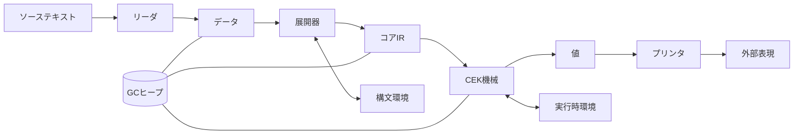
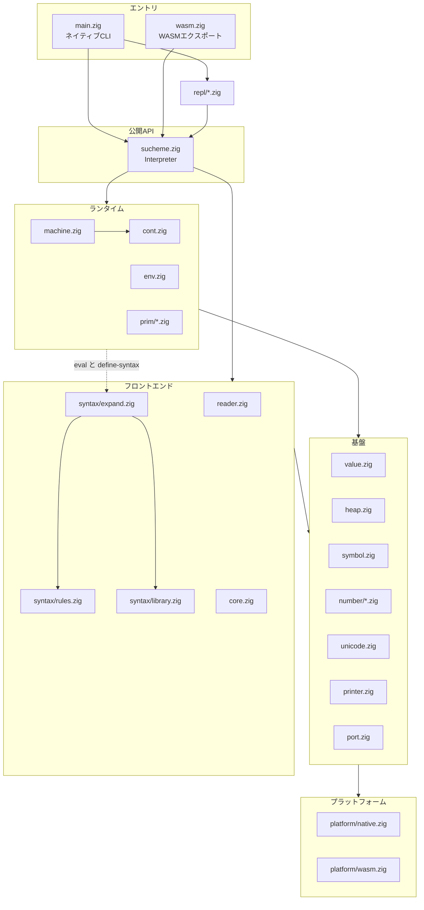

# アーキテクチャ

sucheme-zig は R7RS-small に完全準拠することを目標とする Scheme インタプリタである。ネイティブ実行ファイルと WebAssembly モジュールの両方を同一のコアから生成する。

本ドキュメントは全体構成と、実装者が必ず守る横断的な不変条件を定める。個別の詳細は [runtime.md](runtime.md)、[frontend.md](frontend.md)、[numerics-and-unicode.md](numerics-and-unicode.md)、[platform-and-web.md](platform-and-web.md) にある。

## 設計を決めた制約

次の4つが設計全体を規定している。順序は影響の大きい順。

- R7RS が完全な継続を要求する: `call-with-current-continuation` は多重起動可能で再入可能でなければならない。したがって継続はヒープ上の明示的なデータ構造である必要があり、Zig のコールスタックに評価状態を置くことはできない。
- R7RS が適切な末尾呼び出しを要求する: 末尾位置の呼び出しはスタックを消費してはならない。明示的な継続表現があれば「末尾位置ではフレームを積まない」という規則だけで満たせる。
- WebAssembly では保守的スタック走査ができない: wasm の関数ローカル変数は線形メモリ上に存在せず、GC が走査できない。したがって精密GC(ルートを明示的に管理するGC)が必須である。Zig の再帰で評価していると Zig スタックフレームに `Value` が隠れてしまい精密GCが書けない。
- 実装フェーズを複数のモデル・複数のセッションに分割する: 局所的な判断ミスがコンパイル時または単体テストで検出される構造が望ましい。網羅性検査の効く `union(enum)`、状態が1つの構造体に集約される機械、モジュール境界の明確化を優先する。

4つはすべて同じ結論に収束する。すなわち、評価器は明示的な継続を持つレジスタ機械(CEK機械)とする。4つ目も、状態が1つの構造体に集約される機械を優先事項に挙げている点で同じ結論を支持する。この決定は [ADR-0004](../adr/0004-cek-machine-evaluator.md) に記録した。

## 処理の流れ

リーダは外部表現をデータ(S式)に変換する。展開器はデータを構文環境のもとで解析し、マクロを展開しながらコアIRに変換する。コアIRの節点集合は [runtime.md](runtime.md) のコアIRが正であり、ここに列挙しない。変数参照は、局所変数なら字句アドレスに、グローバル変数なら束縛セルへの参照に解決済みである。CEK機械はコアIRを解釈する。GCヒープはこれら全段階のデータを保持する。

展開と実行は分離されているが、`eval` と REPL のために展開器は実行時にも呼び出せる。`define-syntax` によって展開器が Scheme 手続きを呼ぶ必要が生じた場合(マクロ変換子の実行)は、機械を再帰的に起動せず、展開器自身を継続フレームとして機械に積む。

## モジュールマップ

この図は設計の目標であり、段階2までの実装の現状ではない。図にあって `src/` にまだ無いものは次のとおりである。

- `cont.zig`: 継続フレームと継続のレイアウトは `value.zig` にあり、機械は `machine.zig` が持つ。
- `number/*.zig` と `unicode.zig`: 数値塔と Unicode のテーブルが入る段階4で置く。
- `port.zig`: ポートが入る段階5で置く。
- `platform/native.zig` と `platform/wasm.zig`: 置いていない。ネイティブの入口は `main.zig`、WASM の入口は `wasm.zig` が、それぞれ直接ホストと話す。プラットフォームの違いを1つのモジュール境界に集める整理は、まだしていない([platform-and-web.md](platform-and-web.md) のプラットフォーム抽象は、この境界の設計である)。
- `repl/*.zig`: ネイティブの REPL は `main.zig` の `repl` で、`repl/` ディレクトリは無い。行編集は段階7である([ADR-0014](../adr/0014-repl-line-editor-boundary.md))。

逆に、図に無いが `src/` にあるモジュールがある。`context.zig`(`Context`。展開器と機械が共有する状態)、`trace.zig`(GC の走査関数の生成)、`resolve.zig`(ソースファイルを開く経路)、`features.zig`、`char_syntax.zig`、`string_syntax.zig`、`tier.zig`(テストの層)、`syntax/cond_expand.zig`、`syntax/env.zig`、`syntax/source.zig` である。実際の構成は `src/` が正である。

依存の向きは上から下への一方向とする。基盤が上位を参照してはならない。`platform` は基盤より下にあり、ビルド時にネイティブ実装と WASM 実装のどちらかが選択される。

この規則に2つの例外を置く。

第1の例外はレイアウトの集約である。GC 対象オブジェクトの構造体定義は、フロントエンドでしか使わないものも含めてすべて `value.zig` に集める。GC はヒープ上の全オブジェクトを走査して子を辿るため、全レイアウトを知る場所が1箇所必要であり、それを基盤より上に置くと依存が逆流する。対象は [runtime.md](runtime.md) のヒープオブジェクトの共通部分に挙げた2群すべてである。種別タグの全要素に対応するレイアウトが `value.zig` にあることを検査するテストを置く。

この例外はレイアウトに限る。これらを操作する論理は上位のモジュールに置き、依存の向きは一方向のまま保つ。`value.zig` は構造体の形だけを知り、意味を知らない。

第2の例外は展開器の呼び出しである。`eval` と REPL の `define-syntax` のために、ランタイム層からフロントエンド層を呼ぶ必要がある。`eval` は機械操作プリミティブなので `prim/` に置かれるが、受け取ったデータをコアIRに変換しなければならない。展開器を継続フレームとして機械に積む場合も、機械が展開器を再開するため同じ向きの辺が必要である。

この例外の形を限定する。`prim/` と `machine.zig` が参照できるのは `syntax/expand.zig` が公開する2つの関数、すなわち「データと構文環境からコアIRを作る」と「積んだ展開器のフレームを1段進める」に限る。それ以外のフロントエンドの内部には触れない。モジュールマップではこの辺を破線で描く。

関数ポインタを `root` から注入する形は採らない。注入する側が両層を知る必要があり、依存の向きが見えなくなる。例外を2つと明示して、どちらも検査できる形にするほうがよい。

| ディレクトリ | 役割 |
| --- | --- |
| `src/` | Zig で書くインタプリタ本体 |
| `lib/` | Scheme で書く標準ライブラリ。ビルド時に実行ファイルへ埋め込む。段階3で置くので、まだ無い |
| `web/` | Web UI サブプロジェクト。依存パッケージを持たない素の HTML/CSS/JS |
| `tests/` | Scheme レベルのテストと、外部から持ち込んだ準拠テストスイート |
| `tools/` | Unicode テーブルの生成器、ドキュメントの検査など補助プログラム |
| `docs/` | 設計・ADR・計画・進捗 |

`lib/` に置く Scheme コードの範囲は「コア言語で表現できるものはコア言語で書く」という方針に従う。詳細は [frontend.md](frontend.md) の標準ライブラリの起動順序と [ADR-0006](../adr/0006-library-system-and-scheme-level-stdlib.md) にある。Zig で書く範囲の一覧は ADR-0006 が正である。

## 横断的な不変条件

実装中に判断に迷ったときは、この節が優先する。違反はレビューで指摘の対象とする。

- GC安全性: ヒープ確保を行いうる呼び出しをまたいで、生のヒープポインタや `Value` を Zig のローカル変数に保持してはならない。保持が必要な場合は `heap.zig` のルート登録APIを使う。理由は WASM で保守的スタック走査ができないこと。
- 確保点の一元化: ヒープ確保は `heap.zig` の API 経由のみとする。GC オブジェクトの本体だけでなく、そのヒープ外ペイロードも `heap.zig` の確保 API を通す。計上を1箇所で行うためである。対象の一覧は [runtime.md](runtime.md) の計上の対象が正であり、ここに複製しない。この禁止の対象は、計上の対象となる確保である。GC オブジェクト、そのヒープ外ペイロード、および [runtime.md](runtime.md) の計上の対象に挙げたものを確保する経路では、`src/` のどのモジュールからも `std.mem.Allocator` を直接使ってはならない。モジュール名による例外は置かない。GC 対象でない補助データ構造(シンボル表の索引など)も計上の対象なので、`heap.zig` から計上つきのアロケータを受け取る。段階2のスライス 2k の実装は、展開器の作業状態をこの規則の外に置いている(下の評価の進行点の一元化の項の例外の一覧、[ADR-0031](../adr/0031-gc-at-machine-step-boundaries.md) の 2026-10-13 のスライス 2k の追記)。

  対象外は2つに限る。

  - `heap.zig` 自身。計上つきのアロケータを作る場所である。
  - エントリ層(`main.zig` と `wasm.zig`)。ホストのアロケータを受け取り、`heap.zig` へ渡し、起動と終了に必要な計上の対象でないもの(コマンドライン引数、ホストへの出力バッファ)を扱う。Scheme の値やそのペイロードをここで確保してはならない。

  段階2までの実装の `wasm.zig` は、この対象外を超えている。ホストへの出力バッファ(固定の大きさ)と、ホストが `sucheme_alloc` で渡す入力領域を、`std.heap.wasm_allocator` から直接確保し、計上しない。ほかに、入力領域ごとの記録(`regions`)と、`sucheme_eval_begin` の呼び出しごとのアリーナも、同じ確保元から直接確保し、計上しない。出力バッファと入力領域の2つは [runtime.md](runtime.md) の計上の対象に挙がっているので、設計との食い違いである。入力領域は呼び出しごとに確保され、「起動と終了に限る」にも当たらない。ヒープの上限の外に出る量は、出力バッファの大きさ(固定)と、ホストが渡す入力の量で決まる。計上の対象にするか、対象外に加えるかは、まだ決めていない([platform-and-web.md](platform-and-web.md)、[plans/0008-slice-1i-wasm-web-ui.md](../plans/0008-slice-1i-wasm-web-ui.md))。

  エントリ層のコメントに、そのファイルが確保するものが計上の対象でないことと、確保が起動と終了に限ることを書く。`tools/` は `src/` の外なのでこの規則の対象ではない。段階0の `tools/` はドキュメントの検査と識別子の抽出を行う補助プログラムで、段階4で Unicode テーブルの生成器が加わる。
- 評価の進行点の一元化: Scheme 式の評価を進めるのは `machine.zig` のステップ関数だけとする。Zig の再帰で Scheme 式を評価してはならない。末尾呼び出し・完全な継続・精密GCの3つが同時に壊れる。段階1のスライス 1a から 1e は、CEK 機械の前に素朴な再帰評価器で進めた暫定の例外であり、1f で機械に置き換えて外れた。1g で `heap.zig` が入り、ペア・クロージャ・環境のフレーム・継続フレーム・引数の蓄積は GC ヒープに置かれて回収される(ヒープに入るかどうかの一覧は `value.zig` の `heap_types`)。条件オブジェクトは、段階2のスライス 2b で、送出のための予約領域とあわせて GC ヒープに移った([ADR-0035](../adr/0035-stage-2-gc-roots-and-raise-reserve.md))。残る例外は次のとおりで、いずれも `Interpreter` が持つ永続アリーナ(`std.mem.Allocator`)を使い、セッションが終わるまで回収されない。コアIRの節点と `Lambda`(コードをヒープに移すスライスで外れる)、シンボル表と大域環境の索引(シンボル表を弱い表にするスライスで外れる)、コードの定数を指す `Context.code_roots` の登録表(表そのものがアリーナにあり、セッションの終わりまで増える)、2m から、ライブラリごとの最上位の環境の表(`Registry.tables`。失敗した定義の表も残る)である。アリーナは計上の上限の外にあるので、メモリは展開したコードの量と、ライブラリの個数にインポートした名前の数を掛けた量に比例して増え、呼び出しの回数には比例しない。展開したコードの量には、マクロの適用が生む節点と、展開が失敗した形式の節点も入る。止まらないマクロの適用は、ヒープの上限に当たるまで節点を作り続ける。ただし `code_roots` が指すペアは GC ヒープにあって上限の内側にあり、回収されない(展開が失敗した形式の定数は、展開器が表から外す)。さらに 2k から、展開器の作業状態(照合の木、作業スタック、別名の剥離の表)が、`Interpreter.evalPrint` の呼び出しごとの作業用アリーナにあり、アリーナは計上の上限の外にある。止まらないマクロの適用では、これがヒープの上限を大きく超えて伸びるので、2l で、展開の作業状態と節点を、展開の間だけヒープの上限に計上する形にした(`heap.zig` の `Charged`。最初のマクロの適用から、数えた分が上限の検査に入る。[ADR-0031](../adr/0031-gc-at-machine-step-boundaries.md) の 2026-10-14 のスライス 2l の追記)。`quote` したデータは、展開した時点から、セッションの終わりまで上限を消費する([ADR-0031](../adr/0031-gc-at-machine-step-boundaries.md))。継続の深さとフレーム数に上限は設けず、計上の上限が非末尾の無限再帰を `heap limit exceeded` で止める。
範囲は [plans/0003-phase1-minimal-slice.md](../plans/0003-phase1-minimal-slice.md) が正である。
- プリミティブの非再入: プリミティブ手続きから Scheme 手続きを呼ぶ必要がある場合は、プリミティブの中で機械を起動してはならない。機械にレジスタを書き換えさせて次のステップに進ませる。
- 末尾呼び出しの保持: R7RS 3.5 が末尾呼び出しを必須とする4箇所(`apply` の第1引数、`call-with-current-continuation` の第1引数、`call-with-values` の第2引数、`eval` の第1引数の評価)では、継続フレームを積まずにプリミティブ自身の継続を引き継ぐ。フレームを積むと、能動的な末尾呼び出しが無制限であるという要求を満たせない。詳細は [runtime.md](runtime.md) の機械操作プリミティブと末尾呼び出しにある。
- 値表現の隠蔽: `union(enum)` のタグ構造に直接依存するコードは `value.zig` に閉じ、他モジュールはアクセサ関数を使う。表現を差し替えられる状態を維持する([ADR-0002](../adr/0002-value-representation.md))。
- エラー表現の区別: Scheme プログラムの誤りは Scheme の条件オブジェクトで表現する。Zig の `error` は機械の外側の失敗(メモリ不足、ホストI/Oエラー、内部不整合)にのみ使う。両者を混ぜない。例外が1つある。純粋プリミティブは、型や範囲の失敗を Zig の `error`(`PrimitiveError`)で返し、機械が `Machine.apply` の1か所で条件オブジェクトに写して、機械の中で送出する。段階2のスライス 2d で、ハンドラで捕まえられる形になったが、戻り値の形は変えていない([runtime.md](runtime.md) の上限超過と確保の失敗、[0014](../plans/0014-phase2-core-language.md) の合意を求める点の2)。
- 仕様参照の明示: R7RS の規定に基づく非自明な振る舞いには、節番号を引いた `Why:` コメントを1行添える。
- テストが先: 新しい振る舞いは、失敗するテストを書いてから実装する。

## ビルド成果物

| 成果物 | ターゲット | 用途 |
| --- | --- | --- |
| `sucheme` 実行ファイル | ネイティブおよび [ADR-0010](../adr/0010-ci-cd-and-release-strategy.md) が列挙するクロスコンパイル対象 | CLI と REPL |
| `sucheme.wasm` | `wasm32-freestanding` | Web UI、ブラウザ上の実行 |
| `libsucheme` | ネイティブ | 組み込み用途(将来) |

対応ターゲットと動作保証の範囲は [ADR-0010](../adr/0010-ci-cd-and-release-strategy.md) で定める。macOS はクロスコンパイルによるビルド保証のみで、自動テストによる動作保証は Linux と Windows に限る。
