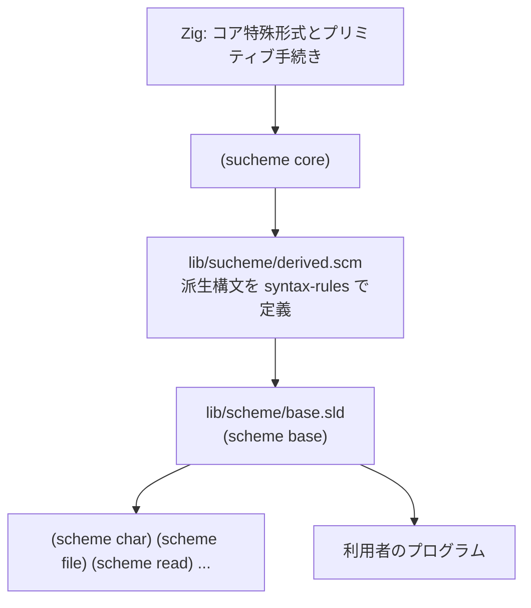

# フロントエンド設計

リーダ、構文環境、衛生的マクロ展開器、`syntax-rules`、ライブラリシステム、標準ライブラリの起動順序についての決定。全体整合性に必要な範囲まで詳細を決め、それ以外は実装時に決める([ADR-0018](../adr/0018-incremental-vertical-slices.md))。実装時に決めるものは [open-questions.md](open-questions.md) に一覧がある。

対応する決定: [ADR-0019](../adr/0019-denotations-and-identifier-resolution.md)、[ADR-0006](../adr/0006-library-system-and-scheme-level-stdlib.md)。

## リーダ

外部表現を読んでデータを構築する。R7RS 7.1.1 の字句構造と 7.1.2 の外部表現の形式文法に対応させる。下の表のうちリスト、ベクタ、略記、データラベルが 7.1.2、残りは 7.1.1 で定義されている。

| 分類 | 対応する記法 |
| --- | --- |
| コメント | `;` 行末まで、`#\|` と `\|#` の入れ子可能なブロック、`#;` によるデータ単位のコメント |
| 真偽値 | `#t` `#true` `#f` `#false` |
| 数値 | 基数接頭辞 `#b` `#o` `#d` `#x`、正確性接頭辞 `#e` `#i`、分数、小数、指数、`+inf.0` `-inf.0` `+nan.0` `-nan.0`、複素数 |
| 文字 | `#\a`、名前付き文字9種(`alarm` `backspace` `delete` `escape` `newline` `null` `return` `space` `tab`)、`#\x` に続く16進 |
| 文字列 | `\a \b \t \n \r \" \\ \|`、`\x` に続く16進とセミコロン(段階5)、行継続(段階5) |
| 識別子 | 通常の識別子、特殊初期文字、`\|` で囲んだ記法 |
| リスト | `(...)`、`[...]` は使わない、ドット対 |
| ベクタ | `#(...)` |
| バイトベクタ | `#u8(...)` |
| 略記 | `'` `` ` `` `,` `,@` |
| データラベル | `#0=` と `#0#` による循環構造 |
| 指令 | `#!fold-case` と `#!no-fold-case` |

識別子の大文字と小文字は区別する(R7RS 2.1)。

文字列のエスケープに `\|` を含めるのは R7RS 7.1.1 の `<string element>` の生成規則に従うためである。同規則は `<mnemonic escape>` と `\"` と `\\` と `\|` を列挙している。字面が縦棒識別子の記法と重なるが、文字列の要素としても規定されている。

名前付き文字は R7RS 7.1.1 の `<character name>` の生成規則どおり9種である。1つでも落とすと準拠しない。

### ケースフォールディング

リーダはポートごとに「識別子と文字名を畳み込むか」の状態を持つ。既定は畳み込まない。

`#!fold-case` と `#!no-fold-case` はこの状態を切り替える指令である。R7RS 2.1 の原文は次のとおり。

> The #!fold-case directive causes subsequent identifiers and character names to be case-folded as if by string-foldcase (see section 6.7). It has no effect on character literals. The #!no-fold-case directive causes a return to the default, non-folding behavior.

畳み込まれないのは文字リテラル(`#\A`)である。文字名(`#\NEWLINE`)は畳み込まれるので、`#!fold-case` のもとでは `#\NEWLINE` が `#\newline` と同じ改行文字になる。文字列と数値も影響を受けない。畳み込みには `string-foldcase` と同じケースフォールディングを使う([numerics-and-unicode.md](numerics-and-unicode.md))。

R7RS 7.1.1 は `<directive>` を `<atmosphere>` の構成要素として定義し、2.1 は「These directives can appear anywhere comments are permitted ... They are treated as comments, except that they affect the reading of subsequent data from the same port」と規定している。コメントが書ける場所すべてに現れうる。

指令の直後には区切りが必要である。R7RS 7.1.1 の注が「it is ungrammatical to follow a ⟨directive⟩ with anything but a ⟨delimiter⟩ or the end of file」としているため、`#!fold-casex` を指令と識別子 `x` の並びとして受理してはならない。読み取りエラーにする。

`include-ci` はこの機構の上に実装する。R7RS 4.1.7 が「include-ci reads each file as if it began with the #!fold-case directive」と規定しているため、対象ファイルを読むポートの初期状態を畳み込む側にするだけで実現できる。

### 段階ごとの実装範囲

| 段階 | 追加する記法 |
| --- | --- |
| 1 | 行コメント、真偽値、10進の整数、識別子、文字列の基本エスケープ、リスト、ベクタ、`'` の略記 |
| 2 | ポートごとのケースフォールディング状態と `include-ci`。指令そのものは段階5 |
| 3 | `` ` `` `,` `,@` の略記、文字リテラル(`#\a` と名前付き文字) |
| 4 | 基数接頭辞、正確性接頭辞、分数、小数、指数、`+inf.0` 系、複素数 |
| 5 | ブロックコメント、`#;`、データラベル、縦棒で囲んだ識別子、`#u8`、16進エスケープ、`#!fold-case` 指令 |

段階3に `` ` `` と `,` と `,@` を置くのは、段階3で `quasiquote` を `syntax-rules` で定義するためである。略記が読めないと `` `(1 ,x) `` を含むテストが書けない。

ケースフォールディングの状態を段階2に置くのは、ライブラリシステムが `include-ci` を提供する段階と合わせるためである。機構がないまま `include-ci` を提供すると `include` に退化し、畳み込みを期待したファイルが未束縛識別子のエラーになる。指令そのもの(入力の途中で切り替える機能)は段階5で足す。

未対応の記法は「段階Nで対応予定」と明示したエラーを返し、黙って誤読しないようにする。

### 位置情報

エラーメッセージのために、ポートから読んだ各ペアの位置を副表に記録する。位置はファイルの識別子と行と桁の3つからなる。

ファイルの識別子を含めるのは、1つのトップレベルフォームが複数のファイルにまたがるためである。`(include "helpers.scm")` を含む `main.sld` を読むと、1つの `define-library` フォームの中に2つのファイル由来のペアが混ざる。行と桁だけを持つと、`helpers.scm` の3行目の誤りを `main.sld` の3行目として報告する。

この副表は1つのトップレベルフォームを読んでから展開し終えるまでの作業表である。その間はルートとして登録し、展開が終わったら破棄する。実行時にも位置が必要なものは、展開器がコアIR節点に複製する([runtime.md](runtime.md))。

永続的な副表にすると、ルートとして扱えば REPL が読んだデータを恒久的に生存させ、扱わなければ回収後に鍵のアドレスが再利用されて無関係な位置を指す。どちらも避ける。

マクロ展開後は対応が失われるので、展開器は展開元のフォームの位置を引き継ぐ努力をするが、完全性は求めない。

### 逐次読み取り

REPL は「入力が完結したか」を知る必要がある。リーダは不足を表す専用の結果を返し、REPL はそれを見て継続行を促す。括弧の数を数える方式では、文字列やブロックコメントの中の括弧で誤判定するため採用しない。

## 構文環境と識別子

展開器の中心となるデータは構文環境である。構文環境は識別子から意味への写像である。衛生性の全体が依存するため、保持する状態は設計時に決める。

意味の種類は6つである。

| 意味 | 内容 |
| --- | --- |
| 特殊形式 | コアIRに直接変換する構文 |
| マクロ | 変換子とその定義環境 |
| 補助構文 | それ自身では式にならず、他の構文のパターンリテラルとしてのみ現れる識別子 |
| 局所束縛 | `lambda` と内部定義が導入する束縛 |
| グローバルセル | ライブラリまたは REPL のトップレベルの束縛 |
| パターン変数 | `syntax-rules` の展開中にのみ現れる |

補助構文を独立した意味にするのは、R7RS 付録A が `(scheme base)` のエクスポートに `...` `=>` `_` `else` `unquote` `unquote-splicing` の6個を含めており、R7RS 4.2.1(`else` と `=>`)・4.2.8(`unquote` と `unquote-splicing`)・4.3.2(`_` と `...`)がこれらを auxiliary syntax として項目化しているためである。これらは式に変換されないので特殊形式ではなく、変換子を持たないのでマクロでもない。意味を与えないと3つが同時に壊れる。

- `(import (only (scheme base) cond else))` がエクスポート表に `else` の行を作れず、R7RS 5.2 の「It is an error if any of the listed identifiers are not found in the original set」に該当して失敗する。
- `cond` のリテラル `else` の照合が、識別子が未束縛であることに依存する。ライブラリごとに独立したグローバル環境を持つ設計(後述)では、定義側と利用側の `else` が別のセルに解決されうるため照合が壊れる。意味を共有すれば位置によらず照合する。
- ライブラリ本体の `(define else 5)` を拒否できない。R7RS 5.2 はインポートした束縛の再定義を誤りとしている。

| 保持するもの | 内容 |
| --- | --- |
| 構文環境 | 親へのリンク、この環境の rib の絶対深さ、束縛の配列 |
| 束縛 | 識別子、意味、インポートしたものかどうかの印 |
| 識別子 | 素のシンボルか別名のどちらか |
| 別名 | 内側の識別子、解決すべき環境(マクロの定義環境)、同一展開を区別する印 |
| 局所束縛 | この束縛を導入した rib の絶対深さ、rib 内の位置 |

局所束縛を深さと添字の組ではなく独立したオブジェクトにするのは、深さが利用側からの相対値なので別々の字句環境にある無関係な束縛が同じ組になりうるためである。意味の同一性をその組で判定すると、同名だが別束縛の識別子を同じ意味と誤判定し、`syntax-rules` のリテラル照合が壊れる。同一性はオブジェクトの同一性で判定する。

印は展開の同一性を表す。異なる展開に同じ印を割り当ててはならない。割り当て器が周回する幅を使うと、周回後の展開が導入した識別子が周回前の展開の束縛と同一と判定され、衛生性が静かに壊れる。幅と、周回しないことをどう保証するかは実装時に決める([open-questions.md](open-questions.md))。

別名の内側の識別子がシンボルではなく識別子であることが重要である。入れ子になったマクロ展開では別名が別名を包むため、1段ずつ剥がせる構造でなければ解決規則が停止しない(後述)。元の名前は内側を最内まで辿って得る。

インポートしたものかどうかの印を意味の中ではなく束縛に置くのは、インポートできるのが変数だけではないためである。`(scheme base)` は `if` や `lambda` や `quote` のような特殊形式も、`when` や `cond` のようなマクロもエクスポートする。意味の種類に関わらず所有関係を表せる位置に置く。

rib を持たない構文環境(`let-syntax`、`letrec-syntax`、`define-syntax` が作る環境)の絶対深さは親と同じ値にする。パターン変数は構文環境に束縛しない。スライス 2k の照合器とテンプレート展開器(`src/syntax/rules.zig`)が、規則ごとのパターン変数の表で引く([ADR-0019](../adr/0019-denotations-and-identifier-resolution.md) の 2026-10-13 の追記)。深さを増やすと、その環境の内側から外側の変数を参照したときの相対深さが1大きくなり、存在しない親の rib をたどる。

### 解決規則

グローバル環境はライブラリごと、および REPL ごとに独立である。処理系全体で1つの表を持つことはしない。R7RS 5.1 が「The initial environment of a program is empty, so at least one import declaration is needed to introduce initial bindings」と規定しているため、インポートしていない他のライブラリの定義が見えてはならない。

```
resolve(id, env):
    e = env
    while e != null:
        if e に id と同一性が一致する束縛がある: return その意味
        e = e.parent
    if id が別名である: return resolve(id.inner, id.env)   // 1段剥がして委譲する
    return env が属するライブラリのグローバル環境で id の名前を引く
```

各構文環境は、自分が属するライブラリ(または REPL)を辿れる。別名は定義環境を持つので、委譲先のグローバル環境は定義側のライブラリのものになる。これによりマクロが導入した自由な参照が定義側の束縛に解決される。

委譲するのは別名自身ではなく内側の識別子である。マクロが導入した別名は定義環境に束縛を持たないのが通常であり、別名のまま委譲すると同じ分岐に戻って停止しない。内側を渡せば1回の委譲で別名の層が1つ減るため、有限回で素のシンボルに到達して必ず停止する。マクロが導入した `if` のような自由な参照は、この経路で定義環境の意味に解決される。

同一性の一致は2つの識別子の間の関係である。片方の種類で場合分けするのではなく、次の2つの場合にのみ一致とする。種類が違う対は一致しない。

- 両方が素のシンボルで、名前が一致する。
- 両方が別名で、内側の識別子が同一性の意味で一致し、印が一致し、環境が一致する。

素のシンボルと別名を一致させてはならない。一致させると、マクロが導入した別名を束縛する rib を、利用側の同名の素のシンボルが引き当てる。`swap!` の展開でテンプレートの `tmp` が別名として束縛され、利用側の `(let ((tmp 1) (x 2)) (swap! tmp x) ...)` の素の `tmp` がその束縛に捕捉される。これが衛生性の要になる。

- マクロが導入した識別子は印が利用側のものと異なるため、利用側の同名の束縛に捕捉されない。
- マクロが導入した識別子が利用側で束縛されなかった場合、定義環境で解決されるため定義時の意味を保つ(参照透明性)。
- マクロが導入した束縛構文が束縛するのは別名そのものなので、本体中の同じ別名だけがその束縛を見る。

### 識別子の比較

- `free-identifier=?` に相当する比較: それぞれの環境での意味が同一なら等しい。どちらも未束縛なら元のシンボル名が等しければ等しい。`syntax-rules` のリテラル照合はこの比較を使う(R7RS 4.3.2)。利用側が `else` を再束縛している場合にリテラル `else` が照合しなくなるという規定が満たされる。
- `bound-identifier=?` に相当する比較: 名前と印と環境が一致する場合のみ等しい。`lambda` の引数リストの重複検査などに使う。

### quote による剥離

`quote` の中に現れた別名は、コアIRの定数にする時点で元のシンボルに戻す。マクロが導入した識別子を `quote` した結果は元の名前のシンボルでなければならない。

剥離は単純な再帰走査にしてはならない。データラベル(R7RS 2.4)で作った循環データを `quote` できるため、再帰では停止しない。また共有構造を複製すると `eq?` で観測できる同一性が変わる。

訪問済みオブジェクトの対応表を使うグラフ走査とする。

1. 第1走査で別名を含む部分グラフがあるかを調べる。この走査も訪問済み集合を持つ。持たないと `'#0=(1 2 . #0#)` のような循環リテラルで停止しない。領域を確保しないため上限超過にもならず、処理系がそのまま止まる。含まなければ元のオブジェクトをそのまま定数にする。複製しないので同一性が保たれ、よくある場合の費用もかからない。
2. 含む場合は、オブジェクトの同一性をキーにした対応表で写しを作る。ペアやベクタは先に中身を未確定で確保して対応表に登録し、そのうえで要素を埋める。これにより循環を同じ形で再現できる。
3. 同じオブジェクトに2回到達したら対応表の値を返す。共有が共有として保たれる。
4. 訪問済み集合と対応表はどちらも走査中の作業領域である。GC のルートとして登録し、計上の対象に含める。

## 展開器

```mermaid
flowchart TB
    form[フォーム] --> kind{フォームの形}
    kind -->|識別子| ref[意味に解決して変数参照または構文エラー]
    kind -->|自己評価する定数| lit[リテラル節点]
    kind -->|空リスト| err1[構文エラー]
    kind -->|非真正リスト| err2[構文エラー]
    kind -->|真正リスト| head{先頭の意味}
    head -->|特殊形式| core[コアIRに変換]
    head -->|マクロ| expand[変換子を適用して再展開]
    head -->|補助構文| err3[構文エラー]
    head -->|局所 / グローバル / 非識別子| call[呼び出しに変換]
    expand --> form
    ref --> out[コアIR]
    lit --> out
    core --> out
    call --> out
```

展開器はフォームと構文環境を受け取り、コアIRを返す。マクロ適用のたびに新しい印を割り当てる。

フォームの形による分岐を先に置く。対であることを前提にすると、空リストと非真正リストと原子に経路がなくなる。

- 識別子は意味に解決する。意味が特殊形式、補助構文、パターン変数なら構文エラーである。マクロなら R7RS 4.3 が式としての使用を規定していないので構文エラーとする。
- 数値、文字列、文字、ベクタ、バイトベクタ、真偽値は自己評価する(R7RS 4.1.2)。`quote` は不要である。
- 空リストは構文エラーである。R7RS 4.1.3 の Note が「In many dialects of Lisp, the empty list, (), is a legitimate expression evaluating to itself. In Scheme, it is an error」と明記している。
- 非真正リスト(`(f . 1)`)は構文エラーである。引数リストの走査が末尾の非対に到達する前に検出する。

| 構文 | 扱い |
| --- | --- |
| `quote` `if` `lambda` `set!` `define` `begin` `parameterize` | コアIRに直接変換する。`parameterize` が節点である理由は [runtime.md](runtime.md) のコアIRにある |
| `define-syntax` `let-syntax` `letrec-syntax` | 構文環境にマクロ束縛を追加し、コアIRには何も出さない |
| `syntax-rules` | 変換子オブジェクトを作る |
| `include` `include-ci` `cond-expand` | 展開時に解決する。式の位置とライブラリ宣言の位置の両方に現れる(後述) |
| `syntax-error` | 展開時に誤りを送出する。引数は評価しない |
| `define-library` `import` `export` | ライブラリ処理に委譲する |
| `define-values` `define-record-type` `case-lambda` などの派生構文 | Scheme 側の `syntax-rules` で定義する |

`include`、`include-ci`、`cond-expand` は式の位置にも現れる。根拠は付録A が3つとも `(scheme base)` のエクスポートに含めていることである。R7RS の Language changes の節(Other language changes since R5RS)にも次の記述があるが、同節は自ら「This list is not authoritative」と述べているので補足として扱う。

> The expressions types include, include-ci, and cond-expand have been added to the base library; they have the same semantics as the corresponding library declarations.

ライブラリ宣言としての経路と式としての経路の両方を持つ。前者はライブラリ宣言の列という文脈で処理順の規則に従い、後者は普通の式として展開する。

`syntax-error` を特殊形式にするのは、R7RS 4.3.3 が「syntax-error behaves similarly to error (6.11) except that implementations with an expansion pass separate from evaluation should signal an error as soon as syntax-error is expanded」と規定しているためである。本処理系は展開と評価を分けるので、展開時に送出する。同節は「Applications cannot count on being able to catch syntax errors with exception handlers or guards」としているので、`guard` では捕捉できない。付録A が `(scheme base)` のエクスポートに含めているので、エクスポート表には特殊形式として入る。

手続きとして扱うと、R7RS 4.3.3 の規範例 `(syntax-error "expected an identifier but got" (x . y))` のテンプレート引数 `(a . b)` が式として展開され、`a` を演算子とする不正な呼び出しになる。送出されるべき誤りの代わりに別の誤りが出る。

内部定義の扱いは `letrec*` 意味論に従う(R7RS 5.3.2)。本体の先頭から `define` と `define-syntax` を集め、`define-syntax` を先に構文環境へ入れてから、`define` のスロットを確保する。マクロ展開によって新たな `define` が現れる可能性があるため、本体の走査は展開と交互に行う。

展開器は入力の深さに比例して進むため、Zig の再帰で書かない。明示的な作業スタックを使う([runtime.md](runtime.md))。

### 変換子の実行

`syntax-rules` の変換子は Zig で実行する。将来 `er-macro-transformer` のような Scheme の手続きを変換子にできるようにする場合、変換子の実行は Scheme 手続きの呼び出しになるため、展開器を機械の継続フレームとして表現する必要がある。段階2ではその拡張を想定した関数境界を作るが、実装は `syntax-rules` のみとする。

## syntax-rules

```text
(syntax-rules (<literal>...) <rule>...)
(syntax-rules <ellipsis> (<literal>...) <rule>...)
<rule> = (<pattern> <template>)
```

R7RS 4.3.2 の全機能を実装する。実装しなければならない要件を列挙する。これらは個別のテストケースに対応させる。

- パターン変数、`_`(何にでも照合し束縛しない)、リテラル(意味の一致で照合)
- 省略記号による0回以上の繰り返し
- 省略記号の入れ子(深さ2以上)
- 省略記号の後に固定パターンを置く形。R5RS から R7RS で拡張された部分
- 非真正リストのパターンとテンプレート
- ベクタのパターンとテンプレート
- テンプレート中の省略記号のエスケープ
- 利用者指定の省略記号識別子
- テンプレートに現れるパターン変数以外の識別子の自動別名化
- マクロを定義するマクロ、`letrec-syntax` による再帰的マクロ
- 規則のパターンの先頭要素は照合に関与しない。R7RS 4.3.2 が「The keyword at the beginning of the pattern in a ⟨syntax rule⟩ is not involved in the matching and is considered neither a pattern variable nor a literal identifier」と規定している。リテラルとして扱うと、利用側の先頭が別の名前なので一致せず、パターン変数として扱うと利用側の名前がテンプレートに差し込まれる
- 定数パターン。パターンが定数のとき、入力が `equal?` の意味で等しければ照合する(R7RS 4.3.2「P is a constant and E is equal to P in the sense of the equal? procedure」)
- `_` をリテラル一覧に置いた場合は、ワイルドカードではなくリテラルとして照合する(R7RS 4.3.2「If an underscore appears in the ⟨pattern literal⟩s list, then that takes precedence and underscores in the ⟨pattern⟩ match as literals」)
- 省略記号の識別子をリテラル一覧に置いた場合は、繰り返しではなくリテラルとして照合する(R7RS 4.3.2「unless ⟨ellipsis⟩ appears in the ⟨pattern literal⟩s, in which case it is matched as a literal」)

照合はパターン変数名から、深さと値の木への写像を作る。テンプレート展開はその写像を深さに沿って展開する。

深さの規則は R7RS 4.3.2 の次の1文が定める範囲に限る。

> Pattern variables that occur in subpatterns followed by one or more instances of the identifier ⟨ellipsis⟩ are allowed only in subtemplates that are followed by as many instances of ⟨ellipsis⟩.

制約の対象は、パターンの中で省略記号つきの部分パターンに現れるパターン変数だけである。パターン深さが n のパターン変数は、テンプレート中の省略記号深さ n 以上の部分テンプレートに置ける。深さが一致しない場合を一律に構文エラーにしてはならない。

パターン深さ0のパターン変数は制約を受けず、テンプレート中の任意の深さに置ける。複製される。`(define-syntax add-prefix (syntax-rules () ((_ p (x ...)) '((p x) ...))))` に `(add-prefix a (1 2 3))` を与えると `((a 1) (a 2) (a 3))` になる。

一律に一致を要求すると、R7RS 7.3 が規範として与える `define-values` の定義そのものが拒否される。同定義は `var0` をパターン深さ0で持ち、省略記号つきの部分テンプレートの内側で2回参照している。本処理系は `define-values` を Scheme 側の `syntax-rules` で定義すると決めているので、拒否すると `lib/sucheme/derived.scm` が展開できない。

構文エラーにするのは、省略記号つき部分パターンに現れるパターン変数を、それより浅い深さの部分テンプレートに置いた場合である。

照合結果の表現は実装時に決める([open-questions.md](open-questions.md))。

### 衛生性の検証項目

次の事例をテストとして持つ。実装の正しさはこれらで判定する。件数は他の文書に書かず、この一覧を参照させる。

1. `swap!` マクロが、利用側の `tmp` という変数を壊さない
2. `my-or` マクロが、利用側の `t` という変数を壊さない
3. 利用側が `if` を再束縛していても、マクロ内の `if` は本来の意味を保つ
4. `let-syntax` の本体で、マクロ定義側だけが見える手続きをテンプレートが参照できる
5. 利用側が `else` を束縛している場合、`cond` のリテラル `else` が照合しない
6. マクロを定義するマクロで、内側のマクロの衛生性が保たれる
7. 省略記号のエスケープが、入れ子マクロのテンプレート生成で正しく働く
8. 入れ子の同名束縛がリテラルに一致しない。別々の字句環境にある同名の局所束縛を、意味の同一性で誤って同じと判定しないことを確かめる
9. 循環データと共有構造を `quote` したとき、剥離が停止し、循環と `eq?` による同一性が保たれる
10. `let-syntax` の本体から外側の `lambda` の変数を参照したとき、相対深さが正しい

## ライブラリシステム

ライブラリシステムと展開器が依存するため、エクスポート表の表現は設計時に決める。

| 保持するもの | 内容 |
| --- | --- |
| ライブラリ | 名前、エクスポート表、本体の構文環境、読み込みの状態(未読み込み・読み込み中・読み込み済み) |
| エクスポート表 | 外部名から、意味とインポートしたものかどうかの印の組への写像 |

エクスポート表が保持するのは意味そのものであり、変数のセルやマクロに限らない。`(scheme base)` は `if` `lambda` `quote` `define` `set!` `begin` `define-syntax` のような特殊形式もエクスポートするため、これらを `import` し `rename` し再エクスポートできなければ準拠しない。

外部名は独立に所有した文字列のコピーとする。シンボル表と鍵を共有してはならない。シンボル表は弱い表なので、`(export (rename internal external))` の `external` はどの生のシンボル型フィールドにも入らず、最初の GC で名前バッファが解放される。共有していると次の `import` のハッシュ探索が解放済みメモリを読む。コピーはエクスポート表が所有し、その sweep で解放し、計上の対象に含める。

`include` `include-ci` `include-library-declarations` の入れ子には、ライブラリの3状態に相当する検出がない。処理中のファイルの集合を持ち、同じファイルに再び入ろうとしたら「自分自身を include している」として構文エラーにする。持たないと `(include "a.scm")` を含む `a.scm` が無限に展開され、読んだデータと位置情報の副表が積み上がって上限超過として報告される。原因を示さないエラーになる。

`import` は変数についてはセルを共有する。値をコピーしないため、エクスポート元での再定義がインポート側に反映される。読み込み中のライブラリを再び読み込もうとした場合は循環インポートのエラーとする。

### ライブラリ宣言

R7RS 5.6.1 の `<library declaration>` は7形式である。`(export ...)` `(import ...)` `(begin ...)` `(include ...)` `(include-ci ...)` `(include-library-declarations ...)` `(cond-expand ...)`。`begin` を落とすと `(define-library (sucheme core) (export x) (begin (define x 1)))` という最も一般的な本体記述が未知の宣言になる。

`<import set>` は R7RS 5.2 で5形式が定義されている。

| 形式 | 意味 |
| --- | --- |
| `<library name>` | そのライブラリの全エクスポートを同じ名前で取り込む。入れ子の基底ケースである |
| `(only <import set> <identifier>...)` | 列挙した識別子だけに絞る |
| `(except <import set> <identifier>...)` | 列挙した識別子を除く |
| `(prefix <import set> <identifier>)` | すべてに接頭辞を付ける |
| `(rename <import set> (<from> <to>)...)` | 個別に改名する |

第1の形式を落とすと入れ子の再帰に基底ケースがなくなる。`(import (prefix (scheme base) s-))` の内側の `(scheme base)` に到達した時点で未知の形式になる。4つの修飾子だけを数えないこと。

### 宣言の処理順

R7RS 5.6.1 は2つの実装を許している。1つは `cond-expand` を展開した後に `import` をすべて処理して環境を作り、そのうえで `begin` と `include` を展開する方式である。もう1つは `cond-expand` と `import` を他の宣言と混ぜて左から右へ処理する方式である。

本処理系は後者を採る。R7RS 5.2 が「インポートされる前の識別子を参照すること」をエラーと定めており、検出できる実装を選ぶほうが利用者の誤りを早く知らせられる。

ただし `export` の解決は遅延させる。R7RS 5.6.2 の規範例が `export` を先頭に置いており、左から右へ処理する方式でも `export` だけは本体の処理が終わってから解決しなければならない。

```scheme
(define-library (example grid)
  (export make rows cols ref each (rename put! set!))
  (import (scheme base))
  (begin (define (make n m) ...) ...))
```

`export` 宣言は識別子の名前だけを記録し、ライブラリ本体の処理が終わった時点でまとめて解決する。R7RS 5.6.1 が左から右へ処理すると述べているのは `cond-expand` と `import` についてであり、`export` の解決時点には触れていない。

### インポートした束縛への書き込みの禁止

R7RS 5.2 は次を規定している。

> In a program or library declaration, it is an error to import the same identifier more than once with different bindings, or to redefine or mutate an imported binding with a definition or with set!, or to refer to an identifier before it is imported. However, a REPL should permit these actions.

禁止はプログラムとライブラリ宣言の中に限られ、REPL では許すべきとされている。

展開器は、プログラムまたはライブラリ宣言を展開しているときに次を構文エラーとして拒否する。

- インポートした束縛に対する `define` `define-syntax` `set!`
- 意味が特殊形式またはマクロである識別子に対する `set!`(R7RS 4.1.6 は `set!` の対象を変数に限る)
- 同じ識別子を異なる束縛で2回インポートすること。`import` の処理時に検出する
- インポートされる前の識別子を参照すること。判定はライブラリ本体の処理が終わった時点で行う

インポートされる前の識別子の参照を参照時点で判定してはならない。判定すると、同じ本体の後続の `define` への前方参照を誤って拒否する。

```scheme
(define-library (a)
  (export f)
  (import (scheme base))
  (begin
    (define (f x) (helper x))
    (define (helper x) (* x 2))))
```

R7RS 5.3.2 は内部定義について「the region of the binding is the entire ⟨body⟩」と定め、後続の定義を参照する例を挙げている。トップレベルの定義にも前方参照の禁止はない。相互再帰する手続きの対も同じ形である。

したがって判定は2段にする。

1. 本体の処理中は、構文環境にもライブラリのグローバル環境にも見つからない識別子の参照を、そのライブラリのグローバル環境の未束縛のセルに解決する。セルには未束縛の番兵が入る。
2. ライブラリ本体の処理が終わった時点で、未束縛のままのセルを集める。1つでもあれば構文エラーとし、名前を全部挙げて報告する。

これで `helper` の前方参照は通り、`(import (scheme base))` より前に書かれた `car` の参照は本体の終わりに未束縛として検出される。REPL では段階的に入力が来るので、この検査は行わない。

### REPL での扱い

REPL では上記を許す。REPL の環境は少なくとも `(scheme base)` の束縛を持つ(R7RS 5.7)ので、`car` や `list` はインポートされた束縛である。これらを拒否すると `(define (list . xs) xs)` や `(set! car my-car)` が入力できない。

展開器は、プログラムまたはライブラリ宣言を展開しているのか REPL の入力を展開しているのかを引数で受け取る。REPL の場合の扱いは、対象の束縛が REPL 自身のものかインポートしたものかで分ける。遮蔽するのはインポートした束縛に対する操作に限る。

| 操作 | 対象がインポートした束縛 | 対象が REPL 自身の束縛 |
| --- | --- | --- |
| `define` | REPL の環境に新しいセルを作って遮蔽する | 既存のセルへ代入する |
| `define-syntax` | REPL の環境に新しいマクロ束縛を作って遮蔽する | 既存の束縛を差し替える |
| `set!` | 意味が変数なら REPL の環境に新しいセルを作って遮蔽し、そこへ代入する。特殊形式・マクロ・補助構文に対してはエラー | 既存のセルへ代入する。意味が変数でなければエラー |

インポートした束縛を遮蔽するのは影響範囲のためである。セルを共有しているため、エクスポート元のセルへの代入として扱うと、Scheme で書かれた `map` `assoc` `append` の中の `car` も同時に差し替わり、以後の標準手続きが壊れる。REPL で手続きを試す利用者がこの結果を期待することはない。`define-syntax` も同じで、`lib/` が使っている `when` や `cond` を REPL で再定義した時点で標準ライブラリの内部の振る舞いが変わる。

REPL 自身の束縛に対しては代入にする。新しいセルを作ると再定義が既存のコードに反映されない。

遮蔽は展開した時点で起きる。実行されない `set!` や、呼ばれない手続きの本体の中の `set!` でも、展開した時点でその名前を遮蔽するので、それ以前に展開した式は元のセルを見続ける。

```
> (define (ping n) (if (= n 0) 'done (pong (- n 1))))
> (define (pong n) (ping n))
> (define (ping n) 'fixed)
> (pong 2)
```

3行目が新しいセルを作ると `pong` は古い `ping` のセルを指し続け、`(pong 2)` が `done` を返す。正しくは `fixed` である。`set!` でも同じで、`(define counter 0)` `(define (bump!) (set! counter (+ counter 1)))` のあと `(set! counter 1)` が新しいセルを作ると、`bump!` が増やすセルと読み出すセルが別になる。

この分け方は R7RS 5.3.1 に従う。原文は「At the outermost level of a program, a definition (define ⟨variable⟩ ⟨expression⟩) has essentially the same effect as the assignment expression (set! ⟨variable⟩ ⟨expression⟩) if ⟨variable⟩ is bound to a non-syntax value. However, if ⟨variable⟩ is not bound, or is a syntactic keyword, then the definition will bind ⟨variable⟩ to a new location」である。束縛済みで構文でなければ代入、未束縛または構文キーワードなら新しい場所、という規則そのものである。

R7RS 5.7 の「Top level REPL definitions ... are truly equivalent to assignments」は、同節が「Implementations may provide an initial REPL environment which behaves as if all possible variables are bound to locations, most of which contain unspecified values」とした初期環境を提供する処理系に限った話であり、本処理系は未束縛の番兵を持つセル方式なのでこの前提を満たさない。インポートした束縛を遮蔽する判断の根拠はこちらではなく、上に述べた影響範囲である。

### 探索とパス名への対応付け

R7RS 5.6.1 はライブラリ名を「識別子と正確な非負整数のリスト」と定めている。ファイルに格納する処理系が名前から位置への対応付けを文書化すべきとしているのは R7RS 5.1 の末尾である。本処理系の対応付けを次のとおり定める。

ライブラリ名 `(foo bar)` はファイル `foo/bar.sld` に対応させる。探索パスは、ネイティブでは埋め込みの仮想ファイルシステムを先に見てから実ファイルシステム、WASM では埋め込みのみとする。

識別子は縦棒で囲む記法によって任意の文字を含みうるため、名前の成分をそのままパス成分にしてはならない。`(|../../etc| passwd)` のような名前が探索ルートの外を指す経路になる。次の規則で防ぐ。

1. 成分の検証: 成分が1個以上であり、各成分が1文字以上であり、`A` から `Z`、`a` から `z`、`0` から `9`、`-`、`_`、`.` のみからなり、`.` で始まらず、`.` で終わらないことを確認する。正確な非負整数の成分は10進表記に変換する。`.` と `..` に一致する成分は「`.` で始まらず」が排除するので、個別の条件を置かない。

   許可集合から `+` を外したのは、R7RS 5.6.1 が「It is inadvisable, but not an error, for identifiers in library names to contain any of the characters `|` `\` `?` `*` `<` `"` `:` `>` `+` `[` `]` `/` or control characters after escapes are expanded」としているためである。仕様自身がパスに問題を起こす文字を列挙しており、`/` と `+` が含まれる。エラーではないので、これらを含む名前はファイルに対応付けないだけとし、埋め込みの仮想ファイルシステムと実行時登録からは解決できるようにする。

   空の成分を拒否するのは、`||` が R7RS 2.1 が認める正当な識別子であり、空文字列の成分が文字集合の検証を空虚に満たすためである。パスの結合は空成分を取り除くので、`(|| base)` が `(base)` と同じファイルを開いてしまう。成分数0も同じ理由で拒否する。空リストは各成分への条件を空虚に満たし、組み立てたパスが空になって探索ルート自身を指す。

   `.` で終わる成分を拒否するのは、Windows が末尾の `.` を取り除いて解決し別の名前のファイルに当たるためである。空白と `$` を含む成分は文字集合で既に排除される。

2. 予約デバイス名の検証: 最初の `.` より前の部分が Windows の予約デバイス名に一致する成分を、大文字小文字を区別せずに拒否する。対象は `CON` `PRN` `AUX` `NUL` `COM1` から `COM9` と `LPT1` から `LPT9` である。拡張子を付けてもデバイスまたはその別名に解決されうるため `CON.scm` のような形も拒否する。判定はビルド対象の OS によらず常に行う。対象 OS ごとに通る名前が変わると再現性を失う。
3. 条件を満たさない成分: その名前をファイルに対応付けない。埋め込みの仮想ファイルシステムと実行時に登録されたライブラリのみを探索対象とする。エラーメッセージには元の名前を表示する。
4. 字句的な正規化: 組み立てたパスを正規化し、設定済みの探索ルート配下にあることを確認する。
5. 実体の確認: 字句的な正規化だけでは足りない。探索ルート内にあるシンボリックリンクや Windows の junction や reparse point がルート外を指していれば、正規化後のパスはルート配下に見えたまま外部のファイルを開ける。探索ルートのディレクトリハンドルから成分を1つずつ辿り、リンクと reparse point の追跡を禁止する。この方法が採れない場合は、開いたファイルハンドルから実体のパスを取得してルートの実体のパス配下にあることを確認する。開く前のパス文字列で確認すると、確認と開く操作の間に経路が差し替えられる余地が残る。
6. 大文字と小文字: 識別子は大文字と小文字を区別するが、ファイルシステムは区別しない場合がある。読み込んだファイルの `define-library` の名前が要求した名前と一致することを確認する。

この検証は外部入力の取り扱いに相当する。`AGENTS.md` のセキュリティの節に従い、パスを組み立てる箇所を1つの関数に閉じ、そこで検証する。リンクの追跡を禁止して開く具体的な手段は実装時に Zig 0.17.0 で確認し、結果を [zig-api-notes.md](zig-api-notes.md) に記録する([open-questions.md](open-questions.md))。

### ファイルを開く経路

ファイルを開く経路を全部数え上げ、2つの類に分ける。類によって制約が違うため、1つの制約をすべてにかけることはできない。

第1類は処理系がソースとして読む経路である。探索ルートの制約をかける。

| 経路 | 入力 | 段階 |
| --- | --- | --- |
| `import` と `define-library` のライブラリ名 | シンボルと正確な非負整数のリスト | 2 |
| `include` `include-ci` `include-library-declarations` | 文字列のファイル名(R7RS 4.1.7、5.6.1) | 2 |
| `load` | 文字列のファイル名(`(scheme load)`) | 5 |

第2類は利用者プログラムのファイル入出力である。探索ルートの制約をかけない。制約をかけると R7RS 6.13.1 と 6.14 に反する。

| 経路 | 手続き | 段階 |
| --- | --- | --- |
| 入力ポートを開く | `open-input-file` `open-binary-input-file` `call-with-input-file` `with-input-from-file` | 5 |
| 出力ポートを開く | `open-output-file` `open-binary-output-file` `call-with-output-file` `with-output-to-file` | 5 |
| ファイルの存在と削除 | `file-exists?` `delete-file` | 5 |

`load` を第1類に入れるのは、読み込んだ内容を処理系がソースコードとして展開するためである。R7RS 6.14 は `load` のファイル名の変換を「An implementation-dependent operation is used to transform filename into the name of an existing file」として処理系に委ねているので、探索ルートの制約をかけても非準拠ではない。利用者が任意のパスからソースを読みたい場合は、探索ディレクトリを追加指定する手段を使う([open-questions.md](open-questions.md))。

コマンドライン引数で与えたソースも第1類である。処理系がソースコードとして読むためで、`load` と同じ理由である。ただし利用者自身が起動時に指定したものなので、探索ルートの制約はかけない。第1類のうちこの1経路だけが例外であり、根拠は利用者の明示的な指定だからである。`include` の相対基準としては、そのファイルのあるディレクトリを使う。

第2類の失敗は R7RS 6.11 の `file-error?` が真になる条件オブジェクトで報告する。

WASM では実ファイルシステムを持たない。このとき第2類の扱いは手続きごとに分ける。すべてを `file-error` にしてはならない。

| 手続き | WASM での扱い |
| --- | --- |
| ポートを開く手続き、`delete-file` | `file-error?` が真になる条件オブジェクトを送出する |
| `file-exists?` | `#f` を返す |

`file-exists?` がエラーを送出してはならないのは、R7RS 6.14 が「The file-exists? procedure returns #t if the named file exists at the time the procedure is called, and #f otherwise」と規定しており、誤りの送出を定めていないためである。送出すると `(if (file-exists? "config.scm") (load "config.scm") (use-defaults))` という移植可能な書き方がブラウザで止まる。`delete-file` については同節が「If the file does not exist or cannot be deleted, an error that satisfies file-error? is signaled」と明記しているので送出が正しい。

文字列のファイル名を受け取る経路の規則を定める。ライブラリ名の成分と同じ規則をそのまま適用してはならない。上の許可集合は R7RS 5.6.1 が「ライブラリ名の識別子に含めるのが望ましくない文字」として列挙したものを根拠にしており、対象が違う。同じ集合を文字列のファイル名に適用すると、`(load "scripts/my setup.scm")` や `(include "設定.scm")` のように実在して読めるべきファイルが拒否される。R7RS 4.1.7 と 6.14 はファイル名の文字集合に制約を置いていない。

第1類の文字列のファイル名には次を適用する。

- 相対の基準: 相対パスは、その構文を含むファイルのあるディレクトリを基準に解決する。R7RS 4.1.7 はファイルの探索を「apply an implementation-specific algorithm to find corresponding files」と処理系に委ね、同節の Note が「Implementations are encouraged to search for files in the directory which contains the including file, and to provide a way for users to specify other directories to search」と推奨している。これに従う。`load` は構文ではなく手続きで、引数が実行時に決まるため「含むファイル」がない。REPL から直接書かれた `include` にも基準となるファイルがない。どちらも処理系の作業ディレクトリを基準にする。R7RS 6.14 は `load` のファイル名の変換を処理系に委ねている。
- 絶対パスと `..`: 第1類では絶対パスを拒否する。`..` を含むパス要素は許す。正規化後に探索ルートの外へ出る場合だけ拒否する。これにより `lib/scheme/base.sld` から `(include "../sucheme/macros.scm")` と書けて、`(include "../../etc/passwd")` は拒否される。
- 予約デバイス名: パス要素に対してライブラリ名と同じ検証を行う。文字集合の検証は行わないが、予約デバイス名は行う。`(include "CON")` が標準入力に解決されるのを防ぐ。
- 仮想ファイルシステムとの優先順: 埋め込みを先に見る。

リゾルバは1つの関数に閉じる。引数は基準ディレクトリ、利用者由来の名前、名前の種別(ライブラリ名か文字列か)、開くモード(読み・書き・追記)、バイナリかどうか、探索ルートの制約をかけるかどうか、求める結果の種別である。

戻り値はパス文字列にしない。検証と使用の間に対象が差し替わる余地を残さないためである。ただしハンドル1種にも固定できない。リゾルバが解決する対象は3種あり、それぞれ別の形で返す。

| 求める結果 | 戻り値 | 使う経路 |
| --- | --- | --- |
| 読むための内容 | 埋め込みのバイト列、または開いたファイルハンドル | `import` `include` `load` |
| 書くための出力先 | 開いたファイルハンドル | `open-output-file` 系 |
| 存在の有無と削除 | 存在の真偽、または削除の結果 | `file-exists?` `delete-file` |

第1の行が直和であるのは、WASM では埋め込みの仮想ファイルシステムだけを探索するためである。ハンドル1種に固定すると、埋め込みを引く経路がリゾルバの外に出て、検証を迂回する第2の入口ができる。第3の行も同じ理由でリゾルバの中に置く。

開いたハンドルの所有権は呼び出し側に移る。`include` の途中で読み取りエラーが起きた場合も呼び出し側が閉じる。

### cond-expand のフィーチャ

`<feature requirement>` は R7RS 4.2.1 が5形式を定めている。フィーチャ識別子だけでなく論理結合子も実装する。

| 形式 | 意味 |
| --- | --- |
| `<feature identifier>` | 処理系のフィーチャ一覧にあれば真 |
| `(library <library name>)` | そのライブラリがインポート可能なら真 |
| `(and <feature requirement>...)` | すべてが真なら真 |
| `(or <feature requirement>...)` | いずれかが真なら真 |
| `(not <feature requirement>)` | 否定 |

評価の規則は原文のとおり、処理系の一覧にあるフィーチャ識別子と `(library ...)` を `#t` に、それ以外のフィーチャ識別子とライブラリ名を `#f` に置き換えてから、Scheme の真偽式として評価する。

結合子を実装しないと、誤りが検出されない形で非準拠になる。`(cond-expand ((and r7rs (not wasm)) (include "native.scm")) (else (error "unsupported")))` で `(and ...)` を未知のフィーチャ識別子として `#f` に落とすと、エラーにならず黙って `else` 節が選ばれる。

提供するフィーチャ識別子。

| フィーチャ | 条件 |
| --- | --- |
| `r7rs` `sucheme` | 常に真 |
| `exact-closed` `ratios` `ieee-float` | 段階4の完了により真になる |
| `exact-complex` | 複素数を段階4に含めた場合に真になる。段階5以降へ繰り延べる場合は偽のままになる([open-questions.md](open-questions.md)) |
| `full-unicode` | 段階4で Unicode テーブルを入れた時点で真になる。サイズの退避案を採る場合は偽のままになる([open-questions.md](open-questions.md)) |
| `unix` `posix` `windows` `gnu-linux` `darwin` | ビルドターゲットに応じる。R7RS 付録B の標準名 |
| `linux` `macos` | 上記の別名として併せて提供する。付録Bにはない独自の名前 |
| `wasm` | WASM ビルドで真。付録Bにはない独自の名前 |
| `little-endian` `big-endian` | ターゲットのエンディアンに応じる |
| `sucheme-0.1` のようなバージョン | ビルド時のバージョンに応じる |

OS のフィーチャ名は R7RS 付録B の標準名を提供する。付録Bは「may provide」なので提供しなくても非準拠ではないが、R7RS 4.2.1 が「for portability a core set of features is given in appendix B」とするため、`(cond-expand (gnu-linux ...) (darwin ...) (windows ...) (else (error ...)))` と書いた移植可能なプログラムが else に落ちないようにする。

`features` 手続き(付録A が `(scheme base)` のエクスポートに含める)は、このフィーチャ一覧をリストとして返す。

## 標準ライブラリの起動順序

「コア言語で表現できるものはコア言語で書く」方針([ADR-0006](../adr/0006-library-system-and-scheme-level-stdlib.md))に従い、Zig で書くのは最小限にとどめる。



`(sucheme core)` は内部用のライブラリで、コアの特殊形式と Zig で書いたプリミティブのみを公開する。利用者には公開しない。

Zig で書く範囲は [ADR-0006](../adr/0006-library-system-and-scheme-level-stdlib.md) が族の一覧として定める。Scheme で書くのは派生構文、合成アクセサ、リストと文字列とベクタの高階手続き、`guard`、数値手続きのうち基本演算で書けるものである。`assert` は書かない。R7RS-small に存在しない識別子であり、付録A の `(scheme base)` のエクスポートにも全文のどこにも手続きとしては現れない。R7RS 5.6.1 は「Libraries whose first identifier is scheme are reserved for use by this report」としているので、`(scheme base)` に独自の識別子を入れてはならない。

`map` と `for-each` を Scheme で書くと末尾呼び出しと継続の相互作用が自動的に正しくなる。性能が問題になった段階で Zig 側へ移すが、その場合も継続フレームを積む形で実装し、プリミティブの中で機械を起動しないという不変条件を守る([open-questions.md](open-questions.md))。

### 埋め込み

`build.zig` が `lib/` 以下を走査して、埋め込んだファイルの一覧と2つの索引を持つ Zig ソースを生成する。走査結果はパス名でソートして再現可能なビルドにする。ネイティブと WASM で同じ仕組みを使う。

索引を2つ持つのは、パスに対応付けられないライブラリ名があるためである。

| 索引 | 鍵 | 用途 |
| --- | --- | --- |
| パスの索引 | 探索ルートからの相対パス | `include` `include-ci` `load` と、パスに対応付けられるライブラリ名 |
| ライブラリ名の索引 | `define-library` に書かれた名前 | 文字集合の検証を通らない名前 |

ライブラリ名の索引を持たないと、成分の検証が「この名前はファイルに対応付けず埋め込みだけを探す」と決めた名前を、パスで索く表から引けなくなる。`build.zig` は各 `.sld` ファイルの先頭の `define-library` の名前を読んでこの索引を作る。
