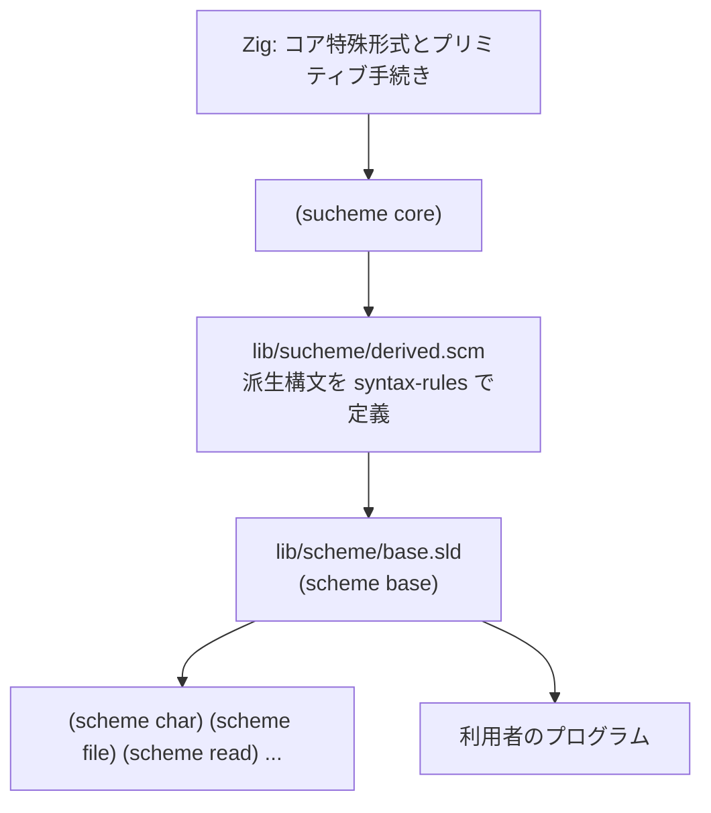

# フロントエンド設計

リーダ、構文環境、衛生的マクロ展開器、`syntax-rules`、ライブラリシステム、標準ライブラリの起動順序を扱う。

対応する決定: [ADR-0005](../adr/0005-hygienic-expander-by-renaming.md)、[ADR-0006](../adr/0006-library-system-and-scheme-level-stdlib.md)。

## リーダ

外部表現を読んでデータを構築する。R7RS 7.1.2 の形式文法に対応させる。

| 分類 | 対応する記法 |
| --- | --- |
| コメント | `;` 行末まで、`#|` と `|#` の入れ子可能なブロック、`#;` によるデータ単位のコメント |
| 真偽値 | `#t` `#true` `#f` `#false` |
| 数値 | 基数接頭辞 `#b` `#o` `#d` `#x`、正確性接頭辞 `#e` `#i`、分数、小数、指数、`+inf.0` `-inf.0` `+nan.0` `-nan.0`、複素数 |
| 文字 | `#\a`、名前付き文字9種(`alarm` `backspace` `delete` `escape` `newline` `null` `return` `space` `tab`)、`#\x` に続く16進 |
| 文字列 | `\a \b \t \n \r \" \\ \|`、`\x` に続く16進とセミコロン、行継続 |
| 識別子 | 通常の識別子、特殊初期文字、`|` で囲んだ記法 |
| リスト | `(...)`、`[...]` は使わない、ドット対 |
| ベクタ | `#(...)` |
| バイトベクタ | `#u8(...)` |
| 略記 | `'` `` ` `` `,` `,@` |
| データラベル | `#0=` と `#0#` による循環構造 |

識別子の大文字と小文字は区別する(R7RS 2.1)。

文字列のエスケープに `\|` を含めるのは R7RS 7.1.1 の `<string element>` の生成規則に従うためである。同規則は `<mnemonic escape>` と `\"` と `\\` と `\|` を列挙している。`\|` は縦棒で囲んだ識別子の記法と字面が重なるが、文字列の要素としても規定されている。

名前付き文字は R7RS 7.1.1 の `<character name>` の生成規則どおり9種である。1つでも落とすと準拠しない。

段階1で実装するのは、行コメント、真偽値、10進の整数、識別子、文字列の基本エスケープ、リスト、ベクタ、`'` の略記に限る。残りは段階4と段階5で追加する。未対応の記法は「段階Nで対応予定」と明示したエラーを返し、黙って誤読しないようにする。

### 位置情報

エラーメッセージのために、ポートから読んだ各ペアの行と桁を副表(`*Pair` をキーにしたハッシュ表)に記録する。`Pair` 本体を太らせないため副表とする。マクロ展開後は対応が失われるので、展開器は展開元のフォームの位置を引き継ぐ努力をするが、完全性は求めない。

### 逐次読み取り

REPL は「入力が完結したか」を知る必要がある。リーダは不足を表す専用の結果(`.incomplete`)を返し、REPL はそれを見て継続行を促す。括弧の数を数える方式では、文字列やブロックコメントの中の括弧で誤判定するため採用しない。

## 構文環境と識別子

展開器の中心となるデータは構文環境である。構文環境は識別子から意味(denotation)への写像である。

```zig
pub const Denotation = union(enum) {
    special: SpecialForm,       // quote, if, lambda, define, ...
    macro: *Macro,              // 変換子とその定義環境
    local: *LocalBinding,       // 一意な識別を持つ局所束縛
    global: *GlobalCell,
    pattern_variable: *PatternVar, // syntax-rules の展開中のみ
};

pub const LocalBinding = struct {
    header: Header,
    level: u16, // この束縛を導入した rib の絶対深さ
    index: u16, // rib 内の位置
};

pub const SyntaxEnv = struct {
    header: Header,
    parent: ?*SyntaxEnv,
    level: u16,          // この環境の rib の絶対深さ
    bindings: []Binding, // 多くの場合少数なので線形探索
};

pub const Binding = struct {
    id: Identifier,
    denotation: Denotation,
    imported: bool, // 真ならこのライブラリは所有者ではない(後述)
};
```

`local` が深さと添字の組ではなく `*LocalBinding` へのポインタであることが重要である。深さは利用側からの相対値なので、別々の字句環境にある無関係な束縛がどちらも `{0, 0}` になりうる。意味の同一性をこの組で判定すると、同名だが別束縛の識別子を同じ意味と誤判定し、`syntax-rules` のリテラル照合が壊れる。

`LocalBinding` は束縛ごとに1つ確保し、同一性はポインタの一致で判定する。コアIRに出す相対深さは、利用側の `SyntaxEnv.level` から `LocalBinding.level` を引いて求める。

`imported` を `Denotation` の中ではなく `Binding` に置くのは、インポートできるのが変数だけではないためである。`(scheme base)` は `if` や `lambda` や `quote` のような特殊形式も、`when` や `cond` のようなマクロもエクスポートする。意味の種類に関わらず所有関係を表せる位置に置く。

識別子は素のシンボルか、別名(alias)である。

```zig
pub const Alias = struct {
    header: Header,
    inner: Value,       // 包んでいる識別子。素のシンボルか、さらに外側の展開由来の別名
    env: *SyntaxEnv,    // この識別子を解決すべき環境(マクロの定義環境)
    marker: u64,        // 同一の展開で導入された識別子を区別する印
};
```

`inner` が `Symbol` ではなく `Value` であることが重要である。入れ子になったマクロ展開では別名が別名を包むため、1段ずつ剥がせる構造でなければ解決規則が停止しない(後述)。元の名前は `inner` を最内まで辿って得る。

別名は `Value` の一種としてデータの中に現れうる。マクロ展開の出力は通常のデータであり、その中に別名が混ざった状態で再び展開器に渡されるからである。

別名は展開時にのみ存在し、CEK機械には到達しない。コアIRを作る時点で、変数参照は意味に解決され、`quote` の中の別名は元のシンボルに剥離される(後述)。したがって `symbol?` などの実行時の述語が別名を見ることはない。これを不変条件として守る。

### 解決規則

```
resolve(id, env):
    e = env
    while e != null:
        if e に id と同一性が一致する束縛がある: return その意味
        e = e.parent
    if id が別名である: return resolve(id.inner, id.env)   // 1段剥がして委譲する
    return グローバル環境で id.symbol を引く
```

委譲するのは `id` ではなく `id.inner` である。マクロが導入した別名は定義環境に束縛を持たないのが通常であり、`id` のまま委譲すると同じ分岐に戻って停止しない。`inner` を渡せば1回の委譲で別名の層が1つ減るため、有限回で素のシンボルに到達して必ず停止する。マクロが導入した `if` のような自由な参照は、この経路で定義環境の意味に解決される。

同一性の一致は、素のシンボルなら名前の一致、別名なら `inner` の同一性と `marker` と `env` の一致とする。これが衛生性の要になる。

- マクロが導入した識別子は `marker` が利用側のものと異なるため、利用側の同名の束縛に捕捉されない。
- マクロが導入した識別子が利用側で束縛されなかった場合、再帰的に `id.env`(マクロの定義環境)で解決されるため、定義時の意味を保つ(参照透明性)。
- マクロが導入した束縛構文が束縛するのは別名そのものなので、本体中の同じ別名だけがその束縛を見る。

### 識別子の比較

- `free-identifier=?` に相当する比較: それぞれの環境での意味が同一なら等しい。どちらも未束縛なら元のシンボル名が等しければ等しい。`syntax-rules` のリテラル照合はこの比較を使う(R7RS 4.3.2)。これにより、利用側が `else` を再束縛している場合にリテラル `else` が照合しなくなるという規定が満たされる。
- `bound-identifier=?` に相当する比較: 名前と `marker` と `env` が一致する場合のみ等しい。`lambda` の引数リストの重複検査などに使う。

### quote による剥離

`quote` の中に現れた別名は、コアIRの定数にする時点で元のシンボルに戻す(剥離する)。マクロが導入した識別子を `quote` した結果は元の名前のシンボルでなければならないためである。

剥離は単純な再帰走査にしてはならない。データラベル(R7RS 2.4)で作った循環データを `quote` できるため、再帰では停止しない。また共有構造を複製すると `eq?` で観測できる同一性が変わってしまう。

訪問済みオブジェクトの対応表を使うグラフ走査とする。

1. 第1走査で、別名を含む部分グラフがあるかを調べる。含まなければ元のオブジェクトをそのまま定数にする。複製しないので同一性が保たれ、よくある場合の費用もかからない。
2. 別名を含む場合は、オブジェクトの同一性をキーにした対応表を使って写しを作る。ペアやベクタは先に中身を未確定で確保して対応表に登録し、そのうえで要素を埋める。これにより循環を同じ形で再現できる。
3. 同じオブジェクトに2回到達したら対応表の値を返す。共有が共有として保たれる。
4. 対応表は走査の間だけ使う作業領域である。GC のルートとして登録する。

この規則により、循環と共有を保ったまま別名だけが剥離される。循環データの `quote` と、共有構造の同一性が保たれることをテストに含める。

## 展開器

```mermaid
flowchart TB
    form[フォーム] --> head{先頭の意味}
    head -->|special| core[コアIRに変換]
    head -->|macro| expand[変換子を適用して再展開]
    head -->|local / global / 非識別子| call[呼び出しに変換]
    expand --> form
    core --> out[コアIR]
    call --> out
```

展開器はフォームと構文環境を受け取り、コアIRを返す。マクロ適用のたびに新しい `marker` を割り当てる。

展開器が扱う構文は次のとおり。

| 構文 | 扱い |
| --- | --- |
| `quote` `if` `lambda` `set!` `define` `begin` | コアIRに直接変換する |
| `define-syntax` `let-syntax` `letrec-syntax` | 構文環境にマクロ束縛を追加し、コアIRには何も出さない |
| `syntax-rules` | 変換子オブジェクトを作る |
| `define-library` `import` `export` `include` `include-ci` `include-library-declarations` `cond-expand` | ライブラリ処理に委譲する |
| `define-values` `define-record-type` `case-lambda` などの派生構文 | Scheme 側の `syntax-rules` で定義する |

内部定義の扱いは `letrec*` 意味論に従う(R7RS 5.3.2)。本体の先頭から `define` と `define-syntax` を集め、`define-syntax` を先に構文環境へ入れてから、`define` のスロットを確保する。マクロ展開によって新たな `define` が現れる可能性があるため、本体の走査は展開と交互に行う。

### 変換子の実行

`syntax-rules` の変換子は Zig で実行する。将来 `er-macro-transformer` のような Scheme の手続きを変換子にできるようにする場合、変換子の実行は Scheme 手続きの呼び出しになるため、展開器を機械の継続フレームとして表現する必要がある。段階2ではその拡張を想定した関数境界を作るが、実装は `syntax-rules` のみとする。

## syntax-rules

R7RS 4.3.2 の全機能を実装する。

```
(syntax-rules (<literal>...) <rule>...)
(syntax-rules <ellipsis> (<literal>...) <rule>...)
<rule> = (<pattern> <template>)
```

実装しなければならない要件を列挙する。これらは個別のテストケースに対応させる。

- パターン変数、`_`(何にでも照合し束縛しない)、リテラル(意味の一致で照合)
- 省略記号による0回以上の繰り返し
- 省略記号の入れ子(深さ2以上)
- 省略記号の後に固定パターンを置く形 `(<p>... <p1> <p2> . <pr>)`。R5RS から R7RS で拡張された部分
- 非真正リストのパターンとテンプレート
- ベクタのパターンとテンプレート
- テンプレート中の `(<ellipsis> <template>)` による省略記号のエスケープ
- 利用者指定の省略記号識別子
- テンプレートに現れるパターン変数以外の識別子の自動別名化
- マクロを定義するマクロ、`letrec-syntax` による再帰的マクロ

照合はパターン変数名から、深さと値の木への写像を作る。テンプレート展開はその写像を深さに沿って展開する。パターン変数の出現深さとテンプレート中の省略記号の深さが一致しない場合は構文エラーとする。

### 衛生性の検証項目

次の古典的な事例をテストとして持つ。実装の正しさはこれらで判定する。

1. `swap!` マクロが、利用側の `tmp` という変数を壊さない
2. `my-or` マクロが、利用側の `t` という変数を壊さない
3. 利用側が `if` を再束縛していても、マクロ内の `if` は本来の意味を保つ
4. `let-syntax` の本体で、マクロ定義側だけが見える手続きをテンプレートが参照できる
5. 利用側が `else` を束縛している場合、`cond` のリテラル `else` が照合しない
6. マクロを定義するマクロで、内側のマクロの衛生性が保たれる
7. 省略記号のエスケープが、入れ子マクロのテンプレート生成で正しく働く
8. 入れ子の同名束縛がリテラルに一致しない。別々の字句環境にある同名の局所束縛を、意味の同一性で誤って同じと判定しないことを確かめる
9. 循環データと共有構造を `quote` したとき、剥離が停止し、循環と `eq?` による同一性が保たれる

## ライブラリシステム

### 表現

```zig
pub const Library = struct {
    header: Header,
    name: Value,            // シンボルと非負正確整数のリスト
    exports: *ExportTable,  // 外部名 -> Export
    env: *SyntaxEnv,        // ライブラリ本体の構文環境
    state: enum { unloaded, loading, loaded },
};

pub const Export = struct {
    denotation: Denotation, // 種類を問わない
    imported: bool,         // 真なら再エクスポートであり所有していない
};
```

エクスポート表が保持するのは `Denotation` そのものであり、変数のセルやマクロに限らない。`(scheme base)` は `if` `lambda` `quote` `define` `set!` `begin` `define-syntax` のような特殊形式もエクスポートするため、これらを `import` し、`rename` し、再エクスポートできなければ準拠しない。意味の種類を問わない形にすることで、特殊形式とマクロと変数を同じ仕組みで扱える。

`import` は変数についてはセルを共有する。値をコピーしないため、エクスポート元での再定義がインポート側に反映される。読み込み中のライブラリを再び読み込もうとした場合は循環インポートのエラーとする。

インポート集合は `only` `except` `prefix` `rename` と、それらの入れ子に対応する(R7RS 5.6.1)。

### インポートした束縛への書き込みの禁止

R7RS 5.2 は次を規定している。

> In a program or library declaration, it is an error to import the same identifier more than once with different bindings, or to redefine or mutate an imported binding with a definition or with set!

したがってセルを共有するだけでは不十分である。所有している束縛とインポートした束縛を区別できる状態が必要である。

区別は `Binding.imported` と `Export.imported` が担う。`Denotation` の中ではなく束縛の側に置くのは、インポートできるのが変数だけではないためである。特殊形式やマクロをインポートした場合も、それらに対する `define-syntax` を拒否できなければならない。

展開器は次を構文エラーとして拒否する。

- `imported` が真の束縛に対する `define` `define-syntax` `set!`
- 意味が `special` または `macro` である識別子に対する `set!`(R7RS 4.1.6 は `set!` の対象を変数に限る)
- 同じ識別子を異なる束縛で2回インポートすること。`import` の処理時に検出する

読み取りはセルを共有したままなので、エクスポート元での再定義がインポート側に反映されるという利点は保たれる。

### 探索とパス名への対応付け

R7RS 5.6.1 はライブラリ名を「識別子と正確な非負整数のリスト」と定め、ファイルに格納する処理系は名前から位置への対応付けを文書化すべきとしている。本処理系の対応付けを次のとおり定める。

ライブラリ名 `(foo bar)` はファイル `foo/bar.sld` に対応させる。探索パスは、ネイティブでは埋め込みの仮想ファイルシステムを先に見てから実ファイルシステム、WASM では埋め込みのみとする。

識別子は縦棒で囲む記法によって任意の文字を含みうるため、名前の成分をそのままパス成分にしてはならない。`(|../../etc| passwd)` のような名前が探索ルートの外を指す経路になる。次の規則で防ぐ。

1. 成分の検証: 各成分が `A` から `Z`、`a` から `z`、`0` から `9`、`-`、`_`、`+`、`.` のみからなり、`.` で始まらず、`.` または `..` に一致しないことを確認する。正確な非負整数の成分は10進表記に変換する。
   さらに次を拒否する。これらは上の文字集合を通過するが、通常のファイルを開くという前提を満たさない。
   - `.` または空白で終わる成分。Windows は末尾の `.` と空白を取り除いて解決するため、別の名前のファイルに当たる。
   - 最初の `.` より前の部分が Windows の予約デバイス名に一致する成分。大文字小文字を区別せずに判定する。対象は `CON` `PRN` `AUX` `NUL` `COM1` から `COM9` と `LPT1` から `LPT9`、および `CONIN$` と `CONOUT$` である。拡張子を付けてもデバイスまたはその別名に解決されうるため、`CON.scm` のような形も拒否する。
   - 判定はビルド対象の OS によらず常に行う。対象 OS ごとに通る名前が変わると、同じライブラリ名が環境によって読めたり読めなかったりして再現性を失う。
2. 条件を満たさない成分: その名前をファイルに対応付けない。埋め込みの仮想ファイルシステムと実行時に登録されたライブラリのみを探索対象とし、ファイル探索は行わない。エラーメッセージには元の名前を表示する。
3. 字句的な正規化: 組み立てたパスを正規化し、設定済みの探索ルート配下にあることを確認する。配下でなければ探索しない。
4. 実体の確認: 字句的な正規化だけでは足りない。探索ルート内にあるシンボリックリンクや Windows の junction や reparse point がルート外を指していれば、正規化後のパスはルート配下に見えたまま外部のファイルを開ける。次のいずれかを行う。
   - 探索ルートのディレクトリハンドルから成分を1つずつ辿り、リンクと reparse point の追跡を禁止する。追跡が必要な成分に出会ったら探索を打ち切る。
   - 開いたファイルハンドルから実体のパスを取得し、探索ルートの実体のパス配下にあることを確認する。開く前のパス文字列で確認すると、確認と開く操作の間に経路が差し替えられる余地が残るため、必ず開いたハンドルから確認する。
   前者を優先する。後者を採る場合は、確認に失敗したらハンドルを閉じて内容を読まない。
5. 大文字と小文字: 識別子は大文字と小文字を区別するが、ファイルシステムは区別しない場合がある。異なる名前が同一のファイルに解決されうるため、読み込んだファイルの `define-library` の名前が要求した名前と一致することを確認する。

この検証は外部入力の取り扱いに相当する。`AGENTS.md` のセキュリティの節に従い、ファイルパスを組み立てる箇所を1つの関数に閉じ、そこで検証する。実装時に Zig 0.17.0 でリンクの追跡を禁止して開く手段を確認し、結果を [zig-api-notes.md](zig-api-notes.md) に記録する。

### cond-expand のフィーチャ

| フィーチャ | 条件 |
| --- | --- |
| `r7rs` | 常に真 |
| `sucheme` | 常に真 |
| `exact-closed` `ratios` `exact-complex` `ieee-float` `full-unicode` | 段階4の完了により真になる |
| `windows` `linux` `macos` `posix` | ビルドターゲットに応じる |
| `wasm` | WASM ビルドで真 |
| `little-endian` `big-endian` | ターゲットのエンディアンに応じる |
| `sucheme-0.1` のようなバージョン | ビルド時のバージョンに応じる |

`library` 形式による存在判定にも対応する(R7RS 4.2.1)。

## 標準ライブラリの起動順序

「コア言語で表現できるものはコア言語で書く」方針([ADR-0006](../adr/0006-library-system-and-scheme-level-stdlib.md))に従い、Zig で書くのは最小限にとどめる。



`(sucheme core)` は内部用のライブラリで、コアの特殊形式と Zig で書いたプリミティブのみを公開する。利用者には公開しない。

Scheme で書く範囲の目安は次のとおり。

| Zig で書くもの | Scheme で書くもの |
| --- | --- |
| コア特殊形式、`syntax-rules`、リーダ、プリンタ | 派生構文(`let` `let*` `letrec` `cond` `case` `and` `or` `when` `unless` `do` `quasiquote` `delay` `guard` `parameterize` `define-record-type` `case-lambda` `let-values` など) |
| 算術の核、`car` `cdr` `cons` `set-car!` など基本操作 | `caar` から `cddddr` までの合成、`list-tail` `list-ref` `assoc` `member` `append` `map` `for-each` `fold` 相当 |
| 文字列とベクタの基本操作、ポートの入出力 | `string-for-each` `vector-map` `vector-for-each` `string-map` など高階手続き |
| `call/cc` `dynamic-wind` `values` `raise` | `call-with-values` を使う便利手続き、`guard`、`assert` |
| Unicode 表、数値の表示と解析 | 数値手続きのうち基本演算で書けるもの |

`map` と `for-each` を Scheme で書くと末尾呼び出しと継続の相互作用が自動的に正しくなる。性能が問題になった段階で Zig 側へ移すが、その場合も継続フレームを積む形で実装し、プリミティブの中で機械を起動しないという不変条件を守る。

### 埋め込み

`build.zig` が `lib/` 以下を走査して、`@embedFile` の一覧とパスの索引を持つ Zig ソースを生成する。走査結果はパス名でソートして再現可能なビルドにする。ネイティブと WASM で同じ仕組みを使う。
