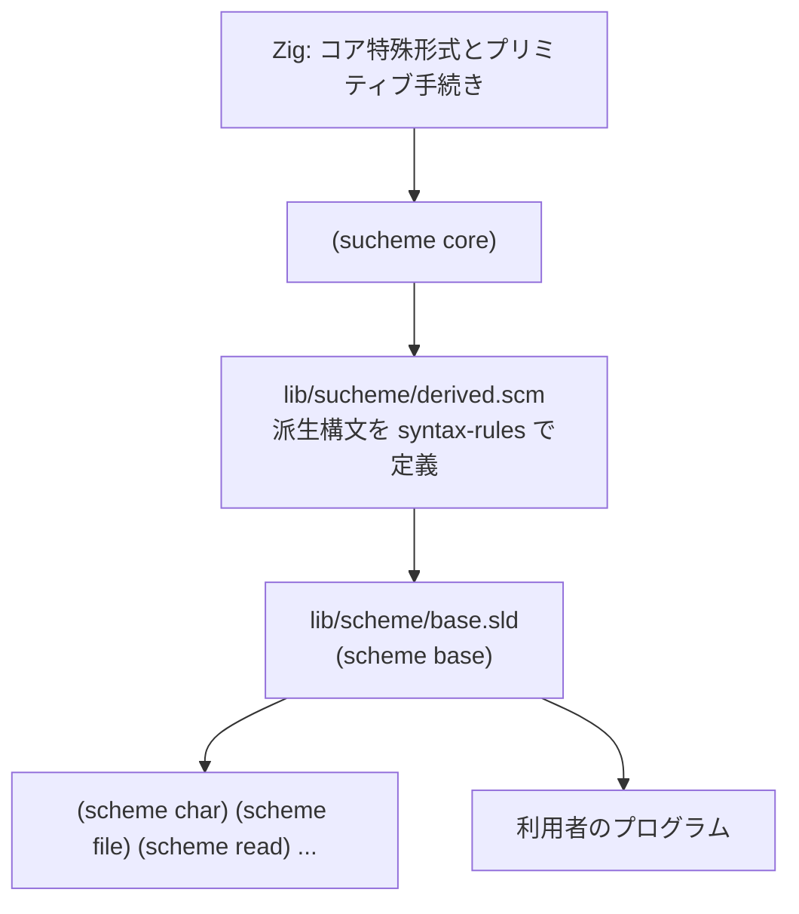

# フロントエンド設計

リーダ、構文環境、衛生的マクロ展開器、`syntax-rules`、ライブラリシステム、標準ライブラリの起動順序を扱う。

対応する決定: [ADR-0005](../adr/0005-hygienic-expander-by-renaming.md)、[ADR-0006](../adr/0006-library-system-and-scheme-level-stdlib.md)。

## リーダ

外部表現を読んでデータを構築する。R7RS 7.1.2 の形式文法に対応させる。

| 分類 | 対応する記法 |
| --- | --- |
| コメント | `;` 行末まで、`#|` と `|#` の入れ子可能なブロック、`#;` によるデータ単位のコメント |
| 真偽値 | `#t` `#true` `#f` `#false` |
| 数値 | 基数接頭辞 `#b` `#o` `#d` `#x`、正確性接頭辞 `#e` `#i`、分数、小数、指数、`+inf.0` `-inf.0` `+nan.0` `-nan.0`、複素数 |
| 文字 | `#\a`、名前付き文字9種(`alarm` `backspace` `delete` `escape` `newline` `null` `return` `space` `tab`)、`#\x` に続く16進 |
| 文字列 | `\a \b \t \n \r \" \\ \|`、`\x` に続く16進とセミコロン、行継続 |
| 識別子 | 通常の識別子、特殊初期文字、`|` で囲んだ記法 |
| リスト | `(...)`、`[...]` は使わない、ドット対 |
| ベクタ | `#(...)` |
| バイトベクタ | `#u8(...)` |
| 略記 | `'` `` ` `` `,` `,@` |
| データラベル | `#0=` と `#0#` による循環構造 |
| 指令 | `#!fold-case` と `#!no-fold-case` |

識別子の大文字と小文字は区別する(R7RS 2.1)。

文字列のエスケープに `\|` を含めるのは R7RS 7.1.1 の `<string element>` の生成規則に従うためである。同規則は `<mnemonic escape>` と `\"` と `\\` と `\|` を列挙している。`\|` は縦棒で囲んだ識別子の記法と字面が重なるが、文字列の要素としても規定されている。

名前付き文字は R7RS 7.1.1 の `<character name>` の生成規則どおり9種である。1つでも落とすと準拠しない。

### ケースフォールディング

リーダはポートごとに「識別子と文字名を畳み込むか」の状態を持つ。既定は畳み込まない(大文字小文字を区別する)。

`#!fold-case` と `#!no-fold-case` はこの状態を切り替える指令である。R7RS 7.1.1 は `<directive>` を `<atmosphere>` の構成要素として定義しており、2.1 は「These directives can appear anywhere comments are permitted ... They are treated as comments, except that they affect the reading of subsequent data from the same port.」と規定している。したがってコメントが書ける場所すべてに現れうる。

畳み込みの対象は識別子と文字名である。R7RS 2.1 の原文は次のとおり。

> The #!fold-case directive causes subsequent identifiers and character names to be case-folded as if by string-foldcase (see section 6.7). It has no effect on character literals. The #!no-fold-case directive causes a return to the default, non-folding behavior.

畳み込まれないのは文字リテラル(`#\A`)である。文字名(`#\NEWLINE`)は畳み込まれるので、`#!fold-case` のもとでは `#\NEWLINE` が `#\newline` と同じ改行文字になる。文字列と数値も影響を受けない。畳み込みには `string-foldcase` と同じケースフォールディングを使う([numerics-and-unicode.md](numerics-and-unicode.md))。

指令の直後には区切りが必要である。R7RS 7.1.1 の注が「it is ungrammatical to follow a ⟨directive⟩ with anything but a ⟨delimiter⟩ or the end of file」としているため、`#!fold-casex` を指令と識別子 `x` の並びとして受理してはならない。読み取りエラーにする。

`include-ci` はこの機構の上に実装する。R7RS 4.1.7 が「include-ci reads each file as if it began with the #!fold-case directive」と規定しているため、対象ファイルを読むポートの初期状態を畳み込む側にするだけで実現できる。`include-ci` を扱うと宣言しておきながらこの機構を持たないと、`(DEFINE X 1)` を含むファイルが未束縛識別子の構文エラーになる。

### 段階ごとの実装範囲

| 段階 | 追加する記法 |
| --- | --- |
| 1 | 行コメント、真偽値、10進の整数、識別子、文字列の基本エスケープ、リスト、ベクタ、`'` の略記 |
| 3 | `` ` `` `,` `,@` の略記、文字リテラル(`#\a` と名前付き文字9種) |
| 4 | 基数接頭辞、正確性接頭辞、分数、小数、指数、`+inf.0` 系、複素数 |
| 5 | ブロックコメント、`#;`、データラベル、縦棒で囲んだ識別子、`#u8`、16進エスケープ、`#!fold-case` 指令 |

段階3に `` ` `` と `,` と `,@` を置くのは、段階3で `quasiquote` を `syntax-rules` で定義するためである。略記が読めないと `` `(1 ,x) `` を含むテストが書けない。文字リテラルも同じ段階で必要になる。

未対応の記法は「段階Nで対応予定」と明示したエラーを返し、黙って誤読しないようにする。

### 位置情報

エラーメッセージのために、ポートから読んだ各ペアの行と桁を副表(`*Pair` をキーにしたハッシュ表)に記録する。`Pair` 本体を太らせないため副表とする。

この副表は1つのトップレベルフォームを読んでから展開し終えるまでの作業表である。その間はルートとして登録し、展開が終わったら破棄する。実行時にも位置が必要なものは、展開器がコアIR節点の `src` に複製する。寿命と帰属の根拠は [runtime.md](runtime.md) の位置情報の寿命にある。

永続的な副表にすると、ルートとして扱えば REPL が読んだデータを恒久的に生存させ、扱わなければ回収後に鍵のアドレスが再利用されて無関係な位置を指す。どちらも避ける。

マクロ展開後は対応が失われるので、展開器は展開元のフォームの位置を引き継ぐ努力をするが、完全性は求めない。

### 逐次読み取り

REPL は「入力が完結したか」を知る必要がある。リーダは不足を表す専用の結果(`.incomplete`)を返し、REPL はそれを見て継続行を促す。括弧の数を数える方式では、文字列やブロックコメントの中の括弧で誤判定するため採用しない。

## 構文環境と識別子

展開器の中心となるデータは構文環境である。構文環境は識別子から意味(denotation)への写像である。

```zig
pub const Denotation = union(enum) {
    special: SpecialForm,       // quote, if, lambda, define, ...
    macro: *Macro,              // 変換子とその定義環境
    local: *LocalBinding,       // 一意な識別を持つ局所束縛
    global: *GlobalCell,
    pattern_variable: *PatternVar, // syntax-rules の展開中のみ
};

pub const LocalBinding = struct {
    header: Header,
    level: u16, // この束縛を導入した rib の絶対深さ
    index: u16, // rib 内の位置
};

pub const SyntaxEnv = struct {
    header: Header,
    parent: ?*SyntaxEnv,
    level: u16,          // この環境の rib の絶対深さ
    bindings: []Binding, // 多くの場合少数なので線形探索
};

pub const Binding = struct {
    id: Identifier,
    denotation: Denotation,
    imported: bool, // 真ならこのライブラリは所有者ではない(後述)
};
```

`local` が深さと添字の組ではなく `*LocalBinding` へのポインタであることが重要である。深さは利用側からの相対値なので、別々の字句環境にある無関係な束縛がどちらも `{0, 0}` になりうる。意味の同一性をこの組で判定すると、同名だが別束縛の識別子を同じ意味と誤判定し、`syntax-rules` のリテラル照合が壊れる。

`LocalBinding` は束縛ごとに1つ確保し、同一性はポインタの一致で判定する。コアIRに出す相対深さは、利用側の `SyntaxEnv.level` から `LocalBinding.level` を引いて求める。

`imported` を `Denotation` の中ではなく `Binding` に置くのは、インポートできるのが変数だけではないためである。`(scheme base)` は `if` や `lambda` や `quote` のような特殊形式も、`when` や `cond` のようなマクロもエクスポートする。意味の種類に関わらず所有関係を表せる位置に置く。

識別子は素のシンボルか、別名(alias)である。

```zig
pub const Alias = struct {
    header: Header,
    inner: Value,       // 包んでいる識別子。素のシンボルか、さらに外側の展開由来の別名
    env: *SyntaxEnv,    // この識別子を解決すべき環境(マクロの定義環境)
    marker: u64,        // 同一の展開で導入された識別子を区別する印
};
```

`inner` が `Symbol` ではなく `Value` であることが重要である。入れ子になったマクロ展開では別名が別名を包むため、1段ずつ剥がせる構造でなければ解決規則が停止しない(後述)。元の名前は `inner` を最内まで辿って得る。

別名は `Value` の一種としてデータの中に現れうる。マクロ展開の出力は通常のデータであり、その中に別名が混ざった状態で再び展開器に渡されるからである。

別名は展開時にのみ存在し、CEK機械には到達しない。コアIRを作る時点で、変数参照は意味に解決され、`quote` の中の別名は元のシンボルに剥離される(後述)。したがって `symbol?` などの実行時の述語が別名を見ることはない。これを不変条件として守る。

### 解決規則

```
resolve(id, env):
    e = env
    while e != null:
        if e に id と同一性が一致する束縛がある: return その意味
        e = e.parent
    if id が別名である: return resolve(id.inner, id.env)   // 1段剥がして委譲する
    return グローバル環境で id.symbol を引く
```

委譲するのは `id` ではなく `id.inner` である。マクロが導入した別名は定義環境に束縛を持たないのが通常であり、`id` のまま委譲すると同じ分岐に戻って停止しない。`inner` を渡せば1回の委譲で別名の層が1つ減るため、有限回で素のシンボルに到達して必ず停止する。マクロが導入した `if` のような自由な参照は、この経路で定義環境の意味に解決される。

同一性の一致は、素のシンボルなら名前の一致、別名なら `inner` の同一性と `marker` と `env` の一致とする。これが衛生性の要になる。

- マクロが導入した識別子は `marker` が利用側のものと異なるため、利用側の同名の束縛に捕捉されない。
- マクロが導入した識別子が利用側で束縛されなかった場合、再帰的に `id.env`(マクロの定義環境)で解決されるため、定義時の意味を保つ(参照透明性)。
- マクロが導入した束縛構文が束縛するのは別名そのものなので、本体中の同じ別名だけがその束縛を見る。

### 識別子の比較

- `free-identifier=?` に相当する比較: それぞれの環境での意味が同一なら等しい。どちらも未束縛なら元のシンボル名が等しければ等しい。`syntax-rules` のリテラル照合はこの比較を使う(R7RS 4.3.2)。これにより、利用側が `else` を再束縛している場合にリテラル `else` が照合しなくなるという規定が満たされる。
- `bound-identifier=?` に相当する比較: 名前と `marker` と `env` が一致する場合のみ等しい。`lambda` の引数リストの重複検査などに使う。

### quote による剥離

`quote` の中に現れた別名は、コアIRの定数にする時点で元のシンボルに戻す(剥離する)。マクロが導入した識別子を `quote` した結果は元の名前のシンボルでなければならないためである。

剥離は単純な再帰走査にしてはならない。データラベル(R7RS 2.4)で作った循環データを `quote` できるため、再帰では停止しない。また共有構造を複製すると `eq?` で観測できる同一性が変わってしまう。

訪問済みオブジェクトの対応表を使うグラフ走査とする。

1. 第1走査で、別名を含む部分グラフがあるかを調べる。含まなければ元のオブジェクトをそのまま定数にする。複製しないので同一性が保たれ、よくある場合の費用もかからない。
2. 別名を含む場合は、オブジェクトの同一性をキーにした対応表を使って写しを作る。ペアやベクタは先に中身を未確定で確保して対応表に登録し、そのうえで要素を埋める。これにより循環を同じ形で再現できる。
3. 同じオブジェクトに2回到達したら対応表の値を返す。共有が共有として保たれる。
4. 対応表は走査の間だけ使う作業領域である。GC のルートとして登録する。

この規則により、循環と共有を保ったまま別名だけが剥離される。循環データの `quote` と、共有構造の同一性が保たれることをテストに含める。

## 展開器

```mermaid
flowchart TB
    form[フォーム] --> head{先頭の意味}
    head -->|special| core[コアIRに変換]
    head -->|macro| expand[変換子を適用して再展開]
    head -->|local / global / 非識別子| call[呼び出しに変換]
    expand --> form
    core --> out[コアIR]
    call --> out
```

展開器はフォームと構文環境を受け取り、コアIRを返す。マクロ適用のたびに新しい `marker` を割り当てる。

展開器が扱う構文は次のとおり。

| 構文 | 扱い |
| --- | --- |
| `quote` `if` `lambda` `set!` `define` `begin` | コアIRに直接変換する |
| `define-syntax` `let-syntax` `letrec-syntax` | 構文環境にマクロ束縛を追加し、コアIRには何も出さない |
| `syntax-rules` | 変換子オブジェクトを作る |
| `define-library` `import` `export` `begin` `include` `include-ci` `include-library-declarations` `cond-expand` | ライブラリ処理に委譲する。`begin` はライブラリ宣言としての `begin` であり、式としての `begin` とは別経路 |
| `define-values` `define-record-type` `case-lambda` などの派生構文 | Scheme 側の `syntax-rules` で定義する |

内部定義の扱いは `letrec*` 意味論に従う(R7RS 5.3.2)。本体の先頭から `define` と `define-syntax` を集め、`define-syntax` を先に構文環境へ入れてから、`define` のスロットを確保する。マクロ展開によって新たな `define` が現れる可能性があるため、本体の走査は展開と交互に行う。

### 変換子の実行

`syntax-rules` の変換子は Zig で実行する。将来 `er-macro-transformer` のような Scheme の手続きを変換子にできるようにする場合、変換子の実行は Scheme 手続きの呼び出しになるため、展開器を機械の継続フレームとして表現する必要がある。段階2ではその拡張を想定した関数境界を作るが、実装は `syntax-rules` のみとする。

## syntax-rules

R7RS 4.3.2 の全機能を実装する。

```
(syntax-rules (<literal>...) <rule>...)
(syntax-rules <ellipsis> (<literal>...) <rule>...)
<rule> = (<pattern> <template>)
```

実装しなければならない要件を列挙する。これらは個別のテストケースに対応させる。

- パターン変数、`_`(何にでも照合し束縛しない)、リテラル(意味の一致で照合)
- 省略記号による0回以上の繰り返し
- 省略記号の入れ子(深さ2以上)
- 省略記号の後に固定パターンを置く形 `(<p>... <p1> <p2> . <pr>)`。R5RS から R7RS で拡張された部分
- 非真正リストのパターンとテンプレート
- ベクタのパターンとテンプレート
- テンプレート中の `(<ellipsis> <template>)` による省略記号のエスケープ
- 利用者指定の省略記号識別子
- テンプレートに現れるパターン変数以外の識別子の自動別名化
- マクロを定義するマクロ、`letrec-syntax` による再帰的マクロ
- 定数パターン。パターンが定数のとき、入力が `equal?` の意味で等しければ照合する(R7RS 4.3.2「P is a constant and E is equal to P in the sense of the equal? procedure」)
- `_` をリテラル一覧に置いた場合は、ワイルドカードではなくリテラルとして照合する(R7RS 4.3.2「If an underscore appears in the ⟨pattern literal⟩s list, then that takes precedence and underscores in the ⟨pattern⟩ match as literals」)
- 省略記号の識別子をリテラル一覧に置いた場合は、繰り返しではなくリテラルとして照合する(R7RS 4.3.2「unless ⟨ellipsis⟩ appears in the ⟨pattern literal⟩s, in which case it is matched as a literal」)

照合はパターン変数名から、深さと値の木への写像を作る。テンプレート展開はその写像を深さに沿って展開する。パターン変数の出現深さとテンプレート中の省略記号の深さが一致しない場合は構文エラーとする。

### 衛生性の検証項目

次の古典的な事例をテストとして持つ。実装の正しさはこれらで判定する。

1. `swap!` マクロが、利用側の `tmp` という変数を壊さない
2. `my-or` マクロが、利用側の `t` という変数を壊さない
3. 利用側が `if` を再束縛していても、マクロ内の `if` は本来の意味を保つ
4. `let-syntax` の本体で、マクロ定義側だけが見える手続きをテンプレートが参照できる
5. 利用側が `else` を束縛している場合、`cond` のリテラル `else` が照合しない
6. マクロを定義するマクロで、内側のマクロの衛生性が保たれる
7. 省略記号のエスケープが、入れ子マクロのテンプレート生成で正しく働く
8. 入れ子の同名束縛がリテラルに一致しない。別々の字句環境にある同名の局所束縛を、意味の同一性で誤って同じと判定しないことを確かめる
9. 循環データと共有構造を `quote` したとき、剥離が停止し、循環と `eq?` による同一性が保たれる

## ライブラリシステム

### 表現

```zig
pub const Library = struct {
    header: Header,
    name: Value,            // シンボルと非負正確整数のリスト
    exports: *ExportTable,  // 外部名 -> Export
    env: *SyntaxEnv,        // ライブラリ本体の構文環境
    state: enum { unloaded, loading, loaded },
};

pub const Export = struct {
    denotation: Denotation, // 種類を問わない
    imported: bool,         // 真なら再エクスポートであり所有していない
};
```

エクスポート表が保持するのは `Denotation` そのものであり、変数のセルやマクロに限らない。`(scheme base)` は `if` `lambda` `quote` `define` `set!` `begin` `define-syntax` のような特殊形式もエクスポートするため、これらを `import` し、`rename` し、再エクスポートできなければ準拠しない。意味の種類を問わない形にすることで、特殊形式とマクロと変数を同じ仕組みで扱える。

`<library declaration>` は R7RS 5.6.1 が7形式を定めている。`(export ...)` `(import ...)` `(begin ...)` `(include ...)` `(include-ci ...)` `(include-library-declarations ...)` `(cond-expand ...)` である。`begin` を落とすと `(define-library (sucheme core) (export x) (begin (define x 1)))` という最も一般的な本体記述が未知の宣言になる。ライブラリ宣言の `begin` は式としての `begin` とは別の経路で処理する。

`import` は変数についてはセルを共有する。値をコピーしないため、エクスポート元での再定義がインポート側に反映される。読み込み中のライブラリを再び読み込もうとした場合は循環インポートのエラーとする。

`<import set>` は R7RS 5.2 で5形式が定義されている。5.6.1 は `define-library` の `import` 宣言が 5.2 と同じ構文と意味を持つと述べている。

| 形式 | 意味 |
| --- | --- |
| `<library name>` | そのライブラリの全エクスポートを同じ名前で取り込む。入れ子の基底ケースである |
| `(only <import set> <identifier>...)` | 列挙した識別子だけに絞る |
| `(except <import set> <identifier>...)` | 列挙した識別子を除く |
| `(prefix <import set> <identifier>)` | すべてに接頭辞を付ける |
| `(rename <import set> (<from> <to>)...)` | 個別に改名する |

第1の形式を落とすと入れ子の再帰に基底ケースがなくなる。`(import (prefix (scheme base) s-))` の内側の `(scheme base)` に到達した時点で未知の形式になる。4つの修飾子だけを数えないこと。

### インポートした束縛への書き込みの禁止

R7RS 5.2 は次を規定している。

> In a program or library declaration, it is an error to import the same identifier more than once with different bindings, or to redefine or mutate an imported binding with a definition or with set!, or to refer to an identifier before it is imported. However, a REPL should permit these actions.

禁止はプログラムとライブラリ宣言の中に限られ、REPL では許すべきとされている。したがってセルを共有するだけでは不十分だが、無条件に拒否するのも誤りである。所有している束縛とインポートした束縛を区別できる状態と、文脈に応じた判定の両方が必要である。

区別は `Binding.imported` と `Export.imported` が担う。`Denotation` の中ではなく束縛の側に置くのは、インポートできるのが変数だけではないためである。特殊形式やマクロをインポートした場合も、それらに対する `define-syntax` を拒否できなければならない。

展開器は、プログラムまたはライブラリ宣言を展開しているときに次を構文エラーとして拒否する。

- `imported` が真の束縛に対する `define` `define-syntax` `set!`
- 意味が `special` または `macro` である識別子に対する `set!`(R7RS 4.1.6 は `set!` の対象を変数に限る)
- 同じ識別子を異なる束縛で2回インポートすること。`import` の処理時に検出する
- インポートされる前の識別子を参照すること

最後の項目を検出するには、ライブラリ宣言を左から右へ順に処理する必要がある。R7RS 5.6.1 は2つの実装を許している。1つは `cond-expand` を展開した後に `import` をすべて処理して環境を作り、そのうえで `begin` と `include` を展開する方式で、この方式では `import` が常に先に処理されるため上の誤りを検出する機会がない。もう1つは `cond-expand` と `import` を他の宣言と混ぜて左から右へ処理する方式である。

本処理系は後者を採る。理由は R7RS 5.2 が「インポートされる前の識別子を参照すること」をエラーと定めており、検出できる実装を選ぶほうが利用者の誤りを早く知らせられるためである。`(define-library (a) (begin (define (f) (car '(1)))) (import (scheme base)))` は構文エラーになる。

REPL ではこれらを許す。R7RS 5.2 が「However, a REPL should permit these actions」と規定しているためである。REPL の環境は少なくとも `(scheme base)` の束縛を持つ(R7RS 5.7)ので、`car` や `list` はインポートされた束縛である。これらを拒否すると `(define (list . xs) xs)` や `(set! car my-car)` が入力できない。

展開器は、プログラムまたはライブラリ宣言を展開しているのか REPL の入力を展開しているのかを引数で受け取る。REPL の場合の扱いは、インポートした意味の種類ごとに分ける。

| インポートした意味 | `define` | `define-syntax` | `set!` |
| --- | --- | --- | --- |
| `global`(変数) | REPL 自身の環境に新しいセルを作り、以後その識別子を遮蔽する | REPL 自身の環境に新しいマクロ束縛を作って遮蔽する | エクスポート元のセルへ代入する |
| `special` または `macro` | REPL 自身の環境に新しい束縛を作って遮蔽する。エクスポート元は変えない | 同じく遮蔽する。エクスポート元は変えない | エラー(R7RS 4.1.6 は `set!` の対象を変数に限る) |

`define-syntax` も遮蔽とする。エクスポート元の束縛を差し替えると、`lib/sucheme/derived.scm` と `lib/scheme/base.sld` が使っている `when` や `cond` を REPL で再定義した時点で、標準ライブラリの内部の振る舞いが変わる。`define` について避けた害と同じである。

`define` を遮蔽として扱い、エクスポート元のセルへの代入にしないのは2つの理由による。

第一に R7RS 5.7 の例外規定である。原文は「Implementations may provide an initial REPL environment which behaves as if all possible variables are bound to locations, most of which contain unspecified values. Top level REPL definitions in such an implementation are truly equivalent to assignments, unless the identifier is defined as a syntax keyword.」である。「assignments と同値」は「すべての変数が場所に束縛されているかのように振る舞う」初期環境を提供する処理系に限った話であり、本処理系は未束縛の番兵を持つセル方式なのでこの前提を満たさない。また構文キーワードの場合は例外とされている。

第二に影響範囲である。セルを共有しているため、`(define (car p) (cdr p))` をエクスポート元のセルへの代入として扱うと、Scheme で書かれた `map` `assoc` `append` の中の `car` も同時に差し替わり、以後の標準手続きが壊れる。REPL で手続きを試す利用者がこの結果を期待することはない。

遮蔽する方式では、REPL の環境がインポートした束縛より手前に自分の環境を持つ。Web UI も同じ REPL 経路を通るため、ブラウザ上でも同じ振る舞いになる。

読み取りはセルを共有したままなので、エクスポート元での再定義がインポート側に反映されるという利点は保たれる。

### 探索とパス名への対応付け

R7RS 5.6.1 はライブラリ名を「識別子と正確な非負整数のリスト」と定めている。ファイルに格納する処理系が名前から位置への対応付けを文書化すべきとしているのは R7RS 5.1 の末尾である。本処理系の対応付けを次のとおり定める。

ライブラリ名 `(foo bar)` はファイル `foo/bar.sld` に対応させる。探索パスは、ネイティブでは埋め込みの仮想ファイルシステムを先に見てから実ファイルシステム、WASM では埋め込みのみとする。

識別子は縦棒で囲む記法によって任意の文字を含みうるため、名前の成分をそのままパス成分にしてはならない。`(|../../etc| passwd)` のような名前が探索ルートの外を指す経路になる。次の規則で防ぐ。

1. 成分の検証: 成分が1個以上であり、各成分が1文字以上であり、`A` から `Z`、`a` から `z`、`0` から `9`、`-`、`_`、`.` のみからなり、`.` で始まらず、`.` または `..` で終わらず、`.` または `..` に一致しないことを確認する。正確な非負整数の成分は10進表記に変換する。

   許可集合から `+` を外したのは、R7RS 5.6.1 が「It is inadvisable, but not an error, for identifiers in library names to contain any of the characters `|` `\` `?` `*` `<` `"` `:` `>` `+` `[` `]` `/` or control characters after escapes are expanded」としているためである。仕様自身がパスに問題を起こす文字を列挙しており、`/` と `+` が含まれる。エラーではないので、これらを含む名前はファイルに対応付けないだけとし、埋め込みの仮想ファイルシステムと実行時登録からは解決できるようにする。

   空の成分を明示的に拒否するのは、`||` が R7RS 2.1 が認める正当な識別子(「Note that || is a valid identifier that is different from any other identifier」)であり、空文字列の成分が文字集合の検証を空虚に満たすためである。パスの結合は空成分を取り除くので、`(|| base)` が `(base)` と同じファイルを開いてしまう。

   成分数0も同じ理由で拒否する。R7RS 5.6.1 の `<library name>` は「a list whose members are identifiers and exact non-negative integers」なので空リストも形式上は当てはまり、各成分への条件を空虚に満たす。組み立てたパスが空になり、正規化すると探索ルート自身を指すため、ディレクトリをソースファイルとして開こうとする。

   `.` で終わる成分を拒否するのは、Windows が末尾の `.` を取り除いて解決し別の名前のファイルに当たるためである。空白と `$` を含む成分は上の文字集合で既に排除されるため、それらに対する個別の判定は置かない(置いても発火しない)。

2. 予約デバイス名の検証: 最初の `.` より前の部分が Windows の予約デバイス名に一致する成分を、大文字小文字を区別せずに拒否する。対象は `CON` `PRN` `AUX` `NUL` `COM1` から `COM9` と `LPT1` から `LPT9` である。拡張子を付けてもデバイスまたはその別名に解決されうるため、`CON.scm` のような形も拒否する。`CONIN$` と `CONOUT$` は `$` を含むため文字集合の段で排除される。

   判定はビルド対象の OS によらず常に行う。対象 OS ごとに通る名前が変わると、同じライブラリ名が環境によって読めたり読めなかったりして再現性を失う。
3. 条件を満たさない成分: その名前をファイルに対応付けない。埋め込みの仮想ファイルシステムと実行時に登録されたライブラリのみを探索対象とし、ファイル探索は行わない。エラーメッセージには元の名前を表示する。
4. 字句的な正規化: 組み立てたパスを正規化し、設定済みの探索ルート配下にあることを確認する。配下でなければ探索しない。
5. 実体の確認: 字句的な正規化だけでは足りない。探索ルート内にあるシンボリックリンクや Windows の junction や reparse point がルート外を指していれば、正規化後のパスはルート配下に見えたまま外部のファイルを開ける。次のいずれかを行う。
   - 探索ルートのディレクトリハンドルから成分を1つずつ辿り、リンクと reparse point の追跡を禁止する。追跡が必要な成分に出会ったら探索を打ち切る。
   - 開いたファイルハンドルから実体のパスを取得し、探索ルートの実体のパス配下にあることを確認する。開く前のパス文字列で確認すると、確認と開く操作の間に経路が差し替えられる余地が残るため、必ず開いたハンドルから確認する。
   前者を優先する。後者を採る場合は、確認に失敗したらハンドルを閉じて内容を読まない。
6. 大文字と小文字: 識別子は大文字と小文字を区別するが、ファイルシステムは区別しない場合がある。異なる名前が同一のファイルに解決されうるため、読み込んだファイルの `define-library` の名前が要求した名前と一致することを確認する。

この検証は外部入力の取り扱いに相当する。`AGENTS.md` のセキュリティの節に従い、ファイルパスを組み立てる箇所を1つの関数に閉じ、そこで検証する。実装時に Zig 0.17.0 でリンクの追跡を禁止して開く手段を確認し、結果を [zig-api-notes.md](zig-api-notes.md) に記録する。

### ファイルを開く経路の数え上げ

ファイルを開く経路を全部数え上げ、2つの類に分ける。類によって制約が違うため、1つのリゾルバで同じ制約をかけることはできない。

第1類は処理系がソースとして読む経路である。利用者のプログラムが文字列やライブラリ名を与え、処理系がそれをソースコードとして読む。探索ルートの制約をかける。

| 経路 | 入力 | 段階 |
| --- | --- | --- |
| `import` と `define-library` のライブラリ名 | シンボルと正確な非負整数のリスト | 2 |
| `include` `include-ci` `include-library-declarations` | 文字列のファイル名(R7RS 4.1.7、5.6.1) | 2 |
| `load` | 文字列のファイル名(`(scheme load)`) | 5 |

第2類は利用者プログラムのファイル入出力である。利用者が自分のプログラムで明示的に開くファイルなので、探索ルートの制約をかけない。制約をかけると R7RS 6.13.1 と 6.14 に反する。

| 経路 | 手続き | 段階 |
| --- | --- | --- |
| 入力ポートを開く | `open-input-file` `open-binary-input-file` `call-with-input-file` `with-input-from-file` | 5 |
| 出力ポートを開く | `open-output-file` `open-binary-output-file` `call-with-output-file` `with-output-to-file` | 5 |
| ファイルの存在と削除 | `file-exists?` `delete-file` | 5 |
| コマンドライン引数で与えたソース | 実行ファイルの引数 | 1 |

第2類は利用者の指定をそのまま使う。失敗は R7RS 6.11 の `file-error?` が真になる条件オブジェクトで報告する。WASM では実ファイルシステムを持たないため、第2類はすべて `file-error` を送出する。

リゾルバの契約は次のとおり。第1類と第2類の両方を扱えるようにし、呼び出し側がモードと制約を指定する。

```zig
pub const OpenRequest = struct {
    base: ?*Dir,        // 相対パスの基準。null なら処理系の作業ディレクトリ
    name: Name,         // union: ライブラリ名 または 文字列
    mode: enum { read, write, append },
    binary: bool,
    constrain_to_root: bool, // 第1類は true、第2類は false
};

pub fn open(req: OpenRequest) OpenError!File;
```

戻り値はパス文字列ではなく開いたファイルハンドルとする。検証と使用の間に対象が差し替わる余地を残さないためである。`file-exists?` と `delete-file` はハンドルを返さないが、同じ検証と同じ基準解決を通した後に操作する。

第1類に対しては、ライブラリ名の成分検証に加えて次を定める。

- 相対の基準: 相対パスは、その構文を含むファイルのあるディレクトリを基準に解決する。R7RS 4.1.7 はファイルの探索を「apply an implementation-specific algorithm to find corresponding files」と処理系に委ねており、同節の Note が次のように推奨している。
  > Note: Implementations are encouraged to search for files in the directory which contains the including file, and to provide a way for users to specify other directories to search.

  この推奨に従う。利用者が探索ディレクトリを追加指定する手段は段階5で用意する。
- 絶対パスと `..`: 絶対パスを拒否する。正規化後に探索ルートの外へ出る `..` を拒否する。
- 仮想ファイルシステムとの優先順: 埋め込みの仮想ファイルシステムを先に見る。見つからなければ実ファイルシステムを探す。
- リンクと再解析ポイント: ライブラリ名の経路と同じ実体の確認を行う。
- コマンドライン引数で与えたファイルは利用者自身の指定なので、探索ルートの制約を課さない。ただし `include` の相対基準としてはそのファイルのディレクトリを使う。

リゾルバの引数は「基準ディレクトリ」と「利用者由来の名前」と「名前の種別(ライブラリ名か文字列か)」の3つとし、戻り値は開いたファイルハンドルとする。パス文字列を返して呼び出し側に開かせる形にしない。検証と使用の間に対象が差し替わる余地を残さないためである。

### cond-expand のフィーチャ

| フィーチャ | 条件 |
| --- | --- |
| `r7rs` | 常に真 |
| `sucheme` | 常に真 |
| `exact-closed` `ratios` `exact-complex` `ieee-float` `full-unicode` | 段階4の完了により真になる |
| `unix` `posix` `windows` `gnu-linux` `darwin` | ビルドターゲットに応じる。名前は R7RS 付録B の標準フィーチャ識別子に合わせる |
| `linux` `macos` | 上記の別名として併せて提供する |
| `wasm` | WASM ビルドで真 |
| `little-endian` `big-endian` | ターゲットのエンディアンに応じる |
| `sucheme-0.1` のようなバージョン | ビルド時のバージョンに応じる |

`<feature requirement>` は R7RS 4.2.1 が5形式を定めている。フィーチャ識別子だけでなく論理結合子も実装する。

| 形式 | 意味 |
| --- | --- |
| `<feature identifier>` | 処理系のフィーチャ一覧にあれば真 |
| `(library <library name>)` | そのライブラリがインポート可能なら真 |
| `(and <feature requirement>...)` | すべてが真なら真 |
| `(or <feature requirement>...)` | いずれかが真なら真 |
| `(not <feature requirement>)` | 否定 |

評価の規則は原文のとおり、処理系の一覧にあるフィーチャ識別子と `(library ...)` を `#t` に、それ以外のフィーチャ識別子とライブラリ名を `#f` に置き換えてから、Scheme の真偽式として評価する。

結合子を実装しないと、誤りが検出されない形で非準拠になる。`(cond-expand ((and r7rs (not wasm)) (include "native.scm")) (else (error "unsupported")))` で `(and ...)` を未知のフィーチャ識別子として `#f` に落とすと、エラーにならず黙って `else` 節が選ばれる。

OS のフィーチャ名は R7RS 付録B の標準名を提供する。付録Bは「may provide」なので提供しなくても非準拠ではないが、R7RS 4.2.1 が「for portability a core set of features is given in appendix B」とするため、`(cond-expand (gnu-linux ...) (darwin ...) (windows ...) (else (error ...)))` と書いた移植可能なプログラムが else に落ちないようにする。`linux` と `macos` は本処理系独自の別名として併せて真にする。

## 標準ライブラリの起動順序

「コア言語で表現できるものはコア言語で書く」方針([ADR-0006](../adr/0006-library-system-and-scheme-level-stdlib.md))に従い、Zig で書くのは最小限にとどめる。



`(sucheme core)` は内部用のライブラリで、コアの特殊形式と Zig で書いたプリミティブのみを公開する。利用者には公開しない。

Scheme で書く範囲の目安は次のとおり。

| Zig で書くもの | Scheme で書くもの |
| --- | --- |
| コア特殊形式、`syntax-rules`、リーダ、プリンタ | 派生構文(`let` `let*` `letrec` `cond` `case` `and` `or` `when` `unless` `do` `quasiquote` `delay` `guard` `define-record-type` `case-lambda` `let-values` など) |
| 算術の核、`car` `cdr` `cons` `set-car!` など基本操作 | `caar` から `cddddr` までの合成、`list-tail` `list-ref` `assoc` `member` `append` `map` `for-each` `fold` 相当 |
| 文字列とベクタの基本操作、ポートの入出力 | `string-for-each` `vector-map` `vector-for-each` `string-map` など高階手続き |
| 機械操作プリミティブ(`apply` `call/cc` `call-with-values` `values` `dynamic-wind` `with-exception-handler` `raise` `raise-continuable` `make-parameter` `eval`)と `parameterize` | `call-with-values` を使う便利手続き、`guard`、`assert` |
| Unicode 表、数値の表示と解析 | 数値手続きのうち基本演算で書けるもの |

`parameterize` が Zig 側にあるのは、`Parameter` を `Value` の独立した変種として動的点に直接結びつける表現を採ったためである。R7RS 7.3 の参考実装は `syntax-rules` で書けているが、パラメータオブジェクトを Scheme のクロージャとして作り私的なマーカーを引数に渡す形を前提としている。詳細は [runtime.md](runtime.md) の動的範囲の通常終了にある。

`map` と `for-each` を Scheme で書くと末尾呼び出しと継続の相互作用が自動的に正しくなる。性能が問題になった段階で Zig 側へ移すが、その場合も継続フレームを積む形で実装し、プリミティブの中で機械を起動しないという不変条件を守る。

### 埋め込み

`build.zig` が `lib/` 以下を走査して、`@embedFile` の一覧とパスの索引を持つ Zig ソースを生成する。走査結果はパス名でソートして再現可能なビルドにする。ネイティブと WASM で同じ仕組みを使う。
