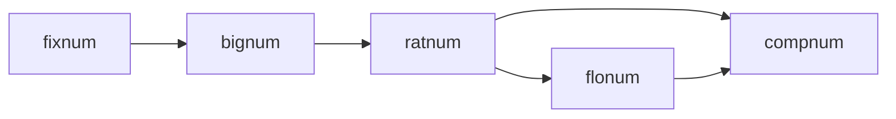

# 数値塔とUnicode

対応する決定: [ADR-0007](../adr/0007-numeric-tower-scope.md)、[ADR-0008](../adr/0008-string-representation.md)。

## 数値塔の範囲

R7RS 6.2 の完全な数値塔を実装する。`cond-expand` のフィーチャ `exact-closed` `ratios` `exact-complex` `ieee-float` をすべて真にすることを目標とする。

| 表現 | 保持するもの | 正確性 | 不変条件 |
| --- | --- | --- | --- |
| fixnum | `i64` の即値 | 正確 | - |
| bignum | 多倍長整数を包むヒープオブジェクト | 正確 | `i64` に収まる値は保持しない |
| ratnum | 分子と分母。いずれも fixnum か bignum | 正確 | 分母は常に正。分子と互いに素。分母は1にならない |
| flonum | `f64` の即値 | 不正確 | - |
| compnum | 実部と虚部。いずれも上記の実数 | 両方が正確なら正確 | 虚部が正確な0にならない。実部と虚部の正確性は同じ |

不変条件は正規化の規則(後述)の裏返しである。表現を作る関数が1箇所に閉じ、そこで必ず正規化する。構造体のフィールドの並びと正確な型はコードに置く([ADR-0018](../adr/0018-incremental-vertical-slices.md))。

多倍長整数には `std.math.big.int.Managed` を使う。Zig 0.17.0 の標準ライブラリに存在することは実機で確認した(2^100 の計算と基数10への変換が動作する)。多倍長演算を自前で書く必要はない。`Managed` は `std.mem.Allocator` で限界値列を確保するため、GC の sweep で `deinit` を呼ぶ。ヒープ外ペイロードとして計上の対象に含める([runtime.md](runtime.md) の計上の対象)。

段階4のスライス 4d で、ヒープに置く形を具体化した(段階4の計画書 [0018](../plans/0018-phase4-numeric-tower-unicode.md) の合意を求める点の5と、[ADR-0007](../adr/0007-numeric-tower-scope.md) の 2026-10-20 の追記)。bignum のオブジェクト(`src/value.zig` の `Bignum`)は `Managed` を持たず、作ったあとに変えない限界値列と符号を持つ。限界値列は文字列のバイト列と同じペイロードで、確保のときに上限に照らし(`Heap.createBignum`)、sweep で解放して計上から引く(`Heap.free`)。`Managed` は演算の途中だけ、上限に計上する作業領域で使い、結果を写す。上の段落の「sweep で `deinit` を呼ぶ」は、この形で満たす。理由は2つある。`Managed` は割り当て器を持つので、走査の分類(`src/trace.zig`)を通らない。演算のたびに自分の限界値列を伸ばすので、伸びた分が確保の時点で上限に照らされない。

### 正規化の規則

演算結果は常に最も単純な表現に落とす。この規則を破ると `eqv?` と `=` の整合性が崩れる。

- bignum が `i64` に収まるなら fixnum にする。
- ratnum の分母が1なら整数にする。約分は常に行い、分母は正にする。
- compnum の虚部が正確な0なら実数にする。虚部が不正確な0.0の場合は複素数のまま残す。R7RS 6.2.6 が `(real? -2.5+0i)` を `#t`、`(real? -2.5+0.0i)` を `#f` とし、`(real? z)` は `(zero? (imag-part z))` と同値だと規定している。
- compnum の実部と虚部は、どちらも正確か、どちらも flonum にする。部分の正確性が混ざるもの(`1.5+2i`、`1+2.5i`、実部の無い `+2.5i`)は、読むときと作るとき(`makeRectangular`)に、正確なほうを不正確にしてそろえる(`1.5+2.0i`、`1.0+2.5i`、`0.0+2.5i`)。R7RS 6.2.1 は、正確な複素数は正確な実部と正確な虚部を持ち、それ以外は不正確な複素数とするだけである。6.2.6 は、`real-part` と `imag-part` が、`make-rectangular` に正確な引数が渡された不正確な複素数に対して、正確な実数を返してよいとする。混在した部分は仕様が許すだけで、必須ではないので、そろえても仕様に反しない。2026-10-22 に、混在を保つ案とそろえる案を比べ、そろえる案に決まった(ユーザーの承認)。理由は、compnum の正確性が実部と虚部で1つに決まり、`exact?` や演算の階層や `eqv?` の規則が単純になることである。代償は、書いた整数の虚部(`2`)が `2.0` に変わることである。

### 演算の階層と伝播

二項演算は、両オペランドの階層のうち高い方に揃えてから計算する。階層は fixnum、bignum、ratnum、flonum の順で、compnum は直交する。

不正確さは伝播する。正確な数と不正確な数の演算結果は不正確になる(R7RS 6.2.2)。`max` と `min` も引数のいずれかが不正確なら結果を不正確にする。

四則と比較(スライス 4f、`src/num/ops.zig`)は、次の規則で計算する。

- 除数が正確な0なら、被除数が不正確でも `DivisionByZero` のエラーである。不正確な0で割ると、IEEE 754 のとおり無限大か `+nan.0` になる(`(/ 1 0.0)` は `+inf.0`)。
- 正確な数と不正確な数の演算は、正確な側を `f64` にして計算する。`(* 0 +inf.0)` は `+nan.0` である(R7RS 6.2.6 は、0と `+nan.0` のどちらも許す)。
- 比較は、正確な数と不正確な数の間でも、正確な値で比べる(flonum を正確な有理数にする)。`f64` に寄せて比べると `=` が推移的でなくなり、R7RS 6.2.2 の要求に反する(`(= 9007199254740993 9007199254740992.0)` は偽)。NaN を含む比較は、すべて偽である。
- `(- z)` は符号の反転で、不正確な0の符号を保つ(`(- 0.0)` は `-0.0`)。`(+ z)` と `(* z)` は引数そのものを返す。
- 複素数は、実部と虚部を実数の演算で計算し、`makeRectangular` で正規化する(虚部が正確な0なら実数、部分の正確性はそろえる)。和と差は部分ごと、積は `(ac-bd) + (ad+bc)i`、商は分母の共役を掛けて `c^2+d^2` で割る。片方が実数なら、実数を各部に掛けるか割る(`(* +inf.0+1.0i 2)` は `+inf.0+2.0i` で、`+nan.0` を作らない)。`=` は実部どうしと虚部どうしを正確な値で比べる。`<` `>` `<=` `>=` は実数だけで、複素数は `WrongType`。
- 作業領域は、`Heap.Charged` から取り、演算の間だけヒープの上限に照らす。上限に断られたら `HeapLimit` になる。結果が fixnum に収まる演算(fixnum 同士、`|n| ≤ 2^53` の fixnum と flonum)は、作業領域を使わない。

`/` が正確な整数に適用された結果は有理数になる。`sqrt` が正確な平方数に適用された結果は正確な整数になる。`exact-integer-sqrt` は2つの値を返す。

### 整数除算

R7RS 6.2.6 の全組を実装する。`floor/` `floor-quotient` `floor-remainder` `truncate/` `truncate-quotient` `truncate-remainder`、および別名の `quotient` `remainder` `modulo`。符号の扱いを間違えやすいので、`floor` 系と `truncate` 系の違いを明示したテストを負数の全組合せで持つ。

### 表示と解析

`number->string` は基数2、8、10、16に対応する。

不正確な数に基数10以外を与えた場合をエラーにしてはならない。R7RS 6.2.7 は次のように規定している。

> returns as a string an external representation of the given number in the given radix such that ... (let ((number number) (radix radix)) (eqv? number (string->number (number->string number radix) radix))) is true. It is an error if no possible result makes this expression true. ... The result returned by number->string never contains an explicit radix prefix.

同項の Note が、エラーになる条件を限定している。

> The error case can occur only when z is not a complex number or is a complex number with a non-rational real or imaginary part.

したがって有限の浮動小数点数には、どの基数でも往復可能な表現が必ず存在する。`(number->string 0.5 2)` は `"#i1/10"` を返す。基数2で `1/10` は 1/2 であり、`#i` は正確性接頭辞であって明示的な基数接頭辞ではないので、結果に基数接頭辞を含めないという制約にも反しない。

ここで解析側の規則に注意が必要である。R7RS 7.1.1 の `<prefix R>` は `<radix R> <exactness>` か `<exactness> <radix R>` で、空の派生が許されるのは `<radix 10>` だけである。したがって `"#i1/10"` は `<num 2>` から文法どおりには導出できない。

第2引数の扱いは R7RS 6.2.7 が規定している。

> If supplied, radix is a default radix that will be overridden if an explicit radix prefix is present in string (e.g. "#o177"). If radix is not supplied, then the default radix is 10.

既定基数であり、文字列に明示的な基数接頭辞があればそれが優先する。したがって2つを満たす。`<radix R>` が省略された場合は第2引数の値を基数として解析するので `(string->number "#i1/10" 2)` は 1/2 を不正確にした値になり、往復条件が成り立つ。明示的な接頭辞があれば第2引数を無視するので `(string->number "#o177" 2)` は 127 になる。第2引数を固定の基数として扱うと後者が `#f` になる。

往復性のテストは基数10だけでなく2、8、16でも行う。基数10だけだとこの食い違いを検出できない。

エラーにできるのは `(number->string +inf.0 2)` のように実部または虚部が有理数でない場合に限る。

不正確な数を基数10で表示するときは、R7RS 6.2.7 が次を要求している。

> If z is inexact, the radix is 10, and the above expression can be satisfied by a result that contains a decimal point, then the result contains a decimal point and is expressed using the minimum number of digits (exclusive of exponent and trailing zeroes) needed to make the above expression true [4, 5]; otherwise the format of the result is unspecified.

要求は2つである。結果が小数点を含むこと(それで往復条件を満たせる場合)と、桁数が最小であること。基数10以外では「otherwise the format of the result is unspecified」なので、桁数の最小性も小数点も要求されない。

Zig の `{d}` と `{e}` はいずれも最短往復表現を与えることを実機で確認した。ただしどちらも Scheme の記法とは一致しない。

| 値 | Zig の `{d}` | Zig の `{e}` | Scheme として必要な表示 |
| --- | --- | --- | --- |
| 0.1 | `0.1` | `1e-1` | `0.1` |
| 100.0 | `100` | `1e2` | `100.0` |
| 1e300 | 301桁の十進表記 | `1e300` | `1.0e300` |
| 1/3 を不正確にした値 | `0.3333333333333333` | `3.333333333333333e-1` | `0.3333333333333333` |

したがって `printer` は Zig の最短桁列を数字の供給源として使い、小数点の配置と指数表記への切り替えを自前で行う。規則は次のとおり。

- 小数点を必ず含める。指数表記に切り替える場合も仮数部に小数点を置く(`1.0e300`)。小数点を含む結果で往復条件を満たせる以上、R7RS 6.2.7 が小数点を要求する。不正確な整数値も同じ規則で `100.0` になる。
- 指数部が一定の範囲を超える場合に指数表記へ切り替える。範囲は実装定義とし、ECMAScript の `Number.prototype.toString` と同じ範囲にする(十進の最初の桁の位を n として、-7 < n < 21 なら小数で書く。ECMA-262 の n は小数点の位置で、ここでの n に 1 を足した値になり、範囲は -5 以上 21 以下と書かれる。境界の値は、2026-10-21 に ECMA-262 の原文で確かめた。記録は [0018](../plans/0018-phase4-numeric-tower-unicode.md) の「ECMA-262 の Number::toString の確認」にある。指数部の正の符号は書かない)。段階4の計画書 [0018](../plans/0018-phase4-numeric-tower-unicode.md) の合意を求める点の4で決めた(2026-10-20)。指数表記にするかどうかは「format of the result」の一部ではなく桁数の最小性の問題なので、どちらでも往復条件と小数点の要求を満たせる。
- `+inf.0` `-inf.0` `+nan.0` を専用に出力する。Zig は `inf` と `nan` を出すため変換が必要である。
- 負のゼロは `-0.0` と出力する。

`string->number` は R7RS 7.1.1 の数値文法全体を解析する。解析に失敗した場合は `#f` を返す(エラーにしない)。

`std.fmt.parseFloat` をそのまま使ってはならない。受理集合が Scheme の数値文法より広く、Scheme では数値でないものを数値として受理する。実機で確認した結果を挙げる。

| 入力 | `parseFloat` | Scheme として正しい結果 |
| --- | --- | --- |
| `inf` `INF` `infinity` | 受理して無限大 | `#f`。`inf` は正当な識別子であって数値表記ではない |
| `nan` `NaN` | 受理して NaN | `#f` |
| `0x10` `0x1p3` `+0x1p-1` | 受理して 16、8、0.5 | `#f`。16進浮動小数の記法は R7RS にない |
| `1_000` | 受理して 1000 | `#f`。下線は数値文法にない |
| `+inf.0` `-inf.0` `+nan.0` | 拒否 | 無限大と NaN |
| `1/2` | 拒否 | 有理数 |

したがって、まず R7RS 7.1.1 の `<number>` の生成規則に従って字句を検査する。`<infnan>` は `+inf.0` `-inf.0` `+nan.0` `-nan.0` の4つで、4つすべてを自前で処理する。基数接頭辞、正確性接頭辞、有理数、複素数も自前で処理する。

十進小数を `parseFloat` に渡すのは、結果が不正確数になる場合に限る。`#e` が付いている場合は渡さない。`#e` 付きの十進小数は、仮数の桁列と指数から有理数を直接組み立てる。

| 入力 | 誤った結果(常に `parseFloat` を通す場合) | 正しい結果 |
| --- | --- | --- |
| `#e0.1` | 3602879701896397/36028797018963968 | 1/10 |
| `#e1e400` | `(exact +inf.0)` でエラーか `#f` | 10 の400乗の正確な整数 |

`parseFloat` は `1e400` を拒否せず `inf` を返すことを実機で確認した。表の2行目は、`#e` を f64 経由で適用すると表現できる値が表現できなくなる例である。本処理系は多倍長整数を持つので 10 の400乗は正確に表せる。

複素数の読み書きの規則(スライス 4e-2)。直交形式(`a+bi`、`+bi`、`+i`、`-i`、`+inf.0i`)と極形式(`a@b`)を読む。実部の無い綴りの実部は正確な0で、`#e` と `#i` は両方の部分に効く。極形式は、角が正確な0なら大きさそのもの(正確さも保つ)、大きさが正確な0なら正確な0、それ以外は `f64` で計算した不正確な数になり、`#e` の綴りでは表せないので `#f` を返す。書くときは、実部、符号つきの虚部、`i` の順に書き、実部が正確な0なら実部を、虚部が正確な1と-1なら数を、書かない(`+2i`、`+i`、`-i`)。部分が flonum で基数が10以外のときは、先頭に `#i` を1つだけ置き、部分は接頭辞なしの正確な有理数で書く(`#i1/10+1/100i`)。読み戻すと `#i` が両方の部分に効くので、往復条件が成り立つ。

表現できない大きさの入力はエラーにせず `#f` を返す。R7RS 6.2.7 が次を要求している。

> If string is not a syntactically valid notation for a number, or would result in a number that the implementation cannot represent, then string->number returns #f. An error is never signaled due to the content of string.

したがって解析は、確保の前に結果の大きさを見積もり、上限を超える場合は確保せず `#f` を返す。`(string->number "#e1e999999999")` は 10 の9億9999万9999乗の限界値列を要するので `#f` になる。見積もりをせずに確保すると上限超過の Scheme のエラーになり、「エラーを送出しない」という要求に反する。分母0の `"1/0"` も同じく `#f` を返す。正規化の経路が分母0を拒否する前に、解析側で `#f` に変換する。

ヒープに収まる綴りでも、読む時間は桁数と指数に対して2乗に近く伸びる(桁の読み取り、累乗、約分、除算)。既定のヒープ(256MiB)でも、ReleaseSafe で `#e1e10000000` を読むのに約30秒かかり、`#e1e1000000` は約0.24秒だった(2026-10-23)。そこで、綴りの桁数(整数、分子、分母、0 でない正確な小数の仮数。先頭の0も数える)の上限を 100,000 に、0 でない正確な小数の10進指数の絶対値の上限を 1,000,000 に置いた。超えた綴りは、ヒープに収まっても `#f` を返す(リーダではエラー)。複素数と極形式は、部分ごとに見る。値は、次の測定を示して、ユーザーが選んだ(いずれも ReleaseSafe で、WASM での時間は未測定)。1つの実数で、桁数10万と指数±100万のとき、数字が同じ並び(9だけなど)なら約0.6秒、乱数の桁なら約1.7秒かかる(`#e` + 乱数99,999桁 + `e-1000000` が1.6秒、乱数100,000桁の分数が1.1秒)。複素数と極形式は部分の数だけ増え、両部が最悪の綴りなら約3秒になる。不正確な小数と、仮数が0の正確な小数には、掛けない。測定では桁数1000万の不正確な小数でも約20ミリ秒で、時間の理由が無く、掛けると `1e999999999` のように `+inf.0` と読むのが標準の綴りが `#f` になるためである。`#i` つきの整数と有理数は、内部で正確な数を通るので掛ける。上限の定数は `src/num/number.zig` の `max_spelling_digits` と `max_spelling_exponent` の2つで、後から緩められる。

この規則はリーダにも適用する。R7RS 6.2.7 が「The rules used by a particular implementation for string->number must also be applied to read and to the routine that reads programs」と要求している。適用しないと `(define inf 1)` が数値の束縛として誤って解釈される。

テストに含める: 上の表の全入力と `<infnan>` の4つすべてについて `string->number` の結果を確認する。`-nan.0` は `parseFloat` が `InvalidCharacter` で拒否することを実機で確認したので、自前の `<infnan>` 処理に4つ全部の分岐が必要である。`(define inf 1)` と `(define nan 2)` と `(define |1_000| 3)` が識別子の束縛として通ることを確認する。

### 検証の方針

- 往復性: 無作為な `f64` の値について `(string->number (number->string x))` が `x` に一致することを確認する。Zig の擬似乱数で多数の値を生成する。
- 階層の網羅: 5種の表現の全組合せについて四則演算と比較を確認する。
- 境界: `i64` の最大値と最小値の前後、fixnum と bignum の境界、分母が1になる約分、`0/n`、ゼロ除算。
- 負数の整数除算: `floor` 系と `truncate` 系を符号の4通りで確認する。被演算子が不正確整数の場合も確認する。R7RS 6.2.6 は `(truncate/ -5.0 -2)` が 2.0 と -1.0 を返す例を挙げている。

## パラメータオブジェクト

パラメータオブジェクトの決定は [runtime.md](runtime.md) のパラメータオブジェクトにある。ここには複製しない。数値に関わる点だけを述べる。

`(scheme base)` の `string->number` と `number->string` は基数を引数で受け取る手続きであり、パラメータオブジェクトを使わない。R7RS 4.2.6 の `radix` の例はパラメータの使い方の説明であって、本処理系の数値手続きの設計ではない。基数の既定値を動的に切り替える機構は提供しない。

## Unicode

R7RS 6.6 は文字属性の手続きについて次のように規定している。

> Specifically, they must return #t when applied to characters with the Unicode properties Alphabetic, Numeric_Type=Decimal, White_Space, Uppercase, and Lowercase respectively, and #f when applied to any other Unicode characters.

この要求は `full-unicode` フィーチャの提供を条件としていない。仕様が実装依存とするのは非 Unicode 文字に対する結果だけである。付録B の `full-unicode` の定義は「All Unicode characters present in Unicode version 6.0 are supported as Scheme characters」であって、属性手続きの正しさの条件ではない。

したがって `full-unicode` を下げても属性手続きの要求は免除されない。Unicode 文字を扱える以上、その属性を正しく返す必要がある。

必要なデータは次の5種である。

| 用途 | 必要なデータ |
| --- | --- |
| `char-upcase` `char-downcase` | 単純大文字小文字写像 |
| `char-foldcase` `char-ci=?` `string-ci=?` | 単純ケースフォールディング |
| `string-upcase` `string-downcase` `string-foldcase` | 完全大文字小文字写像。文字数が変わりうる |
| `char-alphabetic?` `char-numeric?` `char-whitespace?` `char-upper-case?` `char-lower-case?` | 文字属性の真偽値 |
| `digit-value` | 十進数字の数値 |

`digit-value` を属性の真偽値と分けるのは、返すのが真偽値ではなく 0 から 9 の整数だからである。R7RS 6.6 は「This procedure returns the numeric value (0 to 9) of its argument if it is a numeric digit (that is, if char-numeric? returns #t), or #f on any other character」と規定し、`(digit-value #\x0664)` が 4、`(digit-value #\x0AE6)` が 0、`(digit-value #\x0EA6)` が `#f` という例を挙げている。属性の真偽値だけでは U+0664 が十進数字であることは判定できても値 4 を得られない。符号位置からブロック先頭を引く近似では U+0EA6 の例を満たせない。UCD の十進数値のフィールドから別の表を作る。

Zig の `std.unicode` は UTF-8 の符号化と復号のみを提供し、文字属性と大文字小文字写像は持たない。したがって自前のテーブルが必要である。

### 文字の有効範囲

文字として扱う符号位置は 0 から `#xD7FF` と `#xE000` から `#x10FFFF` とする。サロゲート符号位置は含めない。

R7RS 6.6 は「Given a Unicode character, char->integer returns an exact integer between 0 and #xD7FF or between #xE000 and #x10FFFF which is equal to the Unicode scalar value of that character」と規定している。非 Unicode 文字については `#x10FFFF` より大きい整数を返すとしているが、本処理系は非 Unicode 文字を持たない。

`integer->char` は引数がこの範囲外なら Scheme のエラーとする。リーダの `#\x` に続く16進と文字列の `\x` に続く16進も同じ検査を通す。R7RS 7.1.1 の `<hex scalar value>` の生成規則は桁数も値域も制限していないので、`#\xD800` と `"\xD800;"` と `#\x110000` はいずれも文法上正しい字句である。縦棒で囲んだ識別子の `<symbol element>` にも同じ逃げ道がある。

検査を落とすと、UTF-8 に符号化できない符号位置が文字列に入る。文字列は UTF-8 バイト列として保持すると決めているので([ADR-0008](../adr/0008-string-representation.md))、符号化の時点で破綻する。実機で確認したところ Zig 0.17.0 の `std.unicode.utf8Encode` は `error{Utf8CannotEncodeSurrogateHalf, CodepointTooLarge}` を返す。この失敗を Zig の `error` として扱うと、利用者のプログラムの誤りを機械の外側の失敗として報告することになり、[architecture.md](architecture.md) のエラー表現の区別に反する。範囲の検査を先に置き、Scheme の条件オブジェクトで報告する。

検査する箇所は `integer->char` と、リーダの16進エスケープ(文字リテラル、文字列、縦棒識別子)である。[platform-and-web.md](platform-and-web.md) のバイト列が文字列になる経路の表と合わせて、文字列の不変条件を保つ経路の全体になる。

### テーブルの生成方針

Unicode Character Database のファイルから多段テーブルを生成する Zig プログラムを `tools/unicode/` に置き、生成結果の `.zig` ファイルをリポジトリにコミットする。

この方式を採る理由は次のとおり。

- ビルド時にネットワークへアクセスしない。再現可能なビルドを保ち、供給連鎖上の面も単純にする。
- 第三者パッケージへの依存を増やさない。
- 生成器をリポジトリに残すことで、Unicode のバージョン更新を追える。

生成元の Unicode バージョンと、使用した UCD ファイル名を生成結果のヘッダコメントと ADR に記録する。更新は手動の作業とし、更新時は生成結果の差分をレビューする。

`string-upcase` などの完全写像は文字数が変わる(例: ドイツ語のエスツェットの大文字化)。文字列の長さが変わる前提で実装する。

### WASM での大きさ

テーブルは WASM の成果物サイズに直接影響する。多段テーブルで共通部分を共有し、`ReleaseSmall` でのサイズを計測して記録する。

属性表のみを削って `full-unicode` を下げる退避案は採れない。前述のとおり R7RS 6.6 の要求は `full-unicode` の提供を条件としていないため、属性表を削ると `(char-alphabetic? #\x03B1)` が `#f` を返して非準拠になる。ギリシャ文字アルファは Unicode の Alphabetic 属性を持つので `#t` でなければならない。

サイズが問題になった場合に採れる手段は3つある。準拠の範囲が狭まる度合いの小さい順に並べる。

- 表の圧縮を進める。多段テーブルの段数を増やす、属性をビット束にまとめる、連続した範囲を区間表で持つ。準拠の範囲は狭まらない。
- `(scheme char)` を提供しない。大きなテーブルを要する手続きは R7RS 付録A がこのライブラリに切り出しており、付録Aは「The (scheme char) library provides the procedures for dealing with characters that involve potentially large tables when supporting all of Unicode」と述べている。提供しなければそれらの識別子は未束縛になり、`(scheme base)` に残る手続きはテーブルを要しない。仕様が用意している縮小の単位をそのまま使うので、準拠の範囲の狭まりが明示的になる。
- 文字レパートリ自体を ASCII に制限する。この場合は非 ASCII 文字が Scheme の文字でなくなるため属性手続きの要求から外れるが、`#BB` の読み取りと UTF-8 文字列の扱いにも波及する。準拠の範囲が最も大きく狭まる。

第2と第3を採る場合はユーザーの承認を得て ADR に記録する。判断は段階4で計測値を見てから行う。
