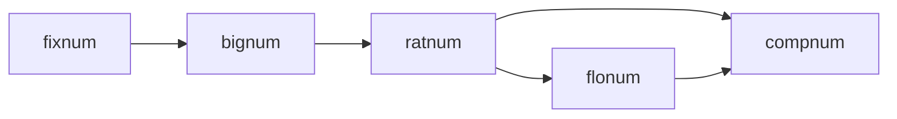

# 数値塔とUnicode

対応する決定: [ADR-0007](../adr/0007-numeric-tower-scope.md)、[ADR-0008](../adr/0008-string-representation.md)。

## 数値塔の範囲

R7RS 6.2 の完全な数値塔を実装する。`cond-expand` のフィーチャ `exact-closed` `ratios` `exact-complex` `ieee-float` をすべて真にすることを目標とする。

| 表現 | 対応する Zig の型 | 正確性 |
| --- | --- | --- |
| fixnum | `i64` の即値 | 正確 |
| bignum | `std.math.big.int` を包むヒープオブジェクト | 正確 |
| ratnum | 分子と分母(いずれも fixnum か bignum) | 正確 |
| flonum | `f64` の即値 | 不正確 |
| compnum | 実部と虚部(いずれも上記の実数) | 両方が正確なら正確 |

```zig
pub const Bignum = struct {
    header: Header,
    value: std.math.big.int.Managed, // sweep 時に deinit する
};

pub const Ratnum = struct {
    header: Header,
    numerator: Value,   // fixnum か bignum
    denominator: Value, // fixnum か bignum。常に正で、分子と互いに素
};

pub const Compnum = struct {
    header: Header,
    real: Value,
    imag: Value,
};
```

`std.math.big.int.Managed` が Zig 0.17.0 の標準ライブラリに存在することは実機で確認した(2^100 の計算と基数10への変換が動作する)。多倍長演算を自前で書く必要はない。`Managed` は `std.mem.Allocator` で限界値列を確保するため、GC の sweep で `deinit` を呼ぶ。

### 正規化の規則

演算結果は常に最も単純な表現に落とす。この規則を破ると `eqv?` と `=` の整合性が崩れる。

- bignum が `i64` に収まるなら fixnum にする。
- ratnum の分母が1なら整数にする。約分は常に行い、分母は正にする。
- compnum の虚部が正確な0なら実数にする。虚部が不正確な0.0の場合は複素数のまま残す(R7RS 6.2.1 の非実数複素数の扱い)。

### 演算の階層と伝播

二項演算は、両オペランドの階層のうち高い方に揃えてから計算する。階層は fixnum、bignum、ratnum、flonum の順で、compnum は直交する。



不正確さは伝播する。正確な数と不正確な数の演算結果は不正確になる(R7RS 6.2.2)。`max` と `min` も引数のいずれかが不正確なら結果を不正確にする。

`/` が正確な整数に適用された結果は有理数になる。`sqrt` が正確な平方数に適用された結果は正確な整数になる。`exact-integer-sqrt` は2つの値を返す。

### 整数除算

R7RS 6.2.6 の全組を実装する。`floor/` `floor-quotient` `floor-remainder` `truncate/` `truncate-quotient` `truncate-remainder`、および別名の `quotient` `remainder` `modulo`。符号の扱いを間違えやすいので、`floor` 系と `truncate` 系の違いを明示したテストを負数の全組合せで持つ。

### 表示と解析

`number->string` は基数2、8、10、16に対応する。不正確な数に基数10以外を指定した場合はエラーとする。

不正確な数の表示は「読み戻して同じ値になる最短表現」でなければならない。Zig の `{d}` と `{e}` はいずれも最短往復表現を与えることを実機で確認した。ただしどちらも Scheme の記法とは一致しない。

| 値 | Zig の `{d}` | Zig の `{e}` | Scheme として必要な表示 |
| --- | --- | --- | --- |
| 0.1 | `0.1` | `1e-1` | `0.1` |
| 100.0 | `100` | `1e2` | `100.0` |
| 1e300 | 301桁の十進表記 | `1e300` | `1e300` |
| 1/3 を不正確にした値 | `0.3333333333333333` | `3.333333333333333e-1` | `0.3333333333333333` |

したがって `printer` は Zig の最短桁列を数字の供給源として使い、小数点の配置と指数表記への切り替えを自前で行う。規則は次のとおり。

- 不正確な整数値には必ず小数点と `0` を付ける(`100.0`)。
- 指数部が一定の範囲を超える場合に指数表記へ切り替える。範囲は実装定義とし、一般的な Scheme 処理系に合わせる。
- `+inf.0` `-inf.0` `+nan.0` を専用に出力する。Zig は `inf` と `nan` を出すため変換が必要である。
- 負のゼロは `-0.0` と出力する。

`string->number` は R7RS 7.1.1 の数値文法全体を解析する。`std.fmt.parseFloat` は `1.0` `.5` `5.` `1e-5` を受理するので十進小数の解析に使えるが、`+inf.0` 形式と基数接頭辞と有理数と複素数は自前で処理する。解析に失敗した場合は `#f` を返す(エラーにしない)。

### 検証の方針

- 往復性: 無作為な `f64` の値について `(string->number (number->string x))` が `x` に一致することを確認する。Zig の擬似乱数で多数の値を生成する。
- 階層の網羅: 5種の表現の全組合せについて四則演算と比較を確認する。
- 境界: `i64` の最大値と最小値の前後、fixnum と bignum の境界、分母が1になる約分、`0/n`、ゼロ除算。
- 負数の整数除算: `floor` 系と `truncate` 系を符号の4通りで確認する。

## Unicode

R7RS は `full-unicode` フィーチャを提供する処理系に対して、文字手続きが Unicode に従うことを要求する(R7RS 6.6)。

必要なデータは次の4種である。

| 用途 | 必要なデータ |
| --- | --- |
| `char-upcase` `char-downcase` | 単純大文字小文字写像 |
| `char-foldcase` `char-ci=?` `string-ci=?` | 単純ケースフォールディング |
| `string-upcase` `string-downcase` `string-foldcase` | 完全大文字小文字写像。文字数が変わりうる |
| `char-alphabetic?` `char-numeric?` `char-whitespace?` `char-upper-case?` `char-lower-case?` `digit-value` | 文字属性 |

Zig の `std.unicode` は UTF-8 の符号化と復号のみを提供し、文字属性と大文字小文字写像は持たない。したがって自前のテーブルが必要である。

### テーブルの生成方針

Unicode Character Database のファイルから多段テーブルを生成する Zig プログラムを `tools/unicode/` に置き、生成結果の `.zig` ファイルをリポジトリにコミットする。

この方式を採る理由は次のとおり。

- ビルド時にネットワークへアクセスしない。再現可能なビルドを保ち、供給連鎖上の面も単純にする。
- 第三者パッケージへの依存を増やさない。
- 生成器をリポジトリに残すことで、Unicode のバージョン更新を追える。

生成元の Unicode バージョンと、使用した UCD ファイル名を生成結果のヘッダコメントと ADR に記録する。更新は手動の作業とし、更新時は生成結果の差分をレビューする。

`string-upcase` などの完全写像は文字数が変わる(例: ドイツ語のエスツェットの大文字化)。文字列の長さが変わる前提で実装する。

### WASM での大きさ

テーブルは WASM の成果物サイズに直接影響する。多段テーブルで共通部分を共有し、`ReleaseSmall` でのサイズを計測して記録する。上限を超える場合は、Web UI 向けビルドで属性表のみを削る選択肢を残すが、その場合 `full-unicode` フィーチャを下げる必要がある。判断は段階4で計測値を見てから行う。
