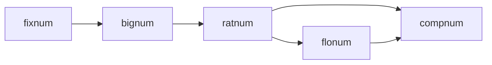

# 数値塔とUnicode

対応する決定: [ADR-0007](../adr/0007-numeric-tower-scope.md)、[ADR-0008](../adr/0008-string-representation.md)。

## 数値塔の範囲

R7RS 6.2 の完全な数値塔を実装する。`cond-expand` のフィーチャ `exact-closed` `ratios` `exact-complex` `ieee-float` をすべて真にすることを目標とする。

| 表現 | 対応する Zig の型 | 正確性 |
| --- | --- | --- |
| fixnum | `i64` の即値 | 正確 |
| bignum | `std.math.big.int` を包むヒープオブジェクト | 正確 |
| ratnum | 分子と分母(いずれも fixnum か bignum) | 正確 |
| flonum | `f64` の即値 | 不正確 |
| compnum | 実部と虚部(いずれも上記の実数) | 両方が正確なら正確 |

```zig
pub const Bignum = struct {
    header: Header,
    value: std.math.big.int.Managed, // sweep 時に deinit する
};

pub const Ratnum = struct {
    header: Header,
    numerator: Value,   // fixnum か bignum
    denominator: Value, // fixnum か bignum。常に正で、分子と互いに素
};

pub const Compnum = struct {
    header: Header,
    real: Value,
    imag: Value,
};
```

`std.math.big.int.Managed` が Zig 0.17.0 の標準ライブラリに存在することは実機で確認した(2^100 の計算と基数10への変換が動作する)。多倍長演算を自前で書く必要はない。`Managed` は `std.mem.Allocator` で限界値列を確保するため、GC の sweep で `deinit` を呼ぶ。

### 正規化の規則

演算結果は常に最も単純な表現に落とす。この規則を破ると `eqv?` と `=` の整合性が崩れる。

- bignum が `i64` に収まるなら fixnum にする。
- ratnum の分母が1なら整数にする。約分は常に行い、分母は正にする。
- compnum の虚部が正確な0なら実数にする。虚部が不正確な0.0の場合は複素数のまま残す。R7RS 6.2.6 が `(real? -2.5+0i)` を `#t`、`(real? -2.5+0.0i)` を `#f` とし、`(real? z)` は `(zero? (imag-part z))` と同値だと規定している。

### 演算の階層と伝播

二項演算は、両オペランドの階層のうち高い方に揃えてから計算する。階層は fixnum、bignum、ratnum、flonum の順で、compnum は直交する。



不正確さは伝播する。正確な数と不正確な数の演算結果は不正確になる(R7RS 6.2.2)。`max` と `min` も引数のいずれかが不正確なら結果を不正確にする。

`/` が正確な整数に適用された結果は有理数になる。`sqrt` が正確な平方数に適用された結果は正確な整数になる。`exact-integer-sqrt` は2つの値を返す。

### 整数除算

R7RS 6.2.6 の全組を実装する。`floor/` `floor-quotient` `floor-remainder` `truncate/` `truncate-quotient` `truncate-remainder`、および別名の `quotient` `remainder` `modulo`。符号の扱いを間違えやすいので、`floor` 系と `truncate` 系の違いを明示したテストを負数の全組合せで持つ。

### 表示と解析

`number->string` は基数2、8、10、16に対応する。

不正確な数に基数10以外を与えた場合をエラーにしてはならない。R7RS 6.2.7 は次のように規定している。

> returns as a string an external representation of the given number in the given radix such that ... (eqv? number (string->number (number->string number radix) radix)) is true. It is an error if no possible result makes this expression true. ... The result returned by number->string never contains an explicit radix prefix.

同項の Note が、エラーになる条件を限定している。

> The error case can occur only when z is not a complex number or is a complex number with a non-rational real or imaginary part.

したがって有限の浮動小数点数には、どの基数でも往復可能な表現が必ず存在する。`(number->string 0.5 2)` は `"#i1/10"` を返す。基数2で `1/10` は 1/2 であり、`#i` は正確性接頭辞であって明示的な基数接頭辞ではないので、結果に基数接頭辞を含めないという制約にも反しない。

ここで解析側の規則に注意が必要である。R7RS 7.1.1 の `<prefix R>` は `<radix R> <exactness>` か `<exactness> <radix R>` で、空の派生が許されるのは `<radix 10>` だけである。したがって `"#i1/10"` は `<num 2>` から文法どおりには導出できない。`string->number` の第2引数で基数を与えられた場合、`<radix R>` の省略を許して既定基数をその値として解析する。この解釈を明示しておかないと、`(string->number "#i1/10" 2)` が `#f` を返して往復条件が成り立たなくなる。

往復性のテストは基数10だけでなく2、8、16でも行う。基数10だけだとこの食い違いを検出できない。

エラーにできるのは `(number->string +inf.0 2)` のように実部または虚部が有理数でない場合に限る。

不正確な数を基数10で表示するときは、R7RS 6.2.7 が次を要求している。

> If z is inexact, the radix is 10, and the above expression can be satisfied by a result that contains a decimal point, then the result contains a decimal point and is expressed using the minimum number of digits (exclusive of exponent and trailing zeroes) needed to make the above expression true; otherwise the format of the result is unspecified.

要求は2つである。結果が小数点を含むこと(それで往復条件を満たせる場合)と、桁数が最小であること。基数10以外では「otherwise the format of the result is unspecified」なので、桁数の最小性も小数点も要求されない。

Zig の `{d}` と `{e}` はいずれも最短往復表現を与えることを実機で確認した。ただしどちらも Scheme の記法とは一致しない。

| 値 | Zig の `{d}` | Zig の `{e}` | Scheme として必要な表示 |
| --- | --- | --- | --- |
| 0.1 | `0.1` | `1e-1` | `0.1` |
| 100.0 | `100` | `1e2` | `100.0` |
| 1e300 | 301桁の十進表記 | `1e300` | `1.0e300` |
| 1/3 を不正確にした値 | `0.3333333333333333` | `3.333333333333333e-1` | `0.3333333333333333` |

したがって `printer` は Zig の最短桁列を数字の供給源として使い、小数点の配置と指数表記への切り替えを自前で行う。規則は次のとおり。

- 小数点を必ず含める。指数表記に切り替える場合も仮数部に小数点を置く(`1.0e300`)。小数点を含む結果で往復条件を満たせる以上、R7RS 6.2.7 が小数点を要求する。不正確な整数値も同じ規則で `100.0` になる。
- 指数部が一定の範囲を超える場合に指数表記へ切り替える。範囲は実装定義とし、一般的な Scheme 処理系に合わせる。指数表記にするかどうかは「format of the result」の一部ではなく桁数の最小性の問題なので、どちらでも往復条件と小数点の要求を満たせる。
- `+inf.0` `-inf.0` `+nan.0` を専用に出力する。Zig は `inf` と `nan` を出すため変換が必要である。
- 負のゼロは `-0.0` と出力する。

`string->number` は R7RS 7.1.1 の数値文法全体を解析する。解析に失敗した場合は `#f` を返す(エラーにしない)。

`std.fmt.parseFloat` をそのまま使ってはならない。受理集合が Scheme の数値文法より広く、Scheme では数値でないものを数値として受理する。実機で確認した結果を挙げる。

| 入力 | `parseFloat` | Scheme として正しい結果 |
| --- | --- | --- |
| `inf` `INF` `infinity` | 受理して無限大 | `#f`。`inf` は正当な識別子であって数値表記ではない |
| `nan` `NaN` | 受理して NaN | `#f` |
| `0x10` `0x1p3` `+0x1p-1` | 受理して 16、8、0.5 | `#f`。16進浮動小数の記法は R7RS にない |
| `1_000` | 受理して 1000 | `#f`。下線は数値文法にない |
| `+inf.0` `-inf.0` `+nan.0` | 拒否 | 無限大と NaN |
| `1/2` | 拒否 | 有理数 |

したがって、まず R7RS 7.1.1 の `<number>` の生成規則に従って字句を検査し、十進小数と確定した部分文字列だけを `parseFloat` に渡す。`<infnan>` は `+inf.0` `-inf.0` `+nan.0` `-nan.0` の4つだけである。基数接頭辞、正確性接頭辞、有理数、複素数は自前で処理する。

この規則はリーダにも適用する。R7RS 6.2.7 が「The rules used by a particular implementation for string->number must also be applied to read and to the routine that reads programs」と要求している。適用しないと `(define inf 1)` が数値の束縛として誤って解釈される。

テストに含める: 上の表の全入力について `string->number` の結果を確認する。`(define inf 1)` と `(define nan 2)` と `(define |1_000| 3)` が識別子の束縛として通ることを確認する。

### 検証の方針

- 往復性: 無作為な `f64` の値について `(string->number (number->string x))` が `x` に一致することを確認する。Zig の擬似乱数で多数の値を生成する。
- 階層の網羅: 5種の表現の全組合せについて四則演算と比較を確認する。
- 境界: `i64` の最大値と最小値の前後、fixnum と bignum の境界、分母が1になる約分、`0/n`、ゼロ除算。
- 負数の整数除算: `floor` 系と `truncate` 系を符号の4通りで確認する。

## パラメータオブジェクト

R7RS 4.2.6 は `make-parameter` が返すものを「a newly allocated parameter object, which is a procedure that accepts zero arguments and returns the value associated with the parameter object」と規定している。つまりパラメータオブジェクトは手続きである。

したがって次を満たす。

- `(procedure? p)` は `#t` を返す。
- `(p)` は現在の値を返す。引数0個の呼び出しとして機械の適用経路を通る。
- `eval_operator` と `eval_operand` が受け付ける被適用型に `parameter` を含める。`closure` `primitive` `continuation` `parameter` の4種が適用できる。
- `(p 1)` のような引数つきの呼び出しはエラーとする。R7RS 4.2.6 は「The effect of passing arguments to a parameter object is implementation-dependent」としており、処理系が決めてよい範囲である。エラーにするのは、引数を渡す用途が本処理系に存在せず、誤りを早く知らせるほうがよいという判断である。
  同節の例は `(radix 16)` の結果を未規定(`unspecified`)と注記しており、R7RS 1.3.2 は未規定の式がエラーを送出せずに何らかのオブジェクトに評価されることを要求している。例に従えばエラーにできない。規定本文が実装依存としているので矛盾ではないが、原文の中で一貫していない箇所である。本処理系は規定本文に従う。R7RS 7.3 の参考実装も引数つきの呼び出しに `(error "bad parameter syntax")` を置いている。
  内部的な値の設定は `parameterize` が `Parameter` を直接操作して行い、Scheme から見える手続きとしての経路には出さない。

`parameter` を `Value` の独立した変種にしているため、適用経路と `procedure?` の両方に明示的に加えないと `(p)` が「手続きでない」エラーになる。`parameterize` の中だけをテストすると見逃す。

## Unicode

R7RS 6.6 は文字属性の手続きについて次のように規定している。

> Specifically, they must return #t when applied to characters with the Unicode properties Alphabetic, Numeric_Type=Decimal, White_Space, Uppercase, and Lowercase respectively, and #f when applied to any other Unicode characters.

この要求は `full-unicode` フィーチャの提供を条件としていない。仕様が実装依存とするのは非 Unicode 文字に対する結果だけである。付録B の `full-unicode` の定義は「All Unicode characters present in Unicode version 6.0 are supported as Scheme characters」であって、属性手続きの正しさの条件ではない。

したがって `full-unicode` を下げても属性手続きの要求は免除されない。Unicode 文字を扱える以上、その属性を正しく返す必要がある。

必要なデータは次の4種である。

| 用途 | 必要なデータ |
| --- | --- |
| `char-upcase` `char-downcase` | 単純大文字小文字写像 |
| `char-foldcase` `char-ci=?` `string-ci=?` | 単純ケースフォールディング |
| `string-upcase` `string-downcase` `string-foldcase` | 完全大文字小文字写像。文字数が変わりうる |
| `char-alphabetic?` `char-numeric?` `char-whitespace?` `char-upper-case?` `char-lower-case?` `digit-value` | 文字属性 |

Zig の `std.unicode` は UTF-8 の符号化と復号のみを提供し、文字属性と大文字小文字写像は持たない。したがって自前のテーブルが必要である。

### テーブルの生成方針

Unicode Character Database のファイルから多段テーブルを生成する Zig プログラムを `tools/unicode/` に置き、生成結果の `.zig` ファイルをリポジトリにコミットする。

この方式を採る理由は次のとおり。

- ビルド時にネットワークへアクセスしない。再現可能なビルドを保ち、供給連鎖上の面も単純にする。
- 第三者パッケージへの依存を増やさない。
- 生成器をリポジトリに残すことで、Unicode のバージョン更新を追える。

生成元の Unicode バージョンと、使用した UCD ファイル名を生成結果のヘッダコメントと ADR に記録する。更新は手動の作業とし、更新時は生成結果の差分をレビューする。

`string-upcase` などの完全写像は文字数が変わる(例: ドイツ語のエスツェットの大文字化)。文字列の長さが変わる前提で実装する。

### WASM での大きさ

テーブルは WASM の成果物サイズに直接影響する。多段テーブルで共通部分を共有し、`ReleaseSmall` でのサイズを計測して記録する。

属性表のみを削って `full-unicode` を下げる退避案は採れない。前述のとおり R7RS 6.6 の要求は `full-unicode` の提供を条件としていないため、属性表を削ると `(char-alphabetic? #\x03B1)` が `#f` を返して非準拠になる。ギリシャ文字アルファは Unicode の Alphabetic 属性を持つので `#t` でなければならない。

サイズが問題になった場合に採れる手段は次の2つに限る。

- 表の圧縮を進める。多段テーブルの段数を増やす、属性をビット束にまとめる、連続した範囲を区間表で持つ。
- 文字レパートリ自体を ASCII に制限する。この場合は非 ASCII 文字が Scheme の文字でなくなるため属性手続きの要求から外れるが、`#\x03BB` の読み取りと UTF-8 文字列の扱いにも波及する。準拠の範囲が大きく狭まるため、採る場合はユーザーの承認を得て ADR に記録する。

判断は段階4で計測値を見てから行う。
