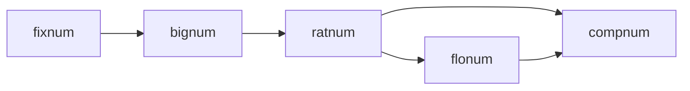

# 数値塔とUnicode

対応する決定: [ADR-0007](../adr/0007-numeric-tower-scope.md)、[ADR-0008](../adr/0008-string-representation.md)。

## 数値塔の範囲

R7RS 6.2 の完全な数値塔を実装する。`cond-expand` のフィーチャ `exact-closed` `ratios` `exact-complex` `ieee-float` をすべて真にすることを目標とする。

| 表現 | 保持するもの | 正確性 | 不変条件 |
| --- | --- | --- | --- |
| fixnum | `i64` の即値 | 正確 | - |
| bignum | 多倍長整数を包むヒープオブジェクト | 正確 | `i64` に収まる値は保持しない |
| ratnum | 分子と分母。いずれも fixnum か bignum | 正確 | 分母は常に正。分子と互いに素。分母は1にならない |
| flonum | `f64` の即値 | 不正確 | - |
| compnum | 実部と虚部。いずれも上記の実数 | 両方が正確なら正確 | 虚部が正確な0にならない。実部と虚部の正確性は同じ |

不変条件は正規化の規則(後述)の裏返しである。表現を作る関数が1箇所に閉じ、そこで必ず正規化する。構造体のフィールドの並びと正確な型はコードに置く([ADR-0018](../adr/0018-incremental-vertical-slices.md))。

多倍長整数には `std.math.big.int.Managed` を使う。Zig 0.17.0 の標準ライブラリに存在することは実機で確認した(2^100 の計算と基数10への変換が動作する)。多倍長演算を自前で書く必要はない。`Managed` は `std.mem.Allocator` で limbs(多倍長整数の桁の配列)を確保するため、GC の sweep で `deinit` を呼ぶ。ヒープ外ペイロードとして計上の対象に含める([runtime.md](runtime.md) の計上の対象)。

段階4のスライス 4d で、ヒープに置く形を具体化した(段階4の計画書 [0018](../plans/0018-phase4-numeric-tower-unicode.md) の合意を求める点の5と、[ADR-0007](../adr/0007-numeric-tower-scope.md) の 2026-10-20 の追記)。bignum のオブジェクト(`src/value.zig` の `Bignum`)は `Managed` を持たず、作ったあとに変えない limbs と符号を持つ。limbs は文字列のバイト列と同じペイロードで、確保のときに上限に照らし(`Heap.createBignum`)、sweep で解放して計上から引く(`Heap.free`)。`Managed` は演算の途中だけ、上限に計上する作業領域で使い、結果を写す。上の段落の「sweep で `deinit` を呼ぶ」は、この形で満たす。理由は2つある。`Managed` は割り当て器を持つので、走査の分類(`src/trace.zig`)を通らない。演算のたびに自分の limbs を伸ばすので、伸びた分が確保の時点で上限に照らされない。

### 正規化の規則

演算結果は常に最も単純な表現に落とす。この規則を破ると `eqv?` と `=` の整合性が崩れる。

- bignum が `i64` に収まるなら fixnum にする。
- ratnum の分母が1なら整数にする。約分は常に行い、分母は正にする。
- compnum の虚部が正確な0なら実数にする。虚部が不正確な0.0の場合は複素数のまま残す。R7RS 6.2.6 が `(real? -2.5+0i)` を `#t`、`(real? -2.5+0.0i)` を `#f` とし、`(real? z)` は `(zero? (imag-part z))` と同値だと規定している。
- compnum の実部と虚部は、どちらも正確か、どちらも flonum にする。部分の正確性が混ざるもの(`1.5+2i`、`1+2.5i`、実部の無い `+2.5i`)は、読むときと作るとき(`makeRectangular`)に、正確なほうを不正確にしてそろえる(`1.5+2.0i`、`1.0+2.5i`、`0.0+2.5i`)。R7RS 6.2.1 は、正確な複素数は正確な実部と正確な虚部を持ち、それ以外は不正確な複素数とするだけである。6.2.6 は、`real-part` と `imag-part` が、`make-rectangular` に正確な引数が渡された不正確な複素数に対して、正確な実数を返してよいとする。混在した部分は仕様が許すだけで、必須ではないので、そろえても仕様に反しない。2026-10-22 に、混在を保つ案とそろえる案を比べ、そろえる案に決まった(ユーザーの承認)。理由は、compnum の正確性が実部と虚部で1つに決まり、`exact?` や演算の階層や `eqv?` の規則が単純になることである。代償は、書いた整数の虚部(`2`)が `2.0` に変わることである。

### 演算の階層と伝播

二項演算は、両オペランドの階層のうち高い方に揃えてから計算する。階層は fixnum、bignum、ratnum、flonum の順で、compnum は直交する。

不正確さは伝播する。正確な数と不正確な数の演算結果は不正確になる(R7RS 6.2.2)。`max` と `min` も引数のいずれかが不正確なら結果を不正確にする。

四則と比較(スライス 4f、`src/num/ops.zig`)は、次の規則で計算する。

- 除数が正確な0なら、被除数が不正確でも `DivisionByZero` のエラーである。不正確な0で割ると、IEEE 754 のとおり無限大か `+nan.0` になる(`(/ 1 0.0)` は `+inf.0`)。
- 正確な数と不正確な数の演算は、正確な側を `f64` にして計算する。`(* 0 +inf.0)` は `+nan.0` である(R7RS 6.2.6 は、0と `+nan.0` のどちらも許す)。
- 比較は、正確な数と不正確な数の間でも、正確な値で比べる(flonum を正確な有理数にする)。`f64` に寄せて比べると `=` が推移的でなくなり、R7RS 6.2.2 の要求に反する(`(= 9007199254740993 9007199254740992.0)` は偽)。NaN を含む比較は、すべて偽である。
- `(- z)` は符号の反転で、不正確な0の符号を保つ(`(- 0.0)` は `-0.0`)。`(+ z)` と `(* z)` は引数そのものを返す。
- 複素数は、実部と虚部を実数の演算で計算し、`makeRectangular` で正規化する(虚部が正確な0なら実数、部分の正確性はそろえる)。和と差は部分ごと、積は `(ac-bd) + (ad+bc)i`、商は分母の共役を掛けて `c^2+d^2` で割る。片方が実数なら、実数を各部に掛けるか割る(`(* +inf.0+1.0i 2)` は `+inf.0+2.0i` で、`+nan.0` を作らない)。`=` は実部どうしと虚部どうしを正確な値で比べる。`<` `>` `<=` `>=` は実数だけで、複素数は `WrongType`。複素数どうしの演算では、正確な0の部分が無限大に掛かると `+nan.0` になる(`(* +i +inf.0+1.0i)` は `+nan.0+inf.0i`。実数との積の `(* 0 +inf.0)` と同じ扱いで、R7RS 6.2.6 は規定していない)。複素数の除数が不正確な0(`0.0+0.0i`)のときの結果は `+nan.0` を含み(`(/ 1+2i 0.0+0.0i)` は `+nan.0+nan.0i`)、実数の除数 `0.0` の無限大(`+inf.0+inf.0i`)とは異なる。分母の共役を掛ける式の帰結である。
- 作業領域は、`Heap.Charged` から取り、演算の間だけヒープの上限に照らす。上限に断られたら `HeapLimit` になる。結果が fixnum に収まる演算(fixnum 同士、`|n| ≤ 2^53` の fixnum と flonum)は、作業領域を使わない。

数の述語、正確性の変換、丸め、`numerator` と `denominator`、`max` と `min`(スライス 4g-1、`src/num/ops.zig` と `src/prim/number.zig`)は、次の規則で計算する。節の番号は R7RS 6.2.6 である。

- 型の述語(`complex?` `real?` `rational?` `integer?` `exact-integer?`)は、数でない値にも使えて偽を返す。`real?` は、虚部を持たない数で真になる。虚部が不正確な0の複素数は実数でない(原文の例 `(real? -2.5+0.0i)` は偽)。`rational?` は、正確な実数と、有限の flonum で真になる。`integer?` は、正確な整数と、整数値の有限の flonum で真になる。`exact?` と `inexact?` は、数でない引数を `WrongType` にする(原文は、数でない引数を誤りとする)。
- `exact` は、flonum の値そのものを表す正確な数を返す(`(exact 0.1)` は `3602879701896397/36028797018963968`)。無限大と NaN には正確な値が無いので `OutOfRange` の誤りにする。原文は、近い正確な数が無い引数について、実装上の制限の違反を報告してよいとする。複素数は、実部と虚部のそれぞれを正確にする。
- `inexact` は、最も近い flonum を返す。範囲を超える正確な数は無限大になる。原文は、近い不正確な数が無い引数について、実装上の制限の違反を報告してよいとするが、無限大を返して報告しない。
- `floor` `ceiling` `truncate` `round` は、正確な数には正確な整数を、flonum には flonum を返す。`round` は、同じ近さの2つの整数があるとき、偶数へ丸める(原文の `round` の説明。`(round 7/2)` は 4、`(round 5/2)` は 2、`(round 2.5)` は 2.0、`(round -0.5)` は `-0.0`)。複素数は `WrongType` である。
- `numerator` と `denominator` は、有理数を取る。flonum には flonum を返す(`(denominator 0.5)` は 2.0)。無限大と NaN は `OutOfRange` の誤りにする。有限の flonum でも、分母が flonum に収まらない値(最小の非正規数など)の `denominator` は、`+inf.0` になる(原文は規定しない)。複素数は `WrongType` である。
- `max` と `min` は、比較を正確な値で行う。引数に flonum があれば、結果を flonum にする(`(max 3 2.0)` は 3.0。原文の注)。混在する正確さの比較で、結果が不正確な数として損失なく表せないときは、原文は実装上の制限の違反を報告してよいとするが、丸めた flonum を返して報告しない。NaN があれば、結果は NaN にする(原文は規定しない)。`-0.0` と `0` のように等しい引数があるときは、先頭の引数が結果になる(`(max 0 -0.0)` は `0.0`、`(max -0.0 0)` は `-0.0`。原文は規定しない)。複素数は `WrongType` である。

`/` が正確な整数に適用された結果は有理数になる。`sqrt` が正確な平方数に適用された結果は正確な整数になる。`exact-integer-sqrt` は2つの値を返す。

### 整数除算

R7RS 6.2.6 の全組を実装する。`floor/` `floor-quotient` `floor-remainder` `truncate/` `truncate-quotient` `truncate-remainder`、および別名の `quotient` `remainder` `modulo`。符号の扱いを間違えやすいので、`floor` 系と `truncate` 系の違いを明示したテストを負数の全組合せで持つ。

実装(スライス 4g-2、`src/num/ops.zig` の `integerDivide` と `absNumber`、`src/prim/arith.zig`)は、次の規則で計算する。

- 整数除算の7個(`quotient` `remainder` `modulo` と、`floor-` `truncate-` の商と余り)と `abs` は、Zig のネイティブで実装する。`floor/` と `truncate/` は、純粋なプリミティブが多値を返せないので、Scheme で商と余りのネイティブを `values` に包む。`gcd` `lcm` `zero?` `positive?` `negative?` `odd?` `even?` `square` は Scheme のままである(ネイティブにする範囲は、親セッションの指示で入れたものである)。
- 引数は、正確な整数と、整数値の有限の flonum である。それ以外(非整数、無限大、NaN、複素数、数でない値)は `WrongType` にする(R7RS 6.2.6 は、`floor/` などの引数を整数とする)。型は両方の引数について先に検査し、そのあとで除数の 0 を検査する。
- 片方でも flonum なら、結果は flonum である(`(truncate/ -5.0 -2)` は 2.0 と -1.0。原文の例)。除数が正確な0でも不正確な0でも `DivisionByZero` である(`(/ 1 0.0)` は無限大だが、整数除算は 0 による除算を誤りとする)。
- bignum を取る。最小の fixnum を -1 で割った商 2^63 は bignum になり、`IntegerOverflow` は無くなった(エラーの種類ごと削除した)。
- flonum の経路は、被除数の絶対値が 2^53 未満で、除数が `f64` に正確に直せるもの(flonum、または絶対値が 2^53 以下の fixnum)なら、`@rem` で余りを正確に求め、被除数から余りを引いた値を除数で割って商を求める。それ以外は、正確な整数に直して bigint で割り、flonum に戻す。商が 53 ビットに収まらないときは丸まる。truncate 系の余りは常に正確である。floor 系の余りは、符号が合わないときに除数を足して補正するので、丸まることがある(`(modulo -5 1e25)` は `1.0e25`、`(modulo -5.0 18446744073709551616)` は除数と等しい値になり、`0 <= r < |d|` に反する。真の値が flonum で表せないためで、原文は不正確な数の結果を規定しない)。
- 結果が 0 のときの符号は、商では被除数と除数の符号が異なれば `-0.0`、余りでは truncate 系が被除数、floor 系が除数の符号に従う。原文は 0 の符号を規定しないので、IEEE 754 の `fmod` と除算の規則に合わせた。
- `abs` は実数を取り、複素数は `WrongType` である。`(abs -0.0)` は `0.0`、最小の fixnum の絶対値は bignum になる。

リーダは、スライス 4r から 2^63 以上の整数の綴りを bignum として読む。それまで `(remainder 9223372036854775808 1)` が出していた「integer out of range」は、リーダの誤りであり、整数除算の誤りではなかった。

### べき乗と平方根と rationalize

`expt` `exact-integer-sqrt` `rationalize`(スライス 4g-3、`src/num/power.zig`)は、次の規則で計算する。節の番号は R7RS 6.2.6 である。

- `expt` の指数が正確な 0 なら、底によらず正確な 1 である(原文の `(expt z 0)` は 1)。`(expt 0 0)` も 1 である。
- 指数が正確な整数なら、正確な底(整数と有理数)は正確な結果になる。負の指数は逆数を取る。`(expt 0 <負>)` は正確な 0 による除算で `DivisionByZero` である。0、1、-1 の底は、指数が bignum でも計算する。それ以外の底で、指数が u32 に収まらないとき(`(expt 2 (expt 10 12))`)は、結果の大きさを `bigint.limbsForPow` で見積もれないので、確保の前に `HeapLimit` にする。u32 に収まる指数も、確保がヒープの上限に断られれば `HeapLimit` である(結果用の確保が最初に行われるので、計算に入る前に断られる)。断るのはメモリの上限だけで、時間の上限ではない。上限に収まる範囲でも、費用は結果の桁数の約2乗で伸びる(`bigint.pow` が std の学校式の2乗を使うため。ReleaseSafe の実行ファイルで `(expt 3 N)` が、N=10万で約6ミリ秒、100万で約0.13秒、300万で約1.1秒。1000万は外挿で十数秒)。1回の `*` と同じ、機械の歩数の上限にもヒープの上限にも抑えられない既知の制約である([open-questions.md](open-questions.md) の「巨大な bignum の演算の時間」)。
- 底が flonum なら、指数が正確な整数でも `std.math.pow` で計算し、結果は flonum である。複素数の底は2乗の繰り返しで計算し、指数は fixnum に限る(bignum の指数は `OutOfRange`)。指数が整数値の flonum のときも同じ計算をして、結果を不正確にする。
- 指数が有理数か flonum なら、底の実数を flonum にして `std.math.pow` で計算し、結果は flonum である(`(expt 4 1/2)` は 2.0。正確な根は探さない)。負の底と整数でない指数は、極形式 `|x|^y (cos(pi y) + i sin(pi y))` の複素数になる。正確な 0 の底は、正の指数で正確な 0(指数が flonum なら 0.0)、負の指数で `DivisionByZero` である。指数が NaN なら NaN、`+inf.0` なら 0.0、`-inf.0` なら `DivisionByZero` である。底が flonum の範囲を超える正確な数(`(expt (expt 10 400) 1/2)`)は、底を先に flonum にするので、結果も無限大か 0 になる(`+inf.0`、`0.0`)。底を仮数と指数に分けて計算する案は、今回は入れない。
- 複素数の指数と、複素数の底に対する整数値でない指数は、`exp(z2 log z1)` で計算し、結果は不正確な複素数である(スライス 4i、`complex.expt`。原文は、累乗を `exp` と `log` で定義する)。底が 0(正確でも不正確でも)のときは、指数の実部が正なら 0(不正確な 0 の底は 0.0)で、それ以外は `DivisionByZero` にする(原文の『実部が正なら 0、そうでなければ誤り』)。
- `exact-integer-sqrt` は、根と `k - 根 * 根` を返す。純粋なプリミティブは多値を返せないので、根を求める内部のプリミティブ `%exact-integer-sqrt` と、`values` に包む Scheme の定義に分ける。負の数、非整数、不正確な数は `WrongType` である(原文は、`k` を負でない正確な整数とする)。誤りに内部のプリミティブの名前が出る。
- `rationalize` は、`x - |y|` から `x + |y|` までの区間で、最も単純な有理数を返す。区間が0をまたぐなら 0 である。連分数の項を前から集めて後ろから畳む(再帰にしないのは、再帰の深さが入力の大きさに比例するためで、時間の上限ではない)。上限に収まる範囲の時間は無制限で、項数と、項ごとの有理数の簡約の積で伸びる(ReleaseSafe の実行ファイルでの測定は [open-questions.md](open-questions.md) の「巨大な bignum の演算の時間」)。引数に flonum があれば、正確な値で計算して結果を不正確にする(原文の例 `(rationalize .3 1/10)` は `#i1/3`)。`y` が無限大なら、`x` が有限のとき 0.0、`x` も無限大なら NaN、NaN があれば NaN、`x` が無限大で `y` が有限なら `x` である(原文は規定しない)。

### 超越関数と平方根

`finite?` `infinite?` `nan?` `exp` `log` `sin` `cos` `tan` `asin` `acos` `atan` `sqrt`(スライス 4h、`src/prim/inexact.zig`)は、次の規則で計算する。節の番号は R7RS 6.2.6 である。

- 計算は `f64` で行い、結果は flonum である。正確な引数でも不正確な結果になる。例外は、正確な引数の特別な点と、正確な平方数の `sqrt` である。特別な点は `(exp 0)` が1、`(log 1)` `(sin 0)` `(tan 0)` `(asin 0)` `(acos 1)` `(atan 0)` が0、`(cos 0)` が1で、2引数の `(atan 0 x)` は `x` が正確な正の数なら0である。原文はこれらの正確さを規定しない。不正確な引数(`0.0` など)は、特別な点でも不正確な結果になる。
- 値の最後の桁は、`f64` の関数の実装(Zig の組み込み関数)に従う。たとえば `(exp 1)` の最後の桁は、`libm` と1だけずれることがある。テストは桁を固定せず、近さで比べる。
- `sqrt` は、正確な平方数(整数と、分子と分母がどちらも平方数の有理数)に正確な根を返し、それ以外は flonum を返す。負の実数の根は複素数で、`(sqrt -4)` は `+2i`、`(sqrt -2)` は `0.0+1.4142135623730951i` である(部分の正確性をそろえる規則による)。`f64` に収まらない平方数でない整数は、整数の平方根を `f64` にする。整数の平方根は1回だけ求める(4h は、平方数かの判定と値の取得で2回求めていた)。
- `log` は、負の実数と `-0.0` に `log |x| + πi` の複素数を返す(`(log -0.0)` は `-inf.0+πi`。原文のとおり)。`(log 0)` と `(log 0.0)` は `-inf.0` である。2引数は2つの自然対数の商である。底が 10 と 2 で、引数が `f64` の正規化数の範囲にあるときは `log10` と `log2` で求め、`(log 1000 10)` は `3.0` になる(4h は `2.9999999999999996` だった)。どちらかの引数が複素数か負の数なら、複素数の商である。
- `asin` と `acos` は、実数の引数が `[-1, 1]` の外なら複素数を返す。値は原文の式 `asin z = -i log(iz + sqrt(1 - z^2))` に実数の `sqrt` と `log` を当てたもので、`(asin 2)` は `1.5707963267948966-1.3169578969248166i`、`(acos 2)` は `0.0+1.3169578969248166i`、`(acos -2)` は `3.141592653589793-1.3169578969248166i` である。NaN は NaN を返す。`(atan 0 0)`(両方が正確な0)は `OutOfRange` である。
- 複素数の引数を、`sqrt` `exp` `log` `sin` `cos` `tan` `asin` `acos` と1引数の `atan` が取る(スライス 4i、「複素数の初等関数」)。2引数の `atan` は実数だけを取る(原文の `(atan y x)` は実数 `y` と `x` の角である)。`finite?` `infinite?` `nan?` は複素数を取り、`finite?` は両方の部分が有限、`infinite?` と `nan?` は少なくとも一方の部分がそうなら真である。数でない引数は `WrongType` である。
- `f64` の範囲を超える正確な数: `log` と `atan` の2引数は、先に `f64` にせず、整数の演算で縮めてから求める(スライス 4i、`src/num/elementary.zig`)。`(log (expt 10 400))` は約 921.03 で、`(atan (expt 10 400) (expt 10 399))` は約 `1.4711276743037347` である。`log` は整数の上位 64 ビットの対数に、捨てたビット数の `log 2` 倍を足す(有理数は分子と分母の対数の差)。2引数の `atan` は、小さい方を大きい方で割った正確な比の逆正接から求める。残る制約: `exp` `sin` `cos` `tan` と `make-polar` の角は、`f64` に収まらない正確な数を `f64` に直して計算する(`exp` は 0 か無限大になる。`sin` `cos` `tan` と `make-polar` は、無限大の引数なので NaN になる。`f64` に収まる整数は、丸めた値の三角関数になる)。複素数の部分が `f64` に収まらない正確な数のとき、`exp` `sin` などと `log` の絶対値と角は、部分を `f64` にして計算する(`magnitude` と `angle` と正確な複素数の `sqrt` は、正確な値で求める)。

### 複素数の初等関数

`(scheme complex)` の6つの手続きと、複素数の引数を取る関数(スライス 4i、`src/prim/complex.zig` と `src/num/complex.zig`)は、次の規則で計算する。節の番号は R7RS 6.2.6 である。

- `make-rectangular` は実数 2 つを取り、`number.makeRectangular` で正規化する(虚部が正確な 0 なら実数、部分の正確性はそろえる)。`make-polar` は大きさか角が正確な 0 なら正確な数(大きさが 0 なら 0、角が 0 なら大きさそのもの)で、それ以外は `m cos(a) + m sin(a) i` の不正確な複素数である(原文は、正確な引数にも不正確な複素数を返してよいとする)。
- `real-part` と `imag-part` は、複素数の部分を返す。実数の `real-part` はその数自身、`imag-part` は正確な 0 である(不正確な実数にも、正確な 0 を返す)。
- `magnitude` は、実数では `abs`、正確な複素数では `sqrt(re^2 + im^2)` を正確な値で求め(`(magnitude 3+4i)` は 5、平方数でなければ flonum)、不正確な複素数では `hypot` を使う。
- `angle` は、複素数では `atan2(im, re)` である。実数では、正確な正の数と 0 が正確な 0、不正確な正の数と 0.0 が `0.0`、負の数が `π`(flonum)、`-0.0` が `π` である(原文の `(atan y x)` の表で、`y = +0.0`、`x = -0.0` の行)。
- 計算は `f64` の対(`std.math.complex.Complex(f64)`)で行い、結果は部分が flonum の複素数である。`exp` `log` `sin` `cos` `tan` は `std.math.complex` の関数を使う(`log` は自前の絶対値と角)。`atan` `asin` `acos` と、大きさが 1e-100 以下の引数の `sqrt` は、`std.math.complex`(Zig 0.17.0)が誤った値を返すので(`(atan 0.0+2.0i)` の実部の符号、`(asin 1e-20+1e-20i)` の虚部の消失、`(asin 0.0+1e8i)` の無限大、`0.0+5e-324i` の根)、自前で求める。`atan` は `0.5 atan2(2x, (1-y)(1+y) - x^2)` と、`±i` の近くでは2つの距離の対数の差、それ以外では `log1p` の式である。`asin` と `acos` は Kahan の式(`sqrt(1 - z)` と `sqrt(1 + z)` の積から求める)である。`sqrt` は、小さい引数を2の偶数乗で拡大してから `std.math.complex.sqrt` に渡し、根を戻す(大きい引数は `std.math.complex.sqrt` が正しく扱う)。これらは、`cmath` の値と、格子の約 2500 点で相対 1e-11 以内で一致した(確かめた範囲)。虚部が `0.0` の結果も複素数のまま残す(`(real? -2.5+0.0i)` は偽、という規則と同じ)。例外は、正確な複素数の `sqrt` で、`m = sqrt(re^2 + im^2)` と `sqrt((m + re) / 2)` と `sqrt((m - re) / 2)` がすべて正確な有理数なら、`sqrt((m + re) / 2) + sgn(im) sqrt((m - re) / 2) i` を正確に返す(`(sqrt 3+4i)` は `2+i`、`(sqrt -3-4i)` は `1-2i`)。部分が `f64` に収まらない正確な複素数の根は、部分を正確な `2^(2k)` で割って求める(`(sqrt (make-rectangular (expt 10 400) (expt 10 400)))` は約 `1.09868411346781e200+4.550898605622273e199i`。一方、`(make-rectangular (expt 10 400) 0.5)` は、部分の正確性をそろえる規則で、実部が `+inf.0` になるので、根も無限大である)。
- 主値の範囲: `sqrt` は実部が正、または実部が 0 で虚部が非負である。`log` の虚部は `-π` から `π` である。切れ目の上の値(たとえば `[-1, 1]` の外の実数の `asin`)は、上の式に当てた値で、`asin 2` の虚部は負である。虚部が `+0.0` の複素数の型の引数(`2.0+0.0i`)も、Kahan の式で同じ側(虚部が負)に切れる(C99 の `casin` は虚部が正になる。原文は規定しない)。`-0.0` の虚部は逆側に切れる。
- 値の最後の桁は、`f64` の関数の実装に従う。テストは、桁を固定せず、近さで比べる。

### 表示と解析

`number->string` は基数2、8、10、16に対応する。

不正確な数に基数10以外を与えた場合をエラーにしてはならない。R7RS 6.2.7 は次のように規定している。

> returns as a string an external representation of the given number in the given radix such that ... (let ((number number) (radix radix)) (eqv? number (string->number (number->string number radix) radix))) is true. It is an error if no possible result makes this expression true. ... The result returned by number->string never contains an explicit radix prefix.

同項の Note が、エラーになる条件を限定している。

> The error case can occur only when z is not a complex number or is a complex number with a non-rational real or imaginary part.

したがって有限の浮動小数点数には、どの基数でもラウンドトリップ可能な表現が必ず存在する。`(number->string 0.5 2)` は `"#i1/10"` を返す。基数2で `1/10` は 1/2 であり、`#i` は正確性接頭辞であって明示的な基数接頭辞ではないので、結果に基数接頭辞を含めないという制約にも反しない。

ここで解析側の規則に注意が必要である。R7RS 7.1.1 の `<prefix R>` は `<radix R> <exactness>` か `<exactness> <radix R>` で、空の派生が許されるのは `<radix 10>` だけである。したがって `"#i1/10"` は `<num 2>` から文法どおりには導出できない。

第2引数の扱いは R7RS 6.2.7 が規定している。

> If supplied, radix is a default radix that will be overridden if an explicit radix prefix is present in string (e.g. "#o177"). If radix is not supplied, then the default radix is 10.

既定基数であり、文字列に明示的な基数接頭辞があればそれが優先する。したがって2つを満たす。`<radix R>` が省略された場合は第2引数の値を基数として解析するので `(string->number "#i1/10" 2)` は 1/2 を不正確にした値になり、ラウンドトリップ条件が成り立つ。明示的な接頭辞があれば第2引数を無視するので `(string->number "#o177" 2)` は 127 になる。第2引数を固定の基数として扱うと後者が `#f` になる。

ラウンドトリップ性のテストは基数10だけでなく2、8、16でも行う。基数10だけだとこの食い違いを検出できない。

手続き(スライス 4g-4、`src/prim/number.zig`。書き出しと解析は `num.write` と `num.parse`)は、次の規則で動く。

- 基数は、省略すれば10である。正確な整数でなければ(不正確な整数 `2.0` を含む)`WrongType`、正確な整数で2、8、10、16以外なら(bignum を含む)`OutOfRange` にする(原文は基数を2、8、10、16に限ってよいとする)。
- `number->string` は、数でない引数を `WrongType` にする。無限大と NaN(複素数の部分を含む)は、基数によらず `+inf.0` `-inf.0` `+nan.0` と書き、誤りにしない(`string->number` は、どの基数でもこの綴りを読み戻せるので、原文の往復の条件が成り立つ。2026-10-24 にユーザーが承認した。4e の計画書にあった『基数10以外の無限大と NaN は誤りにする』という案を、この決定で改めた)。実部が flonum の複素数は、基数10以外で `#i` を前に付け、有限の部分は正確な有理数の綴りで書く(`1.0+inf.0i` は基数16で `#i1+inf.0i`、`+nan.0+1.0i` は `#i+nan.0+1i`)。正確な複素数には `#i` を付けない(`1/3+1/4i` は基数2で `1/11+1/100i`)。書き出しの作業領域と文字列の組み立ては、`Heap.Charged` を通してヒープの上限に計上し、上限を超えれば `HeapLimit` にする。
- `string->number` は、文字列でない引数を `WrongType` にする。数でない綴り、表せない大きさの綴り(桁数の上限 `max_spelling_digits`(100,000)を超えるもの。読み取りの大きさの上限としてスライス 4e-3 で決めた)、空の文字列、前後の空白は `#f` で、誤りにしない(原文 6.2.7)。基数の接頭辞が綴りにあれば、第2引数に優先する。
- `number->string` が書く綴りは、`string->number` の桁数の上限を超えうる(`#e1e100000` の値は10進で100,001桁になり、読み戻すと `#f` である。基数2で書くと、基数16で3万桁の数が12万桁になる)。往復は、綴りが上限に収まる範囲で成り立つ。
- 10進の書き出し(`bigint.toString`)は、桁数の約2乗の時間がかかり、時間の上限は無い([open-questions.md](open-questions.md) の「巨大な bignum の演算の時間」)。
- 内部の `eqv?` は、bignum と ratnum を同一のオブジェクトで比べる(スライス 4j まで)ので、往復のテストは `=` と `exact?` で比べる。

不正確な数を基数10で表示するときは、R7RS 6.2.7 が次を要求している。

> If z is inexact, the radix is 10, and the above expression can be satisfied by a result that contains a decimal point, then the result contains a decimal point and is expressed using the minimum number of digits (exclusive of exponent and trailing zeroes) needed to make the above expression true [4, 5]; otherwise the format of the result is unspecified.

要求は2つである。結果が小数点を含むこと(それでラウンドトリップ条件を満たせる場合)と、桁数が最小であること。基数10以外では「otherwise the format of the result is unspecified」なので、桁数の最小性も小数点も要求されない。

Zig の `{d}` と `{e}` はいずれも最短ラウンドトリップ表現を与えることを実機で確認した。ただしどちらも Scheme の記法とは一致しない。

| 値 | Zig の `{d}` | Zig の `{e}` | Scheme として必要な表示 |
| --- | --- | --- | --- |
| 0.1 | `0.1` | `1e-1` | `0.1` |
| 100.0 | `100` | `1e2` | `100.0` |
| 1e300 | 301桁の十進表記 | `1e300` | `1.0e+300` |
| 1/3 を不正確にした値 | `0.3333333333333333` | `3.333333333333333e-1` | `0.3333333333333333` |

したがって `printer` は Zig の最短桁列を数字の供給源として使い、小数点の配置と指数表記への切り替えを自前で行う。規則は次のとおり。

- 小数点を必ず含める。指数表記に切り替える場合も仮数部に小数点を置く(`1.0e+300`)。小数点を含む結果でラウンドトリップ条件を満たせる以上、R7RS 6.2.7 が小数点を要求する。不正確な整数値も同じ規則で `100.0` になる。
- 指数部が一定の範囲を超える場合に指数表記へ切り替える。範囲は実装定義とし、ECMAScript の `Number.prototype.toString` と同じ範囲にする(十進の最初の桁の位を n として、-7 < n < 21 なら小数で書く。ECMA-262 の n は小数点の位置で、ここでの n に 1 を足した値になり、範囲は -5 以上 21 以下と書かれる。境界の値は、2026-10-21 に ECMA-262 の原文で確かめた。記録は [0018](../plans/0018-phase4-numeric-tower-unicode.md) の「ECMA-262 の Number::toString の確認」にある。指数部の符号は、正でも負でも書く。`1.0e+21`。当初は正の符号を書かない規則だったが、準拠スイートの期待(`1.7976931348623157e+308`)と ECMA-262 の綴りに合わせて改めた。読む側は `e21` も `e+21` も受け付ける)。段階4の計画書 [0018](../plans/0018-phase4-numeric-tower-unicode.md) の合意を求める点の4で決めた(2026-10-20)。指数表記にするかどうかは「format of the result」の一部ではなく桁数の最小性の問題なので、どちらでもラウンドトリップ条件と小数点の要求を満たせる。
- `+inf.0` `-inf.0` `+nan.0` を専用に出力する。Zig は `inf` と `nan` を出すため変換が必要である。
- 負のゼロは `-0.0` と出力する。

`string->number` は R7RS 7.1.1 の数値文法全体を解析する。解析に失敗した場合は `#f` を返す(エラーにしない)。

`std.fmt.parseFloat` をそのまま使ってはならない。受理集合が Scheme の数値文法より広く、Scheme では数値でないものを数値として受理する。実機で確認した結果を挙げる。

| 入力 | `parseFloat` | Scheme として正しい結果 |
| --- | --- | --- |
| `inf` `INF` `infinity` | 受理して無限大 | `#f`。`inf` は正当な識別子であって数値表記ではない |
| `nan` `NaN` | 受理して NaN | `#f` |
| `0x10` `0x1p3` `+0x1p-1` | 受理して 16、8、0.5 | `#f`。16進浮動小数の記法は R7RS にない |
| `1_000` | 受理して 1000 | `#f`。下線は数値文法にない |
| `+inf.0` `-inf.0` `+nan.0` | 拒否 | 無限大と NaN |
| `1/2` | 拒否 | 有理数 |

したがって、まず R7RS 7.1.1 の `<number>` の生成規則に従って字句を検査する。`<infnan>` は `+inf.0` `-inf.0` `+nan.0` `-nan.0` の4つで、4つすべてを自前で処理する。基数接頭辞、正確性接頭辞、有理数、複素数も自前で処理する。

十進小数を `parseFloat` に渡すのは、結果が不正確数になる場合に限る。`#e` が付いている場合は渡さない。`#e` 付きの十進小数は、仮数の桁列と指数から有理数を直接組み立てる。

| 入力 | 誤った結果(常に `parseFloat` を通す場合) | 正しい結果 |
| --- | --- | --- |
| `#e0.1` | 3602879701896397/36028797018963968 | 1/10 |
| `#e1e400` | `(exact +inf.0)` でエラーか `#f` | 10 の400乗の正確な整数 |

`parseFloat` は `1e400` を拒否せず `inf` を返すことを実機で確認した。表の2行目は、`#e` を f64 経由で適用すると表現できる値が表現できなくなる例である。本処理系は多倍長整数を持つので 10 の400乗は正確に表せる。

複素数の読み書きの規則(スライス 4e-2)。直交形式(`a+bi`、`+bi`、`+i`、`-i`、`+inf.0i`)と極形式(`a@b`)を読む。実部の無い綴りの実部は正確な0で、`#e` と `#i` は両方の部分に効く。極形式は、角が正確な0なら大きさそのもの(正確さも保つ)、大きさが正確な0なら正確な0、それ以外は `f64` で計算した不正確な数になり、`#e` の綴りでは表せないので `#f` を返す。書くときは、実部、符号つきの虚部、`i` の順に書き、実部が正確な0なら実部を、虚部が正確な1と-1なら数を、書かない(`+2i`、`+i`、`-i`)。部分が flonum で基数が10以外のときは、先頭に `#i` を1つだけ置き、部分は接頭辞なしの正確な有理数で書く(`#i1/10+1/100i`)。読み戻すと `#i` が両方の部分に効くので、ラウンドトリップ条件が成り立つ。

表現できない大きさの入力はエラーにせず `#f` を返す。R7RS 6.2.7 が次を要求している。

> If string is not a syntactically valid notation for a number, or would result in a number that the implementation cannot represent, then string->number returns #f. An error is never signaled due to the content of string.

したがって解析は、確保の前に結果の大きさを見積もり、上限を超える場合は確保せず `#f` を返す。`(string->number "#e1e999999999")` は 10 の9億9999万9999乗の limbs を要するので `#f` になる。見積もりをせずに確保すると上限超過の Scheme のエラーになり、「エラーを送出しない」という要求に反する。分母0の `"1/0"` も同じく `#f` を返す。正規化の経路が分母0を拒否する前に、解析側で `#f` に変換する。

ヒープに収まる綴りでも、読む時間は桁数と指数に対して2乗に近く伸びる(桁の読み取り、累乗、約分、除算)。既定のヒープ(256MiB)でも、ReleaseSafe で `#e1e10000000` を読むのに約30秒かかり、`#e1e1000000` は約0.24秒だった(2026-10-23)。そこで、綴りの桁数(整数、分子、分母、0 でない正確な小数の仮数。先頭の0も数える)の上限を 100,000 に、0 でない正確な小数の10進指数の絶対値の上限を 1,000,000 に置いた。超えた綴りは、ヒープに収まっても `#f` を返す(リーダではエラー)。複素数と極形式は、部分ごとに見る。値は、次の測定を示して、ユーザーが選んだ(いずれも ReleaseSafe で、WASM での時間は未測定)。1つの実数で、桁数10万と指数±100万のとき、数字が同じ並び(9だけなど)なら約0.6秒、乱数の桁なら約1.7秒かかる(`#e` + 乱数99,999桁 + `e-1000000` が1.6秒、乱数100,000桁の分数が1.1秒)。複素数と極形式は部分の数だけ増え、両部が最悪の綴りなら約3秒になる。不正確な小数と、仮数が0の正確な小数には、掛けない。測定では桁数1000万の不正確な小数でも約20ミリ秒で、時間の理由が無く、掛けると `1e999999999` のように `+inf.0` と読むのが標準の綴りが `#f` になるためである。`#i` つきの整数と有理数は、内部で正確な数を通るので掛ける。上限の定数は `src/num/number.zig` の `max_spelling_digits` と `max_spelling_exponent` の2つで、後から緩められる。

この規則はリーダにも適用する。R7RS 6.2.7 が「The rules used by a particular implementation for string->number must also be applied to read and to the routine that reads programs」と要求している。適用しないと `(define inf 1)` が数値の束縛として誤って解釈される。

テストに含める: 上の表の全入力と `<infnan>` の4つすべてについて `string->number` の結果を確認する。`-nan.0` は `parseFloat` が `InvalidCharacter` で拒否することを実機で確認したので、自前の `<infnan>` 処理に4つ全部の分岐が必要である。`(define inf 1)` と `(define nan 2)` と `(define |1_000| 3)` が識別子の束縛として通ることを確認する。

### 検証の方針

- ラウンドトリップ性: 無作為な `f64` の値について `(string->number (number->string x))` が `x` に一致することを確認する。Zig の擬似乱数で多数の値を生成する。
- 階層の網羅: 5種の表現の全組合せについて四則演算と比較を確認する。
- 境界: `i64` の最大値と最小値の前後、fixnum と bignum の境界、分母が1になる約分、`0/n`、ゼロ除算。
- 負数の整数除算: `floor` 系と `truncate` 系を符号の4通りで確認する。被演算子が不正確整数の場合も確認する。R7RS 6.2.6 は `(truncate/ -5.0 -2)` が 2.0 と -1.0 を返す例を挙げている。

## パラメータオブジェクト

パラメータオブジェクトの決定は [runtime.md](runtime.md) のパラメータオブジェクトにある。ここには複製しない。数値に関わる点だけを述べる。

`(scheme base)` の `string->number` と `number->string` は基数を引数で受け取る手続きであり、パラメータオブジェクトを使わない。R7RS 4.2.6 の `radix` の例はパラメータの使い方の説明であって、本処理系の数値手続きの設計ではない。基数の既定値を動的に切り替える機構は提供しない。

## Unicode

R7RS 6.6 は文字属性の手続きについて次のように規定している。

> Specifically, they must return #t when applied to characters with the Unicode properties Alphabetic, Numeric_Type=Decimal, White_Space, Uppercase, and Lowercase respectively, and #f when applied to any other Unicode characters.

この要求は `full-unicode` フィーチャの提供を条件としていない。仕様が実装依存とするのは非 Unicode 文字に対する結果だけである。付録B の `full-unicode` の定義は「All Unicode characters present in Unicode version 6.0 are supported as Scheme characters」であって、属性手続きの正しさの条件ではない。

したがって `full-unicode` を下げても属性手続きの要求は免除されない。Unicode 文字を扱える以上、その属性を正しく返す必要がある。

必要なデータは次の5種である。

| 用途 | 必要なデータ |
| --- | --- |
| `char-upcase` `char-downcase` | 単純大文字小文字写像 |
| `char-foldcase` `char-ci=?` `string-ci=?` | 単純ケースフォールディング |
| `string-upcase` `string-downcase` `string-foldcase` | 完全大文字小文字写像。文字数が変わりうる |
| `char-alphabetic?` `char-numeric?` `char-whitespace?` `char-upper-case?` `char-lower-case?` | 文字属性の真偽値 |
| `digit-value` | 十進数字の数値 |

`digit-value` を属性の真偽値と分けるのは、返すのが真偽値ではなく 0 から 9 の整数だからである。R7RS 6.6 は「This procedure returns the numeric value (0 to 9) of its argument if it is a numeric digit (that is, if char-numeric? returns #t), or #f on any other character」と規定し、`(digit-value #\x0664)` が 4、`(digit-value #\x0AE6)` が 0、`(digit-value #\x0EA6)` が `#f` という例を挙げている。属性の真偽値だけでは U+0664 が十進数字であることは判定できても値 4 を得られない。符号位置からブロック先頭を引く近似では U+0EA6 の例を満たせない。UCD の十進数値のフィールドから別の表を作る。

Zig の `std.unicode` は UTF-8 の符号化と復号のみを提供し、文字属性と大文字小文字写像は持たない。したがって自前のテーブルが必要である。

### 文字の有効範囲

文字として扱う符号位置は 0 から `#xD7FF` と `#xE000` から `#x10FFFF` とする。サロゲート符号位置は含めない。

R7RS 6.6 は「Given a Unicode character, char->integer returns an exact integer between 0 and #xD7FF or between #xE000 and #x10FFFF which is equal to the Unicode scalar value of that character」と規定している。非 Unicode 文字については `#x10FFFF` より大きい整数を返すとしているが、本処理系は非 Unicode 文字を持たない。

`integer->char` は引数がこの範囲外なら Scheme のエラーとする。リーダの `#\x` に続く16進と文字列の `\x` に続く16進も同じ検査を通す。R7RS 7.1.1 の `<hex scalar value>` の生成規則は桁数も値域も制限していないので、`#\xD800` と `"\xD800;"` と `#\x110000` はいずれも文法上正しい字句である。縦棒で囲んだ識別子の `<symbol element>` にも同じ逃げ道がある。

検査を落とすと、UTF-8 に符号化できない符号位置が文字列に入る。文字列は UTF-8 バイト列として保持すると決めているので([ADR-0008](../adr/0008-string-representation.md))、符号化の時点で破綻する。実機で確認したところ Zig 0.17.0 の `std.unicode.utf8Encode` は `error{Utf8CannotEncodeSurrogateHalf, CodepointTooLarge}` を返す。この失敗を Zig の `error` として扱うと、利用者のプログラムの誤りを機械の外側の失敗として報告することになり、[architecture.md](architecture.md) のエラー表現の区別に反する。範囲の検査を先に置き、Scheme の条件オブジェクトで報告する。

検査する箇所は `integer->char` と、リーダの16進エスケープ(文字リテラル、文字列、縦棒識別子)である。[platform-and-web.md](platform-and-web.md) のバイト列が文字列になる経路の表と合わせて、文字列の不変条件を保つ経路の全体になる。

### テーブルの生成方針

Unicode Character Database のファイルから多段テーブルを生成する Zig プログラムを `tools/unicode-gen/` に置き、生成結果の `.zig` ファイルをリポジトリにコミットする。

この方式を採る理由は次のとおり。

- ビルド時にネットワークへアクセスしない。再現可能なビルドを保ち、供給連鎖上の面も単純にする。
- 第三者パッケージへの依存を増やさない。
- 生成ツールをリポジトリに残すことで、Unicode のバージョン更新を追える。

生成元の Unicode バージョンと、使用した UCD ファイル名を生成結果のヘッダコメントと ADR に記録する。更新は手動の作業とし、更新時は生成結果の差分をレビューする。

`string-upcase` などの完全写像は文字数が変わる(例: ドイツ語のエスツェットの大文字化)。文字列の長さが変わる前提で実装する。

### WASM での大きさ

テーブルは WASM の成果物サイズに直接影響する。多段テーブルで共通部分を共有し、`ReleaseSmall` でのサイズを計測して記録する。

属性表のみを削って `full-unicode` を下げる退避案は採れない。前述のとおり R7RS 6.6 の要求は `full-unicode` の提供を条件としていないため、属性表を削ると `(char-alphabetic? #\x03B1)` が `#f` を返して非準拠になる。ギリシャ文字アルファは Unicode の Alphabetic 属性を持つので `#t` でなければならない。

サイズが問題になった場合に採れる手段は3つある。準拠の範囲が狭まる度合いの小さい順に並べる。

- 表の圧縮を進める。多段テーブルの段数を増やす、属性をビット束にまとめる、連続した範囲を区間表で持つ。準拠の範囲は狭まらない。
- `(scheme char)` を提供しない。大きなテーブルを要する手続きは R7RS 付録A がこのライブラリに切り出しており、付録Aは「The (scheme char) library provides the procedures for dealing with characters that involve potentially large tables when supporting all of Unicode」と述べている。提供しなければそれらの識別子は未束縛になり、`(scheme base)` に残る手続きはテーブルを要しない。仕様が用意している縮小の単位をそのまま使うので、準拠の範囲の狭まりが明示的になる。
- 文字レパートリ自体を ASCII に制限する。この場合は非 ASCII 文字が Scheme の文字でなくなるため属性手続きの要求から外れるが、`#BB` の読み取りと UTF-8 文字列の扱いにも波及する。準拠の範囲が最も大きく狭まる。

第2と第3を採る場合はユーザーの承認を得て ADR に記録する。判断は段階4で計測値を見てから行う。
