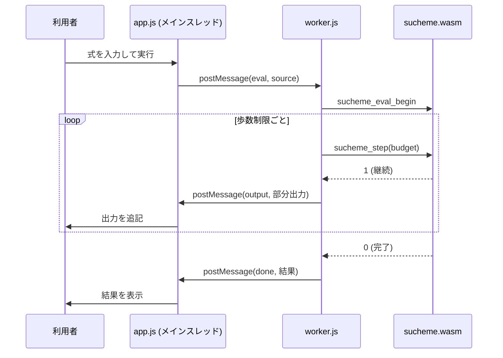

# プラットフォーム抽象、WebAssembly、Web UI

対応する決定: [ADR-0009](../adr/0009-wasm-freestanding-and-zero-dependency-web-ui.md)、[ADR-0011](../adr/0011-github-pages-pr-preview.md)、[ADR-0014](../adr/0014-repl-line-editor-boundary.md)。

## プラットフォーム抽象

インタプリタ本体がホスト環境に求めるものを最小限に絞り、1つのモジュール境界に集める。

| 機能 | ネイティブ | WASM |
| --- | --- | --- |
| 標準出力・標準エラーへの書き込み | `std.Io.File.Writer` | ホストが提供する import 関数 |
| 標準入力の読み取り | `std.Io.File.Reader` | 再開可能な要求として呼び出し側に返す |
| ファイルの開閉と読み書き | `std.Io.Dir` と `std.Io.File` | 埋め込み仮想ファイルシステムのみ(読み取り専用) |
| 現在時刻と単調時間 | `std.Io.Clock.now` | ホストが提供する import 関数 |
| 環境変数 | `std.process` | 空として扱う |
| コマンドライン引数 | `std.process.Init` | ホストが設定した配列 |
| プロセス終了 | `std.process.exit` | ホストへの通知とトラップ |
| メモリ確保 | `std.heap.SafeAllocator` または `page_allocator` | `std.heap.wasm_allocator` |

`sucheme_init` が受け取る `heap_limit_bytes` は、[runtime.md](runtime.md) の計上の対象に挙げたすべて(GC オブジェクトの本体、ヒープ外のペイロード、シンボル表、GC の作業リスト)の合計に対する上限である。オブジェクト本体だけの上限ではない。上限に達して GC を走らせても下回らない場合は状態コード `-2` を返す。

選択はコンパイル時に行う。仮想関数テーブルは使わない。

Zig 0.17.0 ではファイルとディレクトリの操作が `std.fs` から `std.Io.Dir` と `std.Io.File` へ移っている。`std.fs.cwd` は存在しない。時刻は `std.time` も残っているが、`Io` を引数に取る `std.Io.Clock.now` を使って入出力と同じ抽象に揃える。使用する記法は [zig-api-notes.md](zig-api-notes.md) に従う。

```zig
pub const platform = if (@import("builtin").target.cpu.arch.isWasm())
    @import("platform/wasm.zig")
else
    @import("platform/native.zig");
```

`std.heap.wasm_allocator` が `wasm32-freestanding` で動作することは実機で確認した。

## WebAssembly の境界

`wasm32-freestanding` を対象とする。WASI は使わない。理由は、ブラウザで WASI を使うには shim ライブラリが必要になり、依存ゼロの方針と合わないこと、そして必要なホスト機能が数個しかないことである。

### エクスポート

```
sucheme_init(heap_limit_bytes: u32) -> i32      インタプリタを初期化する
sucheme_alloc(len: u32) -> u32                  入力文字列用の領域を確保する。失敗は 0
sucheme_free(ptr: u32, len: u32) -> i32         領域を解放する
sucheme_eval_begin(ptr: u32, len: u32) -> i32   入力を読み取り評価を開始する
sucheme_step(budget: u32) -> i32                実行を進める
sucheme_output_ptr() -> u32                     出力バッファの先頭
sucheme_output_len() -> u32                     出力バッファの長さ
sucheme_output_clear() -> i32                   出力バッファを空にする
sucheme_provide_input(ptr: u32, len: u32) -> i32 入力待ちに応答する
sucheme_reset() -> i32                          状態を捨てて初期状態に戻す
sucheme_version_ptr() -> u32
sucheme_version_len() -> u32
```

文字列はすべて UTF-8 とする。文字列表現に UTF-8 を選んだ理由の一つがこの境界である。

### 状態コード

`sucheme_alloc` `sucheme_output_ptr` `sucheme_output_len` `sucheme_version_ptr` `sucheme_version_len` を除くすべてのエクスポートは、共通の状態コードを `i32` で返す。戻り値の意味を関数ごとに変えない。

| 値 | 意味 | 直後に呼べる関数 |
| --- | --- | --- |
| 0 | 成功。評価が完了した場合もこれを返す | すべて |
| 1 | 継続。`sucheme_step` に続きがある | `sucheme_step` と読み取り専用アクセサ |
| 2 | 入力待ち。`sucheme_provide_input` を待っている | `sucheme_provide_input` と読み取り専用アクセサ |
| -1 | Scheme のエラー。未処理例外を含む。出力バッファに整形済みの内容がある | `sucheme_eval_begin` `sucheme_reset` と読み取り専用アクセサ |
| -2 | 資源の上限超過。ヒープ上限に達した | `sucheme_reset` と読み取り専用アクセサ |
| -3 | 呼び出し順序の誤り。入力待ちでないのに `sucheme_provide_input` を呼んだなど | `sucheme_reset` と読み取り専用アクセサ |
| -4 | 初期化されていない。`sucheme_init` を呼ぶ前に他を呼んだ | `sucheme_init` |

負の値を返した場合、エラーの説明は出力バッファに UTF-8 で書かれている。ホストは `sucheme_output_ptr` と `sucheme_output_len` で取得する。別のエラー文字列取得関数は設けない。経路を増やすと有効期限の契約も増えるためである。

`sucheme_alloc` は成功するとポインタを返し、確保に失敗すると 0 を返す。線形メモリの先頭は使わないので 0 を失敗の表現に使える。

### sucheme_free の引数規約

`sucheme_free(ptr, len)` の `len` は、その `ptr` を返した `sucheme_alloc` に渡した長さと一致しなければならない。一致しない呼び出しは契約違反である。

これを定めるのは、Zig のアロケータが解放時に長さを受け取り、長さからサイズクラスを決めるためである。`sucheme_alloc(100)` で得た領域に 50 バイトだけ書き込んで `sucheme_free(ptr, 50)` を呼ぶと、100 バイトの確保を別のサイズクラスとして解放し、アロケータの内部状態を壊す。`TextEncoder.encodeInto` の結果の長さをそのまま渡す形が最も踏みやすい。

ホストは確保時の長さを保持し、解放時にそれを渡す。`web/sucheme.js` は確保した領域をラップするオブジェクトを返し、長さを利用者に管理させない形にする。契約違反を検出できるよう、Zig 側は確保した長さを記録して不一致を `-3` で返す検査を `Debug` ビルドで行う。

### 所有権と有効期限の契約

評価は複数回の `sucheme_step` にまたがるため、境界をまたぐ領域の所有権と有効期限を ABI の一部として定める。決めないと JS 側と WASM 側の実装が食い違い、解放済み領域の参照や二重解放になる。

入力領域はホストが所有する。

- `sucheme_alloc` が返した領域はホストが所有する。解放の責任はホストにあり、`sucheme_free` で解放する。
- `sucheme_eval_begin` と `sucheme_provide_input` は、渡された領域の内容を WASM 側の記憶域に複製する。関数から戻った時点でホストは領域を解放してよい。評価の継続中も参照しない。
- 複製する方式を選ぶのは、所有権の移動がないほうがホスト側の実装を誤りにくいためである。入力は通常小さいので複製の費用は問題にならない。
- WASM 側が所有権を引き取る方式(ホストが解放してはならない)は採らない。エラー経路で誰が解放するかが曖昧になるためである。

出力領域は WASM 側が所有する。

- `sucheme_output_ptr` と `sucheme_output_len` が返す領域は WASM 側が所有する。ホストは解放してはならない。
- 読み取り専用アクセサは領域を無効にしない。`sucheme_output_ptr` `sucheme_output_len` `sucheme_version_ptr` `sucheme_version_len` は状態を変えないため、ポインタを得てから長さを得る通常の手順が契約違反にならない。
- 領域を無効にしうる関数は次に限る。`sucheme_step` `sucheme_eval_begin` `sucheme_provide_input` `sucheme_output_clear` `sucheme_reset`。ホストはこれらを呼ぶ前に、必要な内容を自身の記憶域へ複製する。
- `sucheme_alloc` と `sucheme_free` は出力領域の内容を変えない。ただし線形メモリを拡張しうるため、後述のビューの作り直しは必要である。
- `sucheme_version_ptr` と `sucheme_version_len` が返す領域は静的で、モジュールの寿命の間ずっと有効である。

線形メモリの拡張に注意する。WASM の線形メモリが拡張されると、JS 側が保持していた `ArrayBuffer` のビューは切り離されて使えなくなる。これは領域の有効期限とは別の話である。ホストは、メモリを拡張しうる関数(`sucheme_alloc` と、上の無効化する関数)を呼んだ後にビューを作り直す。これは `WebAssembly.Memory` の仕様による制約であり、本処理系の都合ではない。

この契約は `web/sucheme.js` の実装とコメントに反映し、契約に反する使い方を単体で検出できるようにする。

### インポート

```
env.host_write_stdout(ptr: u32, len: u32)
env.host_write_stderr(ptr: u32, len: u32)
env.host_now_ms() -> f64
```

3つに限る。import 関数を通じた出力と、エクスポートの出力バッファ経由の取得の両方を用意するのは、逐次出力と一括取得の両方を使いたいためである。

ホスト関数の import と、`alloc` による領域確保、文字列の往復は実機で確認した。

### 再開可能性

`sucheme_step` が歩数制限で戻る設計は、ランタイム設計の `step_budget` に対応する。これにより次の3つが同時に成立する。

- ブラウザのメインスレッドを長時間占有しない。
- 実行の中断(停止ボタン)を実現できる。
- ブラウザで `read` が実装できる。入力が必要になった時点で状態コード 2(入力待ち)を返し、ホストが `sucheme_provide_input` で応答してから `sucheme_step` を再開する。

ブラウザで入力を待つために `SharedArrayBuffer` と `Atomics.wait` を使う方式は採用しない。この方式は COOP と COEP のレスポンスヘッダを必要とし、GitHub Pages ではヘッダを設定できないためである。再開可能な機械であればヘッダ設定なしに同じ目的を達成できる。

### パニックとエラー

`wasm32-freestanding` では既定のパニック処理が使えない。ルートソースファイルに次を置く。

```zig
pub const panic = std.debug.FullPanic(wasmPanic);

fn wasmPanic(msg: []const u8, _: ?usize) noreturn {
    host_write_stderr(msg.ptr, msg.len);
    @trap();
}
```

宣言名が小文字の `panic` であり、型(名前空間)でなければならないことは実機で確認した。

パニックは実装の不具合を意味する。Scheme プログラムの誤りはパニックではなく条件オブジェクトで表現する(アーキテクチャの不変条件)。

## Web UI

`web/` に置くサブプロジェクト。npm パッケージ、バンドラ、CDN を使わない素の HTML と CSS と JavaScript モジュールで構成する。

| ファイル | 役割 |
| --- | --- |
| `web/index.html` | 画面 |
| `web/style.css` | 配色とレイアウト。ブラウザの配色設定に追従する |
| `web/sucheme.js` | WASM の読み込みとエクスポート呼び出しの薄い層 |
| `web/worker.js` | Web Worker 上でインタプリタを動かす |
| `web/app.js` | 画面の制御 |
| `web/sucheme.wasm` | ビルド成果物。リポジトリにはコミットしない |

依存ゼロとする理由は3つある。GitHub Pages への配置がファイルのコピーだけで済むこと、供給連鎖の面を増やさないこと、Dependabot の対象エコシステムを増やさないことである。

### 構成



Worker 上で動かすことで、長時間の計算中も画面が応答し、停止ボタンが機能する。

### 段階ごとの範囲

- 段階1: 入力欄、実行ボタン、出力欄のみ。式を1つ評価して結果を表示する。
- 段階3: サンプルプログラムの選択、URL フラグメントによる共有。
- 段階7以降: 複数行編集の補助、括弧の対応表示、履歴。
- 段階8: `read` による対話、エラー位置の表示、処理の中断。

いずれの段階でも「ブラウザで試せる」状態を保つことを要件とする。

### 配置

GitHub Pages に配置する。リリース時の正式版に加えて、PR ごとのプレビューを用意する。方式は [ADR-0011](../adr/0011-github-pages-pr-preview.md) で定める。

## REPL の行編集

最終的に複数行編集と Emacs バインディングを要件とする。段階1では素朴な行読み取りで始めるため、境界を先に定めておく。

```zig
pub const LineReader = union(enum) {
    dumb: Dumb,  // 行単位。端末でない入力(パイプ・ファイル)でも使う
    rich: Rich,  // 生モードでの編集。段階7で実装する

    pub fn read(self: *LineReader, prompt: []const u8) ReadError!?[]const u8 { ... }
};
```

入力が完結したかどうかの判定はリーダに委ねる。括弧の数を数える方式は、文字列やブロックコメントの中の括弧で誤判定するため使わない。この判定は `dumb` と `rich` の両方が同じ関数を使う。

段階7で実装する要件は次のとおり。

- カーソル移動、削除、キルリングと貼り付け、単語単位の操作、入れ替え、取り消しの Emacs 標準のキー割り当て
- 複数行の式の編集。論理行をまたぐカーソル移動と再描画
- 履歴の保存と検索
- 括弧の対応表示
- 識別子の補完
- 端末の生モード。POSIX では termios、Windows では仮想端末シーケンスの有効化

自前実装にするか既存の C ライブラリを取り込むかは段階7で判断する。段階1から段階6では `dumb` のみを使い、`rich` の有無が他の部分に影響しない構造を保つ。
