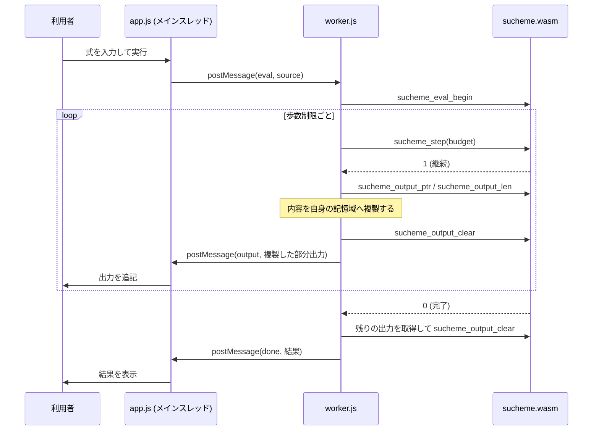

# プラットフォーム抽象、WebAssembly、Web UI

対応する決定: [ADR-0009](../adr/0009-wasm-freestanding-and-zero-dependency-web-ui.md)、[ADR-0021](../adr/0021-no-github-pages-defer-hosting.md)、[ADR-0014](../adr/0014-repl-line-editor-boundary.md)。配置についての決定は ADR-0021 が最新で、置き換えられた旧ADRは ADR-0021 が名前を挙げている。

## プラットフォーム抽象

インタプリタ本体がホスト環境に求めるものを最小限に絞り、1つのモジュール境界に集める。

| 機能 | ネイティブ | WASM |
| --- | --- | --- |
| 標準出力・標準エラーへの書き込み | `std.Io.File.Writer` | ホストが提供する import 関数 |
| 標準入力の読み取り | `std.Io.File.Reader` | 再開可能な要求として呼び出し側に返す |
| ファイルの開閉と読み書き | `std.Io.Dir` と `std.Io.File` | 埋め込み仮想ファイルシステムのみ(読み取り専用) |
| 現在時刻と単調時間 | `std.Io.Clock.now` | ホストが提供する import 関数 |
| 環境変数 | `std.process` | 空として扱う |
| コマンドライン引数 | `std.process.Init` | ホストが設定した配列 |
| プロセス終了 | `std.process.exit` | ホストへの通知とトラップ |
| メモリ確保 | `std.heap.SafeAllocator` または `page_allocator` | `std.heap.wasm_allocator` |

`sucheme_init` が受け取る `heap_limit_bytes` は、[runtime.md](runtime.md) の計上の対象に挙げたすべての合計に対する上限である。オブジェクト本体だけの上限ではない。対象の一覧をここに複製せず、同文書を参照する。上限に達した場合の扱いは後述の状態コードの節で定める。1 GiB を超える値は 1 GiB に丸める。wasm32 の線形メモリは全体で 4 GiB で、計上は実メモリの約半分なので、丸めないと上限に届く前に実メモリが尽きて trap する。

選択はコンパイル時に行う。仮想関数テーブルは使わない。

Zig 0.17.0 ではファイルとディレクトリの操作が `std.fs` から `std.Io.Dir` と `std.Io.File` へ移っている。`std.fs.cwd` は存在しない。時刻は `std.time` も残っているが、`Io` を引数に取る `std.Io.Clock.now` を使って入出力と同じ抽象に揃える。使用する記法は [zig-api-notes.md](zig-api-notes.md) に従う。

```zig
pub const platform = if (@import("builtin").target.cpu.arch.isWasm())
    @import("platform/wasm.zig")
else
    @import("platform/native.zig");
```

`std.heap.wasm_allocator` が `wasm32-freestanding` で動作することは実機で確認した。

## WebAssembly の境界

`wasm32-freestanding` を対象とする。WASI は使わない。理由は、ブラウザで WASI を使うには shim ライブラリが必要になり、依存ゼロの方針と合わないこと、そして必要なホスト機能が数個しかないことである。

### エクスポート

```
// 状態コードを返す(6つ)
sucheme_init(heap_limit_bytes: u32) -> i32       インタプリタを初期化する
sucheme_eval_begin(ptr: u32, len: u32) -> i32    入力を読み取り評価を開始する
sucheme_step(budget: u32) -> i32                 実行を進める
sucheme_provide_input(ptr: u32, len: u32) -> i32 入力待ちに応答する
sucheme_provide_eof() -> i32                     入力の終端を伝える
sucheme_reset() -> i32                           状態を捨てて初期状態に戻す

// 状態コードを返さない(9つ)
sucheme_alloc(len: u32) -> u32                   入力文字列用の領域を確保する。失敗と初期化前は 0
sucheme_free(ptr: u32, len: u32)                 領域を解放する
sucheme_output_ptr() -> u32                      出力バッファの先頭
sucheme_output_len() -> u32                      出力バッファの長さ
sucheme_output_clear()                           出力バッファを空にする
sucheme_set_command_line(ptr: u32, len: u32) -> u32  コマンドライン引数を設定する(改行区切り)。成功は 1、不正な UTF-8 は 0
sucheme_exit_code() -> i32                       直前の -6 に対応する終了コード
sucheme_version_ptr() -> u32
sucheme_version_len() -> u32
```

文字列はすべて UTF-8 とする。文字列表現に UTF-8 を選んだ理由の一つがこの境界である。

### UTF-8 の妥当性検証

境界で受け取ったバイト列は妥当な UTF-8 であることを検証する。リーダは境界の検査に頼るだけでなく、文字列リテラルのバイトを文字列にする前に自分でも確かめ、妥当でなければ `InvalidUtf8` を返す(リーダに任意のバイトを直接渡すファズでも、不正な文字列がヒープに入らないようにするためである)。検証せずに受け入れると、`char` が Unicode スカラ値であるという宣言([runtime.md](runtime.md) の値表現)に反する値が `string-ref` から得られ、文字数とバイト位置の対応も崩れる。

バイト列が文字列になる経路を全部数え上げる。1つでも漏らすと、その経路から不正な文字列が処理系の中に入る。

| 箇所 | 不正なときの扱い |
| --- | --- |
| `sucheme_eval_begin` と `sucheme_provide_input` が受け取るバイト列 | 状態コード `-3` を返し、出力バッファに位置を示す説明を書く。インタプリタの状態は変えない |
| `sucheme_set_command_line` が受け取るバイト列 | 0 を返して設定を変えない。出力バッファには書かない |
| ネイティブのコマンドライン引数 | 起動時に検証し、不正なら標準エラーに説明を書いて非ゼロの終了コードで終わる |
| ネイティブの標準入力(REPL の行読み取り、パイプ、リダイレクト) | 読んだ行を検証し、不正なら読み取りエラーとして報告してプロンプトに戻る。処理系は終了しない |
| ネイティブの環境変数 | `get-environment-variable` と `get-environment-variables` の呼び出し時に検証する。単数形は条件オブジェクトを送出する。複数形は不正な項目を結果の alist から除く |
| ファイルから読んだバイト列(テキストポート) | 下の表に従って報告する |
| `utf8->string`(R7RS 6.9) | 条件オブジェクトを送出する |
| リーダの16進エスケープ(`#\xD800`、`"\xD800;"`、縦棒識別子の `\x`)| スカラ値の範囲を検査し、範囲外なら読み取りエラーとする([numerics-and-unicode.md](numerics-and-unicode.md) の文字の有効範囲)|
| 埋め込んだ Scheme ソースと埋め込み仮想ファイルシステムの内容 | ビルド時に検証し、不正ならビルドを失敗させる。実行時には妥当とみなす |

ネイティブの標準入力を落とすと、同じ入力でネイティブとブラウザの挙動が違う。ブラウザでは `sucheme_provide_input` が `-3` で拒否するのに、ネイティブでは不正なバイト列が文字列に入る。Latin-1 で保存した `(display "café")` の行を貼り付ける場合がこれに当たる。

`get-environment-variables` を複数形として別に書くのは、R7RS 6.14 が単数形についてだけ「It is an error if get-environment-variable can't decode the value」と定めており、複数形については何も述べていないためである。1つの変数が不正なだけで alist 全体が取れなくなるのは使いにくいので、その項目を除く。

`utf8->string` の根拠は R7RS 6.9 の「It is an error for bytevector to contain invalid UTF-8 byte sequences」である。6.7 の「It is an error to pass such a forbidden character ... or in UTF-8 encoded form within a bytevector passed to utf8->string」は、処理系が文字列に現れることを禁じた文字についての規定であり、整形式でないバイト列の規定ではない。本処理系は Unicode スカラ値をすべて許すので禁止文字が存在せず、6.7 は拒否の根拠にならない。

リーダの16進エスケープを落とすと、`integer->char` だけを検査しても塞げない。R7RS 7.1.1 の `<hex scalar value>` は桁数も値域も制限していないので、`#\xD800` と `"\xD800;"` は文法上正しい字句である。

`string->symbol` と `string-append` のように、既存の文字列から文字列を作る経路は検証しない。入力の時点で妥当なので構成上妥当である。`integer->char` はスカラ値の範囲を検査するので、不正なスカラ値から文字列が作られることはない。

Windows では引数と環境変数が UTF-16 で渡される。Zig 0.17.0 はこれを WTF-8 に変換し、対になっていないサロゲートを3バイトで残す。この並びは `utf8ValidateSlice` が拒否するので、下の検査を通せば Scheme の文字列には入らない。標準ライブラリのソースの読解と Linux 上の単体テストで確かめた内容は [zig-api-notes.md](zig-api-notes.md) にあり、Windows 実機での実行は未確認である。引数が Scheme の文字列になる経路は `command-line` が入る段階5まで無いので、検査を足す位置はその段階で決める。

妥当な UTF-8 でないものをすべて拒否する。判定は `std.unicode.utf8ValidateSlice` に委ね、自前で条件を列挙しない。列挙すると取りこぼす。実機で確認したところ、過長符号化(`0xC0 0x80`)、サロゲート符号位置の符号化、5バイト列、不完全な列、継続バイトの単独出現に加えて、`0xFE` と `0xFF` も `false` になる。後者2つは「過長」「サロゲート」「U+10FFFF 超過」のどれにも当てはまらないため、条件を数え上げる書き方では漏れる。

置換文字への差し替えは行わない。黙って内容を変えると、往復しない文字列が処理系の中に入る。

バイナリポートはバイト列をそのまま扱うので検証しない。`string->utf8` は妥当な文字列からバイト列を作るだけなので検証する対象がない。検証が必要なのはバイト列から文字列を作る向き、すなわち `utf8->string` である。

テキストポートの復号エラーの報告は、呼ばれた手続きで分ける。入力元で括ってはならない。

| 手続き | 報告 |
| --- | --- |
| `read` | `read-error?` が真になる条件オブジェクト |
| `read-char` `read-line` `read-string` `peek-char` `char-ready?` | `read-error?` が偽になる条件オブジェクト |

R7RS 6.11 は `read-error?` を「Returns #t if obj is an object raised by the read procedure or by the inability to open an input or output port on a file, respectively. Otherwise, it returns #f」と定めている。真になるのは `read` 手続きが送出したものと、ポートを開けなかった場合に限る。`read-char` の復号エラーで真を返すと、`(guard (e ((read-error? e) 'read-err) (else 'other)) (read-char p))` が `'other` ではなく `'read-err` になる。

検証は上の表の箇所で1回だけ行う。

### 状態コード

エクスポートは2群に分かれる。状態機械の状態を遷移させる6つは共通の状態コードを `i32` で返し、残りの9つは状態コードを返さない。上のエクスポート一覧の2群がこの区別である。どちらの群に属するかは関数ごとに固定で、戻り値の意味を関数ごとに変えない。

2群に分けるのは、混ぜると成功を表す `0` がホスト側の保持する状態を上書きし、通常の手順が契約違反になるためである。

状態コードを返さない9つは、どの状態でも呼べ、状態機械の状態を変えない。出力バッファの内容は `sucheme_output_clear` が空にし、`sucheme_set_command_line` は次回の `sucheme_eval_begin` から有効になる値を置くが、いずれも状態機械の状態には影響しない。

初期化前(状態 -5)にも呼べる。`-5` を返した呼び出しのエラーの説明を出力バッファから読む手順があるので、初期化後に限ると読めなくなる。初期化前の振る舞いを次のとおり定める。

| 関数 | 初期化前の振る舞い |
| --- | --- |
| `sucheme_output_ptr` `sucheme_output_len` | 静的に確保した起動前バッファを指す。`sucheme_init` が失敗した場合の説明もここに入る |
| `sucheme_version_ptr` `sucheme_version_len` | 通常どおり静的な領域を返す |
| `sucheme_output_clear` | 起動前バッファを空にする |
| `sucheme_alloc` | 0 を返す |
| `sucheme_free` | 何もしない |
| `sucheme_set_command_line` | 0 を返して何もしない |

バージョン領域は初期化と無関係に、モジュールの寿命の間ずっと有効である。UI が初期化前にバージョンを表示できる。

| 関数 | 戻り値 |
| --- | --- |
| `sucheme_alloc` | 確保したポインタ。失敗と初期化前は 0 |
| `sucheme_free` | なし。`len` が確保時の記録と一致しない場合は全ビルドで panic する |
| `sucheme_output_ptr` `sucheme_output_len` `sucheme_version_ptr` `sucheme_version_len` | それぞれの値 |
| `sucheme_output_clear` | なし |
| `sucheme_set_command_line` | `u32`。成功なら 1、妥当な UTF-8 でなければ 0 を返して設定を変えない |
| `sucheme_exit_code` | `i32`。直前の `-6` に対応する終了コード。`-6` を一度も返していなければ 0 |

`sucheme_free` の引数の誤りを状態コードで報告しないのは、報告すると状態を遷移させる関数になり、同じ矛盾が戻るためである。契約違反はホスト側の実装の誤りなので panic で検出する。`Debug` ビルドに限らないのは、不一致のまま解放するとアロケータの内部状態が壊れ、以降の確保が未定義の振る舞いになるためである。

状態コードの契約は2つの表で定める。1つは値から次に呼べる関数への対応、もう1つは関数から返しうる値への対応である。片方だけでは実装できない。

下の表の「直後に呼べる関数」は、状態コードを返す6つのうちどれを呼べるかを示す。状態コードを返さない9つはいつでも呼べるので、この欄には挙げない。

| 値 | 意味 | 直後に呼べる関数 |
| --- | --- | --- |
| 0 | 成功。評価が完了した場合もこれを返す | `sucheme_eval_begin` `sucheme_reset` |
| 1 | 継続。`sucheme_step` に続きがある | `sucheme_step` `sucheme_reset` |
| 2 | 入力待ち。`sucheme_provide_input` または `sucheme_provide_eof` を待っている | `sucheme_provide_input` `sucheme_provide_eof` `sucheme_reset` |
| -1 | Scheme のエラー。未処理例外を含む。出力バッファに整形済みの内容がある | `sucheme_eval_begin` `sucheme_reset` |
| -2 | 回復不能。送出のための予約領域を使い切り、送出する条件を作れなかった。出力バッファに `error: heap limit exceeded` の一行がある。段階2のスライス 2e から、このコードを返す(`src/wasm.zig`)。`sucheme_reset` の前に `sucheme_eval_begin` を呼ぶと、状態を変えず、説明の一行を出力に足して -4 を返す | `sucheme_reset` |
| -3 | 渡されたバイト列が妥当な UTF-8 でない。状態は変わっていない | 呼び出し前の状態で呼べたものすべて |
| -4 | 呼び出し順序の誤り。ホスト側の実装の誤り。状態は変わっていない | 呼び出し前の状態で呼べたものすべて |
| -5 | 初期化されていない | `sucheme_init` |
| -6 | プログラムが `exit` または `emergency-exit` を呼んだ。終了コードは専用のアクセサで取る | `sucheme_reset` |
| -7 | 初期化または再初期化に必要な領域を確保できなかった。同じ上限で再試行しても同じ結果になる | なし。ホストはより小さい上限で `sucheme_init` を呼ぶか、モジュールを捨てる |
| -8 | 引数の (ptr, len) が確保済みの領域を指していない。ホスト側の実装の誤り。状態は変わっていない | 呼び出し前の状態で呼べたものすべて |

関数ごとに返しうる値は次のとおりである。

| 関数 | 返しうる値 |
| --- | --- |
| `sucheme_init` | 0(初期化できた)、-4(すでに初期化済み)、-7(確保に失敗した) |
| `sucheme_eval_begin` | 1、0、-1、-2、-3、-4、-5、-6、-8 |
| `sucheme_step` | 1、2、0、-1、-2、-4、-5、-6 |
| `sucheme_provide_input` | 1、-1、-2、-3、-4、-5、-6、-8 |
| `sucheme_provide_eof` | 1、-4、-5 |
| `sucheme_reset` | 0、-5、-7 |

`sucheme_reset` が -5 を返すのは、初期化の前に呼ばれたときである。何も捨てず、起動前バッファに説明を書く。リセットは初期化済みの状態を前提にするので、-5 の行の指示どおり `sucheme_init` を呼ぶ。

`sucheme_init` が成功したときに 0 を返すのは、その後に呼べるのが `sucheme_eval_begin` だからである。0 の行の「直後に呼べる関数」と一致する。

`sucheme_eval_begin` は通常 1 を返す。式を読んで評価を開始し、まだ終わっていない状態である。歩数を使わずに完了する場合(入力が空、コメントだけ、`(quote x)` のような1歩の式)は 0 を返す。0 を返したあとにホストが `sucheme_step` を呼ぶと -4 になるので、ホストは戻り値が 1 のときだけ `sucheme_step` のループに入る。この区別がないと、空の入力欄で実行ボタンを押しただけで「ホスト側の実装の誤り」が報告される。

`sucheme_provide_input` は 2 を返さない。入力を受け取って評価を再開できる状態にするので 1 を返し、次の `read` でまた入力が必要になったときは `sucheme_step` が 2 を返す。

`-3` と `-4` は、どちらも状態を変えずに戻る。状態コードを返す6つの関数は、引数と現在の状態を先に検査し、`-3` `-4` `-8` を返す場合は何も変えない。これを ABI の不変条件とする。したがってホストは、呼び出し前の状態で呼べた関数をそのまま呼び続けられる。

ここで「状態」とは状態機械の状態、すなわち上の表の値に対応する局面と、ヒープ上の定義の全体である。出力バッファの内容はこれに含まれない。`-3` `-4` `-8` を返す呼び出しは、エラーの説明を出力バッファに書くため、バッファにあった内容を失わせる。

したがってホストは、出力バッファの内容を読んだら必要な分を自分の記憶域へ複製してから次の呼び出しに進む。これは下の有効期限の契約に書いたとおりで、`sucheme_eval_begin` と `sucheme_provide_input` は出力領域を無効にしうる関数である。

状態機械の状態を変えずに戻ることを不変条件にするのは、ホスト側の軽微な誤りで利用者の作業を失わせないためである。初期化済みの状態で `sucheme_init` を重ねて呼んだだけ、あるいは評価の完了後に `sucheme_step` を1回多く呼んだだけで、全定義を捨てる `sucheme_reset` を強制する理由はない。同じく、Web UI が貼り付けられたバイナリ混じりの文字列1つで全定義を失うことも避けられる。

`-3` と `-4` を別の値にするのは、ホストが取る手段が違うためである。`-3` は利用者が与えたデータの誤りなので、利用者に知らせて入力をやり直させる。`-4` はホスト側の実装の誤りなので、開発中に気づく必要がある。

`sucheme_init` は状態 -5 でのみ成功する。初期化済みの状態で再び呼ぶと、ヒープにも状態にも触れずに `-4` を返す。ヒープ全体を作り直したい場合は `sucheme_reset` を使う。

`-7` を別の値にするのは、ホストの再試行を止めるためである。`-5` を返すと、`-5` の行がホストに `sucheme_init` を呼ぶよう指示しているので同じ引数で呼び直して無限に繰り返す。`-7` は「この上限では初期化できない」という終端の報告である。送出のための予約領域ごと確保できない場合がこれに当たる([runtime.md](runtime.md) の送出のための予約領域)。

`-8` を `-3` と分けるのは、原因がホスト側にあるためである。`-3` は妥当な UTF-8 でないバイト列、`-8` は確保していない領域を指す (ptr, len) である。`len` に UTF-8 のバイト長ではなく JavaScript の文字列長を渡す誤りは踏みやすく、`(display "αβγ")` は文字列長13・バイト長16なので末尾が切れる。切れた位置が多バイト文字の途中なら `-3` が返り、利用者には「入力が妥当な UTF-8 でない」と報告される。入力は妥当だったので誤った報告である。`len` を大きく渡した場合は確保済みの領域の外を読み、線形メモリの外に出ればトラップしてホストに状態コードが返らない。

これを避けるため、`sucheme_alloc` が返した領域の先頭と長さを WASM 側で記録する。`sucheme_eval_begin` と `sucheme_provide_input` は、受け取った (ptr, len) が記録と一致するかを先に検査し、一致しなければ `-8` を返す。`sucheme_free` も同じ記録で長さの一致を検査する。記録は全ビルドで持つ。`Debug` ビルドだけにすると、本番で踏んだときにトラップになる。

読み取りの失敗(括弧の不均衡、不正な数値表記など)は状態コードではなく、`read-error?` が真になる条件オブジェクトで報告する。`sucheme_eval_begin` の入力に構文エラーがあれば未処理例外の経路を通って `-1` になり、説明が出力バッファに入る。`sucheme_provide_input` で与えた入力の構文エラーは、`read` の呼び出し位置で送出されるので `guard` で捕捉できる。ファイルポートからの読み取りと同じ扱いであり、入力元によって報告の形が変わらない。

ヒープ上限に達した場合は `-2` ではなく Scheme のエラーとして扱う。`guard` で捕捉できるので、捕捉されれば 0、捕捉されず最外に届けば `-1` になる。`-2` は予約領域を使い切って送出自体ができない場合に限る。詳細は [runtime.md](runtime.md) の送出のための予約領域にある。

`-6` の終了コードは `sucheme_exit_code()` で取る。出力バッファには書かない。

出力バッファに書けないのは、`exit` が未処理の `dynamic-wind` の `after` をすべて実行するためである。R7RS 6.14 は「Runs all outstanding dynamic-wind after procedures, terminates the running program, and communicates an exit value to the operating system」と規定している。`(dynamic-wind (lambda () #f) (lambda () (display "in") (exit 3)) (lambda () (display "cleanup")))` を評価すると、バッファには "in" と "cleanup" が入る。先頭行も末尾行も利用者の出力であり、終了コードを混ぜる余地がない。利用者が `(display "exit 0")` と書けば区別もできない。

`exit` の引数は整数に限らない。R7RS 6.14 は「If no argument is supplied, or if obj is #t, the exit procedure should communicate to the operating system that the program exited normally. If obj is #f, ... exited abnormally. Otherwise, exit should translate obj into an appropriate exit value for the operating system, if possible」と規定している。本処理系の変換を次のとおり定める。

| 引数 | `sucheme_exit_code()` の値 | ネイティブの終了コード |
| --- | --- | --- |
| なし、`#t` | 0 | 0 |
| `#f` | 1 | 1 |
| `i32` の範囲の正確な整数 | その値 | その値(OS が下位8ビットに切る場合はそれに従う) |
| 上記以外 | 1 | 1 |

最後の行は「変換できない場合」である。R7RS は「if possible」としているので、変換できないものを異常終了として扱う。

パニックやトラップでは `-6` を報告しない。正常な終了と実装の不具合をホストが区別できる必要がある。`exit` の後は同じインタプリタで評価を続けられないので、`sucheme_reset` のみを許す。

負の値を返した場合、エラーの説明は出力バッファに UTF-8 で書かれている。ホストは `sucheme_output_ptr` と `sucheme_output_len` で取得する。別のエラー文字列取得関数は設けない。経路を増やすと有効期限の契約も増えるためである。

`sucheme_alloc` は成功するとポインタを返し、確保に失敗すると 0 を返す。線形メモリの先頭は使わないので 0 を失敗の表現に使える。初期化前に呼んだ場合も 0 を返す。状態コードを返さない関数なので `-4` では報告できない。

### sucheme_free の引数規約

`sucheme_free(ptr, len)` の `len` は、その `ptr` を返した `sucheme_alloc` に渡した長さと一致しなければならない。一致しない呼び出しは契約違反である。

これを定めるのは、Zig のアロケータが解放時に長さを受け取り、長さからサイズクラスを決めるためである。`sucheme_alloc(100)` で得た領域に 50 バイトだけ書き込んで `sucheme_free(ptr, 50)` を呼ぶと、100 バイトの確保を別のサイズクラスとして解放し、アロケータの内部状態を壊す。`TextEncoder.encodeInto` の結果の長さをそのまま渡す形が最も踏みやすい。

ホストは確保時の長さを保持し、解放時にそれを渡す。`web/sucheme.js` は確保した領域をラップするオブジェクトを返し、長さを利用者に管理させない形にする。契約違反を検出できるよう、Zig 側は `Debug` ビルドで確保した長さを記録し、不一致なら panic する。状態コードで報告しないのは、`sucheme_free` が状態コードを返さない群に属するためである。

### 所有権と有効期限の契約

評価は複数回の `sucheme_step` にまたがるため、境界をまたぐ領域の所有権と有効期限を ABI の一部として定める。決めないと JS 側と WASM 側の実装が食い違い、解放済み領域の参照や二重解放になる。

入力領域はホストが所有する。

- `sucheme_alloc` が返した領域はホストが所有する。解放の責任はホストにあり、`sucheme_free` で解放する。
- `sucheme_eval_begin` と `sucheme_provide_input` は、渡された領域の内容を WASM 側の記憶域に複製する。関数から戻った時点でホストは領域を解放してよい。評価の継続中も参照しない。
- 複製する方式を選ぶのは、所有権の移動がないほうがホスト側の実装を誤りにくいためである。入力は通常小さいので複製の費用は問題にならない。
- WASM 側が所有権を引き取る方式(ホストが解放してはならない)は採らない。エラー経路で誰が解放するかが曖昧になるためである。

出力領域は WASM 側が所有する。

- `sucheme_output_ptr` と `sucheme_output_len` が返す領域は WASM 側が所有する。ホストは解放してはならない。
- 読み取り専用アクセサは領域を無効にしない。`sucheme_output_ptr` `sucheme_output_len` `sucheme_version_ptr` `sucheme_version_len` は状態を変えないため、ポインタを得てから長さを得る通常の手順が契約違反にならない。
- 出力領域の内容を無効にしうる関数は次に限る。`sucheme_step` `sucheme_eval_begin` `sucheme_provide_input` `sucheme_output_clear` `sucheme_reset`。ホストはこれらを呼ぶ前に、必要な内容を自身の記憶域へ複製する。`sucheme_set_command_line` が入らないのは、この関数が出力バッファに書かないと定めたためである。
- `sucheme_alloc` と `sucheme_free` は出力領域の内容を変えない。
- `sucheme_version_ptr` と `sucheme_version_len` が返す領域は静的で、モジュールの寿命の間ずっと有効である。

線形メモリの拡張に注意する。これは出力領域の有効期限とは別の軸なので、別の一覧で定める。

メモリを拡張しうる関数は `sucheme_init` `sucheme_eval_begin` `sucheme_step` `sucheme_provide_input` `sucheme_reset` `sucheme_alloc` `sucheme_set_command_line` の7つである。`sucheme_set_command_line` が入るのは、受け取った引数列を次回の `sucheme_eval_begin` まで保持するため確保を行うからである。出力バッファに書かないことと、メモリを拡張しないことは別である。

拡張しないのは `sucheme_free` `sucheme_output_ptr` `sucheme_output_len` `sucheme_output_clear` `sucheme_version_ptr` `sucheme_version_len` の6つである。

ホストは上の7つを呼んだ後に `ArrayBuffer` のビューを作り直す。既定の固定長バッファについては、WebAssembly JS API 仕様の refresh the memory buffer が `DetachArrayBuffer` を行うため、作り直さないと切り離されたバッファを読んで失敗する。`memory.toResizableBuffer()` で得た伸縮可能バッファについては同仕様が切り離さずに長さを更新するので作り直しは不要だが、本処理系の `web/sucheme.js` は固定長バッファを前提にして毎回作り直す形にする。両方を扱うと契約が増える。

この契約は `web/sucheme.js` の実装とコメントに反映し、契約に反する使い方を単体で検出できるようにする。

### インポート

```
env.host_write_stdout(ptr: u32, len: u32)
env.host_write_stderr(ptr: u32, len: u32)
env.host_now_ms() -> f64
```

3つに限る。プロセス終了とコマンドライン引数は import で扱わない。終了は状態コード `-6` で報告し、引数はエクスポート `sucheme_set_command_line(ptr, len)` でホストが設定する(改行区切りの UTF-8)。設定は次回の `sucheme_eval_begin` から有効になるので、評価の途中で `(command-line)` の値が変わることはない。設定されていなければ `(command-line)` は処理系の名前だけの1要素のリストを返す。R7RS 6.14 は `command-line` が「the command line passed to the process」を返すとし、先頭要素は処理系に依存するとしている。

import を増やさないのは、ホスト側が用意しなければならない関数を最小に保つためである。エクスポートと状態コードで表せるものは import にしない。import 関数を通じた出力と、エクスポートの出力バッファ経由の取得の両方を用意するのは、逐次出力と一括取得の両方を使いたいためである。

ホスト関数の import と、`alloc` による領域確保、文字列の往復は実機で確認した。

### 再開可能性

`sucheme_step` が歩数制限で戻る設計は、ランタイム設計の `step_budget` に対応する。これにより次の3つが同時に成立する。

- ブラウザのメインスレッドを長時間占有しない。
- 実行の中断(停止ボタン)を実現できる。
- ブラウザで `read` が実装できる。入力が必要になった時点で状態コード 2(入力待ち)を返し、ホストが `sucheme_provide_input` で応答してから `sucheme_step` を再開する。

入力待ちには終端が必要である。R7RS 6.13.2 は `read-char` について「If no more characters are available, an end-of-file object is returned.」と規定しているので、ホストが「これ以上入力はない」と伝える手段がなければ `(eof-object? c)` が真になることがなく、入力を読むループが終わらない。

終端は専用のエクスポート `sucheme_provide_eof()` で伝える。`sucheme_provide_input(ptr, 0)` を終端の意味にはしない。長さ0の入力(空行)と終端は別の事象であり、同じ呼び出しで表すとホストが空行を渡せなくなる。このエクスポートは状態コードを返す群に入るので、群の件数は6つになる。

渡したバイト列が1回の読み取りより長い場合は、残りを WASM 側の入力バッファに保持し、次の読み取りが先にそこから取る。捨てない。捨てると `(list (read-char) (read-char))` に `sucheme_provide_input("ab")` を1回渡したときの結果が実装によって変わる。バッファが空になってから次の読み取りが来たときに 2 を返す。終端を受け取った後は、以降のすべての読み取りが EOF を返す。入力バッファも計上の対象に含める([runtime.md](runtime.md) の計上の対象)。

ブラウザで入力を待つために `SharedArrayBuffer` と `Atomics.wait` を使う方式は採用しない。この方式は COOP と COEP のレスポンスヘッダを必要とする。配置先を段階8まで決めないので([ADR-0021](../adr/0021-no-github-pages-defer-hosting.md))、ヘッダを設定できる保証がない。ローカルで開く場合も、簡易な静的サーバがこれらのヘッダを返すとは限らない。再開可能な機械であればヘッダ設定なしに同じ目的を達成できる。

### パニックとエラー

`wasm32-freestanding` では既定のパニック処理が使えない。ルートソースファイルに次を置く。

```zig
pub const panic = std.debug.FullPanic(wasmPanic);

fn wasmPanic(msg: []const u8, _: ?usize) noreturn {
    host_write_stderr(msg.ptr, msg.len);
    @trap();
}
```

宣言名が小文字の `panic` であり、型(名前空間)でなければならないことは実機で確認した。

パニックは実装の不具合を意味する。Scheme プログラムの誤りはパニックではなく条件オブジェクトで表現する(アーキテクチャの不変条件)。

## Web UI

`web/` に置くサブプロジェクト。npm パッケージ、バンドラ、CDN を使わない素の HTML と CSS と JavaScript モジュールで構成する。

| ファイル | 役割 |
| --- | --- |
| `web/index.html` | 画面 |
| `web/style.css` | 配色とレイアウト。ブラウザの配色設定に追従する |
| `web/sucheme.js` | WASM の読み込みとエクスポート呼び出しの薄い層 |
| `web/worker.js` | Web Worker 上でインタプリタを動かす |
| `web/app.js` | 画面の制御 |
| `web/sucheme.wasm` | ビルド成果物。リポジトリにはコミットしない |

依存ゼロとする理由は3つある。配置がファイルのコピーだけで済むこと、供給連鎖の面を増やさないこと、Dependabot の対象エコシステムを増やさないことである。1つ目は配置先を選ぶ自由にもつながる。静的ファイルを置ければどのサービスでもよい([ADR-0021](../adr/0021-no-github-pages-defer-hosting.md))。

### 構成



Worker 上で動かすことで、長時間の計算中も画面が応答し、停止ボタンが機能する。

各ラウンドで出力を取得したら `sucheme_output_clear` を呼ぶ。呼ばないとバッファが単調増加し、同じ内容を毎ラウンド再送するため転送量が出力長の二乗に比例する。無限ループの `display` で線形メモリを食い潰す。出力バッファも計上の対象である([runtime.md](runtime.md) の計上の対象)。

### 段階ごとの範囲

- 段階1: 入力欄、実行ボタン、出力欄のみ。式を1つ評価して結果を表示する。
- 段階3: サンプルプログラムの選択、URL フラグメントによる共有。
- 段階7以降: 複数行編集の補助、括弧の対応表示、履歴。
- 段階8: `read` による対話、エラー位置の表示、処理の中断。

いずれの段階でも「ブラウザで試せる」状態を保つことを要件とする。

### 配置

段階7までは配置しない。段階8で、private にアクセス制限できるクラウドに置く([ADR-0021](../adr/0021-no-github-pages-defer-hosting.md))。配置先のサービスは段階8で選ぶ。

段階1から段階7は、PR のたびに `.github/workflows/preview.yml` が成果物 `sucheme-web` を上げる。中身は、`web/` のファイル(`serve.mjs` を含む)と `sucheme.wasm` を1つのディレクトリに並べたもので、`actions/upload-artifact` が zip にまとめる。保持期間は7日である。レビュアは zip を展開し、展開したディレクトリで `node serve.mjs` を実行して、表示された URL をブラウザで開く。Node.js だけが要り、Zig もリポジトリも要らない。

ローカルで開く手段には制約がある。`file://` から始まる取得は Fetch の対象外であり、`.wasm` だけでなくモジュールスクリプトと Worker のスクリプト取得も失敗する。したがって `file://` で直接開く道は閉じており、ローカルの HTTP サーバを立てる形に絞られる。理由と、zip を開くレビュアとの関係は [ADR-0021](../adr/0021-no-github-pages-defer-hosting.md) にある。手段は `web/serve.mjs` に決めた([plans/0008-slice-1i-wasm-web-ui.md](../plans/0008-slice-1i-wasm-web-ui.md))。

## REPL の行編集

最終的に複数行編集と Emacs バインディングを要件とする。段階1では素朴な行読み取りで始めるため、境界を先に定めておく。

```zig
pub const LineReader = union(enum) {
    dumb: Dumb,  // 行単位。端末でない入力(パイプ・ファイル)でも使う
    rich: Rich,  // 生モードでの編集。段階7で実装する

    pub fn read(self: *LineReader, prompt: []const u8) ReadError!?[]const u8 { ... }
};
```

入力が完結したかどうかの判定はリーダに委ねる。括弧の数を数える方式は、文字列やブロックコメントの中の括弧で誤判定するため使わない。この判定は `dumb` と `rich` の両方が同じ関数を使う。

段階7で実装する要件は次のとおり。

- カーソル移動、削除、キルリングと貼り付け、単語単位の操作、入れ替え、取り消しの Emacs 標準のキー割り当て
- 複数行の式の編集。論理行をまたぐカーソル移動と再描画
- 履歴の保存と検索
- 括弧の対応表示
- 識別子の補完
- 端末の生モード。POSIX では termios、Windows では仮想端末シーケンスの有効化

自前実装にするか既存の C ライブラリを取り込むかは段階7で判断する。段階1から段階6では `dumb` のみを使い、`rich` の有無が他の部分に影響しない構造を保つ。
