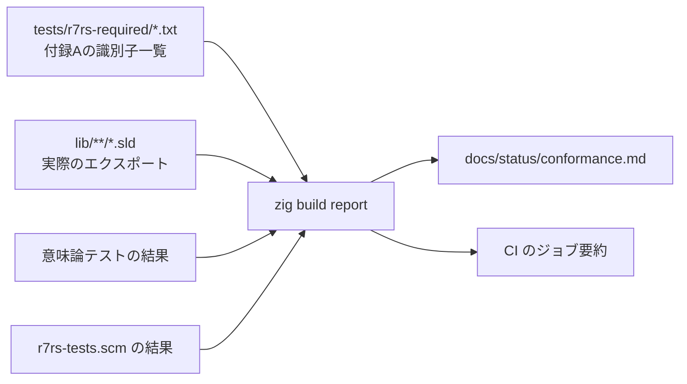

# R7RS 要件の分解と準拠マトリクス

準拠の達成度を測る枠組みを定める。進捗をリポジトリから読み取れるようにするための土台でもある。

対応する決定: [ADR-0013](../adr/0013-testing-strategy-and-conformance-suite.md)。

## 一次情報

| 資料 | 用途 |
| --- | --- |
| [Revised7 Report on the Algorithmic Language Scheme (PDF)](https://standards.scheme.org/official/r7rs.pdf) | 正式版の仕様書 |
| [誤記修正版の HTML](https://standards.scheme.org/corrected-r7rs/r7rs.html) | 誤記修正を反映した版。節の参照に使う |
| 付録A 標準ライブラリ | 各ライブラリがエクスポートする識別子の一覧 |
| 付録B 標準フィーチャ識別子 | `cond-expand` のフィーチャ名 |

節番号を引用するときは誤記修正版の HTML を参照する。他の処理系のドキュメントや解説記事を根拠にしない。

## 準拠の判定基準

次の3つをすべて満たしたときに「R7RS-small 準拠」と称する。

1. 付録Aの16ライブラリが、要求された識別子をすべてエクスポートしている。
2. 各識別子が仕様どおりに振る舞うことを、自作テストと外部の準拠テストスイートの両方で確認している。
3. 仕様が必須とする意味論上の性質を満たしている。具体的には、適切な末尾再帰(3.5)、第一級継続(6.10)、衛生的マクロ(4.3)、記憶モデル(3.4)。

3番目は手続きの有無では測れないため、専用のテスト群を持つ。

## ライブラリ一覧と担当段階

| ライブラリ | 主な内容 | 完成させる段階 |
| --- | --- | --- |
| `(scheme base)` | 言語の中核。他のすべての前提 | 段階3で骨格、段階4と段階5で完成 |
| `(scheme case-lambda)` | `case-lambda` | 段階3 |
| `(scheme char)` | 文字属性と大文字小文字変換 | 段階4 |
| `(scheme complex)` | 複素数 | 段階4 |
| `(scheme cxr)` | `caar` から `cddddr` の合成アクセサ | 段階3 |
| `(scheme eval)` | `eval` と `environment` | 段階5 |
| `(scheme file)` | ファイルポート | 段階5 |
| `(scheme inexact)` | 超越関数と `nan?` など | 段階4 |
| `(scheme lazy)` | `delay` `delay-force` `force` `make-promise` | 段階3 |
| `(scheme load)` | `load` | 段階5 |
| `(scheme process-context)` | コマンドライン引数、環境変数、終了 | 段階5 |
| `(scheme r5rs)` | R5RS 互換の名前空間 | 段階5 |
| `(scheme read)` | `read` | 段階5 |
| `(scheme repl)` | `interaction-environment` | 段階5 |
| `(scheme time)` | `current-second` `current-jiffy` `jiffies-per-second` | 段階5 |
| `(scheme write)` | `write` `write-shared` `write-simple` `display` | 段階5 |

## 必須識別子の一覧の扱い

付録Aの識別子一覧を `tests/r7rs-required/<library>.txt` に1行1識別子で書き出す。段階0の作業とし、出典(誤記修正版 HTML の付録A)と抽出日をファイル先頭のコメントに記録する。記憶や他の処理系からの推測で書かない。

この一覧と、実際の `lib/` 以下のライブラリ定義のエクスポート節を突き合わせる検査を `zig build report` で行う。差分は未実装項目として進捗に表れる。突き合わせる相手は `lib/` が実在する段階3から使う。スライス 3l から、マトリクスは、標準ライブラリごとに、何も束縛していないトップレベルでそのライブラリだけを `import` して、識別子が束縛されるかを数える(下の「準拠マトリクスの生成と提示」)。埋め込みに無いライブラリは 0 と数える。

## 意味論上の性質のテスト

手続きの有無では測れない要件を個別のテスト群にする。

| 要件 | 節 | テストの内容 |
| --- | --- | --- |
| 適切な末尾再帰 | 3.5 | 相互再帰を含む100万回規模の末尾呼び出しが、一定のメモリで完了する。`cond` `case` `and` `or` `when` `unless` `do` の末尾位置も対象にする。仕様が末尾呼び出しを必須とする4箇所(`apply` の第1引数、`call-with-current-continuation` の第1引数、`call-with-values` の第2引数、`eval` の第1引数の評価)も、それぞれ100万回規模のループで確認する |
| 第一級継続 | 6.10 | 継続の多重起動、ジェネレータの実装、`call/cc` による脱出と再入、ループを `call/cc` で作る |
| `dynamic-wind` との相互作用 | 6.10 | 継続による飛び越しで `before` と `after` が正しい順序と回数で呼ばれる |
| 例外 | 6.11 | `raise` と `raise-continuable` の違い、ハンドラ内での再送出、`guard` の再送出節 |
| 衛生的マクロ | 4.3 | [frontend.md](frontend.md) の衛生性の検証項目をすべて通す |
| 記憶モデル | 3.4 | リテラルの変更が禁止されていること、`eqv?` の同一性 |
| 循環構造 | 2.4、6.1 | データラベルの読み書き、`write` が循環を検出すること、`equal?` が循環リストで停止すること([runtime.md](runtime.md) の equal? の循環への対処) |
| 数値のラウンドトリップ性 | 6.2.7 | 無作為な浮動小数点数の表示と解析が元の値に戻る |

## 外部の準拠テストスイート

chibi-scheme に含まれる `r7rs-tests.scm` を取り込む。R7RS-small 小委員会の議長である Alex Shinn が維持しているもので、R7RS-small の事実上の標準準拠テストとして複数の処理系が使っている。ライセンスは BSD 3条項である。

取り込みの方針は [ADR-0013](../adr/0013-testing-strategy-and-conformance-suite.md) で定める。要点は次のとおり。

- `tests/vendor/` 以下に配置し、ライセンス全文と取得元と取得時のコミットを `tests/vendor/README.md` に記録する。
- ビルド時にネットワークから取得しない。
- テストは `(chibi test)` という移植可能な R7RS で書かれたモジュールを使うので、互換の最小実装を用意する。
- 更新は手動の作業とし、差分をレビューする。

このスイートだけに頼らない。スイートが触れない領域(エラー時の振る舞い、大きな入力、WASM 上での動作)は自作テストで補う。

## 準拠マトリクスの生成と提示

上の図は完成形である。現状は、意味論テストの結果の入力はまだ無い。1つ目の表は、`tests/r7rs-required/*.txt` と、そのライブラリを `import` した空のトップレベルでその識別子が束縛されるか(`Interpreter.initBare` と `Interpreter.isBound`)から作る。`lib/` の `.sld` は、`import` を通して読まれる(スライス 3l)。表は、ライブラリごとの「束縛済み」と「全体」、および一意の識別子の合計である。`(scheme r5rs)` が他のライブラリの識別子を再エクスポートするので、ライブラリごとの数の和は一意の合計と一致しない。この重複は、表を分けずに注記で示す(スライス 6f で、表の構成として決めた)。「束縛済み」は準拠を意味しない。計画は [../plans/0011-slice-1m-conformance-report-early.md](../plans/0011-slice-1m-conformance-report-early.md) にある。

2つ目の表は、`r7rs-tests.scm` を、準拠スイートのランナー(`tools/conformance-run`)と同じ `runSuite` で節ごとに走らせた結果である(スライス 6f)。スイートの結果はライブラリごとでなく節ごとに出るので、1つ目の表の列にはせず、別の表にした。列は、通った・落ちた(テストの数)と、誤り・読めない・未実装・連鎖(トップレベルの形式の数。連鎖は、同じ外側の節に評価しなかったか誤りで終わった形式があるとき、テストの中で上がった未束縛の誤りをテストの数で含む)である。分類は [../plans/0020-conformance-harness-early.md](../plans/0020-conformance-harness-early.md) の「分類」が正である。

`docs/status/conformance.md` は生成物である。CI は生成し直した結果が現在のファイルと一致するかを検査し、一致しない場合は失敗させる。これにより、進捗ドキュメントがコードから乖離しない。CI からの自動コミットは行わない(ブランチ保護と衝突し、レビューを経ない変更が入るため)。

マトリクスに載せる数値は次のとおり。

- ライブラリごとの「要求された識別子のうちエクスポート済みの数」と「全体数」
- 意味論テストの合格数と全体数
- `r7rs-tests.scm` の節ごとの、通った・落ちたテストの数と、走らせなかったか誤りを上げたトップレベルの形式の数(全体数は、走らせなかった形式が0になるまで定まらない)
- `cond-expand` のフィーチャのうち、現時点で真にできるもの

README には数値を転記しない。生成物は `docs/status/conformance.md` だけとし、README と [../roadmap.md](../roadmap.md) はそこへのリンクを持つ。

README を生成対象に含めない理由は2つある。README には手で保守する内容(目的、ドキュメントの対応表、ライセンス)が多く、生成ツールが全体を出力する実装にすると手書きの行を消し、手書き部分を残す実装にすると人が README を編集した時点で同期検査が恒久的に赤になる。また進捗の単一のソースはロードマップであると宣言しているため、README に数値を置くとその宣言と矛盾する。
