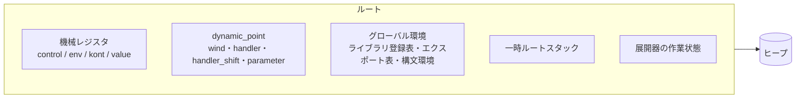
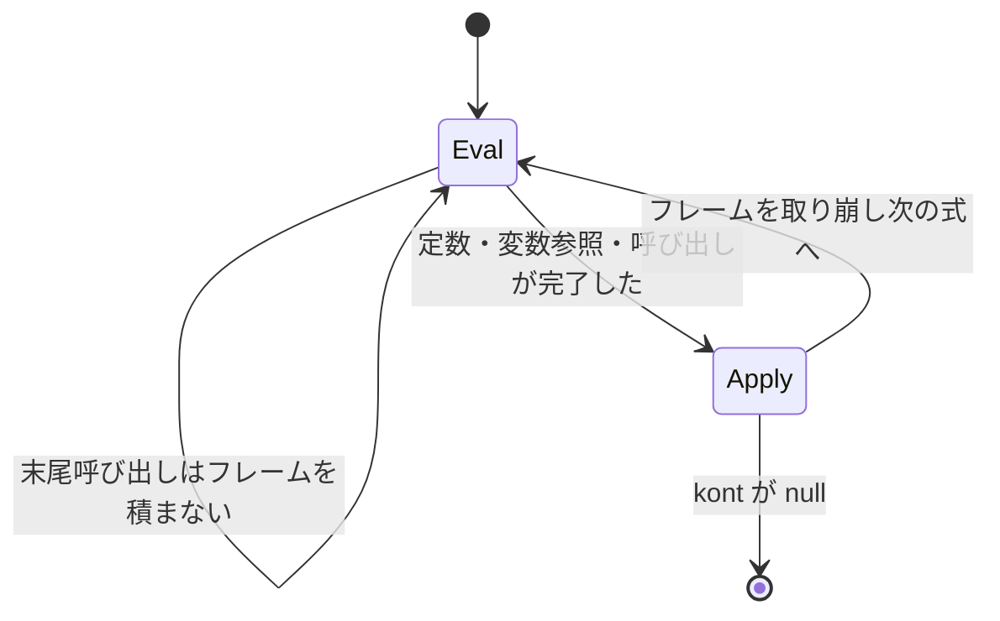
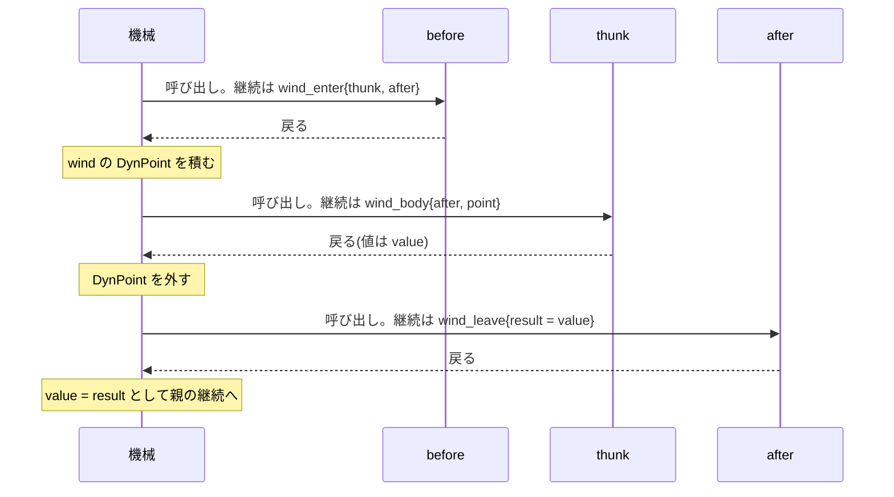
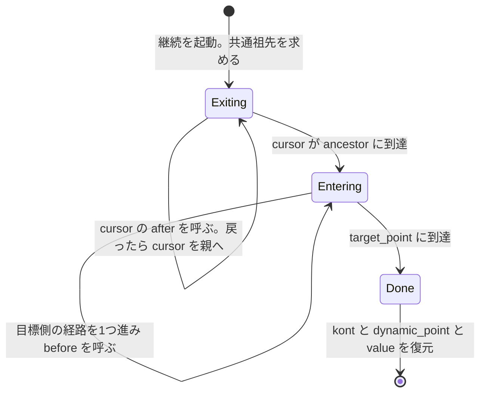
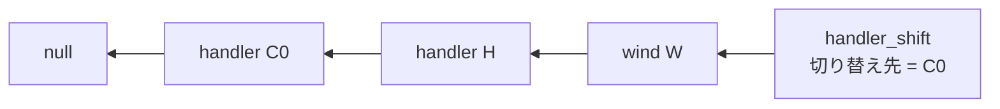

# ランタイム設計

値表現、ガベージコレクション、環境、CEK機械、継続、動的状態、例外を扱う。実装時に最も参照されるドキュメント。

対応する決定: [ADR-0002](../adr/0002-value-representation.md)、[ADR-0003](../adr/0003-precise-mark-sweep-gc.md)、[ADR-0004](../adr/0004-cek-machine-evaluator.md)、[ADR-0008](../adr/0008-string-representation.md)、[ADR-0016](../adr/0016-exception-handler-as-dynamic-point.md)。

## 値表現

`Value` は Zig のタグ付き union とする。即値はインラインに持ち、複合型は GC ヒープ上のオブジェクトへのポインタを持つ。サイズは16バイト(ペイロード8バイト+タグ)。

```zig
pub const Value = union(enum) {
    // 即値
    nil,                      // 空リスト
    unspecified,              // 未規定値
    eof,
    boolean: bool,
    fixnum: i64,
    flonum: f64,
    char: u21,                // Unicode スカラ値
    symbol: Symbol,           // インターン済みID

    // ヒープオブジェクト
    pair: *Pair,
    string: *Str,
    vector: *Vector,
    bytevector: *Bytevector,
    closure: *Closure,
    primitive: *Primitive,
    continuation: *Continuation,
    promise: *Promise,
    record: *Record,
    record_type: *RecordType,
    port: *Port,
    parameter: *Parameter,
    environment: *REnvironment,
    transformer: *Transformer,
    bignum: *Bignum,
    ratnum: *Ratnum,
    compnum: *Compnum,
    condition: *Condition,
    multiple_values: *MultipleValues,

    // 展開時にのみ現れる。CEK機械には到達しない
    alias: *Alias,
};
```

段階1で必要なのは `nil` から `primitive` までで、残りは段階が進むにつれて追加する。タグを増やすと `switch` の網羅性検査が既存コードの修正箇所を教えてくれる。これが表現の選択理由の一つである。

`alias` はマクロ展開の途中にデータの中に現れる識別子である([frontend.md](frontend.md) の構文環境と識別子)。マクロ展開の出力は通常のデータなので、別名もデータの一種でなければならない。別名はコアIRを作る時点で意味に解決されるか元のシンボルに剥離されるため、CEK機械には到達しない。これを不変条件とする。`Value` を受け取る実行時のプリミティブは `alias` の場合を考慮しなくてよいが、`switch` の網羅性検査を満たすために内部エラーとして扱う分岐を書く。

他モジュールはタグに直接依存せず、`value.zig` のアクセサを使う。

```zig
pub inline fn isPair(v: Value) bool {
    return v == .pair;
}

pub fn asFixnum(v: Value) ?i64 {
    return switch (v) {
        .fixnum => |n| n,
        else => null,
    };
}
```

`#f` 以外のすべての値は真である(R7RS 6.3)。真偽判定は `isTruthy` 一箇所に閉じる。

### ヒープオブジェクトのヘッダ

GC は `Value` のタグを知らない状態でオブジェクトを辿る必要があるため、全ヒープオブジェクトは `header` という名前の共通ヘッダのフィールドを持つ。「先頭に持つ」とは書かない。Zig の通常の `struct` は配置順を保証しないため、宣言の位置も実際の位置も根拠にできない(後述)。

```zig
pub const Kind = enum(u8) { pair, string, vector, bytevector, closure, /* ... */ };

pub const Header = struct {
    kind: Kind,
    mark: bool,
    immutable: bool, // リテラル由来。破壊的操作を拒否する(後述)
    next: ?*Header,  // 確保済み全オブジェクトのリンクリスト。sweep で使う
};

pub const Pair = struct {
    header: Header,
    car: Value,
    cdr: Value,
};
```

`Value` のタグと `Header.kind` は冗長だが、GC が型を判別するために必要である。両者の対応表は `value.zig` に1箇所だけ置く。

`Header` のフィールドはいずれも GC のメタデータであり、マークの辺として辿ってはならない。特に `next` は確保済み全オブジェクトを繋ぐリンクであり、1つでも辿ると到達可能な1オブジェクトからヒープ全体が生存扱いになって何も回収されなくなる。走査関数を生成する仕組みは `Header` を必ず除外する。到達不能なオブジェクトが実際に回収されることを確かめるテストを置き、この誤りが入った時点で落ちるようにする。

### Header から具体型への復元

Zig の通常の `struct` はフィールドの配置順を保証しない。`Pair` の宣言で `header` を先頭に書いても、コンパイラが並べ替えてよい。実機で確認したところ、`header` を2番目に宣言しても `@offsetOf` は0になった。つまり宣言順は配置順の根拠にならない。

したがって `*Header` を先頭アドレスとみなして具体型のポインタにキャストしてはならない。配置が変われば無関係なフィールドを読み書きすることになる。`kind` で分岐して `@fieldParentPtr` を使う。

```zig
fn trace(h: *Header, gc: *Gc) void {
    switch (h.kind) {
        .pair => {
            const p: *Pair = @fieldParentPtr("header", h);
            gc.markValue(p.car);
            gc.markValue(p.cdr);
        },
        .string => {
            const s: *Str = @fieldParentPtr("header", h);
            _ = s;
        },
        // ...
    }
}
```

`@fieldParentPtr("header", h)` が結果型から親の型を推論して動作することは実機で確認した。

上の `trace` は子を `gc.markValue` に渡すだけで、`markValue` は再帰しない。マーク段階は明示的な作業リストで進める。Zig の再帰で辿ると、深さがデータの構造に比例して Zig のスタックを溢れさせる。

```zig
// 誤り: データの深さに比例して Zig のスタックを消費する
fn markValue(gc: *Gc, v: Value) void {
    if (objectOf(v)) |h| {
        if (h.mark) return;
        h.mark = true;
        trace(h, gc); // ここで再帰する
    }
}
```

`(build 2000000 '())` のような長いリストは、末尾再帰なので機械のフレームを増やさずに作れる。これが生存している状態で GC が走ると、上の形では200万段の Zig 再帰になる。1フレーム48バイトでも約96MB で、WASM の既定スタック(1MB前後)でもネイティブ(8MB)でも溢れる。溢れた結果は実装の不具合として扱われ、Scheme のエラーにならない。R7RS 3.5 は能動的な末尾呼び出しが無制限であることを要求しているので、長いリストの生成は正当な入力である。

正しい形は次のとおり。

```zig
fn markValue(gc: *Gc, v: Value) void {
    if (objectOf(v)) |h| gc.push(h); // 作業リストに積むだけ
}

fn markPhase(gc: *Gc) void {
    gc.live.unsetAll();              // シンボルの生存ビットを消去する
    gc.pushRoots();
    while (gc.pop()) |h| {
        if (h.mark) continue;
        h.mark = true;
        gc.noteSymbols(h);           // 生の Symbol フィールドを live に記録する
        trace(h, gc);                // 子を push するだけ。再帰しない
    }
    while (gc.overflowed) gc.rescan();
}
```

作業リストは GC ヒープ外のアロケータから確保し、初期化時にヒープ上限に比例した大きさを予約する。

予約を超えた場合は、溢れた印を立てて積むのをやめる。マーク自体は続け、作業リストが空になったらヒープ全体を走査して「マーク済みだが子が未マークのオブジェクト」の子をマークする。この走査を、1回の走査で新たにマークされたオブジェクトが0になるまで繰り返す。

```zig
fn markPhase(gc: *Gc) void {
    gc.live.unsetAll();
    gc.pushRoots();
    gc.drain();
    while (gc.overflowed) {
        gc.overflowed = false;
        if (gc.rescan() == 0) break; // 新たにマークされたものが0なら完了
        gc.drain();
    }
}
```

前進が保証される理由は、`rescan` が作業リストを使わずにその場でマークするためである。1回の走査で少なくとも1つ新たにマークされるか、0になって終了する。マーク済みのオブジェクトは単調に増えるだけなので、走査回数はヒープ上のオブジェクト数で上から抑えられる。

作業リストの初期確保そのものが失敗した場合も同じ経路で動く。容量0でも `rescan` だけでマークが完了する。この場合の計算量は深さに比例した回数の全走査になるため遅いが、停止する。「作業リストが確保できないと何もマークできない」状態を作らないことが要点である。

容量0での完了をテストに含める。作業リストの容量を0に設定してマークが完了することを確認する。

同じ理由で、入力の深さに比例して進む処理はすべて Zig の再帰で書かない。対象は次のとおりで、いずれも明示的な作業スタックを使う。

| 処理 | 深さを決めるもの |
| --- | --- |
| GC のマーク | 生存データの構造 |
| リーダ | 入力の入れ子の深さ |
| プリンタ | データの構造 |
| `equal?` | 両辺の構造。循環に対する停止性は後述 |
| `quote` の別名剥離 | データの構造 |
| リテラルの不変化 | データの構造 |
| 展開器 | フォームの入れ子の深さ |
| `syntax-rules` の照合器とテンプレート展開器 | パターンとテンプレートの深さと入力の深さ |

展開器を落とすと、`(car (car (car ... x)))` のような深い入れ子を貼り付けただけでスタックが溢れる。16MB のヒープ上限内で40万段の入れ子は作れるので、正当な Scheme プログラムで起きる。リーダを作業スタックにしても展開器が再帰なら同じ結果になる。

テストには深い入れ子(`((((...))))`)と長いリストの両方を、上の全処理について含める。

`extern struct` にして C のレイアウトを強制する方法は採らない。ヒープオブジェクトはスライスやタグ付き union を持ち、`extern struct` ではこれらを扱えないためである。

スイープで確保済みリストを辿るときも同じ規則に従う。アドレス計算による復元を書いた箇所は、レビューで指摘の対象とする。

### リテラルの不変性

R7RS 4.1.2 は次のように規定している。

> As noted in section 3.4, it is an error to attempt to alter a constant (i.e. the value of a literal expression) using a mutation procedure like set-car! or string-set!.

リテラルかどうかを区別する状態がないと、`set-car!` や `string-set!` が通常の可変オブジェクトと同じように通ってしまう。`Header.immutable` がこの区別を担う。

構築の規則は次のとおり。

- リーダが作るオブジェクトは可変である。`cons` や `make-string` が作るものも可変である。
- `symbol->string` が返す文字列は不変とする。R7RS 3.4 が「Literal constants, the strings returned by symbol->string, and possibly the environment returned by scheme-report-environment are immutable objects」と規定しており、6.7 の `string-set!` の例にも `(string-set! (symbol->string 'immutable) 0 #\?)` がエラーとして挙がっている。`symbol->string` はインターン表の名前を複製した `Str` を返し、`immutable` を立てる。
  複製するのは、インターン表のバイト列を共有すると二重解放とインターン名の破壊が起きるためである。`Str.bytes` は sweep で解放され、`SymbolTable.names` も sweep で解放されるため、同じバッファを指していると二重に解放される。また `string-set!` が通ってしまった場合にインターン名自体が壊れ、`(eq? 'abc (string->symbol "abc"))` が成立しなくなる。複製の費用を払って共有しない。
- 展開器がデータをコアIRの定数にする時点で、そこから到達可能なオブジェクトグラフ全体に `immutable` を立てる。対象は `quote` されたデータと、自己評価するリテラル(文字列、ベクタ、バイトベクタ)の両方である。R7RS 4.1.2 はこれらを引用しなくても定数とすると規定している。
- グラフ走査は循環を含みうるので、訪問済み集合を使う。別名の剥離と同じ走査で行える([frontend.md](frontend.md) の quote による剥離)。
- 埋め込んだ Scheme の標準ライブラリに現れるリテラルも同じ経路を通るため、自動的に不変になる。

破壊的操作はすべて `immutable` を検査し、立っていれば Scheme のエラーにする。対象は R7RS 第6章の `!` 付き手続きを原文から抽出した次の12個である。

`bytevector-copy!` `bytevector-u8-set!` `list-set!` `read-bytevector!` `set-car!` `set-cdr!` `string-copy!` `string-fill!` `string-set!` `vector-copy!` `vector-fill!` `vector-set!`

`list-set!` は R7RS 6.4 が `(list-set! '(0 1 2) 1 "oops")` をエラーの例として明示している。`read-bytevector!` は渡されたバイトベクタに書き込むため同じ検査が必要である。

検査を1つの補助関数に集め、新しい破壊的操作を足したときに検査を忘れないようにする。この一覧は監査リストとして使うため、R7RS の `!` 付き手続きを原文から機械的に抽出した結果と一致することを `zig build report` の検査に含める。

### 文字列

文字列は UTF-8 バイト列として保持し、全文字が ASCII かどうかのフラグを持つ。

```zig
pub const Str = struct {
    header: Header,
    bytes: []u8,       // GC ヒープ外のアロケータから確保し、sweep 時に解放
    len: u32,          // 文字数
    ascii_only: bool,
};
```

ASCII のみなら `string-ref` と `string-set!` は定数時間、そうでなければ先頭からの走査になる。R7RS は `string-ref` の計算量を規定していない(R7RS 6.7)ため準拠上の問題はない。UTF-8 を選ぶのはポートと WASM ホスト境界で変換が不要になるためである。幅の変わる `string-set!` はバイト列の再確保を伴う。詳細は [ADR-0008](../adr/0008-string-representation.md)。

### シンボルのインターン

シンボルはインターンして32ビットの ID で表す。`eq?` による比較が ID の一致になり、`Value` にポインタを持たせずに済む。

`string->symbol` は任意の文字列からシンボルを作れる(R7RS 6.5)。インターン表を解放しない永続表にすると、乱数で作った文字列をシンボル化し続けるだけでヒープ上限の外側でメモリを増やし続けられる。長時間稼働する REPL とブラウザでは、これは資源枯渇の経路になる。したがって次の2つを行う。

名前の格納領域をヒープ上限に計上する。インターン表自身の確保も `heap.zig` の計上に含める。上限を超えたら Scheme のエラーにする。

インターン表を弱い表にする。ID が `Value` の中に即値として入るため、GC はポインタを辿るだけでは生きているシンボルを判定できない。そこでマーク段階を利用する。

```zig
pub const SymbolTable = struct {
    names: std.ArrayList([]u8),              // ID -> 名前
    index: std.StringHashMapUnmanaged(Symbol), // 名前 -> ID
    pinned: std.bit_set.Dynamic,             // 回収してはならない ID
    live: std.bit_set.Dynamic,               // マーク中に参照された ID
    free: std.ArrayList(Symbol),             // 再利用できる ID
};
```

型名は Zig 0.17.0 で非推奨でないものを使う。`ArrayListUnmanaged` と `DynamicBitSetUnmanaged` は標準ライブラリが非推奨と記している別名である([zig-api-notes.md](zig-api-notes.md))。

- マーク段階では、オブジェクトを辿る過程でシンボル ID に出会うたびに `live` に印を付ける。GC は既に生きている全オブジェクトを訪れるので、追加の走査は発生しない。
- 記録の対象は `Value` の `.symbol` だけではない。`Symbol` 型の生のフィールドもすべて対象にする。`GlobalCell.name`、`Primitive.name`、`RecordType` のフィールド名、`LambdaInfo.param_names` が該当する。これらを漏らすと、所有オブジェクトが生存中でも ID が回収・再利用され、既存のセルや構文束縛が別のシンボルを指すという最悪の形の破壊が起きる。
- `Binding.id` は `Symbol` ではなく `Identifier` である。素のシンボルか別名のどちらかを表す union なので、`.symbol` なら `live` に記録し、`.alias` なら GC ポインタとして走査する。生の `Symbol` として扱うと、別名オブジェクトが走査されずに回収され、かつポインタのビット列をシンボル ID と解釈して無関係な ID を生存扱いにする。
- ヒープ上のオブジェクトだけでは足りない。Zig のローカル変数や、展開器がヒープ外に持つ作業表が保持している生の ID も対象にする。これらは次の確保で GC が走ると回収されうる。一時ルート枠は `Value` と `Symbol` の両方を登録できるものとし(`frame.add` と `frame.addSymbol`)、ヒープ外のルート走査も自分が持つ `Symbol` をマークする責任を持つ。
- マーク段階の開始前に `live` を全消去する。消去を忘れると、一度でも参照された ID が以後ずっと生存扱いになり、弱い表として機能しない。
- スイープ段階で、`live` にも `pinned` にもない ID について、先に `index` から該当項目を削除し、次に名前のバッファを解放し、最後に ID を `free` に戻す。この順序を守る。
  `index` の鍵は `names` が所有するバッファそのものである。削除を忘れると、解放済みのバッファを鍵とする項目が残り、次の `string->symbol` のハッシュ探索が解放済みメモリを読んで比較する。さらに ID を再利用した後は、同じ内容の文字列に対して2つの項目が並び、`eq?` の同一性が壊れる。
  バッファを解放する前に削除するのは、削除の処理が鍵の内容を読むためである。
- `pinned` には、起動時に Zig 側が登録する既知のシンボル(`quote` `if` `lambda` など)を入れる。これらは Zig のコードが ID を定数として保持するため回収してはならない。
- ID の再利用は、その ID への生きた参照が存在しないことを `live` が保証した後にのみ行う。

この方式により `string->symbol` で作って捨てたシンボルは回収され、ID 表現の利点も保たれる。

生のフィールドの漏れは静かな破壊につながるため、走査関数を手書きしない。`heap.zig` が各オブジェクト型の宣言を `@typeInfo` で再帰的に走査し、走査関数をコンパイル時に生成する。

生成器が認識しなければならない形を列挙する。ヒープオブジェクトの宣言は実際にこれらを多用しているため、浅い走査では足りない。

| 形 | 例 |
| --- | --- |
| `Value` 型のフィールド | `Pair.car` |
| `Symbol` 型のフィールド | `GlobalCell.name` |
| GC オブジェクトへのポインタ | `Rib.parent`、`Frame.parent` |
| 上記のスライス | `Rib.slots: []Value`、`DynPath.points: []*DynPoint` |
| タグ付き union のフィールド。アクティブなタグで分岐して中身を走査する | `Node.body`、`Frame.kind`、`DynPoint.kind`、`Denotation` |
| union の変種が持つ無名構造体のフィールド | `Frame.kind.eval_operand` の `operator` と `done` |
| 構造体のスライス。各要素を構造体として再帰的に走査する | `SyntaxEnv.bindings: []Binding` |
| union の変種が持つ名前付き構造体 | `Frame.kind.rewind: Rewind` |
| 素の構造体フィールド。再帰的に走査する | `Node.src: Location` |
| 上記の入れ子の任意の組合せ | `ExportTable` の各 `Export` が持つ `Denotation` の union |

走査しない形も明示する。

| 形 | 例 | 扱い |
| --- | --- | --- |
| `Header` 型のフィールド | `Pair.header` | 走査しない。`next` を辿ると全オブジェクトが生存扱いになる |
| GC オブジェクトを指さないポインタ | `Primitive.impl.pure`(関数ポインタ) | 走査しない。`*Header` として扱うとコード領域に書き込む |
| ヒープ外ペイロードのスライス | `Str.bytes: []u8` | 走査しない。要素が `Value` でも GC ポインタでもない |
| 整数、`bool`、`f64`、`u21` などのスカラ | `DynPoint.depth`、`Binding.imported`、`Location.line` | 走査しない。GC オブジェクトを指さない |
| enum | `Condition.tag`、`Library.state`、`Rewind.phase` | 走査しない |
| `Symbol` のスライス | `LambdaInfo.param_names: []Symbol` | ポインタとしては走査しないが、各要素を `live` に記録する。ペイロードとして計上する |

表のどちらにも当てはまらない形に出会った場合、生成器はコンパイルエラーにする。黙って飛ばしてはならない。この既定を置くため、GC と無関係なスカラと enum を走査しない形として明示的に表に入れてある。入れないとほぼ全オブジェクトでビルドが止まる。

型が成果物のどこにも宣言されていない場合もコンパイルエラーになる。`Arity`、`SpecialForm`、`MachineOp` は名前だけ現れている。いずれも GC オブジェクトを含まない値の型なので、宣言を書く段階で走査しない側に分類する。宣言は手順2の実装計画で確定させる。飛ばす設計だと、`Frame.kind == .rewind` のときに `Rewind` の `target_kont` と `target_value` と `enter_path` が走査されず、巻き戻し中の GC で目標の継続とその値が回収される。新しい形を導入したら、意図を表の側に書いてから生成器を拡張する。

GC オブジェクトを指すポインタとそうでないポインタの判別は、指す型が `header: Header` フィールドを持つかどうかで行う。関数ポインタとスライスは別の分類として扱う。

生成で扱えない型は個別の走査関数を書く。対象はハッシュ表のように内部表現が反映で辿れないもの(`ExportTable`、`SymbolTable`)と、外部ライブラリの型を包むもの(`Bignum` の `std.math.big.int.Managed`)である。

検証として次の4つを置く。

1. `Kind` の全要素に走査関数が対応していること。
2. `Kind` の全要素に対応するレイアウトが `value.zig` に宣言されていること。
3. 到達不能なオブジェクトが実際に回収されること。
4. 各オブジェクト型について、生成した走査関数が辿るフィールドの集合と期待集合が一致すること。期待集合は上の表から導かず、各型ごとに手で列挙したものを使う。表から導くと表の漏れを検出できない。

### 走査対象として宣言が必要な型

次の型は本ドキュメントと [frontend.md](frontend.md) の本文に名前だけ現れていた。GC が走査する対象なので、`value.zig` にヘッダ付きで宣言する。

```zig
pub const LambdaInfo = struct {
    header: Header,
    body: *Node,
    required: u16,          // 必須引数の数
    has_rest: bool,         // 可変長引数を取るか
    frame_size: u16,        // 確保する Rib のスロット数
    param_names: []Symbol,  // エラーメッセージと重複検査に使う
    level: u16,             // 字句アドレスの基準となる絶対深さ
};

pub const ExportTable = struct {
    header: Header,
    entries: std.StringHashMapUnmanaged(Export), // 外部名 -> Export
};

pub const DynPath = struct {
    header: Header,
    points: []*DynPoint,
};
```

```zig
pub const Macro = struct {
    header: Header,
    transformer: Value,   // Transformer か、将来の手続き的変換子
    def_env: *SyntaxEnv,  // 定義環境。参照透明性の根拠。落とすと解放済みメモリを読む
};

pub const PatternVar = struct {
    header: Header,
    name: Symbol,
    depth: u16,     // 省略記号の入れ子の深さ
    binding: Value, // 照合で束縛した入力の部分木。深さに応じた木
};

pub const Location = struct { line: u32, col: u32 }; // GC 対象でない素の構造体

/// 展開時の識別子。素のシンボルか別名。
pub const Identifier = union(enum) {
    symbol: Symbol,
    alias: *Alias,
};
```

`Export` と `Denotation` と `Binding` と `SyntaxEnv` と `Alias` と `LocalBinding` の宣言は [frontend.md](frontend.md) にある。レイアウトはすべて `value.zig` に集めるという規則([architecture.md](architecture.md))に従い、宣言の置き場所は `value.zig` とする。

`Kind` の全要素について、対応するレイアウトの宣言がどこにあるかを一覧にする。宣言のない要素があってはならない。前述の検証2がこれを確かめる。

`Kind` の要素になるのは `header: Header` を持つ型だけである。ヘッダを持たない型は `Kind` に入らない。両者を分けて示す。

| 区分 | 宣言のある文書 | 型 |
| --- | --- | --- |
| `Kind` の要素 | 本ドキュメント | `Pair` `Str` `Vector` `Bytevector` `Closure` `Primitive` `Continuation` `Promise` `Record` `RecordType` `Port` `Parameter` `REnvironment` `Transformer` `Condition` `MultipleValues` `GlobalCell` `Rib` `Node` `Frame` `DynPoint` `DynPath` `LambdaInfo` `ExportTable` `Macro` `PatternVar` |
| `Kind` の要素 | [numerics-and-unicode.md](numerics-and-unicode.md) | `Bignum` `Ratnum` `Compnum` |
| `Kind` の要素 | [frontend.md](frontend.md) | `SyntaxEnv` `Alias` `LocalBinding` `Library` |
| ヘッダを持たず他の型に埋め込まれる | 本ドキュメントと [frontend.md](frontend.md) | `Header` `Rewind` `Location` `Identifier` `Binding` `Export` `Denotation` `Arity` `SpecialForm` `MachineOp` `PrimResult` |

上の一覧に挙げながら本文に構造体宣言のない型は、段階に入る前の実装計画(手順2)で宣言を確定させる。`Vector` `Closure` `Promise` `Record` `RecordType` `Port` `Parameter` `REnvironment` `Transformer` `MultipleValues` `Arity` `SpecialForm` `MachineOp` がこれにあたる。宣言を書く段階は、その型が初めて必要になる段階とする。

## ガベージコレクション

非移動型のマーク・スイープGCとする。停止型で、計上量が閾値を超えたときに動作する。

### 計上の対象

`sucheme_init` が受け取る上限と GC の起動条件は、同じ「計上量」を見る。計上の対象は次のすべてである。GC ヒープ上のオブジェクト本体だけを数えると、本体が小さくペイロードが大きいオブジェクトで上限がまったく効かない。

| 対象 | 例 |
| --- | --- |
| GC オブジェクトの本体 | `Pair`、`Frame`、`DynPoint` |
| GC オブジェクトのヒープ外ペイロード | `Str.bytes`、`Vector` と `Bytevector` の要素領域、`Bignum` の限界値列、`Rib.slots`、`DynPath.points`、`SyntaxEnv.bindings`、`ExportTable.entries` |
| シンボルの名前とインターン表 | `SymbolTable` の全体 |
| GC の作業リスト | `Gc` の worklist |
| 走査の作業スタック | リーダ、プリンタ、`equal?`、`quote` の剥離、リテラルの不変化のそれぞれの明示的スタック |
| 走査の対応表 | データラベルの表、剥離の訪問済み表、`equal?` の訪問済み表、位置情報の作業表 |
| 一時ルートスタック | `heap.zig` のルート枠。展開器が入力長に比例して登録するため伸びる |
| 展開器の作業状態 | 構文環境の作業領域、照合器のスタック、パターン変数の束縛木 |
| ポートのバッファ | WASM の出力バッファ、ファイルポートと文字列ポートのバッファ |

計上しないのは予約領域(前述)だけである。上限の外側に固定量を置く。

この表を網羅と主張するため、`heap.zig` の確保 API を通らない `std.mem.Allocator` の直接使用を禁じる(後述)。表に挙げた全部がその API を通るので、表の網羅性は API の使用箇所の検査で確かめられる。

計上量が上限を超え、GC を走らせても下回らない場合は Scheme のエラーにする。ホストのアロケータが失敗するまで待たない。`guard` で捕捉できるので、`(guard (e (#t 'recovered)) (make-vector 100000000))` は `'recovered` を返す。

### 送出のための予約領域

上限に達した状態で Scheme のエラーを送出するには、条件オブジェクトと `handler_shift` 点の確保が必要である。上限内から確保しようとすると再び上限超過になり、無限後退する。

初期化時に、上限とは別枠の予約領域を確保する。上限超過の送出と内部エラーの報告はこの領域から確保する。予約領域は計上の対象に含めない(上限の外側に固定量を置く)。

大きさは、送出からハンドラの実行、そして `guard` による捕捉までに必要な確保を数え上げて決める。`guard` は Scheme 側で `call/cc` と `with-exception-handler` を使って実装されるため、ハンドラの呼び出しと継続による脱出の両方が起きる。

| 必要なもの | 用途 |
| --- | --- |
| `Condition` 1個 | 条件オブジェクト |
| `Str` 1個とそのバイト列 | `Condition.message` |
| `Pair` 数個 | `Condition.irritants` |
| `handler_shift` 点 1個 | `raise` が積む |
| `Rib` 1個とそのスロット列 | ハンドラ手続きの引数を入れる |
| 継続フレーム 数十個 | ハンドラ本体の評価 |
| `Rewind` フレーム 1個と `DynPath` 1個(`points` のペイロードを含む) | `guard` が捕捉した継続への脱出 |

この一覧を実装計画で具体的なバイト数にする。予約領域を使い切った場合は `Fatal.ReserveExhausted` として回復不能に落とす。

予約領域を使い切った場合に限り、回復不能として扱う。WASM では状態コード `-2` を返し、ネイティブでは標準エラーに出力してゼロでない終了コードで終了する。

状態コードとの対応を次のように定める。[platform-and-web.md](platform-and-web.md) の状態コード表と一致させる。

| 事象 | 扱い | WASM の状態コード |
| --- | --- | --- |
| 上限超過。予約領域から送出できる | Scheme のエラー。`guard` で捕捉できる | 捕捉されれば 0。捕捉されず最外に届けば -1 |
| 予約領域を使い切った | 回復不能 | -2 |
| 未処理例外(上限超過に限らない) | 最外まで届いた条件オブジェクトを報告 | -1 |

計上しない例を1つ挙げる。`(make-string 1000000)` を2000回繰り返す場合、本体の `Str` は数十バイトなので本体だけを数えると計上量は100KB未満にとどまり閾値に達しない。一方で線形メモリには2GB相当のバイト列が同時に生存する。ペイロードを計上すれば16MB の上限に達した時点でエラーになる。

非移動型を選ぶ理由は2つある。第一に、`*Pair` などの生ポインタが収集後も有効なままなので、ルート登録は到達可能性の保証だけを意味し、Zig のローカル変数を書き換える必要がない。第二に、ハンドル経由の間接参照が不要なのでコードが読みやすい。代償は断片化とスイープのコストである。

保守的スタック走査は採用しない。wasm の関数ローカル変数は線形メモリ上に存在せず走査できないため、ネイティブと WASM で GC の正しさが変わってしまう。

マーク段階は、生きている `Value` に出会うたびに参照されたシンボル ID を記録する。スイープ段階でインターン表の未参照の項目を解放する(前述のシンボルのインターン)。これによりシンボルもヒープ上限の中で管理される。

### ルート集合



機械の状態が4レジスタと `dynamic_point` に集約されているため、ルートは少数で済む。これが CEK 機械を選んだ理由の一つである。現在の例外ハンドラを独立したレジスタにせず `dynamic_point` から導出するのも、ルートと真実の源を増やさないためである。

「グローバル環境」が指すものを明示する。ライブラリ名から `*Library` への登録表、各 `Library` の `exports`、各 `Library` の `env`(構文環境)、REPL 自身の環境の4つである。登録表を漏らすと、`(define-library (a) ...)` を読み込んだ後の GC で `Library` と `Library.env` に到達する根がなくなり回収され、次の `(import (a))` が読み込み済み判定のために解放済みメモリを読む。

### 一時ルートの書き方

ヒープ確保をまたいで `Value` を保持する場合は、スコープ単位でルート枠を使う。

```zig
pub fn makeList2(h: *Heap, a: Value, b: Value) AllocError!Value {
    var frame = h.rootFrame();
    defer frame.pop();
    frame.add(a);
    frame.add(b);

    const tail = try h.cons(b, .nil); // ここで GC が走りうる
    frame.add(tail);
    return try h.cons(a, tail);
}
```

非移動型なので `frame.add(a)` の後も `a` をそのまま使える。`frame.add` は到達可能性のみを保証する。

ルート枠は3種の登録を受け付ける。横断的な不変条件が「生のヒープポインタや `Value`」を対象としているため、`Value` に包めない型も登録できなければならない。`*Node` `*Rib` `*Frame` `*DynPoint` `*SyntaxEnv` `*DynPath` などは `Value` の変種にないため、`frame.add` だけでは登録できない。

```zig
frame.add(v: Value);           // Value として持っているもの
frame.addSymbol(s: Symbol);    // 生のシンボル ID
frame.addObject(h: *Header);   // Value に包めない GC オブジェクトへの生ポインタ
```

全ヒープオブジェクトが `header` フィールドを持つので、`frame.addObject(&node.header)` の形で型を問わず登録できる。アドレス計算ではなくフィールドへの参照を取るので、配置順に依存しない。展開器がコアIR節点を組み立てる途中や、`DynPath` を構築する途中の一時ポインタは、この経路で登録する。

生のシンボル ID も同じ扱いが必要である。シンボルは弱い表で管理されるため(後述)、確保をまたいで保持する `Symbol` はルート枠に登録する。

```zig
pub fn defineGlobal(h: *Heap, name_text: []const u8, v: Value) !void {
    var frame = h.rootFrame();
    defer frame.pop();
    frame.add(v);

    const sym = try h.intern(name_text); // ここで GC が走りうる
    frame.addSymbol(sym);                // 登録しないと次の確保で回収されうる

    const cell = try h.allocGlobalCell(sym); // ここでも GC が走りうる
    cell.value = v;
}
```

次の書き方は誤りである。

```zig
// 誤り: 2回目の cons で GC が走ると first が回収されうる
const first = try h.cons(.nil, .nil);
const second = try h.cons(.nil, .nil);
return try h.cons(first, second);
```

判断に迷ったら登録する。過剰な登録は性能を落とすだけだが、不足はメモリ破壊を招く。

### 収集の起動点

GC は `heap.allocate` の内部でのみ走る。したがって確保を行う可能性のある呼び出しを見分けることが実装上の要点になる。`heap.zig` の公開APIのうち確保を行うものは、ドキュメンテーションコメントの先頭に `GCを起動しうる` と書く規約とする。

### ヒープ外ペイロードの確保 API

GC オブジェクトの一部であるヒープ外のペイロードも `heap.zig` の API を通す。計上を1箇所で行うためである。対象を数え上げる。

| オブジェクト | ペイロード |
| --- | --- |
| `Str` | `bytes` |
| `Vector` `Bytevector` | 要素領域 |
| `Bignum` | 限界値列 |
| `Rib` | `slots` |
| `Node` | `body.seq`、`body.call.operands` |
| `LambdaInfo` | `param_names` |
| `Frame` | `kind.seq_rest.nodes`、`kind.eval_operator.operands`、`kind.eval_operand.operands`、`kind.param_convert.params`、`kind.param_convert.values` |
| `DynPath` | `points` |
| `SyntaxEnv` | `bindings` |
| `ExportTable` | ハッシュ表の記憶域と外部名の文字列 |

`ExportTable` の外部名は `Symbol` ではなく独立に所有した文字列のコピーとする。ハッシュ表の鍵をシンボル表のバッファと共有してはならない。シンボル表は弱い表なので、`(export (rename internal external))` の `external` はどの `Symbol` 型フィールドにも入らず、最初の GC で名前バッファが解放される。共有していると次の `(import ...)` のハッシュ探索が解放済みメモリを読む。

コピーは `ExportTable` が所有し、`ExportTable` の sweep で解放する。計上の対象に含める。`Symbol` として持たないので `live` に記録する必要もない。
| `PatternVar` | 束縛した部分木のうち配列として持つもの |

```zig
/// GCを起動しうる。計上に加算する。
pub fn allocPayload(h: *Heap, comptime T: type, n: usize) AllocError![]T;
pub fn freePayload(h: *Heap, slice: anytype) void; // sweep から呼ぶ。計上から減算する
pub fn payloadAllocator(h: *Heap) std.mem.Allocator; // 計上を行うアロケータ。big.int などに渡す
```

`std.math.big.int.Managed` のように内部で確保する型には `payloadAllocator` を渡す。これにより `Bignum` の限界値列も計上される。

横断的な不変条件の「確保点の一元化」の例外は、GC 対象でない補助データ構造(シンボル表の索引、ビルド時テーブル)に限る。GC オブジェクトのペイロードは例外に当たらない。

`std.mem.Allocator` の直接使用は、`src/` の全モジュールで禁止する。`prim/` と `number/` に限ると、`syntax/rules.zig` の照合器の作業スタックとパターン変数の束縛木、`syntax/expand.zig` と `core.zig` のコアIRのスライス、`cont.zig` のフレームのスライスが計上を通らない。これらはいずれも入力長に比例して伸びるため、上限が効かなくなる。

例外を認めるのは `symbol.zig` の索引と、ビルド時にテーブルを生成する `tools/` に限る。例外を使う箇所には理由を `Why:` コメントで書く。計上の表を網羅と主張する根拠はこの禁止にあるので、禁止の範囲を狭めると主張が成り立たない。

### equal? の循環への対処

R7RS 6.1 は `equal?` について「Even if its arguments are circular data structures, equal? must always terminate」と規定している。作業スタックだけでは停止しない。

訪問済みの対の集合を持つ。両辺のペアまたはベクタの対 `(a, b)` を比較する直前に集合を引き、既にあれば真として打ち切る。なければ集合に加えて要素の比較に進む。循環は有限の対の組合せしか生まないため、必ず停止する。

```scheme
(define a (list 1 2)) (set-cdr! (cdr a) a)
(define b (list 1 2)) (set-cdr! (cdr b) b)
(equal? a b)  ; => #t で停止しなければならない
```

訪問済み集合は走査の作業領域なので、計上の対象に含め、GC のルートとして登録する。素朴な実装は全対を保持するため、片側だけが循環する場合に組合せが大きくなりうる。対の数が一定を超えたら、集合をハッシュ表から union-find に切り替える、または対の正規化(アドレス順)で重複を減らす。実装の詳細は段階5の計画で決める。

`equal?` は `string=?` と `=` と `eqv?` に帰着する部分では循環を作れないため、対象はペア、ベクタ、バイトベクタに限る。

### 位置情報の寿命

リーダが記録する行と桁の副表([frontend.md](frontend.md) の位置情報)は、1つのトップレベルフォームを読んでから展開し終えるまでの間だけ存在する作業表とする。その間はルートとして登録し、展開が終わったら表ごと破棄する。

永続的な副表にしない理由は2つある。ルートとして扱うと、REPL が読んだデータをすべて恒久的に生存させてしまう。ルートとして扱わないと、ペアが回収された後も項目が残り、同じアドレスに確保された別のペアが前の行桁を引き継いで無関係な位置を指すエラーメッセージを出す。どちらも受け入れられない。

実行時にも位置が必要なものは、展開器がコアIR節点に複製する。

```zig
pub const Node = struct {
    header: Header,
    src: Location, // 行と桁。不明なら 0
    body: union(enum) { ... },
};
```

これにより、位置情報の生存期間はコードの生存期間と一致し、鍵の再利用の問題が起きない。

機械のステップ関数の境界では、一時ルート枠が空であることが保証される。ルート集合そのものは減らない。グローバル環境、シンボル表、展開器の作業状態はステップ境界でもルートである。安全点方式を採る場合もルート集合の全体を走査する。「レジスタだけを走査すればよい」と読める書き方をしない。グローバル環境を走査から外すと、現在の式から参照されていないグローバルセルがすべて回収され、次にその変数を参照した時点で解放済みメモリを読む。

## 環境

### 局所環境

展開器が字句アドレスを解決するため、局所変数の参照は深さと添字によるポインタ辿りだけになる。

```zig
pub const Rib = struct {
    header: Header,
    parent: ?*Rib,
    slots: []Value, // 固定長。可変長引数は最後のスロットにリストで入る
};
```

内部 `define` は `letrec*` 意味論に従う(R7RS 5.3.2)。展開器は本体をすべて走査して内部定義を集め、`Rib` のスロットを事前に確保し、未初期化を表す内部値で埋める。未初期化スロットの参照はエラーとする。

### グローバル環境

グローバル変数は束縛セルを経由する。

```zig
pub const GlobalCell = struct {
    header: Header,
    name: Symbol,
    value: Value, // 未束縛を表す内部値で初期化
};
```

セルを介することで、前方参照、相互再帰、`set!`、REPL での再定義がすべて自然に扱える。ライブラリごとにシンボルからセルへの表を持ち、`import` はセルを共有する(値をコピーしない)。これによりエクスポート元での再定義がインポート側にも反映される。

セルの共有だけでは、インポートした束縛への `define` と `set!` を拒否できない。R7RS 5.2 がこれをエラーと規定しているため、所有とインポートの区別は構文環境側の意味に持たせる([frontend.md](frontend.md) のインポートした束縛への書き込みの禁止)。実行時のセルには可否の情報を持たせず、展開時に拒否する。

## コアIR

展開器の出力。R7RS 4.1 の基本式(変数参照、リテラル、手続き呼び出し、`lambda`、条件式、代入)に、`begin` と定義を加えた集合に対応する。`begin` は R7RS では派生式(4.2.3)、定義は 5.3 と 5.4 に属するが、いずれも他の構文に展開できないためコアIRの節点とする。

R7RS 4.1 の基本式のうち `include` と `include-ci`(4.1.7)は展開時にファイルを読んで展開するため、コアIRには現れない。

```zig
pub const Node = struct {
    header: Header, // GC が割り当てリストへの登録と種別判定とマークに使う
    body: union(enum) {
        constant: Value,
        local_ref: struct { depth: u16, index: u16 },
        global_ref: *GlobalCell,
        local_set: struct { depth: u16, index: u16, value: *Node },
        global_set: struct { cell: *GlobalCell, value: *Node },
        branch: struct { test_: *Node, consequent: *Node, alternative: ?*Node },
        lambda: *LambdaInfo,
        seq: []*Node,
        call: struct { operator: *Node, operands: []*Node, tail: bool },
    },
};
```

`Node` も GC ヒープに置くため、他のヒープオブジェクトと同じく先頭に `Header` を持つ。ヘッダのない union にすると、割り当てリストへの登録、`Header.kind` による種別判定、マークのいずれもできない。`Header.kind` は `.core_node` の1種類とし、子の走査は `body` のタグで分岐する。

`call` の `tail` は展開器が付ける。機械はこの印を信用して、真なら継続フレームを積まない。末尾位置の判定を機械側に持たせないのは、判定の責任を1箇所にまとめるためである。

コアIRの節点は GC ヒープに置く。`constant` が `Value` を持ち、`lambda` が実行時にクロージャとして参照されるため、プログラム本体も収集対象にする必要がある(REPL で再定義を繰り返すとコードも捨てられる)。

## CEK機械

### 状態

```zig
pub const Machine = struct {
    heap: *Heap,
    control: ?*Node,    // 次に評価する式。null なら value を継続に渡す
    env: ?*Rib,
    kont: ?*Frame,      // 継続。null なら実行完了
    value: Value,       // 直前の結果
    dynamic_point: ?*DynPoint, // wind と parameter と handler の束縛列
    step_budget: u64,   // WASM で制御を戻すための歩数制限
};
```

「現在の例外ハンドラ」は独立したレジスタにしない。`dynamic_point` から定数時間で導出する。理由と仕組みは例外の節で述べる。

ステップ関数は `control` が非 null なら式を1段分解して進み、null なら `value` を `kont` に渡して1フレーム取り崩す。実行ループはこれを繰り返すだけである。



### 継続フレーム

継続フレームは不変とする。一度作ったフレームの内容を書き換えてはならない。

```zig
pub const Frame = struct {
    header: Header,
    parent: ?*Frame,
    env: ?*Rib,
    kind: union(enum) {
        if_branch: struct { consequent: *Node, alternative: ?*Node },
        seq_rest: struct { nodes: []*Node, index: u32 },
        set_local: struct { depth: u16, index: u16 },
        set_global: *GlobalCell,
        eval_operator: struct { operands: []*Node, tail: bool },
        eval_operand: struct {
            operands: []*Node,
            index: u32,
            operator: Value,
            done: Value, // 評価済み引数の逆順リスト
            tail: bool,
        },
        // 段階2以降で追加
        receive_values: struct { consumer: Value },
        handler_result: struct {
            continuable: bool,
            shift_point: *DynPoint, // raise が積んだ handler_shift 点
        },

        // dynamic-wind の通常実行経路。後述
        wind_enter: struct { thunk: Value, after: Value },
        wind_body: struct { after: Value, point: *DynPoint },
        wind_leave: struct { result: Value },

        // parameterize の変換手続きを順に呼ぶ。後述
        param_convert: struct {
            params: []*Parameter, // 評価済みのパラメータ
            values: []*Node,      // 未評価の値の式
            converted: Value,     // 変換済みの値の逆順リスト
            index: u32,
            phase: enum { value_done, convert_done },
            body: *Node,
        },

        // with-exception-handler と parameterize の本体が通常終了した
        leave_dynamic: struct { point: ?*DynPoint }, // 復元する dynamic_point

        rewind: Rewind, // 継続起動時の動的状態の遷移。後述
    },
};
```

引数の蓄積を可変配列ではなく不変の逆順リストで行うのは、継続の多重起動に対する正しさのためである。引数を評価している途中で `call/cc` で継続を捕捉し、その継続を2回起動した場合、可変配列を共有していると2回目が1回目の書き込みを観測してしまう。不変リストなら各起動が独立した状態から再開する。

この選択は確保回数を増やす。段階6以降の最適化候補として、捕捉時にコピーするスタックセグメント方式を検討する。最適化は準拠テストが通った後に行う。

### 機械操作プリミティブと末尾呼び出し

プリミティブは2種に分かれる。

- 純粋プリミティブ: 引数から値を計算して返すだけ。`car` `+` `string-length` など。
- 機械操作プリミティブ: 機械の状態(`control` `env` `kont` `dynamic_point`)を直接書き換える。`apply` `call/cc` `call-with-values` `values` `dynamic-wind` `with-exception-handler` `raise` `raise-continuable` `make-parameter` `eval`。

```zig
pub const Primitive = struct {
    header: Header,
    name: Symbol,
    arity: Arity,
    impl: union(enum) {
        pure: *const fn (*Heap, []const Value) PrimResult,
        machine: MachineOp, // ステップ関数が種別で分岐して処理する
    },
};

/// 純粋プリミティブの結果。Scheme のエラーと機械の外側の失敗を区別する。
pub const PrimResult = union(enum) {
    value: Value,
    condition: *Condition, // Scheme のエラー。機械が raise と同じ処理を行う
    fatal: Fatal,          // 機械の外側の失敗
};

/// 機械の外側の失敗。Zig の error はこの集合に限る。
pub const Fatal = error{
    ReserveExhausted, // 予約領域を使い切った。回復不能
    HostIoFailed,
    InternalInvariant,
};

/// 確保の失敗。上限超過は Scheme のエラーにできるので Fatal と区別する。
pub const AllocError = error{
    HeapLimitExceeded, // 計上量が上限を超えた。条件オブジェクトにして raise する
} || Fatal;
```

`HeapLimitExceeded` と `Fatal.ReserveExhausted` を別の値にするのは、前者が `guard` で捕捉できる Scheme のエラーで、後者が回復不能だからである。1つの `OutOfMemory` にまとめると、どちらに変換すべきか呼び出し元が判断できない。上限超過を回復不能として扱うと `guard` が走らず、予約枯渇を Scheme のエラーとして扱うと回復不能の状態コードが発生しなくなる。

確保を行う関数はすべて `AllocError` を返す。機械のステップ関数は `HeapLimitExceeded` を受け取ったら、予約領域から条件オブジェクトを作って `raise` の処理に入る。`ReserveExhausted` を受け取ったら回復不能として報告する。

`makeList2` の例のように `!Value` と書いた箇所は `AllocError!Value` を指す。`error` を使うのは確保の失敗だけで、Scheme プログラムの誤りには使わない。この区別が横断的な不変条件の意味である。

`pure` の戻り値を `Fatal!Value` にしてはならない。型エラーや範囲外のような Scheme の誤りを Zig の `error` で返すと、横断的な不変条件「Zig の `error` は機械の外側の失敗にのみ使う」に反し、機械が評価を中断して現在の例外ハンドラを起動しない。`(with-exception-handler (lambda (c) 'caught) (lambda () (car 5)))` が `'caught` にならなくなる。

`condition` を返した場合、機械は `raise` と同じ処理を行う。`handler_shift` 点を積んで現在のハンドラを呼ぶ。純粋プリミティブ自身は機械の状態に触れない。条件オブジェクトの確保は `heap` 経由で行い、確保できない場合に備えて後述の予約領域を使う。

機械操作プリミティブの中で機械を起動することはない。ステップ関数がレジスタを書き換えて次のステップに進むだけである。したがって「プリミティブの中で機械を起動しない」という不変条件は保たれる。

R7RS 3.5 は4箇所で末尾呼び出しを必須としている。

> The first argument passed to apply and to call-with-current-continuation, and the second argument passed to call-with-values, must be called via a tail call. Similarly, eval must evaluate its first argument as if it were in tail position within the eval procedure.

これらは継続フレームを積まず、プリミティブ自身の継続をそのまま被呼び出し側に渡す。

| 手続き | 末尾呼び出しになる対象 | 実装 |
| --- | --- | --- |
| `apply` | 第1引数の手続き | `kont` を引き継いで適用に遷移する |
| `call-with-current-continuation` | 第1引数の手続き | `kont` を引き継いで、捕捉した継続を引数として適用に遷移する |
| `call-with-values` | 第2引数(消費者) | 生産者は `receive_values` フレームのもとで呼ぶ。消費者はそのフレームを取り崩した後、`kont` を引き継いで適用に遷移する |
| `eval` | 第1引数の式 | 展開した結果を `control` に置き、`kont` を引き継ぐ |

これにより `(define (loop n) (if (= n 0) 'done (apply loop (list (- n 1)))))` の `(loop 1000000)` が一定のメモリで完了する。フレームを積む実装では100万件のフレームがヒープに積まれ、フレーム数の上限に達して Scheme エラーになる。

`dynamic-wind` の `thunk` と `call-with-values` の生産者は末尾呼び出しの対象ではない。`after` の呼び出しと値の受け取りが残るためである。

### 完全な継続

```zig
pub const Continuation = struct {
    header: Header,
    kont: ?*Frame,
    dynamic_point: ?*DynPoint,
};
```

`call/cc` は現在の `kont` と `dynamic_point` を保存した `Continuation` を作り、引数の手続きに渡す。起動時は `kont` を復元し、`dynamic_point` を現在のものから目標のものへ巻き戻す。現在の例外ハンドラは `dynamic_point` から導出されるので、別に保存するものはない。フレームが不変なので捕捉は定数時間であり、多重起動も再入も成立する。

### 動的状態

`dynamic-wind`、`with-exception-handler`、`parameterize` の3つは、いずれも動的範囲に対する束縛である。1つの不変リストで統一して表す。

```zig
pub const DynPoint = struct {
    header: Header,
    parent: ?*DynPoint,
    depth: u32,                      // 共通祖先の計算用
    current_handler: ?*DynPoint,     // この点で有効な handler 点。生成時に決まる
    kind: union(enum) {
        wind: struct { before: Value, after: Value },
        handler: Value,              // この点より内側で現在のハンドラになる
        handler_shift: ?*DynPoint,   // 現在のハンドラをこの handler 点に切り替える
        parameter: struct { param: *Parameter, value: Value },
    },
};
```

`current_handler` は生成時に決まり、以後変わらない。

| 点の種別 | `current_handler` |
| --- | --- |
| `handler` | その点自身 |
| `handler_shift` | 切り替え先の `handler` 点(`null` もありうる) |
| `wind` と `parameter` | 親の `current_handler` |

この1つのフィールドにより、ある動的点における現在の例外ハンドラが定数時間に求まる。独立したレジスタを持たず、`dynamic_point` だけが真実の源になる。

参照は必ず次の補助関数を通す。`dynamic_point` は起動直後は `null` であり、`dynamic-wind` も `with-exception-handler` も `parameterize` も通っていない状態が正常に存在する。省略可能型を直接展開すると、その状態で `(car '())` を評価しただけで安全ビルドでは panic し、WASM ではモジュールが停止する。本来は未処理例外として報告して REPL に戻らなければならない。

```zig
pub fn currentHandler(p: ?*DynPoint) ?*DynPoint {
    return if (p) |q| q.current_handler else null;
}
```

`H.parent` も `null` を取りうるため、切り替え先の計算も同じ関数を通す。設計の本文で `dynamic_point.?.current_handler` のような直接の展開を書かない。

### 未処理例外

`currentHandler` が `null` のときの `raise` を未処理例外とする。この経路は必ず定義する。

実装は専用の機構を作らず、最外の継続への脱出として行う。評価を始める前に継続を1つ捕捉しておき、未処理例外はその継続を起動して報告する。

- REPL は各入力の評価前に継続を捕捉する。未処理例外はその継続へ脱出し、条件オブジェクトを標準エラーに整形して出力してプロンプトに戻る。処理系は終了しない。
- 非対話実行は最外で捕捉した継続へ脱出し、標準エラーに出力してゼロでない終了コードで終了する。
- WASM は `sucheme_eval_begin` が捕捉した継続へ脱出し、出力バッファに整形して書いて `sucheme_step` が `-1` を返す。パニックもトラップも起こさない。

この方式を採ると `dynamic-wind` の `after` の扱いが自動的に決まる。脱出は通常の継続起動なので巻き戻しの経路を通り、送出時点より内側の `wind` 点の `after` がすべて呼ばれる。

```scheme
(dynamic-wind (lambda () (open!)) (lambda () (car '())) (lambda () (close!)))
```

この例では `close!` が呼ばれてからプロンプトに戻る。専用の中断機構を作ると `after` を呼ぶかどうかを別に決めなければならず、資源が閉じられないまま残る。

`after` の中でさらに未処理例外が起きた場合も停止する。巻き戻しは `dynamic_point` を外側へ進めながら進むので、2回目の脱出の時点で残りの `wind` 点は減っている。有限回で最外に到達する。

起動時に既定のハンドラを積む方式は採らない。R7RS 6.11 の「`H` をインストールした時点のハンドラ」の計算に実在しないインストール点が混ざり、`handler_shift` の切り替え先の意味が曖昧になるためである。`null` を未処理例外として扱う方が規定に素直である。

`handler_shift` は `raise` がハンドラを呼ぶ間だけ積む点である。R7RS 6.11 の「現在のハンドラだけを切り替え、残りの動的環境は `raise` 時のまま保つ」を、外側へ戻るのではなく内側へ1点積むことで表す。詳細は例外の節で述べる。

この表現を選ぶまでに、独立したカーソルレジスタを持つ案を検討して捨てた。カーソルを点の生成時の値から復元する方式も、現在の `dynamic_point` から導出する方式も、継続による再入や `raise` を囲む `dynamic-wind` からの脱出で誤った値になる。レジスタと点の列という2つの真実の源を同期させようとすることが問題の根であり、源を1つにすれば同期の誤りが起こりえない。経緯は [ADR-0016](../adr/0016-exception-handler-as-dynamic-point.md) に記録した。

継続の起動時は、現在の点と目標の点の共通祖先を `depth` を使って求め、現在側を祖先まで `after` を呼びながら降り、目標側を `before` を呼びながら登る(R7RS 6.10)。ハンドラとパラメータの束縛は呼び出しを伴わないので、復元は参照の差し替えだけで済む。

3つを1つの機構で表すことで、`call/cc` との相互作用を1箇所で正しくすれば全体が正しくなる。

「現在の例外ハンドラ」もこの列の中で表す。`raise` がハンドラを呼ぶ間だけ `handler_shift` 種別の点を積むことで、独立したレジスタを持たずに R7RS 6.11 の規定を満たす。理由は例外の節で述べる([ADR-0016](../adr/0016-exception-handler-as-dynamic-point.md))。

### dynamic-wind の通常実行

`before`、`thunk`、`after` はいずれも Scheme 手続きである。プリミティブの中で機械を起動しないという不変条件により、3つの呼び出しはそれぞれ継続フレームを積んで機械に戻す形で実装する。



- `wind_enter`: `before` が完了した。`wind` 種別の `DynPoint` を積み、`thunk` を呼ぶ。継続は `wind_body`。
- `wind_body`: `thunk` が完了した。`dynamic_point` を `point` の親に戻し、`after` を呼ぶ。継続は `wind_leave { result = value }`。フレームは不変なので、`thunk` の結果はこの新しいフレームに格納する。
- `wind_leave`: `after` が完了した。`after` の戻り値を捨て、`result` を親の継続に渡す。

`after` は `DynPoint` を外した後に呼ぶ。R7RS 6.10 が `after` を `thunk` の動的範囲の外で実行すると規定しているためである。`thunk` が複数値を返した場合は `result` に `MultipleValues` が入り、そのまま親に渡る。

`thunk` が例外を送出した場合や継続で脱出した場合は、この通常経路ではなく後述の巻き戻しが働く。

### 動的範囲の通常終了

`with-exception-handler` と `parameterize` も `DynPoint` を積むため、本体が通常終了したときに外す継続状態が必要である。非局所脱出だけを考えて専用のフレームを置かないと、ハンドラやパラメータの束縛が後続の処理へ漏れる。

`leave_dynamic` フレームがこれを担う。本体を呼ぶ際に、積む前の `dynamic_point` を保存したフレームを継続として置く。本体が値を返したら `dynamic_point` を復元し、`value` をそのまま親の継続に渡す。本体が複数値を返した場合もそのまま渡る。現在の例外ハンドラは `dynamic_point` から導出されるため、別に復元するものはない。

`dynamic-wind` は `after` の呼び出しを伴うため `wind_body` と `wind_leave` を使う。`with-exception-handler` は呼び出しを伴わないので `leave_dynamic` だけで足りる。

`parameterize` は進入時にのみ呼び出しを伴う。R7RS 4.2.6 が次のように規定している。

> The ⟨body⟩ is evaluated in a dynamic environment in which calls to the parameters return the results of passing the corresponding values to the conversion procedure specified when the parameters were created. Then the previous values of the parameters are restored without passing them to the conversion procedure.

進入時は各パラメータの変換手続きを呼ぶ。復元時は呼ばない。したがって `param_convert` フレームを使う。宣言は前述の `Frame.kind` にある。変換手続きの呼び出しを機械に積み、途中の状態をフレームに持つ。Zig のローカル変数に `[]*Parameter` を持つと、変換手続きの呼び出しをまたいで保持することになり GC 安全性の不変条件に反する。

`phase` が必要なのは、「値の式 `values[index]` が評価されて戻った」状態と「`params[index]` の変換手続きが戻った」状態がどちらも1個の値を同じフレームに返すためである。区別しないと、変換手続きを呼ばずに値をそのまま積むか、変換手続きの戻り値をもう一度変換するかのどちらかになる。R7RS 4.2.6 の Note は変換手続きが冪等でない場合を前提にしているので、2回適用すると観測できる違いが出る。`Rewind` が同じ理由で `phase` を持っているのと同じ対処である。

`value_done` なら変換手続きを呼び、継続を `phase = convert_done` の同じ添字のフレームにする。`convert_done` なら戻り値を `converted` に積んで添字を進め、`phase = value_done` で次の値の式を評価する。

すべての変換が終わったら `parameter` 種別の `DynPoint` をまとめて積み、本体を `leave_dynamic` 継続のもとで呼ぶ。復元は点を外すだけで、変換手続きを呼ばない。

このため `parameterize` と `make-parameter` はコアの構文とプリミティブとして Zig 側に置く。

「`syntax-rules` では書けない」が理由ではない。R7RS 7.3 は `parameterize` の参考実装を `syntax-rules` で与えており、変換手続きの呼び出しも復元時に呼ばないことも実現している。理由は次の2つである。

第一に、7.3 の参考実装はパラメータオブジェクトを Scheme のクロージャとして作り、私的なマーカー(`<param-set!>` と `<param-convert>`)を引数に渡して値の設定と変換手続きの取得を行う。本処理系は `Parameter` を `Value` の独立した変種とし、動的点の `parameter` 種別に直接結びつける。この表現ではマーカーを引数に取る経路がなく、参考実装の形をそのまま使えない。

第二に、7.3 の参考実装は `dynamic-wind` を使うため、継続による再入のたびに `before` と `after` の呼び出しを伴う。`parameter` 種別の動的点による復元は呼び出しを伴わない参照の差し替えで済むので、巻き戻しが軽くなる。R7RS 4.2.6 が復元時に変換手続きを呼ばないと規定していることとも素直に対応する。

この理由付けは `syntax-rules` 一般の能力についての主張ではない。7.3 が `syntax-rules` で与えている `guard` や `delay-force` は Scheme 側で定義する。

### 巻き戻しの進行

`after` と `before` は Scheme 手続きであり、その中でさらに継続を捕捉したり起動したりできる。したがって巻き戻しを Zig の同期ループで回すことはできない。巻き戻しの途中の状態自体が継続に含まれていなければならない。

専用の不変フレームを置く。

```zig
pub const Rewind = struct {
    phase: enum { exiting, entering },

    // exiting: 現在側を共通祖先まで降りる
    cursor: ?*DynPoint,       // 次に after を呼ぶ点
    ancestor: ?*DynPoint,     // 共通祖先。exiting の終点

    // entering: 目標側を共通祖先から降りる
    enter_path: ?*DynPath,    // 外側から内側の順に並べた経路
    enter_index: u32,         // 次に before を呼ぶ位置

    target_point: ?*DynPoint, // 目標の動的点。entering の終点
    target_kont: ?*Frame,     // 遷移完了後に復元する継続
    target_value: Value,      // 復元した継続に渡す値。複数値も入る
};

pub const DynPath = struct {
    header: Header,
    points: []*DynPoint, // ancestor の直下から target_point までを外側から内側の順に並べる
};
```

`DynPoint` は親へのポインタしか持たないため、目標側を外側から内側へ辿ることができない。`exiting` の完了時に `target_point` から `ancestor` まで親をたどり、順序を反転した `DynPath` を作る。この構築は Scheme 手続きの呼び出しを伴わないので同期に行える。

`DynPath` は作成後に変更しない。`entering` の各段は `enter_index` を1つ進めた新しい `Rewind` フレームを作り、同じ `DynPath` を共有する。不変なので共有しても継続の多重起動で壊れない。

機械の動作は次のとおり。



各 `after` と `before` の呼び出しは通常の手続き呼び出しとして機械に積む。その継続として、`exiting` なら `cursor` を親へ進め、`entering` なら `enter_index` を1つ進めた新しい `Rewind` フレームを置く。フレームは不変なので、`after` の中で捕捉した継続を後で起動しても、その時点の巻き戻し状態から正しく再開する。

`dynamic_point` レジスタは各 `after` の呼び出しの前に親へ、各 `before` の呼び出しの後に子へ更新する。これにより `after` と `before` の中で例外が起きた場合のハンドラ探索が、R7RS の規定どおりその時点の動的環境を見る。

現在の例外ハンドラについて追加の同期は不要である。`dynamic_point.?.current_handler` で導出されるため、`dynamic_point` を正しく動かせば自動的に追随する。`raise` がハンドラを呼ぶ間に積んだ `handler_shift` 点も列の一部なので、巻き戻しの経路に含まれて正しい順序で退出する。

- 点 N を退出するとき: `dynamic_point = N.parent` にしてから、N が `wind` なら `after` を呼ぶ。
- 点 N へ進入するとき: まず `dynamic_point = N.parent` にして、N が `wind` なら `before` を呼ぶ。戻ったら `dynamic_point = N` にする。
- 遷移の完了時は `target_point` と `target_kont` と `target_value` を復元する。

真実の源が `dynamic_point` だけなので、通常経路と巻き戻し経路で `after` が見るハンドラが食い違う余地がない。独立したレジスタを同期させる方式では、この食い違いが設計上の繰り返しの誤りになっていた。

### 例外

R7RS 6.11 は `raise` について次のように規定している。

> The handler is called with the same dynamic environment as that of the call to raise, except that the current exception handler is the one that was in place when the handler being called was installed. If the handler returns, a secondary exception is raised in the same dynamic environment as the handler.

変わるのは現在の例外ハンドラだけであり、動的環境の残りは `raise` を呼んだ時点のままである。したがって `dynamic_point` 全体を外側へ戻してはならない。戻してしまうと、ハンドラのインストールより内側で有効になった `parameterize` の束縛や `dynamic-wind` の範囲までハンドラから見えなくなる。

規定を満たす方法は、外側へ戻るのではなく内側へ1点積むことである。`raise` はハンドラを呼ぶ間だけ `handler_shift` 種別の点を積む。この点は「現在のハンドラを、呼ばれるハンドラがインストールされた時点のものに切り替える」ことだけを表す。`parameterize` の束縛も `dynamic-wind` の範囲も列の中にそのまま残るため、ハンドラは `raise` 時点の動的環境を見る。



上の列は、ハンドラ `C0` の内側で `H` をインストールし、その本体で `dynamic-wind` に入り、その thunk で `raise` した状態である。`handler_shift` を積んだので `current_handler` は `C0` になり、`H` の実行中に再び `H` が呼ばれることはない。`dynamic_point` は `raise` 時点のものに1点足しただけなので、`W` の範囲も失われていない。

各手続きの動作は次のとおり。

- `with-exception-handler`: `handler` 種別の点を積み、`thunk` を `leave_dynamic` 継続のもとで呼ぶ。積んだ点の `current_handler` はその点自身になる。
- `raise` と `raise-continuable`: `H = currentHandler(dynamic_point)` を求める。`null` なら未処理例外として扱う。`handler_shift` 種別の点を積む。切り替え先は `H.parent` に対する `currentHandler`、すなわち `H` をインストールした時点で現在だったハンドラである。この点を積んだ状態で `H` のハンドラ手続きを呼ぶ。継続は `handler_result`。
- `handler_result`: `raise-continuable` の場合は積んだ `handler_shift` 点を外し(規定の「it will again become the current exception handler」)、ハンドラの戻り値を `raise-continuable` の値として親の継続に渡す。`raise` の場合は二次例外を起こす。このとき `dynamic_point` はハンドラ実行時のままなので、規定の「in the same dynamic environment as the handler」が満たされる。
- `guard`: Scheme 側で `call/cc` と `with-exception-handler` を用いて実装する(R7RS 7.3 の派生式に対応)。
- `error`: 条件オブジェクトを作って `raise` する。

ハンドラの中でさらに例外が起きた場合、`current_handler` は `handler_shift` によって既に外側を指しているため外側のハンドラが呼ばれ、無限ループにならない。

ハンドラが継続で脱出した場合も、`handler_shift` 点が列の一部なので巻き戻しの経路に含まれ、正しい順序で退出する。独立したレジスタを `dynamic_point` と同期させる必要がないため、両者が食い違う種類の誤りが起こりえない。

テストに含める事例を挙げる。

1. ハンドラの中で `dynamic-wind` に入り、そこから継続で脱出したとき、`after` の中の例外が実行中のハンドラではなく外側のハンドラに届く。
2. `raise` を囲む `dynamic-wind` からハンドラが継続で脱出したとき、`after` が見るハンドラが、その `dynamic-wind` を呼んだ時点のハンドラと一致する。
3. 上の2つについて、通常終了の経路と脱出の経路で `after` が見るハンドラが一致する。
4. ハンドラの内側で `parameterize` した束縛が、`raise` 時点の束縛としてハンドラから見える。
5. `raise-continuable` のハンドラが戻った後、現在のハンドラがそのハンドラに戻っている。
6. ハンドラの中で例外を送出すると外側のハンドラが呼ばれ、無限ループにならない。
7. `dynamic_point` が `null` の状態で `raise` すると、未処理例外として報告され、処理系が停止しない。

この一覧が正である。[ADR-0016](../adr/0016-exception-handler-as-dynamic-point.md) は件数も項目も重複して持たず、この節を参照する。

条件オブジェクトは R7RS が要求する述語を区別できる構造を持つ。

```zig
pub const Condition = struct {
    header: Header,
    tag: enum { error_object, read_error, file_error },
    message: Value,  // 文字列
    irritants: Value, // リスト
};
```

### 複数値

`values` は引数が1個なら値をそのまま返し、それ以外なら `MultipleValues` を返す。

複数値を受け取れる継続の範囲は R7RS 6.10 が規定している。

> The continuations of all non-final expressions within a sequence of expressions, such as in lambda, case-lambda, begin, let, let*, letrec, letrec*, let-values, let*-values, let-syntax, letrec-syntax, parameterize, guard, case, cond, when, and unless expressions, take an arbitrary number of values because they discard the values passed to them in any event. The effect of passing no values or more than one value to continuations that were not created in one of these ways is unspecified.

未規定なのは「上記以外の方法で作られた継続」に限る。式の列の最後でない式の継続は、任意個の値を受け取って捨てなければならない。したがってフレームを次の4群に分ける。`Frame.kind` の全変種がどれかの群に属する。

| 群 | フレーム | 複数値の扱い |
| --- | --- | --- |
| 捨てる | `seq_rest`(式の列の最後でない式の継続) | 任意個を受け取り、捨てて次へ進む。0個でもよい |
| そのまま渡す | `wind_body` `wind_leave` `leave_dynamic` `rewind` `handler_result`(継続可能な送出) | 値をそのまま親の継続に渡す。個数を検査しない |
| 1個を要求する | `if_branch` `set_local` `set_global` `eval_operator` `eval_operand` `wind_enter` `param_convert` | 1個以外はエラーとする |
| 受け取る | `receive_values`(`call-with-values` の受け手)、最外の REPL | 個数をそのまま消費者に渡す |

`wind_enter` と `param_convert` を「1個を要求する」に入れるのは、`dynamic-wind` の `before` の戻り値と `parameterize` の変換手続きの戻り値が、いずれも R7RS が1個を前提としているためである。`(dynamic-wind (lambda () (values 1 2)) ...)` と `(parameterize ((p (values 1 2))) ...)` は仕様が未規定とする範囲にあたるので、エラーとして検出する。

「受け取る」群を「そのまま渡す」に統合してはならない。統合すると `receive_values` が `MultipleValues` オブジェクトを1個の値として消費者に渡し、`(call-with-values (lambda () (values 1 2)) list)` が `((1 2))` 相当になる。

`seq_rest` を「捨てる」に入れるのは規定の直接の要求である。`(begin (values 1 2) 'x)` は `'x` を返さなければならない。`(let () (values) 1)` と `(when #t (values 1 2) 3)` も同じである。

`handler_result` を「そのまま渡す」に入れるのは R7RS 6.11 の `raise-continuable` の規定による。

> If the handler returns, the values it returns become the values returned by the call to raise-continuable.

`values` が複数の場合も `raise-continuable` の値になるため、個数を検査してはならない。

「1個を要求する」群でエラーにするのは、仕様が未規定とする範囲に限られる。未規定の動作を実装の誤りの検出に使う判断であり、準拠には影響しない。

テストに含める事例: `(begin (values 1 2) 'x)`、`(let () (values) 1)`、`(when #t (values 1 2) 3)`、`(call-with-values (lambda () (with-exception-handler (lambda (c) (values 1 2)) (lambda () (raise-continuable 'x)))) list)`。

### 歩数制限とWASM

ブラウザではメインスレッドを長時間占有できない。機械のループは `step_budget` 歩で制御を呼び出し元に返す。WASM のエクスポート関数は続きがあるかどうかを返し、JS 側が再開する。この構造はネイティブ側でも割り込み処理に使える。

深い再帰はヒープフレームを消費するだけなので Zig のスタックは溢れない。ただし無限再帰でヒープを食い潰す前に Scheme のエラーにするため、フレーム数の上限を設定可能にする。
