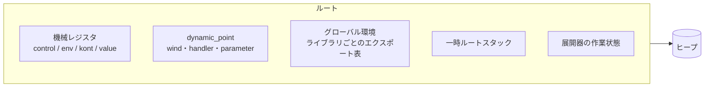
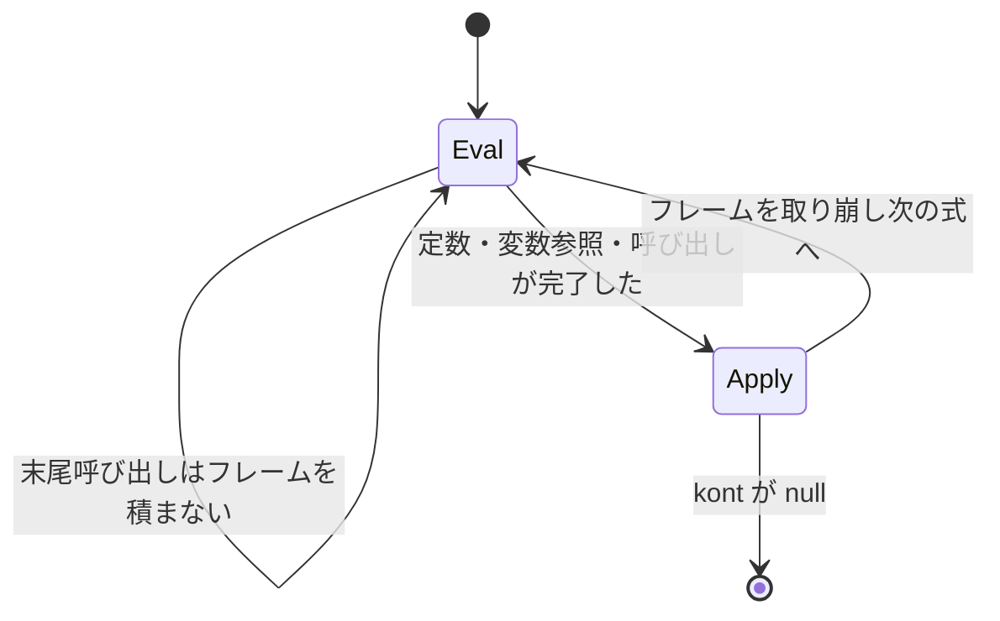
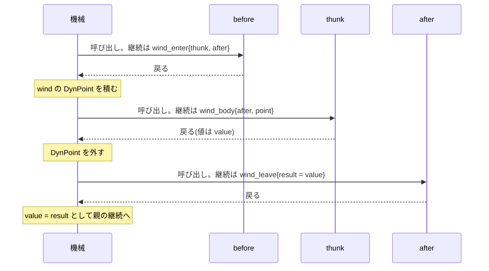
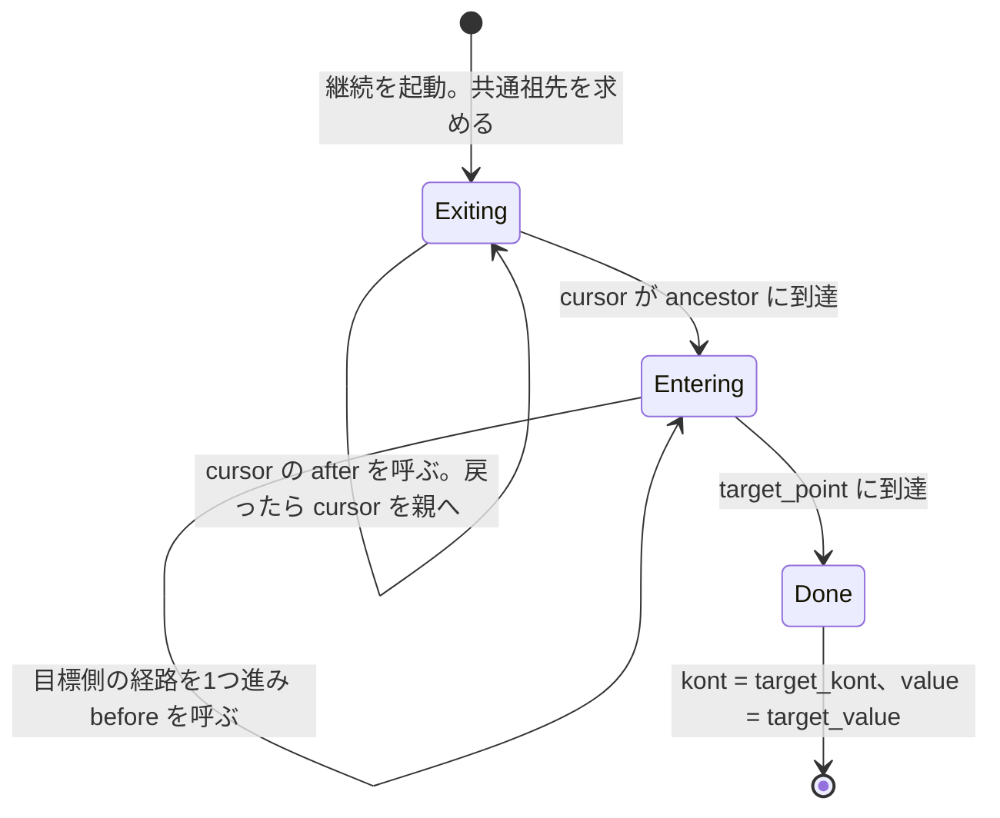

# ランタイム設計

値表現、ガベージコレクション、環境、CEK機械、継続、動的状態、例外を扱う。実装時に最も参照されるドキュメント。

対応する決定: [ADR-0002](../adr/0002-value-representation.md)、[ADR-0003](../adr/0003-precise-mark-sweep-gc.md)、[ADR-0004](../adr/0004-cek-machine-evaluator.md)、[ADR-0008](../adr/0008-string-representation.md)。

## 値表現

`Value` は Zig のタグ付き union とする。即値はインラインに持ち、複合型は GC ヒープ上のオブジェクトへのポインタを持つ。サイズは16バイト(ペイロード8バイト+タグ)。

```zig
pub const Value = union(enum) {
    // 即値
    nil,                      // 空リスト
    unspecified,              // 未規定値
    eof,
    boolean: bool,
    fixnum: i64,
    flonum: f64,
    char: u21,                // Unicode スカラ値
    symbol: Symbol,           // インターン済みID

    // ヒープオブジェクト
    pair: *Pair,
    string: *Str,
    vector: *Vector,
    bytevector: *Bytevector,
    closure: *Closure,
    primitive: *Primitive,
    continuation: *Continuation,
    promise: *Promise,
    record: *Record,
    record_type: *RecordType,
    port: *Port,
    parameter: *Parameter,
    environment: *REnvironment,
    transformer: *Transformer,
    bignum: *Bignum,
    ratnum: *Ratnum,
    compnum: *Compnum,
    condition: *Condition,
    multiple_values: *MultipleValues,

    // 展開時にのみ現れる。CEK機械には到達しない
    alias: *Alias,
};
```

段階1で必要なのは `nil` から `primitive` までで、残りは段階が進むにつれて追加する。タグを増やすと `switch` の網羅性検査が既存コードの修正箇所を教えてくれる。これが表現の選択理由の一つである。

`alias` はマクロ展開の途中にデータの中に現れる識別子である([frontend.md](frontend.md) の構文環境と識別子)。マクロ展開の出力は通常のデータなので、別名もデータの一種でなければならない。別名はコアIRを作る時点で意味に解決されるか元のシンボルに剥離されるため、CEK機械には到達しない。これを不変条件とする。`Value` を受け取る実行時のプリミティブは `alias` の場合を考慮しなくてよいが、`switch` の網羅性検査を満たすために内部エラーとして扱う分岐を書く。

他モジュールはタグに直接依存せず、`value.zig` のアクセサを使う。

```zig
pub inline fn isPair(v: Value) bool {
    return v == .pair;
}

pub fn asFixnum(v: Value) ?i64 {
    return switch (v) {
        .fixnum => |n| n,
        else => null,
    };
}
```

`#f` 以外のすべての値は真である(R7RS 6.3)。真偽判定は `isTruthy` 一箇所に閉じる。

### ヒープオブジェクトのヘッダ

GC は `Value` のタグを知らない状態でオブジェクトを辿る必要があるため、全ヒープオブジェクトは先頭に共通ヘッダを持つ。

```zig
pub const Kind = enum(u8) { pair, string, vector, bytevector, closure, /* ... */ };

pub const Header = struct {
    kind: Kind,
    mark: bool,
    next: ?*Header, // 確保済み全オブジェクトのリンクリスト。sweep で使う
};

pub const Pair = struct {
    header: Header,
    car: Value,
    cdr: Value,
};
```

`Value` のタグと `Header.kind` は冗長だが、GC が型を判別するために必要である。両者の対応表は `value.zig` に1箇所だけ置く。

### 文字列

文字列は UTF-8 バイト列として保持し、全文字が ASCII かどうかのフラグを持つ。

```zig
pub const Str = struct {
    header: Header,
    bytes: []u8,       // GC ヒープ外のアロケータから確保し、sweep 時に解放
    len: u32,          // 文字数
    ascii_only: bool,
};
```

ASCII のみなら `string-ref` と `string-set!` は定数時間、そうでなければ先頭からの走査になる。R7RS は `string-ref` の計算量を規定していない(R7RS 6.7)ため準拠上の問題はない。UTF-8 を選ぶのはポートと WASM ホスト境界で変換が不要になるためである。幅の変わる `string-set!` はバイト列の再確保を伴う。詳細は [ADR-0008](../adr/0008-string-representation.md)。

### シンボルのインターン

シンボルはインターンして32ビットの ID で表す。`eq?` による比較が ID の一致になり、`Value` にポインタを持たせずに済む。

`string->symbol` は任意の文字列からシンボルを作れる(R7RS 6.5)。インターン表を解放しない永続表にすると、乱数で作った文字列をシンボル化し続けるだけでヒープ上限の外側でメモリを増やし続けられる。長時間稼働する REPL とブラウザでは、これは資源枯渇の経路になる。したがって次の2つを行う。

名前の格納領域をヒープ上限に計上する。インターン表自身の確保も `heap.zig` の計上に含める。上限を超えたら Scheme のエラーにする。

インターン表を弱い表にする。ID が `Value` の中に即値として入るため、GC はポインタを辿るだけでは生きているシンボルを判定できない。そこでマーク段階を利用する。

```zig
pub const SymbolTable = struct {
    names: ArrayListUnmanaged([]u8),   // ID -> 名前
    index: StringHashMapUnmanaged(Symbol), // 名前 -> ID
    pinned: DynamicBitSetUnmanaged,    // 回収してはならない ID
    live: DynamicBitSetUnmanaged,      // マーク中に参照された ID
    free: ArrayListUnmanaged(Symbol),  // 再利用できる ID
};
```

- マーク段階では、オブジェクトを辿る過程で `.symbol` の値に出会うたびに `live` に印を付ける。GC は既に生きている全オブジェクトを訪れるので、追加の走査は発生しない。
- スイープ段階で、`live` にも `pinned` にもない ID の名前を解放し、ID を `free` に戻す。
- `pinned` には、起動時に Zig 側が登録する既知のシンボル(`quote` `if` `lambda` など)を入れる。これらは Zig のコードが ID を定数として保持するため回収してはならない。
- ID の再利用は、その ID への生きた参照が存在しないことを `live` が保証した後にのみ行う。

この方式により `string->symbol` で作って捨てたシンボルは回収され、ID 表現の利点も保たれる。

## ガベージコレクション

非移動型のマーク・スイープGCとする。停止型で、確保量が閾値を超えたときに動作する。

非移動型を選ぶ理由は2つある。第一に、`*Pair` などの生ポインタが収集後も有効なままなので、ルート登録は到達可能性の保証だけを意味し、Zig のローカル変数を書き換える必要がない。第二に、ハンドル経由の間接参照が不要なのでコードが読みやすい。代償は断片化とスイープのコストである。

保守的スタック走査は採用しない。wasm の関数ローカル変数は線形メモリ上に存在せず走査できないため、ネイティブと WASM で GC の正しさが変わってしまう。

マーク段階は、生きている `Value` に出会うたびに参照されたシンボル ID を記録する。スイープ段階でインターン表の未参照の項目を解放する(前述のシンボルのインターン)。これによりシンボルもヒープ上限の中で管理される。

### ルート集合



機械の状態が4レジスタと `dynamic_point` に集約されているため、ルートは少数で済む。これが CEK 機械を選んだ理由の一つである。

### 一時ルートの書き方

ヒープ確保をまたいで `Value` を保持する場合は、スコープ単位でルート枠を使う。

```zig
pub fn makeList2(h: *Heap, a: Value, b: Value) !Value {
    var frame = h.rootFrame();
    defer frame.pop();
    frame.add(a);
    frame.add(b);

    const tail = try h.cons(b, .nil); // ここで GC が走りうる
    frame.add(tail);
    return try h.cons(a, tail);
}
```

非移動型なので `frame.add(a)` の後も `a` をそのまま使える。`frame.add` は到達可能性のみを保証する。

次の書き方は誤りである。

```zig
// 誤り: 2回目の cons で GC が走ると first が回収されうる
const first = try h.cons(.nil, .nil);
const second = try h.cons(.nil, .nil);
return try h.cons(first, second);
```

判断に迷ったら登録する。過剰な登録は性能を落とすだけだが、不足はメモリ破壊を招く。

### 収集の起動点

GC は `heap.allocate` の内部でのみ走る。したがって確保を行う可能性のある呼び出しを見分けることが実装上の要点になる。`heap.zig` の公開APIのうち確保を行うものは、ドキュメンテーションコメントの先頭に `GCを起動しうる` と書く規約とする。

機械のステップ関数の境界では、レジスタだけがルートであることが保証される。したがってステップの先頭で GC を走らせる安全点方式も将来の選択肢として残す。

## 環境

### 局所環境

展開器が字句アドレスを解決するため、局所変数の参照は深さと添字によるポインタ辿りだけになる。

```zig
pub const Rib = struct {
    header: Header,
    parent: ?*Rib,
    slots: []Value, // 固定長。可変長引数は最後のスロットにリストで入る
};
```

内部 `define` は `letrec*` 意味論に従う(R7RS 5.3.2)。展開器は本体をすべて走査して内部定義を集め、`Rib` のスロットを事前に確保し、未初期化を表す内部値で埋める。未初期化スロットの参照はエラーとする。

### グローバル環境

グローバル変数は束縛セルを経由する。

```zig
pub const GlobalCell = struct {
    header: Header,
    name: Symbol,
    value: Value, // 未束縛を表す内部値で初期化
};
```

セルを介することで、前方参照、相互再帰、`set!`、REPL での再定義がすべて自然に扱える。ライブラリごとにシンボルからセルへの表を持ち、`import` はセルを共有する(値をコピーしない)。これによりエクスポート元での再定義がインポート側にも反映される。

セルの共有だけでは、インポートした束縛への `define` と `set!` を拒否できない。R7RS 5.2 がこれをエラーと規定しているため、所有とインポートの区別は構文環境側の意味に持たせる([frontend.md](frontend.md) のインポートした束縛への書き込みの禁止)。実行時のセルには可否の情報を持たせず、展開時に拒否する。

## コアIR

展開器の出力。R7RS 7.1.3 の基本式に対応する。

```zig
pub const Node = struct {
    header: Header, // GC が割り当てリストへの登録と種別判定とマークに使う
    body: union(enum) {
        constant: Value,
        local_ref: struct { depth: u16, index: u16 },
        global_ref: *GlobalCell,
        local_set: struct { depth: u16, index: u16, value: *Node },
        global_set: struct { cell: *GlobalCell, value: *Node },
        branch: struct { test_: *Node, consequent: *Node, alternative: ?*Node },
        lambda: *LambdaInfo,
        seq: []*Node,
        call: struct { operator: *Node, operands: []*Node, tail: bool },
    },
};
```

`Node` も GC ヒープに置くため、他のヒープオブジェクトと同じく先頭に `Header` を持つ。ヘッダのない union にすると、割り当てリストへの登録、`Header.kind` による種別判定、マークのいずれもできない。`Header.kind` は `.core_node` の1種類とし、子の走査は `body` のタグで分岐する。

`call` の `tail` は展開器が付ける。機械はこの印を信用して、真なら継続フレームを積まない。末尾位置の判定を機械側に持たせないのは、判定の責任を1箇所にまとめるためである。

コアIRの節点は GC ヒープに置く。`constant` が `Value` を持ち、`lambda` が実行時にクロージャとして参照されるため、プログラム本体も収集対象にする必要がある(REPL で再定義を繰り返すとコードも捨てられる)。

## CEK機械

### 状態

```zig
pub const Machine = struct {
    heap: *Heap,
    control: ?*Node,    // 次に評価する式。null なら value を継続に渡す
    env: ?*Rib,
    kont: ?*Frame,      // 継続。null なら実行完了
    value: Value,       // 直前の結果
    dynamic_point: ?*DynPoint,
    step_budget: u64,   // WASM で制御を戻すための歩数制限
};
```

ステップ関数は `control` が非 null なら式を1段分解して進み、null なら `value` を `kont` に渡して1フレーム取り崩す。実行ループはこれを繰り返すだけである。



### 継続フレーム

継続フレームは不変とする。一度作ったフレームの内容を書き換えてはならない。

```zig
pub const Frame = struct {
    header: Header,
    parent: ?*Frame,
    env: ?*Rib,
    kind: union(enum) {
        if_branch: struct { consequent: *Node, alternative: ?*Node },
        seq_rest: struct { nodes: []*Node, index: u32 },
        set_local: struct { depth: u16, index: u16 },
        set_global: *GlobalCell,
        eval_operator: struct { operands: []*Node, tail: bool },
        eval_operand: struct {
            operands: []*Node,
            index: u32,
            operator: Value,
            done: Value, // 評価済み引数の逆順リスト
            tail: bool,
        },
        // 段階2以降で追加
        receive_values: struct { consumer: Value },
        handler_result: struct { continuable: bool },

        // dynamic-wind の通常実行経路。後述
        wind_enter: struct { thunk: Value, after: Value },
        wind_body: struct { after: Value, point: *DynPoint },
        wind_leave: struct { result: Value },

        rewind: Rewind, // 継続起動時の動的状態の遷移。後述
    },
};
```

引数の蓄積を可変配列ではなく不変の逆順リストで行うのは、継続の多重起動に対する正しさのためである。引数を評価している途中で `call/cc` で継続を捕捉し、その継続を2回起動した場合、可変配列を共有していると2回目が1回目の書き込みを観測してしまう。不変リストなら各起動が独立した状態から再開する。

この選択は確保回数を増やす。段階6以降の最適化候補として、捕捉時にコピーするスタックセグメント方式を検討する。最適化は準拠テストが通った後に行う。

### 完全な継続

```zig
pub const Continuation = struct {
    header: Header,
    kont: ?*Frame,
    dynamic_point: ?*DynPoint,
};
```

`call/cc` は現在の `kont` と `dynamic_point` を保存した `Continuation` を作り、引数の手続きに渡す。起動時は `kont` を復元し、`dynamic_point` を現在のものから目標のものへ巻き戻す。フレームが不変なので捕捉は定数時間であり、多重起動も再入も成立する。

### 動的状態

`dynamic-wind`、`with-exception-handler`、`parameterize` の3つは、いずれも動的範囲に対する束縛である。1つの不変リストで統一して表す。

```zig
pub const DynPoint = struct {
    header: Header,
    parent: ?*DynPoint,
    depth: u32, // 共通祖先の計算用
    kind: union(enum) {
        wind: struct { before: Value, after: Value },
        handler: Value,
        parameter: struct { param: *Parameter, value: Value },
    },
};
```

継続の起動時は、現在の点と目標の点の共通祖先を `depth` を使って求め、現在側を祖先まで `after` を呼びながら降り、目標側を `before` を呼びながら登る(R7RS 6.10)。ハンドラとパラメータの束縛は呼び出しを伴わないので、復元は参照の差し替えだけで済む。

3つを1つの機構で表すことで、`call/cc` との相互作用を1箇所で正しくすれば全体が正しくなる。

### dynamic-wind の通常実行

`before`、`thunk`、`after` はいずれも Scheme 手続きである。プリミティブの中で機械を起動しないという不変条件により、3つの呼び出しはそれぞれ継続フレームを積んで機械に戻す形で実装する。



- `wind_enter`: `before` が完了した。`wind` 種別の `DynPoint` を積み、`thunk` を呼ぶ。継続は `wind_body`。
- `wind_body`: `thunk` が完了した。`dynamic_point` を `point` の親に戻し、`after` を呼ぶ。継続は `wind_leave { result = value }`。フレームは不変なので、`thunk` の結果はこの新しいフレームに格納する。
- `wind_leave`: `after` が完了した。`after` の戻り値を捨て、`result` を親の継続に渡す。

`after` は `DynPoint` を外した後に呼ぶ。R7RS 6.10 が `after` を `thunk` の動的範囲の外で実行すると規定しているためである。`thunk` が複数値を返した場合は `result` に `MultipleValues` が入り、そのまま親に渡る。

`thunk` が例外を送出した場合や継続で脱出した場合は、この通常経路ではなく後述の巻き戻しが働く。

### 巻き戻しの進行

`after` と `before` は Scheme 手続きであり、その中でさらに継続を捕捉したり起動したりできる。したがって巻き戻しを Zig の同期ループで回すことはできない。巻き戻しの途中の状態自体が継続に含まれていなければならない。

専用の不変フレームを置く。

```zig
pub const Rewind = struct {
    phase: enum { exiting, entering },

    // exiting: 現在側を共通祖先まで降りる
    cursor: ?*DynPoint,       // 次に after を呼ぶ点
    ancestor: ?*DynPoint,     // 共通祖先。exiting の終点

    // entering: 目標側を共通祖先から降りる
    enter_path: ?*DynPath,    // 外側から内側の順に並べた経路
    enter_index: u32,         // 次に before を呼ぶ位置

    target_point: ?*DynPoint, // 目標の動的点。entering の終点
    target_kont: ?*Frame,     // 遷移完了後に復元する継続
    target_value: Value,      // 復元した継続に渡す値。複数値も入る
};

pub const DynPath = struct {
    header: Header,
    points: []*DynPoint, // ancestor の直下から target_point までを外側から内側の順に並べる
};
```

`DynPoint` は親へのポインタしか持たないため、目標側を外側から内側へ辿ることができない。`exiting` の完了時に `target_point` から `ancestor` まで親をたどり、順序を反転した `DynPath` を作る。この構築は Scheme 手続きの呼び出しを伴わないので同期に行える。

`DynPath` は作成後に変更しない。`entering` の各段は `enter_index` を1つ進めた新しい `Rewind` フレームを作り、同じ `DynPath` を共有する。不変なので共有しても継続の多重起動で壊れない。

機械の動作は次のとおり。



各 `after` と `before` の呼び出しは通常の手続き呼び出しとして機械に積む。その継続として、`exiting` なら `cursor` を親へ進め、`entering` なら `enter_index` を1つ進めた新しい `Rewind` フレームを置く。フレームは不変なので、`after` の中で捕捉した継続を後で起動しても、その時点の巻き戻し状態から正しく再開する。

`dynamic_point` レジスタは各 `after` の呼び出しの前に親へ、各 `before` の呼び出しの後に子へ更新する。これにより `after` と `before` の中で例外が起きた場合のハンドラ探索が、R7RS の規定どおりその時点の動的環境を見る。

### 例外

`raise` は `dynamic_point` を遡って最も内側の `handler` を探し、その `handler` より外側の動的環境を設定してからハンドラを呼ぶ(R7RS 6.11)。これによりハンドラ自身が例外を起こしても無限ループにならない。

- `raise`: ハンドラが戻った場合は二次例外を起こす。
- `raise-continuable`: ハンドラの戻り値が `raise-continuable` の値になる。
- `with-exception-handler`: `handler` 種別の `DynPoint` を1つ積む。
- `guard`: Scheme 側で `call/cc` と `with-exception-handler` を用いて実装する(R7RS 7.3 の派生式に対応)。
- `error`: 条件オブジェクトを作って `raise` する。

条件オブジェクトは R7RS が要求する述語を区別できる構造を持つ。

```zig
pub const Condition = struct {
    header: Header,
    tag: enum { error_object, read_error, file_error },
    message: Value,  // 文字列
    irritants: Value, // リスト
};
```

### 複数値

`values` は引数が1個なら値をそのまま返し、それ以外なら `MultipleValues` を返す。これを受け取れるのは `receive_values` フレームと最外の REPL だけである。1個を期待するフレームが複数値を受け取った場合はエラーとする。R7RS はこの場合を未規定としている(R7RS 6.10)ため、検出してエラーにする方が実装の誤りを見つけやすい。

### 歩数制限とWASM

ブラウザではメインスレッドを長時間占有できない。機械のループは `step_budget` 歩で制御を呼び出し元に返す。WASM のエクスポート関数は続きがあるかどうかを返し、JS 側が再開する。この構造はネイティブ側でも割り込み処理に使える。

深い再帰はヒープフレームを消費するだけなので Zig のスタックは溢れない。ただし無限再帰でヒープを食い潰す前に Scheme のエラーにするため、フレーム数の上限を設定可能にする。
