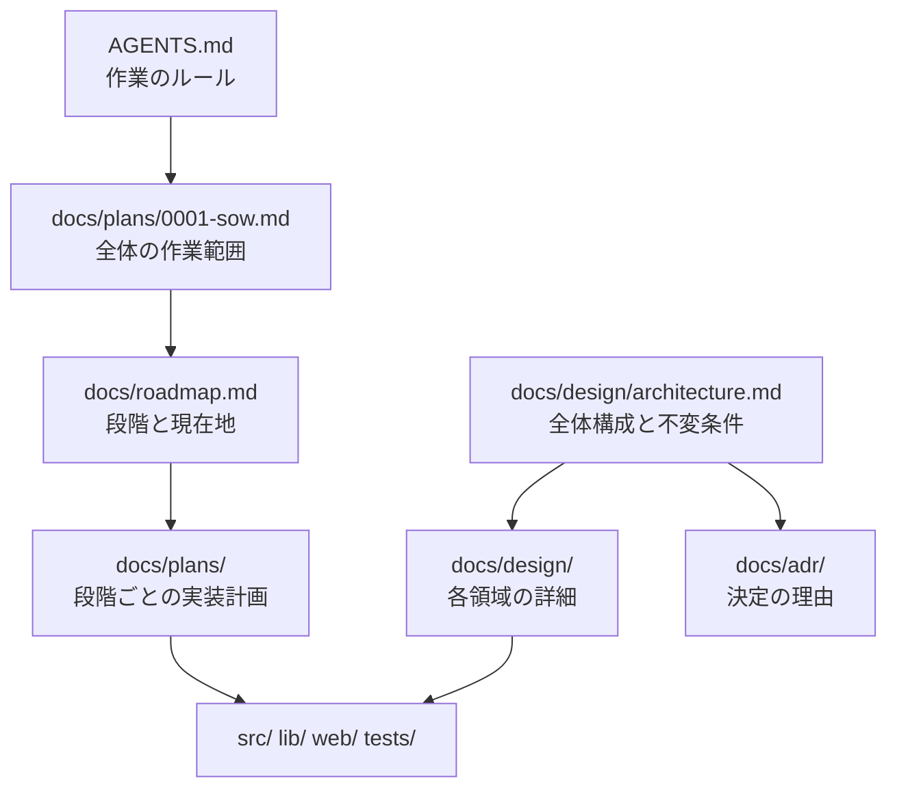

# オンボーディング

sucheme-zig の開発に参加する人と、作業を引き継ぐ AI エージェントのための案内。

現在の到達点は [roadmap.md](roadmap.md) の「現在地」を見る。本ドキュメントには進捗を書かない(2箇所に書くと必ず食い違う)。

## プロジェクトを一文で

Zig で書いた R7RS-small 準拠の Scheme インタプリタで、ネイティブ実行ファイルと WebAssembly の両方を同一のコアから作る。

名前はリポジトリオーナーに由来する。`scheme` の打ち間違いではない。

## 環境を整える

| 必要なもの | バージョン | 備考 |
| --- | --- | --- |
| Zig | `.zigversion` の値に固定 | `.zigversion` が正。バージョンが違うとビルドが通らない。段階0の完了までこのファイルは存在しないので、それまでは [adr/0001-zig-version-pinning.md](adr/0001-zig-version-pinning.md) の決定を見る |
| Git | 任意 | |
| GitHub CLI (`gh`) | 任意 | PR 操作に使う |
| Node.js | 任意 | Web UI の確認とローカル配信に使う。本体のビルドには不要 |

固定している Zig は破壊的変更が多い版である。[design/zig-api-notes.md](design/zig-api-notes.md) を読む前にコードを書き始めないこと。古い記法の多くはコンパイルエラーになるが、すべてではない。管理型の `AutoHashMap` と `StringHashMap` の旧記法や、古い形の panic ハンドラはそのまま通る。コンパイラに頼りきらず対応表を参照する。

導入例(Windows、scoop)。

```
scoop install zig
zig version   # .zigversion の値と一致することを確認する
```

ビルドとテストのコマンドは `AGENTS.md` の検証コマンド表が正とする。本ドキュメントには転記しない。

## リポジトリの歩き方



### 読む順序

1. `AGENTS.md`: 言語ルール、開発フロー、セキュリティ、コミットとPRの作法。すべての作業の前提。
2. [plans/0001-sow.md](plans/0001-sow.md): 何を作るのか、何を作らないのか。
3. [roadmap.md](roadmap.md): いまどの段階にいて、次に何をするのか。
4. [design/architecture.md](design/architecture.md): 全体構成と、守るべき横断的な不変条件。この節は必読。
5. 担当する領域の設計ドキュメント。[design/README.md](design/README.md) に一覧がある。
6. [design/open-questions.md](design/open-questions.md): 設計で決めていないこと。担当領域の行は実装時に自分が決める対象である。
7. 関係する ADR。「なぜこうなっているのか」はここにある。

### ディレクトリ

| パス | 内容 |
| --- | --- |
| `src/` | Zig で書くインタプリタ本体 |
| `lib/` | Scheme で書く標準ライブラリ。ビルド時に実行ファイルへ埋め込む |
| `web/` | Web UI。依存パッケージを持たない素の HTML/CSS/JS |
| `tests/scheme/` | Scheme レベルの振る舞いテスト |
| `tests/vendor/` | 外部から取り込んだ準拠テストスイート。改変しない |
| `tools/` | テーブル生成などの補助プログラム |
| `docs/` | 設計、決定、計画、進捗 |
| `.agents/skills/` | Claude Code・Copilot・Codex で共有するスキル |
| `.claude/` | Claude Code 固有の設定、コマンド、フック |

## 絶対に守ること

[design/architecture.md](design/architecture.md) の「横断的な不変条件」が優先する。特に次の3つは違反するとレビューで差し戻しになる。

- ヒープ確保をまたいで `Value` を Zig のローカル変数に保持しない。保持するならルート枠に登録する。WASM では Zig のローカル変数を GC が走査できないため、これが唯一の安全策である。
- Scheme 式の評価を Zig の再帰で行わない。評価を進めるのは `machine.zig` のステップ関数だけ。
- プリミティブ手続きの中で機械を起動しない。Scheme 手続きを呼ぶ必要があるなら継続フレームを積んで機械に戻す。

## よくある作業の手順

### プリミティブ手続きを追加する

1. `tests/scheme/` に、その手続きの振る舞いを確かめる失敗するテストを書く。
2. `src/prim/` の該当ファイルに実装を追加し、登録表に加える。
3. R7RS の該当節を `Why:` コメントで引く(非自明な振る舞いの場合)。
4. `tests/r7rs-required/` の一覧に含まれる識別子なら、準拠マトリクスの数値が動くことを確認する。

### 派生構文を追加する

Scheme で書けるものは Scheme で書く([ADR-0006](adr/0006-library-system-and-scheme-level-stdlib.md))。`lib/sucheme/derived.scm` に `syntax-rules` で定義し、衛生性を壊していないかを確認するテストを添える。

### 設計判断をした

設計ドキュメントに書くか、実装の中で決めるかを先に分ける。複数のモジュールにまたがる構造とインタフェースは設計ドキュメントに書き、1つのモジュールに閉じたものは実装の中で決める。線引きは [ADR-0018](adr/0018-incremental-vertical-slices.md) にある。実装の中で決めたことが他の段階に影響するなら [design/open-questions.md](design/open-questions.md) の該当行を消して記録する。

技術選択そのものについては、[adr/README.md](adr/README.md) の運用ルールに従って ADR を書く。既存 ADR の決定内容の書き換えは禁止で、決定が変わったら非推奨化して新しい番号で書く。`/adr` スキルが手順を案内する。

レビュー指摘を技術的理由で採用しない場合も ADR に残す。該当コードには ADR 番号を引いた `Why:` コメントを書く。

### 段階を完了させる

1. 段階の完了条件([roadmap.md](roadmap.md))を満たしたことをテストで示す。
2. 準拠マトリクス(`docs/status/`)を生成し直す。CI が同期を検査する。README には数値を置かないので対象外である。
3. `roadmap.md` のチェックを入れ、「現在地」を更新する。段階の節の「残していること」を、実際に残ったものに合わせる。
4. その段階で確定したことを、該当する設計ドキュメントまたはコードのコメントに書き、[design/open-questions.md](design/open-questions.md) から該当する行を消す([ADR-0018](adr/0018-incremental-vertical-slices.md))。
5. リリースタグを打つ。

## 落とし穴

| 症状 | 原因 |
| --- | --- |
| 出力が何も出ない | `std.Io` の Writer の `flush()` を忘れている |
| `std.fs.cwd` が無いと言われる | 0.17 では `std.Io.Dir.cwd()` |
| `ArrayList.init` が無いと言われる | 0.17 では `var l: std.ArrayList(T) = .empty;` と `l.append(gpa, x)` |
| `{d}` で書式エラー | 省略可能型には `?` 接頭辞が必要。`{?}` も `{?d}` も有効 |
| 独自の panic ハンドラが呼ばれない | 宣言名は小文字の `panic` で、値は `std.debug.FullPanic(fn)` |
| `build.zig.zon` の fingerprint エラー | エラーメッセージが正しい値を教えてくれるので、それを貼る |
| ランダムな場所でクラッシュする | GC のルート登録漏れ。確保をまたいで保持している `Value` を探す |
| 深い再帰でスタックが溢れる(評価中) | Zig の再帰で Scheme 式を評価している。機械のフレームに載せ替える |
| 深い再帰でスタックが溢れる(GC・リーダ・プリンタ・`equal?`・展開器・`syntax-rules`) | 入力の深さに比例して進む処理を Zig の再帰で書いている。明示的な作業スタックに載せ替える。対象の一覧は [design/runtime.md](design/runtime.md) にある |

詳細は [design/zig-api-notes.md](design/zig-api-notes.md) にある。

## 一次情報

迷ったらここを見る。解説記事や他の処理系のドキュメントを根拠にしない(`AGENTS.md` の情報源の節)。

| 対象 | 一次情報 |
| --- | --- |
| R7RS の仕様 | [誤記修正版 HTML](https://standards.scheme.org/corrected-r7rs/r7rs.html)、[公式 PDF](https://standards.scheme.org/official/r7rs.pdf) |
| Zig の標準ライブラリ | 手元の `lib/std/` のソース。`zig` の実行ファイルと同じ階層にある |
| Zig の言語仕様 | [0.17.0 の言語リファレンス](https://ziglang.org/documentation/0.17.0/) |
| GitHub Actions | GitHub 公式ドキュメント |

## 困ったとき

- 設計の意図が分からない: 該当領域の ADR を読む。書かれていなければ、それは記録漏れなので ADR を書く機会である。
- 仕様の解釈に迷う: R7RS の該当節を引用して、解釈の候補とトレードオフを提示して判断を仰ぐ。勝手に決めない(`AGENTS.md` の進め方の節)。
- コマンドが想定外の動きをする: 原因を特定してから対処する。原因不明のまま回避策で迂回しない。やむを得ず回避する場合は経緯と理由を `Why:` コメントか ADR に残す。
