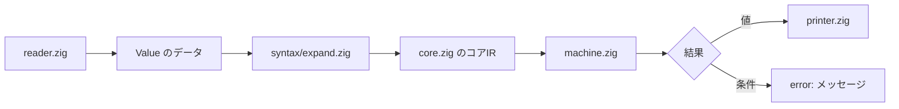

# 0004: 切片 1f の実装計画 — CEK 機械への移行

- 対応する決定: [ADR-0004](../adr/0004-cek-machine-evaluator.md), [ADR-0018](../adr/0018-incremental-vertical-slices.md), [ADR-0027](../adr/0027-severity-by-consequence-and-a-cost-side-stop.md)
- 段階: 1(切片 1f)。切片の全体は [0003-phase1-minimal-slice.md](0003-phase1-minimal-slice.md) が正
- 日付: 2026-10-09
- 状態: 合意待ち。合意されるまで実装を始めない

## 解こうとしている問題

1a から 1e の評価器は、`Value` を直接解釈する Zig の再帰関数である。次の3つが成り立たない。

- 末尾呼び出しが定数の領域で動かない。再帰の深さは Zig のスタックで決まり、`max_depth` が止める。
- 完全な継続を実装できない。Zig のスタックに評価の状態があるため、段階2の `call/cc` と `dynamic-wind` の置き場がない。
- 精密 GC が書けない。Zig のスタックに `Value` が隠れる(1g の前提)。

1f はこれを、展開器・コアIR・CEK 機械に置き換えて解く。置き換えの正しさは、1a から 1e の `tests/scheme/` が(0009 の2ケースを除いて)そのまま通ることで確かめる。

## 完了条件

[roadmap.md](../roadmap.md) の段階1の完了条件のうち、1f が受け持つ部分は次のとおりである。

- 末尾呼び出しが継続を積まない。`(define (loop n) (if (= n 0) 'done (loop (- n 1))))` の `(loop 100000)` が、継続の深さの最大値が定数のまま完了する。
- 深い非末尾再帰が Zig のスタックで止まらない。`(define (count n) (if (= n 0) 0 (+ 1 (count (- n 1)))))` の `(count 10000)` が `10000` を返す。
- エラーが条件オブジェクトとして最外の継続へ脱出し、REPL が `error: <message>` を出して止まらない。
- 1a から 1e のテストが通る。

100万回の末尾再帰が「一定のメモリ」で完了することは、1f では満たせない。局所変数のフレームと引数の蓄積は GC が入る 1g まで永続アリーナに残り、呼び出しの回数に比例してメモリが増えるためである。0003 の1f行の完了条件はこの点で正確でなかったので、この PR で直す。1f が示すのは継続の深さが定数であること(機械が数える)で、メモリの定数性は 1g の完了条件になる。テストの反復回数を 10 万回にするのは、永続側に積む量を数十MB に収めるためである。

## 合意済みの決定

ユーザーが選択肢を比べて決めたもの。

| 事項 | 決定 |
| --- | --- |
| 切片の分け方 | 1f を1つの PR で入れる。コミットは下の順序で論理変更ごとに分ける |
| 字句アドレスの幅 | 深さと添字を `u32` にする。展開器が `u32` を超える入れ子と1フレームの変数の数を実装制限として報告する(R7RS 1.3.2) |
| 条件オブジェクト | 最小形を作る。`Value` に条件の種類を足し、機械が起こすエラーを条件にして最外の継続へ脱出させる。`raise`・`error`・ハンドラは段階2 |
| フレーム数の上限 | 1g まで設けない。`max_depth` は機械が Zig の再帰を使わなくなるので外す |

フレーム数の上限を設けない結果、1f から 1g のあいだは、非末尾の無限再帰(`(define (f n) (+ 1 (f n)))`)がプロセスのメモリを使い切るまで走る。テストにこの形を入れない。既知の制約として 0003 に書く。

## この計画が決めて、合意を求める点

次の2点は設計文書に直接の根拠がなく、この計画で決める。

- 末尾位置の印を作らない。[ADR-0004](../adr/0004-cek-machine-evaluator.md) は展開器が呼び出し節点に末尾の印を付けると定めているが、1f の機械は呼び出しのたびに戻り先のフレームを積まない形にする(手続きの本体は呼び出し側の継続のまま走る。`if` と式の列は、最後の式の評価に入る前に自分のフレームを外す)。この形では末尾呼び出しが印なしで定数の継続になり、印を読む箇所がない。読む箇所のない印を作るのは YAGNI に反するので、印は段階2で `apply` や `dynamic-wind` が読む必要が出たときに足す。ADR-0004 の決定と矛盾はしない(印は手段で、決定の本体は末尾呼び出しが継続を積まないこと)が、ADR の文言とずれるので、ADR-0029 に追記として書く。
- 継続の深さを機械が数える。継続フレームが連鎖の長さを持ち、機械が最大値を記録する(テストが読む)。末尾呼び出しの検査を、メモリ量でなく不変条件で行うためである。長さは 1g の計上上限でも使える。

## 範囲を狭める線

ADR-0027 の費用側の停止の規則に従い、先に線を引く。レビューが収束しない兆候(必須の件数が前の巡より減らない、指摘がレビュー自身の記録に移る、修正が新しい機構を足す形になる)が出たら、次を上から順に外してやり残しに記録する。

1. 条件オブジェクト(`Value` の条件の種類)。外すと、機械は Zig の error とメッセージの組で最外へ脱出し、条件オブジェクトは段階2に回る。
2. u32 の実装制限の報告。外すと、超えたときは Zig の整数の範囲検査で止まる(安全ビルドで panic、WASM でトラップ)。これは [architecture.md](../design/architecture.md) の「パニックもトラップも起こさない」に反するので、外す場合はユーザーに諮る。

## 処理の流れ

## ファイル

| ファイル | 責務 | 変更 |
| --- | --- | --- |
| `src/value.zig` | GC が辿るレイアウトの定義。`Node`(コアIR)、`Closure`、`Frame`、継続フレーム、条件を足し、`Closure` と `Frame` を字句アドレス向けに変える | 変更 |
| `src/core.zig` | コアIRの節点を作る補助と、節点の形の説明 | 新規 |
| `src/syntax/expand.zig` | データからコアIRへ。コンパイル時の環境(名前の列の連鎖)で字句アドレスを解決し、本体の内部定義を集めてスロットを確保する | 新規 |
| `src/machine.zig` | レジスタ(制御・環境・継続・値)とステップ関数。継続フレームは不変 | 新規 |
| `src/context.zig` | 永続アロケータ・シンボル表・大域環境。`eval.zig` の `Context` から、メッセージ領域を除いて移す | 新規 |
| `src/eval.zig` | 再帰評価器。機械に置き換わるので消す | 削除 |
| `src/env.zig` | 大域環境 `Global` は残す。`findLocal`(名前で引く)は消す | 変更 |
| `src/sucheme.zig` | `evalPrint` を、読み取り・展開・機械の実行に変える。`diagnostic()` は最後に脱出した条件のメッセージを返し、呼び出し側の契約を変えない | 変更 |
| `src/printer.zig` | 条件を `#<condition>` と書く(漏れが見える形) | 変更 |
| `src/main.zig` | 変更なし(`diagnostic()` の契約が同じ) | - |

プリミティブ(`src/prim/`)の呼び出し規約 `fn ([]const Value) PrimitiveError!Value` は変えない。機械が `PrimitiveError` を条件に写す。メッセージは 1e までと同じ文字列にし、`tests/scheme/` の期待値を変えない。

### コアIRの節点(段階1の最小集合)

| 節点 | 内容 |
| --- | --- |
| `constant` | `Value`。数値・真偽値・`quote` したデータ |
| `local_ref` | 深さ(u32)と添字(u32)。未初期化なら条件 |
| `global_ref` | シンボル。大域環境に名前が無ければ条件(束縛セルは段階2) |
| `local_set` / `global_set` | `set!`。束縛が無い、または未初期化なら条件 |
| `local_define` / `global_define` | `define`。局所は本体の先頭の定義が上で確保したスロットに代入する |
| `if` | 条件・結果・別(無ければ未規定値) |
| `sequence` | `begin` と本体。1つ以上の節点 |
| `lambda` | 仮引数の数、フレームのスロット数(仮引数と内部定義)、本体 |
| `call` | 演算子と被演算子の列。演算子、被演算子の順に左から評価する |

位置情報は段階1では持たない([frontend.md](../design/frontend.md) の位置情報の導入段階に従う)。

### 継続フレーム(段階1の最小集合)

[runtime.md](../design/runtime.md) の「必要なフレームの種類」の段階1の行に対応する。すべて不変で、次のフレームと連鎖の長さを持つ。

| フレーム | 制御が戻る局面 |
| --- | --- |
| `if` | 判定式の評価後 |
| `sequence` | 各式の評価後(最後の式の前に自分を外す) |
| `set` / `define` | 値の評価後 |
| `call` | 演算子の評価後、各引数の評価後。評価済みの値は不変の逆順リスト(ADR-0004) |

### 実装制限の報告

展開器が、入れ子の `lambda` の深さと1フレームの変数の数が `u32` を超えるとき、`implementation restriction: ...` の条件にする。実際に超える入力は16MBのヒープでは作れないので、制限値を引数に取れる形にして単体テストで小さい値を使う。

## 作業の順序

各行は Red のコミット(テストだけ、失敗する)のあとに Green のコミットが続く。1コミット1論理変更で、各コミットで `zig build test` と `zig build test-scheme` が通ることは求めない(Red のコミットは落ちる)。Green のコミットでは全検証コマンドを通す。

1. Red: `tests/scheme/0011-machine.txt`。深い非末尾再帰、末尾ループ、相互末尾再帰、エラーが REPL を止めないこと。あわせて `0009` の `(loop 1)` と `(fact 100)` の期待値を直す。
2. `value.zig` のレイアウトと `core.zig`。コンパイルが通ることと、`Kind` の網羅(既存のテスト)が根拠。
3. `expand.zig`。Red: データからコアIRへの変換、字句アドレス、内部定義のスロット、構文エラーが1e と同じ文言であること、u32 の制限。Green。
4. `machine.zig`。Red: 手で組んだコアIRを走らせる単体テスト、継続の深さが末尾呼び出しで増えないこと。Green。
5. 切り替え。`Interpreter` を展開と機械に付け替え、`eval.zig` と `max_depth` と小さいスタックのテストを消す。ここで 1a から 1e の `test-scheme` が全部通ることを確かめる。
6. 条件オブジェクト。`Value` に条件を足し、機械が起こすエラーを条件にして最外の継続へ脱出させる。
7. 文書。architecture.md の暫定の例外から再帰評価器の部分を外す(アリーナの記述は 1g まで残る)、runtime.md の段階1のコアIRの節、ADR-0029、open-questions の2行(字句アドレスの幅、フレーム数の上限)、0003 の進捗表と「次にやること」(次は 1g)。

## テスト

- 単体(`zig build test`): 展開器(形ごとの変換、アドレス、内部定義、エラーの文言、u32 の制限)、機械(節点ごとの実行、継続の深さ)、`Value` の条件の種類。
- Scheme の振る舞い(`zig build test-scheme`): 上の完了条件の3つ、`0001` から `0010` の全ケース。末尾ループは 10 万回、深い非末尾再帰は 1 万段にする。
- 変異試験: 判定を機械的に変えてテストが落ちることを確かめる(AGENTS.md)。対象は、末尾でフレームを外す箇所、字句アドレスの深さと添字、内部定義のスロット数、`u32` の境界、条件への写像。

## 検証コマンドの追加

なし。

## リスク

- 差分が大きい。1f は 1a から 1e の合計に近い規模になりうる。対策は上の線と、コミットごとの Red→Green。
- 永続アリーナの使用量が増える。呼び出しごとに、フレーム・スロット列・引数の蓄積の3つが永続側に残る。1g で `heap.zig` に移して回収する。
- 非末尾の無限再帰がメモリを使い切る(上述)。1g の計上上限で止まる。
- ADR-0004 の文言とのずれ(末尾位置の印)。ADR-0029 に書き、ユーザーの合意を得る。

## 参照

- [ADR-0004](../adr/0004-cek-machine-evaluator.md)、[ADR-0016](../adr/0016-exception-handler-as-dynamic-point.md)(段階2で動的状態に載る点)
- [design/runtime.md](../design/runtime.md) の環境、コアIR、CEK機械、例外
- [design/frontend.md](../design/frontend.md) の展開器
- [design/architecture.md](../design/architecture.md) の評価の進行点の一元化(暫定の例外が外れる)
