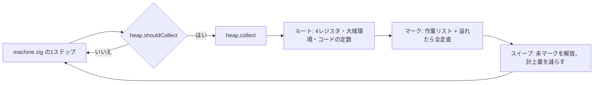

# 0005: スライス 1g の実装計画 — GC ヒープ

- 対応する決定: [ADR-0003](../adr/0003-precise-mark-sweep-gc.md), [ADR-0018](../adr/0018-incremental-vertical-slices.md), [ADR-0027](../adr/0027-severity-by-consequence-and-a-cost-side-stop.md)
- 段階: 1(スライス 1g)。スライスの全体は [0003-phase1-minimal-slice.md](0003-phase1-minimal-slice.md) が正
- 日付: 2026-10-10
- 状態: 合意待ち。合意されるまで実装を始めない

## 解こうとしている問題

1f までの実行時の値は、解放しない永続アリーナに積まれる。呼び出しごとのフレーム、引数の蓄積、継続フレーム、クロージャ、ペアが、回収されずに残る。このため、次の2つが成り立たない。

- 100万回の末尾再帰が一定のメモリで完了しない。1f で継続の深さは増えなくなったが、呼び出しごとのフレームは残り続ける。
- 非末尾の無限再帰(`(define (f n) (+ 1 (f n)))`)が、プロセスのメモリを使い切るまで走る。深さの上限が無いためで、1f の既知の制約である。

1g はこれを、精密なマーク・スイープ GC と、計上の上限で解く。

## 完了条件

- 100万回の末尾再帰(`(loop 1000000)`)が、計上量の最大値が定数のまま完了する。テストが、計上量の最大値を上限の小さい値と比べて確かめる。
- 非末尾の無限再帰が、プロセスのメモリを使い切らずに `heap limit exceeded` を報告し、REPL が止まらない。
- 到達不能なオブジェクトが実際に回収される。生きているクロージャとそのフレームは、GC のあとも読める。
- 1a から 1f のテスト(`zig build test-scheme` の全ケース)が、GC を毎ステップ走らせる状態(ストレスモード)でも通る。ルートの登録漏れを、これで検出する。

## 合意済みの決定

ユーザーが選択肢を比べて決めたもの。

| 事項 | 決定 |
| --- | --- |
| GC を実行する位置 | 機械のステップの境目だけで実行する。確保は閾値を超えたことを印すだけで、GC は走らせない。[ADR-0003](../adr/0003-precise-mark-sweep-gc.md) の「確保の内部で走る」とずれるので、ADR-0031 を書き、ADR-0003 に決定を変えない追記を置く |
| GC ヒープに置くもの | 実行時の値だけ(ペア・クロージャ・環境のフレーム・継続フレーム・引数の蓄積)。コアIRの節点と `Lambda`(コード)は、次のスライスまで今のアリーナに残す |
| 走査関数 | 設計文書どおり、`@typeInfo` でコンパイル時に生成する。手書きしない |

## この計画が決めて、合意を求める点

設計文書に直接の根拠がなく、上の決定から導いた。

- 境目の GC のルートは、機械の4レジスタ(制御・環境・継続・値)、大域環境の値、コードが持つ定数の3つだけになる。一時ルートの登録は要らない。境目では、確保の途中の値が存在しないためである。
- コードが持つ定数(`quote` したデータ)は、ルートにする。節点はアリーナにあって走査されず、定数の値は GC ヒープのペアを指しうるためである。展開器が、定数を作るたびに、ヒープを指すものを永続のルート表に登録する。コードをヒープに移す次のスライスで、この表は要らなくなる。
- 条件オブジェクトは、1g では GC ヒープに置かない。今のとおり `Context.raise` が上限の外のアリーナに作り、`Context.raised` が指す。ハンドラが無く、条件が値として機械の外に出ないので、ルートに要らない。上限に達した状態でもエラーを報告できる(予約領域の代わり)。ハンドラと `guard` が入る段階2で、予約領域の設計([runtime.md](../design/runtime.md) の送出のための予約領域)に移す。
- 確保が上限を超えるときは `error.HeapLimit` を返し、機械が `heap limit exceeded` の条件に変える。GC の起動閾値は上限より低く置く(余裕は、1ステップの確保量が収まる大きさ)ので、GC が間に合わずに上限へ当たるのは、1ステップの中で大きく確保したときだけである。GC のあとも閾値を下回らないときは、境目で同じエラーにする。
- 起動閾値は「直前の GC のあとの計上量の2倍と最小値の大きいほう、ただし上限から余裕を引いた値まで」とする。係数は定数1か所に置き、実測で調整する。
- 作業リストの容量は設定にして、テストで0にする。溢れたら印を立て、リストが空になったあとに全走査で子をマークし直す。これは設計文書のとおりで、実装の大きさは小さい。
- ペイロード(フレームのスロット列など)と所有者の確保は、ペイロードを先に確保し、所有者の確保が失敗したらペイロードを返す。GC は確保の途中で走らないので、未初期化のまま走査される危険がない。巻き戻しの単位は1回の確保呼び出しで、`heap.zig` のコメントに書く。
- フレーム数の上限は設けない。計上の上限が、非末尾の無限再帰を止める。

## 範囲を狭める線

ADR-0027 の費用側の停止の規則に従い、先に線を引く。レビューが収束しない兆候(必須の件数が前の巡より減らない、指摘がレビュー自身の記録に移る、修正が新しい機構を足す形になる)が出たら、次を上から順に外してやり残しに記録する。

1. 作業リストの溢れの全走査。外すと、作業リストはヒープ外の伸長する配列にする(確保の失敗は容量0と同じ経路で扱えなくなる)。
2. ストレスモードを全ケースに広げること。外すと、機械の単体テストと0011だけで走らせる。
3. 走査関数の生成。手書きの `switch` に戻す。設計文書の規定に反するので、外すときはユーザーに諮り、ADR に書く。

## 処理の流れ

## ファイル

| ファイル | 責務 | 変更 |
| --- | --- | --- |
| `src/heap.zig` | ヘッダ・確保・計上・上限・確保済みリスト・`collect`(マークとスイープ)。確保の失敗は `error.HeapLimit` | 新規 |
| `src/trace.zig` | 型の宣言から走査関数を生成する。フィールドを「辿る」「シンボル ID を記録する」「無視する」に分類し、分類できない形はコンパイルエラーにする | 新規 |
| `src/value.zig` | `Pair`・`Closure`・`Frame`・`Kont`・`Args` を、ヒープのヘッダを持つ形で作る。`Value.cons` はヒープ経由にする | 変更 |
| `src/context.zig` | ヒープと、コードの定数のルート表を持つ。`Interpreter.init` が上限を受け取る | 変更 |
| `src/machine.zig` | 確保をヒープ経由にし、ステップの境目で `shouldCollect` を見て `collect` を呼ぶ。`HeapLimit` を条件に変える | 変更 |
| `src/syntax/expand.zig` | 定数を作るとき、ヒープを指す値をルート表に登録する | 変更 |
| `src/reader.zig` | ペアをヒープに作る(`Sink` がヒープを持つ) | 変更 |
| `src/env.zig` | 大域環境の値を列挙する(ルート用) | 変更 |
| `src/sucheme.zig` | `Interpreter.init` に上限の設定を足す | 変更 |

### 走査の分類

| 動作 | 対象 |
| --- | --- |
| 辿る | ヒープのオブジェクトを指すポインタ。`Value` のうちペア・クロージャの変種。所有するスライス(フレームのスロット列)の要素 |
| シンボル ID を記録する | 生のシンボル ID 型のフィールド。1g のシンボル表は弱い表にしないので、記録しても何もしない。型の分類の枠だけ置き、弱い表を入れるスライスで動作を入れる |
| 無視する | コード(節点・`Lambda`)を指すポインタ、静的なプリミティブ、条件、数値、真偽値 |

分類できない形に出会ったらコンパイルエラーにする。分類の一覧は生成器のコードに書き、期待する集合を型ごとに独立に手で列挙するテストで照合する。

## 作業の順序

各行は Red のコミット(失敗するテスト)のあとに Green のコミットが続く。Green のコミットでは全検証コマンドを通す。

1. Red: `tests/scheme/0012-gc.txt`。100万回の末尾ループ、生きているクロージャが GC のあとも読めること、非末尾の無限再帰が `heap limit exceeded` で止まること。
2. `heap.zig` の確保・ヘッダ・計上・上限・確保済みリスト。単体テスト: 計上が確保で増え、上限を超えると `HeapLimit` になる、ペイロードの巻き戻し。
3. `trace.zig`。単体テスト: 型ごとの辿るフィールドの集合と、手で列挙した期待集合の一致。分類できない形がコンパイルエラーになること(コンパイル時の検査は、別の小さな型で `@compileError` の経路を確かめる形にする)。
4. マークとスイープ。単体テスト: 到達不能が回収され計上が減る。ペイロードを持つオブジェクトだけを到達不能にすると計上がペイロード分減る。作業リストの容量0でマークが完了する。
5. ルートと境目の GC。値を作る箇所(機械・リーダ・コンテキスト)をヒープ経由にし、境目で `collect` を呼ぶ。コードの定数のルート表。ここで 1a から 1f のテストが通ることを、ストレスモードでも確かめる。
6. 上限超過。`HeapLimit` を条件に変え、GC のあとも閾値を下回らないときのエラーを足す。
7. 文書。ADR-0031(GC は機械のステップの境目で実行する)と ADR-0003 への追記、architecture.md の暫定の例外(永続アリーナの記述。ヒープに移ったものを外し、節点・`Lambda`・シンボル表・条件が残ることを書く)、runtime.md、open-questions.md の行(閾値・作業リストの容量・巻き戻しの単位・フレーム数の上限を決定済みにし、予約領域の具体的なバイト数は段階2に移す)、計画書 0003 の進捗表と「次にやること」(次は 1h)。

## テスト

- 単体(`zig build test`): `heap.zig`(計上・上限・巻き戻し・回収)、`trace.zig`(分類・期待集合との一致)、機械(ストレスモードで全テストを通す、1,000,000 回の末尾ループの計上量の最大値)。
- Scheme の振る舞い(`zig build test-scheme`): 完了条件の最初の3つ、`0001` から `0011` の全ケース。
- 変異試験: 判定を機械的に変えてテストが落ちることを確かめる。対象は、ルートの列挙(4レジスタ・大域環境・コードの定数のどれかを外す)、マーク済みの印の判定、スイープの計上の減算、閾値の判定、ペイロードの巻き戻し、走査の分類。

## 検証コマンドの追加

なし。

## リスク

- ルートの登録漏れは、メモリ破壊になる。境目の GC で、ルートを4レジスタ・大域環境・コードの定数に限り、ストレスモードで全ケースを走らせて守る。
- コードの定数を指すペアが、ルート表から漏れると回収される。展開器が定数を作る箇所は、`quote` と自己評価のリテラルで、箇所を数え上げてテストで固定する。
- コードは1g ではヒープに入らないので、REPL で `define` を繰り返すとコードの分だけアリーナが増える。呼び出し回数には比例しない。コードの回収は次のスライスで行う。
- 境目の GC では、1回の読み取りや1つのプリミティブの中で大きく確保すると、GC なしで上限へ当たる。1g のプリミティブは数値演算だけで、読み取りの大きさは行の長さで抑えられる。段階2以降で大きな確保が入るときに、この方針を見直す。
- 差分が大きい。対策は上の線と、コミットごとの Red→Green。

## 参照

- [ADR-0003](../adr/0003-precise-mark-sweep-gc.md)
- [design/runtime.md](../design/runtime.md) のガベージコレクション、ヒープオブジェクトの共通部分
- [design/architecture.md](../design/architecture.md) の確保点の一元化、評価の進行点の一元化
