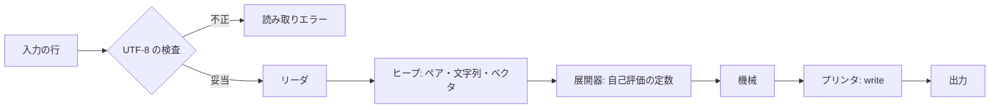

# 0006: スライス 1h の実装計画 — 文字・文字列・ベクタ・ドット対

- 対応する決定: [ADR-0002](../adr/0002-value-representation.md), [ADR-0003](../adr/0003-precise-mark-sweep-gc.md), [ADR-0008](../adr/0008-string-representation.md), [ADR-0018](../adr/0018-incremental-vertical-slices.md), [ADR-0027](../adr/0027-severity-by-consequence-and-a-cost-side-stop.md)
- 段階: 1(スライス 1h)。スライスの全体は [0003-phase1-minimal-slice.md](0003-phase1-minimal-slice.md) が正
- 日付: 2026-10-10
- 状態: 計画(合意待ち)

## 解こうとしている問題

1g までのリーダが読めるのは、整数・真偽値・識別子・括弧のリスト・`'` だけである。プリンタはペアを `(1 . 2)` と書けるが、リーダは `.` を読めないので、この形のデータを書いて確かめる手段がない。文字列・文字・ベクタは値としても存在しない。

1h はこれを埋める。読み取りから表示までの全部の層を貫いて、次の3つの種類の値を通す。

- 文字: `#\a`、`#\space`、`#\x41`
- 文字列: `"abc"`、エスケープ、改行を含むもの
- ベクタ: `#(1 2 3)`

あわせて、ドット対(`(1 . 2)`、`(1 2 . 3)`)を読めるようにし、プリンタに `write` と `display` の区別を入れる。

## 完了条件

- `(1 . 2)`・`(1 2 . 3)`・`'(a . (b c))` が読めて、`(1 . 2)`・`(1 2 . 3)`・`(a b c)` と書ける。`( . 1)`・`(1 . )`・`(1 . 2 3)`・先頭や末尾以外の `.` は、REPL を止めない読み取りエラーになる。
- 文字・文字列・ベクタのリテラルが自己評価し、`write` の形で書ける。`zig build test-scheme` で確かめる。
- プリンタの `write` と `display` が、文字と文字列で異なる出力をする。リストとベクタの中の要素にも同じ規則が及ぶ。`zig build test` の単体テストで確かめる(Scheme から呼ぶ手段は下の「合意を求める点」の1)。
- `write` した出力を `read` し直して `write` すると、元の出力に一致する。表で与えた値の全部について単体テストで確かめる。
- 文字列とベクタは GC ヒープに置かれ、ストレスモードを含めて GC の前後で読める。ヒープ外のペイロードの大きさは計上に含まれ、上限が効く。
- 妥当な UTF-8 でない入力は、文字列や文字に入る前に拒否される。

## 範囲

含めるもの:

- リーダ: ドット対、文字列(エスケープ `\a \b \t \n \r \" \\ \|` と `\x<16進>;`)、文字(`#\` の1文字、名前 `alarm backspace delete escape newline null return space tab`、`#\x<16進>`)、ベクタ `#(`。ベクタの中のドットは読み取りエラー。
- 値: `character`・`string`・`vector` の3種。文字列とベクタはヒープオブジェクトで、バイト列と要素列をヒープ外のペイロードとして持つ。
- 展開器: 文字・文字列・ベクタを自己評価するリテラルとして定数にする。
- プリンタ: `write` と `display`。
- 入力の UTF-8 検査。

含めないもの(別のスライスか段階に回す。理由は括弧内):

- 行コメント `;`、ブロックコメント `#| |#`、データコメント `#;`、`|...|` の識別子、`#u8(` のバイトベクタ、準引用(`` ` `` `,` `,@`)。1h の行に無く、文字列・ベクタとは独立に足せる。
- 文字列・ベクタ・文字を操作する手続き(`string-length`、`vector-ref`、`char->integer` など)。下の合意を求める点の2。
- 文字列の ASCII 判定フラグ([ADR-0008](../adr/0008-string-representation.md))。使うのは `string-ref` と `string-set!` で、どちらも 1h には無い。フラグは文字列を作る1つの関数で計算できるので、使う手続きが入るスライスで足せる。ADR の決定は変えない。入れる時期だけが遅れる。
- リテラルの不変の印([runtime.md](../design/runtime.md) の不変の印)。変更する手続きが無いので、印を見る側がいない。`string-set!` や `vector-set!` が入るスライスで、リテラルへの印と一緒に入れる。
- 循環するデータの `write`。ペアもベクタも変更する手続きが無く、循環を作れない。データラベルは段階5。
- 可変長引数の `lambda`(`(lambda args ...)`、`(lambda (x . rest) ...)`)。ドット対が読めるようになるので、仮引数にドットを書くと展開時の構文エラーになることだけを確かめる。
- 数値の拡張(有理数・浮動小数点・多倍長)。段階4。

## 合意を求める点

設計文書に直接の根拠がなく、この計画が選んだ。それぞれ、勧める案を先頭に置く。

1. `write` と `display` を Scheme から呼べるようにするか。
   - 勧める案: プリンタの Zig の関数としてだけ入れる。REPL は結果を `write` で書く。Scheme の手続き `write`・`display` は、出力先のポートが入る段階5まで入れない。
     - 長所: 出力先(標準出力、WASM の出力バッファ、文字列ポート)を決める前に、仮の出力経路を作らずに済む。ロードマップのプリンタの項目(`write` と `display`)はプリンタの機能を指す。
     - 短所: `display` の出力を Scheme のテストから確かめられない。単体テストで確かめる。
   - 別案: 暫定の手続きを足して標準出力に書く。長所は Scheme のテストが書けること。短所は、ポートが入る段階5で作り直す経路を先に作ること、WASM の出力バッファの扱い(1i の決めること)を先取りすること。
2. 文字列・ベクタ・文字の手続きを 1h に入れるか。
   - 勧める案: 入れない。リテラルが読めて書けること、GC を通ることだけを 1h の完了条件にする。手続きは、プリミティブの表がどの段階でどの族を持つかを決めるときに入れる。
     - 長所: スライスが小さいまま保てる。手続きごとの型検査・範囲検査・エラー文言の決定が、読み取りと表示の指摘に混ざらない。
     - 短所: リテラルを評価しても、その中身を調べる手段が無い。
   - 別案: `string-length`・`vector-length`・`vector-ref`・`char->integer`・`integer->char` などの読み取り専用の少数を入れる。長所は Scheme のテストで中身まで確かめられること。短所は、手続きの範囲の線引きが新しく要ること。
3. 妥当でない UTF-8 の入力を拒否する位置。
   - 勧める案: `Interpreter.evalPrint` の先頭で、入力全体を `std.unicode.utf8ValidateSlice` で検査する。拒否は読み取りエラー(`invalid UTF-8 input`)で、REPL は続く。
     - 長所: 1か所で済み、識別子(シンボル名)・文字列・文字のすべてが妥当な UTF-8 になる。[platform-and-web.md](../design/platform-and-web.md) の「判定は `utf8ValidateSlice` に委ね、自前で条件を列挙しない」に沿う。後の `symbol->string` が不変条件に頼れる。
     - 短所: コメントや読み飛ばす部分に不正なバイトがあっても拒否する(現状は `;` を読まないので、読み飛ばす部分はほぼ無い)。
   - 別案: 文字列と文字のリテラルを読むときだけ検査する。長所は拒否の範囲が狭いこと。短所は、識別子の検査が別途要ること、検査の位置が複数になること。

次は、利用者の確認を取らずに決めた点である。意見があれば言ってほしい。

- 文字の値は `character: u21` とし、スカラ値([numerics-and-unicode.md](../design/numerics-and-unicode.md) の文字の有効範囲)であることを `isScalarValue` で検査する。`#\x`・文字列の `\x…;` が範囲外(サロゲートと `#x10FFFF` 超)なら読み取りエラーにする。`integer->char` は 1h に無いので、同じ検査を使う手続きは後で足す。
- `write` の規則: 文字は `#\` と文字、名前のある文字は名前(`#\space` など)、それ以外の C0 制御文字と DEL は `#\x<16進>`。文字列は `"` と `\` を `\"`・`\\` に、`\a \b \t \n \r` を対応するエスケープに、それ以外の C0 制御文字と DEL を `\x<16進>;` に直す。非 ASCII の文字は、書記素の分類の表(段階4の Unicode テーブル)が無いので、そのまま出力する。出力が読み戻せること(上の完了条件の往復)を規則の根拠にする。
- `display` の規則: 文字列は引用符もエスケープも付けずに内容をそのまま、文字はその文字そのものを書く。ペア・ベクタの中の要素にも同じ規則を適用する(`(display '("a" #\b))` は `(a b)`)。
- 読み取りの新しいエラーは、`UnexpectedDot`(位置の悪い `.`)・`InvalidEscape`(文字列の中の未知のエスケープ)・`InvalidCharacter`(`#\` の名前の誤りや範囲外)・`InvalidUtf8` の4つ。文字列が行末で閉じていないときは `Incomplete` を返し、REPL が次の行を求める([ADR-0014](../adr/0014-repl-line-editor-boundary.md))。
- 文字列とベクタを作る関数は、バイト列(要素列)を渡されて複製する。ペイロードを先に確保し、セルの確保が失敗したら返す(`createFrame` と同じ巻き戻しの単位)。`create`・`createFrame` と並ぶ `createString`・`createVector` を `heap.zig` に足し、ペイロードの計上と解放は `payloadBytes` と `free` の分岐を一般化して扱う。
- 実装は、ドット対、文字、文字列、ベクタ、GC とストレスの確認の順に、コミットを分けて進める。

## 仕様の根拠について

この計画を書いた実行環境から、R7RS の仕様書(`standards.scheme.org`)に届かなかった。次の記述は、この文書より先に仕様書で確かめる。確かめられなかった箇所は、実装の前に仕様書と突き合わせて、この節を直す。

- 文字の名前の一覧(`alarm backspace delete escape newline null return space tab`)と、文字列のエスケープの一覧(7.1.1)。
- `display` が、ペアやベクタの中の文字列と文字にも `display` の規則を及ぼすこと(6.13.3)。
- `write` が文字列の改行を `\n` と書いてよいこと。仕様が決めているのは読み戻せることまでで、書き方の細部は処理系に任されていると理解している。往復の完了条件がその代わりの根拠になる。

リポジトリの中で確かめたことは次のとおり。

- Zig 0.17.0 の `std.process.Args` は、Windows で UTF-16 の引数を WTF-8 に変換する(`lib/std/process/Args.zig` が `calcWtf8Len` と `wtf8Encode` を使う)。WTF-8 は不対サロゲートを3バイトで符号化するので、UTF-8 として妥当でない並びを含みうる。`utf8ValidateSlice` はこの並びを拒否する。このスライスで引数が文字列になる経路は無い(`main.zig` は引数を分類にだけ使う)ので、Scheme の文字列に入る前の検査は `command-line` が入る段階5で足す。1h でやるのは、WTF-8 の不対サロゲートが `utf8ValidateSlice` に拒否されることの単体テストと、[zig-api-notes.md](../design/zig-api-notes.md) への記録である。これで [open-questions.md](../design/open-questions.md) の該当の行を解く。
- 展開器の `itemsOf` は「リーダは真正のリスト以外を書けない」ことに頼ってエラーを出している(`src/syntax/expand.zig`)。ドット対が読めるようになるとこのエラーに到達できる。`(1 . 2)` をそのまま評価したときの `bad syntax: a form must be a proper list` をテストで固定する。

## ファイル

| ファイル | 責務 | 変更 |
| --- | --- | --- |
| `src/value.zig` | `Value` に `character`・`string`・`vector` を足す。`String`・`Vector` のレイアウト、`isScalarValue`、`heap_types` への登録、`pointsIntoHeap` と `Kind` の更新 | 変更 |
| `src/heap.zig` | `createString`・`createVector`、ペイロードの計上と解放の一般化 | 変更 |
| `src/trace.zig` | 変更なしの見込み。`Vector.items` は値の列として辿られ、`String.bytes` は無視される。分類の単体テストを足す | 確認 |
| `src/reader.zig` | ドット対、文字、文字列、ベクタ、新しいエラー | 変更 |
| `src/printer.zig` | `write`・`display` の2つの形、文字・文字列・ベクタの出力 | 変更 |
| `src/syntax/expand.zig` | 文字・文字列・ベクタを自己評価する定数にする | 変更 |
| `src/sucheme.zig` | 入力全体の UTF-8 検査、新しい読み取りエラーの文言 | 変更 |
| `tests/scheme/0013-dotted-pairs.txt` ほか | ドット対、文字、文字列、ベクタ、GC を通した確認のケース | 新規 |
| `docs/design/zig-api-notes.md`・`runtime.md`・`open-questions.md` | Windows の引数の WTF-8 の記録、ペイロードを持つ型の追加、解いた行の整理 | 変更 |

## 処理の流れ

## 進め方

TDD で、コミットを分ける。各コミットの前に、検証コマンド表の該当する行を通す。

1. ドット対: Red(`tests/scheme/0013-dotted-pairs.txt` と読み取りの単体テスト)、Green(リーダの `list` の枠に尾を持たせる)。
2. UTF-8 の検査と文字: 値・リーダ・プリンタ(`write`・`display` の2つの形の骨組みもここ)。
3. 文字列: `createString`、ペイロードの一般化、リーダ・展開器・プリンタ。
4. ベクタ: `createVector`、リーダの `#(`、プリンタ。
5. GC: ストレスモードのケース(文字列とベクタを持つ定義が GC をまたいで読める)、計上と上限の単体テスト、ミューテーションテスト。
6. 文書: 進捗の表と「次にやること」、zig-api-notes・runtime・open-questions、PR。

## 範囲を狭める線

ADR-0027 の費用側の停止の規則に従い、先に線を引く。レビューが収束しない兆候が出たら、次を上から順に外してやり残しに記録する。

1. 文字列の `\x<16進>;` と、`write` の `\x<16進>;` による制御文字の出力。外すと、制御文字は名前のあるものだけを扱い、他は読み取りエラーと `#\x` 形式の出力に限る。
2. `write` と `display` のうち、`display` の入れ子の規則。外すと、トップレベルの値にだけ `display` を適用する。
3. ベクタ。1h の行にあるが、文字列と独立しているので、次のスライス(1h の2)に切り出せる。

## 次にやること

1. この計画書の合意を得る(上の「合意を求める点」の3つ)。
2. 合意後、`feature/phase1-slice-1h-strings-chars-vectors` を最新の `origin/main` から作り、進め方の1から始める。
