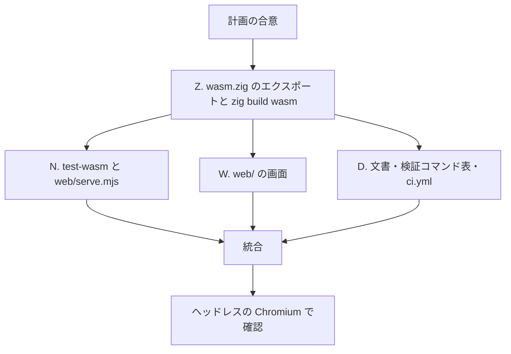

# 0008: スライス 1i の実装計画 — ブラウザで `(fact 10)` が動く

- 対応する決定: [ADR-0009](../adr/0009-wasm-freestanding-and-zero-dependency-web-ui.md), [ADR-0010](../adr/0010-ci-cd-and-release-strategy.md), [ADR-0018](../adr/0018-incremental-vertical-slices.md), [ADR-0021](../adr/0021-no-github-pages-defer-hosting.md), [ADR-0027](../adr/0027-severity-by-consequence-and-a-cost-side-stop.md)
- 段階: 1(スライス 1i)。スライスの全体は [0003-phase1-minimal-slice.md](0003-phase1-minimal-slice.md) が正
- 日付: 2026-10-11
- 状態: 計画(合意待ち)

## 解こうとしている問題

ここまでのインタプリタは、ネイティブの実行ファイルでしか動かない。段階1の完了条件は「階乗の定義と呼び出しがネイティブとブラウザの両方で動く」である。1i は、その後半を満たす。

- インタプリタを `wasm32-freestanding` でビルドし、ホストが呼べる関数(エクスポート)で包む。
- 入力欄に式を入れて実行ボタンを押すと、結果が出力欄に出る最小の Web UI を作る。
- ローカルで開く手段を決める。`file://` では開けない([ADR-0021](../adr/0021-no-github-pages-defer-hosting.md))。
- エクスポートを Node.js から呼ぶ往復テスト(`zig build test-wasm`)を足す。

設計は [design/platform-and-web.md](../design/platform-and-web.md) にほぼ書いてある。この計画は、その全体のうち 1i が実装する部分集合を決め、設計に無い点を決める。

## 完了条件

- `zig build wasm` が `sucheme.wasm` を作る。
- `zig build test-wasm` が、Node.js 上で `sucheme.wasm` のエクスポートを呼び、`(define (fact n) (if (= n 0) 1 (* n (fact (- n 1))))) (fact 10)` の結果 `3628800` を出力バッファから読めることを確かめる。エラー(`-1`)、不正な UTF-8(`-3`)、順序の誤り(`-4`)、初期化前(`-5`)の応答も確かめる。
- ブラウザ(ヘッドレスの Chromium)で `web/` を開き、`(fact 10)` を入力して実行すると、出力欄に `3628800` が出る。この確認は、手作業の確認として PR に書く(CI には入れない)。
- ローカルで開く手段が決まり、手順が文書にある。
- 検証コマンド表に `zig build wasm` と `zig build test-wasm` の行が戻り、CI が実行する。

## 範囲

含めるもの:

- 通常の実行ファイルとは別に、`src/wasm.zig` をルートにした `wasm32-freestanding` のビルド。エクスポートは下の部分集合。
- ホストの import 3つ(標準出力、標準エラー、現在時刻)。1i では標準エラーへの書き込みはパニックのときだけ使い、現在時刻は宣言だけして呼ばない。
- `web/`(`index.html`・`style.css`・`sucheme.js`・`worker.js`・`app.js`)。入力欄、実行ボタン、出力欄。Web Worker 上で動かす。
- Node.js で動く往復テスト。
- ローカルで開く手段。

含めないもの(別のスライスか段階に回す。理由は括弧内):

- 再開可能な機械(`sucheme_step` が歩数制限で戻ること)。下の合意を求める点の1。
- `sucheme_provide_input`・`sucheme_provide_eof`・`sucheme_set_command_line`・`sucheme_exit_code`(入力ポートも `exit` も `command-line` も段階5より前には無い)。
- PR への成果物の添付(1j)。
- Unicode テーブルを含む `ReleaseSmall` のサイズの測定(段階4)。
- 配置(段階8)。

## エクスポートの部分集合

[design/platform-and-web.md](../design/platform-and-web.md) の一覧のうち、1i が実装するのは次のとおりである。状態コードの意味と、各関数が返しうる値は、設計の表が正である。

| 関数 | 1i での範囲 |
| --- | --- |
| `sucheme_init(heap_limit_bytes)` | 実装する。0、-4、-7 を返す |
| `sucheme_eval_begin(ptr, len)` | 入力のすべての式を評価して終わる(合意を求める点の1の案による)。0、-1、-3、-4、-5、-8 を返す |
| `sucheme_reset()` | 実装する。0、-7 |
| `sucheme_alloc(len)` と `sucheme_free(ptr, len)` | 実装する。不一致の `free` は panic |
| `sucheme_output_ptr()` `sucheme_output_len()` `sucheme_output_clear()` | 実装する |
| `sucheme_version_ptr()` `sucheme_version_len()` | 実装する |
| `sucheme_step` `sucheme_provide_input` `sucheme_provide_eof` `sucheme_set_command_line` `sucheme_exit_code` | 実装しない。後のスライスで、設計の契約どおりに足す |

出力は、評価の結果をネイティブの REPL と同じ形(`write` の形で 1 行ずつ)で出力バッファに書く。エラーのときは `error: <メッセージ>` の 1 行を書き、-1 を返す。

## 合意を求める点

設計文書に直接の答えが無く、この計画が選んだ。それぞれ勧める案を先頭に置く。

1. 再開可能な機械(歩数制限で制御を戻す `sucheme_step`)を 1i で入れるか。
   - 勧める案: 入れない。`sucheme_eval_begin` が最後まで評価する。止まらないプログラムは、画面の「停止」ボタンが Worker を捨てて作り直す(`Worker.terminate()`)。
     - 長所: 機械のレジスタ(制御・環境・継続・値)を `Machine` のフィールドへ移す大きな変更が要らない。1i の完了条件に要らない。`terminate()` はブラウザの標準機能で、停止ボタンは機械の再開可能性なしに作れる。
     - 短所: `read` による対話(段階8)のために、いずれ再開可能な機械が要る。そのときに足す。評価の途中でヒープの状態を画面に出す(進捗の表示)ことはできない。
   - 別案: 入れる。`Machine.run` を `begin` と `run(budget)` に分け、レジスタをフィールドへ移し、`Interpreter` に式の列を持つセッションを足す。長所は設計の契約(`sucheme_step`)を最初から満たすこと。短所は 1i の大きさが、機械とリーダの外側に及ぶこと。
2. ローカルで開く手段。[ADR-0021](../adr/0021-no-github-pages-defer-hosting.md) が、zip を開くレビュアと一緒に決めるとしている。
   - 勧める案: `web/serve.mjs`(依存パッケージの無い 30 行ほどの Node.js のスクリプト)。`node web/serve.mjs` で `web/` と `sucheme.wasm` を配る。`application/wasm` の Content-Type を返す。
     - 長所: Node.js は `zig build test-wasm` が要るので、新しい依存が増えない。zip を開くレビュアは、Node.js だけでよい(Zig もリポジトリも要らない)。
     - 短所: Node.js が要る。
   - 別案: `zig build serve`(Zig の標準ライブラリの HTTP サーバ、`tools/serve/`)。長所は Node.js なしで動くこと。短所は、zip を開くレビュアが Zig を要ること。ADR-0021 が、まさに避けたい形である。
3. CI に Node.js を使う step を足す(`.github/workflows/ci.yml` の変更なので承認が要る)。
   - 勧める案: `ci.yml` に `zig build wasm` と `zig build test-wasm` を足す。GitHub のホストランナー(ubuntu と windows)は Node.js を最初から持っているので、`actions/setup-node` を足さない(新しい外部のアクションが増えない)。
     - 長所: 依存が増えない。
     - 短所: ランナーの Node.js の版に依存する。`test-wasm` は、使う機能を LTS で動くものに限り、版を `node --version` で記録して出力する。
   - 別案: `actions/setup-node` を SHA で固定して足す。長所は版を固定できること。短所は、供給連鎖の面が増えること。
4. エクスポートの部分集合(上の表)で足りるか。

## 並行できる単位

Z は私が直列に作る。エクスポートの契約と状態コードの扱いが、N と W の全部が頼る部分だからである。Z の骨組み(`sucheme_init`・`sucheme_eval_begin`・出力・`alloc` が動く)ができたら、N・W・D を別々のワークツリーで並行に進める。書いてよいファイルを分ける。

| 作業 | 書いてよいファイル |
| --- | --- |
| Z | `src/wasm.zig`、`src/platform/`(必要なら)、`build.zig` の `wasm` step |
| N | `tools/test-wasm/`、`web/serve.mjs`、`build.zig` の `test-wasm` step の追加部分 |
| W | `web/index.html`、`web/style.css`、`web/sucheme.js`、`web/worker.js`、`web/app.js` |
| D | `AGENTS.md` の検証コマンド表、`docs/`、`.github/workflows/ci.yml`(承認が要る) |

`build.zig` は Z と N が別の step を足す。足す位置を分けて、統合は私が行う。

## 検証

テストの層([0007](0007-test-tiers.md))の割り当て:

- 層1: `zig build wasm` と `zig build test-wasm`(数秒)。
- 層2: ヘッドレスの Chromium での確認(手作業)。`web/` を `serve.mjs` で配り、入力欄に式を入れ、出力欄の内容を確かめる。結果は PR に貼る。
- ミューテーションテスト: 純粋な判定を含む Zig のコード(状態遷移の判定、`free` の引数の検査)に対して、層2 で行う。

## ファイル

| ファイル | 責務 | 変更 |
| --- | --- | --- |
| `src/wasm.zig` | エクスポート、出力バッファ、状態、パニックの処理 | 新規 |
| `build.zig` | `wasm` と `test-wasm` の step、`test_excluded` に `src/wasm.zig` を理由つきで足す | 変更 |
| `tools/test-wasm/` | Node.js での往復テスト | 新規 |
| `web/` | Web UI と `serve.mjs` | 新規 |
| `AGENTS.md` | 検証コマンド表に `zig build wasm` と `zig build test-wasm` の行 | 変更 |
| `.github/workflows/ci.yml` | 上の2つを実行する step | 変更(承認) |
| `docs/design/open-questions.md` | 1i で決めた行を整理する | 変更 |

## 範囲を狭める線

ADR-0027 の費用側の停止の規則に従い、先に線を引く。レビューが収束しない兆候が出たら、次を上から順に外してやり残しに記録する。

1. `web/` の見た目の整形(配色の追従、レイアウト)。外すと、入力欄・ボタン・出力欄だけの素のページにする。
2. 標準エラーと現在時刻の import。外すと、標準出力の import だけにする。
3. `test-wasm` のうち、順序の誤り(-4)と初期化前(-5)の確認。外すと、成功とエラーと不正な UTF-8 だけを確かめる。

## 次にやること

1. この計画書の合意(上の「合意を求める点」の4つ)。
2. 合意後、`feature/phase1-slice-1i-wasm-web-ui` を最新の `origin/main` から作り、Z から始める。
