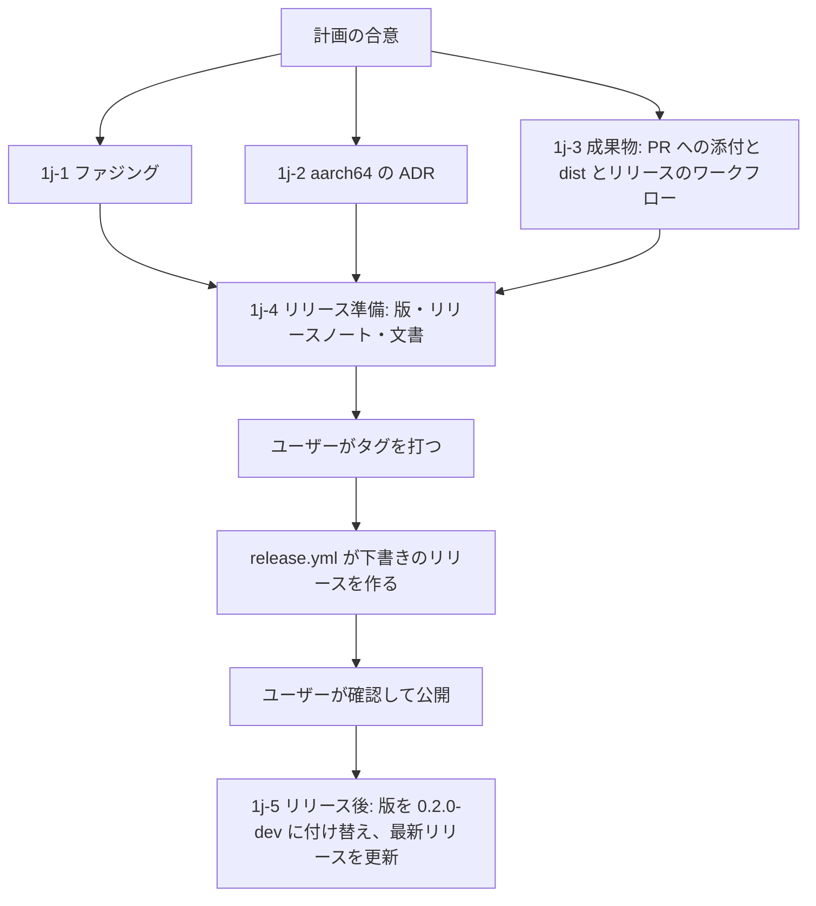
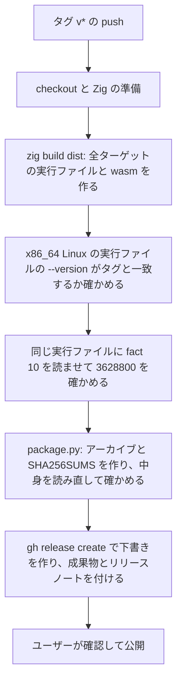

# 0009: スライス 1j の実装計画 — リリース v0.1.0

- 対応する決定: [ADR-0010](../adr/0010-ci-cd-and-release-strategy.md), [ADR-0018](../adr/0018-incremental-vertical-slices.md), [ADR-0020](../adr/0020-repository-visibility-private.md), [ADR-0021](../adr/0021-no-github-pages-defer-hosting.md), [ADR-0022](../adr/0022-unlicensed-proprietary.md), [ADR-0025](../adr/0025-permission-policy-guard-in-hooks.md), [ADR-0026](../adr/0026-verify-facts-about-code-not-prose.md), [ADR-0027](../adr/0027-severity-by-consequence-and-a-cost-side-stop.md)
- 段階: 1(スライス 1j)。スライスの全体は [0003-phase1-minimal-slice.md](0003-phase1-minimal-slice.md) が正
- 日付: 2026-10-11
- 状態: 合意済み(2026-10-11、問い1から11に答えをもらった。問い2だけ、勧める案と違う答えだった。「合意した点と、検討した選択肢」の節の表を参照)

## 解こうとしている問題

段階1の最後のスライスである。1a から 1i で、読み取りから評価・表示までがネイティブとブラウザの両方で通しで動く状態ができる。1j は、それを「リリースとして届けられる状態」にする。[0003](0003-phase1-minimal-slice.md) の 1j の行は、次の4つを範囲と定めている。

- ファジングのワークフロー([AGENTS.md](../../AGENTS.md) の表の「手動と定期実行のみ」の行を実際に動かす)
- aarch64 を自動テストの対象に加えるかの判断と ADR([ADR-0010](../adr/0010-ci-cd-and-release-strategy.md) の追記が、見直しの時点を段階1と定めた)
- PR への成果物の添付([ADR-0021](../adr/0021-no-github-pages-defer-hosting.md) が配置の代わりに定めた手段。1i の計画 [0008](0008-slice-1i-wasm-web-ui.md) が 1j へ送った)
- リリース v0.1.0

どれも `.github/workflows/` を触る。[AGENTS.md](../../AGENTS.md) のセキュリティの節により、変更のたびにユーザーの承認が要る。この計画は、承認を求める単位と権限の範囲を先に示す。

## 前提

- 1i が `main` にマージされていること。1j は 1i の成果物(`zig build wasm` が作る `sucheme.wasm`、`web/` 以下、`zig build test-wasm`)を配るので、1i より前には実装に入れない。
- この計画が 1i について書くことは、1i のブランチ(`origin/feature/phase1-slice-1i-wasm-web-ui`、先頭は 94c80af)を読んだ内容である。`sucheme.wasm` は `zig-out/web/` に入り、`web/serve.mjs` は `web/` と wasm のあるディレクトリを同じオリジンで配る。マージ後の形が違えば、成果物の組み立てを読み直す。

## 完了条件

- `zig build test --fuzz=<N> -Doptimize=<モード>` がリーダに対して走り、止まる。`.github/workflows/fuzz.yml` が定期実行と手動起動で動き、失敗入力が見つかったらジョブが失敗して入力が成果物に残る。
- aarch64 の判断が新しい ADR にあり、README と [ADR-0010](../adr/0010-ci-cd-and-release-strategy.md) の追記と矛盾しない。
- PR の CI 実行に `sucheme.wasm` と `web/` の成果物が添付され、展開して `node serve.mjs` で開くと `(fact 10)` が `3628800` を返す(手作業の確認として PR に書く)。
- タグ `v0.1.0` を push すると、[ADR-0010](../adr/0010-ci-cd-and-release-strategy.md) の一覧の全ターゲットの実行ファイル、Web UI の zip、チェックサム、リリースノートを持つリリースができる。ダウンロードした成果物が `sha256sum -c` を通り、x86_64 Linux の実行ファイルが `--version` と `(fact 10)` に答える。
- [roadmap.md](../roadmap.md) の段階1のチェックボックスと現在地、README、[open-questions.md](../design/open-questions.md) の段階1の行が、実態に合っている。

## 範囲

含めるもの:

- リーダのファジングのテストと `fuzz.yml`。
- 全ターゲットの実行ファイルを作る `zig build` の step、アーカイブとチェックサムを作る手段、`release.yml`。
- PR に成果物を添付するワークフロー。
- aarch64 の ADR(動作確認はしないと決めた。ワークフローの変更は無い)。
- リリースノート、版の付け替え、タグを打つ手順の文書。

含めないもの(理由は括弧内):

- 機械全体(展開器と機械)のファジング。止まらないプログラムを入力にできるので、歩数の上限を持つ入れ物が先に要る。段階6の「ファジングの入力コーパスの拡充」に送る。
- ファジングの入力コーパスを実行間で引き継ぐこと(キャッシュの保存)。同上。供給連鎖の面も増える。
- macOS の署名と公証([ADR-0010](../adr/0010-ci-cd-and-release-strategy.md) が行わないと決めている)。
- Web UI の配置([ADR-0021](../adr/0021-no-github-pages-defer-hosting.md)、段階8)。
- パッケージマネージャ向けの配布。

## 確かめた事実と、確かめられなかったこと

[AGENTS.md](../../AGENTS.md) の情報源の規則に従い、確認の状態を分ける。確認は 2026-10-11 に、Linux x86_64 の実行環境で、Zig 0.17.0 を使って行った。

確認できたこと:

| 事実 | 確かめ方 |
| --- | --- |
| 現在の `main` は、[ADR-0010](../adr/0010-ci-cd-and-release-strategy.md) の一覧の全ターゲットで `zig build -Dtarget=<t> -Doptimize=ReleaseSafe` が成功する | 一覧の全ターゲットを1つずつ実行した |
| x86_64 Linux(musl)の成果物は `sucheme 0.1.0-dev` と名乗り、標準入力の `(fact 10)` に `3628800` を返す。この版文字列は `build.zig.zon` の `.version` に由来する | 実行した。`build.zig.zon` 以外に `0.1.0-dev` を参照する場所は無い |
| Linux の成果物は静的リンクで、デバッグ情報つきで strip されていない。Windows のビルドは `.exe` と並べて `.pdb` を作る | `file` で確認した |
| ネイティブの実行ファイルは REPL だけで、ファイル引数は「未実装」で終わる | `src/main.zig` の doc コメント |
| `zig build test --fuzz`(上限なし)は止まらず、`--fuzz=<N>` は N 回の実行で終わる。数字には `K` `M` `G` を付けられる | `zig build --help` と Zig 0.17.0 の `Maker.zig` を読み、実行した |
| `--fuzz=<N>` で失敗する入力が見つかっても、`zig build` の終了コードは 0 である。失敗は標準エラーに `input saved to '<キャッシュ>/f/crash'` と出て、その入力がファイルに残る | エラーを返す形と panic の2形で実行した。両方で終了コードが 0 だった |
| `-Doptimize=ReleaseFast` のファジングは配列の範囲外参照を見つけず、`ReleaseSafe` は見つける | 範囲外参照を仕込んだ合成のテストで、同じ回数を実行して比べた。実際のリーダではまだ確かめていない |
| `std.testing.fuzz` は初期入力の列(`corpus`)を受け取る | `std/testing.zig` を読んだ |
| `tools/check-docs` は、ワークフローのキーを閉じた集合で検査し、集合の外のキーを報告する。ジョブ名も閉じた集合で、`run:` は1行の値しか読まない。全コミットのワークフロー `ci.yml` では `runs-on` の値と `os` の行列も固定している。`schedule` `tags` `env` `needs` `if` `timeout-minutes` `path` は集合にない | `tools/check-docs/main.zig` を読んだ |
| ソースの `@sizeOf` と `@intFromPtr` は `src/heap.zig` と `src/trace.zig` にあり、`@ptrCast` `@alignCast` とエンディアンの操作は `src/` に無い | `src/` を grep した(`@bitCast` は数えていない) |
| 同梱の Zig 0.17.0 の `LICENSE` は MIT(Expat)で、musl の `COPYRIGHT` も MIT である | ローカルのツールチェーンのファイルを読んだ |
| `git tag` と `gh release` は承認を求める側(`ask`)にある | `.claude/settings.json` を読んだ |
| `dependabot.yml` の対象は `github-actions` だけで、`cooldown` は7日である | `.github/dependabot.yml` を読んだ |

確かめられなかったこと(推測と区別して扱う):

| 事柄 | 状態 |
| --- | --- |
| GitHub のドキュメントの記述全般 | 実行環境から `docs.github.com` に届かなかった。次は一次情報で未確認である。`schedule` の制約(既定ブランチだけで動くか、遅延、無効化の条件が private に及ぶか)、通知の宛先、arm64 ランナーのラベル名と課金の倍率、ホストランナーに `gh` が入っていること、`upload-artifact` の現行の版と保持期間の既定・上限、成果物の attestation が private で使えるか、タグのフィルタの構文。[ADR-0020](../adr/0020-repository-visibility-private.md) が引用している 2026-01-29 の Changelog(arm64 は private でも使える、2 vCPU、分数はプランに計上)は、その ADR の引用に依る |
| `mlugg/setup-zig` が arm64 ランナーで動くこと | 未確認 |
| Zig のファザーが無限ループを検出するか | 実験していない。検出しないなら、ジョブの時間上限だけが止める |
| リーダのファジング1回あたりの時間 | リーダのテストがまだ無い。上限 `<N>` は実装時に測って決める |
| 既定のキャッシュ(`.zig-cache`)の下に `f/crash` ができること | 上の確認は `--cache-dir` で場所を指定して行った。既定の場所は、ビルドルートの `.zig-cache` と推測している |
| Windows と macOS の成果物の実機での実行 | 未確認。[ADR-0010](../adr/0010-ci-cd-and-release-strategy.md) が受け入れた制約と同じ |
| GitHub 側のブランチ保護とタグ保護の設定 | 見えない |
| 静的リンクした Zig の標準ライブラリと musl の MIT の表示義務が、成果物の配布で生じるか | 法的な判断で、確認できない。事実は上の表の1行までである |

## 既に決まっていること

選択の余地がない、または既存の ADR が決めているもの。

- 版: タグ `vX.Y.Z` が指すコミットの `build.zig.zon` の `.version` は `X.Y.Z` である。リリースのワークフローは、ビルドした実行ファイルの `--version` がタグと一致することを確かめてから公開に進む。一致しなければそこで失敗する。`.zigversion`(Zig の版)とは別物で、リリースノートに使った Zig の版を書く。
- リリースの後の版: 次の段階の版に付け替える。[ADR-0010](../adr/0010-ci-cd-and-release-strategy.md) が段階ごとにマイナーを上げると定めているので、`0.2.0-dev` にする。
- 契機: タグの push([ADR-0010](../adr/0010-ci-cd-and-release-strategy.md) の `v*`)。
- ターゲット: [ADR-0010](../adr/0010-ci-cd-and-release-strategy.md) の一覧が正である。1ジョブで `ubuntu-latest` からクロスコンパイルする。このほかに Web UI の zip を加える。件数はここに書かない。
- 自動テストの対象: `ubuntu-latest` と `windows-latest`(x86_64)。macOS はビルド保証だけで、署名と公証をしない。この範囲を README とリリースノートに書く。
- Zig の版: ワークフローのコピーは `.zigversion` と一致させる(`zig build check-docs` が見る)。
- 秘密情報: 新しく持ち込まない。リリースの作成は、ワークフローに自動で渡される `GITHUB_TOKEN` だけで行う。[ADR-0021](../adr/0021-no-github-pages-defer-hosting.md) の「段階7までシークレットを増やさない」に従う。
- 新しい外部のアクション: 追加が要る場合は、`actions/` 配下の GitHub 自身のものに限り、コミット SHA で固定する(`ci.yml` の既存の規則)。サードパーティのアクションは足さない。固定する版は、Dependabot の `cooldown`(7日)と同じ考えで、公開から日数が経ったものを選ぶ。

## 全体の順序と PR の単位

1j-1 から 1j-3 は互いに依存しないが、`tools/check-docs` の許可キーの集合に触れるので、並行して書いても統合は直列にする(問い5)。PR の分け方は問い1にある。

並行できる単位と、書いてよいファイル(1i の計画 [0008](0008-slice-1i-wasm-web-ui.md) の形):

| 作業 | 書いてよいファイル |
| --- | --- |
| 1j-1 ファジング | `src/reader.zig`(テストの追加)、`.github/workflows/fuzz.yml`、`AGENTS.md` の表の該当行 |
| 1j-2 aarch64 | `docs/adr/`(新しい ADR と一覧)、`README.md` |
| 1j-3 成果物 | `build.zig`(`dist` step)、`tools/release/`、`.github/workflows/preview.yml`、`.github/workflows/release.yml`、`.github/workflows/full.yml`(リハーサル) |
| 共通 | `tools/check-docs/main.zig`(許可キーとジョブ名の追加。1つの PR に集める) |
| 1j-4, 1j-5 | `build.zig.zon`、`docs/releases/`、`docs/roadmap.md`、`README.md`、`docs/design/open-questions.md`、`docs/plans/0003-phase1-minimal-slice.md` |

## 設計

### ファジング(1j-1)

対象は、リーダに任意のバイト列を読ませることである([ADR-0013](../adr/0013-testing-strategy-and-conformance-suite.md))。確かめる性質は、パニックも未定義動作も無限ループもなく、検査用のアロケータがリークを報告せず、`Reader.next` が値・終端・エラーのどれかで返ることである。読めた値は `printer` に通し、書き出しが落ちないことも見る。書き出した文字列を読み直して等しいことを確かめる往復は、等価の判定の整備が要るので含めない。

テストは `src/reader.zig` の `test` ブロックに置く。`zig build test`(全コミットの層1)では初期入力だけを1回通るので速く、`--fuzz=<N>` を付けたときだけ探索する。初期入力には、`tests/scheme/` のリーダの入力から数行を抜いた文字列を `corpus` に渡す。

ワークフロー `fuzz.yml` の形(観察に基づく。理由は「確かめた事実」の表):

1. `zig build test --fuzz=<N> -Doptimize=<モード>`。上限つきなので止まる。
2. 失敗が見つかっても終了コードが 0 なので、`.zig-cache/f/crash` の有無を調べる手順を別に置く。ファイルがあればジョブを失敗させる。
3. 上げる手順を、2の検査の手順より前に置く(ファイルが無ければ何も上げない)。検査が失敗してジョブが赤になる時点では、成果物はもう上がっている。
4. ジョブに時間の上限を付ける。ファザーが無限ループを検出するか確かめていないので、上限が最後の止め手になる。

`run:` は `tools/check-docs` が1行しか読まないので、各手順は1行で書く。条件分岐(`if:`)は許可キーにないので使わず、手順の並びで表す。

### aarch64(1j-2)

[ADR-0010](../adr/0010-ci-cd-and-release-strategy.md) の追記は、段階1に値表現・GC・WASM が入ってアライメント・ポインタ幅・エンディアンに依存する判断が現れるので、そこで対象に加えるかを決めると書いた。1i まで終わった時点のコードを読むと、依存は `@sizeOf`(`src/heap.zig`)と `@intFromPtr`(`src/trace.zig`)に限られ、`@ptrCast` `@alignCast` とエンディアンの操作は無い。1i の往復テストは wasm32(4バイトのポインタ)を通すので、64ビット以外の幅はすでに一度通っている。一方、配る aarch64 の実行ファイル(Linux と Windows)は、現状どこでも実行されない。選択肢は問い2にあり、実行しない(動作確認をしない)と決めた。ビルドが通る前提で作り、本当に必要になったときに動作確認を加える。

決めた内容は新しい ADR(次の空き番号、作成時に確かめる)に書く。[ADR-0010](../adr/0010-ci-cd-and-release-strategy.md) の本文は書き換えず、追記もしない(追記は決定を変えないときに限る。ここは見直しの結果なので新しい ADR が要る)。README の対応プラットフォームの表と、aarch64 の理由の段落を、決定に合わせて直す。

### PR への成果物の添付(1j-3)

[ADR-0021](../adr/0021-no-github-pages-defer-hosting.md) と [platform-and-web.md](../design/platform-and-web.md) は、`sucheme.wasm` と `web/` を zip にして CI が上げると決めている。レビュアは展開し、1i の `serve.mjs` で開く。展開した先で追加の手順が要らないよう、`web/` の中身と `sucheme.wasm` と `serve.mjs` を1つのディレクトリに並べて上げる。`upload-artifact` が zip にまとめるので、zip を自前で作らない。置き場所は問い6にある。

### リリース(1j-3, 1j-4)

`dist` は `build.zig` の step で、[ADR-0010](../adr/0010-ci-cd-and-release-strategy.md) の一覧のターゲットを作る。ターゲットの一覧はこの step だけが持つ(アーカイブ側は `zig-out/dist/` の下のディレクトリ名から導く)。最適化モードは `dist` が固定し、`-Doptimize` では変わらない。

同じ手順をリハーサルとして `full.yml` に置く(問い7)。タグを打つ前に、`main` への push のたびに `dist` とアーカイブの組み立てが通っていることを確かめるためである。リリースのワークフローで試せないのは `gh release create` の1行だけになる。

権限は、ワークフローごとに最小にする。

| ワークフロー | 契機 | `permissions` | 外部のアクション | 承認 |
| --- | --- | --- | --- | --- |
| `ci.yml` | 全コミット | `contents: read`(既存) | 既存の2つ | 1i が自分の変更で求める |
| `full.yml` | 準備完了・`main`・手動(既存) | `contents: read`(既存) | 既存の2つ | 1j-2, 1j-3 |
| `fuzz.yml` | 定期と手動 | `contents: read` | 既存の2つと `actions/upload-artifact` | 1j-1 |
| `preview.yml` | PR | `contents: read` | 同上 | 1j-3 |
| `release.yml` | タグ | `contents: write`(リリースの作成に要る。これだけ) | 既存の2つ。リリースの作成は `gh` | 1j-3 |

## 合意した点と、検討した選択肢

ユーザーの確認が要った11の点である。下の表が決定で、その下の各項は検討した選択肢の記録である(勧める案を先頭に置いた)。本文の「問い N」は、この項の番号を指す。

| 問い | 決定 |
| --- | --- |
| 1. PR の分け方 | 勧める案どおり、5つに分ける(1j-1 から 1j-5) |
| 2. aarch64 を自動テストの対象に加えるか | 加えない。勧める案とは違う。aarch64 でビルドが通るつもりで作るが、動作確認はしない。本当に必要になったときに加える。ADR に、この決定と、見直しの契機(必要になったとき)を書く。`full.yml` に aarch64 のジョブは足さない |
| 3. ファジングの最適化モードと AGENTS.md の訂正 | 勧める案どおり。表を `--fuzz=<N> -Doptimize=ReleaseSafe` に直し、説明を訂正する。AGENTS.md の本文の変更を認める |
| 4. ファジングの頻度・範囲 | 勧める案どおり。週1回の定期実行と手動起動、リーダだけ |
| 5. `check-docs` のキーとジョブ名 | 勧める案どおり。必要な最小のものを閉じた集合に足す |
| 6. PR の成果物を添付する場所 | 勧める案どおり。別ワークフロー `preview.yml` |
| 7. リリースの組み立てと成果物の中身 | 勧める案どおり |
| 8. 第三者の表示 | 勧める案どおり。`THIRD-PARTY-NOTICES.txt` を入れる |
| 9. リリースの公開の形 | 勧める案どおり。下書きで作り、ユーザーが確認して公開する |
| 10. タグの手順 | 勧める案どおり |
| 11. open-questions の行 | 勧める案どおり。GC の閾値の実測は段階6へ移す |

`.github/workflows/` の新規追加と変更(`fuzz.yml`、`preview.yml`、`release.yml`、`full.yml`)は、この合意に含まれない。PR ごとに別に承認を求める。

aarch64 の実行ファイルは、ビルドが通るが動作確認をしていないものとして配る。リリースノートの動作保証の範囲に、この旨を書く。

### 1. PR の分け方

- 勧める案: 5つに分ける(1j-1 ファジング、1j-2 aarch64、1j-3 成果物、1j-4 リリース準備、1j-5 リリース後)。
  - 長所: ワークフローの承認が PR ごとに別になる。`release.yml` のレビューが他と混ざらない。失敗の切り分けが効く。段階0で、レビュー対象が大きいほど指摘が増えた経緯([process-lessons.md](../review/process-lessons.md))に沿う。
  - 短所: [0003](0003-phase1-minimal-slice.md) の「各スライスは1つの PR になる」から外れる。1j-1 から 1j-3 が `tools/check-docs` の同じ集合に触れるので、統合の順序を守る必要がある。
- 別案: 3つに分ける(ファジングと aarch64、成果物、リリース)。長所は PR の数が減ること。短所は1つあたりが大きく、`release.yml` の承認がファジングの承認と並ぶこと。
- 別案: 1つにする。長所は規約どおりであること。短所は、レビューの対象が大きく、ワークフローの承認が一括になること。

### 2. aarch64 を自動テストの対象に加えるか

- 勧める案: `full.yml`(層2、準備完了と `main` の push)に aarch64 Linux のジョブを足し、`zig build test` と `zig build test-scheme` を走らせる。Windows の aarch64 と macOS はビルド保証のまま。見直しの時点は段階4(浮動小数点が入り、アーキテクチャごとの差が出やすくなる)と、aarch64 固有の不具合の報告のどちらか早いほうとする。
  - 長所: 配る aarch64 Linux の実行ファイルが、一度は動かされる。全コミットの CI に触れないので、費用は層2の頻度に収まる。`tools/check-docs` が固定している `ci.yml` の行列を変えずに済む。
  - 短所: private なので arm ランナーの分数がプランに計上される([ADR-0020](../adr/0020-repository-visibility-private.md))。ランナーのラベルと `setup-zig` の対応は未確認で、実装時に動かなければ次の案へ戻る。`full.yml` の変更に承認が要る。
- 別案: 加えない。ADR に、依存コードの乏しさと費用を根拠に書く。長所は費用がゼロで検査ツールも変わらないこと。短所は、配る実行ファイルが動かされないことと、根拠が「現時点で依存が乏しい」だけで、段階4の前に見直しの契機が無いこと。
- 別案: 全コミットの CI の行列に加える。長所は最も強い保証。短所は毎コミットの分数と、`tools/check-docs` が固定している行列の値の意味を決め直す必要があること。
- 別案: `ubuntu-latest` で QEMU のユーザーモードエミュレーションを使い、aarch64 のテスト実行ファイルを動かす。長所は arm ランナーが要らないこと。短所は、エミュレーションが実機でないこと、`qemu-user` の導入の手順が要ること、この実行環境に QEMU が無く Zig の `-fqemu` の動作を確かめていないこと。
- 別案: リリース時だけ、作った実行ファイルの煙試験を arm ランナーで行う。長所は回数が最小であること。短所は、テスト本体を動かさないことと、ジョブ間の成果物の受け渡し(`needs` と download)が要ること。

### 3. ファジングの最適化モードと、AGENTS.md の表・説明の訂正

[AGENTS.md](../../AGENTS.md) の表は `-Doptimize=ReleaseFast` と書き、説明は「`--fuzz` が自律的に停止しない」ことを全コミットに入れない理由にしている。確かめた事実と食い違う点が2つある。上限つき(`--fuzz=<N>`)なら止まること、`ReleaseFast` は安全検査を外すので範囲外参照を見つけないこと(合成のテストでの観察)。さらに、見つけても終了コードが 0 になる罠は、どこにも書かれていない。

- 勧める案: 表を `zig build test --fuzz=<N> -Doptimize=ReleaseSafe` に直し、説明に「上限つきは止まる」「見つけても終了コードは 0 で、失敗は `f/crash` で見る」を足す。全コミットに入れない理由は、止まらないことから「時間と分数の費用」に書き換える。
  - 長所: リーダの範囲外参照や整数のあふれを見つけられる。`test-scheme` と `wasm` も `ReleaseSafe` で、検査の設定が揃う。罠が文書に残る。
  - 短所: `ReleaseFast` より1回の実行が遅い(推測。実測は実装時)。[AGENTS.md](../../AGENTS.md) の本文の変更になる。
- 別案: 表のとおり `ReleaseFast` のまま。長所は文書を変えないこと。短所は、境界の誤りを見つけにくいこと(リーダのように添字で入力を読むコードで起こりうる誤りを逃す)。
- 別案: `Debug`。長所は検査が最も多いこと。短所は遅いこと(推測)。

### 4. ファジングの頻度・範囲・リリースとの関係

- 勧める案: 週1回の定期実行と手動起動。リーダだけを対象にする。リリースの前に手動で1回走らせ、リーダがクラッシュする入力が見つかったら 1j-1 の中で直し、それ以外は issue に記録する。定期実行は日曜 18:17 UTC(月曜 03:17 JST)。毎時0分を避ける。
  - 長所: 分数が小さく、リリースを止める条件が明確。
  - 短所: 発見が週単位で遅れる。通知が誰に届くかは未確認で、実装時に確かめる。
- 別案: 毎晩。長所は発見が早いこと。短所は、private で分数を消費し続けること。
- 別案: 手動のみ。長所は費用が最小であること。短所は、[0003](0003-phase1-minimal-slice.md) と [roadmap.md](../roadmap.md) の「定期実行と手動起動」を満たさないこと。
- 別案: 上に加えて、上限の小さいファジングを `full.yml` に入れる。長所は PR の準備完了時にも見つかること。短所は、層2の時間が延びること。

### 5. `tools/check-docs` のワークフローのキー・ジョブ名の扱い

新しいワークフローは、許可していないキーとジョブ名を使う。今のままでは `zig build check-docs` が赤になる。

- 勧める案: 必要な最小のキーとジョブ名を集合に足す。足す候補は `schedule` `cron` `tags` `timeout-minutes` `path` `retention-days` `if-no-files-found` と、ジョブ名 `fuzz` `preview` `release` `dist` である(実装で必要になった分だけ)。トリガを狭める `schedule` と `tags` は、`types` と `workflow_dispatch` と同じく、全コミットのワークフローでは禁じる集合にも入れる。足したものは `tools/check-docs` の単体テストで固定する。これで [open-questions.md](../design/open-questions.md) の「CI が表の行を走らせることの検査の範囲」のうち、`schedule` と `workflow_dispatch` を許可キーに入れる判断が閉じる。
  - 長所: 既存の方針(閉じた集合)のまま、新しいワークフローが書ける。全コミットの検査が弱まらない。
  - 短所: [ADR-0026](../adr/0026-verify-facts-about-code-not-prose.md) が戒めた、検査ツールが育つ方向の変更である。キーを足すたびに「検証に何をするか」を決める作業が要る。
- 別案: 全コミットのワークフロー以外は、キーの集合の検査をやめる(Zig の版の一致と読み取り不能な行の報告だけ残す)。長所は、以後のワークフロー追加が検査ツールに触れずに済むこと。短所は、`if:` や `continue-on-error:` の禁止が他のワークフローで効かなくなり、`ci.yml` の外に検証を逃がす道が開くこと。

### 6. PR の成果物を添付する場所

- 勧める案: 別のワークフロー `preview.yml`(`pull_request` で起動、`ubuntu-latest`)。`zig build wasm` を実行し、ディレクトリを `upload-artifact` で上げる。保持期間は短くする。
  - 長所: `ci.yml` の検査の対象(行列・`runs-on` の固定)に触れない。成果物がちょうど1つできる。
  - 短所: wasm を `ci.yml` と二重にビルドする。ワークフローが1つ増え、承認が要る。
- 別案: `ci.yml` の行列のジョブに上げる手順を足す。短所は、`if:` が使えないので ubuntu と windows の両方が上げ、成果物が2つできること(名前の衝突を避ける工夫も要る)。`tools/check-docs` が `ci.yml` の構造を厳しく見ているので、変更の波及も大きい。
- 別案: `full.yml`(準備完了のときだけ)に置く。長所は実行が少ないこと。短所は、ドラフトの PR の途中の push で成果物が得られないこと。

### 7. リリースの組み立て方と成果物の中身

- 勧める案: `build.zig` に `dist` step(全ターゲットを `ReleaseSafe` で `zig-out/dist/<ターゲット>/` に作る)を置き、`tools/release/package.py`(Python の標準ライブラリだけ)がアーカイブと `SHA256SUMS` を作って中身を読み直す。`release.yml` と `full.yml` のリハーサルが同じ2つを呼ぶ。
  - 成果物: Linux と macOS は `tar.gz`、Windows は `zip`。名前は `sucheme-v<版>-<ターゲット>.<拡張子>`。各アーカイブに実行ファイルと `LICENSE` を入れる。`.pdb` は入れない。strip はしない(パニックの追跡を残す)。Web UI は `sucheme-web-v<版>.zip` として別に付ける。
  - 最適化モード `ReleaseSafe`: 長所は、`test-scheme` と wasm が使っている設定と同じで、動かして確かめた設定を配れること。パニックが安全検査で止まり、未定義動作にならない。短所は `ReleaseFast` より遅いことと、ファイルが大きいこと(推測。性能の測定は段階6)。
  - 長所(組み立て全体): ローカルでも `zig build dist` で再現できる。アーカイブの作り方(順序・時刻・権限)を固定でき、実行ビットを確実に残せる。`run:` を1行に収める制約に合う。
  - 短所: `tools/` に Python のスクリプトが増える(ただし [ADR-0028](../adr/0028-review-harness-in-repo.md) が Python のハーネスを置いている)。`ubuntu-latest` に Python 3 があることは未確認。
- 別案: アーカイブをワークフローのシェルの1行ずつで作る。長所は新しいファイルが無いこと。短所は、ターゲットの一覧がワークフローと `build.zig` の2箇所に要ること、ローカルで再現しにくいこと、1行の制約で長い手順が読みにくいこと。
- 別案: アーカイブまで Zig で書く。短所は、zip を書く標準ライブラリの手段を確認していないこと(未確認)。
- 別案: ターゲットごとのジョブの行列に分ける。[ADR-0010](../adr/0010-ci-cd-and-release-strategy.md) の「1ジョブ」から外れ、検査ツールに新しいキーも要る。
- 別案: `ReleaseFast` か `ReleaseSmall`。`ReleaseFast` は速いが安全検査が無い。`ReleaseSmall` は wasm のサイズ測定(段階4)の前に選ぶ根拠が無い。

### 8. 成果物に入れる第三者の表示

静的リンクした Zig の標準ライブラリは MIT(Expat)で、Linux の成果物が使う musl も MIT である。MIT は著作権表示と許諾文を「複製または実質的な部分」に含めることを求める。配る成果物がこれに当たるか、private で配布先がアクセス権のある人に限られる場合はどうかは、法的な判断で確認できない。[ADR-0022](../adr/0022-unlicensed-proprietary.md) は、リリース成果物を渡す経路があるので表示の記載を維持すると決めているが、対象として挙げたのは BSD 3条項の外部スイートだけである。

- 勧める案: 各アーカイブに `THIRD-PARTY-NOTICES.txt` を入れる。内容は Zig の `LICENSE` と、Linux の成果物には musl の `COPYRIGHT` の写しである。写しはリポジトリにコミットし、リリース時にツールチェーンから取り出さない。
  - 長所: 表示の義務が生じる解釈に立っても満たされる。費用が小さい。
  - 短所: Zig の版を上げる([ADR-0001](../adr/0001-zig-version-pinning.md))たびに写しを見直す必要があり、機械では見られない([ADR-0026](../adr/0026-verify-facts-about-code-not-prose.md))。
- 別案: 入れない。長所は何も増えないこと。短所は、義務が生じる解釈だった場合に満たさないこと。
- 別案: 判断を先に求める(法務の確認)。長所は確実であること。短所は v0.1.0 が待たされること。

### 9. リリースの公開の形

- 勧める案: 下書き(draft)で作り、ユーザーが内容を確認して公開する。リリースノートは日本語で手書きし、`docs/releases/v0.1.0.md` として 1j-4 の PR に入れ、レビューを受ける(含める項目: 成果物の一覧、動作保証の範囲、macOS と aarch64 の扱い、使った Zig の版、`sha256sum -c` の手順、v0.1.0 でできないこと)。チェックサムは `SHA256SUMS` 1つ。リリースの作成は、ホストランナーに入っている `gh` と `GITHUB_TOKEN` で行う。attestation と署名は行わない。
  - 長所: 公開の前に成果物を実際に開ける。サードパーティのアクションを足さない。権限が `contents: write` だけで済む。
  - 短所: ユーザーの手作業が1回増える。チェックサムは同じ経路で配るので、改ざんには効かず、破損と取り違えにだけ効く。
- 別案: 自動で公開する。長所は手間が無いこと。短所は、最初のリリースで誤りに気づく前に公開されること。
- 別案: `--generate-notes` で自動生成する。長所は書く手間が無いこと。短所は、PR の題名が英語で、動作保証の範囲など書くべきことが入らないこと。
- 別案: サードパーティのリリース用アクション。供給連鎖の面が増えるので勧めない。
- 別案: GitHub の attestation を付ける。`id-token` と `attestations` の権限が要り、private で使えるかも未確認なので勧めない。

### 10. タグを打つ手順

- 勧める案: 1j-4 の PR(版を `0.1.0` にする)を `main` にマージし、そのマージコミットの CI(`full.yml` を含む)が緑なことを確かめてから、ユーザーが注釈つきタグ `v0.1.0` を打って push する(`git tag` はユーザーの承認が要る側にある)。タグが指すコミットの CI が緑でなければ打たない。失敗したタグは動かさず、直して次のパッチ版を出す。リハーサル用のタグは打たない。リハーサルは `full.yml` の `dist` で済ませる。
  - 長所: 破壊的な操作(タグの削除・付け替え)を手順から外せる。リリース用のワークフローで試せない部分は `gh release create` の1行だけ。
  - 短所: `release.yml` の失敗がワークフロー側の誤りなら再実行で直せるが、コードの誤りなら v0.1.1 になる。
- 別案: `v0.1.0-rc.1` のようなタグで通しのリハーサルをする。長所は `gh release create` まで試せること。短所は、試したリリースとタグの削除に承認が要ること、`v*` に合うのでふつうのリリースとして現れること。
- ユーザーに確認したい付随の点: タグを `main` のコミットにだけ打てるようにする保護(リポジトリのルールセット)があるか。GitHub 側の設定で、実行環境から見えない。ワークフローでは検査しない([ADR-0026](../adr/0026-verify-facts-about-code-not-prose.md))。

### 11. 段階1の終わりに残る open-questions の行

[open-questions.md](../design/open-questions.md) の記録の規約は、段階の完了時にその段階の行を消す(消す前に決めた内容を設計文書かコードのコメントに書く)と定める。「段階1までに決める」に残る行は、1i が終わった時点で次のとおりである(1i の変更で消える行を除く)。

| 行 | 勧める扱い |
| --- | --- |
| `refAllDecls` の到達性の検査、修飾子が `std.testing` に解決されることの検査 | 「段階を定めずに保留しているもの」へ移す。[0003](0003-phase1-minimal-slice.md) が、製品コードが育って同じ誤りが2回起きたときに決めると定めている |
| フックの判定を機械検査にするか | 同上 |
| `test_excluded` に理由を要求する仕組み | 同上。1i の `src/wasm.zig` が最初の実例になる。2件目が出たときに決める |
| CI が表の行を走らせることの検査の範囲 | 問い5の決定で `schedule` と `workflow_dispatch` の部分を閉じ、残り(`uses:` の差し替え、段のならび順、`permissions` の値)を同上へ移す |
| GC の起動の閾値の倍率と最小値 | 下のとおり、ユーザーに選んでもらう |

GC の閾値は、1g が「ベンチマークは未実施で、段階1の終わりまでに実測で見直す」と書いた。

- 勧める案: 性能測定の段階(段階6、「段階を定めずに保留しているもの」の性能測定の行)へ移す。
  - 長所: ベンチマークの仕組みを今作らずに済む(YAGNI)。値は暫定のまま安全側に動いている(`heap limit exceeded` で止まる経路が [ADR-0031](../adr/0031-gc-at-machine-step-boundaries.md) にある)。
  - 短所: 1g の約束を延ばすことになる。リリース v0.1.0 の GC の起動頻度は未調整のままである。
- 別案: 1j で小さな測定をして値を決める。長所は約束を守ること。短所は、測る道具(ベンチマークの入力、計測の手順)を作ることになり、1j の大きさが増えること。

どちらの案でも、リリースノートに「GC の閾値は暫定」と書く。

## 検証

テストの層([0007](0007-test-tiers.md))の割り当て。

- 層1(全コミット): `zig fmt --check .`、`zig build`、`zig build test`、`zig build test-scheme`、`zig build check-docs`、`zig build check-extract`。1i が足す `zig build wasm` と `zig build test-wasm` も同じ層に入る。リーダのファジングのテストは初期入力だけで通るので、ここに入る。
- 層2(PR を準備完了にする前、`main` へのマージ前): `-Dslow=true` の2つ。`dist` とアーカイブの組み立てのリハーサル(`full.yml`)。変更したファイルのミューテーションテスト(新しい純粋な判定を足したとき)。敵対的レビュー。aarch64 の実行はしない(問い2)。
- 層3(定期): `fuzz.yml`。
- 手作業の確認(PR に結果を貼る): ファジングの失敗検出(仕込んだ失敗で、`f/crash` の検査の手順が失敗すること。実装の前に、今回の合成のテストで同じ形を確かめてある)。PR の成果物を展開して `node serve.mjs` で開き、`(fact 10)`。リリースの下書きから成果物を落として `sha256sum -c`、x86_64 Linux の実行ファイルで `--version` と `(fact 10)`。

検証コマンド表([AGENTS.md](../../AGENTS.md))の変更は、step が実在する PR で行う。

| 行 | 変更 | PR |
| --- | --- | --- |
| ファジング | コマンドを `--fuzz=<N>` つきに直す(問い3) | 1j-1 |
| `zig build dist` | 新しい行。CI の列は「PR を ready にするとき、`main` への push、手動、タグの push」 | 1j-3 |

`zig build check-docs` は全コミットの行だけを `ci.yml` に要求するので、上の2行はどちらも `ci.yml` の変更を要しない。

## ファイル

| ファイル | 責務 | 変更 | PR |
| --- | --- | --- | --- |
| `src/reader.zig` | ファジングのテスト | 変更 | 1j-1 |
| `.github/workflows/fuzz.yml` | 定期と手動のファジング | 新規(承認) | 1j-1 |
| `AGENTS.md` | 表の行と説明の訂正 | 変更 | 1j-1, 1j-3 |
| `tools/check-docs/main.zig` | 許可キーとジョブ名の追加、単体テスト | 変更 | 1j-1 から 1j-3 |
| `docs/adr/` | aarch64 の ADR。リリースの形の ADR(下の注) | 新規 | 1j-2, 1j-3 |
| `.github/workflows/full.yml` | `dist` とアーカイブの組み立てのリハーサルのジョブ | 変更(承認) | 1j-3 |
| `build.zig` | `dist` step | 変更 | 1j-3 |
| `tools/release/package.py` | アーカイブ、チェックサム、読み直し | 新規 | 1j-3 |
| `.github/workflows/preview.yml` | PR への成果物の添付 | 新規(承認) | 1j-3 |
| `.github/workflows/release.yml` | タグからの下書きのリリース | 新規(承認) | 1j-3 |
| `THIRD-PARTY-NOTICES.txt` | 第三者の表示(問い8の案による) | 新規 | 1j-3 |
| `build.zig.zon` | 版を `0.1.0` にし、リリース後に `0.2.0-dev` へ | 変更 | 1j-4, 1j-5 |
| `docs/releases/v0.1.0.md` | リリースノート | 新規 | 1j-4 |
| `README.md`, `docs/roadmap.md`, `docs/design/open-questions.md`, `docs/plans/0003-phase1-minimal-slice.md` | 実態への追従 | 変更 | 1j-2, 1j-4, 1j-5 |

注: リリースの形(最適化モード、下書きから公開、チェックサムのみ、`gh` による作成)は [ADR-0010](../adr/0010-ci-cd-and-release-strategy.md) が決めていない技術選択なので、新しい ADR に書く。aarch64 の ADR と1本にまとめるか分けるかは実装時に決める。

## 範囲を狭める線

[ADR-0027](../adr/0027-severity-by-consequence-and-a-cost-side-stop.md) の費用側の停止の規則に従い、先に線を引く。レビューが収束しない兆候が出たら、次を上から順に外してやり残しに記録する。

1. アーカイブの組み立てが自分の出力を読み直す検査。外すと、組み立てた結果の確認はリハーサルの煙試験と手作業になる。
2. 定期実行の契機。外すと、手動起動だけのファジングにする。
3. PR への成果物の添付。外すと、レビュアは `zig build wasm` の手順で自分で作る。

外さないもの: リリースのワークフローと、そこで版を確かめる手順、ファジングの失敗検出、aarch64 の ADR。

## 次にやること

1. この計画書の PR のマージ(合意は済んでいる)。
2. 1i がマージされたら、`feature/phase1-slice-1j-1-reader-fuzzing` から始める。ブランチは各 PR ごとに最新の `origin/main` から作る。
3. 実装の途中で、確かめられなかったこと(表)を順に確かめ、結果をこの計画書の表と PR に書く。
