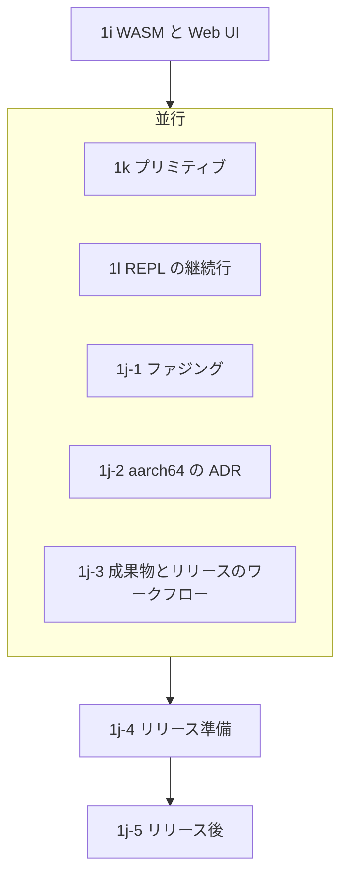
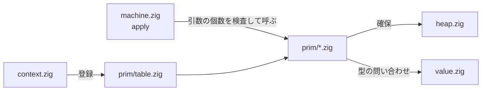
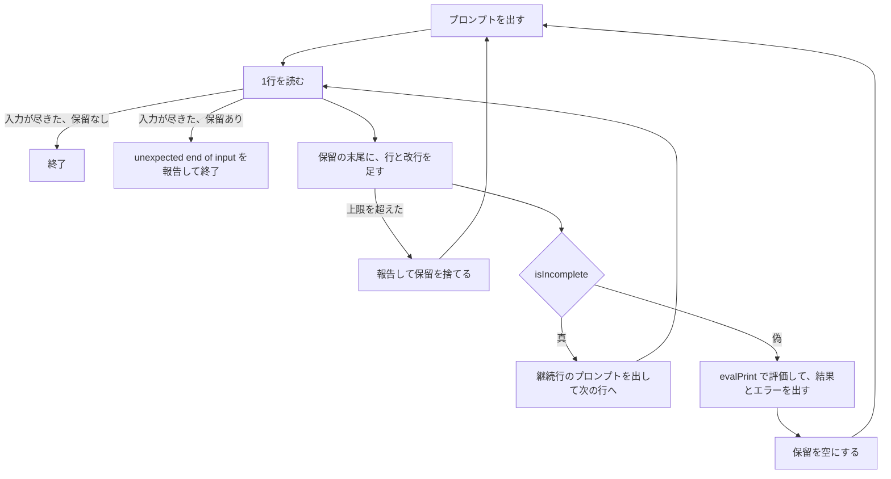
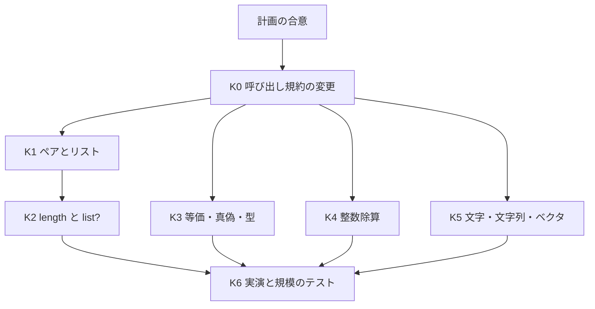

# 0010: スライス 1k と 1l の実装計画 — プリミティブの拡充と REPL の継続行

- 対応する決定: [ADR-0002](../adr/0002-value-representation.md), [ADR-0004](../adr/0004-cek-machine-evaluator.md), [ADR-0006](../adr/0006-library-system-and-scheme-level-stdlib.md), [ADR-0008](../adr/0008-string-representation.md), [ADR-0014](../adr/0014-repl-line-editor-boundary.md), [ADR-0018](../adr/0018-incremental-vertical-slices.md), [ADR-0026](../adr/0026-verify-facts-about-code-not-prose.md), [ADR-0027](../adr/0027-severity-by-consequence-and-a-cost-side-stop.md), [ADR-0031](../adr/0031-gc-at-machine-step-boundaries.md)
- 段階: 1(スライス 1k と 1l)。スライスの全体は [0003-phase1-minimal-slice.md](0003-phase1-minimal-slice.md) が正
- 日付: 2026-10-11
- 状態: 案。「合意を求める点」に答えをもらってから実装に入る

## 解こうとしている問題

[roadmap.md](../roadmap.md) の段階1の作業項目のうち、[0003](0003-phase1-minimal-slice.md) のスライス表(1a から 1j)のどれにも割り当てられていないものがあった。

- 「プリミティブ約30個。算術は固定長整数に限る」: 今あるのは `src/prim/arith.zig` の `+ - * = < > <= >=` だけである。`cons` `car` `cdr` が無く、1c が値に入れたペアを、プログラムは作ることも分解することもできない(リテラルの `'(1 2)` を書くことしかできない)。1h が入れた文字・文字列・ベクタも、調べる手続きが無い。「約30個」の一覧は、どの文書にも定義されていない。
- 「REPL(素朴な行読み取り、完結判定による継続行)」: 1a から入っている REPL は1行ずつ読むだけである。閉じていない式(`(+ 1` だけの行)は `unexpected end of input` で終わり、次の行 `2)` は `unexpected )` になる。リーダは不足を表す `Incomplete` を返す([ADR-0014](../adr/0014-repl-line-editor-boundary.md))が、REPL はそれを使っていない。

この計画を書く途中で、3つ目が見つかった。行コメント `;` である。roadmap の「リーダの最小集合」と [frontend.md](../design/frontend.md) の段階1の行に書かれているが、どのスライスも入れていない。1h の計画が「含めないもの」に挙げて以来、リーダは `;` を `unreadable token` で拒否する。REPL の継続行の判定が行コメントの扱いに左右されるので、1l に入れる(合意を求める点の5)。

## スライスの番号と実施順

ユーザーが、割り当ての決め方を任せた。基準は、品質を保つこと、動くものを確認し続けられること、開発効率の3つである。次のとおり決める。

- プリミティブを 1k、REPL の継続行(と行コメント)を 1l とする。番号は作った順で、実施順ではない。
- 実施順は 1i、(1k、1l、1j-1 から 1j-3 を並行)、1j-4、1j-5 とする。リリース(1j-4、1j-5)は、段階1の全項目がそろってから出す。



理由は次のとおり。

- 1j に入れない: 1j は、PR ごとに `.github/workflows/` の承認が要るリリース工学である。プリミティブの指摘が、ワークフローの権限のレビューに混ざる。レビューの対象が大きいほど指摘が増え、収束しなくなる([process-lessons.md](../review/process-lessons.md))。
- 1i に入れない: 1i は合意済みで、PR のレビュー待ちである。
- 1k と 1l を1つにしない: 触る層が違う。1k は機械とプリミティブ、1l はリーダと入口である。互いに独立で、それぞれ完了条件を1行で書ける([0003](0003-phase1-minimal-slice.md) の「スライス」の条件)。
- 1j の前に入れる: リリース v0.1.0 は、[roadmap.md](../roadmap.md) の段階1の完了条件(階乗、100万回の末尾再帰、エラー報告)を満たしたと言えるものを配る。算術と比較だけのプリミティブと、継続行の無い REPL を配ると、利用者が最初に触る版が「通しで動く」の中身を欠く。
- 並行する: 1k、1l、1j-1 から 1j-3 は、触るファイルがほぼ重ならない。次の「重なりの確認」の3点を除く。

### 重なりの確認

「触るファイルが重ならない」は、完全には成り立たない。確かめた重なりは3つで、それぞれ手当てを決める。

- `src/reader.zig`: 1j-1 は、リーダのファジングのテストを `src/reader.zig` に足す([0009](0009-slice-1j-release-v0-1-0.md))。1l は、行コメントと完結判定の関数を同じファイルに足す。1l は、既存の関数(`skipWhitespace`)の中と、`Reader` の定義の直後に限って書く。1j-1 は、ファイル末尾のテストの節に足す。どちらが先にマージされても、衝突は機械的に解ける。1j-1 のファジングは、1l のあとのほうが入力の文法が広い(行コメントが読める)が、1j-1 の手直しは要らない。
- `tests/scheme/` の番号: 1k と 1l が同じ「次の番号」を取る。1k は 0017 から 0029 を、1l は 0030 から使う。
- 進捗の表: [0003](0003-phase1-minimal-slice.md) の進捗の表と [roadmap.md](../roadmap.md) のチェックボックスは、各 PR が更新する。マージの順に、あとの PR が競合を解く。

## 完了条件

1k: 手で書いた `len` が、`list` と `cdr` の上で動く。`(define (len xs) (if (null? xs) 0 (+ 1 (len (cdr xs))))) (len (list 1 2 3))` が `3` を返す。

- 下の一覧のプリミティブの振る舞いが、`tests/scheme/` と単体テストで固定されている。エラー(型・引数の個数・範囲)を含む。
- `tests/scheme/` のすべてのケースが、既存の2つの方式(既定、1ステップごとに GC するストレスモード)で通る。プリミティブが作った値が、GC を越えて読める。
- 規模を試すテスト(層2)で、長いリストの作成と `length` が通り、深い入れ子の `equal?` が Zig のスタックを使い切らない。縮小版が層1にある。
- 引数の個数の検査が、機械の1か所にある。
- 検証コマンド表の変更は無い。

1l: `(+ 1` で改行すると継続行のプロンプトが出て、次の行 `2)` で `3` が返る。`;` の行コメントが読める。

- 閉じていない式(括弧、`'` の直後、文字列、ベクタ、`#\` の途中)だけが継続行になる。構文エラーは、継続行にならずにその場で報告される。
- 文字列や行コメントの中の括弧で、判定を誤らない。
- 継続行の入力に上限があり、超えたら報告して保留を捨てる。
- 入力が尽きたとき、保留が残っていれば `unexpected end of input` を報告して終わる。
- 検証コマンド表の変更は無い。

## 範囲

含めるもの:

- 1k: プリミティブ(下の一覧)。`Primitive` の呼び出し規約の変更(ヒープと一時領域を渡す、引数の個数を表で検査する)。登録表。プリンタが、データの中の未規定値を書くようにする変更。文字列の ASCII 判定フラグ([ADR-0008](../adr/0008-string-representation.md))。
- 1l: 行コメント `;`。リーダの完結判定の関数。REPL の継続行。

含めないもの(送り先は「選ばなかったものと送り先」の表):

- データの変更(`set-car!` など)と、大きさを数で決める生成(`make-vector` など)。合意を求める点の1。
- `display` `write` `newline`。出力ポートが入る段階5まで、Scheme の手続きにしない(1h の決定を保つ)。REPL と Web UI は、各式の値を `write` の形で出す。複数の値を見たいときは `(list a b c)` に束ねる。
- 1l: 行編集(履歴、カーソル移動、継続行の取り消し)。段階7([ADR-0014](../adr/0014-repl-line-editor-boundary.md))。端末かどうかによるプロンプトの出し分け。ブロックコメント `#| |#` とデータコメント `#;`(段階5)。

## 1k の設計

### 選ぶ基準

R7RS-small を一次情報とし、名前は付録Aの抽出(`tests/r7rs-required/base.txt`)で `(scheme base)` にあることを確かめた。次の4つの基準で選ぶ。

- 段階1の完了条件(階乗、100万回の末尾再帰、エラー報告、ブラウザ)を満たすために要るか、それを確かめるテストと実演のために要る。
- Scheme で書けない。型の印を調べる、ヒープに確保する、同一性を比べる、あふれを検査する、のどれかを要する。[ADR-0006](../adr/0006-library-system-and-scheme-level-stdlib.md) が Zig に置くと定めた族に入る。
- 後で作り直さない。段階2のハンドラ、段階4の数値塔、段階5のポートに依存しない。
- 言語に `let` `cond` `and` `or` `do` が無い(段階3)ので、`if` と `lambda` だけで書くプログラムの部品になる。

### 一覧

既存の `+ - * = < > <= >=` に、次を足す。個数は表から数えられるので、ここには書かない。ロードマップの「約30個」は設計時の目安で、一覧は定義されていない。表は、基準で選んだ結果であり、個数を合わせたものではない。目安に収めるなら、単位 K5 の操作を外す(合意を求める点の2、範囲を狭める線の1)。

| 単位 | 名前(引数の個数) | R7RS の節 | 振る舞いとエラー |
| --- | --- | --- | --- |
| K1 | `cons`(2) `car`(1) `cdr`(1) | 6.4 | ペアの作成と分解。`car` `cdr` の引数がペアでなければ型エラー |
| K1 | `pair?`(1) `null?`(1) `list`(0以上) | 6.4 | `list` は引数の個数だけペアを作る |
| K2 | `length`(1) `list?`(1) | 6.4 | 循環したリストで止まる(下の注)。`length` は、正しいリストでなければ型エラー |
| K3 | `eq?`(2) `eqv?`(2) `equal?`(2) | 6.1 | 下の注 |
| K3 | `not`(1) `boolean?`(1) `symbol?`(1) `procedure?`(1) | 6.3 6.5 6.10 | `procedure?` は、クロージャとプリミティブで真 |
| K4 | `quotient`(2) `remainder`(2) `modulo`(2) `number?`(1) | 6.2.6 | 下の注 |
| K5 | `char?`(1) `char->integer`(1) `integer->char`(1) | 6.6 | `integer->char` は、スカラ値でない整数を範囲エラーにする |
| K5 | `string?`(1) `string-length`(1) `string-ref`(2) | 6.7 | 文字単位の添字。範囲外は範囲エラー |
| K5 | `vector?`(1) `vector`(0以上) `vector-length`(1) `vector-ref`(2) | 6.8 | 範囲外は範囲エラー |

注:

- `eq?` と `eqv?`: 整数・文字・真偽値・空リスト・シンボルは値で比べ、ペア・文字列・ベクタ・手続きは同一のオブジェクトかで比べる。今は2つの結果が同じで、段階4で数の種類が増えたとき `eqv?` が分かれる。実体は `value.zig` の関数にする(値表現の隠蔽、[ADR-0002](../adr/0002-value-representation.md))。
- `equal?`: ペアとベクタは構造で、文字列は内容で比べる。Zig の再帰を使わず、明示的なスタックで進める(リーダ・プリンタ・展開器と同じ規則)。小さな固定の配列で足りる間は一時領域を使わず、足りなくなったときだけ使う。データの変更が無いので循環は作れず、訪問済み集合は要らない。変更が入るスライスで入れる([open-questions.md](../design/open-questions.md) の `equal?` の行)。
- `list?` と `length`: 循環したリストを検出する。Scheme からは1k では循環が作れないので、単体テストが Zig でヒープのペアを書き換えて循環を作り、確かめる。変更操作が入るときに、この検出を頼りにできる。
- `quotient` `remainder` `modulo`: 128 ビットで計算し、あふれと 0 除算を先に判定する(`arith.zig` の既存の方針)。`quotient` は 0 に向かって丸める。`modulo` の符号は除数に従い、`remainder` の符号は被除数に従う。最小の整数を -1 で割る `quotient` はあふれ、`remainder` と `modulo` は 0 になる。0 の除数は 0 除算エラーにする。
- 添字と `integer->char` の引数は 64 ビットの整数なので、範囲を検査してから `usize` や `u32` に変える。`wasm32` は `usize` が 32 ビットで、先に変えると切り捨てるか、検査でパニックする。
- `string-length` と `string-ref` は、文字(Unicode スカラ値)の数と位置で数える。`String` に ASCII 判定フラグを足し、`Heap.createString` の1か所で計算する。1h の計画が、フラグを「使う手続きが入るスライス」に送った。ASCII だけの文字列は定数時間で、そうでなければ UTF-8 を走査する([ADR-0008](../adr/0008-string-representation.md) が受け入れた)。

エラーの文言は、`wrong type of argument to car` のように、既存の形に揃える(次の「エラー」)。

### 選ばなかったものと送り先

| 送り先 | 名前 | 理由 |
| --- | --- | --- |
| 段階3の最初のスライス | `set-car!` `set-cdr!` `vector-set!` `vector-fill!` `string-set!` `make-vector` `make-string` `string` | 変更操作は、リテラルの不変の印(1h の計画が、変更する手続きと一緒に入れると決めた)、循環への備え(プリンタ、`equal?`、`list?`)、大きく確保する生成(ADR-0031 の見直し条件)と同時に要る。合意を求める点の1 |
| 段階3 | `append` `reverse` `list-tail` `list-ref` `list-copy` `memq` `memv` `member` `assq` `assv` `assoc` `string-append` `substring` `string-copy` `string->list` `list->string` `vector->list` `list->vector` `vector-copy` `vector-append` `vector-map` など | 一階の変換と連結は、Scheme の `lib/` に書けるものが大半である。Zig に置くか Scheme に置くかは段階3の計画で決める([ADR-0006](../adr/0006-library-system-and-scheme-level-stdlib.md))。1k のあいだは、利用者が `if` と `lambda` で定義して使える(実演プログラム) |
| 段階3 | `zero?` `positive?` `negative?` `even?` `odd?` `abs` `square` `gcd` `lcm` `max` `min` | `=` `<` `remainder` の上に Scheme で書ける。数値塔が入っても定義は変わらない。`max` と `min` の不正確な数の伝播は段階4で直す。`floor/` `truncate/` は `values` が入る段階2のあと。`floor-quotient` `floor-remainder` `truncate-quotient` `truncate-remainder` は、`quotient` `modulo` `remainder` と同じ関数を別の名前で登録する |
| 段階3 | `char=?` `char<?` など、`string=?` `string<?` など、`symbol->string` `string->symbol` `symbol=?`、`boolean=?`、`caar` `cadr` `cdar` `cddr`(と `(scheme cxr)`)、バイトベクタの操作 | 比較は種類が多い割に価値が小さい。シンボルの操作は、シンボル表を弱い表にする判断([runtime.md](../design/runtime.md))と同時に決める。合成アクセサは Scheme で書く。バイトベクタは、値の種類が段階3で入る |
| 段階4 | `integer?` `rational?` `real?` `exact?` `inexact?` `exact-integer?` `/` `exact` `inexact` `floor` `round` など、`number->string` `string->number` `exact-integer-sqrt`、`(scheme char)` の文字の属性と大文字小文字の変換 | 数値塔と Unicode テーブルに依存する。`number?` は固定長整数で真、種類が増えても意味は変わらない |
| 段階2 | `error` `error-object?` `error-object-message` `error-object-irritants` `raise` `raise-continuable` `with-exception-handler` `read-error?` `file-error?`、`apply` `call/cc` `values` `call-with-values` `dynamic-wind` `make-parameter`、レコードの操作 | 条件オブジェクトにメッセージ以外(種類、irritant)が入り、ハンドラと動的点が入る段階。`error` を今入れると、メッセージの形を段階2で作り直す。機械を操作するものは、プリミティブの中で機械を起動しない規約の別の仕組みになる |
| 段階5 | `display` `write` `newline` `write-string` `write-char` `read` `read-line` などのポートの手続き、`eval` `exit` `command-line` `features` `current-second` など | 出力先(標準出力、WASM の出力バッファ、文字列ポート)が決まる段階。1h の決定どおり、仮の経路を作らない |

### 層と置き場所



- 置き場所: `src/prim/` に、R7RS の節ごとのファイルを置く。`arith.zig`(6.2)、`pair.zig`(6.4)、`equiv.zig`(6.1)、`boolean.zig`(6.3)、`symbol.zig`(6.5)、`procedure.zig`(6.10)、`char.zig`(6.6)、`string.zig`(6.7)、`vector.zig`(6.8)。小さなファイルが3つ(`boolean.zig` `symbol.zig` `procedure.zig`)できるが、段階3以降でそれぞれの族が育つ置き場所になる。新しいファイルは、`test { std.testing.refAllDecls(@This()); }` を持つ。
- 登録表: `src/prim/table.zig` が、各ファイルの `primitives` をコンパイル時に連結した配列 `all` を持つ。`Context.initWithOptions` は、`arith.primitives` の代わりに `table.all` を大域環境に束縛する。表のテストが、名前が全体で一意なことを確かめる。
- 機械との関係: `Machine.apply` が `call` の唯一の呼び出し元である。順序は、引数の個数の検査、呼び出し、エラーの写像である。プリミティブは Scheme の手続きを呼ばず、機械も起動しない([architecture.md](../design/architecture.md) の「プリミティブの非再入」)。1k のプリミティブは、どれも手続きを引数に取らないので、この不変条件に触れるものが無い。`apply` や `map` のように手続きを呼ぶものは、段階2と3で、機械がレジスタを書き換える別の仕組みにする。
- 確保: プリミティブは、渡された `heap` の API(`cons` `createString` `createVector`)だけで確保する。`std.mem.Allocator` を直接使わない(確保点の一元化)。一時領域は、機械が引数を置くのに使っているものと同じで、計上の外にある。`equal?` の作業スタックのように呼び出しの間だけ要るものに使い、返す前に解放する。

呼び出し規約を次の形に変える。`Primitive` は `value.zig` にあるので、`Services` の型もそこに置く。`value.zig` が `heap.zig` の型を名指すのでファイルの参照が相互になるが、`*Heap` はポインタで、レイアウトには依存しない。

```zig
pub const Services = struct {
    heap: *Heap,
    scratch: std.mem.Allocator,
};

pub const Primitive = struct {
    name: []const u8,
    min_args: u8,
    max_args: ?u8,
    call: *const fn (services: *const Services, args: []const Value) PrimitiveError!Value,
};
```

引数の個数の範囲は、省略できない。省略時の既定を可変長にすると、書き忘れた関数が `args[0]` を範囲外で読む(`ReleaseSafe` でパニック、WASM でトラップする)。既存の `arith.zig` の `-` と比較の個数の検査は、この表に移る。

### エラー

プリミティブは、現行どおり Zig の `error` で失敗を返し、`Machine.apply` が条件に写す(`ctx.raise`)。`error` の集合に、次を足す。

| Zig の error | メッセージ |
| --- | --- |
| `WrongType`(既存) | `wrong type of argument to <名前>` |
| `WrongArgumentCount`(既存。今後は機械が表から返す) | `wrong number of arguments to <名前>` |
| `IntegerOverflow`(既存) | `integer overflow in <名前>` |
| `DivisionByZero`(新) | `division by zero in <名前>` |
| `OutOfRange`(新) | `argument out of range in <名前>` |
| `HeapLimit`(新) | `heap limit exceeded`(`ctx.heapFailure` を通す。他の経路と同じ文言) |
| `OutOfMemory`(新) | ホストの失敗。条件にせず、そのまま返す |

検査の順序は、引数の個数、すべての引数の型、値の範囲である。値に左右されずエラーが決まる。`*` と比較の既存の方針である。

[runtime.md](../design/runtime.md) は、プリミティブの戻り値を「値・条件オブジェクト・機械の外側の失敗」の3つを区別できる形にすると定めている。ハンドラが入る段階2で、その形に移る。置き換える場所は、各プリミティブの `return error.X` と `apply` の写像の2種類で、機械的な置換である。1k で先取りしない(合意を求める点の4)。

### GC との関係

- GC は機械のステップの境目で走り、プリミティブの途中では走らない([ADR-0031](../adr/0031-gc-at-machine-step-boundaries.md))。`list` が途中まで作ったペアを Zig のローカル変数で持ってよい。確保が失敗したときの途中のペアはゴミで、次の境目で回収される。
- 引数は呼び出しの引数の鎖(`Args`)から到達できる。結果は `value` レジスタに入って、次の境目でルートになる。ルートの登録(`Context.mark`)は変わらない。
- 1ステップで大きく確保するプリミティブの見直し条件(ADR-0031)に、1k は当たらない。1k のプリミティブが1回に確保する量は、呼び出しの引数の個数に比例するか、確保しない。数から大きさを決めるもの(`make-vector` `make-string`)は入れない。見直しは、それらが入る段階3の最初のスライスで行う(失敗したら GC して再試行する案を含む)。
- ストレスモードは、`tests/scheme/` の全ケースが自動で走らせる。単体テストは `Options.stress = true` で走らせる。

### プリンタの変更: データの中の未規定値

未規定値は、これまでデータの中に入る経路が無かった。プリンタは外部表現を持たず、何も書かない。`(list (set! x 1))` と `(cons 1 (if #f #f))` が作れるようになると、`write` が `(1 . )` や `()` のように、読めない出力を書く。K1 で、プリンタがデータの中の未規定値を `#<unspecified>` と書くようにする。REPL が最上位の未規定値を出力しないのは、プリンタでなく `Interpreter` の判定なので、変わらない。プリンタの既存のテスト「未規定値で何も書かない」は、書き換える。

### 実演プログラム

動作を確認できるようにするため、各単位の完了時に、その単位のプリミティブだけで動くプログラムを `tests/scheme/` に足し、`zig build run` で試す。1i のマージ後は、同じ式を Web UI でも試す。言語に `let` と `cond` と可変長引数の `lambda` が無いので、プログラムは `define` `lambda` `if` だけで書く。1ケースは1行で、1つの `Interpreter` で評価される(実行器の形式)。

| 単位 | 実演 |
| --- | --- |
| K1 | `(car (cdr (list 1 2 3)))` が `2`。手で書いた `append2`(2引数)、`reverse`、1引数の `map1` が動く |
| K2 | 手で書いた `len` と `length` が、同じ結果を返す |
| K3 | `(equal? (list 1 (list 2)) (list 1 (list 2)))` が `#t`。リストの `member` 相当を手で書く |
| K4 | 最大公約数、素数判定、`(fact 20)`。`(fact 21)` は `integer overflow in *` で、REPL は止まらない |
| K5 | `(string-length "あい")` が `2`、`(string-ref "あい" 1)` が `#\い`、`(vector-ref (vector 1 2 3) 2)` が `3` |

## 1l の設計

### 完結判定をどこに置くか

リーダの `Incomplete` を使う。別の字句解析器を作らない([ADR-0014](../adr/0014-repl-line-editor-boundary.md)、[frontend.md](../design/frontend.md))。括弧の数を数える方式は、文字列と行コメントの中の括弧で誤る。

関数を `src/reader.zig` に置く。

```zig
pub fn isIncomplete(gpa: std.mem.Allocator, source: []const u8) error{OutOfMemory}!bool
```

`source` を、使い捨てのヒープ・シンボル表・アリーナで最後まで読む。`Incomplete` で終われば真、データがなくなって終わっても、`Incomplete` 以外のエラー(構文エラー)で止まっても偽である。不正な UTF-8 は偽にして、報告を `evalPrint` に任せる(リーダは、入力が妥当な UTF-8 であることを前提にしている)。ネイティブの REPL とリッチな行編集(段階7)が、同じ関数を使う。

| 入力 | 判定 | 理由 |
| --- | --- | --- |
| `(+ 1` `(a (b)` `#(1 2` | 継続 | リストかベクタが閉じていない |
| `'` `(a '` | 継続 | `'` のあとにデータが無い |
| `"abc` `"a\` | 継続 | 文字列が閉じていない |
| `#\` | 継続 | 文字の本体が無い |
| `(a . ` | 継続 | ドットのあとのデータが無い |
| `(a ; )` のあとに改行 | 継続 | コメントの中の `)` は数えない。リストが閉じていない |
| `)` `(a . )` `#z` `'` に続く `)` | 完結 | 構文エラー。継続しても直らないので、その場で報告する |
| 空行、空白だけ、コメントだけの行 | 完結 | 何もしない |

### 行コメント

`skipWhitespace` が、空白に加えて `;` から行末までを読み飛ばす。`;` は区切り文字として既にあるので、`abc;コメント` は識別子 `abc` で終わる。文字列の中の `;` と文字 `#\;` は、それぞれの読み取りが先に処理するので、コメントにならない。ブロックコメントとデータコメントは段階5で、`#;` は引き続き `unreadable token` である。`src/reader.zig` の既存のテストは `;` を拒否する綴りに数えているので、直す。

### REPL の動き



- 改行を戻す: `takeDelimiter` は改行を落とす。保留に行を足すとき改行を戻す。複数行の文字列リテラルが、改行を含む文字列になるためである。
- 保留の置き場所: `repl` の中の固定長の配列 `[max_line]u8` にする。エントリ層は確保を起動と終了に限る([architecture.md](../design/architecture.md))ので、確保しない。
- 上限: 保留の合計を `max_line` までとする。判定は、行が足されるたびに保留の全体を読み直すので、所要時間が行の数の2乗に比例する。上限が小さければこの費用は抑えられる。上限を上げるには、読み取りの状態を保って続きから読む判定器が要る。1l はしない。
- 超えたとき: `error: the input does not fit in <max_line> bytes, newline included` の形で報告し、保留を捨てる。同じ式の残りの行は新しい入力として読まれるので、エラーが続きうる。行が `max_line` を超えたときの既存の動作(報告して読み飛ばす)も、保留を捨てる。
- 入力が尽きたとき: 保留が残っていれば、`error: unexpected end of input` を stderr に出して終わる。終了ステータスは 0 のままである。
- 空行: 継続中の空行は保留に足して続ける。継続中でない空行は、今までどおり何も出力しない。
- プロンプト: 通常は `> `、継続中は `... `。定数に名前を付ける。
- 動作の変更: 今は `(+ 1` の次の行 `42` が別の行として評価される(既存のテスト `repl reports an error and goes on to the next line`)。1l のあとは、その2行が1つの式になる。[ADR-0014](../adr/0014-repl-line-editor-boundary.md) が意図した動作である。テストと、`src/main.zig` の doc コメント(コマンドラインと REPL の契約の正)を書き換える。
- 取り消し: 継続中の入力を取り消す手段は無い。端末の割り込みはプロセスを終える。行編集は段階7。
- 評価の時点: 複数の式を含む行は、最後の式が閉じていなければ、行全体が閉じるまで評価されない。閉じた先頭の式の出力が遅れる。式ごとに評価してから尾を保留する方式は、`Interpreter` の入口を変えるので採らない(合意を求める点の6の別案)。

### テストの方法

`tests/scheme/` の形式では、継続行を書けない。1ケースは1行の入力で、実行器は `Interpreter.evalPrint` を直接呼ぶ。REPL の読み取りの経路を通らない。REPL を通す形式を実行器に足す案は採らない(検査ツールを育てない、[ADR-0026](../adr/0026-verify-facts-about-code-not-prose.md))。

| 対象 | 置き場所 | 層 |
| --- | --- | --- |
| 行コメントの読み取り | `src/reader.zig` の単体テストと `tests/scheme/0030-line-comments.txt`(`evalPrint` を通る) | 1 |
| `isIncomplete` の表(上の表の全行) | `src/reader.zig` の単体テスト | 1 |
| 継続行、プロンプト、上限、入力が尽きたときの保留 | `src/main.zig` の `replOver`(固定のリーダとライタ)を使う単体テスト。既存の形 | 1 |
| 本物の標準入力 | 手作業。`printf '(define (f x)\n  (+ x 1))\n(f 1)\n' \| zig build run` を PR に貼る | 手作業 |
| `isIncomplete` と上限の判定のミューテーション | 書き換えたファイルに対して | 2 |

### WASM への影響

無い。`sucheme_eval_begin` は入力全体を一度に `evalPrint` へ渡し(1i のブランチの `src/wasm.zig` を読んで確かめた)、REPL の `repl` を通らない。複数行の入力欄は、継続行の仕組みを要らない。閉じていない式は、今までどおり `error: unexpected end of input` で状態コード -1 になる。影響が及ぶのは行コメントで、入力欄に `;` を書けるようになる。`src/wasm.zig` と `web/` は変更しない。`isIncomplete` を WASM から呼ぶ入口は足さない。

## 合意を求める点

設計文書に直接の答えが無く、この計画が選んだ。それぞれ、勧める案を先頭に置く。

1. データの変更(`set-car!` `set-cdr!` `vector-set!` `vector-fill!` `string-set!`)と、大きさを数で決める生成(`make-vector` `make-string` `string`)を、1k に入れるか。
   - 勧める案: 入れない。段階3の最初のスライスで、リテラルの不変の印、循環への備え、ADR-0031 の見直しとあわせて入れる。
     - 長所: 変更が無ければ循環が作れず、`write` と `equal?` と `list?` が止まることが自明になる。1h の計画の約束(不変の印は、変更する手続きと一緒に入れる)を守れる。ADR-0031 を見直さずに済み、1k が機械とヒープの外に広がらない。
     - 短所: リスト操作の代表である `set-car!` と `set-cdr!` が、v0.1.0 に無い。キューのような変更を使うデータ構造を、Scheme で書けない(クロージャと `set!` では書ける)。
   - 別案: 入れる(`set-car!` `set-cdr!` `vector-set!` と `make-vector`)。長所は R7RS の基本がそろうこと。短所は3つある。リテラルの不変の印と検査が要り、`value.zig` と `heap.zig` に及ぶ。循環が作れて、ネイティブの REPL が循環したリストを `write` すると終わらない(WASM は出力バッファが埋まって止まる)。プリンタ・`equal?` に循環の備えが要る。`make-vector` の大きさが数で決まるので、ADR-0031 の見直し条件に当たる。1k のレビューの範囲が広がる。
   - 別案: `set-car!` と `set-cdr!` だけを入れる。循環の問題が残るので勧めない。
2. 文字・文字列・ベクタの操作(単位 K5)を、1k に入れるか。
   - 勧める案: 入れる(`char->integer` `integer->char` `string-length` `string-ref` `vector` `vector-length` `vector-ref` と、型の述語)。`String` の ASCII 判定フラグも入れる。
     - 長所: 1h で読み書きできるようになった3つの型を、プログラムから調べられる。`integer->char` が、1h が用意した `isScalarValue` の最初の利用者になる。フラグは1h の計画の約束である。
     - 短所: 個数が目安の約30個を超える。フラグが `value.zig` と `heap.zig` に及ぶ。
   - 別案: 型の述語(`char?` `string?` `vector?`)だけ残し、中身の操作を段階3へ送る。長所は 1k が機械とペアに集中し、目安に収まること。短所は、文字列とベクタが書き出せるだけの型のままになること。
3. プリミティブの呼び出し規約。
   - 勧める案: `Primitive` に引数の個数の範囲を持たせて機械が検査し、`call` に `Services`(ヒープと一時領域)を渡す。すべてのプリミティブが同じ型になる。
     - 長所: 個数の検査が1か所になり、範囲外の添字の読み取り(`ReleaseSafe` でパニック、WASM でトラップ)の経路が閉じる。登録表が1つの配列になる。`services` を使う関数を探せば、確保するプリミティブが一覧できる。
     - 短所: 既存の `arith.zig` の呼び出しと単体テストを直す。`value.zig` が `heap.zig` の型を名指す(ポインタ越し)。
   - 別案: 純粋なもの(引数だけ)と確保するもの(ヒープも)を、`union` の2種類で持つ。長所は `arith.zig` を直さないこと。短所は、機械の分岐と型が増えること、`equal?` が一時領域を要して3種類目が要ること。
   - 別案: `*Context` を渡す。長所は将来 `raise` を直接呼べること。短所は、`context.zig` が登録のために `prim/` を読むので、参照が環になること、プリミティブが触れる状態(大域環境、シンボル表)が広がること。
4. エラーの形。
   - 勧める案: 現行の Zig の `error` の集合を広げ、`apply` が条件に写す。段階2で [runtime.md](../design/runtime.md) の3値の形に移る。
     - 長所: ハンドラが無い段階で、使う者のいない機構を作らない。移行の場所が `return error.X` と `apply` の写像に限られる。
     - 短所: 段階2で全プリミティブに触る(機械的な置換)。メッセージに引数の値(irritant)が入らない。
   - 別案: 今、3値の形にする。長所は移行が要らないこと。短所は、条件オブジェクトがヒープの外のアリーナにある(1g の例外)うえ、種類と irritant の表現が段階2まで決まっていないので、形だけ先に作ること。
5. 行コメントを 1l に入れるか。
   - 勧める案: 入れる。
     - 長所: 完結判定の入力にコメントを含めて確かめられる。REPL と Web UI の入力欄で、コメントを書ける。リーダの最小集合の項目が閉じる。
     - 短所: 1l が、REPL だけの変更でなくなる。
   - 別案: 別の小さなスライス 1m にする。長所は 1l がREPL に集中すること。短所は、スライスが増えること。完結判定がコメントを考慮するかどうかの境が、スライスをまたぐこと。
6. 完結判定の実装。
   - 勧める案: `reader.isIncomplete` が、リーダ自身を使い捨てのヒープで走らせる。
     - 長所: 字句の規則が1つで、リーダが育つ(文字リテラル、ブロックコメント、縦棒識別子)と判定が自動で追従する。[ADR-0014](../adr/0014-repl-line-editor-boundary.md) の「リーダに委ねる」そのものである。
     - 短所: 判定のたびにデータを作って捨てる。行が足されるたびに全体を読み直す(上限で抑える)。
   - 別案: 確保しない専用の走査器を足す。長所は速いこと。短所は、字句の規則が2つになり食い違うこと(文字列のエスケープ、`#\(`、`;`)。ADR-0014 が避けたかったことである。
   - 別案: リーダに「読むだけで作らない」モードを足す(`Sink` の差し替え)。長所は規則が1つで確保も無いこと。短所は、リーダの全分岐に及び 1l が大きくなること。速さが問題になったときの道として残す。
   - 別案: 式ごとに評価してから、尾の不完結な部分を保留する。長所は、複数の式を含む行の出力が遅れないこと。短所は、`Interpreter` の入口(読み取りの位置を返す形)を変えること。
7. `LineReader` の `union` を 1l で作るか。
   - 勧める案: 作らない。完結判定の共有(`isIncomplete`)だけを、[ADR-0014](../adr/0014-repl-line-editor-boundary.md) の境界として保つ。`union` は、`rich` が入る段階7で作る。
     - 長所: 変種が1つの `union` は、使われない構造である(YAGNI)。差し替えの局所性は、`repl` が `*std.Io.Reader` から読み、判定を共有する現状で保たれる。
     - 短所: ADR-0014 の「`LineReader` という `union` を置く」の文言を、文字どおりには満たさない。守るなら、ADR に追記する(決定の意図は変えない)。
   - 別案: `dumb` だけの `union` を作る。長所は ADR の文言どおりであること。短所は、`rich` の形が分からないまま `read` の署名(プロンプトを受ける)を固めることになり、段階7で作り直す可能性が高いこと。
8. 継続行のプロンプトと上限。
   - 勧める案: プロンプトは `... `、保留の上限は `max_line` と同じ値。
     - 長所: Python と Guile の慣習に近く、通常の `> ` と区別できる。上限が小さく、2乗の費用が抑えられる。定数が1つで済む。
     - 短所: パイプで流すと、継続行の数だけ `... ` が出力に混ざる(`> ` が既に混ざる現状と同じ性質)。1つの式が `max_line` を超える貼り付けは、拒否される。
   - 別案: 継続行のプロンプトを空にする、または空白にする。長所は出力が静かなこと。短所は、継続中かどうかが画面で分からないこと。
   - 別案: 上限を別の定数にして大きくする(例: 1 MiB)。長所は大きな式を貼れること。短所は、判定の2乗の費用が上限に応じて増えること。
9. 重なりの手当て(「重なりの確認」)。
   - 勧める案: 上の3点の手当てのとおり。どちらが先にマージされても構わない。
   - 別案: 1j-1 を 1l のあとに直列にする。長所は競合が起きないこと。短所は、並行の利益が減ること。

## 並行できる単位

### 1k



K0 は私が直列に作る。呼び出し規約、アリティ表、エラーの写像、登録表が、後続の全部が頼る部分だからである。K0 は動作を変えない整理(Refactor)で、既存のテストが緑のまま通ることを条件にする。K0 ができたら、K1 から K2、K3、K4、K5 を別々のワークツリーで並行に進める。書いてよいファイルを分ける。

| 単位 | 内容 | 最初の失敗するテスト(Red) | 書いてよいファイル |
| --- | --- | --- | --- |
| K0 | `Primitive` と `Services`、引数の個数の検査、エラーの写像、`src/prim/table.zig`、`arith.zig` を新しい規約へ | `(-)` を機械が個数の表で報告するテスト | `src/value.zig`(`Primitive` `Services` `PrimitiveError`)、`src/machine.zig`(`apply`)、`src/context.zig`(登録)、`src/prim/table.zig`、`src/prim/arith.zig`(書き換えのみ) |
| K1 | `cons` `car` `cdr` `pair?` `null?` `list`、プリンタの未規定値 | `(cons 1 2)` が `(1 . 2)` | `src/prim/pair.zig`、`src/printer.zig`、`tests/scheme/0017-pairs.txt` |
| K2 | `length` `list?` | `(length (list 1 2 3))` が `3` | `src/prim/pair.zig`、`tests/scheme/0018-lists.txt` |
| K3 | `eq?` `eqv?` `equal?` `not` `boolean?` `symbol?` `procedure?` | `(eq? 'a 'a)` が `#t` | `src/prim/equiv.zig` `boolean.zig` `symbol.zig` `procedure.zig`、`src/value.zig`(`Value` の同一性の関数)、`tests/scheme/0019-equivalence.txt` |
| K4 | `quotient` `remainder` `modulo` `number?` | `(quotient 7 2)` が `3` | `src/prim/arith.zig`、`tests/scheme/0020-integer-division.txt` |
| K5 | 文字・文字列・ベクタ、ASCII 判定フラグ | `(vector-ref (vector 1 2) 1)` が `2` | `src/prim/char.zig` `string.zig` `vector.zig`、`src/value.zig`(`String` のフラグ)、`src/heap.zig`(`createString`)、`tests/scheme/0021-char-operations.txt` `0022-string-operations.txt` `0023-vector-operations.txt` |
| K6 | 実演プログラム、プリミティブのエラーの一覧、規模のテスト、文書 | なし(統合の確認) | `tests/scheme/0024-programs.txt` `0025-primitive-errors.txt`、`tests/scheme-slow/0013-list-scale.txt`、`docs/` |

`src/prim/table.zig` の行は、各単位が自分の族の1行を足す。統合は私が直列に行い、隣り合う行の競合を解く。`src/value.zig` は K0、K3、K5 が別の箇所を触る。

### 1l

1l は小さいので、直列に進める(L1 行コメント、L2 完結判定、L3 REPL)。L3 は L2 に頼り、L3 のテストは L1 の行コメントを使う。並行の利益が大きいのは 1k の K3 から K5 と、1j の3つである。

| 単位 | 内容 | 最初の失敗するテスト(Red) | 書いてよいファイル |
| --- | --- | --- | --- |
| L1 | 行コメント | `1 ; コメント` が `1` を返す | `src/reader.zig`(`skipWhitespace` と既存のテスト)、`tests/scheme/0030-line-comments.txt` |
| L2 | `isIncomplete` と表のテスト | `isIncomplete("(+ 1")` が真 | `src/reader.zig`(`Reader` の定義の直後) |
| L3 | REPL の継続行、プロンプト、上限、入力が尽きたとき | `(+ 1\n2)\n` が `3` を返す | `src/main.zig`(`repl` とその単体テスト、doc コメント) |

## 検証

テストの層([0007](0007-test-tiers.md))の割り当て:

- 層1(全コミット): `zig fmt --check .`、`zig build`、`zig build test`、`zig build test-scheme`、`zig build check-docs`、`zig build check-extract`。1i が足す `zig build wasm` と `zig build test-wasm` も同じ層に入る。プリミティブ1つごとの単体テスト、`tests/scheme/` のケース、1l の `isIncomplete` と REPL の単体テストはここに入る。
- 層2(PR を準備完了にする前、`main` へのマージ前): `-Dslow=true` の2つ。規模を試すテストは `tests/scheme-slow/0013-list-scale.txt` に置く: 100万要素のリストの作成と `length`(GC が何度も走る)、深さ10万の入れ子の `equal?`、長いリストの `equal?`。それぞれの縮小版を層1に残す(数千要素、深さ数千)。変更したファイルのミューテーションテスト: `src/prim/*.zig` の判定(引数の個数の検査、循環の検出、範囲の検査、同一性)、`reader.isIncomplete`、REPL の上限の判定。敵対的レビュー。
- 手作業の確認(PR に結果を貼る): 各単位の実演プログラムを `zig build run` で。1i のマージ後は、`zig build wasm` と `node web/serve.mjs` で開いたヘッドレスの Chromium でも、同じ式を試す。1l は、本物の標準入力での継続行。
- 1i のマージ後に、`tools/test-wasm` の入力へ、1k のプリミティブを使う式を1つ足してよい(`wasm32` の添字の範囲検査を通すため)。1i のマージ後の形に従う。

検証コマンド表([AGENTS.md](../../AGENTS.md))の変更は無い。新しい step は足さない。`.github/workflows/` と `.claude/` は変更しない。承認は要らない。

## ファイル

| ファイル | 責務 | 変更 | スライス |
| --- | --- | --- | --- |
| `src/value.zig` | `Primitive` `Services` `PrimitiveError`、`Value` の同一性、`String` のフラグ | 変更 | 1k |
| `src/machine.zig` | `apply` の個数検査、`Services` の組み立て、エラーの写像 | 変更 | 1k |
| `src/context.zig` | 登録表の使用 | 変更 | 1k |
| `src/heap.zig` | `createString` がフラグを計算する | 変更 | 1k |
| `src/printer.zig` | データの中の未規定値 | 変更 | 1k |
| `src/prim/table.zig` | 登録表 | 新規 | 1k |
| `src/prim/arith.zig` | 新しい規約へ、除算 | 変更 | 1k |
| `src/prim/pair.zig` `equiv.zig` `boolean.zig` `symbol.zig` `procedure.zig` `char.zig` `string.zig` `vector.zig` | 各族のプリミティブ | 新規 | 1k |
| `tests/scheme/0017-*.txt` から `0025-*.txt` | 振る舞い、エラー、実演プログラム | 新規 | 1k |
| `tests/scheme-slow/0013-list-scale.txt` | 規模のテスト | 新規 | 1k |
| `src/reader.zig` | 行コメント、`isIncomplete` | 変更 | 1l |
| `src/main.zig` | 継続行、プロンプト、上限、doc コメントの契約、既存のテストの書き換え | 変更 | 1l |
| `tests/scheme/0030-line-comments.txt` | 行コメント | 新規 | 1l |
| `docs/design/runtime.md` | 純粋プリミティブが、ヒープと一時領域を受け取ること | 変更 | 1k |
| `docs/plans/0003-phase1-minimal-slice.md` `docs/roadmap.md` | 進捗の表、チェックボックスと、それが指すスライス | 変更 | 1k, 1l |
| `docs/adr/0014-repl-line-editor-boundary.md` | 追記(合意を求める点の7で、`union` を作らないとき) | 変更(条件つき) | 1l |

## 確かめた事実と、確かめられなかったこと

[AGENTS.md](../../AGENTS.md) の情報源の規則に従い、分ける。確認は 2026-10-11 に、`origin/main`(`9e8dd48`)の作業ツリーで、Zig 0.17.0 を使って行った。

確認できたこと:

| 事実 | 確かめ方 |
| --- | --- |
| 組み込みは `src/prim/arith.zig` の算術と比較だけで、大域環境への束縛は `Context.initWithOptions` が `arith.primitives` から行う | 読んだ |
| `Primitive.call` は `fn ([]const Value) PrimitiveError!Value` で、ヒープを受け取らない。このままでは `cons` を書けない | `src/value.zig` を読んだ |
| 機械は呼び出しの前に引数の個数を検査せず、各プリミティブが `args.len` を見る | `src/machine.zig` の `apply` と `arith.zig` を読んだ |
| 未規定値の外部表現は空で、データの中に入ると `(1 . )` のようになる。今はデータに入る経路が無い | `src/printer.zig` を読んだ |
| リーダは `;` を読めず、`unreadable token` で報告する。既存のテストも `;` を拒否する綴りに数えている | `printf '(+ 1\n2)\n; c\n(car 1)\n' \| zig build run` を実行して確かめ、`src/reader.zig` のテストを読んだ |
| REPL は `(+ 1` の行で `unexpected end of input`、次の行 `2)` で `unexpected )` を報告する。`car` は未束縛である | 同じ実行で確かめた |
| `Reader.next` は、リスト、ベクタ、`'` のあと、文字列、`#\` の途中で `Incomplete` を返す | `src/reader.zig`、`src/string_syntax.zig`、`src/char_syntax.zig` と、それぞれの既存のテストを読んだ |
| `tests/scheme/` の実行器は、1ケースを1行の入力として `evalPrint` へ直接渡し、REPL を通らない。各ケースは既定とストレスモードの2方式で走る | `tools/test-scheme/main.zig` を読んだ |
| 新しいプリミティブの名前は、すべて付録Aの抽出で `(scheme base)` にある。`display` と `write` は `(scheme write)` にある | `tests/r7rs-required/base.txt` と `write.txt` を読んだ |
| 1i の `sucheme_eval_begin` は、入力全体を `evalPrint` へ渡す | `origin/feature/phase1-slice-1i-wasm-web-ui`(先頭 `e360444`)の `src/wasm.zig` を読んだ。1i はまだマージされていない(PR #36) |
| 1j-1 は `src/reader.zig` を触る。[0009](0009-slice-1j-release-v0-1-0.md) のファイルの表に書かれている | 読んだ |
| `src/main.zig` の REPL の既存のテストが、`(+ 1` の次の行を別の行として評価する動作を固定している | 読んだ |

確かめられなかったこと:

| 事柄 | 状態 |
| --- | --- |
| R7RS の本文の各節(6.1 から 6.8 と 6.10)の規定 | 実行環境から `standards.scheme.org` に届かなかった(プロキシが拒否した)。`length` と `list?` の循環・不正なリストの扱い、`eq?` の小さい数と文字の扱い、`integer->char` の範囲、`modulo` の符号、節番号は、既存の文書の引用と記憶に基づく。実装の最初の Red の前に原文で確かめ、結果を PR に書く |
| `wasm32` での実行 | 1i が未マージで、ビルドしていない。添字の `usize` への変換は、設計で予防しただけで、実行して確かめていない |
| 規模のテストの所要時間、`isIncomplete` の最悪の入力での所要時間 | 測っていない。実装時に測り、層の目標([0007](0007-test-tiers.md))に収まらなければ縮小版を小さくする |
| ADR-0031 の余裕(上限の16分の1)に対する、引数の多い `list` や `vector` の確保量 | 測っていない。引数は呼び出しの鎖としてすでにヒープに計上されているので、結果は同じ桁の確保になると推測している |
| `origin/main` での既存の検証コマンドの結果 | この計画書の変更に対して `zig fmt --check .`、`zig build check-docs`、`zig build check-extract` を実行する |

## 範囲を狭める線

[ADR-0027](../adr/0027-severity-by-consequence-and-a-cost-side-stop.md) の費用側の停止の規則に従い、先に線を引く。レビューが収束しない兆候が出たら、次を上から順に外してやり残しに記録する。

1k:

1. 文字列の `string-ref` と ASCII 判定フラグ。外すと、`string-length` は UTF-8 を数え、添字アクセスは段階3に送る。
2. 単位 K5 の操作の全部(型の述語は残す)。外すと、文字・文字列・ベクタの操作は段階3に送る。
3. `equal?` と、その作業スタック。外すと、`eq?` と `eqv?` だけになる。

外さないもの: K0 の呼び出し規約、ペアとリスト、述語、整数除算、エラーの写像。

1l:

1. 行コメントを、別の小さなスライスに分ける。
2. `isIncomplete` と REPL の本体の食い違いを調べる表の網羅(代表の行だけにする)。

外さないもの: 完結判定がリーダ由来であること、保留の上限、入力が尽きたときの報告。

## 次にやること

1. この計画書の「合意を求める点」の9つに答える。
2. [roadmap.md](../roadmap.md) を編集している PR(#37)のマージ後に、roadmap の「プリミティブ」「REPL」「リーダの最小集合」の項目が指すスライスを 1k と 1l に直す。この計画書の PR は roadmap を触らない。
3. 合意と、1i のマージを待ってから、最新の `origin/main` から `feature/phase1-slice-1k-primitives` と `feature/phase1-slice-1l-repl-continuation` を作る。1k は K0 から始める。
4. 実装の最初に、「確かめられなかったこと」の R7RS の各節を原文で確かめ、結果を PR に書く。
5. 各 PR で、[0003](0003-phase1-minimal-slice.md) の進捗の表と「次にやること」を更新する。
