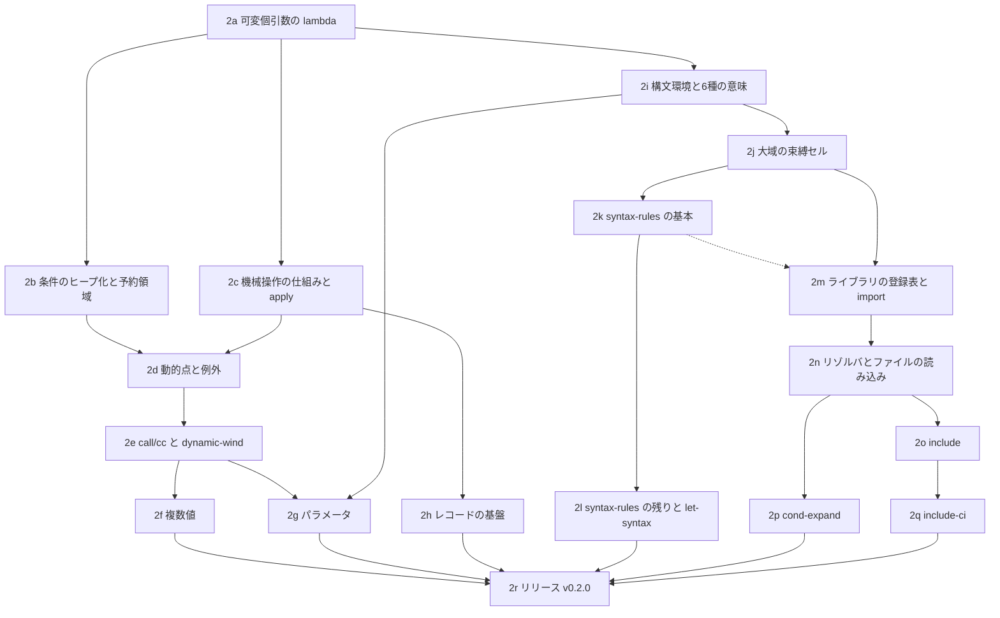

# 0014: 段階2の実装計画 — コア言語の完成

- 対応する決定: [ADR-0003](../adr/0003-precise-mark-sweep-gc.md), [ADR-0004](../adr/0004-cek-machine-evaluator.md), [ADR-0006](../adr/0006-library-system-and-scheme-level-stdlib.md), [ADR-0016](../adr/0016-exception-handler-as-dynamic-point.md), [ADR-0018](../adr/0018-incremental-vertical-slices.md), [ADR-0019](../adr/0019-denotations-and-identifier-resolution.md), [ADR-0026](../adr/0026-verify-facts-about-code-not-prose.md), [ADR-0027](../adr/0027-severity-by-consequence-and-a-cost-side-stop.md), [ADR-0029](../adr/0029-no-tail-marks-in-stage-1-machine.md), [ADR-0030](../adr/0030-lexical-address-width-u32.md), [ADR-0031](../adr/0031-gc-at-machine-step-boundaries.md)。衛生性の方式の経緯として [ADR-0005](../adr/0005-hygienic-expander-by-renaming.md)(非推奨、ADR-0019 に置き換え)
- 段階: 2(コア言語の完成)。段階の作業項目と完了条件は [roadmap.md](../roadmap.md) の段階2の節が正
- 日付: 2026-10-13
- 状態: 合意済み(2026-10-13)。「合意を求める点」の11点すべてを、勧める案どおりに承認した。問い3と問い4の新しい ADR は、それぞれを引き受けるスライスの PR で書く

## 解こうとしている問題

段階1は v0.1.0 で終わった([0013](0013-stage1-completion.md))。段階2は、[roadmap.md](../roadmap.md) の段階2の節が挙げる3つの機構(動的状態、衛生的マクロ、ライブラリシステム)を入れる。3つは互いに依存するので、同じ段階に置かれている。

規模は段階1より大きい([0012](0012-schedule-estimates-and-actuals.md) の段階2の行)。1つの PR にすると段階0の経緯が繰り返されるので、段階1と同じく、1つの PR で半日から1日に収まるスライスに割る([0003](0003-phase1-minimal-slice.md) の前例)。

この計画を書くために `origin/main`(`3a26905`)のコードを読み、設計文書が前提にしているのにコードにも roadmap にも無いものを見つけた。「roadmap に無い項目と、割り当ての無い項目」の節にまとめ、割り当て先を「合意を求める点」で諮る。

## 完了条件

[roadmap.md](../roadmap.md) の段階2の完了条件が正である。この計画は次のように読む。

- [frontend.md](../design/frontend.md) の衛生性の検証項目のうち、段階2で入力を書けるものがすべて通る。どの項目をどのスライスが通すかは「検証項目の割り当て」の表にある。
- [runtime.md](../design/runtime.md) のテストに含める事例がすべて通る。事例は3か所にある。マーク段階の節(作業リストの容量0)、例外の節の番号つきの一覧、複数値の節である。ただし、この条件はそのままでは満たせない。理由と扱いは合意を求める点の9にある。
- 継続の多重起動と `dynamic-wind` の相互作用のテストが通る(スライス 2e)。
- `include-ci` が対象ファイルを畳み込んで読む(スライス 2q)。
- リリース v0.2.0 を出す(スライス 2r)。

## 範囲

含めるもの:

- roadmap の段階2の作業項目のすべて。項目とスライスの対応は「roadmap の項目の割り当て」の表にある。
- 可変個引数の `lambda`。roadmap に無いが、段階2のテストと段階3の派生構文の両方が要る(合意を求める点の1)。
- 条件オブジェクトの手続き(`error` `error-object?` `error-object-message` `error-object-irritants` `read-error?` `file-error?`)。1k の計画 [0010](0010-slices-1k-1l-primitives-and-repl-continuation.md) の「選ばなかったものと送り先」が段階2に送った。
- `features`。`cond-expand` と同じフィーチャ一覧を返す([frontend.md](../design/frontend.md) の `cond-expand` のフィーチャ)。1k の計画 [0010](0010-slices-1k-1l-primitives-and-repl-continuation.md) の「選ばなかったものと送り先」の表は `features` を段階5に送っていた。この計画は段階2に移す(合意を求める点の11)。

含めないもの(送り先は括弧の中):

- `guard`(段階3。R7RS 7.3 の派生式として Scheme で書く、[runtime.md](../design/runtime.md) の例外の節)。
- `define-record-type` の構文そのもの(段階3。`lib/sucheme/derived.scm` が `syntax-rules` で定義する)。段階2はその展開先が使うプリミティブだけを入れる。
- `eval` と `exit`(段階5。roadmap の段階2の項目に書かれている)。
- `lib/` の埋め込み(`build.zig` が `lib/` を走査して索引を作る仕組み)。段階2の `lib/` には置くファイルが無い(合意を求める点の3の勧める案では、`(sucheme core)` を Zig が登録する)。最初の `.sld` と `.scm` が入る段階3のスライスで入れる。段階2のリゾルバは、実ファイルシステムだけを引く。WASM では、ファイルを開く経路はすべて「見つからない」になる。
- リーダの位置情報の副表([frontend.md](../design/frontend.md) の位置情報)。roadmap のどの段階にも項目が無い。段階2のエラーは、今までどおり位置を持たない。「roadmap に無い項目」の節に挙げる。
- WASM の歩数制限による中断と再開(段階8の「処理の中断」)。段階2の機械は、今までどおり完了まで走る。`call/cc` で作った無限ループは、ブラウザでタブを止める以外に止められない。

## roadmap に無い項目と、割り当ての無い項目

コードと設計文書を読み合わせて見つけたもの。[AGENTS.md](../../AGENTS.md) の規則に従い、roadmap の該当する段階に項目を足すか「スライス未割り当て」と書く。roadmap の編集は、この計画書の PR では行わず、各項目を引き受けるスライスの PR で行う([0010](0010-slices-1k-1l-primitives-and-repl-continuation.md) の前例)。割り当てを決めないものは、この計画の合意のあとに roadmap を直す PR で「スライス未割り当て」と書く。

| 項目 | 見つけた場所 | 提案 |
| --- | --- | --- |
| 可変個引数の `lambda`(`(lambda args ...)` と `(lambda (a . rest) ...)`) | `src/syntax/expand.zig` の `lambdaNode` が拒否し、`value.zig` の `Lambda` は固定の `arity` しか持たない | 段階2のスライス 2a(合意を求める点の1) |
| ファイルの実行(`sucheme prog.scm`) | `src/main.zig` の doc コメントの表で、ファイル名の引数は「未実装」で終了ステータス 69 | 段階3(合意を求める点の6) |
| シンボル表を弱い表にする | [architecture.md](../design/architecture.md) の評価の進行点の一元化が「シンボル表を弱い表にするスライス」を前提にしている。`src/trace.zig` の `symbol` の分類は、そのスライスのために置いてある | 段階3。`string->symbol` が入るスライス(0010 が、シンボルの操作を弱い表の判断と同時に決めると書いた)(合意を求める点の5) |
| コアIRを GC ヒープに移す | 同じ節と [ADR-0031](../adr/0031-gc-at-machine-step-boundaries.md) の追記が「コードをヒープに移すスライス」を前提にしている | 段階3(合意を求める点の5) |
| リーダの位置情報の副表 | [frontend.md](../design/frontend.md) の位置情報。どの段階にも項目が無い | 段階5(リーダの完全化と同じ段階)。スライスは決めず、合意の反映で roadmap の段階5に「スライス未割り当て」の項目として書いた |

あわせて、コードの変更が届く先で、見落とすと検証が赤になるものを挙げる。

- 準拠マトリクス: `Interpreter.isBound` は `expand.isKeyword` を呼ぶ。キーワードの列挙を構文環境に置き換えるスライス(2i)が `isBound` を作り直し、`zig build report` で `docs/status/conformance.md` を生成し直す。`zig build check-report` は全コミットで走る。束縛を増やすスライスも同じく生成し直す。
- 診断の経路: `Context.raised` は `*Condition` で、メッセージは永続アリーナにある。`(raise 42)` を報告するには、送出された値そのもの(`Value`)を持つ必要がある。`src/main.zig` と `src/wasm.zig` は `Interpreter.diagnostic()` を文字列として読む。2b で、`diagnostic()` の署名を変えずに、送出された値を `evalPrint` の失敗の時点で文字列に整形する形にする。入口の2つのファイルは変えない。

## スライス

各スライスは1つの PR になる。ブランチ名は `feature/phase2-slice-2a-variadic-lambda` の形にする。見積りは暦日の目安で、[0012](0012-schedule-estimates-and-actuals.md) の単位に従う。

| スライス | 完了条件(1行) | roadmap の項目 | 見積り |
| --- | --- | --- | --- |
| 2a 可変個引数の `lambda` | `((lambda args args) 1 2)` が `(1 2)`、`((lambda (a . r) r) 1 2 3)` が `(2 3)` を返す | (roadmap に無い。合意を求める点の1) | 半日 |
| 2b 条件オブジェクトのヒープ化と送出の予約領域 | 条件オブジェクトが GC ヒープにあり、上限に達した状態でも `heap limit exceeded` の条件を作れる。送出された値を `Value` として持つ | 精密GCの完成とルート管理規約の確立 | 1日 |
| 2c 機械操作プリミティブの仕組みと `apply` | `(apply + 1 2 '(3 4))` が `10`。`apply` を通した末尾呼び出しの 100万回のループが一定の継続の深さで終わる | 機械操作プリミティブ(`apply`) | 半日 |
| 2d 動的点と例外 | `(with-exception-handler (lambda (c) 42) (lambda () (raise-continuable 'oops)))` が `42`。`(car 5)` の型エラーと上限超過をハンドラで捕まえられる | 例外、動的点の単一リストと `handler_shift`、機械操作プリミティブ(`with-exception-handler` `raise` `raise-continuable`) | 1日 |
| 2e 完全な `call/cc` と `dynamic-wind` | `(call/cc (lambda (k) (+ 1 (k 42))))` が `42`。継続の多重起動と `dynamic-wind` の相互作用のテストが通る | 完全な `call/cc` と `dynamic-wind`、機械操作プリミティブ(`call/cc` `dynamic-wind`) | 1日 |
| 2f 複数値 | `(call-with-values (lambda () (values 1 2)) list)` が `(1 2)` | `values` と `call-with-values`、複数値のオブジェクト | 半日 |
| 2g パラメータ | `((make-parameter 10 (lambda (x) (* x 2))))` が `20`。`parameterize` が束縛を戻す | `make-parameter` と `parameterize`、機械操作プリミティブ(`make-parameter`) | 半日 |
| 2h レコードの基盤 | レコード型の作成、生成、型の判定、フィールドの読み書きが、プリミティブで動く | `define-record-type` の基盤 | 半日 |
| 2i 構文環境と6種の意味 | `((lambda (if) (if 1 2)) list)` が `(1 2)`。キーワードの列挙が構文環境に置き換わる | 衛生的マクロ展開器(土台) | 1日 |
| 2j 大域の束縛セル | 大域変数の参照がセルを指し、REPL での再定義と `set!` が [frontend.md](../design/frontend.md) の REPL の表どおりに動く | 衛生的マクロ展開器とライブラリシステム(土台) | 半日 |
| 2k `syntax-rules` の基本と `define-syntax` | `swap!` マクロが利用側の `tmp` を壊さない | 衛生的マクロ展開器(`syntax-rules`) | 1日 |
| 2l `syntax-rules` の残りと `let-syntax` `letrec-syntax` `syntax-error` | [frontend.md](../design/frontend.md) の `syntax-rules` の要件の一覧がすべてテストで通る | 衛生的マクロ展開器(`let-syntax` `letrec-syntax`) | 1日 |
| 2m ライブラリの登録表と `define-library` `import` `export` | REPL で定義したライブラリを `import` して、エクスポートした手続きを呼べる | ライブラリシステム(`define-library` `import` `export` `begin`) | 1日 |
| 2n リゾルバとファイルからのライブラリの読み込み | `(import (foo bar))` が探索ルートの `foo/bar.sld` を読む。ルートの外を指す名前とリンクを拒否する | 第1類のファイル経路をリゾルバに通す | 1日 |
| 2o `include` と `include-library-declarations` | 式の位置とライブラリ宣言の位置の両方で `include` が動く。自分自身を含むファイルを構文エラーにする | ライブラリシステム(`include` `include-library-declarations`) | 半日 |
| 2p `cond-expand` と `features` | フィーチャ要件の5形式が両方の位置で動く | ライブラリシステム(`cond-expand`) | 半日 |
| 2q ポートごとのケースフォールディングと `include-ci` | `include-ci` が対象ファイルを畳み込んで読む | ポートごとのケースフォールディング状態と `include-ci` | 半日 |
| 2r リリース v0.2.0 と段階の完了 | v0.2.0 が公開され、段階2の完了の手続きが済む | (完了条件) | 半日 |

### roadmap の項目の割り当て

| roadmap の段階2の項目 | スライス |
| --- | --- |
| 精密GCの完成とルート管理規約の確立 | 2b(条件のヒープ化、予約領域、規約の文書化)。新しいヒープの型は、それを入れる各スライスが走査の検査とともに入れる。範囲は合意を求める点の5 |
| 完全な `call/cc` と `dynamic-wind` | 2e |
| `values` と `call-with-values`、複数値のオブジェクト | 2f |
| 例外(`raise` `raise-continuable` `with-exception-handler` と条件オブジェクト) | 2b(条件オブジェクト)、2d(手続き) |
| 動的点の単一リストと `handler_shift` | 2d(ハンドラの点)、2e(wind の点と巻き戻し)、2g(パラメータの点) |
| `make-parameter` と `parameterize` | 2g |
| 衛生的マクロ展開器(`syntax-rules` `let-syntax` `letrec-syntax`) | 2i、2j、2k、2l |
| ライブラリシステム(`define-library` `import` `export` `begin` `cond-expand` `include` `include-library-declarations`) | 2m、2n、2o、2p |
| ポートごとのケースフォールディング状態と `include-ci` | 2q |
| 第1類のファイル経路をリゾルバに通す | 2n |
| 機械操作プリミティブ(`apply` から `make-parameter` まで) | 2c、2d、2e、2f、2g |
| `define-record-type` の基盤 | 2h |

## 依存と実施順



辺の理由:

- 2a を最初に置く: `machine.zig`(`apply` の引数の束縛)と `expand.zig`(`lambdaNode`)の両方を触る、小さなスライスである。2つの系列が分かれる前に入れると、後の衝突が無い。`apply` と `call-with-values` のテストは `(lambda args ...)` を使う。
- 2b と 2c は 2d の前: 2d のハンドラは、ヒープ上の条件オブジェクト(2b)と、機械操作プリミティブの仕組み(2c)の上に立つ。2b と 2c は互いに独立で、並行できる。
- 2d、2e、2f は直列: 3つとも `machine.zig` の実行ループと `Kont.Step` に手を入れる。2e の巻き戻しは 2d の動的点のレジスタを使い、2f の「そのまま渡す」群は 2e の wind の経路を含む。
- 2g は 2e と 2i の後: `parameterize` は特殊形式で、構文環境(2i)の意味として登録する。パラメータの点の退出は 2e の巻き戻しを通る。
- 2h は 2c の後: 2c が `Primitive` の形を変えるので、その後に新しいプリミティブのファイルを足す。ほかとは独立である。
- 2a は 2b の前: 2a のあとで2つの系列に分かれる(2a が `machine.zig` の `apply` を触り、2b も `machine.zig` の失敗の写像を触る)。
- 2i、2j は直列で、その後に2系列へ分かれる: マクロの系列(2k、2l)と、ライブラリの系列(2m から 2q)である。
- 2k から 2m への破線: 2m の完了の確認のうち、マクロのエクスポートと `define-syntax` の禁止の部分だけが 2k を要る。2m の残りは 2k を待たずに始められる(2m の節)。

### 並行できるものと、できないもの

系列は2つある。`machine.zig` を触る実行時の系列(2b から 2h)と、`expand.zig` を触るフロントエンドの系列(2i から 2q)である。2a のあとは、2つの系列を並行に進める。

- 並行できる: 実行時の系列とフロントエンドの系列。2b と 2c。2h と、実行時の系列の残り。2i から 2j のあとの、マクロの系列(2k、2l)とライブラリの系列(2m、2n、2o、2p、2q)。ただし、マクロのエクスポートと `define-syntax` の禁止のテストは 2k と 2m の両方を要るので、後にマージされるほうが足す(2m の節)。
- 並行できない: 2d、2e、2f(`machine.zig` の同じ箇所)。2i と 2j(`expand.zig` の全体を書き換える)。2g は、2e と 2i の両方を待つ。

### 重なりの確認

系列が分かれても、次のファイルは複数のスライスが触る。それぞれ手当てを決める。

- `src/value.zig`: 新しい変種(`Value` の変種、ヒープの型、節点)を、2a、2b、2c、2d、2e、2f、2g、2h、2i、2j、2k、2m が足すか変える。それぞれ `Value` の union と `heap_types` と `Kind` の末尾に1行ずつ足す。隣り合う行の衝突は機械的に解ける。`switch` の網羅性検査が、プリンタ、`isEqv`、真偽判定、`procedure?` の分岐の漏れを教える。
- `src/printer.zig`: 新しい変種の外部表現(`#<continuation>` など)を、2d、2e、2f、2g、2h、2k が足す。同じく末尾に足す。
- `src/prim/table.zig`: 族の行を、各スライスが1行ずつ足す。
- `src/sucheme.zig`: 2b(診断の整形)、2f(最上位の複数値の表示)、2i(`isBound`)、2m(読み込みの作業リスト)、2n(初期化にファイルを開く手段を渡す)が触る。関数が別なので、衝突は機械的に解ける。
- `src/machine.zig` と `src/syntax/expand.zig` の系列をまたぐ変更: 2j(セルの参照と代入)と 2g(`parameterize`)は、フロントエンドの系列から `machine.zig` を触る。2j は大域の参照・代入・定義の分岐だけを、2g は新しい節点と継続フレームの分岐だけを書き換える。実行時の系列の 2d から 2f と同時に開いているときは、後にマージするほうが main を取り込んで解く。
- `docs/design/runtime.md` と `docs/design/architecture.md`: 2b(ルート管理の規約、条件オブジェクトの例外の削除)、2d(プリミティブの失敗の形、エラー表現の区別)、2e(未処理例外の実装)が触る。いずれも実行時の系列で直列なので、衝突しない。
- `docs/status/conformance.md`: 束縛を増やすスライスが、それぞれ `zig build report` で生成し直す。並行した PR が両方とも生成し直したときは、後からマージするほうが main を取り込んでから生成し直す。手で合わせない。
- `tests/scheme/` の番号: スライスごとに範囲を分ける。2a は 0040 から 0049 を使い、以降は 2b が 0050 から、2c が 0060 から、のように、スライスの並び順に 10 ずつ進める(2q は 0200 から)。`tests/scheme-slow/` は、2c が 0014、2e が 0015、2k が 0016 を使う。2n の規模のテストは、一時のディレクトリを要るので `tier.slow()` の Zig の単体テストに置く。
- 進捗の表と roadmap: 各スライスの PR は、その PR の中で、この計画書の「進捗」の表の自分の行と、「次にやること」の自分の系列の行と、自分が完了させる roadmap の段階2のチェックボックスを更新する([AGENTS.md](../../AGENTS.md) の作業の区切りの規則)。「次にやること」は系列ごとに1行(実行時、マクロ、ライブラリ)に分けてあるので、並行した PR が同じ行を触らない。

## モジュール間のインタフェース

関数シグネチャの水準で決める。フィールドの細部と内部の関数はコードで決める。名前は、実装で既存の命名に合わせて変えてよい(変えたら、そのスライスの PR に書く)。

### 値とヒープの型(`src/value.zig`)

```zig
pub const Value = union(enum) {
    // 段階1の変種はそのまま。condition はヒープへのポインタになる(2b)。
    continuation: *Continuation, // 2e
    multiple_values: *MultipleValues, // 2f
    parameter: *Parameter, // 2g
    record: *Record, // 2h
    record_type: *RecordType, // 2h
    alias: *Alias, // 2k。展開時だけに現れ、機械には届かない
};

/// 2b。種別は R7RS 6.11 の述語に対応する。
pub const Condition = struct {
    kind: ConditionKind, // error, read, file
    message: Value, // 文字列
    irritants: Value, // リスト
};

/// 2a。rest が真なら、arity 個を超える引数をリストにして、スロット arity(最初の引数の次、本体が定義する名前の前)に入れる。
pub const Lambda = struct { arity: u32, rest: bool, frame_size: u32, body: *const Node };

/// 2c。機械操作プリミティブは、本体の代わりに機械の操作の名前を持つ。
pub const Primitive = struct {
    name: []const u8,
    min_args: u8,
    max_args: ?u8,
    body: Body,
    pub const Body = union(enum) { pure: Fn, machine: MachineOp };
};
pub const MachineOp = enum {
    apply, call_cc, call_with_values, values, dynamic_wind,
    with_exception_handler, raise, raise_continuable, make_parameter,
};

/// 2d。形は ADR-0016 の決定のとおり。
pub const DynPoint = struct {
    parent: ?*const DynPoint,
    depth: u32,
    current_handler: ?*const DynPoint,
    kind: union(enum) {
        wind: struct { before: Value, after: Value }, // 2e
        handler: Value,
        handler_shift: ?*const DynPoint,
        parameter: struct { param: *Parameter, value: Value }, // 2g
    },
};
pub fn currentHandler(point: ?*const DynPoint) ?*const DynPoint;

pub const Continuation = struct { kont: ?*const Kont, dyn: ?*const DynPoint }; // 2e
pub const MultipleValues = struct { items: []Value }; // 2f。個数は 0 か 2 以上
pub const Parameter = struct { value: Value, converter: Value }; // 2g
```

`Primitive` の形を union にする理由: 純粋プリミティブと機械操作プリミティブは、呼び出しの規約が違う。前者は `Services` と引数を受け取って値を返し、後者は機械のレジスタを書き換える([runtime.md](../design/runtime.md) の機械操作プリミティブ)。`call` を残して機械操作に空の関数を入れる形は、呼ばれてはならない関数を表に置くことになる。union にすると、`Machine.apply` の `switch` が2種類を網羅する。既存の `.call = &f` は `.body = .{ .pure = &f }` に機械的に置き換える(2c)。

### 機械(`src/machine.zig`)

- `Machine.run(self, root: *const Node) Error!Value` の署名は変えない。
- レジスタに動的点 `dyn: ?*const DynPoint` を足す(2d)。`Roots` に `dyn` を足し、GC のルートにする。
- `Kont.Step` に変種を足す。ハンドラの戻り(2d)、動的範囲の通常終了(2d)、`dynamic-wind` の3つの局面(2e)、巻き戻しの進行(2e)、`call-with-values` の受け手(2f)、`make-parameter` の変換の戻り(2g)、`parameterize` の3つの局面(2g)。局面と保持する状態は [runtime.md](../design/runtime.md) の「必要なフレームの種類」と「巻き戻しの進行」の表が正である。
- 末尾位置の印は、段階2でも作らない。`apply` `call/cc` `call-with-values` の被呼び出し側は、機械操作プリミティブの適用の時点の継続(呼び出し側の継続そのもの)で走るので、フレームを積まずに末尾呼び出しになる。2c で確かめ、[ADR-0029](../adr/0029-no-tail-marks-in-stage-1-machine.md) に、決定を変えない追記として書く。

### 条件と診断(`src/context.zig`、`src/sucheme.zig`)

```zig
// Context
raised: ?Value, // 2b。送出された値(条件オブジェクトに限らない)
pub fn raise(self: *Context, comptime fmt: []const u8, args: anytype) Error; // 展開器とリーダの誤り。署名は変えない
pub fn makeCondition(self: *Context, kind: value_mod.ConditionKind, comptime fmt: []const u8, args: anytype, irritants: Value) Error!Value; // 2b。予約領域を使う確保地点

// Interpreter
pub fn diagnostic(self: *const Interpreter) []const u8; // 署名は変えない。2b から、evalPrint の失敗の時点で送出された値を整形して持つ
```

送出された値の整形は、条件オブジェクトならメッセージと irritant、それ以外はプリンタの `write` の形である([runtime.md](../design/runtime.md) の未処理例外)。

### 構文環境(`src/syntax/env.zig`、新規。2i)

```zig
pub const SyntacticEnv = struct {
    parent: ?*const SyntacticEnv,
    rib_depth: u32, // rib を持たない環境は親と同じ値
    bindings: []Binding,
    owner: *Library, // 2m までは REPL の環境を表す1つの値
};
pub const Binding = struct { id: Value, denotation: Denotation, imported: bool };
pub const Denotation = union(enum) {
    special: Special,
    macro: *Macro, // 2k
    auxiliary: Auxiliary, // ... => _ else unquote unquote-splicing
    local: *LocalBinding,
    global: *Cell, // 2j
    // パターン変数は変種にしない。2k は構文環境に束縛せず、rules.zig の規則ごとの表で引く
};
pub fn resolve(ctx: *Context, env: *const SyntacticEnv, id: Value) Error!Denotation;
pub fn sameDenotation(a: Denotation, b: Denotation) bool; // free-identifier=? に相当
pub fn boundIdentifierEq(a: Value, b: Value) bool;
```

解決規則と同一性の一致は [frontend.md](../design/frontend.md) の「解決規則」が正である。`resolve` が確保しうるのは、ライブラリの本体で見つからない識別子を未束縛のセルに解決する場合(2m)である。

### 大域の束縛セル(2j)

```zig
pub const Cell = struct { name: SymbolId, value: Value }; // ヒープに置く
// value_mod.Node
global_ref: *Cell,
global_set: CellAssign,
global_define: CellAssign,
```

コアIRの節点は段階2でもアリーナにある(合意を求める点の5)。セルは、節点からは辿られないが、REPL とライブラリの大域環境から必ず到達できる。REPL の再定義が新しいセルを作っても、古いセルはインポート元のライブラリの表に残る。未束縛と未初期化の表し方は 2j で決める([open-questions.md](../design/open-questions.md) の行)。

### `syntax-rules`(`src/syntax/rules.zig`、新規。2k、2l)

```zig
pub fn compile(ctx: *Context, spec: Value, env: *const SyntacticEnv) Error!*Macro;
pub fn transform(ctx: *Context, scratch: std.mem.Allocator, macro: *const Macro, form: Value, use_env: *const SyntacticEnv) Error!Value;
```

展開器は、マクロの適用のたびに新しい印を割り当てる。印は `u64` の通し番号にし、上限に達したら実装制限のエラーにする([open-questions.md](../design/open-questions.md) の印の行をこの形で閉じる)。照合の結果は、パターン変数ごとの深さと値の木で、表現は 2k で決める。

### ライブラリ(`src/syntax/library.zig`、新規。2m から 2q)

```zig
pub const Library = struct {
    name: Value,
    state: enum { loading, loaded },
    exports: ExportTable,
    env: *SyntacticEnv,
};
pub const Registry = struct {
    pub fn find(self: *const Registry, name: Value) ?*Library;
};
pub fn declare(ctx: *Context, loader: *Loader, form: Value) Error!void; // define-library
pub fn importSet(ctx: *Context, registry: *Registry, spec: Value, into: *SyntacticEnv, mode: Mode) Error!void;
pub const Mode = enum { program, library, repl }; // R7RS 5.2 の禁止の適用範囲
```

読み込みと機械の実行の関係は、合意を求める点の4の勧める案に従う。`Interpreter` が読み込みの作業リスト(`Loader`)を持ち、`import` が名指すライブラリを、展開を始める前に依存の順に読み込む。展開器が機械の実行をまたいで状態を持つことはない。作業リストが持つ、読んだデータとライブラリは `Context.mark` のルートに入れる。

### リゾルバ(`src/resolve.zig`、新規。2n)

```zig
pub const Name = union(enum) { library: Value, path: []const u8 };
pub const Request = struct {
    base: ?[]const u8, // 含むファイルのディレクトリ。REPL では作業ディレクトリ
    name: Name,
    restricted: bool, // 探索ルートの制約をかけるか
};
pub fn openSource(io: std.Io, roots: []const []const u8, request: Request) Error!std.Io.File;
```

検証の規則(成分の文字集合、予約デバイス名、正規化、リンクの追跡の禁止、大文字と小文字)は [frontend.md](../design/frontend.md) の「探索とパス名への対応付け」と「ファイルを開く経路」が正である。パスを組み立てる箇所はこの関数1つにする。段階2は書くためのハンドルと存在の判定を返さない(段階5)。埋め込みの分岐は、`lib/` の埋め込みが入る段階3で足す。

### リーダ(`src/reader.zig`、2q)

```zig
pub const Options = struct { fold_case: bool = false };
pub fn initWith(src: []const u8, options: Options) Reader;
```

## 各スライスの設計

各スライスの進め方は [0003](0003-phase1-minimal-slice.md) の「各スライスの進め方」に従う(Red、Green、Refactor、検証コマンド、敵対的レビュー、進捗の更新)。Red は、下の「最初の失敗するテスト」から始める。

### 2a 可変個引数の `lambda`

- 対象: `(lambda args body ...)`、`(lambda (a b . rest) body ...)`、`(define (f . args) ...)`、`(define (f a . rest) ...)`。R7RS 4.1.4。
- ファイル: `src/value.zig`(`Lambda.rest`)、`src/syntax/expand.zig`(`lambdaNode` と `define` の略記)、`src/machine.zig`(`apply` の個数の検査と、余りの引数のリスト化)、`src/core.zig`(IR の書き出し)、`tests/scheme/0040-*.txt` から。
- 最初の失敗するテスト: `((lambda args args) 1 2)` が `(1 2)`。
- 完了の確認: 余りの引数が 0 個なら空リスト。個数が足りないときのメッセージは、余りを受ける手続きでは `expected at least N` の形にする(固定個の手続きは既存の `expected N` のまま)。余りのリストは呼び出しのたびに新しい(`set-car!` は段階3だが、`eq?` で確かめられる)。ストレスモードで通る。

### 2b 条件オブジェクトのヒープ化と送出の予約領域

- 対象: 条件オブジェクトを GC ヒープに移す(`heap_types` へ)。種別、メッセージ(文字列)、irritant のリストを持たせる。`Context.raised` を `?Value` にする。送出のための予約領域([runtime.md](../design/runtime.md))の仕組みと初期の大きさを入れ、条件オブジェクトとそのメッセージの確保地点から使う。runtime.md の必要量の表のうち、ほかの地点(ハンドラ切り替えの動的点、ハンドラの引数の環境、継続フレーム、巻き戻しのフレームと経路の配列)は 2d と 2e で入る。2d と 2e が、自分の地点を予約領域から確保するようにし、その時点で大きさを測って調整する。バイト数が決まるのは 2e である。ルート管理の規約を [runtime.md](../design/runtime.md) の「ルート集合」と「一時ルートの規約」に段階2の形で書く。
- ファイル: `src/value.zig`、`src/heap.zig`(予約領域)、`src/context.zig`、`src/machine.zig`(写像の呼び出し先)、`src/sucheme.zig`(診断の整形)、`docs/design/runtime.md`、`docs/design/architecture.md`(例外の一覧から条件オブジェクトを外す)、`tools/test-wasm` の入力。[ADR-0031](../adr/0031-gc-at-machine-step-boundaries.md) の見直し条件(条件オブジェクトをヒープに置く)に答える記録。追記で足りるか新しい ADR が要るかは、合意を求める点の4で決める。
- WASM の往復: 2b の時点で `raise` はまだ無い。`(car 5)` の失敗が、ヒープの条件オブジェクトを通って、今までと同じ `error: wrong type of argument to car` として届くことを `tools/test-wasm` の入力で確かめる。
- ルート管理の規約として書く内容: 段階2のルートは、機械のレジスタ(環境、継続、値、動的点)、大域環境(REPL とライブラリの登録表)、コードの定数、読み込みの作業リスト、送出された値(`Context.raised`)である。送出された値は `evalPrint` が失敗の時点で文字列に整形するが、次の行の GC の前に `raised` を空にしない限りヒープを指し続けるので、`Context.mark` に入れる。機械の実行をまたいで値を持つものは、`Context` のルートの表に入れる。展開器は、機械の実行をまたいで状態を持たない(合意を求める点の4)。新しいヒープの型は、走査関数の生成器の検査([runtime.md](../design/runtime.md) の「走査関数の生成」)を通す。
- 最初の失敗するテスト: 単体テストで、上限の直前まで確保した状態から `(car 5)` を評価し、`wrong type of argument to car` の条件がヒープにあって、GC のあとも読めること。
- 完了の確認: 既存の `tests/scheme/` のエラーのメッセージがすべて変わらない。条件オブジェクトがアリーナに作られない(アリーナの使用量で確かめる)。ストレスモードで、条件が回収されずに残る経路と、到達しなくなって回収される経路の両方を確かめる。

### 2c 機械操作プリミティブの仕組みと `apply`

- 対象: `Primitive.Body` と `MachineOp`。`Machine.apply` の分岐。`apply`(R7RS 6.10)。`procedure?` が機械操作プリミティブで真。
- ファイル: `src/value.zig`、`src/machine.zig`、`src/prim/*.zig`(`.call` から `.body` への置き換えのみ)、`src/prim/procedure.zig`(`apply` の登録)、`src/prim/test_support.zig`、`tests/scheme/0060-*.txt`、`tests/scheme-slow/0014-apply-loop.txt`、ADR-0029 の追記。
- 最初の失敗するテスト: `(apply + 1 2 '(3 4))` が `10`。
- 完了の確認: `(define (loop n) (if (= n 0) 'done (apply loop (list (- n 1)))))` が、`peak_depth` を増やさない(単体テストで小さい回数、層2で 100万回)。最後の引数が正しいリストでなければ型エラー。

### 2d 動的点と例外

- 対象: 動的点のレジスタ、ハンドラの点と `handler_shift` の点([ADR-0016](../adr/0016-exception-handler-as-dynamic-point.md))。`with-exception-handler` `raise` `raise-continuable` `error` と、条件オブジェクトの述語と取り出し(`error-object?` `error-object-message` `error-object-irritants` `read-error?` `file-error?`)。純粋プリミティブの失敗を、機械の中の `raise` にする(合意を求める点の2)。機械が自分で検出する失敗も、機械の中の `raise` にする。今は `error.Raised` で機械の外へ出て、ハンドラ(と、2e 以降は `dynamic-wind` の `after`)を迂回している。対象は、`Context.create` と `Context.createFrame` から `heapFailure` と `ctx.raise` を経る上限超過、`Machine.collect` が `exhausted` のときの `ctx.raise`、`not a procedure`、引数の個数、未束縛の変数、未初期化の変数である。[runtime.md](../design/runtime.md) の「上限超過と確保の失敗」(上限超過は捕まえられる Scheme のエラー)と「未処理例外」(脱出は巻き戻しの経路を通る)の設計に合わせる。展開器とリーダの誤りは、今までどおり機械の外のエラーである(`syntax-error` はハンドラで捕まらない、R7RS 4.3.3)。ハンドラ切り替えの点とハンドラの呼び出しの確保を、予約領域から行う(2b の仕組み)。ハンドラが無い `raise` は、この時点では今までどおり行を打ち切る(巻き戻しは 2e)。
- ファイル: `src/value.zig`、`src/machine.zig`、`src/context.zig`(失敗を機械へ返す形)、`src/heap.zig`(予約領域の地点)、`src/prim/condition.zig`(新規)、`src/prim/table.zig`、`src/printer.zig`(条件オブジェクトの外部表現)、`docs/design/runtime.md` と `docs/design/architecture.md`(合意を求める点の2の答えに合わせた、プリミティブの失敗の形とエラー表現の区別の文)、`tests/scheme/0070-*.txt`。
- 最初の失敗するテスト: `(with-exception-handler (lambda (c) 42) (lambda () (raise-continuable 'oops)))` が `42`。
- 完了の確認: [runtime.md](../design/runtime.md) の例外の事例 5、6、7、8、11 が通る。`raise` のハンドラが戻ったら二次例外になる。ハンドラの中の `raise` が外側のハンドラに届き、ループしない。小さな上限で、非末尾の無限再帰の `heap limit exceeded` を `with-exception-handler` のハンドラで捕まえ、ハンドラから継続で脱出せずに値を返すと二次例外になる(`raise` の規定どおり)ことと、`raise-continuable` でない上限超過がハンドラに条件オブジェクトとして届くことを確かめる。未束縛の変数と `not a procedure` もハンドラで捕まえられる。

### 2e 完全な `call/cc` と `dynamic-wind`

- 対象: 継続オブジェクト(`kont` と `dyn` の保存)、`call-with-current-continuation` と `call/cc`、wind の点、`dynamic-wind`、継続の起動の巻き戻し(退出と進入、経路の配列)、未処理例外を最外の継続への脱出として巻き戻しの経路に通す。
- ファイル: `src/value.zig`、`src/machine.zig`、`src/prim/procedure.zig`(登録)、`src/printer.zig`、`docs/design/runtime.md`(未処理例外の節の、スライス 1f の暫定の段落を実装に合わせる)、`tests/scheme/0080-*.txt`、`tests/scheme-slow/0015-*.txt`。
- 最初の失敗するテスト: `(call/cc (lambda (k) (+ 1 (k 42))))` が `42`。
- 完了の確認: 例外の事例 1、2、3、9、10。継続の多重起動(同じ継続を2回起動し、引数の評価の途中の状態が独立していること)。`dynamic-wind` の本体へ継続で再入したとき `before` が再び呼ばれ、脱出のたびに `after` が呼ばれる。REPL の前の行で捕捉した継続を後の行で起動したときの動作を、テストで固定する(その行の残りの計算だけが走り、後続の行は再実行されない)。機械が検出する失敗(2d で機械の中の `raise` にしたもの)と巻き戻しの結合: `dynamic-wind` の本体で上限超過が起き、ハンドラが無いとき、`after` が呼ばれてからプロンプトに戻る。`dynamic-wind` の本体の上限超過を、外側のハンドラから `call/cc` の継続で脱出して捕まえたとき、`after` が1回呼ばれる。巻き戻しのフレームと経路の配列を予約領域から確保し、予約領域のバイト数をここで測って決める。
- 予約領域の枯渇: 予約も尽きたとき(`error.ReserveExhausted`)を、[platform-and-web.md](../design/platform-and-web.md) の状態コード -2(回復不能。以後は `sucheme_reset` だけ)として扱う実装を、2e が引き受ける。2b の時点では -1 の `heap limit exceeded` と同じ扱いで、次の行から続く。

### 2f 複数値

- 対象: `values`、`call-with-values`(受け手は末尾呼び出し)、複数値のオブジェクト。[runtime.md](../design/runtime.md) の複数値の表の5つの群を、各フレームの扱いとして実装する。REPL が複数値を1行に1つずつ出す。
- ファイル: `src/value.zig`、`src/machine.zig`、`src/sucheme.zig`(最上位の複数値の表示)、`src/printer.zig`、`tests/scheme/0090-*.txt`。
- 最初の失敗するテスト: `(call-with-values (lambda () (values 1 2)) list)` が `(1 2)`。
- 完了の確認: 複数値の節の事例。`let` と `when` を使う事例は、段階2では `lambda` と `if` と `begin` の同等の形で書く(合意を求める点の9)。「1個を要求する」継続に複数値が届いたらエラー。

### 2g パラメータ

- 対象: `make-parameter`(変換手続きを呼ぶフレーム)、パラメータオブジェクトの適用(引数なし。引数つきはエラー)、`parameterize` のコアIRの節点と特殊形式、パラメータの点。
- ファイル: `src/value.zig`(`Node.parameterize`)、`src/machine.zig`、`src/syntax/expand.zig`(特殊形式)、`src/syntax/env.zig`(`Special` に足す)、`src/core.zig`、`src/printer.zig`(パラメータの外部表現)、`src/prim/procedure.zig`、`tests/scheme/0100-*.txt`。
- 最初の失敗するテスト: `((make-parameter 10 (lambda (x) (* x 2))))` が `20`。
- 完了の確認: 例外の事例 4。`parameterize` の変換手続きが値ごとに1回だけ呼ばれる(冪等でない変換手続きで確かめる)。継続で脱出すると束縛が戻り、再入すると戻る。

### 2h レコードの基盤

- 対象: レコード型とレコードのヒープの型、段階3の `define-record-type` の展開先が使うプリミティブ。プリミティブは低水準の形にする。型を作る、生成する(フィールドの値を並べて渡す)、型を判定する、添字でフィールドを読む、添字でフィールドに書く。添字は、段階3の `syntax-rules` の展開が、フィールド名の並びから求める。名前は、利用者の名前と衝突しない形(`%` で始まる名前など)を 2h で決める。2h の時点(2m より前)では、ほかのプリミティブと同じく `src/prim/table.zig` から大域環境に束縛され、REPL から呼べる。2m の後は `(sucheme core)` のエクスポートになる。段階3で `(scheme base)` を構成するとき、これらの名前を `(scheme base)` に入れない(R7RS 5.6.1 が `scheme` で始まるライブラリへの独自の識別子を禁じる)。
- ファイル: `src/value.zig`、`src/heap.zig`(フィールドのペイロードの確保)、`src/prim/record.zig`(新規)、`src/prim/table.zig`、`src/printer.zig`、`tests/scheme/0110-*.txt`。
- 最初の失敗するテスト: 型を作り、2つのフィールドを持つレコードを生成して、2つ目のフィールドを読む式が値を返す。
- 完了の確認: 別の型のレコードや非レコードに読み書きすると型エラー。添字の範囲外は範囲エラー。`procedure?` はレコードで偽。
- 低水準の形を選ぶ理由: 生成子や取り出しの手続きを返す形(R6RS の手続き的な層に近い形)にすると、レコード型を閉じ込めた新しい適用可能な値の種類が要り、`Value` の変種と機械の適用の分岐が増える。低水準の形なら、段階3の `syntax-rules` が `lambda` で手続きを作れる。

### 2i 構文環境と6種の意味

- 対象: `expand.zig` の `Keyword` の列挙と `Scope` を、構文環境と6種の意味([ADR-0019](../adr/0019-denotations-and-identifier-resolution.md))に置き換える。局所束縛を独立したオブジェクトにし、字句アドレスを rib の深さの差で求める。特殊形式の名前を変数、仮引数、局所の定義に使えるようにする。最上位の空の `(begin)` を受け付ける。本体の定義と同名の仮引数の扱いを、R7RS の原文で確かめてから決める。`isBound` を作り直し、準拠マトリクスを生成し直す。
- 構文環境のオブジェクトは GC ヒープに置く(合意を求める点の5)。展開の途中では GC が走らない(ADR-0031)ので、展開中の一時的な環境はルートにしなくてよい。
- ファイル: `src/syntax/env.zig`(新規)、`src/syntax/expand.zig`、`src/value.zig`(ヒープの型)、`src/context.zig`(REPL の構文環境)、`src/sucheme.zig`(`isBound`)、`docs/status/conformance.md`、`tests/scheme/0120-*.txt`、既存の `tests/scheme/` のうちキーワードの拒否を期待するケースの書き換え。
- 最初の失敗するテスト: `((lambda (if) (if 1 2)) list)` が `(1 2)`。今は `if is a syntactic keyword and cannot be a parameter` になる。
- 完了の確認: 既存の展開器のテストが、キーワードの拒否を除いて通る。書き換えたケースは PR に一覧する。構文環境の束縛の探索は線形で始め、測る。最上位の `(define if 5)` の確認は、REPL の束縛の表が入る 2j で行う。

### 2j 大域の束縛セル

- 対象: セル、`Node` の大域の参照・代入・定義をセルに向ける、REPL の環境の束縛の表。[frontend.md](../design/frontend.md) の「REPL での扱い」の表(インポートした束縛は遮蔽し、REPL 自身の束縛は代入する)。プリミティブの束縛は、インポートした束縛として扱う。未束縛と未初期化の表し方を決める。
- ファイル: `src/env.zig`(セルの表)、`src/value.zig`、`src/syntax/expand.zig`、`src/machine.zig`(参照と代入)、`src/context.zig`、`src/core.zig`、`tests/scheme/0130-*.txt`。
- 最初の失敗するテスト: [frontend.md](../design/frontend.md) の `ping` と `pong` の例で、`(pong 2)` が `fixed` を返す。今は名前で引くので通るが、セルにした最初の形(定義のたびに新しいセル)では落ちる。Red は、REPL の束縛の表に対する単体テスト(REPL 自身の束縛への `define` が同じセルを返す)から始める。
- 完了の確認: `(define car ...)` の後も、それ以前に定義した手続きの中の `car` はプリミティブを指す。`(set! car ...)` も同じく遮蔽する。最上位の `(define if 5)` の後の `if` は変数で、R7RS 5.3.1 どおりである(構文キーワードへの定義は新しい場所を束縛する)。`(set! if 5)` はエラーである([frontend.md](../design/frontend.md) の REPL の表)。
- 振る舞いの変更: 段階1では、プリミティブは大域環境の束縛で、REPL の `define` は束縛を置き換えた。そのため、先に定義した手続きの中の `car` も新しい値を見た。2j の後は、プリミティブはインポートした束縛なので、REPL の `define` は新しいセルで遮蔽し、先に定義した手続きは元のプリミティブを見続ける([frontend.md](../design/frontend.md) の REPL の表のとおり)。`tests/scheme/` の `(define + 5)` を含むケースは、1ケースの中で完結していて、この違いに依存しない(読んで確かめた)。[0003](0003-phase1-minimal-slice.md) の再開の手がかりの「プリミティブは大域環境の束縛で、`define` で隠せる」は、2j の PR で、遮蔽の意味に合わせて直す。v0.2.0 のリリースノートに書く。

### 2k `syntax-rules` の基本と `define-syntax`

- 対象: 別名、印、`define-syntax`(最上位と本体の先頭。本体の走査は展開と交互)、`syntax-rules` のうち、パターン変数、`_`、リテラル(意味の一致)、深さ1の省略記号、テンプレートの自動の別名化、`quote` による剥離(訪問済みの対応表を持つグラフ走査)、規則のパターンの先頭が照合に関与しないこと。
- ファイル: `src/syntax/rules.zig`(新規)、`src/syntax/expand.zig`、`src/syntax/env.zig`、`src/value.zig`(`Alias`、`Macro`)、`src/printer.zig`(別名は機械に届かないが、展開器のテストのために書ける形を持つ)、`tests/scheme/0140-*.txt`、`tests/scheme-slow/0016-*.txt`(深い入れ子の展開)。
- 最初の失敗するテスト: `swap!` を定義し、`((lambda (tmp x) (swap! tmp x) (list tmp x)) 1 2)` が `(2 1)`。`let` は段階3なので、`swap!` のテンプレートは一時変数を `((lambda (tmp) (set! a b) (set! b tmp)) a)` の形で束縛する。
- 完了の確認: 衛生性の検証項目 1、2、3、8。照合器とテンプレート展開器が Zig の再帰を使わない(深い入れ子のテストが層2で通り、縮小版が層1にある)。剥離が共有構造の `eq?` を保つ(Zig の単体テストで、同じペアを2回指すデータを作って確かめる)。
- 変換子の関数境界: [frontend.md](../design/frontend.md) の「変換子の実行」は、段階2で手続き的マクロへの拡張を想定した関数境界を作るとしている。2k は、展開器が変換子を呼ぶ箇所を `rules.transform` の1か所に閉じ、`Macro` に変換子の種類(段階2では `syntax-rules` だけ)を持たせる。この1か所が境界である。Scheme の手続きを変換子にする実装(展開器を継続フレームとして積む形)は作らず、要求が出るまで送る(R7RS-small は手続き的マクロを要求しない)。

### 2l `syntax-rules` の残りと `let-syntax` `letrec-syntax` `syntax-error`

- 対象: [frontend.md](../design/frontend.md) の `syntax-rules` の要件の残り(入れ子の省略記号、省略記号の後の固定パターン、非真正リスト、ベクタ、テンプレートの省略記号のエスケープ、利用者指定の省略記号、定数パターン、リテラル一覧の `_` と省略記号、深さの規則)。`let-syntax` と `letrec-syntax`(rib を持たない環境の深さ)。`syntax-error`(展開時に送出し、ハンドラでは捕まらない)。
- ファイル: `src/syntax/rules.zig`、`src/syntax/expand.zig`、`src/syntax/env.zig`、`tests/scheme/0150-*.txt`。
- 最初の失敗するテスト: `(define-syntax pairs (syntax-rules () ((_ (a b ...) ...) '((a b ...) ...))))` の後の `(pairs (1 2 3) (4))` が `((1 2 3) (4))`(入れ子の省略記号)。はじめに挙げていた `add-prefix`(深さ0の変数を深さ1の省略記号の内側に置く形)は 2k の実装で通るので、最初の失敗するテストにならない。
- 作業項目に加える: マクロの展開のメモリの有界化(適用回数の上限か、展開の作業領域の計上)。止まらないマクロの適用で、計上されない作業領域と節点がヒープの上限を大きく超えて伸びる([ADR-0031](../adr/0031-gc-at-machine-step-boundaries.md) の 2026-10-13 のスライス 2k の追記)。リリース v0.2.0 の前に入れる。
- 完了の確認: 要件の一覧の各行に、少なくとも1つのケースがある。衛生性の検証項目 4、6、7、10。R7RS 7.3 の `define-values` の定義が `define-syntax` として受け付けられ、そのテンプレートが深さのエラーなしに具体化される(深さ0のパターン変数を省略記号の内側に置く形)。展開の結果は `let` `cadr` `set-cdr!` を使うので、実行して確かめるのは段階3である。

### 2m ライブラリの登録表と `define-library` `import` `export`

- 対象: ライブラリの登録表と読み込みの状態、`(sucheme core)` を Zig で登録する(コアの特殊形式、補助構文、プリミティブ)。`define-library`(ライブラリ宣言のうち `export` `import` `begin`)、`import` の5形式、`export` の `rename`、エクスポート表(外部名は独立に所有した文字列)、循環インポートの検出、[frontend.md](../design/frontend.md) の「インポートした束縛への書き込みの禁止」(本体の終わりの未束縛の検査を含む)、REPL の初期環境(合意を求める点の3)、読み込みの作業リスト(合意を求める点の4)。`define-library` は REPL と WASM の入力の最上位でも受け付ける(段階2でファイル無しに試すため)。
- ファイル: `src/syntax/library.zig`(新規)、`src/syntax/expand.zig`、`src/syntax/env.zig`、`src/context.zig`、`src/sucheme.zig`(作業リスト)、`src/value.zig`、新しい ADR と ADR-0006 への案内の追記(合意を求める点の3で勧める案を採るとき。承認点)、`tests/scheme/0160-*.txt`、`tools/test-wasm` の入力(ライブラリを定義して `import` する式を1つ足す)。
- 最初の失敗するテスト: `(define-library (t a) (export f) (import (sucheme core)) (begin (define (f) 1)))`、`(import (t a))`、`(f)` が `1`。
- 完了の確認(2k に依存しない部分。2m の PR で確かめる): 5つの `import` の形式。`(rename internal external)` のエクスポート。特殊形式と補助構文のエクスポートと改名(`(import (rename (sucheme core) (if when-true)))` の後に `when-true` が `if` として働く)。ライブラリの本体での、インポートした束縛への `define` と `set!` が構文エラー。同じ本体の後の `define` への前方参照は通り、最後まで未束縛の識別子は名前を挙げて報告される。
- 完了の確認(2k の `define-syntax` に依存する部分): ライブラリが `define-syntax` で定義したマクロのエクスポートと改名、インポートした束縛への `define-syntax` が構文エラーになること、REPL でインポートしたマクロを `define-syntax` で遮蔽すること。2k と 2m のうち後にマージされるほうの PR が、これらのテストを足す。2m が先なら、エクスポート表は意味の種類を問わずに持つ形で作り(マクロの意味を特別扱いしない)、テストだけを 2k に回す。2m の進捗の行は、この部分が済むまで「完了」にしない。

### 2n リゾルバとファイルからのライブラリの読み込み

- 対象: リゾルバの関数、ライブラリ名からパスへの対応付け(`foo/bar.sld`)、成分の検証、予約デバイス名、探索ルートの配下にあることの確認、リンクと reparse point の追跡の禁止、読み込んだ `define-library` の名前と要求した名前の照合。探索ディレクトリの設定(合意を求める点の7)。ファイルを読むことが [ADR-0031](../adr/0031-gc-at-machine-step-boundaries.md) の見直し条件(1行の長さで抑えられない読み取り)に当たる。その答え(ファイルのフォームの間を GC の境目にすること)は 2b の記録が先に決めておき(合意を求める点の4)、2n はそれを実装する。読み込みの作業リストが GC のルートになり、フォームの間で GC できる形にする。
- `std.Io` の受け渡し: `openSource` はファイルを開くために `std.Io` を要るが、今の `Interpreter.init` は受け取らない。`Interpreter` の初期化に、ファイルを開く手段(ネイティブでは `std.Io`、WASM では「無い」)を渡す形にする。`src/main.zig` と `src/wasm.zig` の初期化の呼び出しが変わる。
- 確かめること: Zig 0.17.0 の `std.Io.Dir` の `follow_symlinks` と `resolve_beneath`(オプションがあることは確かめた。「確かめた事実」の表)で、リンクを辿らずに1成分ずつ開けるか、途中の成分のリンクと Windows の reparse point にも効くか。結果を [zig-api-notes.md](../design/zig-api-notes.md) に書く。手段が無ければ、[frontend.md](../design/frontend.md) の代わりの手段(開いたハンドルから実体のパスを得て確かめる)を試し、それも無ければ実装を止めてユーザーに諮る。
- ファイル: `src/resolve.zig`(新規)、`src/syntax/library.zig`、`src/sucheme.zig`(初期化と作業リスト)、`src/main.zig`(初期化の呼び出し。探索ディレクトリの指定を足すなら、doc コメントの契約の表も)、`src/wasm.zig`(初期化の呼び出し)、`docs/design/zig-api-notes.md`。`tests/scheme/0170-*.txt` は、ファイルを要らないケース(名前の検証のエラー)に使う。規模を試すテスト(大きなライブラリのファイルを、フォームの間で GC しながら読む)は、一時のディレクトリを要るので、`tests/scheme-slow/` でなく、`tier.slow()` を呼ぶ Zig の単体テストに置き、縮小版を層1の単体テストに置く。
- テストの置き場所: `tests/scheme/` の実行器は `.txt` 以外を拒否し、1ケースは1行である。ファイルを読むテストは、Zig の単体テストが `std.testing.tmpDir` に一時のディレクトリを作り、そこを探索ルートにして行う。実行器は育てない([ADR-0026](../adr/0026-verify-facts-about-code-not-prose.md))。
- 最初の失敗するテスト: 一時のディレクトリに `foo/bar.sld` を置き、`(import (foo bar))` の後にエクスポートした手続きを呼べること。
- 完了の確認: `..` や `/` を含む成分、空の成分、`.` で始まる成分と `.` で終わる成分、予約デバイス名(`CON` `con.scm`)、ルートの外へのリンクを、それぞれ拒否するテスト。読んだファイルの `define-library` の名前が要求した名前と違うとき(大文字と小文字だけが違うときを含む)にエラーになるテスト。縦棒で囲んだ識別子(`(|..| passwd)` など)はリーダが段階5まで読めないので、これらの名前はリゾルバの単体テストが Zig で組み立てて渡す。Scheme のケースは、今のリーダで書ける名前(`(import (CON))` など)に限る。正当な名前とリンクでない通常のファイルが通る対照も置く。WASM では「見つからない」のエラーになる(`zig build test-wasm` の入力に1つ足す)。

### 2o `include` と `include-library-declarations`

- 対象: `include`(式の位置とライブラリ宣言の位置)、`include-library-declarations`、処理中のファイルの集合による自己 `include` の検出、相対パスの基準(含むファイルのディレクトリ。REPL は作業ディレクトリ)、絶対パスの拒否と `..` の扱い。
- ファイル: `src/syntax/library.zig`、`src/syntax/expand.zig`、`src/resolve.zig`、`tests/scheme/0180-*.txt`。
- 最初の失敗するテスト: 一時のディレクトリの `a.scm` に `(define x 1)` を置き、REPL の位置から `(include "a.scm")` の後に `x` が `1`。
- 完了の確認: 自分自身を含むファイルが構文エラーになり、上限超過にならない。ライブラリの中の `include` が、ライブラリのファイルのディレクトリを基準にする。

### 2p `cond-expand` と `features`

- 対象: フィーチャ要件の5形式(識別子、`library`、`and`、`or`、`not`)、式の位置とライブラリ宣言の位置、`else`。[frontend.md](../design/frontend.md) の「提供するフィーチャ識別子」の表のうち、段階2で真になるもの(`r7rs` `sucheme`、OS、エンディアン、版、`wasm`)。`features` 手続き。
- ファイル: `src/syntax/library.zig`、`src/syntax/expand.zig`、`src/prim/`(`features`)、`tests/scheme/0190-*.txt`。
- 最初の失敗するテスト: `(cond-expand ((and r7rs (not no-such-feature)) 1) (else 2))` が `1`。
- 完了の確認: どの節も選ばれず `else` も無いときの扱いを R7RS 4.2.1 で確かめて固定する。`(library (sucheme core))` が真、存在しないライブラリが偽。

### 2q ポートごとのケースフォールディングと `include-ci`

- 対象: リーダの畳み込みの状態(識別子と文字名を畳み込み、文字リテラルと文字列は畳み込まない)、`include-ci`(対象ファイルを畳み込みの状態で読む)。非 ASCII の識別子の扱い(合意を求める点の8)。指令 `#!fold-case` そのものは段階5。
- ファイル: `src/reader.zig`、`src/char_syntax.zig`(文字名)、`src/syntax/library.zig`、`tests/scheme/0200-*.txt`(畳み込みの状態を使わないケースは無いので、主に単体テスト)。
- 最初の失敗するテスト: 一時のディレクトリの `b.scm` に `(DEFINE (F X) X)` を置き、`(include-ci "b.scm")` の後に `(f 1)` が `1`。
- 完了の確認: `#\A` は畳み込まれず、`#\NEWLINE` は改行になる。文字列の中身は変わらない。`include` で同じファイルを読むと、`DEFINE` は未束縛の識別子のエラーになる(畳み込みが `include-ci` にだけ効く)。

### 2r リリース v0.2.0 と段階の完了

- 対象: [onboarding.md](../onboarding.md) の「段階を完了させる」の手順。リリースノート `docs/releases/v0.2.0.md`、`build.zig.zon` の版、タグ(手順は [0009](0009-slice-1j-release-v0-1-0.md) と同じ。タグの push はユーザーの承認を得る)。[open-questions.md](../design/open-questions.md) の「段階2までに決める」の行の削除と、決めた内容の設計文書への反映。roadmap の「確定したこと」。[0012](0012-schedule-estimates-and-actuals.md) の実績と補正。
- 完了の確認: roadmap の段階2の全項目にチェックがある。`release.yml` の下書きのリリースを、ユーザーが確かめて公開する。

## 検証項目の割り当て

### 衛生性の検証項目

番号は [frontend.md](../design/frontend.md) の「衛生性の検証項目」の一覧のものである。

| 項目 | スライス | 書き方 |
| --- | --- | --- |
| 1 `swap!` | 2k | `tests/scheme/` |
| 2 `my-or` | 2k | `my-or` を `define-syntax` で定義する。`let` が無いので、テンプレートの一時変数は `((lambda (t) ...) e)` で束縛する |
| 3 利用側の `if` の再束縛 | 2k | 2i で `if` を仮引数にできるようになっている |
| 4 `let-syntax` の本体から定義側の手続きを参照 | 2l | |
| 5 `cond` の `else` | 段階3 | roadmap のとおり。`cond` は `lib/sucheme/derived.scm` で定義される |
| 6 マクロを定義するマクロ | 2l | |
| 7 省略記号のエスケープ | 2l | |
| 8 入れ子の同名束縛とリテラル | 2k | |
| 9 循環データと共有構造の `quote` | 段階5 | roadmap のとおり。データラベルが読めない。ただし共有構造の剥離は、2k が Zig の単体テストで確かめる |
| 10 `let-syntax` の本体から外側の `lambda` の変数 | 2l | |

### runtime.md の事例

[runtime.md](../design/runtime.md) の「テストに含める事例」は3か所にある。番号は例外の節の一覧のものである。

| 事例 | スライス |
| --- | --- |
| マーク段階の節: 作業リストの容量0でマークが完了すること、到達不能なオブジェクトが回収されること | 段階1(スライス 1g)で `src/heap.zig` と `src/machine.zig` のテストに入っている。段階2で足す新しいヒープの型も、各スライスがストレスモードと容量0で通す |
| マーク段階の節: 容量0で `(eq? 'abc (string->symbol "abc"))` が成立し続けること | 段階3(合意を求める点の9)。`string->symbol` と、シンボル表を弱い表にすることが段階3なので、段階2では入力を書けず、確かめる対象(シンボルの回収)も無い |
| 1、2、3、9、10 | 2e |
| 4 | 2g |
| 5、6、7、8、11 | 2d |
| 12(`exit` と `dynamic-wind`) | 段階5(合意を求める点の9) |
| 複数値の節の事例 | 2f。`let` と `when` を使うものは、段階2では同等の核の形で書く(合意を求める点の9) |

### 段階2で入力を書けない項目の扱い

roadmap は、衛生性の検証項目の5と9を、段階3と段階5の完了条件に含めると決めている。この計画はそれに従う。roadmap の段階3と段階5の完了条件には、すでにそれぞれの項目が書かれている。

runtime.md の事例には、同じ扱いが roadmap に書かれていない。例外の節の事例12は `exit`(段階5)を使い、マーク段階の節の事例の1つは `string->symbol`(段階3)を使い、複数値の節の事例のうち2つは `let` と `when`(段階3)を使う。roadmap の段階2の完了条件は「すべて通る」としているので、そのままでは段階2を完了できない。完了条件を変えるのはユーザーの判断なので、合意を求める点の9で諮った。合意の結果、roadmap の段階2の完了条件を段階2で書けるものに限り、書けないものを段階3と段階5の完了条件に移した。

## open-questions の「段階2までに決める」の行の割り当て

[open-questions.md](../design/open-questions.md) の行を、決めるスライスに割り当てる。ユーザーに見える選択だけを合意を求める点にし、ほかはスライスがコードで決めて、その PR に書く。

| 行 | スライス | 決め方 |
| --- | --- | --- |
| 予約領域の具体的なバイト数 | 2b、2d、2e | 2b が仕組みと初期の大きさを入れ、2d と 2e が自分の確保地点を足して測り直す。runtime.md の必要量の表の地点がそろう 2e で決める |
| 未束縛と未初期化の表現を、大域の束縛セルでどう表すか | 2j | セルの状態として持つか、`Value.uninitialized` を共有するかを、機械の参照の分岐の数で比べて決める |
| 本体の定義と同名の仮引数 | 2i | R7RS 5.3.2 と 4.1.4 の原文で確かめる。`standards.scheme.org` に届かないとき(0010 で起きた)は、R7RS の編集者のリポジトリの LaTeX の原文を読む。禁止の明文が無ければ、拒否を外して仮引数を隠す |
| 構文キーワードの名前への `define`、最上位の空の `(begin)` | 2i | 構文環境に置き換えることで、R7RS 5.3.1 と 7.1.6 に合わせる |
| `syntax-rules` の照合結果の表現 | 2k | 実装で決める |
| 別名の印の表現と、周回しないことの保証 | 2k | この計画で決めた(`u64` の通し番号、上限で実装制限のエラー)。2k で実装する |
| 構文環境の束縛の探索方法 | 2j と 2m | 2i は線形探索で始める。2j と 2m で、`(sucheme core)` の束縛を引く場合を測る。遅ければ大域環境だけを索引にする |
| 探索ディレクトリの設定手段 | 2n | 合意を求める点の7 |
| リンクと reparse point の追跡を禁止してファイルを開く手段 | 2n | Zig 0.17.0 で確かめる。手段が無ければユーザーに諮る |

## 合意を求める点

設計文書に直接の答えが無いか、roadmap の項目や完了条件を変えるもの。それぞれ、勧める案を先頭に置く。全部勧める案でよければ、そう返信してほしい。

1. 可変個引数の `lambda` を段階2に加えるか(roadmap に無い)。
   - 勧める案: 加える。最初のスライス 2a にし、roadmap の段階2に項目を足す。
     - 長所: `(lambda args ...)` は R7RS 4.1.4 の核の構文である。段階2の `apply` と `call-with-values` のテスト、段階3の派生構文(R7RS 7.3 の `define-values` の定義など)が使う。2つの系列が分かれる前に入れると、`machine.zig` と `expand.zig` の衝突が起きない。
     - 短所: 段階2の作業が半日ぶん増える。
   - 別案: 段階3の最初のスライスに置く。長所は段階2が小さくなること。短所は、段階2のテストを固定個の引数だけで書くことになり、`apply` の典型的な使い方(`(apply f args)` の `f` が可変個)を試せないこと。
2. 純粋プリミティブの失敗の形。この問いは、合意済みの決定を覆す案を勧める。1k の計画 [0010](0010-slices-1k-1l-primitives-and-repl-continuation.md) の合意を求める点の4(2026-10-11 に合意)は、段階2で戻り値を「値、条件オブジェクト、機械の外側の失敗」の3つの形に移すと決め、[runtime.md](../design/runtime.md) の機械操作プリミティブの節も同じことを書いている。覆す理由は、1k の K0 で失敗の写像が `Machine.apply` の1か所に集まり、3つの形に移さなくても、ハンドラで捕まえるという目的をそこで満たせると分かったことである。
   - 勧める案: Zig の `error`(`PrimitiveError`)を残し、機械が条件オブジェクトに写したうえで、機械の中で `raise` する。条件の irritant には、プリミティブに渡された引数を入れる。[runtime.md](../design/runtime.md) の「3つを区別できる形」と [architecture.md](../design/architecture.md) の「エラー表現の区別」の文を、この形に合わせて 2d で書き直す。
     - 長所: 失敗の写像は、すでに `Machine.apply` の1か所にある(1k の K0)。そこを `raise` に変えるだけで、`(with-exception-handler ... (lambda () (car 5)))` が捕まえられる(事例8)。既存のプリミティブのファイルを1つも書き換えない。Zig の `error` の集合が、プリミティブが報告できる失敗の閉じた一覧として残る。
     - 短所: 設計文書の「Zig の `error` は確保の失敗だけ」の原則に、プリミティブの失敗という例外が残る。プリミティブが、引数以外の値を irritant にしたいとき(たとえば、範囲を外れた添字だけを示したいとき)に表せない。
   - 別案: 設計文書のとおり、戻り値を「値、条件オブジェクト、機械の外側の失敗」の3つにする。長所は原則どおりになること。短所は、すべてのプリミティブの `return error.X` を書き換えること(機械的だが、全ファイルに及び、2c の `Primitive` の変更と重なる)。
3. 段階2の REPL の初期環境と、利用者のライブラリが `import` できるもの。
   - 勧める案: Zig が `(sucheme core)` を登録し、段階2の間は利用者も `import` できるようにする。REPL の初期環境は `(sucheme core)` の全部をインポートしたものとする(今の大域環境と同じ束縛が見える)。段階3で `(scheme base)` ができたら、REPL の初期環境を `(scheme base)` などに替え、`(sucheme core)` を利用者から隠す。
     - 長所: `(scheme base)` を前倒しで作らない(段階3の作業項目のまま)。REPL の振る舞いと既存のテストが変わらない。段階2の利用者のライブラリの本体が、`define` や `lambda` を `import` で得られる。レコードの低水準のプリミティブ(2h)をテストから呼べる。
     - 短所: [ADR-0006](../adr/0006-library-system-and-scheme-level-stdlib.md) の決定と [frontend.md](../design/frontend.md) の起動順序の節は、`(sucheme core)` を利用者に公開しないとしている。期間を限っても決定の変更なので、追記では足りない。この案を採るなら、2m で新しい ADR(次の番号)を書き、ADR-0006 の該当部分(`(sucheme core)` を利用者に公開しない)を段階2の間だけ置き換えることと、段階3で戻す条件を決定として書く。ADR-0006 には、新しい ADR への案内の追記だけを置く(ADR-0031 が ADR-0003 の一部を置き換え、ADR-0003 に案内の追記を置いた前例と同じ形)。承認点である。段階2の間だけ、内部用の名前が利用者に見える。段階2に書いた `(import (sucheme core))` を含むテストは、段階3で書き換える。v0.2.0 のリリースノートに、この名前が段階3で使えなくなることを書く必要がある。
   - 別案: 最小の `lib/scheme/base.sld` を段階2で作り、`(sucheme core)` のうち `(scheme base)` にある名前だけを再エクスポートする。長所は、利用者のコードが段階3でも変わらないこと。短所は、段階3の作業(`(scheme base)` の骨格)と `lib/` の埋め込みを前倒しすること、レコードのプリミティブをテストから呼べないこと、準拠マトリクスの数え方が段階2で変わること。
   - 別案: ライブラリのテストを Zig の単体テストだけにし、利用者には何も開かない。長所は内部の名前が漏れないこと。短所は、REPL と Web UI でライブラリシステムを試せないこと。
4. ライブラリの読み込みと機械の実行の関係。
   - 勧める案: `Interpreter` が読み込みの作業リストを持ち、`import` が名指すライブラリ(とその依存)を、展開を始める前に依存の順に読み込む。各ライブラリは、読む、展開する、機械で本体を走らせる、の順に処理し、展開器が機械の実行をまたいで状態を持たないようにする。作業リストが持つものを `Context.mark` のルートにする。
     - 長所: [ADR-0031](../adr/0031-gc-at-machine-step-boundaries.md) の前提(GC の境目で持っているのはレジスタと文脈のものだけ)が保たれる。一時ルートの規約に戻らない。ライブラリのファイルを読む間も、フォームの間で GC できる。
     - 短所: `import` を見つけるために、展開の前にフォームを調べる段が要る。`cond-expand` と `include-library-declarations` の中の `import` も、その段で解く必要がある(どちらも機械を使わずに解けるので、可能である)。
   - 別案: 展開器が `import` に出会った時点で、入れ子に機械を起動してライブラリの本体を走らせ、展開器の作業状態を一時ルートとして登録する。長所は実装が素直なこと。短所は、ADR-0031 が外した一時ルートの規約が戻り、登録漏れがメモリ破壊になる類型が復活すること。
   - 別案: 展開器を継続フレームとして機械に積む([architecture.md](../design/architecture.md) の第2の例外の形)。長所は、手続き的マクロへの拡張の道と同じ形になること。短所は、段階2で要らない機構が大きいこと。
   - ADR-0031 の扱い(この問いで一緒に決める): ADR-0031 の決定の文面は、GC の境目を「機械のステップの境目」と「`Interpreter` が1行の中の各フォームを読む前」に、ルートを「機械のレジスタのうち環境・継続・値」「大域環境の値」「コードの定数」に限っている。段階2は、勧める案でも、この文面の外にあるものを足す。
     - ルートの追加: 動的点のレジスタ(2d)、送出された値 `Context.raised`(2b)、ライブラリの登録表と各ライブラリの大域環境(2m)、読み込みの作業リスト(2m、2n)。
     - 境目の追加: ライブラリと `include` のファイルの、フォームの間(2n)。1行でなくファイルを読むので、ADR-0031 の追記の見直し条件(1行の長さで抑えられない読み取り)に当たる。
     - 条件オブジェクトのヒープ化と予約領域(2b)。ADR-0031 の見直し条件そのものである。
     - 勧める案: 新しい ADR を 2b で書き、ADR-0031 の決定のうちルートの一覧と境目の一覧を置き換える。段階2のルートと境目を、後のスライス(2m、2n)で入るものまで含めて先に決める。ADR-0031 には案内の追記だけを置く。理由は、ルートと境目の一覧が決定の本文で列挙されているので、足すことは決定を変えることだからである。追記で済ませると、ADR が実際にしていない決定を書いている状態になる。
     - 別案: ADR-0031 への追記で済ませ、各スライスがそれぞれ追記する。長所は ADR が増えないこと。短所は上の理由である。
     - どちらも承認点である。上の別案2(入れ子の機械)を採るなら、一時ルートの規約を戻すので、ADR-0003 と ADR-0031 の両方に関わる新しい ADR が要る。
5. 「精密GCの完成」の範囲。
   - 勧める案: 段階2に入れるのは、条件オブジェクトのヒープ化と予約領域(2b)、段階2で入るヒープの型(動的点、継続、複数値、パラメータ、レコード、構文環境とその束縛、別名、マクロ、セル、ライブラリとエクスポート表)をすべて GC ヒープに置いて走査の検査を通すこと、ルート管理の規約の文書化である。コアIRをヒープに移すことと、シンボル表を弱い表にすることは入れず、roadmap の段階3に項目として足す。
     - 長所: 段階2の機構が作るものは、すべて回収される。コードとシンボルは、量がプログラムの大きさ(REPL で打った式と名前の数)に比例し、実行の回数には比例しない(段階1と同じ性質)。シンボル表を弱くする必要が生まれるのは、任意の文字列からシンボルを作る `string->symbol` が入る段階3である。
     - 短所: 長く使う REPL と Web UI で、コードの量に比例したメモリが残る(段階1と同じ)。`quote` したデータは、展開した時点からセッションの終わりまで上限を消費する(ADR-0031 の追記の制約が続く)。
   - 別案: コアIRのヒープ化も段階2に入れる。長所は `Context.code_roots` が要らなくなること。短所は、機械と展開器の両方の全ての節点の確保を書き換えるので、2つの系列が同時に `value.zig` と `expand.zig` を大きく触ることになり、並行できなくなること。
   - 別案: 構文環境とライブラリもアリーナに置く。長所は2i と 2m の作業が小さいこと。短所は、アリーナからヒープ(マクロの規則のデータ、セルの値)を指す参照が増え、`code_roots` と同じ登録の表が要ること。REPL で `define-syntax` を繰り返すと回収されない。
6. ファイルの実行(`sucheme prog.scm`)をどの段階に置くか(roadmap に無い)。
   - 勧める案: 段階3に置く。`(scheme base)` ができ、プログラムの冒頭の `(import (scheme base))` が書けるようになってから入れる。
     - 長所: R7RS 5.1 のプログラムは初期環境が空で、`import` で始まる。段階2で入れると、プログラムの冒頭に `(import (sucheme core))` を書くことになり、段階3で書き換わる。段階2の範囲が増えない。
     - 短所: 段階2では、ライブラリのファイルを REPL から `import` するしかない。プログラムとしての禁止(R7RS 5.2)を試せるのは、ライブラリの本体だけになる。
   - 別案: 段階2に入れる(小さなスライスを1つ足す)。長所は、`sucheme prog.scm` で段階2の機構を試せること。短所は上の勧める案の長所の裏返しである。
7. 探索ディレクトリの設定手段。
   - 勧める案: 既定の探索ルートを作業ディレクトリにし、コマンドラインの `-I <dir>`(繰り返せる)で足す。環境変数は使わない。
     - 長所: 何を探すかが、コマンドラインに見える。外部入力として検証する入口が1つで済む。R7RS 4.1.7 の Note が勧める、利用者が指定する手段になる。
     - 短所: 毎回の指定が要る。`src/main.zig` の契約が変わる(今は `-I` は未知のオプションで、終了ステータス 64)。
   - 別案: 環境変数(`SUCHEME_LIBRARY_PATH` のような名前)だけ。長所は設定が残ること。短所は、見えない状態で振る舞いが変わること。
   - 別案: 両方。長所は両方の長所。短所は、優先順位の規則と検証が2つになること。
   - 補足: 範囲を狭める線の2で、この指定は最初に外す候補である。外しても、作業ディレクトリの下に置いたライブラリは使える。
8. `include-ci` で読むファイルに、ASCII でない文字を含む識別子があったときの扱い。畳み込み(`string-foldcase`)の Unicode の表は段階4で入る。
   - 勧める案: 読み取りのエラーにする(`case folding of non-ASCII identifiers is not supported yet` のような文言)。ASCII の識別子と文字名だけを畳み込む。段階4で表が入ったらエラーを外す。
     - 長所: [frontend.md](../design/frontend.md) の「黙って誤読しない」に従う。畳み込むべき識別子を畳み込まずに通すと、未束縛の識別子のような、原因の分からないエラーになる。
     - 短所: 非 ASCII の識別子を含むファイルは、段階4まで `include-ci` で読めない。
   - 別案: ASCII だけを畳み込み、非 ASCII はそのまま通す。長所は読めるファイルが多いこと。短所は、誤読が黙って起きること。
   - 別案: 畳み込みの表のうち、`string-foldcase` に要る部分だけを段階2で入れる。長所は正しく読めること。短所は、段階4の Unicode の表の生成器を前倒しすること。
9. runtime.md の事例のうち、段階2で入力を書けないものの扱い。roadmap の段階2の完了条件を変える。
   - 勧める案: 例外の節の事例12(`exit` と `dynamic-wind`)を、roadmap の段階5の完了条件に移す。マーク段階の節の事例のうち、容量0で `(eq? 'abc (string->symbol "abc"))` が成立し続けることを、roadmap の段階3の完了条件に移す(`string->symbol` と弱いシンボル表が段階3)。複数値の節の事例のうち `let` と `when` を使うものは、段階2では `lambda` と `if` と `begin` で書いた同等の形で通し、元の形のテストを段階3の完了条件に加える。衛生性の検証項目と同じ扱いである。
     - 長所: 段階2で書けない入力のために、段階2の完了が止まらない。元の形のテストも失われない。
     - 短所: roadmap の段階3と段階5の完了条件が少し増える。
   - 別案: 段階2で、テストの中だけで `let` と `when` を `define-syntax` で定義して書く。長所は元の形に近いこと。短所は、事例12と `string->symbol` の事例は書けないままで、完了条件の変更はどのみち要ること。
10. 進捗と並行の進め方。
    - 勧める案: 2a の後、実行時の系列とフロントエンドの系列を並行に進め、2j の後はマクロの系列とライブラリの系列も並行にする。重なるファイルは「重なりの確認」の手当てで扱う。各 PR は、進捗の表の自分の行、「次にやること」の自分の系列の行、自分が完了させる roadmap のチェックボックスを更新する。
      - 長所: 段階2の暦日が短くなる([0012](0012-schedule-estimates-and-actuals.md) の見込みの幅に収まる)。
      - 短所: 同時に開く PR が増え、マージの順序と、`value.zig` と `conformance.md` の衝突を解く手間が増える。
    - 別案: すべて直列にする。長所は衝突が無いこと。短所は暦日が延びること。
11. `features` 手続きを、段階5から段階2に移すか。1k の計画 [0010](0010-slices-1k-1l-primitives-and-repl-continuation.md) の「選ばなかったものと送り先」の表は、`features` を段階5(ポートと入出力、プロセス文脈の手続きと同じ行)に送っている。この計画は、それを段階2のスライス 2p に移す案を勧める。
    - 勧める案: 2p で `cond-expand` と同時に入れる。
      - 長所: `features` が返す一覧は、`cond-expand` が引くフィーチャ一覧と同じものである([frontend.md](../design/frontend.md) の `cond-expand` のフィーチャ)。同じスライスで入れると、一覧が1つの定義から作られ、2つが食い違わない。手続きは引数を取らず、ポートにもプロセス文脈にも依存しない。
      - 短所: 0010 の送り先を変える。2p が少し大きくなる。
    - 別案: 0010 のとおり段階5に置く。長所は決定を変えないこと。短所は、段階5で、`cond-expand` の一覧と同じものを返すことを改めて確かめる必要があること。

## 検証

テストの層([0007](0007-test-tiers.md))の割り当て。

- 層1(全コミット): 各スライスの単体テストと `tests/scheme/` のケース。`tests/scheme/` の全ケースは、既存の2つの方式(既定と、ステップごとに GC するストレスモード)で走る。継続、動的点、マクロの展開の出力が GC を越えて読めることは、ストレスモードが確かめる。
- 層2(PR を ready にする前): 規模を試すテスト(`apply` のループ、深い `call/cc` と巻き戻し、深い入れ子の展開、大きなライブラリのファイル)と、それぞれの縮小版を層1に置く。変更したファイルのミューテーションテスト。特に、`currentHandler` と巻き戻しの経路の位置(進入の各段で列のレジスタに入れる値)、識別子の同一性の判定(素のシンボルと別名を一致させない)、リゾルバの成分の検証は、1文字の書き換えで衛生性や安全性が壊れるので、ミューテーションで落ちることを確かめる。敵対的レビュー。
- 手作業の確認(PR に結果を貼る): 各スライスの完了条件の式を `zig build run` と、`zig build wasm` と `node web/serve.mjs` で開いた Web UI で試す。2n と 2o と 2q は、実際のディレクトリを使ってネイティブの REPL で試す。
- WASM の往復: 2b(`(car 5)` の失敗がヒープの条件オブジェクトを通って届く)、2d(`(raise 42)` の報告)、2e(`call/cc`)、2m(ライブラリを定義して `import`)、2n(ファイルを開く経路が「見つからない」になる)で、`tools/test-wasm` の入力に式を足す。

検証コマンド表([AGENTS.md](../../AGENTS.md))の変更は無い見込みである。新しい `build.zig` の step は足さない。足す必要が出たら、`.github/workflows/ci.yml` の変更を伴うので、そのスライスでユーザーの承認を得る。`ci.yml` に足した `run:` の step は、`full.yml` の `windows` ジョブにも同じ綴りで足す(`check-docs` が完全一致で照合する。[ADR-0036](../adr/0036-windows-tests-in-the-slow-tier.md))。`.github/workflows/` と `.claude/` は変更しない。

承認点(この計画の合意とは別に、実施の時点でユーザーの承認を得るもの):

- 2b の、ADR-0031 の決定の文面の外にあるもの(ルートと境目の追加、条件オブジェクトのヒープ化)の記録。勧める案は新しい ADR で、合意を求める点の4で決める。2n は、その ADR が決めた境目(ファイルのフォームの間)を実装する。
- 2c の ADR-0029 への追記(決定を変えない)。
- 2m の新しい ADR と、ADR-0006 への案内の追記(合意を求める点の3で勧める案を採るとき。新しい ADR が、`(sucheme core)` を利用者に公開しないという ADR-0006 の決定の部分を、段階2の間だけ置き換える)。
- 2n の `src/main.zig` の契約の変更(合意を求める点の7)。
- 2r のタグの push。

## ファイル

| ファイル | 責務 | 変更 | スライス |
| --- | --- | --- | --- |
| `src/value.zig` | 新しい変種とヒープの型、`Lambda.rest`、`Primitive.Body`、`DynPoint` | 変更 | 2a から 2m |
| `src/heap.zig` | 予約領域、新しい型のペイロードの確保 | 変更 | 2b、2h |
| `src/machine.zig` | 可変個引数、機械操作プリミティブ、動的点、巻き戻し、複数値、パラメータ、セル | 変更 | 2a、2b から 2g、2j |
| `src/context.zig` | 送出された値、条件の作成、REPL の構文環境、ルート | 変更 | 2b、2i、2j、2m |
| `src/sucheme.zig` | 診断の整形、`isBound`、複数値の表示、読み込みの作業リスト | 変更 | 2b、2f、2i、2m、2n |
| `src/env.zig` | セルの表 | 変更 | 2j |
| `src/core.zig` | IR の書き出し(可変個引数、セル、`parameterize`) | 変更 | 2a、2g、2j |
| `src/printer.zig` | 新しい変種の外部表現 | 変更 | 2d から 2h、2k |
| `src/reader.zig` `src/char_syntax.zig` | 畳み込みの状態 | 変更 | 2q |
| `src/syntax/expand.zig` | 構文環境への置き換え、可変個引数、`parameterize`、マクロとライブラリの分岐 | 変更 | 2a、2g、2i から 2q |
| `src/syntax/env.zig` | 構文環境、束縛、意味、解決 | 新規 | 2i |
| `src/syntax/rules.zig` | `syntax-rules` の照合器とテンプレート展開器 | 新規 | 2k、2l |
| `src/syntax/library.zig` | ライブラリ、エクスポート表、`import`、`include`、`cond-expand` | 新規 | 2m から 2q |
| `src/resolve.zig` | 第1類のファイルを開く経路。一時のディレクトリを使う単体テストと、`tier.slow()` の規模のテスト | 新規 | 2n |
| `src/prim/condition.zig` | 条件オブジェクトの手続き | 新規 | 2d |
| `src/prim/record.zig` | レコードのプリミティブ | 新規 | 2h |
| `src/prim/procedure.zig` | 機械操作プリミティブの登録 | 変更 | 2c から 2g |
| `src/prim/*.zig` `src/prim/test_support.zig` | `.call` から `.body` への置き換え | 変更 | 2c |
| `src/prim/table.zig` | 族の行 | 変更 | 2c、2d、2h、2p |
| `src/main.zig` | `Interpreter` の初期化にファイルを開く手段を渡す。探索ディレクトリの指定と doc コメントの契約(条件つき) | 変更 | 2n |
| `src/wasm.zig` | `Interpreter` の初期化(ファイルを開く手段は「無い」) | 変更 | 2n |
| `tools/test-wasm` の入力 | WASM の往復の式 | 変更 | 2b、2e、2m、2n |
| `tests/scheme/0040-*.txt` から | 振る舞い | 新規 | 2a から 2q |
| `tests/scheme-slow/0014-*.txt` から | 規模 | 新規 | 2c、2e、2k |
| `docs/status/conformance.md` | 生成し直し | 変更 | 束縛を増やすスライス |
| `docs/design/runtime.md` `docs/design/architecture.md` | ルート管理の規約、プリミティブの失敗の形、未処理例外の実装 | 変更 | 2b、2d、2e |
| `docs/design/zig-api-notes.md` | リンクを辿らずに開く手段 | 変更 | 2n |
| `docs/adr/` | ADR-0029 への追記。段階2のルートと GC の境目を決める新しい ADR と ADR-0031 への案内の追記(合意を求める点の4)。`(sucheme core)` の段階2の扱いを決める新しい ADR と ADR-0006 への案内の追記(合意を求める点の3) | 新規、変更(承認点) | 2b、2c、2m |
| `docs/roadmap.md` | チェックボックス、roadmap に無い項目の追加 | 変更 | 各スライス |
| `docs/releases/v0.2.0.md` `build.zig.zon` | リリース | 新規、変更 | 2r |

## 確かめた事実と、確かめられなかったこと

確認は 2026-10-13(JST)に、`origin/main`(`3a26905`)の作業ツリーで、コードと文書を読んで行った。インタプリタは実行していない。

確認できたこと:

| 事実 | 確かめ方 |
| --- | --- |
| 機械のレジスタは `control` `env` `kont` `value` の4つで、`run` の局所変数である。動的点のレジスタは無い | `src/machine.zig` を読んだ |
| `Primitive` は `call: Fn` を持ち、機械を操作するプリミティブの仕組みは無い。失敗の写像は `Machine.primitiveFailure` の1か所にある | `src/value.zig` と `src/machine.zig` を読んだ |
| 条件オブジェクトは `message` だけを持ち、永続アリーナにある。`Context.raised` は `*Condition` である | `src/value.zig` と `src/context.zig` を読んだ |
| `heap_types` は `Pair` `Closure` `Frame` `Kont` `Args` `String` `Vector` で、`Condition` は `code_types` にある | `src/value.zig` を読んだ |
| `lambdaNode` は `(lambda args ...)` と非真正の仮引数リストを拒否し、`Lambda` は固定の `arity` を持つ | `src/syntax/expand.zig` と `src/value.zig` を読んだ |
| 特殊形式は `expand.zig` の `Keyword` の列挙で、変数、仮引数、`define` と `set!` の対象のどれにも使えない | 同上 |
| 大域環境は `SymbolId` から `Value` への表で、セルは無い。`Node.global_ref` はシンボルである | `src/env.zig` と `src/value.zig` を読んだ |
| `Interpreter.isBound` は `expand.isKeyword` と大域環境を引く | `src/sucheme.zig` を読んだ |
| `src/main.zig` はファイル名の引数に終了ステータス 69 を返す | doc コメントの契約の表を読んだ |
| `zig build test-scheme` の作業ディレクトリはリポジトリのルートである | `build.zig` の `run_test_scheme.setCwd(b.path("."))` を読んだ |
| Zig 0.17.0 の `std.Io.Dir` の `OpenOptions`(ディレクトリ)と `OpenFileOptions`(ファイル)は `follow_symlinks` を持つ。`OpenFileOptions` は、ディレクトリの外へ出る解決を `error.AccessDenied` にする `resolve_beneath` も持つ(対応しない OS では無視される) | 固定の版の標準ライブラリの `std/Io/Dir.zig` を読んだ |
| `src/wasm.zig` と `src/main.zig` は `Interpreter.diagnostic()` を文字列として読む | 読んだ |
| `lib/` は無い | `ls` で確かめた |
| `tests/scheme/` の実行器は `.txt` 以外を拒否し、1ケースは1行である | `tools/test-scheme/main.zig` の doc コメントを読んだ |
| `build.zig` の `current_stage` は 2 である | 読んだ |

確かめられなかったこと:

| 事柄 | 状態 |
| --- | --- |
| R7RS の各節の原文 | この計画の R7RS の引用は、設計文書が引いたものである。各スライスの実装の最初に、原文(誤記修正版に届かなければ編集者のリポジトリの LaTeX)で確かめ、PR に書く |
| `follow_symlinks = false` が途中の成分のリンクにも効くか、`resolve_beneath` がどの OS で効くか | 確かめていない。オプションがあることを読んだだけで、実行していない。2n で、Linux の一時のディレクトリで確かめる |
| Windows の reparse point と junction の扱い | 確かめていない。Windows 実機での実行は段階1から未確認である([0003](0003-phase1-minimal-slice.md) の 1h の行)。2n で CI の windows ジョブのテストに入れられるかを見る |
| 予約領域に要るバイト数 | 2b から 2e で測る |
| 各スライスの見積り | 段階1の実績からの推定で、測っていない |

## 見積り

各スライスの見積りは「スライス」の表にある。2つの系列を並行に進めた場合の暦日は、長いほうの系列(フロントエンドの系列)と、2a と 2r と、レビューの往復で決まる。[0012](0012-schedule-estimates-and-actuals.md) の段階2の行の幅に収まる見込みである。並行しない場合は、その幅の上側を超える見込みである。

段階の途中で、スライスが見積りの2倍を超えたら、続ける前に原因(設計の手戻り、レビューの往復、環境)を書いて報告する。段階の終わりに、0012 の補正の手順で実績を記録する。

## 範囲を狭める線

[ADR-0027](../adr/0027-severity-by-consequence-and-a-cost-side-stop.md) と [AGENTS.md](../../AGENTS.md) の費用側の停止の規則に従い、先に線を引く。

線を引き直す条件: スライスのレビューで次の兆候が1つでも出たら、巡を足す前に、(1) そのスライスで必須とするものを狭めるか、(2) 指摘を生んでいる機構そのものを外してやり残しとして記録するかを決め、ユーザーに諮る([AGENTS.md](../../AGENTS.md) の2つの手段)。

- その巡の必須の件数が、前の巡より減っていない。
- 指摘の中身が、レビュー自身の記録や検査ツール自身の読み方に移っている。
- 修正が、新しい機構を足す形になっている。

外す対象は、段階全体の固定の順ではなく、兆候が出たスライスの中で、その指摘を生んでいる機構である。各スライスで外せる機構と、外したときの送り先と、[open-questions.md](../design/open-questions.md) の「段階2までに決める」の行の移し先を、先に決めておく。外すたびに、roadmap の該当する段階に項目を足し、open-questions の行を移す。

| 兆候が出たスライス | 外せる機構 | 外したときの姿と送り先 | open-questions の行の移し先 |
| --- | --- | --- | --- |
| 2n | 探索ディレクトリの追加指定(`-I`) | 探索ルートは作業ディレクトリだけになる。送り先は段階5(`load` と同じ経路で入れる) | 「探索ディレクトリの設定手段」を段階5までに決めるへ移す |
| 2n | リンクと reparse point の追跡の禁止のうち、Windows の reparse point | Linux と macOS のシンボリックリンクだけを禁止し、Windows では第1類のファイルの読み込みをエラーにする(黙って通さない)。送り先は段階5 | 「リンクと reparse point の追跡を禁止してファイルを開く手段」を段階5までに決めるへ移す |
| 2p | `cond-expand` のフィーチャのうち、OS、エンディアン、版、`wasm` | `r7rs` と `sucheme` と `(library ...)` だけになり、`features` も同じ一覧を返す。送り先は段階3 | 該当なし |
| 2h | レコードの基盤の全体 | 送り先は段階3の、`define-record-type` を入れるスライス。roadmap の段階2の項目なので、外すにはユーザーの承認が要る | 該当なし |
| 2b、2d、2e | 送出の予約領域 | 上限に達した時点で条件オブジェクトの確保が上限に当たったときだけ、今までどおり行を打ち切る(ハンドラと `after` を迂回する)。上限より手前の失敗を機械の中の `raise` にすること(2d)は残す。送り先は段階3の、`guard` を入れるスライス | 「予約領域の具体的なバイト数」を段階3までに決めるへ移す |
| 2l | 利用者指定の省略記号、リテラル一覧の `_` と省略記号 | 衛生性の検証項目に使われない要件だけを外す。項目7(省略記号のエスケープ)は外さない。送り先は段階3 | 該当なし |
| 2q | 文字名の畳み込み | 識別子だけを畳み込む。送り先は段階5(`#!fold-case` 指令と同じ段階) | 該当なし |

外さないもの: 完全な `call/cc` と `dynamic-wind`、例外とハンドラ、複数値、パラメータ、`syntax-rules` と構文環境、ライブラリの登録表と `import` `export`、リゾルバの検証(上の表の Windows の行は、検証を緩めるのでなく、確かめられない環境で読み込みをエラーにする形である)、`include-ci`。これらは roadmap の段階2の完了条件か、その前提である。完了条件に含まれるもの(衛生性の検証項目、runtime.md の事例、継続の多重起動と `dynamic-wind` の相互作用、`include-ci`)は、完了条件をユーザーの承認を得て変えない限り外せない。

## 進捗

スライスの PR を出すときに、そのスライスの行を更新する(「重なりの確認」の規則)。

| スライス | 状態 | PR |
| --- | --- | --- |
| 計画 | 合意済み(2026-10-13)。「合意を求める点」はすべて勧める案。合意の反映は、roadmap の現在地、段階2の完了条件、段階3・4・5の項目と完了条件に済んでいる | [#76](https://github.com/suchi/sucheme-zig/pull/76)、[#77](https://github.com/suchi/sucheme-zig/pull/77) |
| 2a | 実装済み。敵対的レビューを 1 巡行い、必須は 0 件。指摘の反映は済み | [#78](https://github.com/suchi/sucheme-zig/pull/78) |
| 2b | main に入った。ADR-0035 は採用 | [#79](https://github.com/suchi/sucheme-zig/pull/79) |
| 2c | 実装済み。敵対的レビューを 1 巡行い、必須は 0 件。指摘の反映は済み。`apply` が1ステップの中で確保する件は、ADR-0031 の追記に記録して受け入れ、段階3で直す | |
| 2d | main に入った | [#84](https://github.com/suchi/sucheme-zig/pull/84) |
| 2e | 未着手 | |
| 2f | 未着手 | |
| 2g | 未着手 | |
| 2h | 実装済み。敵対的レビューの前。プリミティブの名前は `%make-record-type` `%make-record` `%record?` `%record-ref` `%record-set!`(`src/prim/record.zig`) | |
| 2i | main に入った | [#80](https://github.com/suchi/sucheme-zig/pull/80) |
| 2j | main に入った | [#82](https://github.com/suchi/sucheme-zig/pull/82) |
| 2k | 実装済み。敵対的レビュー中(1巡目の指摘を修正した)。2l が入れる形は、定義の時点で「まだ扱えない」と報告する。本体の先頭の `begin` の展開は入れていない(roadmap の「スライス未割り当て」の項目のまま) | |
| 2l | 実装済み。敵対的レビューの前。`let-syntax` `letrec-syntax` の本体に定義は置けない(仮に決めた制限)。展開のメモリの有界化は、作業領域と節点を上限に計上する方式で、検査は最初のマクロの適用から効く([ADR-0031](../adr/0031-gc-at-machine-step-boundaries.md) の 2026-10-14 の追記) | |
| 2m | 未着手 | |
| 2n | 未着手 | |
| 2o | 未着手 | |
| 2p | 未着手 | |
| 2q | 未着手 | |
| 2r | 未着手 | |

## 次にやること

1. 2a のマージ後に、実行時の系列(2b と 2c)とフロントエンドの系列(2i)を並行に始める。2a の進行は、進捗の表の 2a の行に置く。
2. 項目を引き受けるスライスの PR で roadmap に足すと決めたもの(2a の可変個引数の `lambda`、2p の `features` など)は、そのスライスの PR で足す。

系列ごとの次の作業。各スライスの PR は、自分の系列の行だけを書き換える(「重なりの確認」)。

- 実行時の系列(2b から 2h): 2b、2c、2d、2h は main に入った。2e に進める。
- マクロの系列(2i から 2l。2i と 2j はライブラリの系列の土台でもある): 2i と 2j は main に入った。2k は main に入った。2l は実装済みで、敵対的レビューの前である。展開のメモリの有界化も入れた。これで、マクロの系列は 2r を待つだけになる。
- ライブラリの系列(2m から 2q): 2j のマージ後に 2m から始める。
