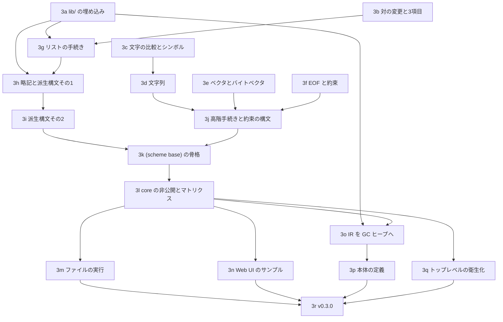

# 0016: 段階3の実装計画 — Scheme による標準ライブラリ

- 対応する決定: [ADR-0006](../adr/0006-library-system-and-scheme-level-stdlib.md), [ADR-0018](../adr/0018-incremental-vertical-slices.md), [ADR-0019](../adr/0019-denotations-and-identifier-resolution.md), [ADR-0026](../adr/0026-verify-facts-about-code-not-prose.md), [ADR-0027](../adr/0027-severity-by-consequence-and-a-cost-side-stop.md), [ADR-0031](../adr/0031-gc-at-machine-step-boundaries.md), [ADR-0034](../adr/0034-release-shape.md), [ADR-0037](../adr/0037-core-library-exposed-in-stage-2.md), [ADR-0038](../adr/0038-wasm-entry-layer-allocations-outside-the-accounting.md)
- 段階: 3(Scheme による標準ライブラリ)。段階の作業項目と完了条件は [roadmap.md](../roadmap.md) の段階3の節が正
- 日付: 2026-10-16
- 状態: 合意済み(2026-10-16)。「合意を求める点」の6点すべてを、勧める案どおりに承認した。7は報告である。スライスの実装は未着手

## 解こうとしている問題

段階2は v0.2.0 で終わった([0014](0014-phase2-core-language.md))。REPL が見える束縛は、特殊形式のほか、Zig が書いたプリミティブだけである。`let` も `cond` も `map` も無い。段階3は、これらを Scheme で書き、`(scheme base)` の骨格を作る。ここで初めて、`lib/` のファイルが実行ファイルに埋め込まれる。

段階3には、段階2から送られた「スライス未割り当て」の項目が多い。計画を書くために、`origin/main`(`b5d2ac9`)の実行ファイルで、`tests/r7rs-required/base.txt` の識別子を1つずつ評価した。結果は次のとおりで、準拠マトリクス(`docs/status/conformance.md`)の数と一致した。

- 束縛済み: `(scheme base)` の必須識別子のうち、特殊形式と、段階1と2のプリミティブだけである。
- 未束縛: 残り(下の「未束縛の識別子の行き先」)。Scheme で書く派生構文と手続きだけでなく、Zig のプリミティブも、まだ多く足りない。`set-car!` `make-vector` `vector-set!` `string-append` `symbol->string` `char=?` などである。段階3は、Scheme のライブラリを書く段階であると同時に、段階1の1k が残したプリミティブを足す段階でもある。

## 完了条件

[roadmap.md](../roadmap.md) の段階3の完了条件が正である。この計画は次のように読む。

- `(scheme base)` の必須識別子のうち、数値塔とポートを要らないものが、`(scheme base)` のエクスポートとして揃う。残りは、準拠マトリクスに未実装として正しく表れる。
- `(import (only (scheme base) cond else))` が通り、`cond` のリテラル `else` の検証項目([frontend.md](../design/frontend.md) の衛生性の検証項目)が通る。
- [runtime.md](../design/runtime.md) の事例のうち、段階2で書けなかったもの(容量0で `(eq? 'abc (string->symbol "abc"))` が成立し続けること、`let` と `when` を使う複数値の事例の元の形)が通る。
- 段階2から送られた項目のすべてに、スライスの割り当てがあるか、受け入れた制約として根拠つきで残されている。
- リリース v0.3.0 を出す。

## 範囲

含めるもの:

- roadmap の段階3の作業項目のすべて(割り当ては下の表)。
- ADR-0006 の族のうち、段階1と2が入れなかった Zig のプリミティブ。対の変更、文字の比較、シンボルの操作、文字列とベクタとバイトベクタの操作、EOF の値、約束。
- `lib/` の埋め込みの仕組み(`build.zig` の走査、仮想ファイルシステム、リゾルバの探索順)。
- 派生構文(`lib/sucheme/derived.scm`)と、リストと文字列とベクタの手続き(Scheme)。
- ライブラリ `(scheme base)` `(scheme case-lambda)` `(scheme cxr)` `(scheme lazy)`。
- ファイルの実行(`sucheme prog.scm`)。
- Web UI のサンプルと共有リンク。

含めないもの(送り先は括弧の中):

- 数値塔を要る手続き(`/` `exact` `inexact` `number->string` `string->number` `floor` など)と `(scheme char)` `(scheme inexact)` `(scheme complex)`(段階4)。
- ポートを引数に取るか返す手続き(`read-char` `write-string` `newline` `open-input-string` など)、`(scheme write)` `(scheme read)` `(scheme file)` `(scheme eval)` `(scheme load)` `(scheme process-context)` `(scheme time)` `(scheme repl)` `(scheme r5rs)`(段階5)。
- 完全な準拠スイートの取り込み(段階6)。

## 未束縛の識別子の行き先

`(scheme base)` の必須識別子のうち、`b5d2ac9` で未束縛のものを、行き先ごとに分ける。数は書かない。数えるときは、`zig build report` の出力か、上の方法で評価する。

| 行き先 | 識別子 |
| --- | --- |
| Zig のプリミティブ(段階3) | `set-car!` `set-cdr!`、`char=?` `char<?` `char>?` `char<=?` `char>=?`、`symbol->string` `string->symbol` `symbol=?`、`make-string` `string` `string-set!` `string-copy` `string-copy!` `string-fill!` `substring` `string-append` `string=?` `string<?` `string>?` `string<=?` `string>=?` `string->list` `list->string` `string->vector` `vector->string`、`make-vector` `vector-set!` `vector->list` `list->vector` `vector-copy` `vector-copy!` `vector-append` `vector-fill!`、`bytevector?` `make-bytevector` `bytevector` `bytevector-length` `bytevector-u8-ref` `bytevector-u8-set!` `bytevector-copy` `bytevector-copy!` `bytevector-append` `utf8->string` `string->utf8`、`eof-object` `eof-object?` |
| Scheme の派生構文(段階3) | `and` `or` `cond` `case` `do` `let` `let*` `letrec` `letrec*` `let-values` `let*-values` `define-values` `define-record-type` `guard` `quasiquote` `when` `unless`(`(scheme base)`)。`case-lambda`(`(scheme case-lambda)`)。`delay` `delay-force` `make-promise` `force`(`(scheme lazy)`)。約束の値は Zig のプリミティブで足す |
| Scheme の手続き(段階3) | `append` `reverse` `list-tail` `list-ref` `list-set!` `list-copy` `make-list` `memq` `memv` `member` `assq` `assv` `assoc` `map` `for-each` `string-map` `string-for-each` `vector-map` `vector-for-each` `caar` `cadr` `cdar` `cddr` `boolean=?`。`(scheme cxr)` の合成アクセサ |
| Scheme の手続き(合意を求める点の2で決める) | `abs` `even?` `odd?` `zero?` `positive?` `negative?` `square` `gcd` `lcm` `floor/` `floor-quotient` `floor-remainder` `truncate/` `truncate-quotient` `truncate-remainder`。2026-10-16 に点2が勧める案どおり承認され、段階3に入ることが決まった。ところが、スライスの表と roadmap の項目に写されず、どのスライスも実装しなかった。2026-10-23 に、3r の下調べで、main の実行ファイルでこの15個だけが未束縛であることが分かり、スライス 3s に割り当てた |
| 段階4 | `/` `exact` `inexact` `exact?` `inexact?` `exact-integer?` `integer?` `rational?` `real?` `complex?` `exact-integer-sqrt` `expt` `max` `min` `floor` `ceiling` `round` `truncate` `numerator` `denominator` `rationalize` `number->string` `string->number` |
| 段階5 | ポートの識別子のすべて。例: `binary-port?` `call-with-port` `char-ready?` `close-port` `current-output-port` `flush-output-port` `get-output-string` `input-port-open?` `newline` `open-input-string` `peek-char` `read-char` `read-line` `write-string` `write-u8`(名前の一覧は `tests/r7rs-required/base.txt` が正。この表には全部を複製しない) |

この分け方は、ADR-0006 の族の一覧と、[roadmap.md](../roadmap.md) の「この段階で未実装として表れてよいのは、後の段階の機能を必要とする識別子」の記述から導いた。`max` と `min` を段階4に置くのは、R7RS 6.2.6 の不正確さの伝播(引数のどれかが不正確なら結果も不正確)が、数値塔を要るためである。原文はこの環境から取得できず、記憶によるので、未確認である。

## roadmap の項目の割り当て

roadmap の段階3の項目と、スライス(下の「スライス」の表)の対応。

| roadmap の項目 | スライス |
| --- | --- |
| リーダに `` ` `` `,` `,@` の略記を追加 | 3h |
| EOF の値、バイトベクタと約束の値 | 3e(バイトベクタ)、3f(EOF、約束) |
| 派生構文を `lib/sucheme/derived.scm` に定義 | 3a(仕組み)、3h、3i |
| リストと文字列とベクタの高階手続きを Scheme で実装 | 3g、3j |
| `(scheme base)` の骨格、`(scheme case-lambda)`、`(scheme cxr)`、`(scheme lazy)` | 3k |
| Web UI にサンプルと共有リンク | 3n |
| 本体の先頭の `begin` `include` `cond-expand` が持つ定義 | 3p |
| パラメータの読み出しの費用 | 合意を求める点の6(スライスを割り当てず、見直しの条件を置く) |
| ライブラリの表と `import` の作業領域の計上 | 3o |
| マクロの展開の有界化の残り | 3o(失敗した展開の節点)、3p(環境の探索の深さ) |
| `let-syntax` と `letrec-syntax` の本体の定義 | 3p |
| REPL で解決した名前ごとに残る未束縛のセル | 3o |
| 準拠マトリクスの入力に `lib/` のエクスポート節を足す | 3l |
| `equal?` の循環と共有構造 | 3b |
| マクロが導入したトップレベルの定義の衛生化 | 3q(合意を求める点の5)。2026-10-22 に段階6へ送った(下の「3q の中身」) |
| ファイルの実行 | 3m |
| シンボル表を弱い表にする | 3c |
| コアIRを GC ヒープに移し `code_roots` を要らなくする | 3o(合意を求める点の4) |
| `(sucheme core)` を利用者から隠す | 3l |
| `apply` の周回をステップの境目を通る形にする | 3b |
| 複数値の確保を個数に比例させない | 3b |

## スライス

各スライスは1つの PR になる。ブランチ名は `feature/phase3-slice-3a-embedded-lib` の形にする。見積りは時間単位で、「ready まで」(最初のコミットから PR を ready にするまで)と「マージまで」(最初のコミットからマージまで)を分ける。根拠と限界は「見積り」の節にある。

| スライス | 完了条件(1行) | 規模 | ready まで | マージまで |
| --- | --- | --- | --- | --- |
| 3a `lib/` の埋め込みと `(sucheme derived)` の種 | `(import (sucheme derived))` のあとで `(when #t 1)` が `1`、`(unless #f 2)` が `2`。ネイティブでも WASM でも通る | 中 | 2〜4 | 3〜6 |
| 3b 対の変更と、変更が入ると要る3項目 | `set-car!` と `set-cdr!` が動く。循環した2つのリストの `equal?` が止まり、共有構造の深い比較が深さに比例する時間で終わる。`apply` の入れ子の周回と `values` の確保が、ステップの境目を通る | 中 | 2〜4 | 3〜6 |
| 3c 文字の比較とシンボル | `(eq? 'abc (string->symbol "abc"))` が、ワークリストの容量0でも成立し続ける。使われないシンボルが回収される | 中 | 2〜4 | 3〜6 |
| 3d 文字列 | `(string-append "ab" "cd")` が `"abcd"`。文字列の比較、変更、変換のプリミティブが [R7RS 6.7](https://standards.scheme.org/corrected-r7rs/r7rs.html) どおりに動く | 中 | 2〜4 | 3〜6 |
| 3e ベクタとバイトベクタ | `(vector-fill! (make-vector 3 0) 7)` が動く。`(bytevector-u8-ref (bytevector 1 2 3) 1)` が `2`。`utf8->string` と `string->utf8` がラウンドトリップする | 中 | 2〜4 | 3〜6 |
| 3f EOF の値と約束 | `(eof-object? (eof-object))` が `#t`。`make-promise` `promise?` と `force` の本体が動く | 小 | 1〜2 | 1.5〜3 |
| 3g リストの手続き | `(append '(1 2) '(3) '())` が `(1 2 3)`。`map` と `for-each` が複数のリストを取り、継続の再入に対して正しい | 中 | 2〜4 | 3〜6 |
| 3h リーダの略記と派生構文その1 | `` `(1 ,(+ 1 1) ,@(list 3 4)) `` が `(1 2 3 4)`。`cond` `case` `and` `or` `let` `let*` `letrec` `letrec*` `do` `when` `unless` が R7RS 4.2 どおりに動く | 大 | 4〜8 | 6〜12 |
| 3i 派生構文その2 | `define-record-type` `let-values` `let*-values` `define-values` `guard` `case-lambda` が動く。`guard` の再送出と `dynamic-wind` の相互作用が通る | 大 | 4〜8 | 6〜12 |
| 3j 文字列とベクタの高階手続きと約束の構文 | `(vector-map (lambda (x) (* x x)) #(1 2 3))` が `#(1 4 9)`。`string-map` `string-for-each` `vector-for-each` が動く。`delay-force` の連鎖が、R7RS 4.2.5 の要求する一定の空間で終わる | 小 | 1〜2 | 1.5〜3 |
| 3k `(scheme base)` の骨格と3つのライブラリ | `(import (scheme base))` で、上の表の「段階3」の識別子が引ける。`(scheme case-lambda)` `(scheme cxr)` `(scheme lazy)` が引ける | 中 | 2〜4 | 3〜6 |
| 3l `(sucheme core)` の非公開、REPL の初期環境、準拠マトリクスの入力 | REPL の初期環境が `(scheme base)` で、`(sucheme core)` の `import` が利用者のコードから拒否される。`(import (only (scheme base) cond else))` が通る。準拠マトリクスが `lib/` のエクスポートを数える | 中 | 2〜4 | 3〜6 |
| 3m ファイルの実行 | `sucheme prog.scm` が `import` で始まるプログラムを実行し、終了ステータスが [main.zig](../../src/main.zig) の表どおり | 小 | 1〜2 | 1.5〜3 |
| 3n Web UI のサンプルと共有リンク | サンプルを選んで実行できる。URL のフラグメントに入れたソースが、開いたときに復元される | 中 | 2〜4 | 3〜6 |
| 3o コアIRと構文環境を GC ヒープへ | `Context.code_roots` が無い。ライブラリの表と未束縛のセルと失敗した展開の節点が、上限に計上されるか回収される | 大 | 4〜8 | 6〜12 |
| 3p 本体の定義と `let-syntax` の本体 | `(lambda () (begin (define x 1)) x)` と `(lambda () (cond-expand (r7rs (define x 1))) x)` が動く。`let-syntax` の本体に `define` が置ける。入れ子の `lambda` を重ねる止まらないマクロが、有界で終わる | 中 | 2〜4 | 3〜6 |
| 3q マクロが導入したトップレベルの定義の衛生化 | マクロが導入したトップレベルの `define` が、利用側の同じ綴りのトップレベルの変数を書き換えない | 中 | 2〜4 | 3〜6 |
| 3r リリース v0.3.0 と段階の完了 | v0.3.0 が公開され、段階3の完了の手続きが済む | 小 | 1〜2 | 1.5〜3 |
| 3s 整数の手続き | `(floor/ -5 2)` が 2つの値 `-3` と `1` を返す。合意を求める点の2の15個が `(scheme base)` からエクスポートされる | 小 | 1〜2 | 1.5〜3 |

### 3a の中身

- `build.zig` が `lib/` を走査し、`@embedFile` の索引を生成する。パス名でソートし、再現できるビルドにする([frontend.md](../design/frontend.md) の埋め込みの節)。索引は2つある。パスの索引と、`define-library` の名前の索引である。
- `src/resolve.zig` の探索順を、埋め込みを先、実ファイルシステムを後にする。WASM は埋め込みだけを引く。
- 最初の `lib/` のファイルは `lib/sucheme/derived.sld` と `lib/sucheme/derived.scm` で、`when` と `unless` だけを定義する。ほかの派生構文は、3h と 3i が足す。
- 埋め込みの内容を、ビルド時に検証する([platform-and-web.md](../design/platform-and-web.md) の入力の検証の表)。不正ならビルドを失敗させる。

### 3b の中身

3つの項目は、`set-car!` のような変更が入る最初のスライスまでに要ると、roadmap と [ADR-0031](../adr/0031-gc-at-machine-step-boundaries.md) が定めている。変更が入ると、自分を指す引数のリストと循環したデータが作れる。

- `equal?` の訪問済みの集合の実装(ハッシュ表か union-find)は、このスライスで、対の数を変えた実測で決める([open-questions.md](../design/open-questions.md) の「段階3までに決める」の行)。決めたら、その行を消し、決めた内容を `src/prim/equiv.zig` の doc コメントに書く。
- `apply` の周回と複数値の確保は、ADR-0031 の追記が示す直し方で、1ステップの中で個数に比例する量を確保しない形にする。

### 3c の中身

- シンボル表を、[runtime.md](../design/runtime.md) のシンボルの節の設計どおり、弱い表にする。設計は決まっているので、このスライスは設計を足さない。
- 事例「容量0で `string->symbol` が成立し続ける」を、`tests/scheme/` に入れる。

### 3d、3e、3f の中身

- 新しいヒープの型(バイトベクタ、約束、EOF の値)は、`src/value.zig` の `heap_types` と `Kind`、`src/trace.zig` の分類、`src/printer.zig` に、走査の検査とともに足す。
- 入力の大きさに比例して確保するプリミティブ(`make-string` `make-vector` `make-bytevector` `string-append` `vector-append` など)は、確保を GC の計上に通し、上限を超えたときに `heap limit exceeded` の条件を作ることを、縮小版の単体テストと、規模を試すテスト(`tier.slow()` か `tests/scheme-slow/`)で確かめる。段階2で、入力に比例する確保の計上漏れが、後のスライスのレビューで見つかった([0012](0012-schedule-estimates-and-actuals.md))。この点検を、各スライスの設計の時点で行う。

- リテラルの不変性の基盤は、3d の範囲である。2026-10-16 に、3d が基盤を入れ、3e がベクタとバイトベクタに適用する案を選んだ。3d が入れるもの: ヘッダの不変の印(`heap.isImmutable` と `heap.makeImmutable`)、リテラルを定数にする1か所(`Expander.constant`)での印の付与(`freeze.freezeGraph`)、`symbol->string` の印、共通の検査(`prim/immutable.zig` の `requireMutable`)、検査の適用先のうち、ペアと文字列の手続き。3e は、`vector-set!` `vector-fill!` `vector-copy!` `bytevector-u8-set!` `bytevector-copy!` から `requireMutable` を呼び、バイトベクタの型を `heap.isImmutable` と `heap.makeImmutable` と `freezeGraph` に足す(ベクタの印は、`freezeGraph` がすでに立てる)。誤りの文言は `cannot modify a constant in <手続き名>` で、引数が irritant になる。検査の順序は、型、不変、範囲の順で、範囲が空でも断る。
- 3d の `string->vector` と `vector->string` は、ベクタの型が既にあるので、3e を待たずに `src/prim/string.zig` へ足した。3e は、ベクタの手続きだけを足す。
- ベクタを一定の長さで作る確保は、`Heap.createVectorFilled`(要素の領域へ直接書く。3d が `string->vector` のために足した)を、`make-vector` が使える。文字列の `Heap.createStringFilled` と同じ形である。

### 3g から 3j の中身

- 手続きは `lib/sucheme/procedures.scm`(まとめて1ファイル)に、派生構文は `lib/sucheme/derived.scm` に書く。名前の決め方は、小さく戻せる選択なので、PR に書くだけにする。
- `map` と `for-each` は、末尾呼び出しと継続の再入が自動的に正しくなるように、Scheme で書く([ADR-0006](../adr/0006-library-system-and-scheme-level-stdlib.md))。
- `quasiquote` は `syntax-rules` で書く(ADR-0006 の Zig の族に無い)。入れ子の準引用、ベクタの準引用、`unquote` のリテラルの照合が、実際の `syntax-rules` の展開器で通るかが、このスライスの最大の不確定である。通らないときは、展開器の変更が要るかを、ユーザーに諮る。
- `define-record-type` は、段階2の2h が入れたプリミティブ(`%make-record-type` など)に展開する。

### 3k と 3l の中身

- `lib/scheme/base.sld` は、`(sucheme core)` と `(sucheme derived)` と `(sucheme procedures)` から、`(scheme base)` の必須識別子のうち存在するものだけを再エクスポートする。存在しないものは、エクスポートしない(準拠マトリクスが未実装として表す)。
- `(scheme base)` に独自の識別子を入れない(R7RS 5.6.1)。`%` で始まる内部用の名前は、`(sucheme core)` に残し、`(scheme base)` には入れない。
- 3l で、`(sucheme core)` を、`lib/` に埋め込んだ標準ライブラリだけが `import` できるものにする([ADR-0037](../adr/0037-core-library-exposed-in-stage-2.md) の将来の見直し条件)。段階2のテストのうち `(import (sucheme core))` を含むものを、`(scheme base)` を使う形に書き換える。`(scheme base)` に無い名前(2h の `%` で始まる名前)を呼ぶテストは、単体テストか `lib/` の側へ移す。v0.3.0 のリリースノートに、この取り消しを書く(3r)。
- 3l で、準拠マトリクスの入力に、`lib/` のエクスポート節を足す。段階1の最小版の「インタプリタが束縛しているか」の数え方との差が出るので、`docs/design/r7rs-coverage.md` の記述と合わせて直す。

### 3o の中身

最も大きく、最も危険なスライスである。

- 構文環境と展開の節点を GC ヒープに移し、`Context.code_roots` を要らなくする([ADR-0031](../adr/0031-gc-at-machine-step-boundaries.md))。
- ライブラリごとのトップレベルの環境の表を、ヒープの上限に計上するか、インポートごとの複製をやめて表を共有する形にする。どちらにするかは、設計の判断を要するので、着手前にユーザーに諮る。
- REPL で解決した未知の名前ごとの未束縛のセルを、回収するか、数の上限を置く。
- 失敗した展開の節点が行をまたいで残る問題は、節点が GC ヒープに移ると外れる。

### 3p の中身

- 本体の先頭の `begin`、`include`、`cond-expand` が持つ定義を、定義の並びとして展開する。`let-syntax` と `letrec-syntax` の本体に `define` と `define-syntax` を置けるようにする([frontend.md](../design/frontend.md))。
- 環境の探索を深さに依存しない形にするか、展開の深さの上限を置く。入れ子の `lambda` を重ねる止まらないマクロが、時間で終わらない問題への対応である。

2026-10-22 に、3点を決めた。

- 3p を2つの PR に分ける。3p-1 は本体の定義(上の1つ目の項目)、3p-2 は有界化(2つ目の項目)である。どちらも `src/syntax/expand.zig` を触るので、逐次に進める。見積りは、3p-1 が ready まで 2〜4 時間、マージまで 3〜6 時間、3p-2 が ready まで 1〜2 時間、マージまで 1.5〜3 時間である。
- `let-syntax` の本体は、自分の有効範囲を持つ。定義は本体の局所変数で、外側の並びに繋ぎ込まない。R7RS 4.3.1 の原文は、キーワードの領域を本体とし、繋ぎ込みを書いていない。
- 有界化は、展開時の rib の深さ(`lambda` の入れ子の数)に上限を置く。環境の探索を深さに依存しない形にする案は、新しい機構になるので採らない。

### 3q の中身

- 設計から始める。名前が別名(`Alias`)のままのトップレベルの定義を、REPL の表にどう持つかを決め、[frontend.md](../design/frontend.md) の解決規則の節と [ADR-0019](../adr/0019-denotations-and-identifier-resolution.md) に、決めた内容を日付つきの追記で足す。実装はそのあとである。設計が ADR-0019 の決定を変えるなら、新しい ADR を書く。

2026-10-22 に、3q を段階6へ送ることが決まった。下の「範囲を狭める線」の3つ目に当たったためである。

- 設計の下調べで分かったこと: 今の解決(`src/syntax/env.zig` の `resolveAt`)は、構文環境に束縛が無ければ別名を剥がし、最後にトップレベルの表をシンボルの名前で引く。衛生的にするには、別名を剥がす前に、トップレベルの表を別名そのもので引く段を足すことになる。これは ADR-0019 の解決規則を変える。
- 仕様: R7RS 4.3 は「Note that a global variable definition may or may not introduce a binding; see section 5.3.」と書き、トップレベルの定義が束縛を導入するかを実装に委ねている(docs/spec の原文で確かめた)。
- 扱い: v0.3.0 に既知の制限として入れ、3r がリリースノートに書く。ADR は書かない(解決規則を変えないため)。段階6の準拠検証で必要になったときに、新しい ADR とともに直す。

## 依存と実施順

### 並行できるものと、できないもの

系列は3つある。Zig のプリミティブの系列(3b から 3f)、Scheme のライブラリの系列(3a、3g、3h、3i、3j、3k、3l)、実行時と展開器の系列(3o、3p、3q)である。

- 並行できる: プリミティブの系列の 3c から 3f(ファイルは別で、`src/value.zig`、`src/prim/table.zig` に1行ずつ足すだけである)。3a と 3b。3m と 3n(3l のあと)。
- 並行できない: 3g、3h、3i の順(`lib/sucheme/derived.scm` と `procedures.scm` を伸ばす)。3o と 3p(`src/syntax/expand.zig` を大きく変える)。3p と 3q。3o は、実行時の他の系列より後に置く。構文環境と節点の置き場所が変わるので、他の系列の PR とぶつかる。

### 重なりの確認

- `src/value.zig`、`src/trace.zig`、`src/printer.zig`: 3d、3e、3f が、新しいバリアントを、それぞれ末尾に1行ずつ足す。隣り合う行のコンフリクトは機械的に解ける。
- `src/prim/table.zig`: 3b から 3f が、族の行を1行ずつ足す。
- `src/prim/char.zig`、`string.zig`、`vector.zig`、`symbol.zig`: それぞれ 3c、3d、3e が触る。3c の中でも、文字の比較は `char.zig`、シンボルは `symbol.zig` で、ファイルが分かれる。
- `docs/status/conformance.md`: 束縛を増やすスライスが、`zig build report` で生成し直す。並行した PR が両方とも生成し直したときは、後からマージするほうが main を取り込んでから生成し直す。手で合わせない。
- `src/heap.zig`、`src/prim/immutable.zig`(新規)、`src/freeze.zig`(新規): 3d が不変の印と検査の関数を足し、3e が使う。3e は、`heap.isImmutable` と `heap.makeImmutable` の `switch` にバイトベクタの行を足す。
- `tests/scheme/` の番号: 段階2は 0190 まで使った。3a は 0200 から 0209、3b は 0210 から、のように、スライスの並び順に 10 ずつ進める。
- `lib/sucheme/derived.scm` と `lib/sucheme/procedures.scm`: 3g、3h、3i、3j が追記する。逐次に進めるのでコンフリクトしない。
- `src/syntax/expand.zig`: 3h(略記は `src/reader.zig`)、3o、3p、3q が触る。3o と 3p と 3q は逐次に進める。
- 進捗の表と roadmap: 各スライスの PR が、この計画書の「進捗」の表の自分の行と、自分が完了させる roadmap の段階3のチェックボックスを、その PR の中で更新する([AGENTS.md](../../AGENTS.md))。

## 検証項目の割り当て

- 衛生性の検証項目: 段階3で通すのは、`cond` のリテラル `else` の項目(3l の `(import (only (scheme base) cond else))`)である。
- runtime.md の事例: 容量0の `string->symbol` は 3c、`let` と `when` を使う複数値の事例の元の形は 3h のあとの 3i(`let-values` が入る)で通す。
- R7RS 4.2 と 6.4、6.6 から 6.9 の各識別子: 各スライスが、`tests/scheme/` に、R7RS の例から起こしたケースを入れる。仕様の例は、[docs/spec/](../spec/README.md) の原文から起こす。原文で確かめていない例は、PR 本文に「未確認」と書く。
- 規模を試すテスト: 入力に比例して確保するプリミティブ、`map` と `for-each` の長いリスト、`equal?` の共有構造、`apply` の周回に、縮小版を層1 に、規模を試す版を層2 に置く。

## 合意を求める点

勧める案を先に書く。勧める案でよいときは、そう返信する。小さく戻せる選択(ファイルの構成、名前、テストの足し方)は、[AGENTS.md](../../AGENTS.md) の規則どおり、ここでは諮らず、PR に書く。

1. 範囲と、段階4と5への送り方。
   - 勧める案: 「未束縛の識別子の行き先」の表のとおり。数値塔を要るもの(`max` `min` `floor` `number->string` など)は段階4、ポートに関するものは段階5に置く。準拠マトリクスが、未実装として表す。
   - 別案: `max` `min` や整数の `floor` などを、固定長整数だけで段階3に入れる。段階4で数値塔に合わせて書き直す手間が出る。
2. 整数の除算と符号の手続き(`abs` `even?` `odd?` `zero?` `positive?` `negative?` `square` `gcd` `lcm` `floor/` と `truncate/` の4種)を、段階3の Scheme の手続きとして入れるか。
   - 勧める案: 入れる。`quotient` `remainder` `modulo` と比較だけで書け、段階4で数値塔が入っても定義が変わらない。段階4のレビューで、不正確な数の扱いを足す。着手するときに、定義が変わらないことを確かめる(原文を取得できないので、未確認)。
   - 別案: 段階4に送る。段階3の `(scheme base)` が、これらを欠いた状態で v0.3.0 になる。
3. `(sucheme core)` を隠す時期。
   - 勧める案: 3l で隠す。ADR-0037 が定めた将来の見直し条件に合う。v0.3.0 のリリースノートに書く(3r)。
   - 別案: 段階の最後(3r の直前)まで公開のままにする。テストの書き換えが後ろに寄るが、段階3の途中の PR が `(sucheme core)` を使い続けられる。
4. 3o(コアIRと構文環境を GC ヒープへ)を段階3に入れるか。
   - 勧める案: 入れる。ただし最後の大きなスライスとして置き、下の「範囲を狭める線」を引く。ライブラリの表、未束縛のセル、失敗した展開の節点という、上限の外の確保を、まとめて直せる。3o は、[ADR-0031](../adr/0031-gc-at-machine-step-boundaries.md) が前提にしている変更でもある。
   - 別案: 段階4の最初に送る。段階3の完了条件には要らない。v0.3.0 に、上限の外の確保が残る。
5. 3q(マクロが導入したトップレベルの定義の衛生化)を段階3に入れるか。
   - 勧める案: 入れる。ただし、設計から始め、ADR-0019 との関係が変わるなら、新しい ADR を書いてユーザーに諮る。`derived.scm` がトップレベルの定義を持たないので、v0.3.0 の標準ライブラリには影響しないが、利用者のマクロの正しさに関わる。
   - 別案: 既知の制限として v0.3.0 に残し、段階6の準拠検証で必要になったときに直す。
6. パラメータの読み出しの費用(動的点の列の長さに比例する)。
   - 勧める案: スライスを割り当てない。受け入れた制約として残し、見直しの条件(実際のプログラムで読み出しが支配的になったとき)を roadmap の項目に書く。AGENTS.md の「スライス未割り当てなら割り当てる計画を立てる」は、この条件つきの保留で満たす。
   - 別案: 3o の後に小さなスライスを足し、パラメータごとの束縛の索引を持つ。新しい機構になる。
7. 見積りの単位を時間にし、「ready まで」と「マージまで」を分けること。これは、2026-10-15 に決まった進め方である([handoff.md](../handoff.md))。この計画の表は、その形で書いた。確認の対象ではなく、報告である。

## 検証

各スライスの PR を ready にする前に、[AGENTS.md](../../AGENTS.md) の検証コマンド表の「全コミット」の行をすべて通す。段階3で足す検証は次のとおりである。

- 3a: `zig build test-wasm` に、埋め込みのライブラリを WASM で `import` するラウンドトリップを足す。
- 3a から 3j: `zig build test-scheme` の `tests/scheme/` に、スライスごとのケースを足す。入力に比例して確保するものには、規模を試すケースを `tests/scheme-slow/` に足す。
- 3l: `zig build report` と `zig build check-report` が、`lib/` のエクスポートから生成される表を検査する。

敵対的レビューは、[AGENTS.md](../../AGENTS.md) の新しい規則に従う。コードの変更には、ミューテーション(テストの強さ)の担当1本を基本にし、3h、3i、3o のように大きいか、入力に比例する確保を入れたスライスには、挙動を広く試す担当を足す。文書だけの変更(この計画書を含む)には、サブエージェントのレビューを走らせない。

## ファイル

追加または変更する主なファイル。

| ファイル | 変更 | スライス |
| --- | --- | --- |
| `build.zig` | `lib/` を走査し、`@embedFile` の索引を生成する | 3a |
| `src/resolve.zig` | 探索順に埋め込みを加える | 3a |
| `lib/sucheme/derived.sld`、`derived.scm` | 派生構文 | 3a、3h、3i、3j |
| `lib/sucheme/procedures.sld`、`procedures.scm` | リストと文字列とベクタの手続き | 3g、3j |
| `lib/scheme/base.sld`、`case-lambda.sld`、`cxr.sld`、`lazy.sld` | 標準ライブラリ | 3k |
| `src/prim/pair.zig` | `set-car!` `set-cdr!` | 3b |
| `src/prim/equiv.zig` | 訪問済みの集合 | 3b |
| `src/machine.zig` | `apply` と複数値のステップ境界 | 3b |
| `src/prim/char.zig`、`symbol.zig`、`string.zig`、`vector.zig`、`bytevector.zig`(新規)、`eof.zig`(新規)、`promise.zig`(新規) | プリミティブ | 3c から 3f |
| `src/symbol.zig`、`src/heap.zig` | 弱いシンボル表 | 3c |
| `src/reader.zig` | `` ` `` `,` `,@` の略記 | 3h |
| `src/syntax/library.zig`、`src/sucheme.zig` | `(sucheme core)` の非公開、REPL の初期環境 | 3l |
| `tools/coverage-report/main.zig` | `lib/` のエクスポートを入力に足す | 3l |
| `src/main.zig` | ファイルの実行 | 3m |
| `web/` | サンプルと共有リンク | 3n |
| `src/syntax/expand.zig`、`src/syntax/env.zig`、`src/context.zig`、`src/core.zig` | IR と環境を GC ヒープへ。本体の定義。衛生化 | 3o、3p、3q |

## 確かめた事実と、確かめられなかったこと

確かめた事実(`origin/main` の `b5d2ac9` で、この環境から実行した)。

- `tests/r7rs-required/base.txt` の識別子を、`zig build` で作った実行ファイルに1つずつ評価させ、未束縛と束縛済みに分けた。結果の数は、`docs/status/conformance.md` の `(scheme base)` の行と一致した。
- `lib/` はまだ無い。`src/resolve.zig` の冒頭のコメントが「埋め込みの仮想ファイルシステムは、段階3が足す」と書いている。
- `src/prim/table.zig` が、族ごとの配列を1行ずつ足す形になっている。
- 段階2の実績のうち、最後の数スライスの着手(最初のコミット)からマージまでの時間は、76 分から 118 分だった。ほかのスライスは、ブランチ名が違うため、この方法では取れなかった。

確かめられなかったこと。

- R7RS の原文は、[docs/spec/](../spec/README.md) にある(2026-10-16 に置かれた)。`max` と `min` の不正確さの伝播、整数の手続きの定義、`delay-force` の末尾での反復は、この計画書を書いた時点では記憶による(`case` の定義が `memv` を使うことは、3h で原文の 7.3 と照らして確かめた)。該当するスライスの着手時に、原文で確かめる。
- `quasiquote` を、現在の `syntax-rules` の展開器で書けるか。入れ子の準引用とベクタの準引用が通るかは、書いてみないと分からない。3h の設計で最初に試す。(3h で試し、書けた。入れ子もベクタも通る。ベクタは `list->vector` が無いので `(apply vector リスト)` で作る。)
- 起動時に、埋め込んだ Scheme を展開する時間と、WASM のサイズへの影響。ADR-0006 が受け入れたトレードオフである。3k で測った(2026-10-18、`ReleaseSafe` の実行ファイル、5回の実行の範囲、1回の入力ごとにプロセスを起こす):

  | 入力 | 時間 |
  | --- | --- |
  | 空の入力 | 4〜5 ms |
  | `1` | 4〜5 ms |
  | `(import (sucheme derived) (sucheme procedures))` | 7〜8 ms |
  | `(import (scheme base))` | 7〜10 ms |
  | `(import (scheme base) (scheme cxr) (scheme lazy) (scheme case-lambda))` | 8〜11 ms |

  `(import ...)` を使わない起動に、`lib/` の展開の費用は載らない(展開は、そのライブラリを最初に `import` するときに行う)。`import` する場合の追加は、数 ms の桁である。`zig build wasm` の `sucheme.wasm` は 2,693,379 バイトで、`lib/` の `.sld` と `.scm` の合計は 39,377 バイトである。3k が足した `lib/scheme/` は 4,559 バイトで、3k の前後での `sucheme.wasm` の差は測っていない。実機のブラウザでの起動の時間も測っていない。測定の方法は、この表の入力を `printf` で標準入力に渡して `date +%s%N` の差を取ったものである。

  3l で、初期化が `(scheme base)` を読み込むようにした(測定は 2026-10-19、同じ方法と同じ環境)。空の入力でも、`import` を含む入力と同じ費用がかかる。空の入力は 5 ms 前後で、シェルがプロセスを起こすだけの 2〜3 ms を引くと、読み込みは 3 ms 前後である。`zig build test-scheme` は、ケースごとに新しいインタプリタを2つのモードで作るので、この費用が件数に比例して載る。main(3k まで)で 127 秒、3l で 133 秒から 175 秒だった(同じ環境で、main は1回、3l は3回。環境の負荷でぶれ、ケース数も 3l のほうが多い)。「全コミットで 1 分以内」の目標は 3k までの時点で超えており([plans/0007-test-tiers.md](0007-test-tiers.md))、3l の費用は、読み込んだ標準ライブラリの共有(roadmap のスライス 3o の候補)で減らせる。単体テストは `initCore` 系の入口を使うので、増えない。
- 3o の大きさ。構文環境と節点を GC ヒープに移す変更が、`src/syntax/` と `src/machine.zig` のどこまで及ぶかは、読んだだけでは見積れない。

## 見積り

表の時間は、概算で、約束ではない。

- 根拠: 段階2の最後の数スライス(小さいもの)の、着手からマージまでが 76 分から 118 分だった。これを「小」の下限と上限に当てた。「中」は小の約2倍、「大」は小の約4倍と仮定した。この倍率には、測った根拠が無い(推測)。大きいスライス(2e、2k、2n など)は、ブランチ名が違うため、時間を取れていない。
- 「ready まで」と「マージまで」の差は、レビューと層2とユーザーの待ちを含む。段階2では、ユーザーの判断やマージを待つ時間が、遅れの主因の1つだった([0012](0012-schedule-estimates-and-actuals.md))。
- 3つの系列を並行に進めた場合の暦日は、[0012](0012-schedule-estimates-and-actuals.md) の補正後の見積り(2〜3日)を使う。この計画の表を足して並行の度合いで割った値とは、別の根拠である。2つが大きく違えば、差の理由を記録する。
- 段階が終わったら、スライスごとの実績(着手、ready、マージの時刻)を、`git log` と PR の時刻から取り、0012 に日付の形で足す。

## 範囲を狭める線

次の兆候が出たら、巡を足す前に、範囲を狭めるかをユーザーに諮る(AGENTS.md の「終わらなさそうなら」の規則)。

- 3o が、「大」の見積りの上限を超えても、ready にならない。または、レビューの巡ごとに必須の指摘が減らない。このとき、3o を段階4の最初に送り、v0.3.0 には、上限の外の確保を既知の制限として入れる。
- 3h で、`quasiquote` を `syntax-rules` で書けないと分かる。このとき、展開器の変更か、Zig の特殊形式として足すかを、ADR-0006 の族の一覧との関係を示して諮る。
- 3q の設計が、ADR-0019 の決定を変える。このとき、3q を段階6に送り、既知の制限として v0.3.0 に入れる。

## 進捗

| スライス | 状態 | PR |
| --- | --- | --- |
| 3a | 実装済み。埋め込み、`(sucheme derived)` の `when` と `unless`、ネイティブと WASM のテストは済み。ライブラリ名の索引は、名前が要るライブラリが現れるまで足さない。マージ済み | [#108](https://github.com/suchi/sucheme-zig/pull/108) |
| 3b | マージ済み | [#110](https://github.com/suchi/sucheme-zig/pull/110) |
| 3c | マージ済み。弱いシンボル表(`Heap` が表を持ち、名前の長さに比例する量を計上する)、`char=?` `char<?` `char>?` `char<=?` `char>=?`、`symbol=?` `symbol->string` `string->symbol`。ルートの所有者と計上の範囲は [runtime.md](../design/runtime.md) のインターン表の節に書いた。`symbol->string` の不変の印は 3d が足す | [#112](https://github.com/suchi/sucheme-zig/pull/112) |
| 3g | マージ済み。`(sucheme procedures)` に、リストの手続きと `boolean=?` と `caar` `cadr` `cdar` `cddr` がある。`map` と `for-each` は複数のリストを取り、継続の再入に対して正しい | [#111](https://github.com/suchi/sucheme-zig/pull/111) |
| 3h | マージ済み。リーダの `` ` `` `,` `,@` と、`(sucheme derived)` の `cond` `case` `and` `or` `let`(名前つきを含む)`let*` `letrec` `letrec*` `do` `quasiquote` がある。`quasiquote` は `syntax-rules` で書けた(展開器と特殊形式は変えていない)。`(sucheme derived)` は `case` と `quasiquote` のために `(sucheme procedures)` を取り込む | [#115](https://github.com/suchi/sucheme-zig/pull/115) |
| 3f | マージ済み。EOF の値(`Value` の即値)、約束(ヒープの型 `Promise`)、`eof-object` `eof-object?` `make-promise` `promise?` `force`、内部用の `%make-promise`。設計は [runtime.md](../design/runtime.md) の「EOF の値と約束」に書いた。`delay` と `delay-force` の構文は 3j が足す | [#116](https://github.com/suchi/sucheme-zig/pull/116) |
| 3d | マージ済み。文字列のプリミティブ(`make-string` `string` `string-set!` `string-copy` `string-copy!` `string-fill!` `substring` `string-append` `string=?` などの比較5個、`string->list` `list->string` `string->vector` `vector->string`)。リテラルの不変性の基盤: ヘッダの不変の印、リテラルと `symbol->string` への印、共通の検査 `requireMutable`、`set-car!` `set-cdr!` `string-set!` `string-fill!` `string-copy!`(と `list-set!`)への適用 | [#117](https://github.com/suchi/sucheme-zig/pull/117) |
| 3i | マージ済み。`(sucheme derived)` に `define-record-type` `let-values` `let*-values` `define-values` `guard` `case-lambda` がある。どれも `syntax-rules` で書いた(特殊形式とプリミティブは足していない)。`define-record-type` は、2h の `%` で始まるプリミティブを呼ぶ補助手続きに展開する。マクロの適用が複数の定義になる `define-record-type` と `define-values` を本体で使うため、本体の先頭の `begin` の展開(3p の項目の一部)を `scanBody` に入れた。3p に残るのは `include` と `cond-expand` が持つ定義である。設計と測定は [frontend.md](../design/frontend.md) の「現状(スライス 3i)」に書いた | [#118](https://github.com/suchi/sucheme-zig/pull/118) |
| 3e | マージ済み。ヒープの型 `Bytevector`(`#u8(...)` のリーダと印字)、バイトベクタの手続きと `utf8->string` `string->utf8`、ベクタの `make-vector` `vector-set!` `vector-fill!` `vector-copy` `vector-copy!` `vector-append` `vector->list` `list->vector`。ベクタとバイトベクタの書き込みが `requireMutable` を呼ぶ | [#119](https://github.com/suchi/sucheme-zig/pull/119) |
| 3j | マージ済み。`vector-map` `vector-for-each` `string-map` `string-for-each`(`procedures.scm`)と `delay` `delay-force`(`derived.scm`)。`delay-force` は `%make-promise` に展開する | [#121](https://github.com/suchi/sucheme-zig/pull/121) |
| 3k | マージ済み。`lib/scheme/` に `base.sld` `case-lambda.sld` `cxr.sld` `lazy.sld`。`(scheme base)` は実装のある必須識別子だけをエクスポートする。起動時の展開時間と WASM のサイズは、下の「確かめられなかったこと」の該当の行に測定を書いた | [#122](https://github.com/suchi/sucheme-zig/pull/122) |
| 3l | マージ済み([#125](https://github.com/suchi/sucheme-zig/pull/125))。`(sucheme core)` の `import` を、埋め込みの標準ライブラリだけに限った。トップレベルの初期環境は `(scheme base)` で、初期化が読み込む。読み込みはヒープの上限に計上する([ADR-0039](../adr/0039-standard-environment-installed-at-init.md))。準拠マトリクスの入力を `lib/` の輸出に替えた。`!` で終わる束縛済みの手続きが定数への書き込みを断ることを、テストのランナーが検査する | - |
| 3m | マージ済み([#126](https://github.com/suchi/sucheme-zig/pull/126))。`sucheme [-I <dir>]... <file>` がプログラムを実行する。式の値は出さず、実行時エラーは 1、読めないファイルは 66、ファイルの後ろの引数は 64。仕様の3点は、2026-10-19 に承認した。`main` の配線(引数から終了ステータスまで)は単体テストの外で、手で確かめた | - |
| 3n | マージ済み([#127](https://github.com/suchi/sucheme-zig/pull/127))。`web/samples.mjs` に6個のサンプル、`web/share.mjs` に共有リンク(`#code=<base64url>`)。リンクを開いても自動では実行しない。サンプルの評価と符号化の検査は `tools/test-wasm`。画面の操作はブラウザで手で確かめた。仕様の4点は、2026-10-19 に承認した | - |
| 3s | マージ済み([#178](https://github.com/suchi/sucheme-zig/pull/178))。`(sucheme procedures)` に、整数の手続き `abs` `even?` `odd?` `zero?` `positive?` `negative?` `square` `gcd` `lcm` `floor/` `floor-quotient` `floor-remainder` `truncate/` `truncate-quotient` `truncate-remainder` を Scheme で書き、`(scheme base)` からエクスポートする。割り当ての経緯は「未束縛の識別子の行き先」の表の注。`floor-quotient` と `gcd` は、結果が固定長の整数に収まるときに途中の値があふれない形で書いた | - |
| 3o | マージ済み(2026-10-21)。5つの PR に分けた(計画書 [0023](0023-slice-3o-ir-to-gc-heap.md))。コアIRの節点は GC ヒープにあり、`Context.code_roots` は無い。トップレベルの表とライブラリのレジストリは常に上限に数える。失敗した展開の節点、到達できなくなったコードの定数、定義に失敗したライブラリの表、コードが指さない未束縛のセルは、回収されるか手放される([ADR-0040](../adr/0040-core-ir-in-the-gc-heap.md)、[ADR-0042](../adr/0042-keep-replaced-cells-without-a-value.md)、[ADR-0043](../adr/0043-loading-library-holds-unbound-cells-strongly.md))。見積りと実績は [0012](0012-schedule-estimates-and-actuals.md) の「3o の内訳」 | [#130](https://github.com/suchi/sucheme-zig/pull/130)、[#139](https://github.com/suchi/sucheme-zig/pull/139)、[#140](https://github.com/suchi/sucheme-zig/pull/140)、[#150](https://github.com/suchi/sucheme-zig/pull/150)、[#159](https://github.com/suchi/sucheme-zig/pull/159)、[#161](https://github.com/suchi/sucheme-zig/pull/161) |
| 3p-1 | マージ済み([#167](https://github.com/suchi/sucheme-zig/pull/167))。本体の先頭の `include` と `cond-expand` が持つ定義を、定義の並びとして展開する。`let-syntax` と `letrec-syntax` の本体に定義を置ける(本体は自分の有効範囲を持つ)。設計は [frontend.md](../design/frontend.md) の展開器の節と「現状(スライス 3p-1)」 | - |
| 3p-2 | マージ済み([#171](https://github.com/suchi/sucheme-zig/pull/171))。展開器が作る構文環境の入れ子の深さ(環境の鎖の長さ。`lambda` の rib と、rib を持たない `let-syntax` の環境の両方を数える)に上限(`src/syntax/expand.zig` の `max_depth`、10000)を置き、超えたら実装制限の誤りにする。入れ子の `lambda` や `let-syntax` を重ねる止まらないマクロが、ReleaseSafe で約1秒で終わる(上限に届くまでの時間は深さの2乗で伸び、1000 では 0.02 秒だった)。最初は rib の深さで数えたが、レビューで、`let-syntax` を重ねる形が止まらないことが分かり、鎖の長さに替えた。値は、`let*` の束縛の数(入れ子の `lambda` の数になる)について [frontend.md](../design/frontend.md) が通ると書いている 1500 を下回らないように選んだ | - |
| 3q | 段階6へ送った(suchi/sucheme-zig#173) | - |
| 3r | 3つの PR に分ける(2026-10-23 に承認した)。3r-1 はリリースの準備(版を 0.3.0 にし、リリースノートを書き、roadmap の段階3と open-questions を整理する)、3r-2 は開発版に戻す、3r-3 は振り返りと handoff.md の更新である。タグ v0.3.0 の push は、3r-1 のマージの後に、ユーザーの確認を取ってから行う。3r-1 はマージ済み(2026-10-24 00:27 JST、マージコミット `b73aaa1`)。タグ v0.3.0 は、2026-10-24 00:46 JST に、`b73aaa1` に打たれた(main の先頭には段階4のスライス 4f と 6i-4 が続けて入っていたので、先頭には打っていない)。3r-2 は PR 作成済みで、版を 0.4.0-dev に戻し、`current_stage` を 4 に上げる | [#177](https://github.com/suchi/sucheme-zig/pull/177)、この PR(3r-2) |

## 次にやること

1. 3a、3b、3c、3d、3e、3f、3g、3h、3i、3j はマージ済み。`(sucheme derived)` が `(sucheme procedures)` を取り込む向きなので、`procedures.scm` は派生構文を使わずに書く。
2. 3k と 3l はマージ済み。`!` で終わる手続きの検査と `(sucheme core)` を隠す変更は、2026-10-19 に、3l に入れる案を選んだ。
3. 3m、3n、3o はマージ済み。
4. 合意の反映は済んだ(roadmap の段階3の項目にスライスの割り当てを書いた)。
5. 3p-1、3p-2、3s、3r-1 はマージ済みで、タグ v0.3.0 を打った。3q は段階6へ送った。3r-2 を収束させ、3r-3(振り返りと handoff.md の更新、計画書 0012 の段階3の実績)に進む。
