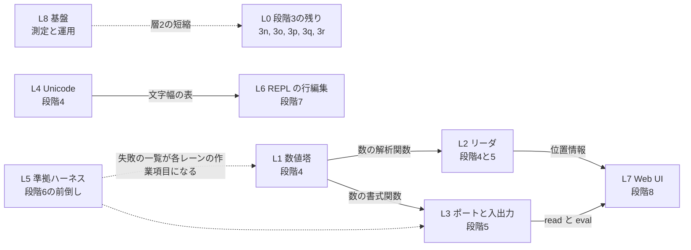
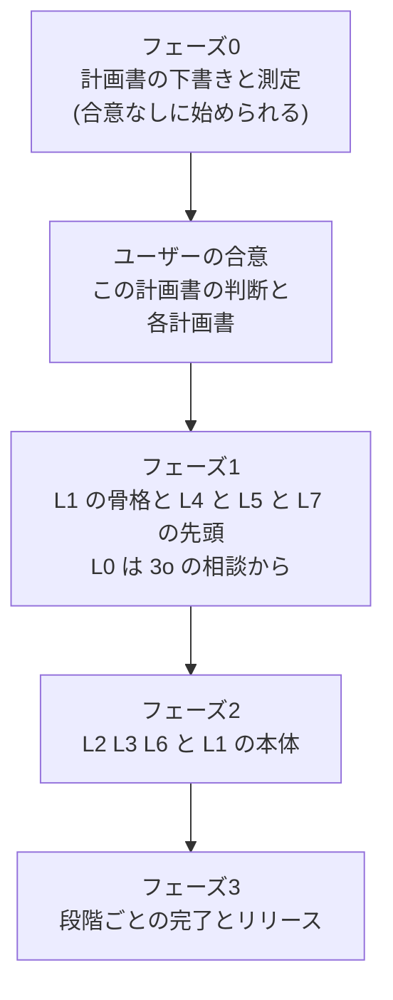

# 0017: 並行開発への再計画 — 段階3の残りから段階8まで

- 対応する決定: [ADR-0018](../adr/0018-incremental-vertical-slices.md)(漸進的な縦切り)、[ADR-0027](../adr/0027-severity-by-consequence-and-a-cost-side-stop.md)(費用の側で止める)、[ADR-0034](../adr/0034-release-shape.md)(リリースの形)、[ADR-0036](../adr/0036-windows-tests-in-the-slow-tier.md)(層2)
- 段階: 3(残り)から8。段階の作業項目と完了条件は [roadmap.md](../roadmap.md) の各段階の節が正
- 日付: 2026-10-20
- 状態: 合意済み(2026-10-20)。「合意を求める点」の6項目すべてを、勧める案どおりに承認した。各レーンの実装は、そのレーンの計画書(0018 から 0021)が合意されてから始める。3o の着手前に、ライブラリの表の扱いをユーザーに諮る
- きっかけ: 2026-10-20 に、ユーザーから、待ち時間の長さの指摘と、作業を並行にして全体を速くする再計画の依頼を受けた

## 解こうとしている問題

スライスの進みは、1本の鎖になっている。実装、通常の CI、レビュー、ready、層2、ユーザーのマージ、の順に進み、各段で次の段を待つ。段階3の計画([0016](0016-phase3-scheme-stdlib.md))は、並行できるスライスを書いたが、実際には1つずつ進めた。残りの段階4から8は、まだ計画書が無く、段階3の終わりを待つ形になっている。

測った待ちを、日付つきで残す。出典は、`full.yml` の各実行の `created_at` と `updated_at`、および 2026-10-19 の実行(run_number 159)のジョブごとの時刻である。

- 層2の実行全体: 24 分(run_number 156)、39 分(157)、22 分(158)。159 は、2026-10-19 21:23 UTC の時点で 31 分を超えて実行中だった。
- 159 のジョブ別: `tests (windows-latest)` が約 6 分、`dist` が約 5.5 分、`slow tests` の `zig build test -Dslow=true` が約 5 分。`zig build test-scheme -Dslow=true` は、20:58:05 UTC に始まり、21:26:13 UTC に終わった(約 28 分)。続く `zig build test-wasm -Dslow=true` は約 1.5 分で、実行は 21:27 UTC に成功で終わった(約 35 分)。層2の長さを決めているのは、この1ステップである。
- 層2は、PR を ready にしたときに起動し、ready にするのは、レビューが収束したあとである。そのため、層2の待ちは、レビューの待ちの後ろに逐次に並ぶ。

資源の制約も測った。

- この環境(1セッションの VM)は、4 コア、メモリ 15 GB で、ディスクの空きは約 7.6 GB である。作業ツリーは 39 個あり、ビルドキャッシュ(`.zig-cache`)が大きい。最大の 3 個で、合わせて約 10 GB を占める。ローカルで多数のビルドを同時に走らせると、コアとディスクの両方が足りなくなる。
- サブエージェントは、起動したセッションの VM が回収されると失われる。長く走る用事は別セッションに任せる規則が、すでにある([watch-subagent](../../.agents/skills/watch-subagent/SKILL.md))。

## 方針

5本の柱で、逐次の鎖を並行に組み替える。

1. レーン分割: 触るファイルが重ならない作業を、レーンとして切り出し、同時に進める。段階をまたぐ。段階の完了条件とリリースは、段階ごとのままにする。
2. 実行基盤: 重い、または長いレーンは、別セッション(別の VM)で動かす。短い機械的な作業は、このセッションのサブエージェントに任せる。
3. 階層と引き継ぎ: 作業の難しさで、担当を軽量・標準・上位の3階層に分ける。詰まったら、決めた条件で、上の階層へ引き継ぐ。
4. 待ちの短縮: 層2の長さを測って縮める。層2とレビューを重ねる運用は、費用とあわせて選ぶ。
5. マージの流れ: ユーザーが読む PR の数に上限を置き、順序と競合の確認を、エージェントの側で先回りする。

## レーン

実線は、後ろのレーンが前のレーンの成果物を使う依存である。点線は、情報の流れで、着手の順序を縛らない。

| レーン | 内容(roadmap の項目) | 触るファイル(所有) | 主な階層 | 前提 |
| --- | --- | --- | --- | --- |
| L0 | 3n のマージ、3o、3p、3q、3r([0016](0016-phase3-scheme-stdlib.md)) | `src/syntax/*`、`src/context.zig`、`src/core.zig`、`src/env.zig`、`src/sucheme.zig`、リリース関係 | 上位(3o と 3q の設計)、標準(3p、3r) | 3o の着手前に、ユーザーへ相談する(ライブラリの表の計上か共有か) |
| L1 | 浮動小数点数、bignum、ratnum、compnum。`number->string`。整数除算などの Scheme の手続き。`(scheme inexact)` `(scheme complex)` | `src/num/`(新規)、`src/prim/arith.zig`、`lib/sucheme/numbers.*`(新規)、`lib/scheme/inexact.sld` `complex.sld`(新規) | 上位(型の骨格と正規化)、標準(演算)、軽量(表の転記) | 計画書 0018。複素数を含めるかの判断([open-questions.md](../design/open-questions.md)) |
| L2 | リーダの完全化(データラベル、ブロックコメント、`#;`、縦棒識別子、`#u8`、16進エスケープ、`#!fold-case`)、数の構文、位置情報の副表 | `src/reader.zig`、`src/string_syntax.zig`、`src/char_syntax.zig` | 標準 | 数の構文は L1 の解析関数。それ以外は着手できる |
| L3 | ポート(文字列、バイトベクタ、ファイル)、`write` の3種、`eval` と `exit`、`(scheme file)` などの9ライブラリ | `src/port.zig`(新規)、`src/prim/port.zig`(新規)、`src/printer.zig`、`src/wasm.zig`、`web/sucheme.js` のホスト側、`lib/scheme/*.sld` | 上位(ポートの表現)、標準 | 計画書 0019。ポートのバッファの方針([open-questions.md](../design/open-questions.md)) |
| L4 | Unicode のテーブルの生成ツールと生成結果、`(scheme char)`、文字列の大文字小文字 | `tools/unicode-gen/`(新規)、`src/unicode/`(新規)、`src/prim/char.zig` の追加分、`lib/scheme/char.sld` | 標準、軽量(生成ツールの枠) | 表の大きさの実測が、ASCII に制限する退避案の判断(ユーザーの承認と ADR)の根拠になる |
| L5 | `(chibi test)` 互換の最小実装、`r7rs-tests.scm` の取り込みと、節ごとの実行 | `tests/vendor/`(新規)、`tools/conformance-run/`(新規)、`lib/chibi/`(新規)、`docs/status/` | 標準、軽量 | 計画書 0020。取り込みの ADR(BSD 3条項の第3条項の件、[roadmap.md](../roadmap.md) の段階6) |
| L6 | 行編集の実装(Emacs バインディング、複数行、履歴、括弧の対応、補完) | `src/line_editor/`(新規)、`src/main.zig` の REPL の入口 | 標準、軽量(キー列の解読などの純粋な部品) | 計画書 0021。自前か既存の C ライブラリかの判断([ADR-0014](../adr/0014-repl-line-editor-boundary.md))。Windows の生モードは層2でしか試せない |
| L7 | エラー位置の表示と処理の中断、編集の補助、`read` による対話、サンプルの充実、配置先 | `web/*` | 標準、軽量 | 計画書 0021。配置先の判断(ユーザー)。`read` は L3、エラー位置は L2 の位置情報を待つ |
| L8 | 層2の測定と短縮、ビルドキャッシュの共有、作業ツリーの片付け、レーンの起動手順 | `build.zig`(測定用の追加のみ)、`tools/test-scheme/`、`.github/workflows/`(ユーザーの承認後) | 標準 | ワークフローの変更はユーザーの承認が要る |

L1 から L4 の先頭の作業は、インタプリタ本体に触れない。純粋なモジュールとして先に作れる。

- L1: 多倍長整数は `std.math.big.int.Managed` を使う方針が、[numerics-and-unicode.md](../design/numerics-and-unicode.md) にある。ヒープの上限への計上の仕方が設計の要である。
- L1: 浮動小数点数のラウンドトリップする書式と解析は、標準ライブラリの機能を使えるかを、実機で確かめてから決める(未確認)。
- L4: 生成ツールとテーブルは、インタプリタと独立している。WASM のサイズの実測は、ここで先に出せる。

### ファイルの重なり

複数のレーンが触るファイルと、取り決めを挙げる。数や行は書かない。見つけ方は、PR の変更ファイルの一覧を突き合わせることである。

- `src/value.zig`、`src/trace.zig`、`src/heap.zig`: L1(数の型)と L3(ポートの型)が、それぞれ新しい型を足す。どちらも、型の骨格だけを先に小さな PR にして、先にマージする。実体の機能は、その後の PR で足す。
- `src/reader.zig`: L2 が所有する。L1 は数の構文を、L2 のレーンの中の作業として足してもらう。L1 は解析関数(`src/num/` の中)を渡すだけにする。
- `src/printer.zig`: L3 が所有する。L1 は書式関数を `src/num/` に置き、L3 が呼ぶ。
- `src/prim/table.zig`: 全レーンが1行ずつ足す。隣り合う行のコンフリクトは、機械的に解く。
- `tests/scheme/` の番号: レーンごとに範囲を分ける。L0 は 0300 台、L1 は 0400 台、L2 は 0500 台、L3 は 0600 台、L4 は 0700 台、L5 は 0800 台とする。`tests/scheme-slow/` も同じ範囲で振る。
- `docs/status/conformance.md` と `docs/roadmap.md`、各計画書の進捗の表: 後からマージするほうが、main を取り込んでから、生成物は生成し直し、表は行を合わせる。
- `src/machine.zig`: L0(3o)と L3(`eval` と `exit`)の両方が触りうる。L3 が着手する前に、3o が触る範囲を確かめ、重なるなら順序を決める。

## 階層と引き継ぎ

担当を3階層に分ける。[roadmap.md](../roadmap.md) の「手順と担当モデル」の表(設計は上位、実装は標準、簡単なものは軽量)を、実装の中でさらに細かくしたものである。

| 階層 | 任せるもの | 任せないもの |
| --- | --- | --- |
| 軽量(T1) | 既存のパターンの複製で書ける作業。R7RS の例から起こす `tests/scheme/` のケース。表や文書の同期。生成物の再生成。CI のログの要約。純粋で小さい部品(キー列の解読など) | 新しいヒープの型。GC のルートと計上に関わる変更。複数ファイルにまたがる設計 |
| 標準(T2) | 計画書が合意済みのスライス。プリミティブ、Scheme のライブラリ、リーダの追加、Web UI、テストの強化 | 計画書にない設計判断。展開器とヒープの不変条件を変える変更 |
| 上位(T3) | 計画書と ADR の下書き。新しい型の骨格。GC と計上の設計。3o と 3q。敵対的レビューのうち、メモリと衛生性に関わるもの。T1 と T2 が詰まった作業 | 機械的な転記 |

上の階層から下の階層への引き渡しも使う。T3 が設計を計画書に書き、T2 と T1 が実装する。

### 引き継ぎの条件

下の階層の担当は、次のどれかに当たったら、作業を止めて引き継ぎを申し出る。粘らない。

1. 同じテストが、2 回の修正の試みのあとも赤いままである。
2. 自分の所有ファイルの外を変えないと進めない。
3. 計画書と ADR に無い設計判断が要る。
4. GC のルート、ヒープの上限への計上、ストレスモードでの失敗に関わる。
5. 着手から、目安の時間の 2 倍が過ぎても、最初の緑に届かない。

### 引き継ぎの手順

1. 担当は、作業中のブランチに、その時点の状態をコミットして push する(ドラフトの PR でよい)。
2. 担当は、PR の本文かレーンの計画書に、詰まりの記録を書く。書くのは、試したこと、失敗しているコマンドと出力の末尾、立てた仮説、所有外のファイルを変えたくなった理由である。
3. 担当は、親のセッションに `send_message` で知らせる。
4. 親は、より上の階層の担当を、同じブランチから、詰まりの記録だけを渡して起動する。元の担当は、そのブランチに書き込まない(同時に2者が書くと壊れる)。
5. 引き継ぎは、1つの作業につき通算 2 回までにする。2 回目にも詰まったら、ユーザーに選択肢を示す。

## 実行基盤

### どこで動かすか

- 別セッション(`create_session`): レーンの本体と、10 分を超える用事。別の VM で動き、4 コアとディスクを占有できる。このセッションの中断や回収の影響を受けない。生存確認の手順は [watch-subagent](../../.agents/skills/watch-subagent/SKILL.md) に従う。
- サブエージェント: 数分で終わる、機械的な作業と、読み取りの調査。書き込む先は、1つの作業ツリーに限る。
- 親(このセッション): 司令塔に徹する。担当の起動、競合とマージの順序の確認、ユーザーへの報告、層2とレビューの結果の集約だけを行う。実装は、レーンが詰まったときの上位の担当として入るときを除き、自分では持たない。

### 子セッションへの依頼文に必ず書くこと

- レーン、目標、読む計画書、所有するファイルと、触ってはならないファイル。
- 着手の手順(作業ツリーの作り方、ブランチ名、共有のビルドキャッシュの指定)と、受け入れの検証コマンド([AGENTS.md](../../AGENTS.md) の表の「全コミット」の行)。
- 引き継ぎの条件と手順(上の節)。
- 最初の push で、計画書の骨組みと「状態」「次にやること」を残すこと。依頼の中身が、依頼文と会話にしか無い状態を作らない。
- 目安の時間と、打ち切りの時刻。足りなければ、途中までの結果を報告して終わる。
- 報告は `send_message` で親に送る。着手したときに一言、PR を作ったとき、通常の CI が緑になったとき、詰まったときに送る。ユーザーに直接話しかけない。
- 承認の確認が出る操作(`rm`、複製の作成、仮想環境、パッケージの導入)を避ける。避けられないときは、止めて報告する。
- PR の購読は、子のセッションが行う。親は同じ PR を購読しない(1つの PR のイベントは1つのセッションにしか届かない)。
- ユーザーのチャットの文を、リポジトリに残るものへ写さない([AGENTS.md](../../AGENTS.md))。

### 見張りと報告

親の10分ごとの予約は、1本で全レーンを巡回する(別の予約を足さない)。巡回で見るのは、各子セッションの `get_session` の状態、各 PR の通常の CI と層2、各レーンの `send_message` の取りこぼしである。変化があった分だけを、1つの報告にまとめる。報告の形式は [AGENTS.md](../../AGENTS.md) と [briefing](../../.agents/skills/briefing/SKILL.md) に従う。

### ローカルの資源

- 同時に走らせるビルドは 2 本までとする(4 コアの半分)。それを超える並行は、別セッションに回す。
- ビルドキャッシュは、作業ツリーの外の共有の場所に置く。Zig のキャッシュは内容に基づくので、異なるソースの木で共有できる見込みだが、同時ビルドでの安全性は、公式文書で確かめてから採る(未確認)。[tools/review-harness/](../../tools/review-harness/) は、すでにキャッシュを複製の外に置いて共有している。
- 古い作業ツリーとキャッシュの片付けは、削除にあたるので、ユーザーの確認を取ってから行う。

## 待ちの短縮

1. 層2の長さの測定(L8、承認不要): `zig build test-scheme -Dslow=true` の1件あたりの時間を測る。[AGENTS.md](../../AGENTS.md) が、並行にする前に1件あたりの時間を測るよう定めている。3l が、インタプリタを作るたびに `(scheme base)` を読み込む費用を足した([ADR-0039](../adr/0039-standard-environment-installed-at-init.md))ので、まず、その費用が支配的かを見る。支配的なら、読み込んだライブラリの共有(3o の候補)か、ストレスモードの件数の見直しで、並行にせずに縮められる。
2. 層2の分割(承認が要る): 1 で縮まらないときに、`slow tests` のジョブを、規模を試すテストの集合ごとに並行のジョブへ分ける。`.github/workflows/full.yml` の変更になるので、ユーザーの承認を得る。実行分数の合計はほぼ同じで、待ちの時間が短くなる。
3. 層2をレビューと重ねる(選択、費用あり): 通常の CI が緑になった時点で層2を手動で起動し、ミューテーションなどのレビューと並行に走らせる。レビューがコードの変更を生んだら、最後のコミットで層2をもう一度走らせる。待ちは、およそ層2の長さだけ縮む。代わりに、実行分数が、レビューでコードが変わるスライスで、層2の1回分増える。1 と 2 で層2が短くなれば、この選択の利得も小さくなる。
4. レビューの並行化: 挙動を試す担当とミューテーションの担当を、別セッションで同時に走らせる。担当ごとに、結果を書くファイルを決め、更新が 15 分止まったら打ち切る([handoff.md](../handoff.md) の規則のとおり)。
5. 待っている間に別の作業を進める: ユーザーのマージや層2の結果を待つ間、親が待つ作業は、別のレーンの進行で埋める。

## 資源と上限

- ユーザーが同時に読む PR の数に上限(W)を置く。W を超える数の PR が「あなたの番」に並ばないよう、親が順序を管理する。
- 起動する子セッションの数にも上限を置く。費用の上限が近いときは、新しい子セッションを起動しない([AGENTS.md](../../AGENTS.md))。
- W と子セッションの上限の値は、「合意を求める点」の 5 で決める。
- 同じファイルを触る PR の組は、変更ファイルの一覧を突き合わせて確かめる。マージの順序の報告の前に、必ず行う([AGENTS.md](../../AGENTS.md))。

## 実施の順序

### 合意なしに始められるもの(フェーズ0)

次は、リポジトリの挙動を変えず、判断の根拠を作る作業だけである。この計画書の合意を待たずに始める。

1. 計画書の下書き(上位、文書のみ、ドラフトの PR): 0018(段階4)、0019(段階5)、0020(段階6の前倒しと L5)、0021(段階7と8のうち、先に始める部分)。[plans/README.md](README.md) の規則(計画書のない段階の実装は始めない)に従い、各レーンの実装はこれらの合意を待つ。
2. 層2の測定(標準): 上の「待ちの短縮」の 1。コードを変えず、測定の結果だけを返す。
3. 判断材料の下書き(上位または標準、文書のみ): 3o の相談の選択肢、行編集の自前と既存ライブラリの比較、配置先の比較、Unicode テーブルの大きさの見積りの方法。

### 合意のあと

- フェーズ1: L1 の型の骨格、L4 の生成ツール、L5 の取り込みとハーネス、L7 の先頭(エラー表示、中断、編集の補助)、L8 の片付けと共有キャッシュ。L0 は、3n のマージのあと、3o の相談に進む。
- フェーズ2: L1 の演算、L2、L3(骨格のマージのあと)、L6(判断のあと)。
- フェーズ3: 段階ごとの完了条件の確認、リリース。リリースは、段階の完了条件でこれまでどおり切る。

見積りは、各レーンの計画書が揃ってから、[0012](0012-schedule-estimates-and-actuals.md) の方法で付ける。いま数字を置かないのは、レーンの計画書が無いまま付けた見積りは、根拠が薄いからである。全体の所要は、レーンの合計ではなく、いちばん長い鎖(L0 の 3o から 3r、または L1 の骨格から演算まで)で決まる見込みである。

## リスクと対策

- 競合の増加: 上の「ファイルの重なり」の取り決めと、骨格の PR を先にマージする順序で抑える。競合が出た PR は、親が先に main の取り込みを指示する。
- 子セッションの停止: 確認の頻度を保ち、小さな作業に分け、結果の書き込み先を決める。引き継ぎの条件に、時間の超過を入れている。
- 品質の低下: 軽量の担当の成果は、標準の担当のレビューを必ず通す。メモリと衛生性に関わる変更は、上位の担当のレビューを通す。ミューテーションテストの方針は変えない。
- 読む側の負荷: W の上限と、PR を小さく保つことで抑える。
- 実行分数と費用: レビューと層2を重ねる運用と、子セッションの数は、費用が増える。上限と、費用の側の停止の規則([ADR-0027](../adr/0027-severity-by-consequence-and-a-cost-side-stop.md))で抑える。
- レーン間の見えない結合: リーダと数、プリンタと数のように、片方の成果物をもう片方が呼ぶ点は、関数の署名を計画書に書く。署名が変わるときは、親が両方に知らせる。

## 合意を求める点

勧める案を先に書く。勧める案でよいときは、そう返信する。

1. 実行基盤。
   - 勧める案: 別セッションを中心にし、短い機械的な作業はサブエージェントに任せる。ローカルのビルドの同時数には、「実行基盤」の上限を置く。
   - 別案: すべてローカルの作業ツリーとサブエージェントで行う。起動の手間は小さいが、4 コアとディスクの空きがすぐに尽き、サブエージェントの回収で作業が失われるリスクが残る。
2. マージの流れ。
   - 勧める案: 現状の形(PR ごとに、ユーザーがマージ)を保ち、親が順序と競合の確認を先回りする。同時に待つ PR は W 件まで。
   - 別案: 文書だけ、またはテストだけの PR のように、種類を決めた低リスクの PR は、CI と層2が緑で、レビューが済んでいれば、エージェントがマージしてよいと事前に承認する。待ちは減るが、[AGENTS.md](../../AGENTS.md) のマージの規則を変える。
3. 層2の運用。
   - 勧める案: 先に「待ちの短縮」の 1 の測定を行い、層2そのものを縮める。そのうえで、縮まらないときに 2(分割)を、承認のもとで行う。3(レビューとの重ね)は、レビューでコードが変わらないと見込める PR(文書、機械的な変更)に限って使う。
   - 別案: すべての PR で 3 を使う。待ちは最も短いが、実行分数が増える。
4. リリースと段階の関係。
   - 勧める案: 後の段階のレーンの成果も、できあがった分から main にマージする。リリースは、段階の完了条件を満たした時点で、これまでどおり切る。リリースノートに、含まれる先行分を書く。
   - 別案: 後の段階のレーンは、段階ごとの統合ブランチに集め、前の段階のリリースのあとに main へ入れる。リリースの内容が段階の範囲と一致するが、統合ブランチへの取り込みと、そこから main への大きなマージの手間が増える。
5. 同時に読む PR の上限 W と、子セッションの上限。
   - 勧める案: W は 5、子セッションは 6。
   - 別案: 読める量に合わせて、ユーザーが数字を指定する。
6. 作業ツリーとキャッシュの片付け。「解こうとしている問題」に書いた、キャッシュの大きい作業ツリーのうち、使用中の 1 個(3n)を除き、マージ済みのレビュー用の作業ツリーとキャッシュの削除を提案する。削除の前に、対象の一覧と、未コミットの変更が無いことの確認を示す。
   - 勧める案: 一覧を見たうえで承認する。
   - 別案: 削除せず、キャッシュを共有の場所へ寄せるだけにする。

この計画書が合意されたら、次を行う。

- [AGENTS.md](../../AGENTS.md) の「進め方」に、レーン、階層、引き継ぎ、巡回の規則を、規則の形で追記する(Edit ツールで、ユーザーに差分が見える形にする)。
- [handoff.md](../handoff.md) の「次にやること」を、この計画書に合わせる。
- 各レーンの計画書(0018 から 0021)を、順に合意にかける。

## 進捗

| 項目 | 状態 |
| --- | --- |
| この計画書 | 合意済み(2026-10-20) |
| 計画書 0018(段階4) | 下書きを別セッションに依頼する(フェーズ0) |
| 計画書 0019(段階5) | 同上 |
| 計画書 0020(段階6の前倒し) | 同上 |
| 計画書 0021(段階7と8) | 同上 |
| 層2の測定(L8、番号は 0022) | 別セッションに依頼する(フェーズ0) |
| 作業ツリーとキャッシュの片付け | 一覧をユーザーに示して承認を得る。承認の前に削除しない |

計画書の番号は、衝突を避けるために、ここで割り当てる。0018 は段階4、0019 は段階5、0020 は段階6の前倒しと L5、0021 は段階7と8の先に始める部分、0022 は層2の測定である。

## 次にやること

- フェーズ0の下書きと測定が揃ったら、各計画書をユーザーの合意にかける。合意が済んだレーンから、フェーズ1に進む。
- 3o の着手前に、ライブラリの表の扱い(計上するか、共有するか、見送るか)をユーザーに諮る。
