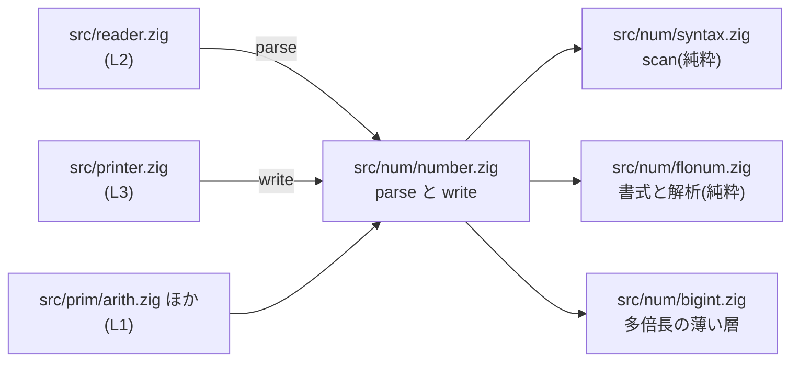

# 0018: 段階4の実装計画 — 数値塔と Unicode

- 対応する決定: [ADR-0007](../adr/0007-numeric-tower-scope.md)(完全な数値塔)、[ADR-0008](../adr/0008-string-representation.md)(文字列の表現)、[ADR-0018](../adr/0018-incremental-vertical-slices.md)(漸進的な縦切り)、[ADR-0027](../adr/0027-severity-by-consequence-and-a-cost-side-stop.md)(費用の側で止める)、[ADR-0031](../adr/0031-gc-at-machine-step-boundaries.md)(GC はステップの境目)
- 段階: 4(数値塔と Unicode)。段階の作業項目と完了条件は [roadmap.md](../roadmap.md) の段階4の節が正
- レーン: [0017](0017-parallel-lanes.md) の L1(数値塔)、L4(Unicode)と、L2(リーダ)のうち数の構文
- 日付: 2026-10-20
- 状態: 合意済み(2026-10-20)。「合意を求める点」の7項目すべてを、勧める案どおりに承認した。スライスの実装は未着手

## 解こうとしている問題

段階3までの数は、固定長の整数(`Value.fixnum`)だけである。`src/value.zig` の `Value` には、浮動小数点数のバリアントも無い。演算が `i64` からあふれると `IntegerOverflow` の Scheme のエラーになり(`src/prim/arith.zig` の `fromWide`)、リーダは `[+-]?[0-9]+` の形の整数しか数として読まない(`src/reader.zig` の `isDecimalInteger`)。`+inf.0` などの、識別子の形をした数の綴りは、識別子として束縛されないように、リーダが拒否している(`isUnsupportedNumber`)。

文字は Unicode のスカラ値を持てるが、属性と大文字小文字の表が無い。`(scheme char)` は無く、リーダは ASCII でない識別子を読めない。

段階4は、[numerics-and-unicode.md](../design/numerics-and-unicode.md) の設計どおりに、5種の数の表現と、Unicode の表を入れる。設計は決まっているので、この計画書は、スライスへの分け方、レーンの間の関数の署名、ヒープの上限への計上、検証の割り当てと、設計が残した4点の判断を書く。

## 完了条件

[roadmap.md](../roadmap.md) の段階4の完了条件が正である。この計画は次のように読む。

- `features` が `exact-closed` `ratios` `exact-complex` `ieee-float` を返し、それぞれが表すことが、`tests/scheme/` の 0400 台で確かめられている(`exact-complex` は、合意を求める点の3で複素数を段階4に含める場合)。
- 浮動小数点数のラウンドトリップ性のテスト(基数10の無作為な値と、基数2、8、16)が通る。
- `(scheme char)` `(scheme inexact)` `(scheme complex)` の識別子が、準拠マトリクスで束縛済みになる。
- roadmap の段階4の作業項目のすべてに、スライスの割り当てがある(下の「roadmap の項目の割り当て」)。
- リリース v0.4.0 を出す。

## 範囲

含めるもの:

- 数の5種の表現(fixnum、flonum、bignum、ratnum、compnum)と、正規化。
- 数の構文の全体(R7RS 7.1.1 の `<number>`)の解析と、`number->string` の書式。リーダが同じ解析を使う(R7RS 6.2.7)。
- `(scheme base)` の数の手続きのうち、段階3で未束縛のまま残したもの(0016 の「未束縛の識別子の行き先」の「段階4」の行)。
- `(scheme inexact)` と `(scheme complex)`。
- `eq?` と `eqv?` の分離と、`memq` と `memv` などを区別するテスト(roadmap の項目)。
- Unicode の表の生成ツールと生成結果、`(scheme char)`、文字列の大文字小文字の手続き、リーダの ASCII でない識別子と、その畳み込み。
- リリース v0.4.0。

含めないもの(送り先は括弧の中):

- ポートへの数の書き出し(`write` の3種の実装は段階5の L3)。ただし、プリンタが呼ぶ数の書式関数は、この段階で作る。
- リーダの数以外の完全化(データラベル、ブロックコメント、`#u8` など。L2 の別の計画)。
- 準拠スイートの数の節の実行(段階6の L5)。

## 現状の確認

計画の前提にしたコードの事実を挙げる。行番号は書かない。

- `Value` は `union(enum)` で、バリアントの `fixnum: i64` が即値である。`f64` も同じ大きさなので、`flonum: f64` を即値のバリアントとして足しても、`Value` の大きさは変わらない見込みである(未確認。骨格のスライスで `@sizeOf(Value)` を固定するテストを足して確かめる)。
- ヒープのオブジェクトの型は `value.heap_types` に並び、`heap.zig` の `payloadBytes` と `Heap.free` が、型ごとにペイロードの大きさと解放を `switch` で持つ。スイープは `free` を呼ぶので、新しい型のペイロードは、この2つに1行ずつ足せば、スイープで解放され、計上から引かれる。
- `trace.zig` の分類は、`std.mem.Allocator` を持つ構造体を分類できない(中の `*anyopaque` がヒープの型でも code の型でもないので、コンパイルエラーになる)。`[]Limb` のような整数の切片は「無視する」に分類される。
- `Heap.Charged` は、確保をヒープの上限に計上する割り当て器である。上限に照らすのは `Heap.external_enforced` が立っている間だけで、`equal?` と展開器が、その間だけ立てている。
- プリミティブは `Services`(`heap` と、1行ぶんのアリーナの `scratch`)を受け取る。`scratch` は計上の外にあり、`free` が効くのは最後の確保だけである。
- `printer.zig` の書き出しは `*std.Io.Writer` に書き、誤りの型は `std.Io.Writer.Error || error{OutOfMemory}` である。
- R7RS は、数の綴りの大文字小文字を区別しない(2.1 と 7.1.1。`#x1A` と `#X1a` は同じ)。

## 設計の要点

### 値の表現

[numerics-and-unicode.md](../design/numerics-and-unicode.md) の表のとおりに、5種を持つ。`Value` への足し方を、ここで決める。

| 表現 | `Value` のバリアント | ヒープの型 | ペイロード |
| --- | --- | --- | --- |
| fixnum | `fixnum: i64`(既存) | - | - |
| flonum | `flonum: f64`(即値) | - | - |
| bignum | `bignum: *Bignum` | `Bignum`(`limbs: []Limb` と `positive: bool`) | limbs(多倍長整数の桁の配列) |
| ratnum | `ratnum: *Ratnum` | `Ratnum`(`numerator: Value` と `denominator: Value`) | なし |
| compnum | `compnum: *Compnum` | `Compnum`(`real: Value` と `imag: Value`) | なし |

bignum は作ったあとに変えない。演算の途中は `std.math.big.int.Managed` を作業領域で使い、結果の limbs だけを、ヒープのペイロードに写す。設計文書は「`Managed` をオブジェクトに持ち、sweep で `deinit` を呼ぶ」と書いているが、この計画はそれを変える提案をする(合意を求める点の5)。理由は次のとおりである。

- `Managed` は割り当て器を持つので、`trace.zig` の分類を通らない。通すには、分類に例外を足すことになる。
- `Managed` は、演算のたびに自分の limbs を伸ばしうる。伸びた分は `payloadBytes` から読めても、確保の時点で上限に照らされない。変えない limbs なら、確保の1回で大きさが決まり、文字列やベクタと同じ `reserveWithPayload` の経路で計上できる。
- 数は変えられない値なので、オブジェクトを変える必要がない。

ratnum と compnum は、`Value` を2つ持つだけで、ペイロードを持たない。`trace.zig` の分類は `Value` のフィールドを辿るので、追加の作業は無い。

### 正規化

数を作る関数は `src/num/number.zig` に閉じ、そこで必ず正規化する(設計文書の正規化の規則)。ほかのファイルは `Value.bignum` などを直接作らない。骨格のスライスでは、`heap.zig` に `createBignum` などの確保の関数だけを置き、正規化をしない。正規化をしない関数を外から呼べないよう、名前に `Raw` を付けるか、`num/` だけが使うことを doc コメントに書く(内部の名前なので、実装時に決めて PR に書く)。

### `eq?` と `eqv?`

- `eqv?`: fixnum は値、flonum はビット列の一致、bignum と ratnum と compnum は数としての一致(同じ正確性で、`=` が真)で比べる。ビット列で比べるので、`(eqv? 0.0 -0.0)` は `#f` になる(R7RS 6.1 の例)。`(eqv? +nan.0 +nan.0)` は R7RS 6.1 が未規定とするので、ビット列が同じなら真になる。
- `eq?`: fixnum と flonum は `eqv?` と同じ、ヒープの数(bignum、ratnum、compnum)は同じオブジェクトかで比べる。R7RS 6.1 は、数の `eq?` を実装依存とし、真を返してよいのは `eqv?` が真のときだけとする。この分け方で、`(memq (expt 2 100) (list (expt 2 100)))` が `#f`、`memv` が見つける、という区別が書ける(roadmap の項目)。

これは利用者に見える挙動なので、合意を求める点の6で確認する。

## レーンの間の関数の署名

L1 が `src/num/` に関数を置き、L2(リーダ)と L3(プリンタ)が呼ぶ。署名をここで決め、変えるときは親のセッションが両方のレーンに知らせる([0017](0017-parallel-lanes.md) のリスクと対策)。



### 純粋な層(ヒープに触れない)

`src/num/syntax.zig`(スライス 4a):

```zig
pub const Exactness = enum { unmarked, exact, inexact };
pub const Sign = enum { positive, negative };
pub const InfNan = enum { positive_infinity, negative_infinity, positive_nan, negative_nan };

/// <ureal> の1つ。切片は、scan に渡した文字列の中を指す。
pub const Real = union(enum) {
    /// <uinteger R>。digits は空でない。
    integer: struct { sign: Sign, digits: []const u8 },
    /// <uinteger R> / <uinteger R>。分母が0でも、ここでは受理する。
    ratio: struct { sign: Sign, numerator: []const u8, denominator: []const u8 },
    /// <decimal 10>。基数10のときだけ現れる。
    /// whole と fraction のどちらかは空でない。exponent は符号を含む綴りか、空。
    decimal: struct { sign: Sign, whole: []const u8, fraction: []const u8, exponent: []const u8 },
    infnan: InfNan,
};

pub const Shape = union(enum) {
    real: Real,
    /// a+bi と +bi。real が null なら実部は正確な0。`+i` の虚部は integer の "1"。
    rectangular: struct { real: ?Real, imag: Real },
    /// a@b
    polar: struct { magnitude: Real, angle: Real },
};

pub const Literal = struct { radix: u8, exactness: Exactness, shape: Shape };

/// R7RS 7.1.1 の <number> として text を検査し、構造に分ける。数でなければ null。
/// default_radix は、text に基数の接頭辞が無いときの基数(2、8、10、16)。
/// 大文字小文字を区別しない(R7RS 2.1)。確保しない。
pub fn scan(text: []const u8, default_radix: u8) ?Literal
```

`src/num/flonum.zig`(スライス 4b):

```zig
/// 有限か無限か NaN の x を、R7RS 6.2.7 の基数10の書式で書く。
/// 最短のラウンドトリップする桁列に、小数点を必ず置き、指数部が範囲の外なら指数表記にする。
/// +inf.0 -inf.0 +nan.0 と -0.0 を専用に書く。確保しない。
pub fn write(out: *std.Io.Writer, x: f64) std.Io.Writer.Error!void

/// scan が decimal と判定した綴り(符号を除き、整数部、小数点、小数部、指数部が
/// 続いて並ぶ1つの切片)を、最も近い f64 にする。範囲を超える大きさは無限大、
/// 小さすぎるものは0になる。確保しない。中身は std.fmt.parseFloat に綴りを渡すだけで、
/// scan が先に受理集合を絞る(下の実験の2と3)。形が合わない綴りは error.InvalidSpelling。
pub fn parseDecimal(text: []const u8) error{InvalidSpelling}!f64
```

4b の実装で、`parseDecimal` の署名を、当初の3つの切片(整数部、小数部、指数部)から、1つの切片に変えた。3つに分けると、`std.fmt.parseFloat` に渡す前に連結が要り、桁数に上限のない入力では、確保するか、桁を切り詰めて丸めの判定を自前で持つことになる。1つの切片なら、標準ライブラリがそのまま読む。`syntax.scan` の `decimal` の切片は、部分が無いとき(`1e5` の小数部、`1.5` の指数部)に入力を指さない空文字列になるので、切片のポインタから範囲を作らない。4e-1 の `parse` は、元の文字列から接頭辞(`#x` など)と符号を除いたものを渡す。誤りを返す形にしたのは、`parseFloat` が符号、`inf`、`0x`、`_` も受理するため、約束が破れたときに別の値を黙って返さないようにするためである。

`src/num/bigint.zig`(スライス 4c): `std.math.big.int` の上に、この処理系が要る演算だけを薄く置く。入力は `std.math.big.int.Const`、出力は呼び出し側が渡した割り当て器で確保した `Managed` である。

```zig
pub const Limb = std.math.big.Limb;
pub const Const = std.math.big.int.Const;
pub const Managed = std.math.big.int.Managed;
pub const Error = std.mem.Allocator.Error;

pub fn add(gpa: std.mem.Allocator, a: Const, b: Const) Error!Managed
pub fn sub(gpa: std.mem.Allocator, a: Const, b: Const) Error!Managed
pub fn mul(gpa: std.mem.Allocator, a: Const, b: Const) Error!Managed
/// 商と剰余。Rounding は floor と truncate の2つ(R7RS 6.2.6)。b は0でない。
pub fn divide(gpa: std.mem.Allocator, a: Const, b: Const, rounding: Rounding) Error!struct { q: Managed, r: Managed }
pub fn gcd(gpa: std.mem.Allocator, a: Const, b: Const) Error!Managed
pub fn pow(gpa: std.mem.Allocator, base: Const, exponent: u64) Error!Managed
/// 基数 radix の数字の列(符号なし)から。数字は scan が検査済み。
pub fn parseDigits(gpa: std.mem.Allocator, digits: []const u8, radix: u8) Error!Managed
/// 基数 radix の綴り(符号つき)。返す切片は gpa で確保する。
pub fn toString(gpa: std.mem.Allocator, a: Const, radix: u8) Error![]u8
/// 確保の前に結果の大きさを見積もる。上の関数を呼ぶ前に、上限と比べるために使う。
pub fn limbsForDigits(digit_count: usize, radix: u8) usize
pub fn limbsForPow(base: Const, exponent: u64) ?usize
```

関数の集合は、スライス 4c の実装で足りないと分かったら足してよい(署名の形、つまり `Const` を受けて割り当て器で `Managed` を返す形は変えない)。

### ヒープに触れる層

`src/num/number.zig`(スライス 4e):

```zig
pub const Error = heap.Error; // OutOfMemory と HeapLimit

/// text を R7RS 7.1.1 の数として読み、正規化した値を返す。数でないか、表せない
/// 大きさなら null(R7RS 6.2.7。内容を理由に誤りを送出しない)。
/// default_radix は string->number の第2引数か、リーダなら10。
/// 確保は heap の上限に計上する。HeapLimit は、上限に達していて結果を置けないときだけ。
pub fn parse(h: *Heap, text: []const u8, default_radix: u8) Error!?Value

/// 数 v を、radix(2、8、10、16)の外部表現で out に書く(R7RS 6.2.7)。
/// v が数でないときの挙動は未定義で、Debug では assert する。
/// 作業領域は scratch から取り、返る前に返す。
pub fn write(out: *std.Io.Writer, scratch: std.mem.Allocator, v: Value, radix: u8) (std.Io.Writer.Error || error{OutOfMemory})!void

/// 数かどうか。プリンタとリーダが、数の分岐に入るかを決めるのに使う。
pub fn isNumber(v: Value) bool
```

リーダ(L2)の呼び方: 区切り文字までの綴りを、まず `num.parse(heap, token, 10)` に渡し、`null` なら識別子かどうかを見る。`#x` `#X` `#o` `#b` `#d` `#e` `#i` で始まる綴りも、`#` の分岐から `num.parse` に渡す。`isDecimalInteger` と `isUnsupportedNumber` は、このときに消す。綴りが数の形をしているのに表せない大きさのとき(`#e1e999999999`)は、R7RS 6.2.7 の規則がリーダにも及ぶので、`string->number` と同じく数でない扱いになる。そのあと識別子でもないので、リーダの誤り(`InvalidToken`)になる。

プリンタ(L3)の呼び方: `emit` の `switch` で、数の種別の分岐から `num.write(out, scratch, v, 10)` を呼ぶ。`display` と `write` で同じ書式である。

`number->string` と `string->number` のプリミティブ(スライス 4g)は、`num.write` と `num.parse` を使う。`number->string` は、書いた結果を文字列にする前に、作業領域の大きさを上限に照らす(下の「ヒープの上限への計上」)。

## ヒープの上限への計上

### ペイロードと sweep

- bignum の limbs は、文字列のバイト列と同じく、オブジェクトのペイロードとして数える。`payloadBytes` に `Bignum => object.limbs.len * @sizeOf(Limb)` を、`Heap.free` に `Bignum => self.backing.free(cell.value.limbs)` を足す。確保は `reserveWithPayload` を通し、セルより先に limbs を確保して、セルの確保が失敗したら返す(`createString` と同じ単位)。
- ratnum と compnum はペイロードを持たない。セルの大きさだけを数える。
- limbs は変えないので、計上した大きさと、スイープで引く大きさは、常に一致する。

### 演算の作業領域

多倍長の演算は、結果の前に作業用の `Managed` を作る。これを `Services.scratch` に置くと、1行のプログラムの中の繰り返し(`(do ((i 0 (+ i 1))) ((= i 1000000)) (expt 10 1000))` など)で、アリーナが計上の外で伸び続ける。`scratch` の `free` は最後の確保にしか効かないからである。そこで、作業領域は `Heap.Charged` から取り、演算の間だけ `external_enforced` を立てて上限に照らし、演算の終わりに返す。`equal?` の訪問済みの集合と同じ形である([runtime.md](../design/runtime.md) の `equal?` の節)。

- 作業領域の確保を断られたら、`HeapLimit` の Scheme のエラーになる。
- `string->number` とリーダは、内容を理由に誤りを送出してはならない(R7RS 6.2.7)。そこで `num.parse` は、確保の前に `bigint.limbsForDigits` と指数部の大きさで結果の大きさを見積もり、上限から見て置けない大きさなら、確保せずに `null` を返す。見積りの上界の取り方は 4e で決め、doc コメントに書く。
- `expt` も、`bigint.limbsForPow` で先に見積もり、上限を超えるなら確保の前に `HeapLimit` にする。`(expt 2 (expt 10 12))` で、確保が断られるまで長い計算を続けることを避ける。

### GC の時点

GC は機械のステップの境目でしか走らない([ADR-0031](../adr/0031-gc-at-machine-step-boundaries.md))。プリミティブの途中で作った中間の数(ratnum の分子と分母の bignum など)は、ルートに登録しなくてよい。1つのプリミティブが確保する量は、引数の大きさに比例し、上の見積りで上から抑えられる。

### 検証

- [runtime.md](../design/runtime.md) の走査関数の検証項目: `Bignum` `Ratnum` `Compnum` について、辿るフィールドの集合と、手で列挙した期待集合が一致すること。bignum だけを到達できなくして GC を走らせると、計上量が limbs の分だけ減ること(4d)。
- 作業領域が返ること: 大きな bignum の演算を繰り返したあと、`Heap.external` が0に戻ること(4f)。

### 規模を試すテストの置き方

[0007](0007-test-tiers.md) の規則どおり、規模に比例して壊れるものは `tests/scheme-slow/` の 0400 台(L4 は 0700 台)か、単体テストの `tier.slow()` に置き、同じ論理を小さい規模で通す双子を層1に残す。

| 試すこと | 層2(規模) | 層1(双子) |
| --- | --- | --- |
| bignum の繰り返しの演算で計上が戻ること | `(do ...)` で大きな `expt` を多数回(`tests/scheme-slow/`) | 同じ式を数回(`tests/scheme/`) |
| `string->number` が大きすぎる綴りに `#f` を返し、確保しないこと | 指数部が大きい `#e1e...` を、上限の小さいランナーで | 上限の手前と先の2点 |
| 浮動小数点数のラウンドトリップ性 | 無作為な `f64` を多数(`tier.slow()`) | 境界の値の表(最小の非正規化数、最大値、0.1、1/3 など) |
| 多倍長の除算と基数変換 | 大きな桁数の無作為な値(`tier.slow()`) | 境界(`i64` の前後、limb の境目の前後) |
| Unicode の表の全域の検査 | 全符号位置について、生成ツールの入力と表の答えが一致すること(`tier.slow()`) | 代表の符号位置の表 |

規模を試すテストの件数と上限は、実装のときに1件あたりの時間を測ってから決める(層2の長さは [0017](0017-parallel-lanes.md) の「待ちの短縮」の1で測っている)。

## Unicode

### 生成ツールと生成結果

- 生成ツール: `tools/unicode-gen/`(Zig のプログラム)。UCD のファイルを読み、多段の表を Zig のソースとして書き出す。[numerics-and-unicode.md](../design/numerics-and-unicode.md) は置き場所を `tools/unicode/` と書いているが、[0017](0017-parallel-lanes.md) は `tools/unicode-gen/` と書いている。新しい 0017 に合わせ、4u1 で設計文書を直す。
- 入力: UCD のファイル(`UnicodeData.txt`、`DerivedCoreProperties.txt`、`PropList.txt`、`SpecialCasing.txt`、`CaseFolding.txt`)。リポジトリに取り込むか、取得の手順だけを置くかは、合意を求める点の7で決める。
- 生成結果: `src/unicode/tables.zig`(生成物、手で編集しない)と、引く関数の `src/unicode/props.zig`(手で書く)。生成元の Unicode の版とファイル名を、生成物の先頭のコメントに書く。
- 生成物が入力から導かれたことは、既存の `check-extract` と同じ形の比較モードで検査する。検証コマンドの表に行を足すかは、4u1 で `build.zig` の step を作ってから決める(表の行は、step が実在するときに足す規則)。

### 表が答えること

設計文書の5種(単純大文字小文字写像、単純ケースフォールディング、完全大文字小文字写像、属性の真偽値、十進数字の値)を、`src/unicode/props.zig` の関数として出す。

```zig
pub const Property = enum { alphabetic, numeric, white_space, uppercase, lowercase };
pub fn has(c: u21, p: Property) bool
pub fn simpleUpcase(c: u21) u21
pub fn simpleDowncase(c: u21) u21
pub fn simpleFoldcase(c: u21) u21
/// 完全写像。結果は1から3文字。out の先頭から書き、書いた数を返す。
pub fn fullUpcase(c: u21, out: *[3]u21) u2
pub fn fullDowncase(c: u21, out: *[3]u21) u2
pub fn fullFoldcase(c: u21, out: *[3]u21) u2
/// 十進数字の値(0から9)か null(R7RS 6.6 の digit-value)。
pub fn digitValue(c: u21) ?u4
```

`string-downcase` のギリシャ文字シグマの語末の規則は、R7RS 6.7 が言語に依存しない写像を求めるかを、原文で確かめてから決める(未確認)。

### リーダの識別子

リーダ(L2)が ASCII でない識別子を読むときの規則と、畳み込み(`#!fold-case`)に `simpleFoldcase` を使うことは、roadmap の項目である。読み取りの規則(R7RS 7.1.1 の `<initial>` に入る Unicode の一般カテゴリ)は L2 が実装し、L4 は `props.zig` に一般カテゴリを引く関数を足す。どのカテゴリを要るかは、4u3 の着手の前に、R7RS 7.1.1 の原文で確かめる。

## スライス

各スライスは1つの PR になる。ブランチ名は `feature/phase4-slice-4a-number-syntax` の形にする。担当の階層(T1、T2、T3)は [0017](0017-parallel-lanes.md) の「階層と引き継ぎ」の定義に従う。見積りの時間は、この計画書では付けない(別の方法で付ける)。

| スライス | 完了条件(1行) | 所有するファイル | 階層 | 前提 | 並行 | 規模 |
| --- | --- | --- | --- | --- | --- | --- |
| 4a 数の字句 | `syntax.scan` が R7RS 7.1.1 の `<number>` を受理し、[numerics-and-unicode.md](../design/numerics-and-unicode.md) の `parseFloat` の表の綴りを拒否する | `src/num/syntax.zig` | T2 | なし | 可(4b、4c、4u1 と) | 中 |
| 4b 浮動小数点数の書式と解析 | `flonum.write` が設計文書の表のとおりに書き、`parseDecimal` と合わせて境界の値がラウンドトリップする | `src/num/flonum.zig` | T2 | 合意を求める点の4(指数表記の範囲) | 可 | 小 |
| 4c 多倍長の薄い層 | `bigint` の各関数が、`i64` の範囲で `i128` の計算と一致し、基数2、8、10、16で `toString` と `parseDigits` がラウンドトリップする | `src/num/bigint.zig` | T2 | なし | 可 | 中 |
| 4d 型の骨格 | `Value` に4つのバリアント、`heap_types` に3つの型が入り、走査と計上の検証項目が通る。プリンタの分岐が `num.write` を呼ぶ(中身は仮) | `src/value.zig` `src/heap.zig` `src/trace.zig` `src/printer.zig`(分岐だけ) `src/num/number.zig`(仮の `write` だけ) | T3 | 合意を求める点の5、6 | 4a〜4c と可。L3 の骨格とは順に(下) | 中 |
| 4e-1 数の生成と正規化、`parse` と `write`(複素数を除く) | `num.parse` と `num.write` が、fixnum、bignum、ratnum、flonum について、基数2、8、10、16でラウンドトリップする。純粋な変換(`src/num/exact.zig`)を含む | `src/num/number.zig` `src/num/exact.zig`(新規) | T3 | 4a、4b、4c、4d | 不可(下の鎖の要) | 大の前半 |
| 4e-2 複素数の構文と書き出し | `num.parse` と `num.write` が compnum についてラウンドトリップし、正規化の規則(虚部が正確な0なら実数)が通る | `src/num/number.zig` | T3 | 4e-1。部分の正確性が混ざる複素数の扱いは、そろえる案に決まった(2026-10-22。設計文書の正規化の規則) | 4f と可 | 大の後半 |
| 4r リーダの数の構文(L2 の作業) | リーダが `num.parse` で数を読み、`(define inf 1)` と `(define |1_000| 3)` 以外の数の綴りが数になる | `src/reader.zig` | T2 | 4e。L2 のレーンが実装する | L2 のほかの作業と順に | 小 |
| 4f 四則と比較 | `+ - * /` と `=` が数値塔の5種の全組合せ(compnum を含む)で、`< > <= >=` が実数で動き、作業領域が返る。`number?` が塔のすべての数に真になる(2026-10-23 に決まった。下の「4f の決定」) | `src/prim/arith.zig` `src/num/ops.zig`(新規) | T2 | 4e | 4h、4u2 と可 | 大 |
| 4g 整数と有理数の手続き | `exact` `inexact` `floor` 系、整数除算の全組、`numerator` `denominator` `rationalize` `exact-integer-sqrt` `expt` `max` `min` `number->string` `string->number` が R7RS 6.2.6 と 6.2.7 の例どおり | `src/prim/arith.zig` `src/prim/number.zig`(新規) `lib/scheme/base.sld` | T2 | 4f | 4h と可(`table.zig` の行のコンフリクトは機械的に解く) | 大 |
| 4h `(scheme inexact)` | `exp` `log` `sin` ほか12の識別子が束縛され、R7RS 6.2.6 の例が通る | `src/prim/inexact.zig`(新規) `lib/scheme/inexact.sld`(新規) | T2 | 4f | 4g と可 | 小 |
| 4i `(scheme complex)` と compnum の演算 | 6つの識別子が束縛され、`sqrt` `exp` `log` が複素数で動く(複素数の四則と `=` は 4f) | `src/num/complex.zig`(新規) `src/prim/complex.zig`(新規) `lib/scheme/complex.sld`(新規) | T2 | 4g、4h。合意を求める点の3 | 不可 | 中〜大 |
| 4j `eq?` と `eqv?` の分離とフィーチャ | `memq` と `memv`、`assq` と `assv` を区別するテストが通り、`features` が4つのフィーチャを返す。bignum、ratnum、compnum が `eqv?` と `equal?` で値として比べられ、`case` が `(case 1/2 ((1/2) 'a) (else 'b))` で `a` を返す。`syntax-rules` のパターンに、flonum、bignum、ratnum、compnum を書ける(4r で読めるようになったが、`src/syntax/rules.zig` が拒否する。R7RS 7.1.3 の `<pattern datum>` は `<number>` を含む) | `src/value.zig`(`isEq` と `isEqv`) `src/syntax/rules.zig`(パターンの定数の分岐だけ) `src/features.zig` `tests/scheme/` | T1 | 4g(4i を含めるなら 4i) | 不可 | 小 |
| 4u1 Unicode の生成ツール | `tools/unicode-gen/` が UCD から表を生成し、比較モードで生成物の同期を検査する | `tools/unicode-gen/`(新規) `build.zig`(step の追加だけ) | T2(枠は T1) | 合意を求める点の1、7 | 可(4a〜4c と) | 中 |
| 4u2 生成結果と引く関数、サイズの実測 | `src/unicode/` の表が全符号位置で生成ツールの入力と一致し、`ReleaseSmall` の WASM の大きさが記録される | `src/unicode/`(新規) | T2 | 4u1 | 可 | 中 |
| 4u3 `(scheme char)` と文字列の大文字小文字 | `(scheme char)` の識別子が束縛され、R7RS 6.6 と 6.7 の例(`(char-alphabetic? #\x03B1)` など)が通る | `src/prim/char.zig` の追加分 `src/prim/string_case.zig`(新規) `lib/scheme/char.sld`(新規) | T2 | 4u2。合意を求める点の2 | 可 | 中 |
| 4u4 リーダの ASCII でない識別子(L2 の作業) | リーダが ASCII でない識別子を読み、`#!fold-case` が Unicode の表で畳み込む | `src/reader.zig` | T2 | 4u2。L2 のレーンが実装する | L2 のほかの作業と順に | 小 |
| 4z リリース v0.4.0 と段階の完了 | v0.4.0 が公開され、段階4の完了の手続きが済む | リリース関係の文書 | T2 | ほかのすべて | 不可 | 小 |

`src/prim/table.zig` は、4f、4g、4h、4i、4u3 が1行ずつ足す。隣り合う行のコンフリクトは、後からマージする側が機械的に解く([0017](0017-parallel-lanes.md) のファイルの重なり)。

### 4f の決定

2026-10-23 に、ユーザーが次の3点を、勧める案どおりに決めた。

- compnum の範囲: 4f の `ops.zig` が、compnum を含む5種の四則と `=` を扱う。和と差は部分ごと、積は `(ac-bd) + (ad+bc)i`、商は分母の共役を掛けて割る。片方が実数なら、各部に掛けるか割る。正確性は部分で同じにそろえる規則のとおり。`< > <= >=` は実数だけで、複素数は `WrongType`。4i は `(scheme complex)` の手続きと `sqrt` `exp` `log` だけを持つ。
- 数の述語の担当: 4f は `number?` の更新だけ。`zero?` `positive?` `negative?` `odd?` `even?` `abs` `max` `min` とそのほかの述語は 4g が持つ。
- 巨大な bignum の演算の時間: 時間の上限は置かず、ヒープの上限の見積りだけにする。1回の乗算は、機械の歩数の上限(計画書 0024、ADR-0044)にもヒープの上限にも抑えられない。測定値と、置くなら見積りで断る案は、[open-questions.md](../design/open-questions.md) にある。

### 4d の中身(型の骨格)

骨格は、型のバリアントと確保の関数と走査の検証だけを足し、演算を足さない。L3 の骨格(ポートの型)と同じファイルを触るので、どちらか一方を先にマージし、後の側が main を取り込む。順序は親のセッションが決める。

- `Value` に `flonum` `bignum` `ratnum` `compnum` のバリアントと、`fromFlonum` などの構築と `asFlonum` などのアクセサ、`Kind` の4つの値を足す。`pointsIntoHeap` と `kind` と `isEqv` の `switch` に分岐を足す(`isEqv` の数の分岐は、4e までは仮に同じオブジェクトか、ビット列で比べる)。
- `heap_types` に `Bignum` `Ratnum` `Compnum` を足す。`heap.zig` に `payloadBytes` と `free` の分岐と、`createBignum`(limbs を写して作る)、`createRatnum`、`createCompnum` を足す。
- `printer.zig` の数の分岐は `num.write` を呼ぶ。4d の `num.write` は仮で、flonum とヒープの数を `#<number>` と書く。`printer.zig` を触るのはこの1回だけにし、4e は `num.write` の中身だけを変える。
- `@sizeOf(Value)` が変わらないことを単体テストで固定する。

### 4e の中身

- `num.parse`: `syntax.scan` の結果から値を組み立てる。`#e` の小数は、桁列と指数から有理数を直接作る(`parseFloat` を通さない)。分母0の `1/0` は `null`。`#i` と小数点のある綴りは `flonum.parseDecimal`。大きさの見積りは上の「演算の作業領域」のとおり。
- `num.write`: 正確な整数は `bigint.toString`、ratnum は分子と分母、flonum の基数10は `flonum.write`、基数10以外の有限の flonum は、正確な有理数に直して `#i` を前に付ける(設計文書の `(number->string 0.5 2)` が `"#i1/10"` の例)。無限大と NaN は、基数によらず `+inf.0` などと書く(4e の時点では、基数10以外を 4g の `number->string` が Scheme の誤りにする案だった。4g-4 のレビューで、`string->number` がどの基数でも読み戻せると分かり、2026-10-24 にユーザーが承認して、誤りにしない決定に改めた)。
- 正規化の関数(`normalizeInteger`、`makeRatio`、`makeRectangular`)を、ここに閉じる。

## roadmap の項目の割り当て

| roadmap の項目 | スライス |
| --- | --- |
| 浮動小数点数、bignum、ratnum、compnum | 4d(型)、4e(生成と正規化)、4f(演算)、4i(compnum の演算) |
| `number->string` と `string->number` の全範囲 | 4a、4b、4e(本体)、4g(手続き) |
| リーダに基数接頭辞、正確性接頭辞、分数、小数、指数、`+inf.0` 系、複素数を追加 | 4r(L2) |
| リーダの ASCII でない識別子の畳み込みに Unicode の表を使う | 4u4(L2) |
| Unicode テーブルの生成ツールと生成結果 | 4u1、4u2 |
| `(scheme char)` `(scheme complex)` `(scheme inexact)` | 4u3、4i、4h |
| `eq?` と `eqv?` が別になるときの `memq` と `memv` などの区別のテスト | 4j |

## 検証項目の割り当て

`tests/scheme/` の番号は、L1 が 0400 台、L4 が 0700 台である([0017](0017-parallel-lanes.md))。`tests/scheme-slow/` も同じ範囲で振る。下の割り当ては目安で、ファイルの分け方は各スライスで決める。

| 番号 | 中身 | 出典 | スライス |
| --- | --- | --- | --- |
| 0400〜0409 | 数の構文の受理と拒否(`string->number` 経由)。設計文書の `parseFloat` の表、`<infnan>` の4つ、`#e0.1` と `#e1e400`、`1/0`、大文字小文字(`#X1a`) | R7RS 7.1.1、6.2.7。[numerics-and-unicode.md](../design/numerics-and-unicode.md) の表 | 4g、4r(`string->number` とリーダが入るまで、Scheme からは試せない。4e-1 は Zig の単体テスト) |
| 0410〜0419 | 数の述語と正確性(`number?` `complex?` `real?` `rational?` `integer?` `exact?` `inexact?` `exact-integer?` `finite?` `infinite?` `nan?`)。`(real? -2.5+0i)` と `(real? -2.5+0.0i)` | R7RS 6.2.6 の例 | 4f、4g |
| 0420〜0429 | 四則と比較の全組合せ、不正確さの伝播、`max` と `min` | R7RS 6.2.2、6.2.6 | 4f、4g |
| 0430〜0439 | 整数除算の全組、符号の4通りと不正確な整数(`(truncate/ -5.0 -2)`) | R7RS 6.2.6 の例 | 4g |
| 0440〜0449 | `floor` `ceiling` `round` `truncate`、`rationalize` の例(`(rationalize .3 1/10)` が `#i1/3`)、`exact-integer-sqrt`、`expt`、`numerator` と `denominator` | R7RS 6.2.6 の例 | 4g |
| 0450〜0459 | `number->string` と `string->number` のラウンドトリップ(基数2、8、10、16)、`"#o177"` を第2引数2で読むと127 | R7RS 6.2.7 | 4g |
| 0460〜0469 | `(scheme inexact)` の例 | R7RS 6.2.6 | 4h |
| 0470〜0479 | `(scheme complex)` の例、compnum の正規化 | R7RS 6.2.6 | 4i |
| 0480〜0489 | `eq?` と `eqv?`、`memq` と `memv`、`assq` と `assv`。`(eqv? 0.0 -0.0)`、`(eqv? 100000000 100000000)`。`features` と `cond-expand` | R7RS 6.1、4.2.1 | 4j |
| 0490〜0499 | 上限と計上(大きすぎる `string->number` が `#f`、`expt` の上限、作業領域が返ること) | R7RS 6.2.7。この計画の「ヒープの上限への計上」 | 4e、4f、4g |
| 0700〜0719 | 文字の属性と写像(`(char-upcase #\x03B1)`、`(digit-value #\x0664)` が4、`(digit-value #\x0EA6)` が `#f` など) | R7RS 6.6 の例 | 4u3 |
| 0720〜0739 | 文字列の大文字小文字(エスツェットの大文字化で長さが変わる、`string-ci=?`) | R7RS 6.7 の例 | 4u3 |
| 0740〜0749 | リーダの ASCII でない識別子と `#!fold-case` | R7RS 2.1、7.1.1 | 4u4 |

単体テスト(`zig test src/num/*.zig`)は、純粋な層のスライス(4a、4b、4c)が、テストの大半を持つ。インタプリタを要らないので、層1の時間に効かない。

## 浮動小数点数の書式と解析の実験

課題: Zig 0.17.0 の標準ライブラリで、(1) 最短のラウンドトリップする桁列を取り出せるか、(2) R7RS の `<decimal 10>` の綴り(`1.` `.5` `1e10` `1.5e-3`)を `std.fmt.parseFloat` が正しく丸めて読むか、を確かめる。

設計文書には、`{d}` と `{e}` が最短ラウンドトリップ表現を与えること、`parseFloat` の受理集合が Scheme より広いことを、実機で確かめた記録がある([numerics-and-unicode.md](../design/numerics-and-unicode.md))。この計画が新たに要る4点を、2026-10-20 に Zig 0.17.0(Debug ビルド、x86_64 の Linux)で確かめた。実験のコードはコミットしていない。同じことを確かめるときは、4b の単体テストとして書く。

1. 桁列と指数を、書式の文字列を介さずに取り出せる。`std.fmt.float.binaryToDecimal(u64, bits, mantissa_bits, exponent_bits, false, &std.fmt.float.Backend64_TablesFull)` が公開されていて、値を「仮数の整数 × 10 の指数乗」と符号で返す。末尾の0は仮数に残らない(100.0 は仮数1、指数2。1/3 は仮数 3333333333333333、指数 -16)。`std.fmt.float.render` の既定(指数表記)が、同じ値から書いている。4b は、この仮数と指数から、小数点の位置と指数表記への切り替えを自前で決める。
   - 注意: この関数は公開されているが、文書のある利用者向けの API かは確かめていない(未確認)。Zig の版を上げるときに、名前と引数が変わる見込みがある。4b は呼び出しを1つの関数に閉じ、版の更新で直す箇所を1つにする。
   - `ReleaseSmall` では `render` が `Backend64_TablesSmall` を使う。4b も同じ選び方にするかは、4u2 の WASM の大きさの実測と並べて決める。
2. `parseFloat` は `1.` `.5` `1.e2` `.5e1` `1E10` を受理し、期待どおりの値を返した。R7RS の `<decimal 10>` の綴りは、符号を除いてそのまま渡せる。
3. 丸めは、試した境目で最も近い値を与えた。`2.2250738585072011e-308` は最大の非正規化数(ビット列 `000fffffffffffff`)に、`9007199254740993` は偶数への丸めで 2 の53乗になった。
4. 最小の非正規化数は、`4.9e-324` を読んでビット列 `1` になり、最短の桁は `5e-324` である。最大値 `1.7976931348623157e308` はラウンドトリップした。`1e400` は無限大、`1e-400` は0になった(誤りにならない)。

あわせて、無作為なビット列の有限の `f64` を、`render` の既定の書式で書き、`parseFloat` で読み直して、ビット列が一致することを確かめた(失敗は無かった。件数は、4b の単体テストで定める)。これは Zig の書式についての確認で、4b が作る Scheme の書式のラウンドトリップ性は、4b のテストで改めて確かめる。

## ECMA-262 の Number::toString の確認

合意を求める点の4の境界の値を、原文で確かめた記録である。

- 確認した日: 2026-10-21。
- 版: ECMAScript 2026(第17版)の仕様の原稿のリポジトリ(`spec.html`)。ユーザーから zip で渡された複製で、zip の注記にあるコミットは `d89c03f2db8a597bc915b363a6518d0cc8acdbc0`、ファイルの日付は 2026-07-28 である。tc39.es への接続は、この環境で HTTP 403 で拒否されたため、公開されている版との一致は確かめていない。
- 場所: 節 id `sec-numeric-types-number-tostring`(Number::toString)の手順 6。節の番号は、`spec.html` が自動採番のため、ファイルからは確かめていない。
- 規則: 整数 n、k、s を、k ≥ 1、radix^(k-1) ≤ s < radix^k、𝔽(s × radix^(n-k)) が x、k が最小、となるものとする。radix が 10 でない、または n が -5 以上 21 以下(両端を含む)なら小数で書く。それ以外は指数表記で、仮数部は先頭の桁と、k > 1 なら小数点と残りの桁、続けて `e`、符号(`+` か `-`)、abs(n - 1) の十進表記を置く。
- 計画書の記述との関係: 食い違いは無い。原文の n は、x = 0.d1d2… × 10^n の n(小数点の位置)で、最初の桁の位は n - 1 になる。計画書の n(最初の桁の位)で言えば、-7 < n < 21 で小数、それ以外が指数表記であり、原文の「-5 以上 21 以下」と同じ範囲である。確かめた境界は、1e20 が小数(`100000000000000000000.0`)、1e21 が指数表記(`1.0e21`)、1e-6 が小数(`0.000001`)、1e-7 が指数表記(`1.0e-7`)である。
- この処理系の差分: 原文は指数の符号を常に書く(`1e+21`)。R7RS の書式として、4b は正の符号を書かず、`1.0e21` と書く。仮数部にも小数点を置くのは、R7RS 6.2.7 が小数点を要求するためである。

`i64` と `f64` とポインタを持つ `union(enum)` の大きさは16バイトだった。実際の `Value` の大きさは、4d のテストで確かめる。

## 合意を求める点

勧める案を先に書く。勧める案でよいときは、そう返信する。小さく戻せる選択(ファイルの構成、内部の名前、テストの足し方)は、[AGENTS.md](../../AGENTS.md) の規則どおり、ここでは諮らず、PR に書く。1から4は [open-questions.md](../design/open-questions.md) の「段階4までに決める」の4行である。合意のあと、決まった3と4の行は消し、4の内容は [numerics-and-unicode.md](../design/numerics-and-unicode.md) の表示の規則に書いた。1と2は実測が根拠なので、4u2 まで残す。

1. Unicode の表の圧縮方式と段数。
   - 勧める案: 2段の表(上位のビットで区画を引き、同じ内容の区画を共有する)から始め、属性の5つはビット束にまとめる。完全写像と十進数字の値は、例外の少ない表なので、整列した区間表を二分探索する。4u2 で `ReleaseSmall` の WASM の大きさを測り、段数を増やすかを決める。
     - メリット: 生成ツールと引く関数が単純で、誤りが入りにくい。2段の表は、多くの処理系と標準ライブラリが採る形である(どの処理系かは未確認)。
     - デメリット: 3段より大きくなりうる。大きさは測るまで分からない。
   - 別案A: 最初から3段にする。小さくなる見込みだが、生成ツールと検査が複雑になる。
   - 別案B: すべてを区間表にする。最も単純だが、引くのが二分探索になり、文字列の大文字小文字の変換が遅くなる。
2. 文字のレパートリを ASCII に制限する退避案を採るか。
   - 勧める案: 採らない。設計文書のとおり、圧縮で解けない場合も、先に `(scheme char)` を提供しない案を検討する。判断は 4u2 の実測のあとで、採る場合だけユーザーの承認と ADR を求める。
     - メリット: 準拠の範囲が狭まらない。`full-unicode` を真にできる。
     - デメリット: WASM が大きくなる。許容できる大きさの基準が、まだ無い(4u2 で実測と並べて諮る)。
   - 別案: 今の時点で退避案を採る。表の作業が要らなくなるが、R7RS 6.6 の属性の要求から外れ、`#\x03B1` などが文字でなくなる。
3. 複素数を段階4に含めるか。
   - 勧める案: 含める(4i)。ただし最後の演算のスライスとして置き、4i が 4z を遅らせる兆候が出たら、[ADR-0007](../adr/0007-numeric-tower-scope.md) の見直しの条件に従って、ユーザーに繰り延べを諮る。
     - メリット: ADR-0007 の目標(`exact-complex` を真にする)を段階4で満たす。正規化と `real?` の規則を、ほかの表現と一緒に試せる。
     - デメリット: 段階4の作業が増える。`sqrt` `log` `atan` などの分岐の切れ目の扱いが細かい。
   - 別案: 段階5以降に繰り延べる。段階4は早く終わるが、`exact-complex` が偽のままで、`real?` などの述語を後で書き直す。
4. 指数表記に切り替える指数部の範囲。
   - 勧める案: ECMAScript の `Number.prototype.toString` と同じ範囲にする。十進の指数(最初の桁の位)を n としたとき、-7 < n < 21 なら小数で書き、それ以外は指数表記にする(ECMA-262 の Number::toString の規則。境界の値は 2026-10-21 に原文で確かめ、食い違いは無かった。下の「ECMA-262 の Number::toString の確認」)。
     - メリット: 一次情報で範囲が定まる。Web UI(JavaScript)の表示と揃う。`1e21` を21桁の小数で書かずに済む。
     - デメリット: ほかの Scheme 処理系と揃うかは確かめていない(未確認。Chez Scheme、Chibi、Gauche のソースで確かめる案もあるが、処理系ごとに違う見込み)。
   - 別案: 主な Scheme 処理系の1つのソースを読み、その範囲に合わせる。設計文書の「一般的な Scheme 処理系に合わせる」に字義どおり従えるが、どれを基準にするかの判断が別に要る。
5. bignum の表現(データ形式)。
   - 勧める案: 変えない limbs(`limbs: []Limb` と `positive: bool`)をペイロードに持ち、演算の作業は `Managed` を計上つきの作業領域で行う(上の「値の表現」)。設計文書と ADR-0007 の「sweep で `deinit` を呼ぶ」の記述は、4d で、この形に合わせて追記する。
     - メリット: 走査の分類に例外が要らない。計上が確保の1回で決まり、文字列と同じ経路になる。
     - デメリット: 演算のたびに結果を写す。大きな数の加算で、写す分の時間が増える。
   - 別案: 設計文書のとおり `Managed` をオブジェクトに持つ。写さずに済むが、`trace.zig` の分類と計上の両方に例外が要る。
6. `eq?` と `eqv?` の数の扱い(利用者に見える挙動)。
   - 勧める案: 上の「`eq?` と `eqv?`」のとおり。flonum の `eqv?` はビット列で比べ、ヒープの数の `eq?` は同じオブジェクトかで比べる。
     - メリット: R7RS 6.1 の範囲に収まり、roadmap の `memq` と `memv` の区別のテストが書ける。
     - デメリット: `(eq? (expt 2 100) (expt 2 100))` が `#f` になる。R7RS は未規定とするが、驚く利用者がいるかもしれない。
   - 別案: `eq?` を `eqv?` と同じにする。驚きは減るが、`memq` と `memv` を区別するテストが書けないまま残る。
7. UCD のファイルの扱い(依存)。
   - 勧める案: 生成に使った UCD のファイルを `tools/unicode-gen/ucd/` に取り込み、取得元、版、取得日、ライセンス(Unicode License v3)を同じ場所の `SOURCE.md` に書く。準拠の識別子の抽出(`tools/extract-r7rs-required/SOURCE.md`)と同じ形である。
     - メリット: 生成がネットワークに依存せず、生成物の同期の検査が CI で走る。
     - デメリット: リポジトリが大きくなる(大きさは取り込みの前に測って PR に書く)。ライセンスの表示の要件を、取り込みの前に原文で確かめる必要がある(未確認)。
   - 別案: 取得の手順だけを置き、ファイルは取り込まない。リポジトリは小さいが、同期の検査が CI で走らない。

## 検証

- 各スライスは [AGENTS.md](../../AGENTS.md) の検証コマンドの表の「全コミット」の行を通す。純粋な層のスライスは、加えて `zig test src/num/<ファイル>.zig` を通す。
- ミューテーションテストは、変更した判定の分岐ごとに代表的な書き換えを数件試す。特に、正規化の各規則(bignum から fixnum、分母が1、虚部が正確な0)を1つずつ外して、テストが落ちることを確かめる。
- 4e と 4f の敵対的レビューは、メモリと計上に関わるので、上位の担当が行う([0017](0017-parallel-lanes.md))。

## ファイル

| ファイル | 責務 | スライス |
| --- | --- | --- |
| `src/num/syntax.zig`(新規) | 数の綴りの検査と分解。確保しない | 4a |
| `src/num/flonum.zig`(新規) | 浮動小数点数の基数10の書式と、十進の綴りの解析 | 4b |
| `src/num/bigint.zig`(新規) | `std.math.big.int` の上の薄い層と、大きさの見積り | 4c |
| `src/num/number.zig`(新規) | 数の生成と正規化、`parse` と `write` | 4d(仮)、4e |
| `src/num/ops.zig`(新規) | 階層を揃えた四則と比較 | 4f |
| `src/num/complex.zig`(新規) | compnum の `sqrt` `exp` `log` など(四則と `=` は `ops.zig`) | 4i |
| `src/value.zig` | 4つのバリアントと3つのヒープの型、`isEqv` と `isEq` | 4d、4j |
| `src/heap.zig` | 3つの型の確保、ペイロードの計上と解放 | 4d |
| `src/trace.zig` | 走査の期待集合のテスト | 4d |
| `src/printer.zig` | 数の分岐から `num.write` を呼ぶ | 4d |
| `src/reader.zig` | 数の綴りを `num.parse` で読む、ASCII でない識別子 | 4r、4u4(L2) |
| `src/prim/arith.zig` | 四則と比較、整数除算 | 4f、4g |
| `src/prim/number.zig`(新規) | 正確性の変換、丸め、`expt` ほか、`number->string` と `string->number` | 4g |
| `src/num/power.zig`(新規) | `expt` `exact-integer-sqrt` の根 `rationalize` | 4g-3 |
| `src/prim/inexact.zig`(新規) | `(scheme inexact)` のプリミティブ | 4h |
| `src/prim/complex.zig`(新規) | `(scheme complex)` のプリミティブ | 4i |
| `src/prim/char.zig` | `(scheme char)` の文字の手続き | 4u3 |
| `src/prim/string_case.zig`(新規) | 文字列の大文字小文字と `string-ci` の比較 | 4u3 |
| `src/prim/table.zig` | プリミティブの表に行を足す | 4f〜4i、4u3 |
| `src/features.zig` | 数のフィーチャ | 4j |
| `src/unicode/tables.zig`(新規、生成物) | Unicode の表 | 4u2 |
| `src/unicode/props.zig`(新規) | 表を引く関数 | 4u2 |
| `tools/unicode-gen/`(新規) | 表の生成ツールと UCD の入力 | 4u1 |
| `lib/scheme/base.sld` | 数の手続きのエクスポート | 4g |
| `lib/scheme/inexact.sld` `complex.sld` `char.sld`(新規) | 3つのライブラリ | 4h、4i、4u3 |
| `tests/scheme/04xx-*.txt` `07xx-*.txt`、`tests/scheme-slow/` の同じ範囲 | Scheme の振る舞いのテスト | 各スライス |
| `docs/design/numerics-and-unicode.md` | bignum の表現の追記、生成ツールの置き場所の修正 | 4d、4u1 |

## 確かめた事実と、確かめられなかったこと

確かめた事実(この計画の下書きで、コードと原文を読んで確かめた):

- `Value` に浮動小数点数のバリアントが無いこと、リーダが整数だけを数として読むこと、`isUnsupportedNumber` が `<infnan>` と `+i` `-i` を拒否していること(`src/value.zig`、`src/reader.zig`)。
- ヒープの型ごとのペイロードの計上と解放が `payloadBytes` と `Heap.free` の `switch` にあること、`Heap.Charged` が `external_enforced` の間だけ上限に照らすこと(`src/heap.zig`)。
- `trace.zig` の分類が、整数の切片を無視し、ヒープの型でも code の型でもない型へのポインタをコンパイルエラーにすること(`src/trace.zig` の `classifyAt`)。
- R7RS が数の綴りの大文字小文字を区別しないこと(2.1、7.1)、`(eqv? 0.0 -0.0)` を `#f`、`(eqv? +nan.0 +nan.0)` を未規定としていること(6.1)。原文は `docs/spec/` の PDF で引いた。

- 浮動小数点数の書式と解析の4点(上の「浮動小数点数の書式と解析の実験」)。Zig 0.17.0 で実行して確かめた。

確かめられなかったこと:

- `std.fmt.float.binaryToDecimal` が、版をまたいで保たれる API かどうか。
- `@sizeOf(Value)` が flonum のバリアントを足しても変わらないこと(同じ形の小さな共用体では変わらなかった)。
- ほかの Scheme 処理系の指数表記の範囲と、Unicode の表の段数の慣行。
- UCD のライセンスの表示の要件。
- `string-downcase` の語末のシグマの扱いを R7RS 6.7 が求めるか。

## 進捗

| スライス | 状態 |
| --- | --- |
| 4c | マージ済み([suchi/sucheme-zig#136](https://github.com/suchi/sucheme-zig/pull/136))。Zig 0.17.0 の `Const.toString` が基数8と32で桁を誤るため、2のべきの基数の書き出しは自前にした |
| 4d | マージ済み([suchi/sucheme-zig#134](https://github.com/suchi/sucheme-zig/pull/134)) |
| 4a | マージ済み([suchi/sucheme-zig#148](https://github.com/suchi/sucheme-zig/pull/148)) |
| 4b | マージ済み([suchi/sucheme-zig#163](https://github.com/suchi/sucheme-zig/pull/163))。境界の値は原文で確かめた(上の「ECMA-262 の Number::toString の確認」) |
| 4e-1 | マージ済み([suchi/sucheme-zig#175](https://github.com/suchi/sucheme-zig/pull/175))。4e を 4e-1 と 4e-2 に分けた(レビューを小さくするため)。実績: PR を作ってからマージまで約 14 時間(2026-10-22 20:37 JST から 2026-10-23 10:32 JST。夜間の待ちを含む) |
| 4e-2 | マージ済み([suchi/sucheme-zig#179](https://github.com/suchi/sucheme-zig/pull/179))。複素数の構文と書き出し、部分の正確性をそろえる規則。実績: PR を作ってから ready まで約 44 分、マージまで約 77 分(2026-10-23 11:24 JST から 12:08 JST、12:41 JST。層2 は約 30 分) |
| 4e-3 | 読み取りの大きさの上限(桁数 100,000、指数の絶対値 1,000,000)。値は 2026-10-23 に決まった。マージ済み([suchi/sucheme-zig#181](https://github.com/suchi/sucheme-zig/pull/181))。実績: PR を作ってから ready まで約 57 分、マージまで約 128 分(2026-10-23 13:27 JST から 14:24 JST、15:35 JST。層2 は約 25 分) |
| 4f | マージ済み([suchi/sucheme-zig#182](https://github.com/suchi/sucheme-zig/pull/182))。四則と比較(compnum を含む)。実績: PR を作ってから ready まで約 5.5 時間、マージまで約 7 時間(2026-10-23 17:31 JST から 23:03 JST、翌 00:27 JST。独立レビュー 3 巡と main の取り込みを含む。層2 は約 32 分) |
| 4g-1 | マージ済み([suchi/sucheme-zig#188](https://github.com/suchi/sucheme-zig/pull/188))。述語、`exact` `inexact`、`floor` 系、`numerator` `denominator`、`max` `min`。4g は 4g-1(これ)、4g-2(整数除算と `abs` など)、4g-3(`expt` `exact-integer-sqrt` `rationalize`)、4g-4(`number->string` `string->number`)の4つの PR に分ける(2026-10-23。大きいので、レビューを小さくするため)。実績: PR を作ってから ready まで約 3.4 時間、マージまで約 5.1 時間(2026-10-24 02:02 JST から 05:25 JST、07:11 JST。独立レビュー 2 本の指摘への修正 1 回を含む) |
| 4g-2 | 整数除算の7個と `abs` のネイティブ化(bignum と不正確な整数、`-0.0`)、`IntegerOverflow` の削除。マージ済み([suchi/sucheme-zig#189](https://github.com/suchi/sucheme-zig/pull/189))。ブランチ `feature/phase4-slice-4g-2-integer-division-and-abs-main`。実績: PR を作ってから ready まで約 1.4 時間、マージまで約 2.2 時間(2026-10-24 07:52 JST から 09:18 JST、10:01 JST。独立レビュー 2 本の指摘への修正 2 回(2 回目は設計書の 1 文だけ)を含む) |
| 4g-3 | マージ済み([suchi/sucheme-zig#191](https://github.com/suchi/sucheme-zig/pull/191))。`expt`、`exact-integer-sqrt`、`rationalize`。ブランチ `feature/phase4-slice-4g-3-expt-sqrt-rationalize-main`。準拠マトリクスに失敗が1件出る(`tests/vendor/r7rs-tests.scm` の `(test (expt 2 140) (square root))`)。`expt` が束縛されて、これまで未実装として数えられていた項目が実行されるようになったためで、bignum の `eqv?` と `equal?` が同一のオブジェクトで比べる欠落(4j が直す)が原因である。この PR の回帰ではない。実績: PR を作ってから ready まで約 1.8 時間、マージまで約 5.4 時間(2026-10-24 10:09 JST から 11:54 JST、15:35 JST。独立レビュー 2 本の指摘への修正 1 回を含む。層2 とユーザーのマージの待ちを含む) |
| 4g-4 | マージ済み([suchi/sucheme-zig#194](https://github.com/suchi/sucheme-zig/pull/194))。`number->string`、`string->number`。ブランチ `feature/phase4-slice-4g-4-number-string-conversion-main`。実績: PR を作ってから ready まで約 2.7 時間、マージまで約 5.2 時間(2026-10-24 15:44 JST から 18:27 JST、20:55 JST。独立レビュー 3 本(挙動、ミューテーション、2 巡目の差分)の指摘への修正 2 回と、ユーザーの設計判断 1 件(無限大と NaN の基数)を含む)。これで 4g が終わった |
| 4h | マージ済み([suchi/sucheme-zig#202](https://github.com/suchi/sucheme-zig/pull/202))。`(scheme inexact)` の12個の識別子(`src/prim/inexact.zig`、`lib/scheme/inexact.sld`)。範囲の決め方は [numerics-and-unicode.md](../design/numerics-and-unicode.md) の「超越関数と平方根」 |
| 4r | 実装済み。ブランチ `feature/phase4-slice-4r-reader-numbers`。リーダの `atom` が、fixnum に収まる十進整数以外を `num.parse` で読む。値を持たない綴り(`1/0`、`#e+inf.0`)と、読み取りの大きさの上限を超える綴りは `InvalidToken` になる。`IntegerOutOfRange` はリーダが返さなくなったが、`src/sucheme.zig` の `switch` のために誤りの集合に残している。準拠マトリクスの「落ちた」が 9 件増えたのは、読めるようになった bignum、ratnum、compnum を `eqv?` が同じオブジェクトかで比べる欠落(4j が直す)と、`(expt 0.0 0)` が `1.0` でなく `1` を返す `expt` の挙動による。受け入れた制約: 上限の内側でも、`#e1e1000000` を並べた入力は 1 個あたり約 0.25 秒かかる。上限を超えた正しい数(9 を 100,001 個並べた整数、`#e1e1000001`)は `unreadable token` になる |
| 4i | 実装済み、ドラフトの PR で確認中。`(scheme complex)` の6個の識別子(`src/prim/complex.zig`、`lib/scheme/complex.sld`)、複素数の `sqrt` `exp` `log` `sin` `cos` `tan` `asin` `acos` `atan` と `expt`(`src/num/complex.zig`)、`f64` の範囲を超える正確な数の `log` と `atan`(`src/num/elementary.zig`)。ブランチ `feature/phase4-slice-4i-scheme-complex`。範囲の決め方は [numerics-and-unicode.md](../design/numerics-and-unicode.md) の「超越関数と平方根」と「複素数の初等関数」 |
| 4j | 実装済み、ドラフトの PR で確認中。`isEqv` が bignum、ratnum、compnum を値で比べ、`isEq` はこの3つを同一性で比べる。`features` が `exact-closed` `exact-complex` `ratios` `ieee-float` を返す。テストは `tests/scheme/0480-eq-eqv.txt`。ブランチ `feature/phase4-slice-4j-eq-eqv-features`。準拠マトリクスの「落ちた」は 30 件から 18 件に減った。残る 18 件は 4j の外である(桁数を丸めて書いた期待値 16 件(`4.2` の `b` を含む)、`(sqrt -1.0-0.0i)`、`(expt 0.0 0)`)。`syntax-rules` のパターンに flonum、bignum、ratnum、compnum を書けるようにした(`src/syntax/rules.zig` の定数の分岐。照合は `equal?` のまま。テストは `tests/scheme/0481-pattern-number-constants.txt`)。 |
| 4k〜4z、4u1〜4u4 | 未着手 |

## 次にやること

- 4g(整数と有理数の手続き)は、4g-1 から 4g-4 のマージで終わり、4h(`(scheme inexact)`)もマージされた。スライスごとの実績は上の表にあり、段階4の見積りとの比較は、段階4の終わりに [0012](0012-schedule-estimates-and-actuals.md) の規則で記録する。4i(`(scheme complex)`)は実装を終え、PR のレビューに入る。次は 4j(`eq?` と `eqv?` の分離と、フィーチャ)。
- 4h から 4i への申し送りの扱い(4i の PR で決めた)。
  - `(log -0.0)` は `-inf.0+πi` を返すようにした(原文の記述)。`(log -0.0)` `(log 0.0)` `(log 0.0 2)` を `tests/scheme/0470-complex.txt` と `src/prim/inexact.zig` のテストで固定した。
  - 2引数の `log` は、底が 10 と 2 のとき `log10` と `log2` で求め、`(log 1000 10)` が `3.0` になる。その他の底は2つの自然対数の商のままで、丸めが1桁ずれることがある。
  - `asin` と `acos` の定義域の外は、複素数を返すようにした(原文の式に実数の `sqrt` と `log` を当てた値)。
  - 平方数でなく `f64` を超える整数の `sqrt` は、`integerSqrt` を1回にした。10 万桁の整数で、測定では約 5.7 秒だった(ReleaseSafe の実行ファイル。4h は約 10 秒と記録していた)。残りの時間は `integerSqrt` 自体(`std.math.big.int` の `sqrt`)で、このスライスでは直さない。時間の上限が無いことは、4f の決定(上の「4f の決定」)のとおり既知の制約である。
  - `f64` に収まらない正確な数を先に `f64` にする計算は、`log` と2引数の `atan` を直した(`src/num/elementary.zig`)。`exp` `sin` `cos` `tan` は直さない。`f64` に直した値が引数として意味を持つかが、関数の性質で決まるためで、`exp` は 0 か無限大が正しい答えに近く、`sin` などは丸めた整数の値になる(設計文書に書いた)。複素数の部分が `f64` を超える場合の `exp` `sin` なども直さない。
- 4i の独立レビューで見つかった、直さないものの記録(任意の帯)。
  - 符号つきゼロが C99 と違う(`(asin 0.0+0.0i)` が `0.0-0.0i` を返すなど)。原文は規定しない。
  - 最後の桁が1だけずれる(`(sqrt +i)` の虚部、`(log -8 2)` の実部が `2.9999999999999996`)。`f64` の関数と複素数の商の丸めによる。
  - `std.math.complex`(Zig 0.17.0)の `exp` `sin` `cos` `tan` `log` は、4i の格子の検査で食い違いが見つからなかったので使っている。版を上げるときは、`tests/scheme/0470-complex.txt` の逆関数の往復で確かめる。
  - `std.math.ldexp` は、0 を渡すと 0 でない値を返す(Zig 0.17.0)。`src/num/complex.zig` の `scale2` で避けた。
- 4i のミューテーションレビューの記録。閾値を動かしても出力が変わらない書き換えは、`atan` の大きい引数の経路の閾値(`s < 1e8` を `s < 1e300` に。|z| が大きいと実部は `±π/2` に丸まる)だけが同値で、縮める枝(8.9e307 を超える入力)はテストで固定した。`apply` の `f64` を超える経路の閾値(`1e-100` を `1e-300` に)と、`sqrtBeyondF64` の `scaled.re > 0`(`> 1` に)は、同値ではなかった(反例は `tests/scheme/0470-complex.txt` のテスト。前者は、正確な虚部が `f64` で 0 に潰れるのに根の虚部が収まる入力、後者は、縮めた実部が 0.5 から 1 の間になる入力)。`sqrtC` の上側の閾値は、`std.math.complex.sqrt` が大きい引数を正しく扱うと分かったので、コードから外した。残る穴(直さない): 大きさが 1e-100 を超える正確な複素数で、正確な虚部が `f64` で 0 に潰れ、根の虚部が非正規化数の範囲に入る入力(`(sqrt (make-rectangular (/ 1 (expt 10 99)) (/ 1 (expt 10 360))))` の虚部が `0.0`、正しくは約 `1.58e-311`)。実質同値として残った書き換え: `lnAbs` の `isZero`、`sqrtC` の下側の閾値、`@floor` を `@ceil` に。
- 4i の挙動レビューの記録(直さないもの): 実部と虚部がどちらも `f64` の最大に近い引数(`(asin 1e308+1.7976931348623157e308i)`)で、`asin` と `acos` の積があふれて無限大を返す。`|z|` が `f64` の最大を超える複素数は、`magnitude` と `log` の絶対値も有限の答えを失いうる。実用の範囲を超えるので、制約として残す。
- 4i が置き換えたもの: `expt` の複素数の指数と、複素数の底の整数でない指数(4g-3 は `WrongType` にしていた)を、`exp(z2 log z1)` で計算するようにした。範囲は依頼文に明記されていなかったが、4g-3 の設計文書と `power.zig` の doc コメントが 4i の仕事として予告していたため入れた。PR で伝える。
- 4g-2 で解決した: `(lcm -9223372036854775808 3)` は 27670116110564327424 を返す。`(remainder 9223372036854775808 1)` の「integer out of range」は、整数除算ではなくリーダが 2^63 以上の綴りを読めないことの誤りで、4r が直す。`procedures.scm` の古い「あふれる」のコメントも直した。
- 改善案(段階4の終わりの振り返りで検討する。実装はしない): `src/sucheme.zig` の include の上限のテストは、既定の上限で初期化した使用量に余裕(128 KiB)を足す形に直した。残る課題は、束縛を足すたびに初期化の使用量が増えることそのもので、未束縛の手続きがすべて入ると、ヒープの既定の上限に対する初期化の割合がどうなるかを、段階の終わりに測る。
- 4r(リーダの数)は実装済みで、PR のレビューとマージを待つ。次の L2 の作業は 4u4(4u2 のあと)。
- 別の変更で足す(4r のミューテーションレビューの指摘): `src/num/number.zig` の指数の上限の判定(`@abs(parseExponent(d.exponent)) > max_spelling_exponent`)の `>` を `>=` にしても、全テストが通る。`parse` のテストに、`#e1e1000000` が bignum を返し `#e1e1000001` が null になる境界の組を足す。読む時間は `ReleaseSafe` で約 0.6 秒なので、`tier.slow()` に置く。
- Unicode の生成ツール(4u1)は、数値の層と並行に進められる。
