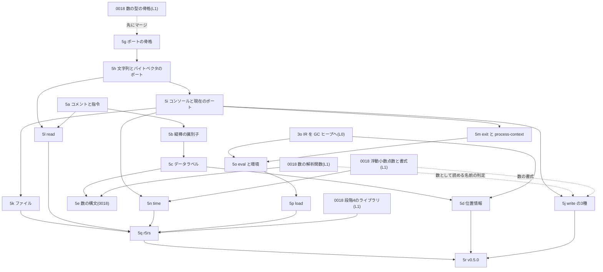

# 0019: 段階5の実装計画 — ポートと入出力

- 対応する決定: [ADR-0003](../adr/0003-precise-mark-sweep-gc.md)、[ADR-0018](../adr/0018-incremental-vertical-slices.md)、[ADR-0027](../adr/0027-severity-by-consequence-and-a-cost-side-stop.md)、[ADR-0031](../adr/0031-gc-at-machine-step-boundaries.md)、[ADR-0038](../adr/0038-wasm-entry-layer-allocations-outside-the-accounting.md)、[ADR-0039](../adr/0039-standard-environment-installed-at-init.md)。並行の進め方は 0017(`docs/plans/0017-parallel-lanes.md`。この計画書を書いた時点で main に未マージなので、リンクにしていない)
- 段階: 5(ポートと入出力)。段階の作業項目と完了条件は [roadmap.md](../roadmap.md) の段階5の節が正
- 対象のレーン: 0017 の L3(ポートと入出力)の全部と、L2(リーダ)のうち、リーダの完全化と位置情報の副表。L2 の数の構文は、段階4の計画(0018)の担当で、ここでは順序だけを書く
- 日付: 2026-10-20
- 状態: 下書き。「合意を求める点」への回答を待つ。スライスの実装は未着手

## 解こうとしている問題

段階3までの処理系には、ポートが無い。結果の出力は、`Interpreter.evalPrint` に渡す `std.Io.Writer` だけを通り、Scheme のプログラムは `display` も `read-char` も呼べない。`eval` と `exit` は、機械操作プリミティブとして設計だけがある([runtime.md](../design/runtime.md) の機械操作プリミティブ)。リーダは、データラベル、ブロックコメント、`#;`、縦棒の識別子、`#!fold-case` の指令、文字列の行継続を読めない([frontend.md](../design/frontend.md) の段階ごとの実装範囲)。プリンタは循環を検出しないので、`set-cdr!` で作った循環リストを REPL が書くと止まらない。

R7RS 付録Aのライブラリのうち、段階5が入れるのは、`(scheme file)` `(scheme read)` `(scheme write)` `(scheme load)` `(scheme eval)` `(scheme repl)` `(scheme process-context)` `(scheme time)` `(scheme r5rs)` の9つと、`(scheme base)` のポートの識別子である。必須の識別子の一覧は `tests/r7rs-required/` の各ファイルが正で、ここに複製しない。

## 完了条件

[roadmap.md](../roadmap.md) の段階5の完了条件が正である。この計画は次のように読む。

- 循環リストの `write` がデータラベル付きで出る(5j)。
- `#!fold-case` が入力の途中で有効になる(5a)。
- 衛生性の検証項目([frontend.md](../design/frontend.md))のうち、循環データの `quote`(9番)が Scheme から通る(5c)。
- [runtime.md](../design/runtime.md) の「テストに含める事例」の12(`exit` と `dynamic-wind`)が通る(5m)。
- R7RS 付録Aのライブラリすべてが `import` できる(5q。段階4のライブラリは 0018 が入れる)。
- リリース v0.5.0 を出す(5r)。

## 範囲

含めるもの:

- roadmap の段階5の作業項目のすべて(割り当ては下の表)。
- ポートの型、文字列ポート、バイトベクタポート、ファイルポート、コンソールのポート(標準入出力と標準エラー)。
- `write` の3種と `display` の循環への対応、非 ASCII を含むシンボルの縦棒での書き出し。
- `eval` `environment` `interaction-environment` `load`、`exit` `emergency-exit` `command-line` `get-environment-variable` `get-environment-variables`、`current-second` `current-jiffy` `jiffies-per-second`。
- WASM の境界の追加(`sucheme_set_command_line`、`sucheme_exit_code`、状態コード -6、時刻の import)と、`web/sucheme.js` と `tools/test-wasm/` のホスト側の対応。

含めないもの(送り先は括弧の中):

- 数の構文と数の書式の実体(段階4、0018)。この計画は、呼ぶ側の署名だけを書く。
- 再開可能な機械と、ブラウザでの入力待ち(状態コード 2)と `sucheme_provide_input`(段階8)。段階5の WASM の標準入力は、合意を求める点の6で決める。
- 準拠スイートの取り込み(段階6、0020)。

## roadmap の項目の割り当て

| roadmap の段階5の項目 | スライス |
| --- | --- |
| テキストポートとバイナリポート、文字列ポート、バイトベクタポート、ファイルポート | 5g(型の骨格)、5h(文字列とバイトベクタ)、5i(コンソール)、5k(ファイル) |
| 第2類の経路を同じリゾルバに通す。失敗は `file-error` | 5k |
| リーダの完全化 | 5a、5b、5c |
| リーダの位置情報の副表(スライス未割り当て) | 5d |
| `write` と `write-shared` と `write-simple` | 5j |
| `eval` `exit` と `eval` 用の環境の値。`Expander.constant` の EOF と約束の分岐を Scheme から通すテスト | 5m(`exit`)、5o(`eval` と環境の値とテスト) |
| 9つのライブラリ | 5i と 5j(`(scheme write)`)、5k(`(scheme file)`)、5l(`(scheme read)`)、5m(`(scheme process-context)`)、5n(`(scheme time)`)、5o(`(scheme eval)` `(scheme repl)`)、5p(`(scheme load)`)、5q(`(scheme r5rs)`) |

リーダの項目のうち、`#u8` と、文字列と文字の16進のエスケープは、すでに入っている(`src/reader.zig` の `atBytevectorOpen`、`src/string_syntax.zig` と `src/char_syntax.zig` の `x` の分岐)。5a から 5c は、残りを足す。roadmap の項目は、この計画の合意のあとで、入っているものが分かる形に直す(下の「合意のあとにやること」)。

## スライス

規模は、0016 と同じ「小・中・大」の3段で書く。見積りの時間は付けない(別の方法で付ける)。担当の階層は 0017 の「階層と引き継ぎ」の T1・T2・T3 である。

| スライス | レーン | 完了条件 | 所有するファイル | 階層 | 前提 | 並行 | 規模 |
| --- | --- | --- | --- | --- | --- | --- | --- |
| 5a コメントと指令と行継続 | L2 | `#\| a #\| b \|# \|# 1` が `1`、`(list 1 #;2 3)` が `(1 3)`、`#!fold-case` のあとの `ABC` が `abc` で、`#!no-fold-case` で戻る。文字列の行継続が読める | `src/reader.zig`、`src/string_syntax.zig` | T2 | なし | 5b と 5c とは直列(同じファイル)。L3 とは並行 | 小 |
| 5b 縦棒の識別子 | L2 | `(eq? '\|a b\| (string->symbol "a b"))` が `#t`。`\|\x41;\|` が `A` という名前のシンボル | `src/reader.zig`、`src/symbol_syntax.zig`(新規、必要なら) | T2 | 5a | L3 と並行 | 小 |
| 5c データラベル | L2 | `(let ((x '#0=(a . #0#))) (eq? x (cdr x)))` が `#t`。衛生性の検証項目の9 | `src/reader.zig` | T2(T3 がレビュー) | 5b | L3 と並行 | 中 |
| 5d 位置情報の副表 | L2 | 展開時のエラーが、ファイルと行と桁を添えて報告される | `src/reader.zig`、`src/syntax/source.zig` の受け渡しの部分 | T3 | 5c、3o のマージ | L3 と並行。3o とは直列 | 中 |
| 5g ポートの型の骨格 | L3 | `Value` に `port` の変種があり、GC が辿り、計上し、回収する。プリンタが `#<port>` と書く。手続きは足さない | `src/value.zig`、`src/trace.zig`、`src/heap.zig`、`src/printer.zig` の1行 | T3 | 0018 の数の型の骨格との順序(下の「型の骨格の衝突」) | L2 と並行 | 小 |
| 5h 文字列ポートとバイトベクタポート | L3 | `(let ((p (open-input-string "ab"))) (list (read-char p) (peek-char p) (read-char p) (eof-object? (read-char p))))` が `(#\a #\b #\b #t)`。`get-output-string` と `get-output-bytevector` が往復する | `src/port.zig`(新規)、`src/prim/port.zig`(新規)、`src/prim/table.zig` の1行、`lib/scheme/base.sld` のポートの輸出 | T2 | 5g | L2 と並行 | 中 |
| 5i コンソールのポートと現在のポート | L3 | `(display "hi")` と `(newline)` と `(write-string "x" (current-error-port))` が、ネイティブでも WASM でも、評価の結果の出力と同じ順で出る。`current-output-port` が `parameterize` で差し替わる | `src/port.zig`、`src/prim/port.zig`、`src/platform/`(新規)、`src/sucheme.zig` の配線、`src/wasm.zig`、`lib/scheme/write.sld`(新規、`display` だけ先に) | T2 | 5h | L2 と並行 | 中 |
| 5j `write` の3種 | L3 | `(let ((x (list 1 2))) (set-cdr! (cdr x) x) (write x))` が `#0=(1 2 . #0#)`。`write-shared` が共有を、`write-simple` がラベルなしを書く。`display` が循環で止まる。非 ASCII を含むシンボルを縦棒で書く | `src/printer.zig`、`src/prim/port.zig` の書き出しの手続き、`lib/scheme/write.sld` | T2(T3 がレビュー) | 5i | L2 と並行 | 中 |
| 5k ファイルポートと `(scheme file)` | L3 | `with-output-to-file` で書いたファイルを `call-with-input-file` で読み返せる。開けないファイルで `file-error?` が真になる条件が送出される。WASM で `file-exists?` が `#f` を返す | `src/port.zig`、`src/prim/port.zig`、`src/resolve.zig` の第2類の入口、`src/platform/`、`lib/scheme/file.sld`(新規) | T3(GC との関係)、T2(手続き) | 5i | L2 と並行 | 大 |
| 5l `read` と `(scheme read)` | L3 | `(read (open-input-string "(a . b) c"))` が `(a . b)` で、続く `read` が `c`、その次が EOF。読めない入力で `read-error?` が真になる。`#!fold-case` がポートごとに効く | `src/prim/port.zig`、`lib/scheme/read.sld`(新規) | T2 | 5h、5a(指令の状態) | L2 と並行。5a のマージ後 | 小 |
| 5m `exit` と `(scheme process-context)` | L3 | 事例12が通る。`sucheme prog.scm a b` で `(command-line)` が `("prog.scm" "a" "b")` の形の文字列のリスト。終了コードが [platform-and-web.md](../design/platform-and-web.md) の表どおり。WASM が -6 と `sucheme_exit_code` を返す | `src/machine.zig` の `MachineOp.exit` と巻き戻しの目標、`src/value.zig` の `MachineOp` の1行、`src/prim/process.zig`(新規)、`src/main.zig` のファイルの実行の部分、`src/wasm.zig`、`web/sucheme.js`、`tools/test-wasm/`、`lib/scheme/process-context.sld`(新規) | T3(機械)、T2(残り) | 5i | 3o と重なる(下の「機械の重なり」) | 中 |
| 5n `(scheme time)` | L3 | `(< 0 (current-jiffy))` と `(exact-integer? (jiffies-per-second))` が `#t`。`current-second` が不正確な数を返す。WASM でも同じ | `src/prim/time.zig`(新規)、`src/platform/`、`src/wasm.zig`、`web/sucheme.js`、`tools/test-wasm/`、`lib/scheme/time.sld`(新規) | T2 | 5i、0018 の浮動小数点数 | L2 と並行 | 小 |
| 5o `eval` と環境の値 | L3 | `(eval '(* 7 3) (environment '(scheme base)))` が `21`。`(eval '(define foo 32) (environment '(scheme base)))` が誤りを送出する。`interaction-environment` で定義した名前が REPL から見える。EOF の値と約束を `eval` で定数にするテストが通る | `src/machine.zig` の `MachineOp.eval`、`src/value.zig` の環境の値の型、`src/prim/eval.zig`(新規)、`lib/scheme/eval.sld` `repl.sld`(新規) | T3 | 3o のマージ、5m | 3o とは直列 | 大 |
| 5p `load` と `(scheme load)` | L3 | `(load "x.scm")` が探索ルートの中の `x.scm` を、指定の環境で評価する。ルートの外の名前を拒否する | `src/prim/eval.zig`、`src/resolve.zig` の第1類の入口、`lib/scheme/load.sld`(新規) | T2 | 5o | L2 と並行 | 小 |
| 5q `(scheme r5rs)` | L3 | `(import (scheme r5rs))` が通り、`(eval '(+ 1 2) (scheme-report-environment 5))` が `3`。付録Aの全ライブラリが `import` できる | `lib/scheme/r5rs.sld`(新規)、`src/prim/eval.zig` の `null-environment` と `scheme-report-environment` | T2(輸出の転記は T1) | 5k、5l、5n、5p、0018 の `(scheme inexact)` `(scheme complex)` `(scheme char)` | 最後 | 小 |
| 5r v0.5.0 と段階の完了 | L3 | v0.5.0 が公開され、段階5の完了の手続きが済む | `docs/releases/`、`build.zig` の `current_stage` と版、roadmap | T2 | 5a から 5q、v0.4.0 の公開 | 最後 | 小 |

5e は、L2 が数の構文を足すスライスの名前として 0018 に渡す(下の「数の構文との順序」)。5f は欠番である。

### 5a から 5d の中身(L2)

- 5a: `skipWhitespace` を、行コメント、入れ子のブロックコメント、データコメント、指令を読み飛ばす形に広げる。`#;` は、続く1つのデータを読んで捨てる。捨てるデータの中のデータラベルの扱いは 5c で決める。指令の直後に区切りが要る([frontend.md](../design/frontend.md) のケースフォールディングの節。`#!fold-casex` は読み取りの誤り)。閉じていない `#|` と、データの来ない `#;` は `Incomplete` にする。`isIncomplete` の判定表の `"#| x"` と `"(a #;1"` の行は、偽から真に変わる。行継続は `\` に続く行内の空白、改行、次の行の先頭の空白を読み飛ばす(R7RS 6.7 と 7.1.1 の `<line ending>` と `<intraline whitespace>`。原文で確かめてから書く)。
- 5b: `|` で始まるトークンを、R7RS 7.1.1 の `<symbol element>` の規則で読む。`\x` の16進と、文字列と同じ記憶術のエスケープを許す(原文の生成規則で確かめる)。名前に ASCII でない文字を含むシンボルは、`#!fold-case` のもとでも畳み込まない縦棒の記法でだけ作れる。畳み込みの扱いは R7RS 2.1 の規定で確かめる。`folded` の ASCII の assert は、縦棒の識別子を通さない形に保つ。
- 5c: `#n=` を読んだら、ラベルの表に仮の目印(placeholder)を置き、データを読み終えたら、目印を本体で置き換える。置き換えは、作ったペアとベクタを訪問済みの集合つきで辿る(循環を作るので、Zig の再帰を使わない。[runtime.md](../design/runtime.md) の入力の深さに比例する処理)。ラベルの表と訪問済みの集合は、計上の対象である(runtime.md の計上の対象の「データラベルの表」)。読み取りの途中で GC は走らない(`Sink` の doc コメント)ので、目印はルートに入れなくてよい。未定義のラベルの参照と、同じラベルの二重定義は、読み取りの誤り(新しい `SyntaxError` の変種)にする。`#;` の中のラベルは、捨てるデータの中だけで有効にする。目印の表現(専用の `Value` の変種を作らず、ラベルの表の中の未完成のペアを指すなど)は、5c の中で決め、PR に書く。
- 5d: [frontend.md](../design/frontend.md) の位置情報の節を実装する。副表は、1つのトップレベルフォームを読んでから展開し終えるまでの作業表で、ルートに登録し、展開が終われば捨てる。展開器がコアIRの節点に位置を写す部分は、3o が節点を GC ヒープに移したあとの形に合わせる必要があるので、3o のマージを前提にする。L7 の「エラー位置の表示」が、この結果を使う。

### 5g から 5r の中身(L3)

- 5g: ヒープの型 `Port` を足す。中身は、方向(入力、出力)、種類(テキスト、バイナリ)、開いているか、畳み込みの状態(`#!fold-case` の状態はポートごと。[frontend.md](../design/frontend.md))、裏付け(下の表)の直和である。`Value` と `Kind` と `heap_types` に1行ずつ、`payloadBytes` と `free` に1行ずつ足す。`isEqv` は同一性で比べる。裏付けの各変種の中身は、合意を求める点の1と3と4の回答で決まる。骨格の PR では、文字列ポートの変種1つだけを置き、ほかは各スライスが足す。
- 5h: `src/port.zig` に、ポートの読み書きの関数を置く(下の「署名」)。`src/prim/port.zig` に、`(scheme base)` のポートの手続きのうち、明示したポートを取るものと、文字列ポートとバイトベクタポートを作るものを置く。`call-with-port` は Scheme で書けるので、`lib/sucheme/procedures.scm` に置く(R7RS 6.13.1 の定義を原文で確かめる)。`read-bytevector!` は `requireMutable` を呼ぶ([runtime.md](../design/runtime.md) のリテラルの不変性)。
- 5i: 標準入力、標準出力、標準エラーのポートを、`Interpreter` が作る。`current-input-port` `current-output-port` `current-error-port` は、パラメータオブジェクトである(R7RS 6.13.1)。既存の `make-parameter` の機構に載せる。ネイティブの出力は `evalPrint` が受け取る `std.Io.Writer` に、WASM の出力は既存の出力バッファに書く。WASM の出力バッファを計上の外に置く例外([ADR-0038](../adr/0038-wasm-entry-layer-allocations-outside-the-accounting.md))は変えない。プラットフォームの差は、[platform-and-web.md](../design/platform-and-web.md) のプラットフォーム抽象の形(`src/platform/native.zig` と `src/platform/wasm.zig` をコンパイル時に選ぶ)で、このスライスから置く。
- 5j: プリンタを、`write`(循環にだけラベル)、`write-shared`(2回以上現れるペアとベクタすべてにラベル)、`write-simple`(ラベルなし)、`display`(循環にだけラベル)の4つの形にする。原文は R7RS 6.13.3 で、`display` は「must not loop forever on self-referencing pairs, vectors, or records」である。ラベルは、先に1回辿って、共有または循環しているオブジェクトを数え、2回目に書く。辿る表は計上の対象である。プリンタは今、作業スタックを `scratch`(計上の外)に置いているので、5j で計上つきの確保に移す。名前に ASCII でない文字を含むシンボルと、そのまま書くと別のデータとして読まれる名前(空白や括弧を含むもの、数として読めるもの)は、縦棒で囲んで書く(R7RS 6.13.3 の「Symbols that contain non-ASCII characters are escaped with vertical lines」)。数として読めるかの判定は、0018 の解析関数を呼ぶ(下の「署名」)。REPL が結果を書くのも `write` なので、循環した結果が止まらない問題も、ここで直る。
- 5k: ファイルポートを、[frontend.md](../design/frontend.md) のファイルを開く経路の第2類として、リゾルバを通して開く。探索ルートの制約はかけない。失敗は、`ConditionKind.file` の条件で送出する。WASM の扱いは frontend.md の表どおり(開く手続きと `delete-file` は `file-error`、`file-exists?` は `#f`)。閉じ忘れたファイルの扱いは、合意を求める点の4で決める。
- 5l: `read` は、ポートの残りの入力を `Reader` に渡し、読めたデータの長さだけポートを進める。`Reader` の今の形(入力のスライス、`pos`、`fold_case`)で足り、`src/reader.zig` を変えない見込みである。指令で変わった `fold_case` は、読み終えたあとポートに書き戻す。ファイルとコンソールのポートでは、データの途中で入力のバッファが尽きたとき(`Incomplete`)、バッファに続きを足して、データの頭から読み直す。読み直しの費用はデータの長さの2乗に比例する。REPL の継続行の判定と同じ制約で、段階7の差分読み取りの項目([roadmap.md](../roadmap.md))が解く。`reader.zig` の変更が要ると分かったら、L3 の担当は止めて、L2 に頼む(0017 の引き継ぎの条件の2)。
- 5m: `MachineOp` に `exit` を足す。未処理例外と同じ巻き戻しの経路で最外まで戻り、途中の `after` を呼ぶ([runtime.md](../design/runtime.md) の未処理例外と、必要なフレームの種類の「`exit` の巻き戻し」)。最外に着いたら、終了の値を持って、`error.Raised` と別の Zig の誤り(名前は 5m で決める)で機械の外へ出る。`emergency-exit` は、純粋プリミティブとして、巻き戻さずに同じ誤りを返す。`exit` の値から終了コードへの変換は [platform-and-web.md](../design/platform-and-web.md) の表どおり。`sucheme prog.scm` の後ろの引数を、今の 64 での拒否から、`command-line` に渡す形に変える(`src/main.zig` の doc コメントの表を直す)。引数と環境変数を UTF-8 として検査する位置は、platform-and-web.md の未決の記述どおり、このスライスで決める。WASM は `sucheme_set_command_line` と `sucheme_exit_code` を足し、`exit` で -6 を返す。環境変数は空として扱う。
- 5n: `current-jiffy` と `jiffies-per-second` は正確な整数(固定長整数で足りる)、`current-second` は不正確な数である(R7RS 6.14)。`current-second` は 0018 の浮動小数点数が入ってから足す。それまでに 5n を始めるなら、`current-jiffy` と `jiffies-per-second` だけを先に入れ、`(scheme time)` の `.sld` は `current-second` が入ってから置く。TAI は、R7RS が許す「UTC に定数を足したもの」で返す。足す定数の値と出典(IERS の公表値)は、5n の着手時に一次情報で確かめる(未確認)。WASM の import の形は、合意を求める点の2で決める。ネイティブの時計の API(Zig 0.17.0 の `std.Io.Clock` の種類)は、5n の着手時に標準ライブラリのソースで確かめ、[zig-api-notes.md](../design/zig-api-notes.md) に足す(未確認)。
- 5o: 環境の値(`environment` が返す指定子)のヒープの型を足し、`MachineOp` に `eval` を足す。`eval` は、データを指定の環境で展開し、できた節点を `eval` の継続のもとで、末尾の位置として評価する(R7RS 3.5)。`environment` は、空の環境に輸入集合を `import` した、変更できない環境を作る(R7RS 6.12)。環境の表の形と、展開した節点の置き場所は、3o の結果に従う。3o の前に `eval` を入れると、`eval` を繰り返すループが、計上の外の節点を際限なく積む。roadmap の、`Expander.constant` の EOF の値と約束の分岐を Scheme から通すテストは、`(eval (list 'quote (eof-object)) ...)` の形で書く。
- 5p: `load` は第1類の経路で、探索ルートの制約をかける([frontend.md](../design/frontend.md))。読み込んだ式は、5o の機構で、指定の環境(省略時は `interaction-environment`)で順に評価する。
- 5q: `(scheme r5rs)` は、ほかのライブラリからの再輸出と、`null-environment` と `scheme-report-environment` である。数の手続き(`exact->inexact` など)は 0018 のライブラリを待つ。準拠マトリクスの、再輸出による識別子の重複は、roadmap の段階6の項目が解く。
- 5r: 0016 の 3r と同じ手続き。v0.4.0 の公開より前には出さない(リリースは段階の完了条件で切る。0017 の合意を求める点の4)。

## 依存と実施順



実線は、後ろのスライスが前のスライスのマージを待つ依存である。点線は、マージの順序の取り決めか、後から呼び先を差し替える依存で、着手を縛らない。5j は、0018 の書式関数と解析関数がまだ無ければ、固定長整数の書式と、今の `isDecimalInteger` 相当の判定で入れ、0018 のマージのあとに呼び先を差し替える(差し替えは L3 の小さな PR にする)。

### 並行できるものと、できないもの

- L2(5a から 5d)と L3(5g から 5q)は、所有するファイルが重ならないので、並行できる。重なるのは、5l が 5a の指令の状態に依存する点だけで、5l は 5a のマージを待つ。
- L2 の中は直列である(どれも `src/reader.zig` を触る)。0018 の数の構文(5e)も、L2 の中で 5c のあとに置く。
- L3 の中では、5i のあとに、5j、5k、5m、5n を並行できる。どれも `src/prim/port.zig` か `src/platform/` に足すが、足す関数が別で、隣り合う行の衝突だけである。同時に開く PR の数は、0017 の上限 W に従う。
- 5o は 3o のマージを待つ。5p と 5q は 5o のあとである。

### 型の骨格の衝突

`src/value.zig`、`src/trace.zig`、`src/heap.zig` には、0018(L1)が数の型を、この計画(5g)がポートの型を足す。どちらも `Value` の変種、`Kind`、`heap_types`、`payloadBytes`、`free` の末尾に1行ずつ足すので、衝突は隣り合う行だけである。

- 順序: 先に ready になったほうを先にマージする。同時なら、0018 の骨格を先にする。段階4のリリースが段階5より前で、5j が数の書式を呼ぶためである。
- 後からマージするほうは、main を取り込んで、両方の行を残す。取り込みは、[AGENTS.md](../../AGENTS.md) の規則どおり、ready にする直前でよい。
- どちらの骨格の PR も、型の変種と、GC と計上の最小の行だけにして、手続きを含めない。

### 機械の重なり

`src/machine.zig` は、L0 の 3o と、この計画の 5m と 5o が触る。`origin/main`(`83e173d`)で確かめたこと:

- 0016 は 3o の変更ファイルを `src/syntax/expand.zig`、`src/syntax/env.zig`、`src/context.zig`、`src/core.zig` としており、`src/machine.zig` にどこまで及ぶかは見積れないと書いている(0016 の「確かめられなかったこと」)。`Machine` は、`Context` を持ち、`apply` の中で `MachineOp` を振り分け、`invoke` で巻き戻す。`Context.code_roots`(3o が無くす)は `src/context.zig` にある。
- 5m が触るのは、`MachineOp` の変種の追加、`apply` の振り分けの1行、`invoke` の巻き戻しの目標に「終了」を加える部分である。展開器と節点には触れない。
- 5o は、`apply` から展開器を呼び、できた節点を評価する。節点の置き場所と環境の表の形は、3o が決める。

取り決め:

- 5m は、3o の着手前にマージできれば先に入れる。3o が進行中なら、5m の PR は 3o のマージを待ってから main を取り込む。どちらの場合も、マージの順序を報告する前に、変更ファイルの一覧を突き合わせる(AGENTS.md)。
- 5o は、3o のマージのあとに着手する。

### そのほかのファイルの重なり

- `src/sucheme.zig`: 0017 では L0 の所有である。5i(コンソールのポートの配線)と 5m(終了の結果)が、`Interpreter` に小さく足す。3o と同時に開いたときは、後からマージするほうが取り込む。
- `src/main.zig`: L6 が REPL の入口を、5m がファイルの実行の引数と終了コードを触る。触る関数が別で、隣り合う行の衝突だけの見込みである。
- `lib/scheme/base.sld`: 0018 が数の識別子を、5h がポートの識別子を輸出に足す。輸出の並びの中で、L3 の分を1つの塊にまとめて置き、隣り合う行の衝突にとどめる。
- `web/sucheme.js` と `tools/test-wasm/`: ホスト側の import と、新しいエクスポートの呼び出しは L3(5m、5n)が足す。`web/` のそれ以外は L7 の所有である。
- `src/prim/table.zig`: 5h、5m、5n、5o が1行ずつ足す。

### 数の構文との順序

roadmap の段階4の「リーダに基数接頭辞、正確性接頭辞、分数、小数、指数、`+inf.0` 系、複素数を追加」は、0018 の担当である。0017 の取り決めで `src/reader.zig` は L2 の所有なので、実装は L2 のスライス 5e として行い、0018 が解析関数を `src/num/` に置く。

- 5e は、0018 の解析関数のマージと、5c のマージのあとに置く。5a から 5c は `atom` の外(空白の読み飛ばし、`#` の分岐、`|`)を主に触り、5e は `atom` の中の数の判定を差し替えるので、順序を逆にしても衝突は小さい。0018 の解析関数が 5a より先に揃ったときは、5e を 5a の前に入れてよい。
- 5e の完了条件と検証項目は 0018 が書く。この計画は、5e を L2 の直列の中に置くことだけを決める。

## 署名

レーンをまたいで呼ぶ関数の署名を書く(0017 のリスクと対策の「レーン間の見えない結合」)。名前は実装の中で変えてよいが、変えたら、相手のレーンの計画書の担当に、親を通して知らせる。

0018(L1)から受け取るもの(0018 の計画書が正で、食い違ったら 0018 に合わせてこの節を直す):

```zig
// src/num/format.zig: 数の外部表現を書く。number->string と同じ文字列を出す。
pub fn write(out: *std.Io.Writer, v: Value, radix: u8) std.Io.Writer.Error!void;

// src/num/parse.zig: トークンが数の構文なら数を、そうでなければ null を返す。
// 多倍長整数などの確保はヒープに行う。
pub fn parse(heap: *Heap, token: []const u8, default_radix: u8) ParseError!?Value;
```

プリンタ(5j)は、数の変種すべてを `format.write(out, v, 10)` に渡す。シンボルを縦棒で囲むかの判定は、`parse` が null 以外を返す名前を「数として読める」とみなす。`parse` が確保をするなら、判定のための別の入口(確保しない `looksLikeNumber(token: []const u8) bool`)を 0018 に頼む。

L3 が置くもの(`src/port.zig`。5h で入れる):

```zig
pub const Error = heap_mod.Error || error{ PortClosed, WrongDirection, WrongKind, Io };

// テキストの入力ポートから1文字を読む。終端なら null。
pub fn readChar(heap: *Heap, port: *Port) Error!?u21;
pub fn peekChar(heap: *Heap, port: *Port) Error!?u21;
// バイナリの入力ポートから1バイトを読む。終端なら null。
pub fn readByte(heap: *Heap, port: *Port) Error!?u8;
pub fn peekByte(heap: *Heap, port: *Port) Error!?u8;
// 出力ポートにバイト列を書く。テキストのポートには妥当な UTF-8 だけを渡す。
pub fn writeBytes(heap: *Heap, port: *Port, bytes: []const u8) Error!void;
pub fn flush(port: *Port) Error!void;
pub fn close(port: *Port) void;

// read(5l)のための入口: まだ読んでいない入力の、手元にある分と、そこから n バイトを
// 読んだことにする操作。足りなければ fill で足す(終端なら false)。
pub fn pending(port: *const Port) []const u8;
pub fn consume(port: *Port, n: usize) void;
pub fn fill(heap: *Heap, port: *Port) Error!bool;

// プリンタ(5j)のための入口: ポートに書く std.Io.Writer。
pub fn writer(port: *Port, heap: *Heap) PortWriter;
```

プリンタ(5j、`src/printer.zig`)の入口は、次の形にする。今の `write` と `display` は、この1つにまとめる。

```zig
pub const Mode = enum { write, shared, simple, display };

// ラベルの表と作業スタックは、heap の計上つきの確保で持つ。
pub fn print(out: *std.Io.Writer, heap: *Heap, symbols: *const symbol.Table, v: Value, mode: Mode) Error!void;
```

## ホスト側のインポートの設計

[platform-and-web.md](../design/platform-and-web.md) のインポートの節は、`host_write_stdout`、`host_write_stderr`、`host_now_ms` の3つに限る、と書いている。今の `src/wasm.zig` が宣言するのは `host_write_stderr` だけで、パニックのときに使う。

- 標準出力と標準エラー(5i): 今のまま、出力バッファに書く。`host_write_stdout` は足さない(足す段階は決まっていない。platform-and-web.md)。`current-error-port` への書き込みも、5i では出力バッファに書く。標準出力と分けてホストに渡すかは、L7 の Web UI の表示と合わせて決めるので、段階5では分けない。分けないことを 5i の PR に書く。
- 標準入力(5i): 合意を求める点の6で決める。
- ファイル(5k): import を足さない。WASM は実ファイルを持たない(platform-and-web.md のプラットフォーム抽象)。
- コマンドラインと終了(5m): import でなく、エクスポート(`sucheme_set_command_line`、`sucheme_exit_code`)と状態コード -6 で扱う(platform-and-web.md の設計どおり)。
- 時刻(5n): 合意を求める点の2で決める。

import を足すと、ホストのすべて(`web/sucheme.js` と `tools/test-wasm/main.mjs`)が、その関数を渡さなければ、`WebAssembly.instantiate` が失敗する。5n は、`src/wasm.zig` の宣言と、2つのホストの `env` を、同じ PR で足す。`zig build test-wasm` が、渡し忘れを落とす。

## 各ライブラリの作り方

| ライブラリ | 作り方 | スライス |
| --- | --- | --- |
| `(scheme base)` のポートの識別子 | Zig のプリミティブ(`src/prim/port.zig`)と、Scheme の `call-with-port`。`base.sld` の輸出に足す | 5h、5i |
| `(scheme write)` | `display` を 5i で、`write` `write-shared` `write-simple` を 5j で。プリミティブはプリンタを呼ぶ | 5i、5j |
| `(scheme file)` | 開く手続きと `file-exists?` `delete-file` は Zig。`call-with-input-file` `call-with-output-file` は Scheme(`call-with-port` の上)。`with-input-from-file` `with-output-to-file` は、`parameterize` で現在のポートを差し替える Scheme の手続き(R7RS 6.13.1 の記述を原文で確かめる) | 5k |
| `(scheme read)` | `read` だけ。Zig のプリミティブで、`Reader` を呼ぶ | 5l |
| `(scheme process-context)` | `exit` は機械操作プリミティブ。残りは純粋プリミティブ | 5m |
| `(scheme time)` | 純粋プリミティブ3つ | 5n |
| `(scheme eval)` | `eval` は機械操作プリミティブ、`environment` は純粋プリミティブ(展開器のライブラリの表を引く) | 5o |
| `(scheme repl)` | `interaction-environment` だけ。REPL の最上位の環境を指す環境の値を返す | 5o |
| `(scheme load)` | `load` だけ。読み込みはリゾルバ、評価は 5o の機構 | 5p |
| `(scheme r5rs)` | 再輸出の `.sld` と、`null-environment` `scheme-report-environment` | 5q |

## 検証項目の割り当て

- 衛生性の検証項目の9(循環データと共有構造の `quote`): 5c。データラベルで循環と共有を作り、`eq?` で同一性を確かめる。剥離が循環で止まることは、`src/syntax/expand.zig` の単体テスト(`quote strips the aliases of a cycle`)がすでに見ている。Scheme から通すのが 5c の追加である。結果を `write` で見るケースは 5j に足す。
- [runtime.md](../design/runtime.md) の例外の事例12: 5m。`(dynamic-wind (lambda () #f) (lambda () (display "in") (exit 3)) (lambda () (display "cleanup")))` の出力と終了コードを、ネイティブ(ファイルの実行)と WASM(-6 と `sucheme_exit_code`)の両方で見る。
- roadmap の完了条件の `#!fold-case`: 5a(リーダ)と 5l(ポートごとの状態)。
- roadmap の完了条件の循環の `write`: 5j。
- roadmap の完了条件の付録Aのライブラリ: 5q。`zig build report` と `zig build check-report` が、`lib/` の輸出から表を作る。
- `Expander.constant` の EOF の値と約束の分岐: 5o。
- R7RS 6.13、6.14、6.12、2.2 と 7.1.1(リーダ)の各識別子と構文: 各スライスが、R7RS の原文([docs/spec/](../spec/README.md))の例から `tests/scheme/` のケースを起こす。原文で確かめていない例は、PR 本文に「未確認」と書く。
- 規模を試すテスト: 入れ子の深いブロックコメント、長いデータラベルの鎖(5c)、深い循環の `write`(5j)、大きな文字列ポートの読み書き(5h)、`read` の読み直し(5l)。縮小版を層1 に、規模を試す版を `tests/scheme-slow/` に置く。

`tests/scheme/` と `tests/scheme-slow/` の番号は、0017 の取り決めで、L2 が 0500 台、L3 が 0600 台である。スライスごとに次のように振る。

| スライス | 番号 |
| --- | --- |
| 5a | 0500 から 0509 |
| 5b | 0510 から 0519 |
| 5c | 0520 から 0529 |
| 5d | 0530 から 0539 |
| 5e(0018) | 0540 から 0559 |
| 5g | 0600 から 0604 |
| 5h | 0605 から 0619 |
| 5i | 0620 から 0629 |
| 5j | 0630 から 0639 |
| 5k | 0640 から 0654 |
| 5l | 0655 から 0664 |
| 5m | 0665 から 0674 |
| 5n | 0675 から 0679 |
| 5o | 0680 から 0689 |
| 5p | 0690 から 0694 |
| 5q | 0695 から 0699 |

## 合意を求める点

勧める案を先に書く。勧める案でよいときは、そう返信する。小さく戻せる選択(ファイルの構成、名前、テストの足し方)は、[AGENTS.md](../../AGENTS.md) の規則どおり、ここでは諮らず、PR に書く。1 から 3 は [open-questions.md](../design/open-questions.md) の「段階5までに決める」の3行で、4 から 6 は、この計画を書くなかで、データ形式または設計の判断と分かったものである。

1. ポートのバッファの大きさと、バッファリングの方針(open-questions.md の1行目)。
   - 勧める案: ファイルとコンソールのポートは、開くときに固定の大きさのバッファを1つ持つ。バッファはヒープの計上つきの確保で取り、ポートと一緒に回収する。ファイルへの出力は、バッファが満ちたとき、`flush-output-port`、閉じるとき、終了するときに書き出す。コンソールの出力は、それに加えて、最上位の式の評価のたびと、コンソールから入力を読む前に書き出す(プロンプトと出力の順を保つため)。大きさは、5k で、候補の値を `ReleaseSafe` で測って決め、決めた値と測定の方法をコードの `Why:` コメントに書く。文字列ポートとバイトベクタポートは、このバッファを持たない(3の表現そのものがバッファである)。
     - メリット: 確保がポートごとに1回で、上限への計上が開くときに決まる。書き出しの時点が決まっているので、出力の順序をテストできる。
     - デメリット: 大きな値を1つ選ぶと、多数のファイルを開いたときに計上が膨らむ。小さく選ぶと、システムコールが増える。
   - 別案A: バッファを持たず、書き込みのたびにシステムコールを呼ぶ。実装が最も小さいが、`write-char` を繰り返すプログラムが遅い。
   - 別案B: 伸びるバッファ。大きな書き込みでシステムコールが減るが、計上が書き込みの量に比例して動き、上限の超過が書き出しの途中で起きうる。

2. ブラウザで単調時間と絶対時刻の両方を得る import の形(open-questions.md の2行目)。
   - 勧める案: import を2つにする。`env.host_now_ms() -> f64` は絶対時刻(UNIX 時刻のミリ秒。ブラウザでは `Date.now()`)、`env.host_monotonic_ms() -> f64` は単調時間(ブラウザでは `performance.now()`)を返す。`jiffies-per-second` は、ネイティブと WASM で同じ値(マイクロ秒、`1000000`)にする。`current-second` は、絶対時刻に TAI と UTC の差の定数を足す(5n の中身)。platform-and-web.md の import の一覧と「3つに限る」の文は、5n で4つに直す。
     - メリット: 1つの import が1つの JavaScript の API に対応し、ホストの実装が読んで分かる。用途の取り違えを型でなく名前で防げる。
     - デメリット: ホストが用意する関数が1つ増える。
   - 別案A: import を1つにし、用途の引数を持たせる(`env.host_now(kind: u32) -> f64`)。import の数は増えないが、引数の値の約束がホストとの契約に増え、知らない値を渡したときの扱いを決める必要がある。
   - 別案B: 単調時間の import を持たず、`current-jiffy` を `host_now_ms` から作る。時計が戻ると `current-jiffy` が減り、R7RS 6.14 の「The starting epoch is guaranteed to be constant during a run of the program」に反する経過時間を返しうる。

3. 文字列ポートとバイトベクタポートの内部表現(open-questions.md の3行目)。
   - 勧める案: 入力のポートは、開くときに、文字列の UTF-8 のバイト列(またはバイトベクタの中身)をポートのペイロードに写し、読んだ位置をバイトの添字で持つ。出力のポートは、伸びるバイト列をペイロードに持ち、`get-output-string` と `get-output-bytevector` が新しいオブジェクトに写して返す。ペイロードは、文字列やバイトベクタと同じく、計上して回収する。
     - メリット: 開いたあとで元の文字列が `string-set!` で変わっても(R7RS 6.13.1 はこの場合を unspecified としている)、ポートの添字が文字の途中を指すことがない。文字の境目の検査が要らない。GC が辿るポインタが増えない。
     - デメリット: 入力の文字列の長さに比例する写しと計上が、開くたびにかかる。
   - 別案A: 入力のポートが元の `String` を指し、バイトの添字を持つ。写しは要らないが、`string-set!` が UTF-8 の長さの違う文字を書くとバイト列が作り直されるので、読むたびに添字が範囲と文字の境目に収まるかを確かめる必要がある。確かめ忘れると、安全ビルドで panic する。
   - 別案B: 入力のポートを、文字の配列(`u21` の列)で持つ。`read-char` が定数時間だが、文字列の4倍の大きさを計上し、`read` の `Reader` に渡すには UTF-8 に戻す必要がある。

4. 閉じ忘れたファイルポートの扱い(データ形式と GC の設計に関わる)。
   - 勧める案: ヒープが、開いているファイルポートの弱い一覧を持つ。到達できなくなった開いたポートは、回収のときに、出力なら書き出してから、閉じる。書き出しと閉じる操作の誤りは捨てる。`Interpreter.deinit` と `exit` は、一覧に残るポートをすべて書き出して閉じる。ファイルを開くとき、記述子が尽きた誤りが返ったら、GC を1回走らせて、1回だけ開き直す。回収のときに閉じるには、ヒープの回収が、ホストの閉じる関数を呼べる必要がある。`Heap` に、閉じる関数を差し込む口を1つ足す(5k で、その形を PR に書く)。
     - メリット: 閉じ忘れるプログラムでも、記述子とバッファが際限なく残らない。終了時に出力が失われない。
     - デメリット: 回収の中で入出力が起きる。書き出しの誤りを利用者に報告できない。`Heap` がホストに依存する口を持つ。
   - 別案A: 回収のときに閉じない。開いたポートは、一覧がルートとして生かし続け、`Interpreter.deinit` と `exit` で閉じる。動きが決定的だが、閉じ忘れたポートのメモリと記述子が、セッションの終わりまで残る。REPL で開き続けると、記述子が尽きる。
   - 別案B: 別案Aに、開いているファイルポートの数の上限を足し、超えたら `file-error` を送出する。資源は有界になるが、上限の値を決める根拠が要る。

5. `eval` を 3o のあとに置くこと(実施の順序)。
   - 勧める案: 5o(`eval` と環境の値)と、それに依存する 5p と 5q を、3o のマージのあとに着手する。理由は「5g から 5r の中身」の 5o にある(3o の前に入れると、`eval` を繰り返すループが、計上の外の節点を際限なく積む)。環境の値の型の形(ライブラリの表を指すか、写しを持つか)は、3o の結果に合わせて 5o で決め、データ形式の判断として、5o の着手前に改めて諮る。
     - メリット: 3o が解く問題を、`eval` で作り直さない。
     - デメリット: 段階5の最後の鎖が、3o の長さだけ延びる。3o が段階4の最初に送られた場合(0016 の範囲を狭める線)、5o も一緒に遅れる。
   - 別案: 5o を 3o より先に入れ、`eval` が作る節点を、評価が終わるまでの一時の領域に置いて捨てる。3o を待たないが、`eval` の中で定義した手続き(クロージャが節点を指す)が評価のあとも生きるので、捨てられない。この案は、確かめた範囲では成り立たない見込みである(推測。`Closure` が節点を指すことは `src/value.zig` で確かめたが、捨て方の全体は試していない)。

6. 段階5の WASM の標準入力(データの流れに関わる)。
   - 勧める案: 段階5の WASM では、`current-input-port` を、最初から終端にある入力ポートにする。`(read-char)` は EOF を返し、`char-ready?` は `#t` を返す(R7RS 6.13.2 は終端で `#t` を求める)。ホストからの入力は、段階8の再開可能な機械と `sucheme_provide_input` で入れる。この扱いを、v0.5.0 のリリースノートの既知の制限に書く。
     - メリット: 段階8の設計(状態コード 2 と入力待ち)を前倒しせずに、入力を読むプログラムが WASM でも止まらずに終わる。
     - デメリット: ブラウザで `read` を使うサンプルが、段階8まで動かない。
   - 別案: 段階5で、評価の前にホストが入力の全体を渡すエクスポート(仮の名前 `sucheme_set_stdin`)を足す。対話はできないが、入力を読むサンプルが動く。段階8で入れる `sucheme_provide_input` と別の経路になり、境界の契約が増える。

7. 型の骨格のマージの順序(報告)。「型の骨格の衝突」の節のとおり、先に ready になったほうを先に、同時なら 0018 を先にする。0017 の取り決めの具体化で、確認の対象ではない。異論があれば返信する。

## 検証

各スライスの PR を ready にする前に、[AGENTS.md](../../AGENTS.md) の検証コマンド表の「全コミット」の行をすべて通す。段階5で足す検証は次のとおりである。

- 5a から 5q: `zig build test-scheme` の `tests/scheme/` に、上の番号の範囲でケースを足す。
- 5i、5m、5n: `zig build test-wasm` に、出力の順序、-6 と終了コード、時刻の import の往復を足す。
- 5k: ファイルを書いて読み返すケース。書き込み先は、テストのランナーが作る一時のディレクトリにする(ランナーの変更が要るかは 5k で確かめる)。
- 5m: ファイルの実行の終了コードは、今は単体テストの外で手で確かめている(0016 の 3m の進捗)。事例12の終了コードを自動で見る方法(`tests/cli-slow/` の形を使えるか)を、5m で確かめる。
- 5q: `zig build report` と `zig build check-report`。

敵対的レビューは、[AGENTS.md](../../AGENTS.md) の規則に従う。ミューテーションの担当1本を基本にし、5c、5j、5k、5o のように、入力に比例する確保か、GC と計上に関わるものには、挙動を広く試す担当を足す。メモリと衛生性に関わる変更(5c、5g、5k、5o)は、T3 の担当のレビューを通す(0017 のリスクと対策)。文書だけの変更(この計画書を含む)には、サブエージェントのレビューを走らせない。

## ファイル

追加または変更する主なファイル。所有は 0017 のレーンの表に従う。

| ファイル | 変更 | スライス |
| --- | --- | --- |
| `src/reader.zig` | コメント、指令、縦棒の識別子、データラベル、位置情報 | 5a から 5d(L2) |
| `src/string_syntax.zig` | 文字列の行継続 | 5a(L2) |
| `src/value.zig`、`src/trace.zig`、`src/heap.zig` | ポートの型、環境の値の型、`MachineOp` の `exit` と `eval` | 5g、5m、5o |
| `src/port.zig`(新規) | ポートの読み書き | 5h、5i、5k |
| `src/prim/port.zig`(新規) | ポートの手続き | 5h から 5l |
| `src/prim/process.zig`、`time.zig`、`eval.zig`(新規) | プロセス、時刻、`eval` の手続き | 5m、5n、5o、5p、5q |
| `src/platform/native.zig`、`src/platform/wasm.zig`(新規) | ホストの機能の差 | 5i、5k、5m、5n |
| `src/printer.zig` | `write` の3種と `display`、シンボルの縦棒 | 5j |
| `src/machine.zig` | `exit` の巻き戻し、`eval` | 5m、5o |
| `src/resolve.zig` | 第2類の入口、`load` | 5k、5p |
| `src/sucheme.zig` | コンソールのポート、終了の結果 | 5i、5m |
| `src/main.zig` | プログラムへの引数、終了コード | 5m |
| `src/wasm.zig`、`web/sucheme.js`、`tools/test-wasm/main.mjs` | エクスポートと import | 5i、5m、5n |
| `lib/scheme/base.sld` | ポートの識別子 | 5h、5i |
| `lib/scheme/write.sld` `file.sld` `read.sld` `process-context.sld` `time.sld` `eval.sld` `repl.sld` `load.sld` `r5rs.sld`(新規) | ライブラリ | 5i から 5q |
| `lib/sucheme/procedures.scm` | `call-with-port`、ファイルの `call-with-*` と `with-*` | 5h、5k |
| `docs/design/platform-and-web.md`、`runtime.md`、`frontend.md`、`open-questions.md` | 決めたことの反映、段階5の行の削除 | 各スライス、5r |

## 確かめた事実と、確かめられなかったこと

確かめた事実(`origin/main` の `83e173d` で、ソースと文書を読んだ):

- `src/reader.zig` の `Reader` は、入力全体のスライス(`src`)と位置(`pos`)と畳み込みの状態(`fold_case`)を持ち、`next` が1つのデータを読む。`#u8(` のバイトベクタは読める。ブロックコメントと `#;` は読めず、`isIncomplete` の判定表は `"#| x"` と `"(a #;1"` を偽としている。`|` は `unreadable token` になる。
- `src/string_syntax.zig` は `\x` の16進のエスケープを読み、行継続を読まない(「行継続はまだ読まない」のコメント)。
- `src/printer.zig` は、作業スタックを `scratch` に置き、循環を検出しない。シンボルは名前だけで書く。
- `src/value.zig` の `MachineOp` に `eval` と `exit` は無い。`ConditionKind` には `read` と `file` がすでにある。
- `src/wasm.zig` が宣言する import は `host_write_stderr` だけである。`host_write_stderr` を渡すホストは、`web/sucheme.js` と `tools/test-wasm/main.mjs` の2つである。
- R7RS の原文(`docs/spec/` の errata 訂正版)で、次を確かめた。`write` は循環にだけラベルを使い、循環が無ければ使ってはならない。`write-shared` は2回以上現れるペアとベクタすべてにラベルを付ける。`write-simple` はラベルを使わない。`display` は自己参照で止まらなければならない。非 ASCII を含むシンボルは `write` で縦棒で囲む。`open-input-string` のあとで文字列を変えたときの効果は unspecified である。`current-second` は TAI の不正確な数で、UTC に定数を足したものでよい。`current-jiffy` は正確な整数で、起点は1回の実行の間は変わらない。`exit` は例外を送出せず、継続に戻らない。`environment` が返す環境と束縛は変更できず、そこでの `define` の `eval` は誤りを送出する。
- `tests/r7rs-required/r5rs.txt` は、`exact->inexact` `make-polar` などの数の手続きと、`null-environment` `scheme-report-environment` を含む。

確かめられなかったこと:

- 0018(段階4)の計画書は、この計画書を書いた時点で push されていない。「署名」の節の 0018 から受け取る関数は、この計画の側の案である。
- 3o が `src/machine.zig` と `src/sucheme.zig` のどこまでを変えるかは、0016 が見積れないとしており、ここでも分からない。
- Zig 0.17.0 の `std.Io.Clock` の時計の種類、`std.Io.File` の閉じる関数が `Io` を要るか、記述子が尽きたときの誤りの名前。5k と 5n の着手時に標準ライブラリのソースで確かめる。
- TAI と UTC の差の現在の値。5n で一次情報で確かめる。
- 5l の読み直しの費用が、実際のプログラム(大きなファイルの `read`)でどれだけになるか。5l で測る。

## 範囲を狭める線

次の兆候が出たら、巡を足す前に、範囲を狭めるかをユーザーに諮る(AGENTS.md の「終わらなさそうなら」の規則)。

- 5k の GC とファイルの閉じ方が、レビューの巡ごとに必須の指摘を減らさない。このとき、合意を求める点の4の別案A(回収のときに閉じない)に落とし、閉じ忘れの資源を既知の制限として v0.5.0 に入れる。
- 3o が段階4以降に送られる。このとき、5o、5p、5q を段階6の前に送り、v0.5.0 の完了条件の「付録Aのライブラリすべて」を、`(scheme eval)` `(scheme repl)` `(scheme load)` `(scheme r5rs)` を除いた形に狭めることを諮る(roadmap の完了条件の変更になる)。
- 5c の目印の置き換えが、GC と計上の不変条件を変える必要に行き当たる。このとき、T3 へ引き継ぐ(0017 の引き継ぎの条件の4)。

## 合意のあとにやること

- roadmap の段階5の項目を、入っているもの(`#u8`、16進のエスケープ)が分かる形に直し、位置情報の副表の「スライス未割り当て」を 5d に替える。
- open-questions.md の段階5の3行を、決めたスライス(5k、5n、5h)で消す。
- 0018 の計画書と、署名と骨格の順序を突き合わせる。食い違いは、親を通して両方の担当に知らせる。

## 進捗

| スライス | 状態 | PR |
| --- | --- | --- |
| この計画書 | 下書き | - |
| 5a から 5r | 未着手 | - |

## 次にやること

- 合意を求める点の1から6への回答を得る。
- 0017 が main にマージされたら、この計画書の 0017 への言及をリンクに直す。
- 合意のあと、L2 は 5a から、L3 は 5g から始める。5g は、0018 の数の型の骨格との順序を、親が確かめてから ready にする。
