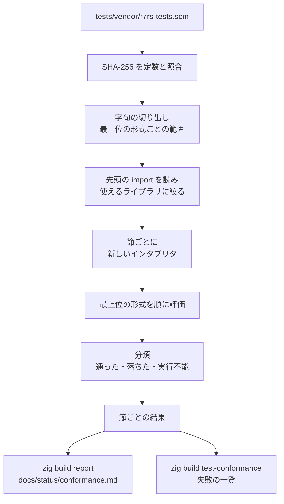
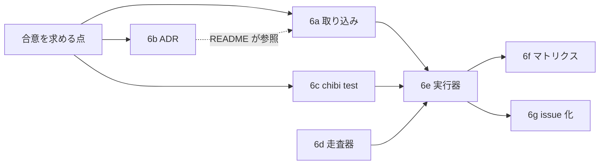

# 0020: 準拠ハーネスの前倒し — レーン L5

- 対応する決定: [ADR-0013](../adr/0013-testing-strategy-and-conformance-suite.md)(3層のテストと準拠スイートのベンダリング)、[ADR-0022](../adr/0022-unlicensed-proprietary.md)(UNLICENSED と第三者由来のもの)、[ADR-0026](../adr/0026-verify-facts-about-code-not-prose.md)(検査はコードの事実について)、[ADR-0027](../adr/0027-severity-by-consequence-and-a-cost-side-stop.md)(重要度と費用の側の停止)、[ADR-0039](../adr/0039-standard-environment-installed-at-init.md)(標準環境の初期化)
- 段階: 6(準拠検証)のうち、前倒しで始められる項目。段階の作業項目と完了条件は [roadmap.md](../roadmap.md) の段階6の節が正
- レーン: [0017](0017-parallel-lanes.md) の L5(準拠ハーネス)
- 日付: 2026-10-20
- 状態: 合意済み(2026-10-20)。「合意を求める点」の4項目すべてを、勧める案どおりに承認した。スライスの実装は未着手

## 解こうとしている問題

段階6の作業項目は、準拠スイート(`r7rs-tests.scm`)の取り込み、`(chibi test)` 互換の最小実装、準拠マトリクスへの結果の列、不合格項目の issue 化である。今の計画では、段階5が終わるまで、どれも始まらない。

一方で、スイートの結果は、段階4と段階5の各レーン(L1 から L4)の作業項目の一覧として使える。スイートが早く回れば、各レーンは、自分の領域で何が落ちているかを、仕様の読み直しでなく実行の結果から知れる。[0017](0017-parallel-lanes.md) は、この情報の流れを L5 から各レーンへの点線として描いた。

スイートは、現在の処理系でも、節によってはかなりの部分が動く。2026-10-20 に、`origin/main`(`83e173d`)の実行ファイルで、使い捨ての試作を走らせて確かめた(下の「確かめた事実」)。そのため、ハーネスを先に作れば、すぐに意味のある結果が出る。

## 完了条件

この計画の完了条件は、段階6の完了条件の一部である。段階6そのもの(不合格ゼロか根拠の記録、v1.0.0)は、この計画の範囲の外である。

- `tests/vendor/` に、上流のコミットとバイト単位で一致する `r7rs-tests.scm` と許諾文があり、`tests/vendor/README.md` に記録項目がそろっている。
- `(chibi test)` の最小実装が `lib/chibi/` にあり、`r7rs-tests.scm` が使う形式(`test`、`test-assert`、`test-error`、`test-values`、`test-begin`、`test-end`)が動く。
- `zig build test-conformance` が、スイートを節ごとに実行し、節ごとに「通った」「落ちた」「実行不能」を数え、失敗の一覧を出す。
- `docs/status/conformance.md` に、準拠スイートの節ごとの結果がある。`zig build check-report` が、生成し直した結果との一致を検査する。
- 失敗の一覧が、各レーンの作業項目(issue)に流れている。
- BSD 3条項の第3条項の扱いを定める ADR が、採用の状態である。

## 範囲

含めるもの(roadmap の段階6の項目):

- `(chibi test)` 互換の最小実装
- `r7rs-tests.scm` の取り込みと実行
- 準拠マトリクスに、準拠スイートの結果を足すこと。`(scheme r5rs)` の再エクスポートによる識別子の重複を解くこと
- `tests/vendor/README.md` の作成
- BSD 3条項の第3条項の線を引く新しい ADR。記録形式が2つ併存することを定める件を含む
- 不合格項目の issue 化(解消は各レーン)

含めないもの:

- ファジングの入力コーパスの拡充(段階6の残り。L5 の後の計画で扱う)
- 不合格項目の解消そのもの(各レーン。L5 は一覧を渡すだけにする)
- 段階6の完了の確認と v1.0.0 のリリース
- 準拠スイート以外の外部スイートの併用([ADR-0013](../adr/0013-testing-strategy-and-conformance-suite.md) の見直し条件)

## 取り込む準拠スイート

### 出典、版、ライセンス

| 項目 | 内容 | 確かめ方 |
| --- | --- | --- |
| 取得元 | <https://github.com/ashinn/chibi-scheme> の `tests/r7rs-tests.scm` | 公式リポジトリ |
| 版の候補 | `master` のコミット `b2087f3a320a56f79ede5c546fd45fdde582c4ed`(コミットの日時は 2026-10-12 21:43:53 +0900)。2026-10-20 07:30 JST ごろに、`git ls-remote` で `master` の先頭だった | `git ls-remote https://github.com/ashinn/chibi-scheme.git refs/heads/master` と、`https://github.com/ashinn/chibi-scheme/commit/<SHA>.patch` の `Date:` の行 |
| 最新のリリースのタグ | `0.11` は、コミット `b1a370b218cb13cb8f6c98a087185b0357df8e89`(コミットの日時は 2024-06-01)を指す。タグを作った日時は確かめていない(未確認) | 同上 |
| 2つの版の差 | `0.11` のあとに、`r7rs-tests.scm` を変えたコミットがある(GitHub のファイルの履歴で、2026-08-29、2026-09-27、2026-10-12)。2026-09-27 のコミットの題は、NaN の読み書きの修正である | `https://github.com/ashinn/chibi-scheme/commits/master/tests/r7rs-tests.scm` |
| ライセンス | リポジトリの根の `COPYING`。BSD 3条項の形で、著作権表示は「Copyright (c) 2009-2021 Alex Shinn」である。第3条項は「The name of the author may not be used to endorse or promote products derived from this software without specific prior written permission.」で、著者(the author)の名前だけを対象にし、寄稿者とソフトウェアの名前は挙げていない | `master` の `COPYING` を取得して読んだ(2026-10-20)。取り込む版の `COPYING` は、取り込むときに、その版で取得し直して読む([ADR-0022](../adr/0022-unlicensed-proprietary.md) の要求) |
| ファイル自身の表示 | `r7rs-tests.scm` の中に、著作権表示と許諾の文は無い。リポジトリの根の `COPYING` が覆うと読む。上流がそう明言しているかは、確かめていない(未確認) | `grep -i -E "copyright|license"` で何も出ない |

`r7rs-tests.scm` は、`master` の取得結果と、候補のコミットを指定した取得結果が、バイト単位で一致した(`cmp`)。行数や節の数は、ここに書かない。取り込んだあとは、`tests/vendor/` のファイルで数える。

版の公開日は、AGENTS.md の「手で固定する外部依存」の規則(公開から7日以上たった版)に従って選ぶ。候補のコミットは、2026-10-19 21:43 JST に7日を超えた。取り込むスライス(6a)の時点で、`master` の先頭と、7日以上たったコミットを確かめ直す。

### スイートの形と、処理系への要求

- ファイルは1つのプログラムで、先頭の1つの `import` が、標準ライブラリの多く(`(scheme cxr)`、`(scheme load)`、`(scheme repl)` を除く)と `(chibi test)` を読み込む。`define-library` は使わない。
- 節は、`(test-begin "<名前>")` と `(test-end)` で囲まれる。外側に `"R7RS"` の群があり、その中に R7RS の章立てに合わせた節が並ぶ。6.13 の中には、入れ子の節が2つある(`"Read syntax"` と `"Numeric syntax"`)。
- 使う `(chibi test)` の形式は、`test`(名前を省いた2引数の形)、`test-assert`、`test-error`、`test-values`、`test-begin`、`test-end` である。`test-group` は使わない。
- ファイルの中で、補助の手続きと構文(`test-read-error`、`test-write-syntax`、`test-numeric-syntax`、`test-precision`)を定義している。これらは `(chibi test)` の一部ではない。
- ファイルの先頭の注釈が、完全な Unicode、完全な数値塔、すべての標準ライブラリを前提にすると述べている。有理数、複素数、浮動小数点数(無限大、NaN、`-0.0`)、文字列ポート、`read`、データラベル、`#!fold-case` を使う。

### 取り込みの記録(`tests/vendor/README.md` の項目)

[ADR-0013](../adr/0013-testing-strategy-and-conformance-suite.md) の記録項目に、[ADR-0022](../adr/0022-unlicensed-proprietary.md) の要求を足す。

- 取得元のリポジトリの URL と、ファイルのパス(上流の中のパス)
- 取得時のコミットのハッシュ(40桁)と、そのコミットの日時
- 取得日
- ライセンスの名前と、同梱した許諾文のファイル名
- 取り込んだ各ファイルの SHA-256。ただし、ハッシュの値の正は、実行器の定数とする(下の「実行器の設計」)。README には、値を書かず、どこが正かを書く。同じ値を2か所に書かないためである
- リポジトリの `LICENSE`(UNLICENSED)が、このディレクトリを覆わないこと。覆うのは同梱した許諾文であること
- 取り込んだファイルを改変しないこと。処理系の制約で実行できない部分は、除外の一覧(別のファイル)で扱うこと
- 更新の手順(手動で取得し、差分をレビューし、ハッシュの定数と README を同じコミットで変える)

### BSD 3条項の第3条項の ADR の案

roadmap の段階6の項目と、[ADR-0022](../adr/0022-unlicensed-proprietary.md) の「出典として述べることと推奨として用いることの線は段階6で引く」を受ける新しい ADR である。番号は、起票のときに既存の最大値に1を足して決める(他のレーンも ADR を足すため、ここでは決めない)。

ADR に書く決定の案:

1. 対象の条文は、取り込んだ版の `COPYING` の第3条項である。名前の利用の制限が及ぶのは著者(Alex Shinn)の名前である。
2. 出典として述べることは、制限の外である。書いてよいもの: `tests/vendor/README.md` の取得元と著作権表示、準拠マトリクスの見出しにスイートのファイル名と上流のリポジトリの名前を書くこと、「`r7rs-tests.scm` の、この節のテストに合格した」という事実の記述。
3. 推奨または宣伝として用いることは、書面の許可なしには行わない。書かないもの: 著者がこの処理系を認めた、推薦した、検証した、と読める文。リリースノート、README の紹介文、Web UI の表示に、著者の名前を出すこと。
4. 合格の事実を述べるときは、スイートのファイル名と、取り込んだコミットを添える。「準拠と認められた」のように、第三者の認定と読める語を使わない。
5. 記録の形式が2つ併存する: R7RS の仕様から抜き出した入力は `tools/extract-r7rs-required/SOURCE.md` に、第三者のコードの取り込みは `tests/vendor/README.md` に記録する。前者は仕様の複製の許諾に、後者は BSD 3条項に依る。許諾の種類が違うので、一方に寄せない。

選択肢は「合意を求める点」の2にある。

## `(chibi test)` 互換の最小実装

### 方針

上流の `lib/chibi/test.sld` は取り込まない。上流の実装は、`(chibi diff)`、`(chibi term ansi)`、`(chibi optional)` と chibi 固有の手続きを読み込むためである(上流の `lib/chibi/test.sld` を 2026-10-20 に読んで確かめた)。互換の最小実装を、自前で Scheme で書く。[ADR-0013](../adr/0013-testing-strategy-and-conformance-suite.md) の決定(互換の最小実装を自作して `lib/` 側に置く)のとおりである。

- 置き場所: `lib/chibi/test.sld`(とその本体の `.scm`)。埋め込みの標準ライブラリになり、実行ファイルと WASM に入る。別案は「合意を求める点」の4にある。
- 輸出: `r7rs-tests.scm` が使う6つ(`test`、`test-assert`、`test-error`、`test-values`、`test-begin`、`test-end`)。上流の輸出のうち、ほかのもの(`test-group`、`test-equal` など)は、要るまで足さない(YAGNI)。
- 結果を外へ出す方法: 結果は、ポートに書かず、ライブラリの中の状態に貯める。実行器が、節を走らせたあとに、結果を返す手続きを呼んで値として受け取る。段階5のポート(L3)を待たずに動かすためである。結果を返す手続きは、`(chibi test)` の輸出の名前と衝突しないよう、別のライブラリ(`(sucheme test-results)` のような名前。名前は 6c で決める)から輸出し、`(chibi test)` はそれを読み込む。
- 1件のテストの記録: 節の名前、テストの式(`quote` した形)、期待した値、得た値、または上がった条件。
- 誤りの捕まえ方: `test` は、式の評価を `with-exception-handler` と脱出の継続で包み、上がった条件を記録して次へ進む。処理系が上げる誤り(未束縛の変数、型の誤り)も、条件として捕まえられる(`tests/scheme/0273-guard.txt` のケースが、`(car 1)` と未束縛の変数を `guard` で捕まえている)。
- 比較: `equal?` で比べる。上流の `test` は、不正確な数を近似で比べる。近似の比較は、浮動小数点数が入る(L1)まで書かない。入ったら、上流の既定の誤差の扱いを、上流の `lib/chibi/test.scm` で確かめてから足す(未確認)。
- `test-error`: 式が条件を上げれば合格、値を返せば不合格である。
- `test-values`: 両辺を `call-with-values` で受けて、値のリストを比べる。

### 現在の処理系で動くか

2026-10-20 に、上の方針と同じ形の `test` を、REPL の最上位の `define-syntax` として書いて、スイートの節を流した(下の「確かめた事実」)。`syntax-rules`、`with-exception-handler`、`call/cc`、`equal?`、`error-object?` は、今の処理系で動いた。最小実装に、今の処理系で足りない機能は見つかっていない。ただし、ライブラリとして `define-library` に入れた形は、まだ試していない(6c で確かめる)。

### 足りない機能と、依存するレーン

最小実装そのものではなく、スイートを走らせるために足りない機能を挙げる。

| 足りない機能 | 依存するレーン | スイートへの影響 |
| --- | --- | --- |
| 浮動小数点数、有理数、複素数、`number->string` `string->number`、`exact` `inexact` など | L1 | 6.2 の大半。近似の比較。ほかの節の中の、数を使う一部 |
| 数の構文、データラベル、`#!fold-case`、縦棒の識別子、16進のエスケープ | L2(数の構文は L1 の解析関数) | 読めない最上位の形式。6.13 の `"Read syntax"` と `"Numeric syntax"` |
| ポート、`read`、`write` の3種、`eval` `environment`、`(scheme file)` `(scheme process-context)` `(scheme time)` | L3 | 6.11 の一部(文字列ポートを使うハンドラ)、6.12、6.13、6.14 |
| `(scheme char)`、文字列の大文字小文字、`string-ci=?` など | L4 | 6.6、6.7 の一部、6.4 の一部(`member` に `string-ci=?` を渡す例) |
| `(scheme r5rs)` と、同じ識別子を2つのライブラリから読み込むこと | L3(段階5) | 先頭の `import`。実行器が読み込みを絞るので、絞る間は影響しない |

## 実行器の設計(`tools/conformance-run/`)

### 全体の流れ



### 改変しないこと

取り込んだファイルは改変しない([ADR-0013](../adr/0013-testing-strategy-and-conformance-suite.md))。実行器は、ファイルを読み、文字の範囲を切り出して、範囲ごとにインタプリタへ渡す。ファイルを書き換えたり、切り出した結果をファイルに保存したりしない。改変していないことは、実行器が、読み込んだファイルの SHA-256 を定数と照合して確かめる。一致しなければ、何も実行せずに失敗する。

### 字句の切り出し

最上位の形式の境目は、リーダでなく、括弧の釣り合いだけを見る小さな走査器で決める。理由は2つある。

- リーダが読めない形式(数の構文、データラベルなど)があると、REPL と同じ入口に流したとき、読めない字句のあとの入力がずれる。試作で、読めない字句の行のあとに、続く形式がまとめて誤りになった。
- 行頭の `(` を境目にする方法は使えない。`r7rs-tests.scm` には、複数行の形式の途中で、行頭に `(` が来る箇所がある(試作の走査で、括弧の深さが0でない行頭の `(` が見つかった)。

走査器が知る字句は、文字列、行コメント、ブロックコメント(`#|...|#`)、データのコメント(`#;`)、文字(`#\(` など)、縦棒の識別子(`|...|`)、ベクタとバイトベクタの開き括弧、データラベルの定義(`#0=` とその後ろのデータ)である。数の中身は読まない。

リーダが消費した範囲と走査器の範囲の照合は、行わない(2026-10-20 に、6e の着手前の確認で、勧める案が承認された)。照合には、リーダの範囲を返す API を src/ に足す必要があり、6e は src/ を変えない方針をとった。代わりに、形式を1つずつ `evalPrint` に渡し、リーダの誤りは「読めない」に分ける。境目の誤りの多くはリーダの誤りとして表れるが、1つの形式に2つのデータが入った場合は表れないので、走査器の単体テストで境目を固定する。

### 先頭の `import`

先頭の形式は `import` である。実行器は、その中のライブラリの名前を読み、処理系が解決できるライブラリだけに絞って読み込む。解決できないライブラリの名前は、節ごとの結果とは別に、「読み込めなかったライブラリ」として報告する。絞るのは、1つでも解決できないライブラリがあると、`import` 全体が誤りになり、どのテストも走らないためである。

### 節と、インタプリタの単位

- 節は、`(test-begin "<名前>")` だけの最上位の形式で始まり、`(test-end)` で終わる。実行器は、走査器が切り出した形式の文字列を、この2つの形と照らして見分ける。
- 外側の `"R7RS"` の直下の節ごとに、新しいインタプリタを作る(`Interpreter.initBare`。最上位の束縛は、スイートの `import` が読み込むものだけになる)。入れ子の節は、親の節のインタプリタを共有し、結果は入れ子の節の名前で数える。
- 節をまたいで、前の節の定義を後の節が使う箇所があるかは、確かめていない(未確認)。試作では、節ごとに分けて走らせて、節をまたぐ未束縛は見つからなかった。実行器は、最上位の形式の誤りか、テストの中の誤りの記録が、前の節で定義された名前を未束縛と報告したら、実行器の誤りとして止まる。後の節が、同じ名前を自分で定義する前に使う場合も止まる(誤検出になりうるが、今のスイートの実行では止まらなかった。止まったときは、そこで節の分け方を見直す)。
- 無限に回るテストへの備えは、6e では入れない(2026-10-20 に、6e の着手前の確認で、勧める案が承認された)。手元で回り続けたら止める運用にする。6f から、`check-report` が全コミットの CI でスイート全体を走らせる。6f でも備えは足さず、回り続けたときは `ci.yml` のジョブの既存の `timeout-minutes: 20` が止める(2026-10-21 に、6f の着手の確認で、この案が選ばれた)。その場合、どのテストで回ったかは CI の出力から分からない。備えの方式は、子プロセスと時間の上限でなく、機械に歩数の上限を足す方向に決まった(2026-10-21)。設計と、L0 と L3 との調整は [0024](0024-step-limit-for-the-conformance-run.md) にある。スライス 6h-2 から、実行器は節ごとのインタプリタに歩数の上限を置き、上限に当たった形式を誤りに数えて、残りの形式を走らせ続ける。`check-report` も同じ実行器を通るので、止まらない形式でジョブの時間切れを待つことは無くなった。

### 分類

テストごとに、次の3つに分ける。ただし、実行不能の数え方は「合意を求める点」の3で決める。以下は勧める案(案B)の形である。

- 通った: `test` 系の形式が合格を記録した。
- 落ちた: `test` 系の形式が不合格を記録した。値の不一致と、処理系が上げた誤り(未実装による誤りを除く)の両方を含む。
- 実行不能: 次のどれかに当たる最上位の形式。その中で記録されたテストは、通った・落ちたに数えない。
  - 読めない: リーダが、その形式を読めない。
  - 未実装: その形式に、`tests/r7rs-required/` に挙がっていて、今の処理系で束縛されていない識別子が、引用の外のシンボルとして現れる(`Interpreter.isBound` で確かめる。`'x` や準引用の `,` の外のように、変数として評価されない位置のシンボルは数えない)。静的に見るのは、テストの式が自分で `guard` を持つとき、未実装による誤りが捕まって「落ちた」に見えるためである(試作で、`file-error?` と `read-error?` のテストが、`open-input-file` と `read` が未束縛のまま、偽を返して不合格になった)。
  - 連鎖: その形式が、同じ節の中で実行不能だった `define` 系の形式(最上位の `begin` の中を含む)が定義するはずの名前を使う(試作で、`case-lambda` の定義が未束縛で失敗し、その名前を使う後続のテストがすべて未束縛の誤りになった)。マクロが展開して作る定義のように名前を静的に取り出せないものに備えて、同じ節に実行不能の形式があるときは、テストの中の未束縛の誤りも連鎖に数える(この分は、形式でなくテストの単位である)。
- 誤り: 最上位の形式そのものが条件を上げた(期待した値の式の誤り、定義の誤りなど)。テストの中で上がった誤りではないので、通った・落ちたには数えず、最上位の形式として別に数える。その形式が定義する名前は、連鎖のもとになる(6e で足した分類)。

実行不能の数は、テストの数でなく、最上位の形式の数である。単位が違うので、通った・落ちたと足さない。段階6の完了の時点では、実行不能が0になるか、除外の一覧に根拠つきで載る。そのとき、通った・落ちたの合計が、テストの全数になる。

### 除外の一覧

[ADR-0013](../adr/0013-testing-strategy-and-conformance-suite.md) の除外の一覧は、最初の項目が要るときに、別のファイルとして置く。6e では置かない(空のファイルを置いても、読む実装が要るだけで、何も除外しないため)。1行に、節の名前、形式を特定する情報(形式の先頭の行の番号と、形式の文字列のハッシュ)、理由を書く。番号だけで特定しないのは、上流の更新で行がずれたときに、別の形式を除外し続けないためである。未実装は、上の分類が機械的に扱うので、一覧に載せない。

### インタフェース

署名の水準まで書く。名前は 6d と 6e で変えてよい。変えたら、この節を同じ PR で直す。

```zig
// tools/conformance-run/split.zig: 純粋な走査器。インタプリタに依存しない。
pub const Chunk = struct {
    /// 形式の先頭と末尾の、ファイルの中のバイトの位置(末尾は含まない)。
    start: usize,
    end: usize,
    /// 形式の先頭の行の番号(1から)。
    line: u32,
};
pub const SplitError = error{ Unbalanced, UnterminatedString, UnterminatedBlockComment, UnterminatedIdentifier };
/// `pos` から後ろで、次の最上位の形式を返す。形式が無ければ null。
pub fn next(text: []const u8, pos: usize) SplitError!?Chunk;

// tools/conformance-run/run.zig: スイートの実行。coverage-report からも呼ぶ。
pub const Counts = struct { passed: u32, failed: u32, errored: u32, unreadable: u32, unimplemented: u32, cascaded: u32 };
pub const Kind = enum { failed, errored, unreadable, unimplemented, cascaded };
pub const Failure = struct {
    section: []const u8,
    line: u32,
    kind: Kind,
    /// 記録の全体、誤りの説明、未束縛の識別子、または連鎖のもとの名前を、表示のための文字列にしたもの。
    detail: []const u8,
};
pub const SectionResult = struct { name: []const u8, counts: Counts };
pub const SuiteResult = struct {
    sections: []const SectionResult,
    failures: []const Failure,
    /// 先頭の import のうち、解決できなかったライブラリ。
    missing_libraries: []const []const u8,
};
/// `required` は tests/r7rs-required/ の識別子の全体。読むのは main.zig である。
pub fn runSuite(gpa: std.mem.Allocator, text: []const u8, required: []const []const u8) RunError!SuiteResult;
```

### build.zig の step

- `zig build test-conformance`: スイートを走らせ、節ごとの数と失敗の一覧を標準出力に出す。AGENTS.md の検証コマンド表に、この行は段階6として既にある。段階6より前は、CI は走らせない(`check-docs` が要求するのは `current_stage` 以下の段階の行だけである)。段階6より前の終了コードは、実行器の誤り(ハッシュの不一致、切り出せない、節の対が合わない、記録を読めない、節をまたぐ未束縛)のときだけ非0にする。テストが落ちても0である。段階6の完了の時点で、「落ちた」と、除外の一覧に無い「実行不能」が1件でもあれば非0にする規則に切り替える(この切り替えは、段階6の残りの計画で扱う)。
- 退行の検出は、段階6より前は、準拠マトリクスの同期検査(`zig build check-report`)が受け持つ。節ごとの数が生成物に載るので、数が変われば `check-report` が赤になる。

## 準拠マトリクスへの載せ方

- `docs/status/conformance.md` に、2つ目の表として、準拠スイートの節ごとの結果を足す。列は、節、通った、落ちた、誤り、読めない、未実装、連鎖である(6f で、実行不能を分類ごとの列に分けた)。表の上に、単位が違うことを書く。取り込んだ版は、コミットのハッシュを2か所に書かないよう、`tests/vendor/README.md` への参照で示す(6f で決めた)。
- 表は、`tools/coverage-report` が `tools/conformance-run` の `runSuite` を呼んで作る。生成物は1つのファイルのままにする。
- roadmap の項目は「準拠マトリクスに、準拠スイートの結果の列を足す」と書いている。スイートの結果は、ライブラリごとでなく節ごとに出るので、既存のライブラリの表の列でなく、別の表にする。roadmap の項目の文言は、6f で、この形に合わせて直す。
- `(scheme r5rs)` の重複: 今の表は、ライブラリごとの数の和が一意の合計と一致しないことを注記で済ませている。6f で、`(scheme r5rs)` の行を、「ほかのライブラリと重ならない識別子」と「再エクスポート」に分けるか、注記のままにするかを決める。データ形式に関わらない表の構成なので、勧める案で進めて PR に書く。6f では、注記のままにした(行を分けると、ライブラリごとに `import` して数える今の数え方と、表の意味が変わるため)。
- 生成のたびに全スイートを走らせるので、`check-report` の所要が増える。所要は、6f で、1件あたりの時間と全体を測ってから PR に書く。目標(全コミットの層を1分以内)を超えるなら、マージの前に相談する。6f の測定(2026-10-21、使い捨ての写しで実施): 節を1つずつ別のファイルにして実行器を直接走らせると、1節あたり 6〜14 ミリ秒(プロセスの起動と `import` の解決を含む)、スイート全体を実行器だけで走らせると約 78 ミリ秒だった。6e の PR に書いた 0.3 秒弱は、`zig build` の step の出入りを含む値である。`zig build check-report` は、ビルド済みの状態で約 0.7 秒だった。
- 他のレーンの PR が、テストを通すようにしたときは、`zig build report` で生成し直した `conformance.md` を、同じ PR に含める。今の束縛の表と同じ運用で、[0017](0017-parallel-lanes.md) の「ファイルの重なり」の取り決め(後からマージするほうが生成し直す)に従う。

## 失敗の一覧を、各レーンの作業項目に流す手順

マトリクスに載せる前(6e のあと)から始め、載せたあとも続ける。

1. `zig build test-conformance` を走らせ、失敗の一覧を得る(標準出力)。一覧はリポジトリにコミットしない。変わり続けて、全レーンの PR が競合するためである。
2. 一覧を、下の表で、レーンごとに振り分ける。実行不能(未実装)は、未束縛の識別子が属するライブラリの段階([r7rs-coverage.md](../design/r7rs-coverage.md) の「ライブラリ一覧と担当段階」)で振り分ける。実行不能(読めない)は L2 に振る(数の構文なら L1 と L2 の両方)。落ちた(実装済みの機能の誤り)は、その機能を持つレーンに振る。段階3までの機能なら L0 である。
3. レーンごとに1つの issue を作り(タイトルは英語、本文は日本語)、失敗をチェックリストにする。各項目に、節、行の番号、分類、詳細を書く。同じレーンの issue がすでにあれば、新しく作らず、本文を更新する。
4. 落ちた(実装済みの機能の誤り)は、不具合なので、1件ずつ別の issue にしてよい。振り分けた担当が判断する。
5. 各レーンの PR がマージされたら、1 からやり直し、通った項目のチェックを入れる。チェックが全部入った issue は閉じる。

この作業は機械的なので、軽量(T1)の担当に任せる。issue の作成は GitHub への書き込みなので、作る前に、作る issue の一覧を親のセッションに示す。

| 節 | 主なレーン |
| --- | --- |
| 4.1 Primitive expression types | L0 |
| 4.2 Derived expression types | L0(`delay` と `case-lambda` は輸入の絞り込みで解決する見込み)、L1(`parameterize` の例が `number->string` を使う) |
| 4.3 Macros | L0 |
| 5 Program structure | L0 |
| 6.1 Equivalence Predicates | L0、L1(不正確な数) |
| 6.2 Numbers | L1、L2(数の構文) |
| 6.3 Booleans | L0 |
| 6.4 Lists | L0、L4(`string-ci=?`) |
| 6.5 Symbols | L0 |
| 6.6 Characters | L4、L2(文字の構文) |
| 6.7 Strings | L4、L0 |
| 6.8 Vectors | L0、L1(`round` など) |
| 6.9 Bytevectors | L0、L2 か L1(試作で読めない字句があった。字句の種類は 6e で見る) |
| 6.10 Control Features | L0 |
| 6.11 Exceptions | L0、L3(文字列ポート、`file-error?` と `read-error?` の元になる操作) |
| 6.12 Environments and evaluation | L3 |
| 6.13 Input and output(入れ子の2節を含む) | L3、L2、L1 |
| 6.14 System interface | L3 |

この表は、試作の結果と、各節が使う識別子から作った見込みである。実際の振り分けは、手順2の結果が正である。

## スライス

tests/scheme の番号は、L5 の範囲(0800 台)を使う([0017](0017-parallel-lanes.md) の取り決め)。

| スライス | 完了条件 | 所有するファイル | 担当 | 前提 | 並行 | 規模 |
| --- | --- | --- | --- | --- | --- | --- |
| 6a | `tests/vendor/` に、合意した版の `r7rs-tests.scm` と許諾文があり、上流とバイト単位で一致し、`README.md` に記録項目がそろう | `tests/vendor/*` | T1 | 合意を求める点の1と2 | 6b、6c、6d と並行できる | 小 |
| 6b | BSD 3条項の第3条項と、記録形式の併存を定める ADR が、採用の状態でマージされる | `docs/adr/NNNN-*.md`(新規)、`docs/adr/README.md` の一覧の1行 | T3 | 合意を求める点の2 | 6a、6c、6d と並行できる。6a の README が ADR を参照するので、マージは 6b を先にするか同時にする | 小 |
| 6c | `(import (chibi test))` が通り、6つの形式の振る舞い(合格、不合格、誤りの記録、`test-values`、`test-error`、節の名前)を `tests/scheme/0800-*.txt` のケースが固定する | `lib/chibi/test.sld`、`lib/chibi/test.scm`、結果を返すライブラリ(`lib/sucheme/` の新しい1組)、`tests/scheme/0800-*.txt` から `0809-*.txt` | T2 | 合意を求める点の4 | 6a、6b、6d と並行できる | 中 |
| 6d | 走査器が、文字列、コメント、文字、縦棒の識別子、ブロックコメント、データのコメントを扱い、単体テストで固定される | `tools/conformance-run/split.zig` | T1 | なし | 6a、6b、6c と並行できる | 小 |
| 6e | `zig build test-conformance` が、取り込んだスイートを節ごとに走らせ、3つの分類で数え、失敗の一覧を出す。ハッシュの照合が働く | `tools/conformance-run/run.zig`、`tools/conformance-run/main.zig`、`build.zig` の step の追加、`tests/scheme/0810-*.txt` から `0819-*.txt`(必要なら) | T2 | 6a、6c、6d。合意を求める点の3 | 単独 | 中 |
| 6f | `docs/status/conformance.md` に節ごとの表があり、`check-report` が一致を検査する。roadmap の項目の文言と、`docs/status/README.md`、[r7rs-coverage.md](../design/r7rs-coverage.md) の記述が合う | `tools/coverage-report/main.zig`、`docs/status/*`、`docs/design/r7rs-coverage.md` の該当の節、`docs/roadmap.md` の現在地と段階6の項目。6f で、ハッシュの照合を共有するために、`tools/conformance-run/run.zig` と `main.zig`、`build.zig` のモジュールの追加、`tests/vendor/README.md` も触った | T2 | 6e | 6g と並行できる | 中 |
| 6g | 失敗の一覧が、レーンごとの issue になっている | issue(リポジトリのファイルは持たない) | T1 | 6e | 6f と並行できる | 小 |



### 他のレーンとのファイルの重なり

- `build.zig`: 6e が step を1つ足す。[0017](0017-parallel-lanes.md) では L8 が測定のために触る。足す位置が離れていれば、機械的に解ける。
- `lib/sucheme/`: 6c が新しい1組を足す。既存のファイル(`derived`、`procedures`)は触らない。
- `docs/status/conformance.md`: 全レーンが生成し直す。[0017](0017-parallel-lanes.md) の取り決めに従う。
- `docs/roadmap.md`: 6f が段階6の項目を直す。ほかのレーンは、自分の段階の項目にチェックを入れる。行が離れているので、機械的に解ける。
- `docs/adr/README.md`: 6b が一覧の末尾に1行足す。ほかのレーンも足しうる。競合したら、両方の行を残す。

## 各スライスのテストと、Red から始める手順

- 6a: 文書とベンダリングだけで、テストは無い。取り込んだファイルのハッシュを、上流から取り直したファイルのハッシュと比べた結果を、PR に書く。
- 6b: 文書だけ。ADR は毎巡レビューする(AGENTS.md の「レビューの頻度」)。
- 6c: 先に `tests/scheme/0800-chibi-test.txt` に、`(import (chibi test))` が誤りになるケースが今は通らないこと(Red)を確かめ、そのあと最小の `test` から足す。不合格と誤りの記録は、結果を返す手続きの値で確かめる。ミューテーションは、比較の `equal?` を `eqv?` に変える、誤りを捕まえる枠を外す、などで試す。
- 6d: 単体テストで、行頭の `(` が形式の途中にある例、文字列の中の括弧、`#\(`、`|a(b|`、`#|...|#` の入れ子、`#;` を固定する。ミューテーションは、字句の種類を1つずつ外して、テストが落ちるかで確かめる。
- 6e: 小さな偽のスイート(テスト用の固定のテキスト)で、3つの分類と節の数え方を単体テストで固定してから、本物のスイートにつなぐ。ハッシュの不一致で失敗することもテストする。
- 6f: 生成物の比較は `check-report` が受け持つ。表の形は `tools/coverage-report` の単体テストで固定する。

## 検証

各スライスで、AGENTS.md の検証コマンド表の「全コミット」の行を通す。6e からは、`zig build test-conformance` も走らせる(CI は段階6まで走らせない)。

## 確かめた事実と、確かめられなかったこと

確かめた事実(2026-10-20):

- 上流の `master` の先頭のコミットと、そのコミットの日時、`0.11` のタグが指すコミットと、その日時(上の「出典、版、ライセンス」の確かめ方)。
- `master` の `COPYING` の文面。第3条項は著者の名前だけを対象にしている。
- `r7rs-tests.scm` の先頭の `import` が読み込むライブラリ、使う `(chibi test)` の形式、節の構成、ファイルの中で定義する補助。
- 上流の `lib/chibi/test.sld` が chibi 固有のライブラリを読み込むこと。
- 使い捨ての試作(スクラッチパッドに置き、リポジトリには入れていない): `origin/main`(`83e173d`)の実行ファイルの REPL に、上の方針と同じ形の `test` の定義と、節の行の範囲を流した。すべての節が最後まで走り、4.1 などの節は、試作の `test` ですべて通った。読めない字句のあとは、続く入力がずれた。未実装による誤りの多くは、`(scheme char)` の手続き、数値塔の手続き、ポートと `read` の未束縛だった。節ごとの数は、ここに書かない。6e のあとに `zig build test-conformance` で数える。
- 行頭の `(` が括弧の深さ0でない箇所が、スイートにあること(試作の走査で確かめた)。

確かめられなかったこと:

- `0.11` のタグを作った日時。
- 上流が、`tests/` の中のファイルに、根の `COPYING` が及ぶと明言しているか。
- 上流の `test` の、不正確な数の近似の比較の既定の誤差。
- 節をまたいで定義を使う箇所の有無(試作では見つからなかったが、網羅的に調べていない)。

## 合意を求める点

勧める案を先に書く。全部勧める案でよければ、そう返信してください。

1. 取り込みの方式(ベンダリングの形と版)。
   - 勧める案: `r7rs-tests.scm` と `COPYING` の2ファイルだけを、改変せずに `tests/vendor/` に置く。版は、取り込む時点の `master` のうち、コミットから7日以上たったもの(今の候補は `b2087f3`)。ハッシュの値の正は実行器の定数とする。
     - メリット: 取り込む量が最小で、差分のレビューが容易である。2026 年の修正(NaN の読み書きなど)を含む。改変していないことを機械が確かめる。
     - デメリット: リリースのタグでないコミットを固定する。上流の更新は手動で追う。
   - 別案A: リリースのタグ `0.11` のファイルを取り込む。
     - メリット: 上流が区切った版である。
     - デメリット: 2024 年のコミットで、その後の `r7rs-tests.scm` の修正を含まない。
   - 別案B: chibi-scheme のリポジトリ全体を、サブモジュールか subtree で取り込む。
     - メリット: 上流の履歴ごと持てる。
     - デメリット: 要らないファイルが大量に入る。サブモジュールは、取得にネットワークが要り、[ADR-0013](../adr/0013-testing-strategy-and-conformance-suite.md) の「ビルド時にネットワークから取得しない」の趣旨から外れる。
2. BSD 3条項の第3条項の件の ADR の方針。
   - 勧める案: 上の「ADR の案」の1から5の線引き(出典の記述は書いてよい、推奨・宣伝・認定と読める文と、紹介文やリリースノートでの著者名は使わない、併存する記録形式を定める)を ADR にする。
     - メリット: 出典の表示と合格の事実は書ける。判断の基準が文の種類で決まり、各レーンの書き手が迷わない。
     - デメリット: 「推奨と読める」の判定に、読む人の判断が残る。
   - 別案A: 著者の名前を、`tests/vendor/` の中(許諾文と README)にだけ置き、リポジトリのほかの場所には一切書かない。
     - メリット: 判定が機械的で、誤る余地が小さい。
     - デメリット: 設計文書の「Alex Shinn が維持している」のような既存の出典の記述([ADR-0013](../adr/0013-testing-strategy-and-conformance-suite.md) と [r7rs-coverage.md](../design/r7rs-coverage.md) にある)と食い違う。ADR-0013 の本文は書き換えられない。
   - 別案B: 著者に書面の許可を求める。
     - メリット: 曖昧さが消える。
     - デメリット: 外部への連絡が要り、返事を待つ。出典の記述と事実の記述には、もともと許可は要らないと読めるので、得るものが小さい。
3. 実行不能の扱い。
   - 勧める案(案B): 上の「分類」のとおり、実行不能を、読めない・未実装・連鎖の3つの機械的な規則で決め、通った・落ちたと別に数える。除外の一覧は、段階6の終わりに残る、根拠のある項目だけに使う。
     - メリット: 各レーンが、自分の未実装と、実装済みの機能の誤りを分けて見られる。未実装の判定に手作業が無く、識別子が実装されれば自動で消える。
     - デメリット: 単位が形式の数とテストの数で混ざる。未実装の判定は、引用されただけのシンボルも数えるので、実装済みのテストを実行不能に数えることがある(識別子が実装されれば解消する)。
   - 別案A: 実行不能を設けず、すべてを通った・落ちたの2つに数える。読めない形式の中のテストは数えない。
     - メリット: 実装が最も小さい。
     - デメリット: 落ちたの大半が未実装になり、実装済みの機能の誤りが埋もれる。
   - 別案C: 実行できない形式を、除外の一覧に手で載せる。
     - メリット: 1件ずつ理由が残る。
     - デメリット: レーンが識別子を実装するたびに、一覧の更新が要る。一覧が古くなると、通るテストを除外し続ける。
4. `(chibi test)` の置き場所(コードの構成の判断なので、ここで確認する)。
   - 勧める案: `lib/chibi/` に置き、埋め込みの標準ライブラリにする。[ADR-0013](../adr/0013-testing-strategy-and-conformance-suite.md) と [0017](0017-parallel-lanes.md) の所有の表のとおりである。
     - メリット: 実行器が、特別なファイルシステムの設定なしに読み込める。利用者も `(import (chibi test))` で自分のテストを書ける。
     - デメリット: 実行ファイルと WASM に、テスト用のライブラリが入り、大きさが少し増える。chibi の名前のライブラリを、互換の最小実装として配ることになる。
   - 別案: `tests/vendor/` の外の、埋め込まない場所(`tests/conformance/lib/chibi/` など)に置き、実行器だけが `Interpreter.initWithFiles` の探索ルートで読み込む。
     - メリット: 配る成果物に入らない。
     - デメリット: [ADR-0013](../adr/0013-testing-strategy-and-conformance-suite.md) の「`lib/` 側に置く」と異なるので、新しい ADR が要る。

## 進捗

| スライス | 状態 |
| --- | --- |
| 6a | 完了(suchi/sucheme-zig#135)。`b2087f3` の2ファイルを取り込んだ。`r7rs-tests.scm` のハッシュの正は、6e から実行器の定数 |
| 6b | 完了(suchi/sucheme-zig#137)。ADR-0041 |
| 6c | 完了(suchi/sucheme-zig#145) |
| 6d | 完了(suchi/sucheme-zig#143) |
| 6e | 完了(suchi/sucheme-zig#149) |
| 6f | 完了(suchi/sucheme-zig#151) |
| 6g | 完了。ユーザーの承認を得て、main の e0ce204 の結果から5件を作った: L2 は suchi/sucheme-zig#152、L0 は suchi/sucheme-zig#153(誤りの1件、bug)、L4 は suchi/sucheme-zig#154、L1 は suchi/sucheme-zig#155、L3 は suchi/sucheme-zig#156 |

## 次にやること

- 各レーンの PR がマージされたら、「失敗の一覧を、各レーンの作業項目に流す手順」の5のとおり、issue のチェックを更新する。
- 無限に回るテストへの備えを、段階6の完了の前に決める(「節と、インタプリタの単位」の開いた問い)。
