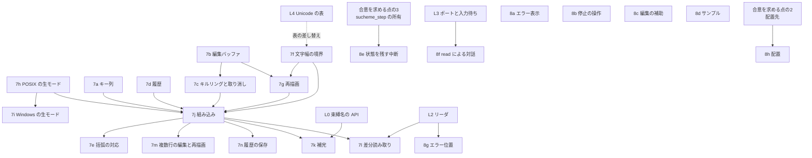

# 0021: 段階7と8のうち先に始める部分 — REPL の行編集(L6)と Web UI(L7)

- 対応する決定: [ADR-0009](../adr/0009-wasm-freestanding-and-zero-dependency-web-ui.md)(freestanding と依存ゼロの Web UI)、[ADR-0014](../adr/0014-repl-line-editor-boundary.md)(行編集の境界)、[ADR-0018](../adr/0018-incremental-vertical-slices.md)(漸進的な縦切り)、[ADR-0021](../adr/0021-no-github-pages-defer-hosting.md)(配置は段階8)
- 段階: 7(REPL の編集機能)と 8(Web UI の本格化)。段階の作業項目と完了条件は [roadmap.md](../roadmap.md) の段階7と段階8の節が正
- レーン: [0017](0017-parallel-lanes.md) の L6(REPL の行編集)と L7(Web UI)
- 日付: 2026-10-20
- 状態: 合意済み(2026-10-20)。「合意を求める点」の4項目すべてを、勧める案どおりに承認した。L6 と L7 の実装は、親のセッションの指示で始める(同時に動かす子セッションの上限があるため)
- 改訂: 2026-11-12。L6 を、最小の核を先に組み込む順序に改めた(下の「L6 の最小の核」)。行編集を自前で作る決定は [ADR-0049](../adr/0049-line-editor-in-zig-minimal-core-first.md) に記録した。L7 の記述は変えていない

## 解こうとしている問題

[0017](0017-parallel-lanes.md) は、段階7と8の作業を、段階3から6の終わりを待たずに始めるレーンとして切り出した。どちらの段階にも、まだ計画書が無い。段階7には、実装方式の判断([ADR-0014](../adr/0014-repl-line-editor-boundary.md) が段階7に送った)が残っている。段階8には、配置先の判断([ADR-0021](../adr/0021-no-github-pages-defer-hosting.md) が段階8に送った)が残っている。どちらも、ユーザーの判断を要する([design/open-questions.md](../design/open-questions.md) の「段階7までに決める」と「段階8までに決める」の行)。

この計画書は、次の3つを決める。

1. 2つの判断の選択肢と、勧める案。
2. ほかのレーンを待たずに作れる部分を、スライスに分けること。
3. ほかのレーンを待つ部分と、何を待つかを明示すること。

## 完了条件

段階7と段階8の完了条件は、[roadmap.md](../roadmap.md) が正である。この計画書が扱うのは、その一部(先に始める部分)なので、完了条件を次のように読む。

- L6: 次の2段で判定する。段階7の完了条件(要件どおりの編集操作)は、2段目のあとに判定する。
  - 核: 下の「L6 の最小の核」の 7h、7a、7f、7b、7c、7d、7g、7j が完了し、POSIX の端末から起動した REPL で、Emacs の標準のキー割り当てによる1行の編集と、記憶上の履歴(上下の移動と逐次検索)ができる。
  - 核のあと: 7e(括弧の対応表示)、7m(複数行の編集と再描画)、7n(履歴の保存)、7i(Windows の生モード)が完了する。補完(7k)と差分読み取り(7l)は、ほかのレーンを待つ。
- L7: 下の「L7 のスライス」の 8a から 8d が完了する。`read` による対話(8f)、エラー位置の表示(8g)、状態を残す中断(8e)は、ほかのレーンを待つ。段階8の完了条件(R7RS のサンプルが一通り動く、配置した URL でも動く)は、それらと配置(8h)のあとに判定する。
- リリース(v1.1.0、v1.2.0)は、この計画書の範囲の外である。段階の完了条件でこれまでどおり切る([0017](0017-parallel-lanes.md) の合意を求める点の4)。

## 範囲

含めるもの:

- L6: 行編集の部品(キー列の解読、編集バッファ、キルリングと取り消し、履歴、括弧の対応、文字幅、再描画)、端末の生モード(POSIX と Windows)、REPL への組み込み(`LineReader` の union)。
- L7: エラー表示の改善、停止の操作の改善、入力欄の編集の補助、サンプルの充実、`web/` の純粋な部品のテスト、配置先の選定。
- 2つの判断の比較(行編集の実装方式、配置先)。

含めないもの(送り先は括弧の中):

- 識別子の補完の候補を、処理系から取り出す API(L0 が所有する `src/sucheme.zig`。7k で、L0 と調整する)。
- REPL の継続行の差分読み取り(L2 が所有する `src/reader.zig`。7l で、L2 と調整する)。
- 再開可能な機械(`sucheme_step`、歩数の制限、入力待ち)。`src/wasm.zig` は L3 が所有し、機械の歩数は `src/machine.zig` に及ぶ(合意を求める点の3)。
- ペアの位置情報の副表(L2)。
- 配置の作業そのもの(8h)。配置先の合意と、シークレットの扱いの判断のあとに行う。

## 確かめた事実と、確かめられなかったこと

確かめた事実(`origin/main` の `83e173d` を読んだ)。

- REPL は `src/main.zig` の `repl` で、`*std.Io.Reader` から `takeDelimiter('\n')` で行を読み、`sucheme.isIncomplete` が偽になるまで保留(`max_line` の大きさの配列)に足す。`LineReader` の union はまだ無い([ADR-0014](../adr/0014-repl-line-editor-boundary.md) の追記のとおり)。
- `build.zig.zon` の `.dependencies` は空である。C のソースの取り込みも無い。
- Web UI は `web/` の8ファイルで、停止は `web/app.js` が Worker を `terminate()` で捨てて作り直す。作り直した処理系は初期状態で、定義は失われる(`web/app.js` の冒頭のコメント)。
- `web/sucheme.js` は、状態コードの表(`CONTINUE` と `WAITING_INPUT` を含む)を持つが、`sucheme_step` などは呼ばない(同ファイルの冒頭のコメント)。
- `tools/test-wasm/main.mjs` は、`web/samples.mjs` と `web/share.mjs` を Node.js から読み込んで検査している。`web/` の純粋な部品を `.mjs` にして Node から試す形は、すでにある。
- `web/app.js` の画面の文言は日本語である。[AGENTS.md](../../AGENTS.md) の言語の表は、UI ラベルとエラーメッセージを英語と定めている。8a で、どちらに揃えるかを PR に書く(範囲が小さく戻せる選択なので、勧める案で進める。勧める案は、言語の表に合わせて英語にする)。
- `LICENSE` は「All rights reserved」である。取り込む C のライブラリのライセンスは、この形の配布と両立する必要がある。

確かめられなかったこと:

- 下の C ライブラリの比較のうち、「未確認」と書いた欄。GNU Readline と libedit の公式サイトには、この環境から接続できなかった。
- 下の配置先の比較のうち、「未確認」と書いた欄。Netlify と Vercel の公式文書には、この環境から接続できなかった。Cloudflare と Azure は、公式文書のソースを置く GitHub のリポジトリ(`cloudflare/cloudflare-docs`、`MicrosoftDocs/azure-docs`)の本文で確かめた。公開中のサイトの版と一致するかは確かめていない。
- C ライブラリを、`zig build dist` の全ターゲットでビルドできるか(実際にビルドしていない)。

## 行編集の実装方式

### 候補の C ライブラリ

2026-10-20 に、各リポジトリの GitHub のページ(README とコミットの一覧)で確かめた。行数は README の記載で、数え直していない。

| 名前 | ライセンス | Windows | 複数行の編集 | Emacs の割り当て | 大きさ | 保守 |
| --- | --- | --- | --- | --- | --- | --- |
| [linenoise](https://github.com/antirez/linenoise) | BSD 2条項 | README に記載なし。Windows への対応は派生の Linenoise NG の目標として書かれている | あり(`linenoiseSetMultiLine`) | 一部(移動、`Ctrl-W`、`Ctrl-U`、履歴は上下の矢印)。キルリング、`Ctrl-Y`、`Ctrl-R`、取り消しは README に記載なし | 約1600行(コメントと空行を除く、README) | 直近のコミットは 2026-05-02 |
| [isocline](https://github.com/daanx/isocline) | MIT | あり(Windows のコンソール API、Windows Terminal では端末のエスケープシーケンス) | あり(`shift-tab` などで改行を入れる) | GNU Readline の割り当てに倣う。取り消しとやり直し、履歴の逐次検索はある。キルリングは README の今後の拡張に挙がっている(未実装と読める) | 8000行未満(README)。1つの C ファイルとしてコンパイルできる | 最新のリリースは v1.1.0(2026-04-21)。直近のコミットは 2026-04-23 |
| [bestline](https://github.com/jart/bestline) | BSD 2条項。閉じたソースのバイナリにも著作権表示の埋め込みを求める(README) | Windows 10 以降の MinTTY と CMD.EXE で動くと変更履歴にある。README は、Windows 向けのコードの寄稿は受けないと書く | 複数行の形だけになった(変更履歴) | GNU Readline のほぼすべての割り当て。キルリングと `Alt-Y` がある。取り消しは README に記載なし | 行数は未確認(README はバイナリの大きさだけを書く) | 直近のコミットは 2025-11-21 |
| [replxx](https://github.com/AmokHuginnsson/replxx) | BSD | あり(Visual Studio でのビルドの節) | あり | README は「通常の割り当て」とだけ書く。詳細は未確認 | 未確認。C++11 のコンパイラを要求するので C++ で書かれていると読める | 直近のコミットは 2021-11-25。リリースの記載なし |
| GNU Readline | GPL と記憶しているが、公式で確かめられなかった(未確認) | 未確認 | 未確認 | あり(Emacs の割り当ての元) | 未確認 | 未確認 |
| libedit(NetBSD の editline の移植) | BSD と記憶しているが、公式で確かめられなかった(未確認) | 未確認 | 未確認 | 未確認 | 未確認 | 未確認 |

参考として、Zig で書かれた [linenoize](https://github.com/joachimschmidt557/linenoize)(MIT、Windows 対応、複数行の形あり)もある。README は Zig 0.15.2 を対象とすると書いており、このリポジトリの固定版(`.zigversion`)とは違う。`std.Io` への移行([design/zig-api-notes.md](../design/zig-api-notes.md))を考えると、そのままは使えない見込みである(推測。ビルドして確かめていない)。Zig のパッケージとして取り込むと、Dependabot の対象のエコシステムが増える。

### ADR-0014 の境界との関係

[ADR-0014](../adr/0014-repl-line-editor-boundary.md) は、入力が完結したかの判定をリーダに委ね、`dumb` と `rich` の両方が同じ関数(`sucheme.isIncomplete`)を使うと決めた。これが、実装方式の比較の要になる。

- 自前で作る場合: `Enter` を押したときに、編集バッファ全体を `isIncomplete` に渡し、閉じていれば評価に送り、閉じていなければ改行を挿入して編集を続ける。複数行の式を、1つのバッファとして、行をまたいで編集できる。
- C のライブラリの場合: `Enter` の押下で、ライブラリが行を確定させる。確定の前に、ホストに完結を問い合わせる仕組みがあれば、自前と同じ形にできる。問い合わせる仕組みが無ければ、行ごとにライブラリで読み、今の `repl` と同じ形で保留に足すことになり、確定した前の行には戻れない。上の表の候補のうち、確定の前の問い合わせの仕組みがあるものは、README からは確かめられなかった(未確認)。isocline と linenoise は、改行を入れる別のキー(`shift-tab` など)を持つので、利用者が改行と確定を打ち分ける形にはできる。

どちらの方式でも、端末の生モードと、`LineReader` の union と、端末でない入力(パイプ、ファイル)での `dumb` は、自前で書く。ADR-0014 は、`std.Io.Terminal` が入力の生モードを提供しないことを確かめている。

### 自前で作るときの部品と、方式に依らず残るもの

自前で作ることに決まった([ADR-0049](../adr/0049-line-editor-in-zig-minimal-core-first.md))。下の「L6 のスライス」の部品を、すべて作る。作る順序は、最小の核が先である(下の「L6 の最小の核」)。以下は、方式を決める前の比較として残す。

自前で作るときは、7a から 7n をすべて作る。C のライブラリを取り込むときは、7a から 7d と 7g が、ライブラリの機能に置き換わる。7e(括弧の走査)と 7f(文字幅)は、ライブラリが強調表示や幅の計算を受け持つかによって、残るかが決まる。7h と 7i(生モード)は、ライブラリが持つ。7j(組み込み)は、どちらでも残る。

方式は自前に決まったので、7a から着手できる。

## L6 のスライス

所有するファイルは `src/line_editor/` 以下(新規)と、7j の `src/main.zig` の REPL の入口である。階層は [0017](0017-parallel-lanes.md) の T1(軽量)、T2(標準)、T3(上位)である。規模は、小、中、大の相対で、時間は付けない(見積りは [0012](0012-schedule-estimates-and-actuals.md) の方法で別に付ける)。

### L6 の最小の核

2026-11-12 に、順序を改めた。理由は、REPL を使ってテストする作業で、編集機能の不在が最大の障害になっているからである。部品をすべてそろえてから組み込む元の順序では、組み込みの完了まで編集機能が届かない。そこで、次の8つ(表で「核」と書いたもの)を先に作り、7j で REPL に組み込む。決定は [ADR-0049](../adr/0049-line-editor-in-zig-minimal-core-first.md) に記録した。

- 7h、7a、7f(仮の実装)、7b、7c、7d、7g(単一行)、7j。
- キー割り当ては Emacs の標準を含める。`Ctrl-A` `Ctrl-E` `Ctrl-B` `Ctrl-F` `Ctrl-K` `Ctrl-U` `Ctrl-W` `Ctrl-Y` `Ctrl-T` `Ctrl-D` `Ctrl-P` `Ctrl-N` `Ctrl-R`、`Alt-B` `Alt-F` `Alt-D`、矢印、`Home`、`End`、`Delete`、`Ctrl-_` による取り消し。
- 完結判定は、これまでどおり `repl` が `sucheme.isIncomplete` で行い、`dumb` と `rich` が共有する([ADR-0014](../adr/0014-repl-line-editor-boundary.md))。

核の 7j が、後回しの部品なしで成立するための切り方(2026-11-12 に、ユーザーから任された範囲で、親のセッションの依頼のもと、このスライスの計画を書いた側が決めた。異議があれば戻す)。

- 核の編集バッファは、1行である。`Enter` で式が閉じていないときは、行を確定して継続行のプロンプトに進む。確定した前の行には、カーソルで戻れない。バッファに改行を挿入して編集を続ける形は 7m で入る。この形にすると、`LineReader.read` が1行を返す契約は `dumb` と同じで、`repl` の保留と `isIncomplete` の呼び出しを変えずに済む。
- 再描画は単一行で、端末の幅を超える行は横にずらして表示する。折り返しと、カーソルを上へ戻す操作に依らないので、複数行の再描画(7m)を後に回せる。
- 履歴は記憶上だけである。複数行の式は、閉じたときに、改行でつないで1項目として記録する。核の間は、上下の移動で呼び出せるのは、1行の項目だけである(呼び出しに複数行の再描画が要るため)。
- 文字幅は、仮の実装(下の「文字幅と L4 の依存」)である。`src/unicode/` に幅の表が無いことを、2026-11-12 に確かめた(`width` と `East` を `src/unicode/*.zig` で検索した結果、一致が無かった)。全角の文字を含む行で、カーソルの位置がずれる。
- Windows の生モード(7i)は入れない。Windows では `dumb` のままである。端末でない入力は、どの OS でも `dumb` である。
- 補完(7k)、差分読み取り(7l)、括弧の対応表示(7e)、履歴の保存(7n)は入れない。

核が終わるまでの実施順の案(並行にできるものは並行にする)。7h、7a、7d、7f を先に始める。7b は 7a と並行でよい。7c と 7g は 7b のマージのあとである。7j は最後である。着手の順と時期は、親のセッションが決める。

核のあと、7e、7m、7n、7i は、それぞれのスライスの PR で、`rich` への組み込みの変更も行う(7j のような最後の組み込みのスライスは置かない)。

| スライス | 完了条件 | 所有するファイル | 階層 | 前提 | 並行 | 規模 |
| --- | --- | --- | --- | --- | --- | --- |
| 7a キー列の解読(核) | バイト列を、文字の挿入、制御キー、`Alt` との組、矢印と `Home` `End` `Delete` の CSI 列、括弧つき貼り付けの開始と終了に解読する純粋な関数があり、途中で切れた列は「続きを待つ」を返す | `src/line_editor/keys.zig` | T1 | なし | 7b、7d、7f、7h と並行できる | 小 |
| 7b 編集バッファ(核) | UTF-8 の文字列とカーソルを持ち、挿入、削除、文字と単語と行の移動、入れ替え(`Ctrl-T`)ができる。核の範囲は、改行を含まない1行である。不正な UTF-8 を作らない。論理行をまたぐ上下の移動は 7m | `src/line_editor/buffer.zig` | T2 | なし | 7a、7d、7f、7h と並行できる | 中 |
| 7c キルリングと取り消し(核) | `Ctrl-K` `Ctrl-U` `Ctrl-W` `Alt-D` の切り取りがキルリングに入り、`Ctrl-Y` と `Alt-Y` で貼り付けと回転ができ、`Ctrl-_` で編集を1つずつ取り消せる | `src/line_editor/kill_ring.zig`、`src/line_editor/undo.zig` | T2 | 7b | 7b のマージのあと | 中 |
| 7d 履歴(核) | 記憶上の履歴に追加、上下の移動、逐次検索(`Ctrl-R`)ができる。複数行の項目は、1項目として記録する。上下の移動で呼び出せるのは、核の間は1行の項目だけで、複数行の項目の呼び出しは 7m で入れる。ファイルへの保存は 7n | `src/line_editor/history.zig` | T1 | なし | 7a、7b、7f、7h と並行できる | 小 |
| 7e 括弧の対応(核のあと) | 編集中のテキストとカーソルの位置から、対応する括弧の位置を返す。文字列、文字リテラル(`#\(`)、行コメント、ブロックコメント、縦棒の識別子の中の括弧を数えない。`isIncomplete` と食い違わないことを、同じ入力の集合で照合するテストがある | `src/line_editor/parens.zig` | T2 | なし | 7a から 7d、7f と並行できる | 中 |
| 7f 文字幅(核は仮の実装) | 符号位置から表示の幅(0、1、2)を返す関数がある。核には、下の注の仮の実装で入る。表を引く実装への差し替えは、L4 の表に幅の情報が入ってから | `src/line_editor/width.zig` | T1 | 核は無し。差し替えは L4 の表(下の注) | 7a から 7d と並行できる | 小 |
| 7g 再描画(核は単一行) | 編集バッファ、プロンプト、端末の幅から、描画するエスケープシーケンスを作る純粋な関数がある。核の範囲は単一行で、幅を超える行は横にずらして表示し(カーソルを上へ戻す操作を使わない)、逐次検索の表示を含む。仮想の画面に適用して、結果の画面とカーソルの位置を比べるテストがある。複数行と折り返しは 7m、括弧の強調は 7e | `src/line_editor/render.zig` | T2 | 7b、7f の境界 | 7b のマージのあと | 中 |
| 7h POSIX の生モード(核) | termios で生モードに入り、終了と異常終了と `SIGINT` で元に戻す。端末の幅を取る。端末でない入力では `dumb` を使う | `src/line_editor/term_posix.zig` | T2 | なし | 7a から 7g と並行できる | 中 |
| 7i Windows の生モード(核のあと) | コンソールの入力の仮想端末シーケンスを有効にし、終了時に元のモードに戻す。端末の幅を取る | `src/line_editor/term_windows.zig` | T2 | 7h(同じ境界の形) | 7h のマージのあと | 中 |
| 7j REPL への組み込み(核) | `LineReader` の union(`dumb` と `rich`)を置き、POSIX の端末からの起動で `rich` を使う。Windows と、端末でない入力は `dumb` である。`Enter` で、保留の全体を `isIncomplete` に渡す呼び出しは、これまでどおり `repl` が行い、閉じていなければ継続行のプロンプトで次の行を読む(確定した前の行は編集できない)。閉じた式を `rich` の履歴に1項目として記録する。`Ctrl-D` は、空の行で入力の終わり、そうでなければカーソルの文字の削除である。`Ctrl-C` は、編集中の行と保留を捨て、新しいプロンプトに戻る | `src/line_editor/line_reader.zig`、`src/main.zig` の REPL の入口 | T3 | 7h、7a、7f、7b、7c、7d、7g | 核の最後 | 中 |
| 7k 識別子の補完 | `Tab` で、現在の環境の束縛名から補完する | `src/line_editor/complete.zig` | T2 | 7j、束縛名を列挙する API(L0 の `src/sucheme.zig`) | L0 の API のあと | 中 |
| 7l 差分読み取り | 継続行で、保留の全体を読み直さずに、読み取りの状態を保って続きから読む(roadmap の段階7の3つ目の項目) | 調整中(L2 が所有する `src/reader.zig` に及ぶ) | T3 | 7j、L2 のリーダの完全化 | L2 のあと | 中 |
| 7m 複数行の編集と再描画(核のあと) | 編集バッファが改行を含み、論理行をまたぐ上下の移動と、行の結合(行頭の削除)ができる。再描画が、複数行と折り返しを扱う。`Enter` で式が閉じていないときは、バッファに改行を挿入して編集を続ける。複数行の履歴の項目を呼び出せる | `src/line_editor/buffer.zig`、`src/line_editor/render.zig`、`src/line_editor/line_reader.zig`、`src/line_editor/history.zig` | T3 | 7j | 7e、7n と並行できる(同じファイルの重なりは、後からマージするほうが main を取り込む) | 大 |
| 7n 履歴の保存(核のあと) | 履歴をファイルに保存して読み込む。場所と形式は、このスライスの計画で選択肢を示して判断を得る(データ形式の判断) | `src/line_editor/history.zig` | T2 | 7j、合意を求める点の4 | 7e、7m と並行できる | 小 |

7a、7d、7f は、[0017](0017-parallel-lanes.md) が T1 に任せる「純粋で小さい部品」に当たる。T1 の成果は、T2 のレビューを通す(0017 のリスクと対策)。

### 文字幅と L4 の依存

表示の幅は、東アジアの文字幅(全角は2)と、結合文字などの幅0の文字で決まる。表は L4(Unicode の表の生成ツールと生成結果、`src/unicode/`)が作る。7f は、L4 の表を待たずに、次の形で始める。

- 関数の署名を先に決める。`pub fn width(cp: u21) u2`。
- L4 の表がマージされるまでは(2026-11-12 の時点で、`src/unicode/` に幅の表は無い。核は、この仮の実装で入る)、ASCII の印字可能文字を1、制御文字を0、それ以外を1とする仮の実装を置く。仮の実装であることを `Why:` コメントに書く。日本語の文字で、カーソルの位置がずれる。
- L4 の表のマージのあとで、表を引く実装に替える。L4 が、表の大きさの実測から、ASCII に制限する退避案を選んだ場合([0017](0017-parallel-lanes.md) の L4 の行)は、幅の表だけを別に持つかを、そのときに諮る。

7g の再描画は、幅を `width` 経由でしか求めない。表の差し替えは、7f の中で閉じる。

### Windows の生モードの試し方

Windows のテストは層2(`full.yml` の `windows` ジョブ)でしか走らない([ADR-0036](../adr/0036-windows-tests-in-the-slow-tier.md))。ドラフトの間の push では、Windows の不具合が見えない。次のように扱う。

- 純粋な部品(7a から 7g)は、OS に触れない。Linux の層1 で試したものが、Windows でもそのまま正しい。
- OS に触れるコードは、7h と 7i の2ファイルに閉じる。境界は、生モードに入る、戻す、1バイトずつ読む、幅を取る、の4つの関数だけにする。
- 7i の PR は、ドラフトの間に、手動の `workflow_dispatch` で層2を1回走らせる。Windows でのコンパイルの誤りは、ここで見つかる。
- 端末の実際の操作(キーを押して画面を見ること)は、CI に端末が無いので、手で確かめる。Windows の実機での確認は、この環境からはできないので、ユーザーに依頼するか、未確認として PR に書く。
- 層1 で Windows 向けのコンパイルだけを確かめる step(`zig build test` を Windows のターゲットで実行せずにコンパイルする形)を足す案がある。`build.zig` と検証コマンドの表と `ci.yml` の変更になり、`ci.yml` の変更はユーザーの承認が要るので、この計画書では足さない。7i の層2 の結果で、必要かを判断する。

## L7 のスライス

所有するファイルは `web/*` である。`web/sucheme.js` のホスト側は、L3 が `read` と `eval` のために触る([0017](0017-parallel-lanes.md) の L3 の行)。L7 は、L3 の着手の前に `web/sucheme.js` の変更を済ませるか、L3 のマージのあとに触る。

### ほかのレーンを待たずに作れるもの

| スライス | 完了条件 | 所有するファイル | 階層 | 前提 | 並行 | 規模 |
| --- | --- | --- | --- | --- | --- | --- |
| 8a エラー表示 | 出力とエラーの説明を分けて表示する。エラーの前に出た出力を残す。状態コードごとの説明を1か所(`web/errors.mjs`)に持ち、Node から試せる。画面の文言の言語を言語の表に揃える | `web/errors.mjs`(新規)、`web/app.js`、`web/style.css` | T2 | なし | 8b から 8d と並行できる(`web/app.js` の重なりは機械的に解く) | 小 |
| 8b 停止の操作 | `Esc` キーで停止できる。経過時間を表示する。停止で定義が失われることを、停止の前後に明示する | `web/app.js`、`web/index.html` | T1 | なし | 8a、8c、8d と並行できる | 小 |
| 8c 編集の補助 | 入力欄で、括弧の対応の強調、`Tab` の字下げ、`Ctrl-Enter` での実行、実行した入力の履歴(上下の移動)ができる。括弧の走査は `web/parens.mjs` に置き、Node から試せる | `web/parens.mjs`(新規)、`web/history.mjs`(新規)、`web/app.js`、`web/index.html`、`web/style.css` | T2 | なし | 8a、8b、8d と並行できる | 中 |
| 8d サンプルの充実 | 段階4と5の機能を使わずに書ける R7RS のサンプルを足す。各サンプルが期待どおりに評価されることを `tools/test-wasm/main.mjs` が検査する | `web/samples.mjs` | T1 | なし | 8a から 8c と並行できる。段階4と5の機能を使うサンプルは、各レーンのマージのあとに足す | 小 |

8c の括弧の走査は、7e と同じ規則(文字列、文字リテラル、コメント、縦棒の識別子の中を数えない)で書く。JavaScript と Zig の2つの実装になる。両方を、同じ入力と期待の一覧で試す。一覧は1か所に置き(`tests/parens/` の下のテキストを想定)、Zig のテストと `tools/test-wasm/main.mjs` の両方が読む。ブラウザで `isIncomplete` を呼ぶ形(WASM のエクスポートを足す)も考えられるが、`src/wasm.zig` は L3 が所有するので、この計画書では採らない。括弧の強調は表示の補助で、完結の判定ではないので、[ADR-0014](../adr/0014-repl-line-editor-boundary.md) の「括弧の数を数える方式は使わない」には当たらない。判定はこれまでどおりリーダが行う。

### ほかのレーンを待つもの

| スライス | 完了条件 | 待つもの |
| --- | --- | --- |
| 8e 状態を残す中断 | 停止しても、それまでの定義が残る | `sucheme_step` と、機械の歩数の制限。所有は合意を求める点の3 |
| 8f `read` による対話 | `(read)` と `(read-line)` が、画面の入力欄から入力を受け取る。終端を送れる | L3 のポートと、状態コード 2(入力待ち)、`sucheme_provide_input` と `sucheme_provide_eof`([design/platform-and-web.md](../design/platform-and-web.md) の再開可能性) |
| 8g エラー位置の表示 | エラーの説明に行と桁があり、入力欄の該当の位置を示す | L2 の位置情報の副表と、実行時の位置を IR の節点に複製する展開器の変更([design/frontend.md](../design/frontend.md) の位置情報) |
| 8h 配置 | 選んだ配置先に置き、アクセス制限の下で動く | 合意を求める点の2と、シークレットの扱いの判断 |

### web/ のテストの方針

- 画面に触れない論理(状態コードの説明、括弧の走査、履歴、共有リンク、サンプル)は、`web/` の `.mjs` に置く。Node.js から、パッケージの設定なしで読み込める([design/platform-and-web.md](../design/platform-and-web.md) の段階3の範囲と同じ理由)。
- それらのテストは、既存の `tools/test-wasm/main.mjs` に足す。`zig build test-wasm` が走らせるので、検証コマンドの表と `ci.yml` を変えずに済む。ファイルが大きくなったら、同じ step から呼ぶ別の `.mjs` に分ける(`build.zig` の変更だけで済む)。
- 画面の操作(キー、強調の見た目、停止)は、CI にブラウザが無いので、手で確かめて PR に書く。ブラウザを CI で動かす案(Playwright など)は、依存を増やすので採らない。
- `web/app.js` は、DOM に触れる部分を薄く保ち、判断を `.mjs` の関数に寄せる。テストできる量を増やすためである。

## Web UI の配置先

### 条件

[ADR-0021](../adr/0021-no-github-pages-defer-hosting.md) の4つの要件を、比較の条件にする。

1. private にアクセス制限できる。
2. 静的ファイルの配信だけでよい。
3. `.wasm` を `application/wasm`(パラメータなし)で配信できる。
4. `.wasm` を Web UI と同じオリジンから配れる。

4 は、静的ファイルを1つのサイトとして置く形なら、どの候補でも満たす。

### 候補

Cloudflare と Azure は、公式文書のソース(下の注)で確かめた。それ以外は、公式文書に接続できず、確かめていない。

| 候補 | アクセス制限の方法 | `application/wasm` | 費用の枠 |
| --- | --- | --- | --- |
| Cloudflare Pages と Cloudflare Access | プロジェクトの設定で Access のポリシーを有効にすると、デプロイを見られる人を Cloudflare のアカウントか、Access のポリシーで指定した人に限れる。`*.pages.dev` の本番のドメインにも効かせるには、既知の問題の節の手順が要る | 既定の Content-Type は未確認。`_headers` ファイルの見出しは、Cloudflare が通常送るものを上書きする、と文書にある | Pages の無償の枠は、サイトあたり 20,000 ファイル、1ファイル 25 MiB、月 500 回のビルド。Zero Trust に無償と有償の枠があることは確かめたが、無償の枠の人数の上限は未確認 |
| Azure Static Web Apps(Free) | `staticwebapp.config.json` の経路の規則で、役割を持つ利用者だけに許す。Free で使えるのは、あらかじめ用意された認証(GitHub、Microsoft Entra ID)。役割は、組み込みの招待で利用者に割り当てる。プランの比較表は、関数による役割の割り当てだけを Standard に限っている。招待が Free で使えることは、比較表から読んだもので、実際の画面では確かめていない | 既定の Content-Type は未確認。設定の `mimeTypes` で拡張子ごとに指定できる | Free は個人のプロジェクト向けで、アプリあたり 250 MB。SLA は無い |
| Netlify | パスワードによる保護があると記憶しているが、どのプランで使えるかは未確認 | 未確認 | 未確認 |
| Vercel | デプロイの保護(パスワード、Vercel の認証)があると記憶しているが、プランごとの範囲は未確認 | 未確認 | 未確認 |
| GitHub Pages | 個人のアカウントでは private にできない([ADR-0021](../adr/0021-no-github-pages-defer-hosting.md))。候補から外す | - | - |

出典の注: Cloudflare は `cloudflare/cloudflare-docs` の `pages/configuration/preview-deployments.mdx`、`pages/platform/known-issues.mdx`、`pages/platform/limits.mdx`、`pages/configuration/headers.mdx`、`cloudflare-one/index.mdx`。Azure は `MicrosoftDocs/azure-docs` の `articles/static-web-apps/plans.md`(`ms.date` は 2025-01-28)、`authentication-authorization.yml`、`authentication-custom.md`、`configuration.md`。どちらも 2026-10-20 に取得した。

### シークレットとの関係

どの候補でも、CI から配置すると、配置用のトークンを CI のシークレットに置くことになる。[ADR-0021](../adr/0021-no-github-pages-defer-hosting.md) は、段階7までシークレットを増やさないと決め、増やすときはユーザーの承認を得るとしている([design/open-questions.md](../design/open-questions.md) の「段階8までに決める」の2行目)。CI からの配置は、`.github/workflows/` の変更にもなる。

シークレットを増やさない形として、リリースのときに、ユーザーが手元から、リリースの成果物(`sucheme-web` の中身)を配置する形がある。どちらの候補にも、手元からアップロードする CLI がある見込みである(未確認。8h の着手時に公式文書で確かめる)。

## tests/scheme の番号

`tests/scheme/` の番号の範囲は、[0017](0017-parallel-lanes.md) の「ファイルの重なり」が正である。L6 と L7 には範囲が割り当てられていない。L6 は Zig の単体テスト(`src/line_editor/` の各ファイルの `test`)を使い、L7 は `tools/test-wasm/main.mjs` を使うので、`tests/scheme/` のケースを足す見込みは無い。足す必要が出たら、親のセッションに範囲の割り当てを求める(0017 が割り当てていない範囲、たとえば 0900 台)。

括弧の走査の共有の入力(8c の注)は、`tests/scheme/` ではなく、別のディレクトリに置く。

## 依存と実施順



- L6 の核は、7h、7a、7f、7b、7d から始められる(方式は自前に決まっている)。7c と 7g は 7b のあと、7j は核の最後である。核の外の 7e は、前提が無いので並行して始められるが、`rich` への組み込みは 7j のあとに行う。7i、7m、7n も 7j のあとである。L7 の 8a から 8d は、L6 と独立に始められる。
- 7e と 8c は、括弧の規則を共有するので、同じ担当が続けて行うか、7e を先にマージする。
- L7 の 8a から 8c は、どれも `web/app.js` を触る。同時に開く PR は2件までにし、後からマージするほうが main を取り込む。

## 検証

- 各スライスの PR は、[AGENTS.md](../../AGENTS.md) の検証コマンドの表の「全コミット」の行を通す。新しい step は足さない(上の Windows の節の案を除く。その案もユーザーの承認なしに足さない)。
- `src/line_editor/` の各ファイルは、`build.zig` が `addTest` の対象として拾う(新しいファイルを足したときに、対象から漏れていないかを `zig build test --summary all` の件数で確かめる)。
- ミューテーションテストは、変更した判定の分岐ごとに代表的な書き換えを数件試す([AGENTS.md](../../AGENTS.md))。7a のキー列の解読と、7e の括弧の走査は、分岐が多いので、境界(途中で切れた列、文字列の中の括弧、ブロックコメントの入れ子)を重点にする。
- 7e と 7a は、ファジングの対象に向く(任意の入力で、異常終了せず、7e は `isIncomplete` と矛盾しない)。ファジングの対象を足すかは、7e の PR で判断する。

## ファイル

| ファイル | 責務 | スライス |
| --- | --- | --- |
| `src/line_editor/keys.zig` | バイト列からキーの事象への解読 | 7a |
| `src/line_editor/buffer.zig` | 編集バッファとカーソル | 7b |
| `src/line_editor/kill_ring.zig` | キルリング | 7c |
| `src/line_editor/undo.zig` | 取り消しの記録 | 7c |
| `src/line_editor/history.zig` | 履歴と逐次検索 | 7d |
| `src/line_editor/parens.zig` | 括弧の対応の走査 | 7e |
| `src/line_editor/width.zig` | 符号位置の表示の幅 | 7f |
| `src/line_editor/render.zig` | 再描画のエスケープシーケンスの生成 | 7g |
| `src/line_editor/term_posix.zig` | POSIX の生モード | 7h |
| `src/line_editor/term_windows.zig` | Windows の生モード | 7i |
| `src/line_editor/line_reader.zig` | `LineReader` の union | 7j |
| `src/line_editor/complete.zig` | 補完 | 7k |
| `src/main.zig` | REPL の入口で `LineReader` を使う | 7j |
| `web/errors.mjs` | 状態コードとエラーの説明 | 8a |
| `web/parens.mjs` | 括弧の対応の走査(ブラウザ) | 8c |
| `web/history.mjs` | 実行した入力の履歴 | 8c |
| `web/app.js`、`web/index.html`、`web/style.css` | 画面 | 8a から 8c |
| `web/samples.mjs` | サンプル | 8d |
| `tools/test-wasm/main.mjs` | `web/` の `.mjs` の検査 | 8a、8c、8d |

関数の署名(実装時に変わりうるもの。変えるときは、PR に書く):

```zig
// src/line_editor/keys.zig
pub const Key = union(enum) { insert: u21, ctrl: u8, alt: u21, arrow: Arrow, home, end, delete, paste_begin, paste_end, unknown };
pub const Decoded = union(enum) { key: struct { key: Key, consumed: usize }, need_more, invalid: usize };
pub fn decode(bytes: []const u8) Decoded;

// src/line_editor/parens.zig
pub fn matching(text: []const u8, cursor: usize) ?usize;

// src/line_editor/width.zig
pub fn width(cp: u21) u2;

// src/line_editor/line_reader.zig
pub const LineReader = union(enum) {
    dumb: Dumb,
    rich: Rich,
    pub fn read(self: *LineReader, prompt: []const u8) ReadError!?[]const u8;
};
```

```js
// web/parens.mjs
export function matching(text, cursor); // 対応する括弧の位置か null
// web/errors.mjs
export function describeStatus(status, output); // { text, kind }
```

## 合意を求める点

勧める案を先に書く。勧める案でよいときは、そう返信する。

1. 行編集の実装方式(上の「行編集の実装方式」)。
   - 勧める案: Zig で自前に作る(7a から 7j)。理由は3つある。確かめた候補のうち、Windows、複数行、キルリングを含む Emacs の割り当ての3つをすべて README で確かめられたものが無いこと。`Enter` で `isIncomplete` を呼んで複数行を1つのバッファで編集する形([ADR-0014](../adr/0014-repl-line-editor-boundary.md) の完結判定の共有)を、自前なら確実に作れること。依存が増えず、`zig build dist` の全ターゲットへの C のクロスビルドの確認が要らないこと。代わりに、作る量が多く(7a から 7j のすべて)、端末の癖への対応を自分で負う。決まったら、新しい ADR に記録する(ADR-0014 の見直し条件)。
   - 別案A: isocline を取り込む。MIT で、Windows、複数行、取り消し、括弧の対応、補完がそろう。キルリングは無いと読める。1つの C ファイルとしてビルドできる。複数行の確定の前に完結を問い合わせる仕組みの有無は未確認で、無ければ、改行と確定を利用者が打ち分ける形になる。取り込むコードは 8000 行未満で、ベンダリングの記録と、ライセンスの表示(`THIRD-PARTY-NOTICES.txt`)が要る。
   - 別案B: linenoise を取り込む。最も小さい(約1600行)が、Windows への対応が README に無い。Windows の生モードを自前で足すと、自前の案との差が小さくなる。
2. Web UI の配置先(上の「Web UI の配置先」)。
   - 勧める案: Azure Static Web Apps の Free を第一候補にする。アクセス制限(あらかじめ用意された認証と役割)と、`mimeTypes` による `application/wasm` の指定を、公式文書で確かめられたのは、この候補である。8h の着手時に、招待による役割の割り当てが Free で使えることを、実際の画面で確かめる。使えなければ、Cloudflare Pages と Access に替える。配置は、シークレットを増やさないよう、リリースのときにユーザーが手元から行う形で始める。
   - 別案: Cloudflare Pages と Cloudflare Access。制限は Access のポリシーで柔軟に書けるが、Zero Trust の無償の枠の人数と、`.wasm` の既定の Content-Type を確かめていない。
   - 別案: 判断を 8h の着手時まで延ばし、そのときに Netlify と Vercel を含めて確かめ直す。
3. `sucheme_step`(再開可能な機械)の所有。
   - 勧める案: L3 が持つ。入力待ち(状態コード 2)と歩数の制限は、同じ再開の仕組みで、`src/wasm.zig` も L3 が所有する([0017](0017-parallel-lanes.md))。L7 は、8e と 8f を L3 のマージのあとに行う。それまでの停止は、今の `terminate()` の形のままにする(8b で操作だけを改善する)。
   - 別案: L7 に、`sucheme_step` と歩数の制限の別のスライスを置く。8e を早く出せるが、`src/wasm.zig` と `src/machine.zig` で L3 と L0 と重なる。
4. 履歴をファイルに保存するか(7d)。保存の場所と形式は、データ形式の判断にあたる。
   - 勧める案(承認済み。7n として割り当てた): 7d では、記憶上の履歴だけを作り、ファイルへの保存は 7j のあとに別のスライスとして諮る。保存するときの場所(環境変数で上書きできるホームの下のファイル)と形式(複数行の項目の区切り方)は、そのスライスの計画で選択肢を示す。
   - 別案: 7d で保存まで入れる。そのときは、場所と形式をこの計画書の合意で決める。

## 進捗

| スライス | 状態 | PR |
| --- | --- | --- |
| この計画書 | 合意済み(2026-10-20) | - |
| 7a キー列の解読 | `decode` が、文字の挿入、制御バイト、`Alt` との組、CSI と SS3 の矢印と `Home` `End` `Delete`、括弧つき貼り付けの印を解読する。途中で切れた列は `need_more`、不正な UTF-8 と終端のない CSI は捨てるバイト数つきの `invalid` を返す。署名は上の案から変えていない(`Arrow` を足し、`Key.ctrl` は制御バイトそのもの)。単独の `ESC` は `need_more` で、時間切れの扱いは呼び出し側(7j)に任せる。確かめたこと: 単体テスト、全切り詰めの `need_more`、乱数と全探索に近い列で止まらないこと | 7b と同じ PR |
| 7b 編集バッファ | `Buffer` が、挿入、範囲の置き換えと削除、文字と単語と行頭行末の移動、入れ替えを持つ。変更は `Edit` を返し、削除や切り取りの範囲は操作の前に `rangeBackwardWord` などで問い合わせる(7c が使う)。不変条件(正しい UTF-8、改行なし、カーソルは文字の境界)を乱数の操作列で確かめた。単語は ASCII の英数字と ASCII でない文字の並びで、仮の実装である | 7a と同じ PR |
| 7c キルリングと取り消し | `KillRing` が、4つの切り取り(`killToEnd` `killToStart` `killBackwardSpaceWord` `killForwardWord`)、`yank`、`yankPop` を持つ。続けた切り取りは1項目にまとめ、向きが前なら後ろに、後ろなら前に足す。リングは項目数に上限を置く。`UndoStack` が、`Edit` と取り除いたテキストの複製を記録し、`undo` で1つずつ戻す。`insertTyped` で入れた隣り合う文字の挿入は1項目にまとめる。やり直しは入れていない。どちらも入出力に触れず、`Buffer` を受け取って操作する。切り取りや貼り付けの取り消しは、各操作に `UndoStack` を渡すと記録される。確保の失敗でバッファと記録が変わらないことを、確保を失敗させるテストで確かめた。キー割り当てと、連なりを切る呼び出し(`breakChain` と `breakGroup`)は 7j の担当である | 7c の PR |
| 7d 履歴 | 実装した(`src/line_editor/history.zig`)。`History`(追加、重複と空の項目の除外、上限、`addLines` による複数行の項目)、`Browser`(上下の移動、最初の編集中の行を覚える)、`Search`(Ctrl-R の逐次検索)。改行を含む項目は記録するが、移動と検索は返さない(`isRecallable` が1か所で決める。7m で直す)。残り: ファイル保存は 7n | - |
| 7e 括弧の対応 | 未着手(核のあと) | - |
| 7f 文字幅 | 仮の実装を入れた(`src/line_editor/width.zig`、`width(cp: u21) u2`)。全角と結合文字で幅がずれる。L4 の表に幅の情報が入ったら差し替える | - |
| 7g 再描画 | `render` が、プロンプト、編集バッファのテキストとカーソル、端末の幅から、1行を描くシーケンス(`CR`、プロンプト、窓、`CSI K`、`CR`、`CSI n C`)を `std.Io.Writer` に書く。毎回、行全体を書き直す。描く桁数は `cols - 1` までで、折り返さず、カーソルを上へ戻さない。幅を超える行は、前回の窓の先頭(`State.start`)から、カーソルとその下の文字が入る最小の量だけ右へずらす。逐次検索は、`View.search` で、プロンプトの代わりに `(reverse-i-search)` のラベルを描く(テキストは呼び出し側が渡す)。プロンプトが `cols - 1` の半分を超えるときは末尾の側だけを描く。制御文字は `^A`、不正な UTF-8 と C1 は U+FFFD で描く。仮想の画面に適用するテストで、行の内容とカーソルの桁を確かめた。幅は `width.zig`(7f)の `width` を使う。今は仮の実装なので、全角の文字を含む行で、カーソルの位置が実際の画面とずれる。テストは、幅の関数を差し替える内部関数で、全角と結合文字を試した。確かめていないこと: 実際の端末での見え方(7j の組み込みのあと) | 7g の PR |
| 7h POSIX の生モード | 実装した。境界は `RawMode.enter` `RawMode.leave` `RawMode.read`、`columns`、`isInteractive`、`restoreActive` の `src/line_editor/term_posix.zig` に閉じた。復元の経路は、`leave`(`defer`)、`SIGINT` `SIGTERM` `SIGHUP` `SIGQUIT` のハンドラ、panic の中の `restoreActive` の3つである。Linux の疑似端末で、実際の信号と panic のあとに、端末が戻ることを確かめた(確かめた範囲は PR 本文)。panic ハンドラからの `restoreActive` の呼び出しは、7j で `src/main.zig` に入れた。Windows と macOS の実機での実行は、未確認である | - |
| 7i Windows の生モード | 未着手(核のあと) | - |
| 7j REPL への組み込み | `src/line_editor/line_reader.zig` に `LineReader`(`dumb` と `rich`)を置いた。`rich` は、入力と出力の両方が POSIX の端末のとき(`term_posix.isInteractive`)に使い、1行を読む間だけ生モードにする(評価の間は元の端末に戻すので、プログラムの `read` と評価中の `Ctrl-C` の信号は今までどおり)。生モードに入れない行は `dumb` で読む。キーの処理は `Editor` に閉じ、端末は `Terminal` の vtable の向こうに置いて、テストは台本の端末で走らせる。`repl` は `dumb` を作って `replLines` に渡す形にし、既存の REPL のテストは変えずに通した。決めたこと: 単独の `ESC` に時間切れを置かず、次のキーと組で `Alt` として読む(時間切れには `term_posix.zig` の外の OS の呼び出しが要るため。`ESC` のあとの `Ctrl-C` も行を捨てる)。端末からは1バイトずつ読み、`Enter` のあとのバイトを端末に残す。`Tab` は補完(7k)までは文字として入れる。逐次検索の中の `Ctrl-G` は検索をやめ、ほかのキーは見つかった項目を行に入れてから通常の割り当てで処理する。panic ハンドラから `term_posix.restoreActive` を呼ぶ(7h の残り)。確かめたこと: 単体テスト、ミューテーション、Linux の疑似端末での実行(PR 本文)。確かめていないこと: macOS と実機の端末エミュレータでの見え方、panic ハンドラの復元(自動のテストは無い) | 7j の PR |
| 7k 識別子の補完 | 未着手(核のあと) | - |
| 7l 差分読み取り | 未着手(核のあと) | - |
| 7m 複数行の編集と再描画 | 未着手(核のあと) | - |
| 7n 履歴の保存 | 未着手(核のあと) | - |
| 8a から 8h | 未着手 | - |

## 次にやること

1. 行編集を自前で作る決定は、[ADR-0049](../adr/0049-line-editor-in-zig-minimal-core-first.md) に記録した。[design/open-questions.md](../design/open-questions.md) の「段階7までに決める」の行は消した。配置先(合意を求める点の2)の結果は 8h の計画に反映し、配置を終えたら「段階8までに決める」の行を消す。
2. L6 は、核の 7a から 7d、7f から 7h、7j を実装した。核のあとは、7e、7m、7n、7i を、それぞれのスライスの PR で `rich`(`src/line_editor/line_reader.zig` の `Editor`)に組み込む。7g の幅は、7f の表を引く実装に差し替わると、`render.zig` を変えずに正しくなる。L7 の 8a から 8d は、L6 と独立に始められる。着手の順と時期は、子セッションの上限に合わせて親のセッションが決める。
3. 7a と 7b の PR で、進捗の表をスライスごとの行に分けた。残りの 7d から 7n は、着手するスライスの PR で、行を分ける。
4. 部品の新しいファイルは、`src/line_editor/root.zig` に `pub const` で1行足す(足さないとテストが走らない)。`src/main.zig` は `line_editor/root.zig` を相対のパスで取り込むので、`build.zig` の行編集のテストの根(`line_editor` のモジュール)は、部品の単体テストの根として残る。
