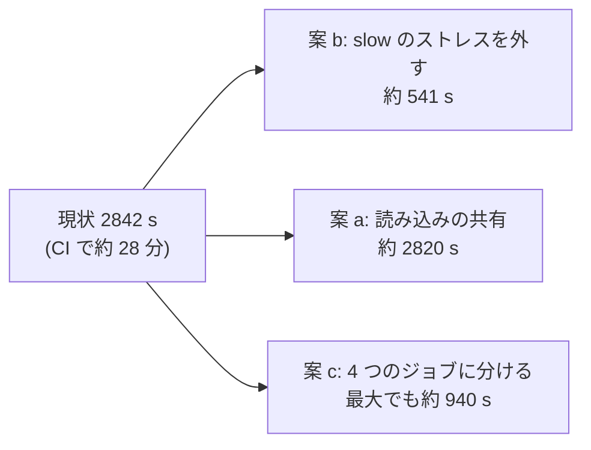

# 0022: 層2の `test-scheme -Dslow=true` の測定

- 対応する計画: 計画書 0017(`docs/plans/0017-parallel-lanes.md`。ブランチ `docs/parallel-lanes-plan` にあり、`main` には未マージ) の「待ちの短縮」の1(L8)
- 日付: 2026-10-20(測定は 2026-10-19 22:30 UTC から 2026-10-20 00:10 UTC)
- 状態: 測定の記録と見積り。どの案を採るかは決めていない

## 結論

- 層2の長さを決めているのは、規模を試すケース(`tests/scheme-slow/`)を「1ステップごとに GC するモード」で走らせた分である。測定した合計の約 81% を占める。
- `(scheme base)` の読み込みは、支配的ではない。インタプリタの作成と `1` の評価の1回が約 3 ms で、全実行の合計に対して 1% 未満である。最初の仮説は、この測定では支持されない。
- 時間は少数のケースに集中している。規模を試すケースのストレスモードのうち、上位5件で 71%、上位10件で 82% である。

## 環境と方法

- コンテナ: 4 コア(`nproc`)、Intel Xeon 2.80GHz、Linux、Zig 0.17.0(`pip install --user ziglang==0.17.0` で導入)。測定中、ほかの重い処理は走らせていない(負荷平均は測定の外で約 1)。
- 対象: `origin/main` の 83e173d。使い捨ての作業ツリーに、コミットしない一時パッチを当てた。パッチは、`tools/test-scheme/main.zig` で、ケースの実行ごとに単調時計の時間を標準エラーに出し、始めに空に近いケース(`1`)を各モード 20 回走らせる。リポジトリには入れていない。
- コマンド: `zig build test-scheme -Dslow=true`(ランナーは `ReleaseSafe` でビルドされる)。
- 回数: 規模を試すディレクトリを含む実行は 1 回だけ(約 48 分かかるため)。通常ディレクトリだけの `zig build test-scheme` は、同じパッチで 3 回走らせた(下のばらつきの表)。規模を試す分が 3 回に満たない点は、この文書の限界である。

### 通常ディレクトリのばらつき(3 回)

| 回 | 既定(秒) | ストレス(秒) | 空ケース 1 回(ms、全 40 回の平均) |
| ---: | ---: | ---: | ---: |
| 1(`-Dslow=true` の実行の一部) | 32.1 | 167.5 | 2.7 |
| 2 | 32.9 | 165.2 | 2.8 |
| 3 | 33.7 | 166.2 | 3.1 |

ストレスの合計の幅は約 2 秒(約 1.4%)、既定の幅は約 1.5 秒で、通常ディレクトリの合計は安定している。規模を試す分のばらつきは、これで代用できない(1 ケースが数百秒で、GC の挙動が違う)。
- CI との対応: 2026-10-19 の CI(run_number 159)では、同じコマンドが約 28 分だった(計画書 0017(`docs/plans/0017-parallel-lanes.md`。ブランチ `docs/parallel-lanes-plan` にあり、`main` には未マージ))。この環境では約 48 分で、CI の 1.7 倍である。以下の割合は両者で同じと仮定し、CI の分への換算には、この比を使う(仮定であり、確かめていない)。

## モード別の合計

| ディレクトリ | モード | 実行数 | 合計(秒) |
| --- | --- | ---: | ---: |
| `tests/scheme/` | 既定 | 3950 | 32 |
| `tests/scheme/` | 1ステップごとに GC | 3950 | 167 |
| `tests/scheme-slow/` | 既定 | 103 | 341 |
| `tests/scheme-slow/` | 1ステップごとに GC | 103 | 2302 |
| 合計 | | 8106 | 2842 |

ビルドを含む実時間は 48 分 9 秒だった。規模を試すケースの 1 実行の内訳は、ストレスが既定の約 6.7 倍である(2302 / 341)。

## 1件あたりの時間(上位20件)

実行ごとの時間である。同じケースが、モードごとに別の行になる。

| 時間(秒) | ケース(ファイル:行) | モード |
| ---: | --- | --- |
| 468.7 | `scheme-slow/0020-list-procedures-scale.txt:9` | ストレス |
| 370.7 | `scheme-slow/0020-list-procedures-scale.txt:13` | ストレス |
| 358.1 | `scheme-slow/0024-higher-order-and-delay-scale.txt:28` | ストレス |
| 298.9 | `scheme-slow/0024-higher-order-and-delay-scale.txt:31` | ストレス |
| 127.2 | `scheme-slow/0013-list-scale.txt:15` | ストレス |
| 97.8 | `scheme-slow/0020-list-procedures-scale.txt:17` | ストレス |
| 70.2 | `scheme-slow/0020-list-procedures-scale.txt:9` | 既定 |
| 53.8 | `scheme-slow/0019-apply-values-scale.txt:12` | ストレス |
| 51.8 | `scheme-slow/0020-list-procedures-scale.txt:13` | 既定 |
| 42.2 | `scheme-slow/0024-higher-order-and-delay-scale.txt:20` | ストレス |
| 41.3 | `scheme-slow/0019-apply-values-scale.txt:16` | ストレス |
| 36.7 | `scheme/0230-list-procedures.txt:138` | ストレス |
| 36.0 | `scheme-slow/0013-list-scale.txt:31` | ストレス |
| 34.6 | `scheme-slow/0013-list-scale.txt:20` | ストレス |
| 34.3 | `scheme-slow/0019-apply-values-scale.txt:28` | ストレス |
| 34.0 | `scheme-slow/0019-apply-values-scale.txt:20` | ストレス |
| 32.2 | `scheme-slow/0024-higher-order-and-delay-scale.txt:17` | ストレス |
| 22.7 | `scheme/0230-list-procedures.txt:141` | ストレス |
| 21.2 | `scheme-slow/0013-list-scale.txt:15` | 既定 |
| 19.1 | `scheme-slow/0024-higher-order-and-delay-scale.txt:35` | ストレス |

ファイルごとの合計(両モード)の上位は、`0020-list-procedures-scale` が 1074 秒、`0024-higher-order-and-delay-scale` が 836 秒、`0013-list-scale` が 250 秒、`0019-apply-values-scale` が 215 秒である。この4ファイルで、全体の約 76% になる。

観察として、`0020` の1行目の入力は、30万個のリストを `map` などで処理するだけの式であり、既定モードでも 70 秒かかっている。既定でこの時間が、リストの長さに対して妥当かは、この測定では調べていない(原因は未確認)。

## `(scheme base)` の読み込みの費用

- 測り方: ケースの本体を走らせる前に、`1` を評価する実行を各モード 20 回走らせ、平均を取った。実行は、インタプリタの作成(標準環境の読み込み)、`1` の評価、破棄を含む。
- 結果: 既定 2.5 ms、ストレス 2.9 ms。
- 全体に占める割合の見積り: 8106 実行 × 約 2.7 ms ≈ 22 秒で、合計 2842 秒の約 0.8% である。通常ディレクトリだけで見ると、7900 実行 × 約 2.7 ms ≈ 21 秒で、その合計 199 秒の約 11% である。
- 注意: 空に近いケースの時間は、読み込みのほかに `1` の評価と破棄を含む。読み込み単独の時間ではなく、上限である。

## 短縮案ごとの効果の見積り

効果は、この環境の測定値から、CI の 28 分への比例換算で出した見積りである。

| 案 | 効果の見積り | 触るファイル | ワークフローの変更 |
| --- | --- | --- | --- |
| a. 読み込んだライブラリを複数のインタプリタで共有する | 全体で約 22 秒(約 0.8%)の短縮が上限。CI の 28 分は、ほぼ変わらない。通常の `zig build test-scheme` では約 20 秒の短縮が上限で、通常ディレクトリの約 11% | `src/sucheme.zig`、`src/env.zig` など(ADR-0039 の設計の変更を伴う。インタプリタ間でヒープを共有しない設計との関係は未確認) | 不要 |
| b. ストレスモードの対象を減らす | `scheme-slow` のストレスをすべて外すと、約 2302 秒を除いて約 541 秒。CI の 28 分は約 5 分に縮む見込み(比例換算)。上位4ケースだけを外しても約 1496 秒を除く(約 53% 減、CI で約 13 分の見込み)。外した分の GC のルートの検査は、小さい規模の双子(`tests/scheme/`)に頼ることになる | `tools/test-scheme/main.zig`(ケースまたはディレクトリごとに、モードを選ぶ仕組み)。`tests/scheme-slow/*.txt` に指示行を足す形も考えられる | 不要(`zig build test-scheme -Dslow=true` の綴りは変わらない) |
| c. 集合を N 個に分けて並行のジョブにする | N = 4 で、ファイル単位に割ると最長のファイルが律速で、約 937 秒(ストレスの `0020` 1ファイル分、全体の約 33%)まで。ケース単位で割れば、合計 2842 秒の 1/4 の約 711 秒に近づく(最大のケースが 469 秒なので下限は 469 秒)。CI で約 10 〜 12 分の見込み(比例換算)。ただし、各ジョブがビルドをやり直す。実行分数の合計は減らず、ビルドの分だけ増える([0015](0015-ci-minutes-reduction.md)の分数の節約と逆向きである) | `tools/test-scheme/main.zig` と `build.zig`(現在は引数を取らない規則がある。分割の指定を、環境変数などで渡す形が要る)、`check-docs` の照合 | 要る(`full.yml` のジョブの追加。承認が必要) |

案を組み合わせる場合は、b の上位ケースだけ外す案と、c は独立に効く(b を先にやって、残りが長ければ c)。

## 制約と、測っていないこと

- 規模を試すディレクトリを含む実行は 1 回だけで、その分のばらつきを測っていない。通常ディレクトリのばらつきは、上の表のとおり小さい。
- CI のランナーのコア数と速度は、確かめていない。比例換算は、この環境の 48 分が CI の 28 分に対応することだけを根拠にしている。
- ストレスモードが既定より約 6.7 倍遅い理由と、既定モードで `0020` の1行目が 70 秒かかる理由は、調べていない。ストレスの間隔は `src/heap.zig` の `stress_ramp` と `stress_objects_per_step` で決まる。ここを変えると、検査の強さに影響する(設計の判断で、この文書の範囲外)。
- ケースごとの時間は、1 回の実行の値である。上位の順序は、実行ごとに入れ替わりうる。

## 再現の手順

1. 使い捨ての作業ツリーを作る(`git worktree add`)。
2. `tools/test-scheme/main.zig` の `runCaseWith` の前後に、`std.Io.Timestamp.now(io, .awake)` で時間を測って標準エラーに出す一時パッチを当てる。
3. `zig build test-scheme -Dslow=true` を走らせ、出力をファイルに取る。
4. 行ごとに集計する。パッチはリポジトリに入れない。
