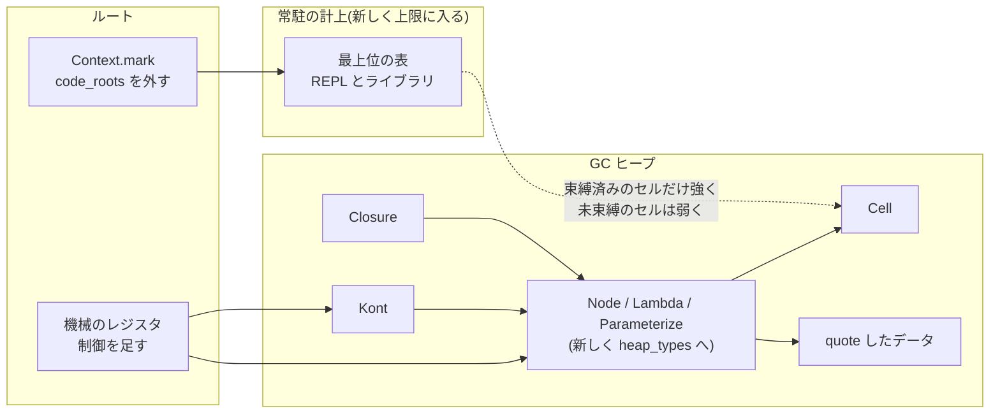
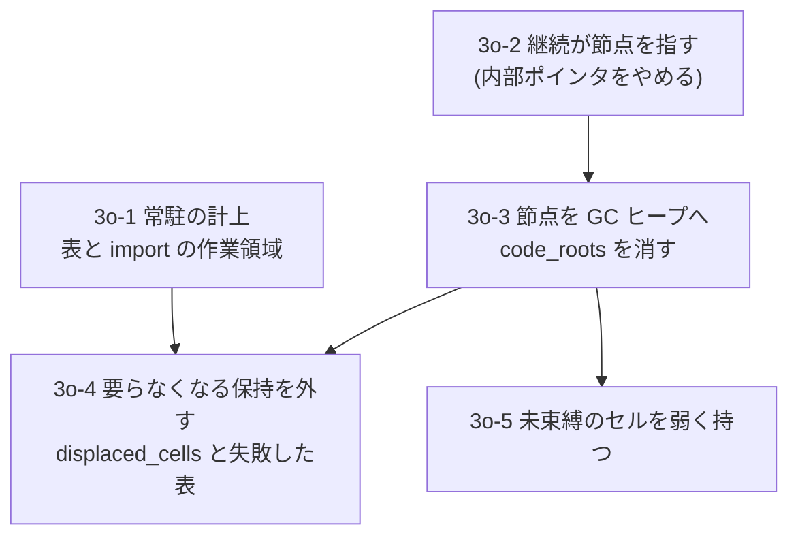

# 0023: スライス 3o の設計 — コアIRを GC ヒープへ移し、上限の外の確保を閉じる

- 対応する決定: [ADR-0031](../adr/0031-gc-at-machine-step-boundaries.md)(GC はステップの境目だけ)、[ADR-0035](../adr/0035-stage-2-gc-roots-and-raise-reserve.md)(段階2のルートと境目)、[ADR-0039](../adr/0039-standard-environment-installed-at-init.md)(初期環境の読み込みを上限に計上)、[ADR-0040](../adr/0040-core-ir-in-the-gc-heap.md)
- 段階: 3。スライス 3o([0016](0016-phase3-scheme-stdlib.md) の「3o の中身」)。レーン L0([0017](0017-parallel-lanes.md))
- 日付: 2026-10-20
- 状態: 合意済み(2026-10-20)。「合意を求める点」の6項目すべてを、勧める案どおりに承認した。実装は未着手
- 前提として承認済みのこと(2026-10-20): ライブラリごとの最上位の表と `import` の作業領域は、複製を残したまま上限に計上する(案 A)。計上は 2l の `Charged` の延長を第一候補にする。表の共有は 3o に入れず、層2の測定([0017](0017-parallel-lanes.md) の 0022)の結果を見てから別のスライスで決める。未束縛のセルの回収と、失敗した展開の節点は、IR の移動と同時に直す

## 解こうとしている問題

[0016](0016-phase3-scheme-stdlib.md) は、3o を「コアIRと構文環境を GC ヒープへ移し、`Context.code_roots` を要らなくする」スライスとした。roadmap の段階3には、3o に割り当てた項目が4つある。

- コアIRを GC ヒープに移し、`Context.code_roots` を要らなくする。
- ライブラリの表と `import` の作業領域を、ヒープの上限に計上する。
- マクロの展開の有界化の残りのうち、失敗した展開の節点が行をまたいで残ること。
- REPL で解決した名前ごとに残る未束縛のセル。

この文書は、実装の前に、現状をコードで確かめ、設計と PR の分け方を決める。

## 現状の調査

`origin/main`(`83e173d`、スライス 3n のマージ)のコードを読んで確かめた。

### 何がヒープにあり、何が外にあるか

計画書と ADR は「コアIRと構文環境」を一組で書いてきたが、コードでは、構文環境はすでに GC ヒープにある。

| もの | 型(`src/value.zig`) | 置き場所 | GC が辿るか |
| --- | --- | --- | --- |
| 構文環境、その束縛、局所束縛 | `SyntacticEnv`、`SyntacticBinding`、`LocalBinding` | GC ヒープ(`heap_types`) | 辿る |
| 別名、マクロ | `Alias`、`Macro` | GC ヒープ | 辿る |
| ライブラリ、エクスポート | `Library`、`Export` | GC ヒープ | 辿る |
| 大域変数のセル | `Cell` | GC ヒープ | 辿る |
| コアIRの節点 | `Node`、`Lambda`、`Parameterize` と、節点の中の `If`、`LocalAssign`、`GlobalAssign`、`Call`、`ParameterBinding` | 永続アリーナ(`Context.persist`)。`code_types` | 辿らない |
| 最上位の束縛の表(REPL とライブラリごと) | `env.Global`(ハッシュ表と2つのリスト) | 永続アリーナ | `Context.mark` が中身を挙げる |
| `(sucheme core)` の表 | `env.Core` | 永続アリーナ | 同上 |
| ライブラリの登録表 | `library.Registry`(`list`、`tables`、`loading`) | 永続アリーナ | 同上 |

したがって、3o で動かすものは、コアIRの節点と、最上位の束縛の表(の計上)である。構文環境の型は変えない。

### `Context.code_roots` を使っているもの

`src/context.zig` の `code_roots` は、節点が辿られないことの埋め合わせである。挙げるのは次の3つで、どれもセッションの終わりまで残る。

- 定数(`keepConstant`)。`quote` したデータと、シンボルの定数。呼び出しは `src/syntax/expand.zig` の定数の節点を作る1か所。
- 局所変数の節点が持つ名前(`keepName`)。`expand.zig` の3か所(参照、`set!`、本体の定義)。
- 保留中のエクスポートの名前(`keepName`)。`src/syntax/library.zig` の `export` 宣言の処理の2つ。節点ではない。`export` の名前は、本体の処理が終わるまで、どの束縛にも入らないためである。

失敗した展開は、`expandIn` の `errdefer` が `code_roots` を展開前の長さに戻す。節点そのものは戻せない(アリーナにあるため)。

### 節点の確保と計上

節点は `expand.zig` の `Expander.nodes` から確保する。確保の箇所は、`nodes.create` と `nodes.alloc` の 10 か所余りで、すべて `expand.zig` にある。`nodes` は、永続アリーナの上に `heap.Charged` を重ねた割り当て器である(スライス 2l)。`Charged` が数える `Heap.external` は、`expandIn` の終わりに 0 に戻る。つまり、節点は展開の最中だけ上限に数えられ、展開が終わると数えられなくなる。メモリはアリーナに残る。

節点を指すものは、次のとおりである。

- ヒープの中から: `Closure.lambda`(`*const Lambda`)と、継続のフレームの `Kont.Step` の7つの変種。そのうち5つは、節点の中の部分を指す内部ポインタである(`branch: *const If`、`local_set` などの `*const LocalAssign` と `*const GlobalAssign`、`call` の `*const Call`)。`sequence` は、列の残りを指す部分スライスである。`parameterize_*` の3つは `*const Parameterize` を指す。
- 機械のレジスタ: `Registers.control`。`Machine.Roots` は制御を挙げない(ADR-0031 の「制御は節点を指し、節点はヒープの外にある」)。
- 節点の中から: `constant` の `Value`、`global_ref` などの `*Cell`、局所変数の名前の `SymbolId`。

静的に置いた節点(関数の外の `const` の `Node`)は、テストの中だけにある(`value.zig`、`trace.zig`、`printer.zig`、`core.zig` のテスト)。製品のコードには無い。`.lambda = undefined` のクロージャを作るテストが `heap.zig` と `expand.zig` にある。

### ライブラリの表

`library.Registry.begin` は、ライブラリごとに `env.Global` を永続アリーナに作る。`bindImports` は、インポートした名前をすべて、そのライブラリの表のハッシュ表に入れる(複製)。ハッシュ表が伸びるとき、古い領域はアリーナに残る。`Registry.abandon` は、定義に失敗したライブラリを `list` から外すが、表は `tables` に残す。理由は、失敗した本体がほかへ渡したクロージャのコードが、表のセルを `global_ref` で指しうるのに、GC がコードを辿らないためである(`library.zig` の `abandon` の `Why:`)。同じ理由で、`env.Global.displaced_cells` が、REPL が遮蔽して表から外した自分のセルを持ち続ける。

`import` の作業領域(`evalImportSet` が作る `Names` と、`prefix` などの修飾の途中の文字列)は、`Interpreter.evalPrint` の呼び出しごとのアリーナにあり、計上されない。展開の作業領域とは違い、`Charged` を通っていない。

### REPL の未束縛のセル

`env.Global.binding` は、表に無い名前を初めて解決したとき、その最上位自身の未束縛のセル(値が `uninitialized` のセル)を作り、表に入れる。表から外す経路は無い(`undoShadows` が戻すのは、遮蔽の記録 `replaced` に載ったものだけで、新しい名前の未束縛のセルは記録しない)。`Global.mark` は表のすべてのセルを挙げるので、回収されない。セルは名前を持つので、3c の弱いシンボル表でも、名前が残る。

### GC の仕組みで、3o が使えるもの

- `src/trace.zig` は、型の宣言から走査を導く。型を `code_types` から `heap_types` に移せば、その型へのポインタは辿られるようになり、その型の中のフィールドも辿られる。型ごとの走査を書く必要は無い。部分を指すポインタ(`*const If` など)は、`If` が `heap_types` にも `code_types` にも無ければコンパイルエラーになる。
- `src/heap.zig` の `payloadBytes` と `Heap.free` は、型ごとのペイロード(`Frame.values`、`Vector.items` など)を数え、セルと一緒に返す。節点の列(`sequence`、`operands`、`bindings`)は、ここに行を足す形で扱える。
- `Heap.collect` は、マーク、オブジェクトの掃除、シンボル表の掃除の順に進む。弱い表の掃除(3c)の前例がある。

### 実測の測り直し

2026-10-20 07:20 JST ごろに測り直した。

- 環境: この作業環境(Linux、4 コア、メモリ 15 GB)。Zig 0.17.0(Python の `ziglang` パッケージ。版を `.zigversion` と照合した)。
- コード: `origin/main` の `83e173d`。`zig build -Doptimize=ReleaseSafe` で作った `sucheme`。既定のヒープの上限(256 MiB)。
- 方法: 入力をスクリプトで作り、`sucheme` に標準入力から与え、子プロセスの最大常駐サイズ(`getrusage` の `ru_maxrss`)と経過時間を見た。1つの入力ごとに別のプロセスで測った。測定は各1回で、ぶれは測っていない。

結果は、3o の各 PR の前後で、同じ入力と同じ方法で比べる。

| 項目 | 入力 | 記録済みの値(出典) | 2026-10-20 の値 |
| --- | --- | --- | --- |
| ライブラリの表 | 名前を 1000 個エクスポートするライブラリ1つと、それを `import` するだけのライブラリ(`(define-library (u N) (export) (import (t big)))`)1500 個 | 約 308 MB、エラーにならない(2026-10-15、[open-questions.md](../design/open-questions.md) と ADR-0031 の追記) | 約 293 MiB、0.46 秒、エラーにならない |
| 入れ子の `prefix` | `(scheme base)` に `prefix` を 5000 段重ねた `import` の1行 | 約 970 MB(レビュー担当の測定、同上。入力の細部は記録が無い) | 約 2.0 GiB、10.8 秒、エラーにならない |
| `include` の節点 | 1 MiB のファイル(`1 ` を 524288 個)を1行に1回 `include` する行を 8 行 | 最大 262.5 MiB(ADR-0031 の 2026-10-15 の追記(2)) | 約 264 MiB、1.1 秒 |
| 失敗した展開の節点 | 2000 個の呼び出しを本体に持ち、末尾の `(if)` で構文エラーになる `lambda` を、1行に1つ、20 行と 200 行 | 記録なし | 20 行で約 11.3 MiB、200 行で約 63.6 MiB。どの行も展開の誤りで終わる |
| 未束縛のセル | `(if #f unknown-N)` を、N を変えて 1 万行と 10 万行 | 記録なし | 1 万行で約 11.3 MiB、10 万行で約 51.6 MiB |
| 初期化の費用 | 空の入力 | 空の入力で約 5 ms(2026-10-19、[0016](0016-phase3-scheme-stdlib.md) の「確かめられなかったこと」) | 約 11.3 MiB。時間は 0.01 秒未満(この方法の分解能より短い) |

読み取れること:

- ライブラリの表と `include` は、2026-10-15 の記録とほぼ同じ値で、問題は今も残っている。入れ子の `prefix` は、記録の約2倍だった。2l 以降、`(scheme base)` が大きくなったため、段ごとに複製する名前が増えた(推測。段数と名前の数を変えて確かめていない)。どれも上限の 256 MiB を超えても、エラーにならない。
- 失敗した展開と未束縛のセルは、行の数に応じて常駐サイズが伸びる。少ない行では、初期化の後の余白に収まり、伸びが見えない。
- 初期化の後の節点の個数と、ヒープの `count` と `accounted` は、この方法では測れない。3o-1 の最初のテストで数える。

## 設計

### 全体の形

### 節点を GC ヒープの型にする

`Node`、`Lambda`、`Parameterize` を、`code_types` から `heap_types` に移す。節点1つが GC ヒープのオブジェクト1つになる(粒度の選択は「合意を求める点」の1)。

- 節点の中の部分(`If`、`LocalAssign`、`GlobalAssign`、`Call`、`ParameterBinding`)は、`Node` の共用体のペイロードのままにし、独立したオブジェクトにしない。`code_types` から外し、`heap_types` にも入れない。これらへの単独のポインタはコンパイルエラーになるので、継続のフレームが部分を指している箇所を、コンパイラが全部挙げる。
- 継続のフレームは、部分でなく節点を指す。`branch`、`local_set`、`local_define`、`global_set`、`global_define`、`call` は `*const Node` を持ち、使う側で共用体の変種を取り出す(安全ビルドでは変種の検査が付く)。`sequence` は、部分スライスの代わりに、列の節点と次の位置(`u32`)を持つ。部分スライスは、所有者の節点を辿れないためである。
- 節点の列(`sequence` の節点の並び、`Call.operands`、`Parameterize.bindings`)は、所有する節点のペイロードにする。`payloadBytes` と `Heap.free` に行を足し、節点と一緒に数え、一緒に返す。
- `Closure.lambda` は、型をそのままにして、辿られるようになる。
- 機械の `Roots` に制御(`?*const Node`)を足す。ADR-0035 のルートの一覧が変わる。

走査は `trace.zig` の型からの導出に任せる。`Node.constant` の `Value` は辿られ、`global_ref` の `*Cell` は辿られ、名前の `SymbolId` は弱いシンボル表に印を付ける。これで、`code_roots` が挙げていた3種のうち、定数と局所変数の名前は、節点から辿られる。`keepConstant` と `keepName` の展開器からの呼び出しを外す。

保留中のエクスポートの名前は、節点ではないので、別のルートが要る。`Registry` に、処理中の `define-library` ごとの保留中の名前の作業リストを置き、`Registry.mark` が挙げる(今の `loading` と同じ扱い)。宣言の処理が終われば空にする。これで `code_roots` と `keepConstant` と `keepName` を消せる。

### 確保と、ADR-0031 との整合

展開器は、節点をヒープの `create` 系で確保する(`Budget.limit`)。確保した節点は、すぐに上限に数えられ、展開が終わっても数えられ続け、到達できなくなれば回収される。展開の作業領域(`scratch` と適用ごとの `work`)は、今までどおり `Charged` で展開の最中だけ数える。

ADR-0031 は、GC を機械のステップの境目と、`Interpreter` がフォームを読む前でだけ走らせる。展開は機械のステップの外で走るので、展開の途中で GC は走らない。そのため、展開器が作りかけの節点(`Task.dest` が指す、子がまだ決まっていない節点)をどこにも登録しなくてよい。これは今の別名やペアの扱いと同じである。

この整合が成り立つには、次の2つが要る。実装の PR で、どちらも単体テストとストレスモードで確かめる。

1. 作りかけの節点が、GC の走る点に届かないこと。展開が返した根の節点は、`Machine.run` が制御のレジスタに置き、最初のステップの GC の前に、ルートに入る。展開と `run` の間に GC を起こす呼び出しを挟まない。この順は、`Interpreter.run`、`library.zig` の本体の処理、`include` の処理、機械のテストのフィクスチャ、WASM の入口のすべてで、今もそうなっている。
2. 機械の実行をまたいで、Zig の局所変数が節点を持たないこと。持つと、その節点は GC に見えない。`library.zig` の本体の処理は、フォームごとに展開と実行を繰り返し、前のフォームの節点を持たない。

作りかけの節点は、未初期化のフィールドを持ちうる。GC が作りかけの節点を辿ることは、上の1から起きない。それでも、展開器は節点を確保するときに、無害な既定の値(`constant` の `unspecified`)で初期化してから埋める。万一辿られても、未初期化のポインタを読まないためである。

### 失敗した展開の節点

展開が失敗すると、その展開が作った節点は、どこからも指されないまま残り、次の GC で回収される。`expandIn` の `code_roots` を戻す `errdefer` は要らなくなる。roadmap の「マクロの展開の有界化の残り」の (2) が、ここで外れる。

### 最上位の表を上限に計上する(承認済みの案 A)

ライブラリごとの表と REPL の表は、複製のまま、ヒープの上限に常に数える。2l の `Charged` は、展開の最中だけ数える計上(`Heap.external`)なので、そのままでは使えない。延長として、常に数える計上を足す。

- `Heap` に、常駐の計上 `resident` を足す。`Heap.held` が `accounted` と `symbols.charged` に加えて `resident` を含めるので、上限の検査、GC の閾値、余裕の無さの判定(`exhausted`)のすべてに入る。
- `Charged` に、どちらの計上に数えるかを持たせる(`.expansion` は今の `external`、`.resident` は新しい `resident`)。常駐の割り当て器は1つで、`Context` が持つ。実装(3o-1)では、`Charged` は変えず、`Heap.residentAllocator` を足した。割り当て器は呼び出しのたびに `Heap` から作り、どこにも保存しない(`Context` は値として動くので、`Heap` を指す割り当て器を保存すると古いアドレスを指す)。
- 常駐の割り当て器の下は、永続アリーナではなく、ヒープの `backing`(個別に解放できる割り当て器)にする。アリーナの上で数えると、ハッシュ表が伸びたときに、古い領域の分を戻してもメモリは残るので、数えた量が実際より少なくなる。そのため、表を `Context.deinit` で解放する処理を足す(`Global.deinit`、`Registry.deinit`。今はアリーナを捨てて済ませている)。
- 対象は、ライブラリの表と REPL の表(`env.Global`)、`Registry` の3つのリスト、`displaced_cells` と `replaced`、`sources` である。`env.Core` は、初期化で大きさが決まり、伸びないので、対象にしない。
- 断られた確保は `error.OutOfMemory` に見える。2l と同じく、断られたことを `Heap` の印で見分け、`define-library` と `import` の入口で `heap limit exceeded` に変える。
- `import` の作業領域は、`evalImportSet` に渡す作業用の割り当て器を、展開の作業領域と同じく `Charged`(`.expansion`)にする。入れ子の `prefix` の1行が、上限で `heap limit exceeded` で終わる。

REPL の表を対象に含めるかは、「合意を求める点」の3で諮る。承認済みの案 A はライブラリの表を名指ししているが、同じ仕組みで REPL の表も数えられ、数えないと `define` を繰り返す長いセッションで同じ穴が残る。

### コードが辿られると要らなくなる保持

節点が GC から辿られると、「コードがセルを指しうるので持ち続ける」保持が要らなくなる。

- `env.Global.displaced_cells` を消す。遮蔽の前に展開したコードが元のセルを指すなら、そのコードから辿られる。
- `Registry.abandon` は、失敗したライブラリの表を手放す(常駐の計上から戻す)。失敗した本体が渡したクロージャのコードは、表のセルを節点から辿る。`tables` の番号は再利用しない(今の規則のまま)。
- `env.Core.mark` は、プリミティブのセルを持ち続ける。セルは一度作れば同じものを全員が共有する設計なので、変えない。

### 未束縛のセルを弱く持つ

最上位の表(REPL とライブラリ)は、自分の未束縛のセル(値が `uninitialized` で、インポートしたものでない束縛)を弱く持つ。

- `Global.mark` は、そのような束縛のセルと名前を挙げない。
- `Heap.collect` は、マークの後、掃除の前に、弱い束縛を刈る段を呼ぶ。刈る段は、マークされなかった未束縛のセルの束縛を表から外す。セルを指すコードが生きていれば、そのコードからセルがマークされるので、外れない。
- 外れた名前を後で解決すると、新しい未束縛のセルができる。そのセルを指すコードは、外れたセルを指すコードと共存しない(外れたセルを指すコードは死んでいる)ので、意味は変わらない。
- 刈る段は、3c の弱いシンボル表の掃除と同じ位置に置く。`collect` の `roots` に任意の宣言 `pruneWeak` を足すか、`Context` が刈る関数を `Heap` に渡す形にする。どちらにするかは、実装の PR で決める(内部の形なので、PR に書く)。
- 遮蔽の記録 `replaced` に載った束縛は、展開の最中だけのもので、展開の途中に GC は走らないので、強いままでよい。

これで、`(if #f unknown-1)` のような行を繰り返しても、セルと名前は、次の GC で回収される。数の上限を置く案(0016 の別案)は採らない。上限の値に根拠が無く、上限に達したときの振る舞いも新しく決める必要があるからである。

### ストレスモードでの検査

ストレスモード(`Options.stress`)では、短い実行の各ステップで GC が走る。節点がヒープにあると、ルートの漏れ(制御の挙げ忘れ、局所変数が持つ節点)は、解放済みの節点の読み出しとして現れる。Debug と ReleaseSafe では、解放したメモリを `0xaa` で埋める割り当て器が使われるので、共用体の変種の検査か、範囲の検査で止まる見込みである(見込み。割り当て器の挙動は、実装の PR で確かめる)。

次のテストを足す。

- 単体テスト(`src/sucheme.zig`): 失敗する展開を繰り返し、`collectIdle` の後の `Node` の個数が、最初の値に戻ること。`quote` した大きなリストを持つ式を評価し、その式のコードに到達できなくなった後の GC で、リストが回収されること(ADR-0031 の 2026-10-10 の追記の、受け入れたトレードオフが外れること)。
- 単体テスト(`src/env.zig`): 未束縛のセルが、コードから指されていなければ刈られ、指されていれば残ること。刈られた名前を解決し直すと、新しいセルになること。
- 単体テスト(`src/machine.zig`): ストレスモードで、末尾呼び出しの列、`call/cc` の再入、`parameterize` の3つのフレームを通る式が、正しい値を返すこと。継続のフレームが節点を持つ形に変えた全変種を通す。
- Scheme のテスト(`tests/scheme/` の 0300 台、[0017](0017-parallel-lanes.md) の L0 の範囲): REPL で関数を再定義したあと、古い定義のクロージャを持つ変数から呼べること。失敗したライブラリの定義が渡したクロージャを、後で呼べること(今の `abandon` の理由の事例)。
- 規模を試すテスト(`tests/scheme-slow/` の 0300 台): 上の「実測の測り直し」の入力の縮小版を層1 に、元の大きさを層2 に置く。ライブラリの表の入力は、既定の上限で `heap limit exceeded` で終わることを確かめる。

### 速さへの影響

節点がヒープに移ると、GC のたびに、生きているコードのすべてをマークする。3l から、初期化が `(scheme base)` を読み込むので、標準ライブラリのコードは常に生きていて、GC のたびにマークされる。ストレスモードでは、ほぼステップごとにマークされる。層2の `zig build test-scheme -Dslow=true` は、2026-10-19 に約 28 分かかっており([0017](0017-parallel-lanes.md))、これが伸びるおそれがある。また、節点ごとにヘッダ(`heap.zig` の `Header`。64 ビットの環境で 16 バイト)と個別の確保が要るので、初期化の時間とメモリが増える。

どれだけ増えるかは、測っていない(推測)。最初の PR で節点の個数を数え、IR を移す PR で、初期化の時間、`zig build test-scheme` の時間、層2の時間を前後で比べる。大きく増えたときの対処(初期化で読み込んだコードを固定し、マークを省く仕組みなど)は、新しい機構なので、3o には入れず、測定の結果を添えて諮る(「範囲を狭める線に当たる兆候」)。

3o-3 での測定(2026-10-20、この作業環境、各1回。前は main の `6272c9f`、後は 3o-3 のブランチ):

| 項目 | 前 | 後 | 比 |
| --- | --- | --- | --- |
| `zig build test-scheme`(ビルド済みで、ストレスモードの構成を含む) | 203.6 秒 | 233.5 秒 | 約 1.15 倍 |
| 空の入力の起動(ReleaseSafe、50 回の中央値) | 3.74 ms | 3.66 ms | 差は測定のぶれの内 |

どちらも目安の 1.5 倍を下回った。層2の時間は、ready にしたあとの層2のランで比べる。

深く入れ子になったコードでは、マークの時間が深さの2乗に近く伸びていた(敵対的レビューの指摘)。原因は、マークの作業リストがあふれたときの全走査である。全走査の1回は、オブジェクトの一覧を新しい順になめるだけなので、参照が新しい方向へ伸びる鎖では、回数が鎖の長さに比例する([0005](0005-slice-1g-gc-heap.md) の受け入れた制約と同じ形)。展開器は親の節点を子より先に作るので、節点がヒープに入ると、深いコードがこの形になる。3o-3 は、作業リストを、満杯のときにヒープの外で倍に伸ばす形に変えた([runtime.md](../design/runtime.md) のマーク段階の節)。測定(2026-10-20、ReleaseSafe、入れ子 n 段の手続きを 20 回呼ぶ入力、各1回。GC の回数はどの行も 31〜34 回):

| n | 伸ばさない(`882d43e`) | 伸ばす(`a9d4092`) | 3o-3 の前(`6272c9f`) |
| --- | --- | --- | --- |
| 25000 | 2.83 秒、全走査 199 回 | 1.01 秒、全走査 0 回 | 0.93 秒 |
| 50000 | 7.92 秒、全走査 305 回 | 2.08 秒、全走査 0 回 | 2.18 秒 |
| 100000 | 38.7 秒、全走査 886 回 | 4.20 秒、全走査 0 回 | 5.07 秒 |

### 3o-3 で受け入れた制約

- 展開の途中は GC が走らない([ADR-0031](../adr/0031-gc-at-machine-step-boundaries.md))。節点は作った時点から上限に数えるので、ごみが閾値の手前まで溜まっていると、回収すれば収まる形式でも `heap limit exceeded` になりうる(敵対的レビューの指摘。推測で、再現はしていない)。起きるのは、1つの形式の節点とリーダのデータが、上限の 1/16(ソフトリミットとの差。既定で 16 MiB)を超えるときに限る。`include` が読むデータは、3o-3 の前から読む時点で上限に数えていた。
- 伸ばした作業リストは計上の外で、GC の間だけ、マークされるオブジェクトの数 M に対して、ポインタ 2M 個分まで(確保し直して写す間は 3M 個分まで)増える。GC の終わりに `Options.work_capacity` の大きさへ戻す。

### 継続のフレームと節点の変種の対応(3o-3 で検討した)

3o-2 は、継続のフレームの6つの変種が、どれも `*const Node` を持つ形にした。フレームの種類と節点の変種の対応(`branch` のフレームは `if` の節点を持つ、など)は型で守られず、取り違えは、安全ビルドの共用体の変種の検査で実行時に止まる。3o-3 で、節点の変種ごとに型を分ける案を検討し、採らなかった。

- 案: 変種ごとに別のヒープの型(`IfNode`、`CallNode` など)を作り、`Node` を、それらへのポインタの共用体にする。フレームは変種の型を持ち、取り違えはコンパイルエラーになる。
- 採らない理由: ヒープの型が変種の数だけ増え、`Node` の確保が2段(共用体の箱と変種のオブジェクト)になり、節点あたりのヘッダと確保が倍になる。展開器の節点を作る箇所(子より先に節点を作り、後で埋める形)は、変種が決まる前に節点を作るので、変種の型を先に選べない。取り違えは、フレームを積む箇所と外す箇所が `machine.zig` の同じ `switch` の中にあり、安全ビルドとストレスモードのテストで止まる。費用に見合わない。
- 見直しの条件: フレームの種類が増えて、積む箇所と外す箇所が離れたとき。

## スライスの分割

3o は、1つの PR には大きすぎる。次の5つの PR に分ける。各 PR は、それだけでマージでき、全コミットの検証を通す。

| PR | 完了条件(1行) | 触るファイル | 担当の階層 | 見積り(ready まで / マージまで、時間) |
| --- | --- | --- | --- | --- |
| 3o-1 常駐の計上 | 最上位の表と `import` の作業が上限に数えられ、収まらない量は `heap limit exceeded` で終わる(2026-10-20 に、実装に合わせて書き直した。元は「1500 個が `import` する入力が既定の上限でエラーになる」で、計上が実際の量に近づいた結果、その入力は上限に収まる。確かめ方は、上限 512 KiB の単体テストと、既定の上限での実測) | `src/heap.zig`、`src/context.zig`、`src/env.zig`、`src/syntax/library.zig`、`src/syntax/expand.zig`、`src/sucheme.zig`、`src/machine.zig`(テストの2件) | T3 | 2〜4 / 3〜6 |
| 3o-2 継続が節点を指す | `Kont.Step` が `If` などの部分と部分スライスを指さない。挙動は変わらない | `src/value.zig`(`Kont.Step`)、`src/machine.zig` | T2(機械的な書き換え。レビューは T3) | 1〜2 / 1.5〜3 |
| 3o-3 節点を GC ヒープへ | `Context.code_roots` が無い。失敗した展開の節点と、到達できなくなったコードの定数が回収される | `src/value.zig`(`heap_types`)、`src/heap.zig`、`src/trace.zig`(テスト)、`src/core.zig`、`src/syntax/expand.zig`、`src/syntax/library.zig`、`src/machine.zig`(`Roots`)、`src/context.zig`、`src/printer.zig`(テスト)、`docs/design/runtime.md` | T3 | 4〜8 / 6〜12 |
| 3o-4 要らなくなる保持を外す | `displaced_cells` が無い。定義に失敗したライブラリの表が、常駐の計上から戻る | `src/env.zig`、`src/syntax/library.zig`、`src/value.zig`(`Cell` の doc コメント) | T2 | 1〜2 / 1.5〜3 |
| 3o-5 未束縛のセルを弱く持つ | 未知の名前を参照する行を繰り返しても、GC の後の `Cell` の個数が増え続けない | `src/env.zig`、`src/heap.zig`、`src/context.zig` | T3 | 2〜4 / 3〜6 |

見積りは、[0016](0016-phase3-scheme-stdlib.md) の「見積り」の節の小・中・大の値を当てた概算である。3o-3 だけが「大」である。合計は、0016 の 3o の見積り(大、ready まで 4〜8 時間)を超える。分けたことで、レビューと層2の回数が増えるためである(推測)。

### 順序と並行

- 3o-1 と 3o-2 は、触るファイルが重ならないので、並行にできる。3o-1 は `heap.zig` と `context.zig` を、3o-2 は `machine.zig` と `value.zig` の `Kont` を触る。
- 3o-3 は 3o-2 の後。3o-3 と 3o-1 は `heap.zig` と `context.zig` と `library.zig` で重なるので、3o-1 を先にマージしてから 3o-3 を ready にする。
- 3o-4 は、3o-1 と 3o-3 の両方の後。3o-5 は 3o-3 の後。3o-4 と 3o-5 は `env.zig` で重なるので、直列にする。

### ほかのレーンとの重なり

- `src/machine.zig`: L3 は `eval` と `exit` を機械操作プリミティブとして足す([0017](0017-parallel-lanes.md))。3o-2 は `Kont.Step` の使い方を書き換え、3o-3 は `Roots` に制御を足す。L3 の追加は `Machine.apply` の機械操作の節に行が増える形と見込まれ、3o-2 の書き換えとは別の場所である(見込み)。それでも、3o-2 を L3 の機械の変更より先にマージすることを勧める。3o-2 は機械的で、挙動を変えず、小さいからである。`eval` は、実行の途中で展開器を呼ぶ。この呼び出しは機械のステップの中で展開を走らせるので、上の「ADR-0031 との整合」の2つの条件を、L3 の設計でも満たす必要がある。3o-3 の後なら、`eval` が作った節点は制御のレジスタに置かれてルートになる。3o-3 の前に `eval` が入るなら、節点はアリーナにあり、今の規則のまま動く。どちらの順でも壊れないが、3o-3 の PR で `eval` の経路をストレスモードのテストに入れる。
- `src/syntax/expand.zig`: 3p と 3q も大きく触る([0016](0016-phase3-scheme-stdlib.md) の「重なりの確認」)。3o-3 の変更は節点の確保の箇所(10 か所余り)と定数・名前の登録の削除に限られるが、行の数は多い。0016 のとおり、3o-3 を先にマージし、3p と 3q はその後に着手する。3o-1、3o-2、3o-4、3o-5 は `expand.zig` を触らないので、3p は 3o-3 のマージの後に、3o-4 と 3o-5 と並行に進められる。
- `src/value.zig`、`src/trace.zig`、`src/heap.zig`: L1 と L3 が新しい型を足す([0017](0017-parallel-lanes.md) の「ファイルの重なり」)。3o-3 は `heap_types` と `code_types` の行を書き換えるので、隣り合う行で衝突しうる。機械的に解く。

## リスクと、範囲を狭める線の兆候

| リスク | 兆候の見つけ方 | 対処 |
| --- | --- | --- |
| ルートの漏れ(制御、局所変数が持つ節点、`eval`) | ストレスモードの単体テストと `zig build test-scheme` が、解放済みのメモリの読み出しで止まる | 漏れた持ち主を `Roots` か `Context.mark` に挙げる。漏れを直す修正が新しいルートの種類を足す形になったら、ADR-0040 の一覧を更新する |
| GC の時間の増加 | 3o-3 の前後で、空の入力の時間、`zig build test-scheme` の時間、層2の時間を比べる。目安として、どれかが 1.5 倍を超えたら兆候とする(目安の値に測定の根拠は無い) | 3o-3 を ready にする前に、測定を添えて諮る。固定の仕組みは 3o に入れない |
| 3o-3 が見積りの上限(ready まで 8 時間)を超える | 進捗の表の時刻 | [0016](0016-phase3-scheme-stdlib.md) の「範囲を狭める線」のとおり、3o-3 以降を段階4の最初に送る案を諮る。3o-1 と 3o-2 は、それだけで価値がある(前者は上限の外の確保を閉じ、後者は挙動を変えない)ので、マージしたまま残せる |
| レビューの巡ごとに必須の指摘が減らない | 巡ごとの必須の件数 | AGENTS.md の「終わらなさそうなら」の規則のとおり、基準を狭めるか機能を減らすかを諮る |
| 常駐の計上で、初期化が小さい上限で失敗する | ADR-0039 は、初期化の読み込みを上限に計上すると決めている。表が計上に入ると、初期化に要る上限が上がる。単体テストの小さい上限(`initCore` 系)と、WASM のホストの指定の最小値を確かめる | 失敗する上限の値を、ADR-0039 の追記に記録する。テストの上限の値を直す |
| `Charged` の失敗の変換の漏れ | `define-library` と `import` の経路で、上限の超過が `heap limit exceeded` でなく、ホストのメモリ不足(`OutOfMemory`)として報告される | 上限を小さくした単体テストで、両方の経路のメッセージを確かめる |

## ADR が要るか

要る。コアIRの持ち主を永続アリーナから GC ヒープに変えること、ルートの一覧(ADR-0031 と ADR-0035)が変わること、最上位の表を常に上限に数えること、未束縛のセルを弱く持つことは、アーキテクチャとデータの持ち方の決定である。[ADR-0040](../adr/0040-core-ir-in-the-gc-heap.md) として決めた(2026-10-20 にユーザーが承認)。ADR-0031 と ADR-0035 には、この設計の PR で、決定を変えない追記(一部を ADR-0040 が置き換えること)を足した。

ADR の番号は、並行して計画書を書いている別のレーンと衝突しうる。衝突したら、後からマージするほうが番号を振り直す。

## 合意を求める点

勧める案を先に書く。全部勧める案でよければ、そう返信してほしい。

1. 節点の粒度。
   - 勧める案: 節点1つを GC ヒープのオブジェクト1つにする(`Node`、`Lambda`、`Parameterize`)。走査は型から導かれ、`trace.zig` に何も書かない。機械の変更は、継続のフレームが部分でなく節点を指すことだけである。
   - 別案: 1つの最上位の形式の展開の結果を、1つのオブジェクト(コードの塊)にし、その中に節点をアリーナで置く。ヘッダと確保の回数は減るが、クロージャ、継続のフレーム、制御のレジスタのそれぞれに、塊への所有者のポインタを足す必要があり、機械の変更が広い。塊の中の一部だけが生きていても、塊の全体が残る。
2. ADR。
   - 勧める案: 新しい ADR-0040 として決め、ADR-0031 と ADR-0035 には一部の置き換えの追記を足す。
   - 別案: ADR-0031 と ADR-0035 への追記だけにする。ルートの一覧の変更は、ADR-0035 の決定の変更にあたるので、追記の規則([adr/README.md](../adr/README.md))の「決定を変えない追記」に収まらない。
3. REPL の表も常駐の計上に入れるか。
   - 勧める案: 入れる。ライブラリの表と同じ型(`env.Global`)で、同じ割り当て器を渡すだけで済む。入れないと、`define` を繰り返す長いセッションで、表が上限の外で伸びる穴が残る。
   - 別案: 承認済みの範囲どおり、ライブラリの表と `import` の作業領域に限る。REPL の表は既知の制限として残す。
4. 未束縛のセルの扱い。
   - 勧める案: 表が弱く持ち、コードから指されていないものを GC が刈る(上の「未束縛のセルを弱く持つ」)。
   - 別案: 数の上限を置く。仕組みは小さいが、上限の値に根拠が無く、上限に達したときの振る舞いを新しく決める必要がある。
5. 速さへの影響の扱い。
   - 勧める案: 3o には固定の仕組みを入れず、3o-3 の前後で測る。目安(1.5 倍)を超えたら、測定を添えて諮る。
   - 別案: 最初から、初期化で読み込んだコードを固定し、マークを省く仕組みを 3o-3 に入れる。新しい機構で、固定したコードが指す値(セル、定数)の扱いの設計が要る。
6. PR の分け方。
   - 勧める案: 上の5つに分ける。3o-1 と 3o-2 を並行に始める。
   - 別案: 3o-1 を除いた4つを1つの PR にする。レビューと層2の回数は減るが、PR が大きくなり、範囲を狭める線を引く単位も大きくなる。

## 進捗

| PR | 状態 | PR の番号 |
| --- | --- | --- |
| 設計(この文書と ADR-0040) | マージ済み(2026-10-20) | [#130](https://github.com/suchi/sucheme-zig/pull/130) |
| 3o-1 | マージ済み(2026-10-20)。最上位の表、登録表、読んでいる最中のファイルの列を常駐の計上に、1つの `import` の全部の集合の作業(読み込むライブラリの `import` の分を含む)を、束縛し終えるまで展開と同じ計上に入れた。1500 個の入力は上限に収まり(最大常駐サイズ約 161 MiB)、4000 個は `heap limit exceeded` で終わる。入れ子の `prefix` も同じエラーで終わる | [#139](https://github.com/suchi/sucheme-zig/pull/139) |
| 3o-2 | マージ済み(2026-10-20)。継続のフレームは、節点の部分でなく節点を指す。列のフレームは、列の節点と次の位置を持つ | [#140](https://github.com/suchi/sucheme-zig/pull/140) |
| 3o-3 | 実装済み、PR 作成済み(ドラフト)。`Node`、`Lambda`、`Parameterize` を GC ヒープの型にし、列を持ち主のペイロードにした。機械のルートに制御を足し、`Context.code_roots` を外した。保留中のエクスポートの名前は登録表の `pending_names` が持つ。失敗した展開の節点と、届かなくなったコードの定数は、次の GC で回収される。マークの作業リストは、満杯のときに伸びる | [#150](https://github.com/suchi/sucheme-zig/pull/150) |
| 3o-4 | 未着手 | - |
| 3o-5 | 未着手 | - |

## 次にやること

- 3o-3(#150)をマージする。
- 3o-4 と 3o-5 に着手する(3o-4 は 3o-1 と 3o-3 の後、3o-5 は 3o-3 の後。`env.zig` で重なるので直列にする)。
