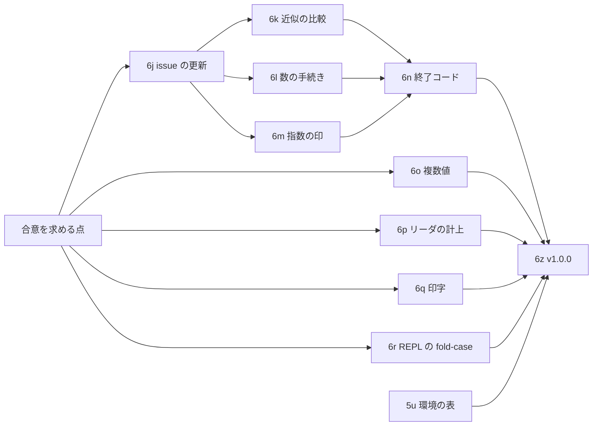

# 0028: 段階6(準拠検証)の全体の計画

- 段階: 6(準拠検証)。段階の作業項目と完了条件は [roadmap.md](../roadmap.md) の段階6の節が正
- 前倒しで済んだ部分: [0020](0020-conformance-harness-early.md)(スライス 6a から 6h)、[0024](0024-step-limit-for-the-conformance-run.md)(6h-1、6h-2)、[0025](0025-fuzzing-the-evaluator.md)(6i-1 から 6i-3)
- 対応する決定: [ADR-0013](../adr/0013-testing-strategy-and-conformance-suite.md)(準拠スイートと除外の一覧)、[ADR-0010](../adr/0010-ci-cd-and-release-strategy.md) と [ADR-0034](../adr/0034-release-shape.md)(リリース)、[ADR-0027](../adr/0027-severity-by-consequence-and-a-cost-side-stop.md)(実測値を文章に書かない)、[ADR-0031](../adr/0031-gc-at-machine-step-boundaries.md)(1ステップの確保)、[ADR-0044](../adr/0044-machine-step-limit-not-catchable.md)(機械の歩数の上限)
- レーンの運用: [0017](0017-parallel-lanes.md)
- 日付: 2026-11-03
- 状態: 合意済み(2026-11-04)。「合意を求める点」の7点すべてを、勧める案どおりに承認した。スライス 6j から着手できる

## 状態

| 項目 | 状態 |
| --- | --- |
| 計画書 | 合意済み。承認の結論を、スライスの表と roadmap の項目に写した |
| 合意 | 済み(2026-11-04。7点すべて勧める案) |
| スライスの実装 | 6j、6m 完了。6l はこの PR で完了。6k 実装中 |

## 次にやること

1. 6j(issue の更新)から着手する。6j の結果で、6k から 6m の対象を確かめ直す。
2. 6l の `(sqrt -1.0-0.0i)` は、案A(直す)に決まった(2026-11-04)。`sqrt` の手続きに限り、実部が負で虚部が負のゼロの引数を、虚部が正のゼロの引数と同じ `+i` 側の根にする(原文の6.2.6は、実部が0なら虚部は非負としている)。`asin` と `acos` が内部で使う根は、共役対称に頼る式なので変えない。除外の一覧に `sqrt` の行は要らない(合意を求める点の4)。
3. 6m の PR は、ドラフトで開いたあと、自前の敵対的レビュー(ミューテーション)と通常の CI の結果を待つ。マージ後は、6n の前提(6k、6l、6m のマージ)の 1 つが満たされる。
4. 6q の PR は、ドラフトで開いたあと、自前の敵対的レビュー(ミューテーション)と通常の CI の結果を待つ。
5. 並行できるスライス(6k、6l、6m、記憶の上限の3本、印字と REPL の2本)を、[0017](0017-parallel-lanes.md) のレーンに割り当てて起動する。

## 解こうとしている問題

段階6の完了条件は、準拠マトリクスに `r7rs-tests.scm` の結果の表があり、その不合格項目がゼロか、残りすべてに根拠が記録されていること、そして v1.0.0 を出すことである(roadmap)。表は 6f で入った。残っているのは次の4つである。

- 不合格の解消。前倒しの間に、各レーン(L1 から L4)が多くの未実装を解いた。残りの内訳は、`zig build test-conformance` を走らせて確かめる(件数はここに書かない)。2026-11-03 に、main の `0a388bc` で走らせた結果、残りは「落ちた」と「誤り」だけで、「読めない」「未実装」「連鎖」は無かった。落ちたものと誤りの原因は、下の「残りの不合格の原因の見立て」に分けた。
- `zig build test-conformance` の終了コードの切り替え。今は、ランナーの誤りのときだけ非0で、テストが落ちても0である(0020 の「build.zig の step」)。段階6の完了の時点で、落ちたものが残れば非0にする規則に切り替える。
- roadmap の段階6の「スライス未割り当て」の項目の行き先。
- v1.0.0 のリリース。

この計画は、この4つを、スライスに割り、順序と担当を決める。

## 完了条件

roadmap の段階6の完了条件を、次の機械で確かめられる形にする。

- `zig build test-conformance` が、main の先頭で終了コード0で終わる。6n の切り替えのあとは、終了コード0が「落ちた」「誤り」と、除外の一覧に無い「実行不能」が0件であることを意味する。
- 除外の一覧が要るなら(6l の `sqrt` の判断による)、そのすべての行に理由がある。
- `zig build check-report` が緑で、`docs/status/conformance.md` が同じ結果を載せている。
- roadmap の段階6の作業項目に、チェックが入っているか、段階6の外への送り先と、ユーザーの承認の日付が書いてある。
- v1.0.0 が公開され、段階6の完了の手続き(6z)が済んでいる。

## 範囲

含めるもの:

- 残りの不合格の解消(6k、6l、6m)
- 失敗の一覧の issue の更新と、閉じること(6j)
- 終了コードの切り替え(6n)
- roadmap の段階6の未割り当ての項目のうち、段階6に残すことを勧めるもの(6o、6p、6q、6r と、0019 で割り当て済みの 5u)
- v1.0.0 のリリースと段階の完了(6z)

含めないもの(送り先は「未割り当ての項目の行き先」):

- 性能の測定と、それを根拠にする判断([design/open-questions.md](../design/open-questions.md) の「段階を定めずに保留しているもの」のうち、準拠テストが通ったあとの性能測定を根拠にする行)。roadmap の段階6の「残していること」が、これらを段階6の外に置いている。
- 準拠スイート以外の外部スイートの併用([ADR-0013](../adr/0013-testing-strategy-and-conformance-suite.md) の見直し条件)。

## 残りの不合格の原因の見立て

2026-11-03 に、main の `0a388bc` の `zig build test-conformance` の失敗の一覧を読み、原因を3つに分けた。分け方は、一覧の詳細(期待した値と実際の値)と、取り込んだスイートの該当の行と、R7RS の原文(`docs/spec/` の errata 訂正版)で確かめた。件数は、走らせ直して数える。

1. 近似の比較(レーン L5): 期待した値が不正確な数で、実際の値と小数点以下の桁の数だけが違うもの(`(exp 3)`、`(sqrt 2)`、`atan` の2引数の形など、6.2 の大半と、4.2 の1件)。スイートは、上流の `(chibi test)` が不正確な数を近似で比べることを前提に、桁を丸めた期待値を書いている。こちらの `(chibi test)`(`lib/chibi/test.scm`)は `equal?` で比べる。処理系の誤りではなく、互換の最小実装の欠けである。上流の比較の規則(誤差の既定値と、複素数の扱い)は、6k の最初の作業で、上流の `lib/chibi/test.scm` を読んで確かめた(下の「確かめた事実」)。
2. 数の手続きの値(レーン L1): 近似では説明できないもの。
   - `(expt 0.0 0)` が、期待の `1.0` でなく、正確な `1` を返す。R7RS 6.2.6 の `expt` は、`0.0` の `z` 乗について「不正確な結果で同様」と書いている(原文で確かめた)。処理系の誤りと見ている。
   - `(sqrt -1.0-0.0i)` が、期待の `0.0+1.0i` でなく、`0.0-1.0i` を返す。虚部が負の0のときの分岐の向きである。R7RS がこの場合を定めているかは、まだ確かめていない(6l の最初の作業)。合意を求める点の4で扱う。
3. 数の構文(レーン L2 と L1): Numeric syntax の節の「誤り」は、すべて `1s2`、`1f2`、`1d2`、`1l2` のような、`e` 以外の指数の印を読めないことによる。R7RS 7.1.1 の文法の指数の印は `e` だけで、6.2.5 は、精度を示す `s`、`f`、`d`、`l` を、処理系が受け付けてもよい(may)としている(原文で確かめた)。受け付けないことは仕様に反しない。合意を求める点の3で扱う。

この見立ては、走らせた時点の結果である。各レーンの PR で変わるので、6j で取り直す。

## 未割り当ての項目の行き先

roadmap の段階6の「スライス未割り当て」の項目と、割り当て済みでまだ済んでいない項目の、行き先である。合意を求める点の1と2で諮り、2026-11-04 に、下の表のとおり承認された。

| roadmap の項目 | 行き先(2026-11-04 に承認) | 理由 |
| --- | --- | --- |
| パラメータの読み出しが、動的点の列の長さに比例する | 段階6の外。受け入れた制約のまま、[design/open-questions.md](../design/open-questions.md) の「パラメータの読み出しの費用」の行(段階を定めない保留)に寄せ、roadmap の段階6の項目から外す | 結果は正しく、メモリは有界である。roadmap の項目自身が「準拠テストの後の性能の見直しと同じ時期に見る」としていて、その見直しは段階6の範囲の外(「範囲」の節) |
| 複数値のオブジェクトの本体が、1ステップの中で個数に比例して確保する | 段階6に残す。6o | 1ステップの確保を有界にする [ADR-0031](../adr/0031-gc-at-machine-step-boundaries.md) の規則の残りで、v1.0.0 の前に閉じたい。準拠スイートとは独立 |
| マクロが導入したトップレベルの `define` と `define-syntax` の衛生 | 段階6の外。既知の制限のまま v1.0.0 に入れる(合意を求める点の2)。roadmap の項目は、段階を定めない保留の既存の行へ寄せた | R7RS 4.3 は、トップレベルの定義が束縛を導入するかを処理系に委ねている(roadmap の項目が原文で確かめた)。準拠スイートの 4.3 の節は、今の実装で通る。直すには、識別子の解決の規則([ADR-0019](../adr/0019-denotations-and-identifier-resolution.md))を変える新しい ADR が要る |
| `environment` が作る表を、GC の圧力に数える | 段階6に残す。0019 の 5u のまま(名前と担当を変えない) | 0019 で割り当て済み。v0.5.0 の後に送られ、段階6の項目に置かれた。常駐のメモリが伸び、ヒープの上限で止まらない疑いがあるので、v1.0.0 の前に閉じたい |
| プリンタが、ASCII でない識別子を縦棒なしで書く | 段階6に残す。6q | 小さく、読み戻しの一貫性(`write` と `read` の往復)に関わる |
| `#!fold-case` を完全な畳み込みにするか | 段階6の外。単純な畳み込みのまま、決めたこととして記録し、roadmap の項目を閉じた(合意を求める点の2) | 2026-10-31 に単純な畳み込みのままにすると決めていて、項目は「準拠検証で必要になったときに直す」としている。準拠スイートの Read syntax の節は、今の実装で通る |
| `exptComplexByFloat` の到達しないガード | 段階6に残す。6l に含める | `src/num/power.zig` を 6l が触るので、同じ PR で消せる |
| 位置情報の残り(2): コアIRへの位置の複写と、実行時の誤りへの位置の表示 | 段階8へ送る。L7 の「エラー位置の表示」の計画書で割り当てる | roadmap の項目自身が L7 の計画書で割り当てるとしている。段階8の作業項目「エラー位置の表示と処理の中断」と同じ機構である |
| ファイルを読むときのリーダの作業領域を、ヒープの上限に計上する | 段階6に残す。6p | 計上の外の確保を閉じる規則の残り。今は、ファイルの大きさの上限で最悪の場合を抑えているだけである |
| REPL のソースの読み取りに、`#!fold-case` の状態を残す | 段階6に残す。6r | R7RS 2.1 の文言(同じポートの後続のデータに効く)に合わせる。小さい |
| 不合格項目の issue 化と解消 | 段階6。6j から 6m | この計画の中心 |

## スライス

スライスの名前は 6j から続ける(6a から 6i-3 は前倒しで済んだ)。担当の階層は [0017](0017-parallel-lanes.md) の T1・T2・T3、レーンは同じ計画書のレーン表である。テストの番号は、L5 は 0800 台、ほかのレーンはそのレーンの範囲を使う(0017 の取り決め)。

見積りは時間で、「ready まで」と「マージまで」を分ける(最初のコミットから)。基準は、段階3の計画書 0016 の規模ごとの見積り(小は 1〜2 / 1.5〜3、中は 2〜4 / 3〜6)で、それに 1.35 を掛けて丸めた。1.35 は、[0012](0012-schedule-estimates-and-actuals.md) の補正の記録の、直近2段階(段階4の約1.6と段階5の約1.1)の比の平均である。0012 の段階3の内訳では、多くのスライスの「マージまで」が見積りを超えた。超えた主因は、層2 とユーザーのマージの待ちと、夜をまたいだ判断の待ちだった。この見積りは、待ちが短い時間帯を前提にしているので、夜をまたぐと超える。

| スライス | レーン | 完了条件 | 所有するファイル | 階層 | 前提 | 見積り(ready まで / マージまで、時間) |
| --- | --- | --- | --- | --- | --- | --- |
| 6j 失敗の一覧の更新 | L5 | main の先頭の `zig build test-conformance` の結果で、レーンごとの issue(suchi/sucheme-zig#152、#154、#155、#156)のチェックを更新し、全部通った issue を閉じる。残りの不合格を、上の見立ての3つに振り分けた issue にする(既存の issue の本文の更新か、新しい issue)。作る・閉じる issue の一覧を、書き込みの前に親に示す | issue だけ(リポジトリのファイルは持たない)。計画書 0020 の進捗の表の 6g の行に、更新したことを1行足す | T1 | 合意 | 0.5〜1 / 1〜2 |
| 6k `(chibi test)` の近似の比較 | L5 | 上流の `(chibi test)` の不正確な数の比較の規則を、上流のソースで確かめて計画書に記録し、同じ規則を `lib/chibi/test.scm` に入れる。正確な数どうしと、数でない値の比較は `equal?` のまま。`tests/scheme/0800` 台のケースが、近いが等しくない不正確な数で合格、離れた数で不合格、正確な数で厳密な比較になることを固定する。準拠スイートの近似の比較による不合格が0件になる | `lib/chibi/test.scm`、`tests/scheme/0800` 台、`docs/status/conformance.md`(生成し直す) | T2 | 6j | 3〜5.5 / 4〜8 |
| 6l 数の手続きの値 | L1 | `(expt 0.0 0)` が `1.0` を返す。`(sqrt -1.0-0.0i)` は、最初の作業で R7RS の原文と今の実装の規則を確かめ、その結果をユーザーに諮ってから扱いを決める(合意を求める点の4)。直すと決まれば直し、除外と決まれば 6n の除外の一覧に行を渡す。`src/num/power.zig` の `exptComplexByFloat` の到達しないガードを外す。どれも単体テストか `tests/scheme` で固定する | `src/num/power.zig`、`src/num/` の平方根の関数、`tests/scheme` の L1 の範囲、`docs/status/conformance.md` | T2 | 6j。`sqrt` の扱いは、着手後のユーザーの判断 | 1.5〜3 / 2〜4 |
| 6m 指数の印 | L1(解析関数)、L2(リーダ) | `s`、`f`、`d`、`l`(と大文字)を、`e` と同じ倍精度の指数の印として受け付ける(合意を求める点の3で承認)。精度の区別はしない。Numeric syntax の節の誤りが0件になる。受け付ける綴りを、リファレンスに載せる項目として L9 に伝える | `src/num/` の数の字句の関数、`src/reader.zig` の数の判定(要るときだけ)、単体テスト、`docs/status/conformance.md` | T2 | 6j | 1.5〜3 / 2〜4 |
| 6n 終了コードの切り替え | L5 | `zig build test-conformance` が、「落ちた」「誤り」と、除外の一覧に無い「実行不能」が1件でもあれば、非0で終わる。除外の一覧は、6l で `sqrt` の除外が決まったときだけ置き、`tools/conformance-run/excluded.txt` に、1行に節の名前、形式の先頭の行の番号、形式の文字列のハッシュ、理由を書く。置くときは、その読み込みと照合が入り、除外した形式が出力と `docs/status/conformance.md` で分かる(合意を求める点の5で承認)。展開器のコードを読み、確保を伴わない展開の有無を確かめて、結果を 0024 の「残っていること」に書く(合意を求める点の6で承認)。ランナーの単体テストで、落ちたものが1件ある偽のスイートで非0、除外した形式だけが残る偽のスイートで0、除外の一覧の行が形式に当たらない(ハッシュの不一致)ときに誤り、を固定する。main の先頭で終了コード0 | `tools/conformance-run/main.zig`、`run.zig`、除外の一覧のファイル(要るときだけ)、計画書 0024 の「残っていること」、計画書 0020 の「build.zig の step」の文 | T2 | 6k、6l、6m のマージ | 3〜5.5 / 4〜8 |
| 6o 複数値の本体の確保 | L0 | `Machine.valuesOf` が、1ステップの中で値の個数に比例する量を確保しない。最初の作業として、今の確保の経路を読み、確保の前に必要な量を境目で確かめる形か、表現を変えるかを決める。表現を変えるなら、データ形式の判断として着手前にユーザーに諮る。多数の値を返す `values` が、ヒープの上限で止まるか、上限の内で動くことを、縮小版を層1、規模版を `tier.slow()` で固定する | `src/machine.zig` の該当の部分、テスト | T3 | 合意 | 3〜5.5 / 4〜8 |
| 6p リーダの作業領域の計上 | L2 | ファイルを読むときのリーダの、未閉じの括弧ごとの枠を、ヒープの上限に計上する。深い入れ子のファイルが、ヒープの上限で止まることを固定する。[design/open-questions.md](../design/open-questions.md) の「ライブラリの表と `import` の作業領域が、ヒープの上限の外にある」の行のうち、リーダの分を消すか書き直す | `src/reader.zig`、テスト、`docs/design/open-questions.md` の該当の行 | T2 | 合意 | 3〜5.5 / 4〜8 |
| 5u 環境の表の GC の圧力 | L3 | 0019 の 5u の行のまま | 0019 の 5u の行のまま | T3 | v0.5.0 の公開(済み) | 1.5〜3 / 2〜4 |
| 6q 非 ASCII の識別子の印字 | L3(プリンタ) | `(write 'λ)` が縦棒なしで書き、読み戻すと同じシンボルになる。印字の判定が、リーダの `readsAsIdentifier` と同じ規則になる。縦棒が要る綴り(空白を含むものなど)は縦棒で囲むままであることを、同じテストで固定する | `src/printer.zig`、テスト | T2 | 合意 | 1.5〜3 / 2〜4 |
| 6r REPL の `#!fold-case` | L0(`src/sucheme.zig`)、L2(リーダ) | REPL で、`#!fold-case` の行のあとの行の識別子が畳み込まれる。`#!no-fold-case` で戻る。`Interpreter` が畳み込みの状態を持ち、`evalPrint` のたびに `Reader` へ渡して書き戻す | `src/sucheme.zig` の `evalPrint`、`src/reader.zig`(状態を受け渡す口が要るときだけ)、テスト | T2 | 合意 | 1.5〜3 / 2〜4 |
| 6z v1.0.0 と段階の完了 | L0(リリース関係) | v1.0.0 が公開され、段階6の完了の手続きが済む。手順は下の「v1.0.0 のリリース」 | `build.zig` の版と `current_stage`、`docs/releases/v1.0.0.md`、roadmap、この計画書、0012、`THIRD-PARTY-NOTICES.txt`(要るときだけ) | T2 | ほかのすべてのスライスのマージ | 準備の PR: 1.5〜3 / 2〜4。残りの2つの PR は、それぞれ 0.5〜1 / 1〜2 |

### 並行できるものと、ファイルの重なり

- 6k、6l、6m は、互いにファイルが重ならない(`lib/chibi/`、`src/num/` の平方根と `expt`、数の字句)。6l と 6m は、どちらも `src/num/` の下だが、触る関数が違う。同時に進めるときは、着手のときに変更するファイルを親が突き合わせる。
- 6o、6p、5u、6q、6r は、不合格の解消と独立で、合意のあとすぐに並行に起動できる。6p と 6r は、どちらも `src/reader.zig` を触りうる。6r がリーダを触らずに済むなら重ならない。重なるときは 6p を先にする。
- `docs/status/conformance.md` は、6k、6l、6m がそれぞれ生成し直す。[0017](0017-parallel-lanes.md) の取り決め(後からマージするほうが生成し直す)に従う。
- 6n は、6k、6l、6m のマージのあとに着手する。理由は「終了コードの切り替え」の節。

## 不合格の解消の進め方

- 振り分けは 0020 の「失敗の一覧を、各レーンの作業項目に流す手順」の表と同じ規則で行う。上の見立てでは、L5(近似の比較)、L1(数の手続き)、L1 と L2(指数の印)の3つで、L0、L3、L4 に振るものは無かった。6j で取り直した結果が違えば、6j の PR の代わりに、この節とスライスの表を直す文書の PR を出す。
- 順序: 6j、次に 6k、6l、6m を並行、最後に 6n。6k を先に入れると、近似の比較で隠れていた本物の値の誤りが「落ちた」に残って見えるので、6l の対象が確かめやすくなる。
- 完了の測り方: 各スライスの PR に、マージ前の main と PR の先頭で `zig build test-conformance` を走らせた結果の合計の行を書く(PR の本文は、その時点の記録なので、実測を書いてよい。計画書と roadmap には書かない)。段階6の不合格の解消の完了は、6n のあと、main の先頭で `zig build test-conformance` が終了コード0で終わることで測る。
- 新しい不合格: ほかのレーン(段階7、段階8、L9)の PR が新しい不合格を生んだら、6n より前は `zig build check-report` が赤になって止める(節ごとの数が生成物に載る)。6n のあとは `test-conformance` も赤になる。

## 終了コードの切り替え(6n)

0020 は、段階6の完了の時点で、「落ちた」と、除外の一覧に無い「実行不能」が1件でもあれば非0にする規則に切り替える、としていた。手順と、切り替えの前に CI が赤になる危険の扱いを決める。

- 数える分類: 0020 の文は「落ちた」と「実行不能」だけを挙げている。「誤り」(最上位の形式が条件を上げたもの)は、6e で後から足した分類で、0020 の文は誤りに触れていない。誤りも非0の理由に含める(合意を求める点の5で、2026-11-04 に承認)。誤りを含めないと、指数の印の誤りのような、最上位の形式が誤りを上げる不合格が、終了コードに現れない。機械の歩数の上限に当たった形式も誤りに数えられる(0024)ので、止まらない形式も非0になる。
- 赤になる危険: 切り替えを、不合格が残る状態で入れると、全コミットの CI(`ci.yml` の `test` ジョブと `full.yml` の `windows` ジョブ)が、その PR から赤になり、ほかのレーンのすべての PR が赤になる。これを避けるため、次の順にする。
  1. 6k、6l、6m がマージされ、main の先頭で、落ちた・誤り・実行不能が、除外の一覧に載せる予定のものを除いて0件であることを、6n の着手の前に確かめる。
  2. 6n の PR は、除外の一覧(要るとき)と、終了コードの変更を同じ PR に入れる。どちらか片方だけをマージすると、赤になるか、除外の一覧が効かない。
  3. PR を ready にする前に、main を取り込んだ先頭で、手元の `zig build test-conformance` が終了コード0で終わることを確かめる。`set -o pipefail` を付けるか、終了コードを別に確かめる(AGENTS.md)。
  4. 文書だけの PR ではないので、ready にすると層2 が走る。`full.yml` の `windows` ジョブが、Windows で同じ結果になることを確かめる(数の印字の違いで、Windows だけが落ちる危険を、ここで見る)。
  5. 6n のマージの時点で開いているほかのレーンの PR は、main を取り込んで、`test-conformance` が0で終わることを確かめてから ready にする。取り込みの push は、ready の直前まで延ばしてよい(AGENTS.md の「Actions の分数」)。
- 切り替えたあとに上流の更新でスイートを取り込み直すと、新しい不合格で赤になりうる。取り込み直しは、この計画の範囲の外で、するときは同じ PR で不合格を解くか除外する。

## 止まらない形式への時間の上限(0024 の残り)

0024 は、機械の歩数の外で走る処理のうち、マクロの展開が、入れ子を深くせずに増え続ける形で止まるかを、確かめていないとしていた。

- 確かめたこと(2026-11-03、`0a388bc` の Debug ビルドの実行ファイルで、スクラッチパッドのファイルを実行した): 自分自身に展開する `syntax-rules` のマクロ(引数を持つ形と、`begin` で包む形)の呼び出しは、どちらも `heap limit exceeded` で止まり、終了ステータス 1 になった。止まるまでの時間は、走らせ直して測る(ここには書かない)。展開のたびに確保が起き、ヒープの上限で止まる見込み(0024)と合う。
- 確かめたこと(6n、2026-11-04): 確保を伴わずに展開を続ける形は、展開器のコードを読んだ範囲では存在しない。根拠と、確かめていない範囲は [0024](0024-step-limit-for-the-conformance-run.md) の「残っていること」にある。
- 扱い(合意を求める点の6で、2026-11-04 に承認): 新しい仕組み(展開の回数の上限、ランナーの壁時計の上限)は足さない。理由は、確かめた2つの形が上限で止まったこと、止める仕組みが歩数の上限([ADR-0044](../adr/0044-machine-step-limit-not-catchable.md))とヒープの上限のほかに増えること、CI のジョブの `timeout-minutes` が最後の止め役として残ることである。展開器のコードの読み取りは 6n の中で行い、確保を伴わない展開が見つかったら、その時点で仕組みの案を諮る。ヒープの上限で止まるまでの時間が、ランナーの1形式の時間として長いことは、受け入れる制約として記録する(時間は 6n で、ランナーと同じ ReleaseSafe で測り、PR に書く)。合意を求める点の6で扱う。

## v1.0.0 のリリース(6z)

段階4(4z)と段階5(5r)と同じ、3つの PR の形にする。手順の正は、0019 の 5r の行と、[ADR-0034](../adr/0034-release-shape.md) である。

1. 準備の PR: `build.zig` の版を `1.0.0` にし、`docs/releases/v1.0.0.md` を書き、roadmap の段階6にチェックを入れ、この計画書の進捗を整理する。リリースノートには、既知の制限(段階6の外へ送った項目と、受け入れた制約)を書く。配布物に入る第三者の表示(`THIRD-PARTY-NOTICES.txt`)が、段階6で入れたものを覆っているかを確かめる(handoff.md の注意)。段階6で、配布物に第三者のデータやコードを足す予定は無い。`(chibi test)` は互換の最小実装で、上流のコードを写していない(0020)。6k で上流の比較の規則を参考にするときも、コードを写さない。
2. タグ: ユーザーが手元で打つ。この環境からは、タグの push が拒否される(handoff.md)。準備の PR のマージコミットを、ハッシュで指定したコマンド(`git tag -a v1.0.0 <コミット> -m "sucheme v1.0.0"` と `git push origin v1.0.0`)を示して頼む。タグの push で `release.yml` が下書きのリリースを作り、ユーザーが成果物を確かめて公開する。
3. 開発版に進める PR: 版を `1.1.0-dev` にし、roadmap の現在地と最新リリースを更新する。`current_stage` を 7 に上げるかは、そのときの検証コマンドの表に段階7の全コミットの行があるかで決める(上げると `check-docs` が段階7の行を CI に要求する)。
4. 振り返りの PR: 0012 に段階6の実績(スライスごとの着手、ready、マージ)と補正を足す。段階6の行を open-questions.md から消す規約は、段階6の行が無いので当てはまらない。

v1.0.0 は、[ADR-0010](../adr/0010-ci-cd-and-release-strategy.md) の「段階ごとにマイナーを上げる」より、R7RS 準拠の達成を v1.0.0 とする規則が優先する(roadmap の段階6の完了条件)。

## 合意を求める点

勧める案を先に書いた。2026-11-04 に、7点すべてが勧める案どおりに承認された。各点の結論を、点の最初の行に書いた。選択肢の説明は、判断の記録として残す。

1. 未割り当ての項目の行き先(上の「未割り当ての項目の行き先」の表)。
   - 結論: 勧める案で承認(2026-11-04)。表の行き先を、スライスの表と roadmap の項目に写した。
   - 勧める案: 表のとおり。段階6に残すのは 6l の一部、6o、6p、5u、6q、6r。外へ送るのは、パラメータの読み出し(段階を定めない保留へ)、マクロの衛生と完全な畳み込み(次の2)、位置情報の残り(段階8へ)。
     - メリット: v1.0.0 の前に、記憶の上限(計上の外の確保)の残りを閉じられる。段階6の完了条件(準拠スイート)と関係しない設計変更を、v1.0.0 の前提に入れない。
     - デメリット: v1.0.0 に既知の制限が残る。段階6のスライスが7本増え、v1.0.0 が遅れる。
   - 別案A: 記憶の上限の3本(6o、6p、5u)も段階6の外へ送り、v1.0.0 を不合格の解消と終了コードだけで出す。
     - メリット: v1.0.0 が早い。
     - デメリット: 1ステップの確保とヒープの上限の規則に、穴が残ったまま 1.0 を名乗る。
   - 別案B: 全項目を段階6で解く。
     - メリット: 既知の制限が最も少ない。
     - デメリット: 新しい ADR が要る設計変更(マクロの衛生)が v1.0.0 の前提に入り、見積りの裾野が読めなくなる。
2. マクロが導入したトップレベルの定義の衛生と、`#!fold-case` の完全な畳み込みの扱い。
   - 結論: 勧める案で承認(2026-11-04)。衛生は既知の制限として v1.0.0 に入れ、段階を定めない保留へ寄せた。完全な畳み込みは 2026-10-31 の決定を正とし、roadmap の項目を閉じた。
   - 勧める案: どちらも段階6では直さない。衛生は、v1.0.0 にも既知の制限として入れ、roadmap の項目を「段階を定めない保留」([design/open-questions.md](../design/open-questions.md) の既存の行)へ寄せる。完全な畳み込みは、2026-10-31 の決定(単純な畳み込み)を正として記録し、roadmap の項目を閉じる。
     - メリット: R7RS がどちらも処理系に委ねているか許している範囲で、準拠スイートも通る。v1.0.0 の前提が小さい。
     - デメリット: 衛生の制限は、利用者のプログラムで、マクロの導入した名前が利用側の変数を書き換える形で現れうる。
   - 別案: 衛生を段階6で直す(新しい ADR とスライスを足す)。
     - メリット: 既知の制限が1つ減る。
     - デメリット: 識別子の解決の規則を変えるので、段階2から3の機構に戻る。見積れない。
3. `e` 以外の指数の印(`s`、`f`、`d`、`l`)。
   - 結論: 勧める案で承認(2026-11-04)。受け付ける。6m の完了条件に写した。
   - 勧める案: 受け付ける(6m)。精度の区別はせず、すべて倍精度として読む。
     - メリット: 除外の一覧が要らない(4の答えによっては、除外の一覧そのものが要らなくなる)。字句の変更は小さい。R5RS 由来のプログラムが読める。
     - デメリット: R7RS の文法の外の綴りを、処理系の拡張として持つ。文書のリファレンスに書く必要がある。`write` は `e` で書くので、読み書きは往復しない(値は同じ)。
   - 別案: 受け付けず、該当の形式を、R7RS 6.2.5 の「may」を理由に除外の一覧に載せる。
     - メリット: 文法が R7RS の文法そのままになる。
     - デメリット: 除外の一覧の仕組み(5)が要る。
4. `(sqrt -1.0-0.0i)` の分岐の向き。
   - 結論: 勧める案で承認(2026-11-04)。6l の最初の作業で原文と実装の規則を確かめ、その結果を改めてユーザーに諮る。
   - 結果(6l、2026-11-04): 確かめた結果を諮り、案A(直す)に決まった。除外の一覧に `sqrt` の行は要らない。
   - 勧める案: 6l の最初に、R7RS の原文と、今の実装が従っている規則を確かめてから決める。決める前に、確かめた結果を諮る。R7RS が定めていなければ、除外の一覧に「R7RS が規定しない」を理由に載せる案と、スイートの期待に合わせる案の2つを、そのときに示す。
     - メリット: 根拠を確かめずに挙動を変えない。
     - デメリット: 判断が1回増える。
   - 別案: 確かめずに、スイートの期待(`+i`)に合わせる。
     - メリット: 速い。
     - デメリット: IEEE の複素数の慣習(虚部の符号を保つ)から外れる恐れがあり、外れたかどうかが分からない。
5. 終了コードの切り替えの規則と、除外の一覧の形(データ形式)。
   - 結論: 勧める案で承認(2026-11-04)。誤りも非0の理由に含める。除外の一覧は、4で除外が決まったときだけ置く。6n の完了条件に写した。
   - 勧める案: 「落ちた」「誤り」と、除外の一覧に無い「実行不能」が1件でもあれば非0にする。除外の一覧は、要るとき(3か4で除外を選んだとき)だけ、0020 の「除外の一覧」の形(1行に、節の名前、形式の先頭の行の番号、形式の文字列のハッシュ、理由)で、`tests/vendor/` の外の `tools/conformance-run/excluded.txt` に置く。除外した形式は、`zig build test-conformance` の出力と `docs/status/conformance.md` に、除外したことが分かる形で出す(数え方は 6n で決め、PR に書く)。
     - メリット: 誤りも止める。除外の一覧は、取り込んだスイートと別の場所にあるので、スイートを改変しない([ADR-0013](../adr/0013-testing-strategy-and-conformance-suite.md))。行番号だけで特定しないので、上流の更新で別の形式を除外し続けない。
     - デメリット: 除外の一覧の読み込みと照合の実装が要る(要るときだけ)。
   - 別案A: 誤りを数えず、0020 の文のとおり「落ちた」と「実行不能」だけにする。
     - メリット: 0020 の文と一致する。
     - デメリット: 最上位の形式の誤り(指数の印、歩数の上限)が終了コードに出ない。
   - 別案B: 除外の一覧を置かず、残りの不合格はすべて直す。
     - メリット: 仕組みが要らない。
     - デメリット: 3と4の答えによっては、仕様が定めない挙動をスイートの期待に合わせることになる。
6. 止まらない形式への時間の上限(上の「止まらない形式への時間の上限」)。
   - 結論: 勧める案で承認(2026-11-04)。新しい仕組みは足さず、6n の中で展開器のコードを読む。6n の完了条件に写した。
   - 勧める案: 新しい仕組みを足さず、6n の中で展開器のコードを読んで、確保を伴わない展開の有無を確かめる。見つかったら、その時点で仕組みの案を諮る。止まるまでの時間の長さは、受け入れる制約として 0024 の「残っていること」に書く。
     - メリット: 仕組みを増やさない。確かめた2つの形は上限で止まった。
     - デメリット: 確保を伴わない展開が後で見つかると、CI のジョブの時間切れまで止まらない。
   - 別案: ランナーに、形式ごとの壁時計の上限を足す。
     - メリット: どんな形でも、どの形式で止まったかが出る。
     - デメリット: 時間で止めると、遅いランナー(Windows など)で正当な形式が落ちうる。歩数の上限([ADR-0044](../adr/0044-machine-step-limit-not-catchable.md))と別の止め方が増える。
7. v1.0.0 の手順。
   - 結論: 勧める案で承認(2026-11-04)。3つの PR にし、タグはユーザーが打つ。
   - 勧める案: 上の「v1.0.0 のリリース」のとおり、4z と 5r と同じ3つの PR にし、タグはユーザーが打つ。
     - メリット: 2回の実績がある手順で、迷いが少ない。
     - デメリット: PR が3つになり、公開までに往復が増える。
   - 別案: 準備と開発版に進める変更を1つの PR にまとめる。
     - メリット: PR が減る。
     - デメリット: タグを打つコミットの版が `1.1.0-dev` になり、`release.yml` の版の確認に当たる。

## 検証

各スライスで、AGENTS.md の検証コマンド表の「全コミット」の行を通す。`zig build test-conformance` は、`current_stage` が 6 なので全コミットの CI で走る。6n のあとは、その終了コードが不合格の有無を表す。

## 確かめた事実と、確かめられなかったこと

確かめた事実(2026-11-03):

- main の `0a388bc` で `zig build test-conformance` を走らせ、終了コード0で終わった(今はテストが落ちても0)。失敗の一覧は「落ちた」と「誤り」だけだった。
- 失敗の一覧の詳細と、`tests/vendor/r7rs-tests.scm` の該当の行(近似の比較の期待値、`(expt 0.0 0)`、`(sqrt -1.0-0.0i)`、指数の印の `test-numeric-syntax`)。
- `lib/chibi/test.scm` の比較は `equal?` である。
- R7RS(`docs/spec/` の errata 訂正版)の 7.1.1 の指数の印は `e` だけで、6.2.5 は `s`、`f`、`d`、`l` を受け付けてもよいとしている。6.2.6 の `expt` は、`0.0` の累乗について不正確な結果を求めている。
- 自分自身に展開するマクロの2つの形は、Debug ビルドの実行ファイルで `heap limit exceeded` で止まった。
- レーンごとの issue(suchi/sucheme-zig#152、#154、#155、#156)は開いたままで、本文のチェックは 6g の時点(2026-10-21)から更新されていない。

確かめた事実(2026-11-04、6k):

- 上流の `(chibi test)` の不正確な数の比較の規則。取り込んだスイートと同じ上流のコミット `b2087f3` の `lib/chibi/test.scm` を読んで確かめた(コードは写さず、`lib/chibi/test.scm` に自前で書いた)。
  - `equal?` で等しければ合格である。
  - そうでなく、期待した値が実数なら、期待した値が不正確で、得た値が実数で、両者が近いときに合格である。得た値は正確でもよい(上流のコメントが、不正確な値を期待するテストは等しい正確な値を受け入れてよい、としている)。
  - 近さは、差を、2つの絶対値の大きいほうで割った比の絶対値が、誤差より小さいことである。絶対値の小さいほうが0なら、大きいほうの絶対値が誤差より小さいことである。
  - 誤差の既定値は 1e-5 である(上流では、パラメータ `current-test-epsilon` の初期値)。
  - 期待した値が実数でないなら、両方が数のときに、実部どうしと虚部どうしを、同じ規則で比べる。数でない値は `equal?` だけで決まる。`test-values` は値のリストを `test` と同じ比較に渡すので、リストは `equal?` で決まる。
- この規則では、`(test 1.0 (expt 0.0 0))` は、正確な `1` を返す今の実装でも合格になる。`(expt 0.0 0)` の誤り(上の見立ての2)は、準拠スイートには現れなくなり、6l の自前のテストで扱う。

確かめられなかったこと:

- `(sqrt -1.0-0.0i)` について R7RS が定めているか(6l で確かめる)。
- Windows で `test-conformance` が同じ結果になるか(層2 の `windows` ジョブは走らせているが、結果の一覧を Linux と比べていない)。

## 進捗

| スライス | 状態 |
| --- | --- |
| 6j | 完了。main の 571a372 の結果で、suchi/sucheme-zig#152、#154、#155、#156 を閉じ、残りの不合格を suchi/sucheme-zig#256(近似の比較)、#257(数の手続きの値)、#258(指数の印)に移した |
| 6k | 実装中。上流の比較の規則を確かめて記録し、`lib/chibi/test.scm` に入れた |
| 6l | 完了。`(expt 0.0 0)` を `1.0` にし、`exptComplexByFloat` の到達しないガードを外し、`sqrt` を案Aで直した。除外の一覧に `sqrt` の行は要らない |
| 6m | 完了。`s` `f` `d` `l`(大文字も)を `e` と同じ倍精度の指数の印として読む。字句は `src/num/syntax.zig`、値の読み取りは `src/num/number.zig`(`std.fmt.parseFloat` が `e` しか読まないので、印を `e` に置いた写しを渡す)。準拠スイートの Numeric syntax の節の誤りは0件になった。受け付ける綴りは L9 のリファレンスに載せる項目として伝える |
| 6n | 実装済み、ドラフトの PR で通常の CI を待つ。`test-conformance` は、落ちた・誤り・実行不能が1件でもあれば非0。着手前に main の `afc93c8` で走らせ、終了コード0、不合格0件を確かめたので、除外の一覧は置かない。展開器の読み取りの結果は 0024 に書いた。次にやること: 通常の CI が緑になったら親に報告する。ready の前に、main を取り込んだ先頭で `test-conformance` が終了コード0であることを確かめる |
| 6o | 未着手 |
| 6p | 未着手 |
| 5u | 未着手(0019 で割り当て済み) |
| 6q | 実装中。`reader.readsAsIdentifier` を公開し、プリンタの判定をそれ1本にした(リーダの `isIdentifier`、ASCII だけを通す写しは削除)。`λ` などは縦棒なしで書き、空白や先頭に置けない文字(Nd など)を含む綴りは縦棒のまま。テストは `src/printer.zig`、`tests/scheme/0630-write.txt` |
| 6r | 未着手 |
| 6z | 未着手 |
