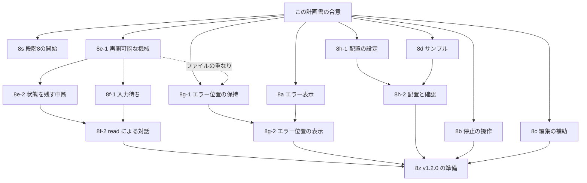

# 0030: 段階8(Web UI の本格化)の全体の計画

- 段階: 8(Web UI の本格化)。段階の作業項目と完了条件は [roadmap.md](../roadmap.md) の段階8の節が正
- 前身: [0021](0021-stage7-8-early-parts.md) の L7 の部分(スライス 8a から 8h)。この計画書は、0021 の 8a から 8h を、段階7までの実績を踏まえて組み直し、置き換える。0021 の L7 の記述は、この計画書の合意のあと、参照用に残す
- 対応する決定: [ADR-0009](../adr/0009-wasm-freestanding-and-zero-dependency-web-ui.md)(freestanding と依存ゼロの Web UI)、[ADR-0021](../adr/0021-no-github-pages-defer-hosting.md)(配置は段階8)、[ADR-0052](../adr/0052-repository-visibility-public-again.md)(public)、[ADR-0034](../adr/0034-release-shape.md)(リリースの形)、[ADR-0044](../adr/0044-machine-step-limit-not-catchable.md)(機械の歩数の上限)、[ADR-0031](../adr/0031-gc-at-machine-step-boundaries.md)(GC は機械の歩の境目)、[ADR-0048](../adr/0048-run-the-examples-of-the-user-documentation.md)(文書の例の実行)
- レーン: [0017](0017-parallel-lanes.md) の L7(Web UI)。機械に触れるスライスは L0 と L3 の所有ファイルに及ぶ(下の「ファイルの重なり」)
- 日付: 2026-11-21
- 状態: 合意済み(2026-11-21)。「決定」の8点すべてを、勧める案どおりに採った。実装、`current_stage` の引き上げ、`build.zig.zon` の版の更新は、この PR に含めず、別の PR で行う

## 状態

| 項目 | 状態 |
| --- | --- |
| 計画書 | 合意済み(2026-11-21)。決定を、スライスの完了条件と roadmap に写した |
| スライスの実装 | 8s の実装を終えた(2つの PR)。8a から 8d、8e-1、8e-2、8f-1 は実装を終えた(進捗の表を参照)。残りは未着手(8g-1 から 8z。8g-1 は別セッションで進行中) |

## 次にやること

1. 8a から 8d と 8h-1 は、機械に触れず、ファイルが重ならないので、並行して始められる。8h-1 の workflow は書いた(進捗の表)。残りは、マージのあとに、手動の起動で試験の配置を行い、未確認の3点(Content-Type、シークレット、環境の保護規則)を確かめて、ADR-0056 と進捗の表に写すこと。起動の前に、ユーザーが、リポジトリの設定で、Pages の配置元を「GitHub Actions」にし、環境 `github-pages` の保護規則で、配置できるブランチとタグを、main とリリースのタグだけに明示する(どちらも、画面の手順は未確認。手動の起動は任意のブランチを選べるので、規則が緩いと、feature ブランチの中身が公開される。[ADR-0056](../adr/0056-deploy-web-ui-to-github-pages.md))。
2. 8e-1 は、機械の設計を ADR に記録して着手する。8f-1 と 8g-1 は、8e-1 のマージのあとに着手する(ファイルの重なり)。
3. 8e-2 のあと、8f-1 が着手できる(`src/wasm.zig` を、8e-2 のマージのあとに取り込む)。8e-2 の決定(`Context.interrupt` を降ろす時期、予算 0 の順序)は、進捗の表の 8e-2 の行にある。8f-2 は、8e-2 と 8f-1 のあとに着手する。
4. 8f-1 は実装を終え、PR の査読と層2(`-Dslow=true`)の確認を待っている。8f-2 は、8f-1 のマージのあとに取り込んで着手する(`web/sucheme.js` の `provideInput` と `provideEof`、`Status.WAITING_INPUT` を使う)。`web/errors.mjs` の `describeResult` は、状態コード 2 を「予期しない状態」として扱っている。8f-2 で、入力待ちの表示に直す。

## 解こうとしている問題

v1.1.0 の時点の Web UI は、次の制約を持つ(いずれも確かめた事実。根拠のファイルを添える)。

- 評価は、`sucheme_eval_begin` の1回の呼び出しで完了まで走る。`sucheme_step` も歩数の制限も WASM には無い(`web/sucheme.js` の冒頭、[design/platform-and-web.md](../design/platform-and-web.md) の「再開可能性」)。機械の歩数の上限は、制御を戻さずに形式を打ち切る形だけが入っていて、準拠スイートのランナーだけが置く([ADR-0044](../adr/0044-machine-step-limit-not-catchable.md))。`Machine.run` のレジスタは、`run` の中の局所変数である(`src/machine.zig`)。
- 停止は、Worker を `terminate()` で捨てて作り直す(`web/app.js`)。作り直した処理系は初期状態で、それまでの定義は失われる。
- 標準入力は最初から終わりにあり、`(read-char)` は EOF を返す([docs/manual/guide/06-web-ui.md](../manual/guide/06-web-ui.md))。
- エラーの表示は、出力の文字列に状態コードを足す程度で(`web/app.js` の `describeStatus`)、行と桁は無い。リーダは括弧で書いたリストの先頭のペアに位置を記録するが、副表は1つのトップレベルの形式を展開し終えるまでの作業表で、実行時の誤りへの位置は出ない([design/frontend.md](../design/frontend.md) の位置情報)。
- 入力欄に編集の補助が無く、サンプルは少ない(`web/samples.mjs`)。
- 配置先が無い。リリースの成果物は zip で、展開して `node serve.mjs` を実行する形である([ADR-0034](../adr/0034-release-shape.md))。画面の文言は日本語で、[AGENTS.md](../../AGENTS.md) の言語の表(UI ラベルは英語)と食い違う。
- `web/` のテストは、`tools/test-wasm/main.mjs` が Node.js から `.mjs` の部品と WASM のエクスポートを試す形である。ブラウザの自動テストは無い([docs/releases/v1.1.0.md](../releases/v1.1.0.md))。

段階7のスライスは、0021 のとき機械に触れない部品として作れた。段階8の中核(状態を残す中断、`read` による対話、エラー位置)は、機械と展開器に触れる。この計画書は、その違いを、スライスの分け方と階層の割り当てに反映する。

## 完了条件

[roadmap.md](../roadmap.md) の段階8の完了条件は、次の3つである。

1. ブラウザで R7RS のサンプルが一通り動く。「一通り」の線引きは、決定6で定めた。
2. 配置した URL でも動く。
3. リリース v1.2.0 を出す。

この計画書は、それを次の判定に分ける。

- 機能: 8e から 8g(状態を残す中断、`read` による対話、エラー位置)が完了し、利用者向けの文書の Web UI の節が実装と一致する。
- サンプル: 8d が完了し、決定6の検査が全コミットの CI で通る。
- 配置: 8h が完了し、配置した URL で、同じサンプルが動くことを確かめる。
- リリース: 8z。リリースを出す作業は、段階の完了条件には含めない(段階7と同じ扱い。公開はユーザーの確認を取る)。

## 範囲

含めるもの: 上の完了条件のもの。`src/machine.zig`、`src/context.zig`、`src/sucheme.zig`、`src/wasm.zig`、展開器と IR(位置の複写)、`web/*`、`tools/test-wasm/`、配置のワークフロー(承認のあと)、利用者向けの文書の更新。

含めないもの(送り先は括弧の中):

- 識別子の補完、REPL の差分読み取り、端末の高さを超える描画、貼り付けの描画の畳み込み、文字幅の表の差し替え、Windows と macOS の実機での確認の残り(roadmap の「段階7の後続の作業」。どれも REPL の行編集の作業で、Web UI の完了条件に入らない)。
- ネイティブの REPL の「評価だけを止める Ctrl-C」(同じ節。決定7: 段階8に含めない。8e-1 は、割り込みの要求を機械が歩の境目で見る作りにするだけで、信号ハンドラからの組み込みは含めない)。
- ブラウザの自動テストの CI への導入(決定8)。
- roadmap に無い機能(オフライン対応、モバイル向けの最適化、アカウントや保存の機能)。

## 確かめた事実と、確かめられなかったこと

確かめた事実(`origin/main` の `8c15470` を読んだ)。

- `web/` は8ファイル(`app.js`、`index.html`、`samples.mjs`、`serve.mjs`、`share.mjs`、`style.css`、`sucheme.js`、`worker.js`)で、`tools/test-wasm/main.mjs` が `samples.mjs` と `share.mjs` を読んで検査している。
- `web/app.js` は、`sucheme.wasm` を `import.meta.url` からの相対パスで取る。サイトをサブパス(`/<リポジトリ名>/`)の下に置いても、取得先は変わらない。
- `preview.yml` が、PR ごとに `sucheme.wasm` と `web/` の中身を、成果物 `sucheme-web` として上げる(保存7日)。リリースの zip は `tools/release/package.py` が作る。
- `.github/dependabot.yml` と `.github/workflows/` の変更は、ユーザーの承認が要る(AGENTS.md のセキュリティの節)。
- 利用者向けの文書 `docs/manual/guide/06-web-ui.md` は、`read` による対話、エラーの位置の表示、配置した URL が「まだありません」と書く。L9 の計画は、これらの内容を、前提のスライスのあとに足すとしている([0027](0027-user-documentation.md)、roadmap の利用者向けの文書の節)。

確かめられなかったこと(合意のあと、各スライスの着手時に確かめる)。

- GitHub Pages が、`.wasm` を `application/wasm` で返すか。Pages の配置にシークレットが要らないか。Actions による配置の公式文書の記述。この環境から GitHub の文書に届かなかったので、確かめていない。確かめ方は、配置先の試験用の配置を作り、レスポンスの `Content-Type` を見る(8h-1)。
- Pages の配置を、タグの push かリリースの公開から起動できるか(環境の保護規則の既定が、既定のブランチに限られる、という記憶がある。未確認)。
- 再開可能な機械が、周回ごとの費用をどれだけ増やすか(測っていない。ADR-0044 の測定は、周回ごとの残りの比較だけを対象にしている)。
- WASM の大きさと、圧縮して配る場合の大きさ(測っていない。数値は文書に書かず、`zig build wasm` のあとに `zig-out/web/sucheme.wasm` を測って出す)。

## スライス

0021 の 8a から 8d は、独立で機械に触れない部品として、そのまま残す。0021 の 8e、8f、8g、8h は、機械と展開器の変更を含むので、機械側と画面側に分ける。識別子は、0021 を引き継ぎ、分けたものに枝番を付ける。

階層は [0017](0017-parallel-lanes.md) の T1(軽量)、T2(標準)、T3(上位)である。時間は下の「見積り」に分けて置く。

| スライス | 完了条件 | 所有するファイル | 階層 | 前提 | 並行 |
| --- | --- | --- | --- | --- | --- |
| 8s 段階8の開始 | 版を `1.2.0-dev` に進める PR と、`current_stage` を 8 に上げる PR(別々)。`check-docs` が新しい行を要求しないことを確かめる | `build.zig.zon`、`build.zig`(`current_stage`)、roadmap の「現在地」、handoff | T1 | この計画書の合意 | 8a から 8d と並行できる |
| 8a エラー表示 | 出力とエラーの説明を分けて表示する。エラーの前に出た出力を残す。状態コードごとの説明を `web/errors.mjs` に持ち、Node から試せる。画面の文言を、言語の表(UI ラベルは英語)に揃える | `web/errors.mjs`(新規)、`web/app.js`、`web/style.css`、`web/index.html`、`web/worker.js`(終了コードの受け渡し)、`tools/test-wasm/main.mjs`、`docs/design/platform-and-web.md`、`docs/manual/guide/06-web-ui.md` | T2 | なし | 8b から 8d と並行できる |
| 8b 停止の操作 | `Esc` で停止できる。経過時間を表示する。停止すると、定義が失われることを、停止の前後に明示する(8e-2 のあと、定義が残る場合の表示に差し替える) | `web/app.js`、`web/index.html` | T1 | なし | 8a、8c、8d と並行できる |
| 8c 編集の補助 | 入力欄で、括弧の対応の強調、`Tab` の字下げ、`Ctrl-Enter` での実行(済み)、実行した入力の履歴(上下の移動)ができる。括弧の走査は `web/parens.mjs` に置き、Zig の `src/line_editor/parens.zig` と同じ入力の一覧で試す(一覧は `tests/parens/` に置き、両方が読む) | `web/parens.mjs`(新規)、`web/history.mjs`(新規)、`tests/parens/`(新規)、`web/app.js`、`web/index.html`、`web/style.css`、`tools/test-wasm/main.mjs`、`src/line_editor/parens.zig` のテスト | T2 | なし(7e は main にある) | 8a、8b、8d と並行できる |
| 8d サンプルの充実 | R7RS-small の機能を使うサンプルを足す(段階4から6が済んだので、数値塔、文字列、ポート、`dynamic-wind`、`call/cc`、ライブラリを含められる)。各サンプルが期待どおりに評価されることを `tools/test-wasm/main.mjs` が検査する。決定6に従い、`docs/manual/programs/` のうち、ファイル、コマンドライン、標準入力を使わないものを、同じ WASM で走らせて `.out` と比べる検査を `zig build test-wasm` に足す(新しい step と表の行は足さない)。どの例が WASM で動くかは未確認で、出力が食い違う例は、除外の一覧に理由を記録する | `web/samples.mjs`、`tools/test-wasm/main.mjs` | T1(サンプル)、T2(検査) | なし | 8a から 8c と並行できる |
| 8e-1 再開可能な機械 | 決定2に従い、機械のレジスタを `Machine` の状態として持ち、`step(budget)` が、歩数を使い切る、完了する、入力待ちになる(8f-1)、割り込みの要求を見る、のいずれかで制御を戻し、続きから再開できる。割り込みの要求(外から立てる印)を歩の境目で見る(ネイティブの信号ハンドラからの組み込みは含めない。決定7)。`Machine.run` は `step` を完了まで呼ぶ薄い層にして、ネイティブの挙動を変えない。再開をまたいで、GC のルートと計上が保たれる。ストレスモードと、ヒープの上限のテストが通る。周回ごとの費用の変化を測り、PR に書く(未確認の点)。設計を新しい ADR に記録する(この計画書の PR では ADR を足さない) | `src/machine.zig`、`src/context.zig`、`src/sucheme.zig`(`Interpreter` の入口)、設計文書、`docs/adr/` | T3 | 決定2 | 8g-1 と、ファイルが重なる(下の「ファイルの重なり」)。8a から 8d とは独立 |
| 8e-2 状態を残す中断 | WASM に `sucheme_step(budget)` を足す(設計は [design/platform-and-web.md](../design/platform-and-web.md) の表)。Worker が、歩数ごとに制御を取り戻し、停止の要求を受けて評価を打ち切る。停止しても、それまでの定義が残る。長い評価の間も、画面が応答する。利用者向けの文書の Web UI の節を実装に合わせる | `src/wasm.zig`、`web/sucheme.js`、`web/worker.js`、`web/app.js`、`tools/test-wasm/main.mjs`、`docs/manual/guide/06-web-ui.md` | T2 | 8e-1 | 8f-1 とは、`src/wasm.zig` が重なる |
| 8f-1 入力待ち | 決定3に従い、読み取りのプリミティブが「入力待ち」を返し、機械が呼び出しを保存して状態コード 2 で制御を戻し、入力が届いたら同じ呼び出しをやり直す。入力待ちを起こすプリミティブは、待つ前に何も消費しない。複数回に分けて読むもの(`read-string` など)も、同じ確認を通し、テストで固定する。`sucheme_provide_input` と `sucheme_provide_eof` で再開する。渡したバイト列のうち、1回の読み取りより長い分は、WASM 側に保持する。入力バッファを計上の対象にする。終端のあとの読み取りは、すべて EOF を返す | `src/port.zig` と `src/prim/port.zig`(コンソール入力の部分)、`src/machine.zig`、`src/wasm.zig`、`tools/test-wasm/main.mjs` | T3 | 8e-1 | 8e-2 と並行できない(`src/wasm.zig`)。後にマージするほうが main を取り込む |
| 8f-2 `read` による対話 | `(read)`、`(read-line)`、`(read-char)` が、画面の入力欄から入力を受け取る。終端を送れる。入力待ちの間、入力欄の状態が分かる表示がある。利用者向けの文書(ユーザーズガイドの Web UI の対話)を足す | `web/app.js`、`web/worker.js`、`web/sucheme.js`、`web/index.html`、`web/style.css`、`docs/manual/guide/06-web-ui.md`、`tools/test-wasm/main.mjs` | T2 | 8f-1、8e-2 | 8g-2 とは `web/app.js` が重なる |
| 8g-1 エラー位置の保持 | 展開器が、コアIR の節点に、位置(ファイル、行、桁)を複写する。決定5に従い、手続き呼び出しの節点だけに複写し、診断に、誤りを起こした最も内側の呼び出しの位置が入る(ネイティブでも出る)。呼び出しでない節点で起きた誤りは、位置が出ない。IR の節点の増えた分が、ヒープの上限に計上される。節点ごとの追加の大きさを測り、PR に書く(未確認の点)。マクロの展開で失われる位置は、位置なしで動く | `src/syntax/expand.zig`、`src/syntax/source.zig`、IR の定義、`src/machine.zig`(診断の部分)、`src/sucheme.zig`(`diagnostic`)、`src/positions.zig`、設計文書 | T3 | 決定5 | 8e-1 と、`src/machine.zig` と `src/sucheme.zig` が重なる。8e-1 のあとに着手するか、重なる範囲を先に確かめる |
| 8g-2 エラー位置の表示 | WASM のエラー出力から、行と桁を取り出し、入力欄の該当の位置を示す(強調か、選択)。位置が無いエラーは、これまでどおり表示する。位置の取り出しを、Node から試せる `.mjs` に置く | `web/errors.mjs`、`web/app.js`、`web/style.css`、`tools/test-wasm/main.mjs`、`docs/manual/guide/06-web-ui.md` | T2 | 8g-1、8a | 8f-2 とは `web/app.js` が重なる |
| 8h-1 配置の設定 | 決定1に従い、GitHub Pages(GitHub Actions による配置)に、試験用の配置を作り、次の未確認の点を確かめて、結果を PR に書く: `.wasm` の `Content-Type` が `application/wasm` であること、配置にシークレットが要らないこと、リリースの公開と手動の起動から配置できること(環境の保護規則が許すこと)。確かめた結果が決定1の前提と食い違うときは、配置先を諮り直す。配置のワークフローは、リリースの公開と `workflow_dispatch` で起動し、main への push では起動しない(`.github/workflows/` の変更を含むので、ユーザーの承認を得てから行う)。配置の決定を新しい ADR に記録する | `.github/workflows/`(承認のあと)、リポジトリの設定(ユーザーが行う)、`docs/adr/` | T2 | 決定1。承認 | 8a から 8g と並行できる(ファイルが重ならない) |
| 8h-2 配置と確認 | 配置した URL で、サンプルが動くことを確かめる。利用者向けの文書に、配置した URL を載せる。配置の運用(いつ配置するか)を、ADR と利用者向けの文書に書く。Unicode の表を含む WASM の大きさを測り、数値を添えて報告し、決定4に従い、表の大きさの許容基準をそのときに諮る | `docs/manual/guide/06-web-ui.md`、`docs/manual/guide/07-limitations.md`、`docs/adr/`、README | T2 | 8h-1、8d | 8f と並行できる |
| 8z v1.2.0 の準備 | 版を `1.2.0` にし、`docs/releases/v1.2.0.md` を書く。利用者向けの文書の既知の制限と、未実装の一覧を実装に合わせる。roadmap の「現在地」と段階8の項目を更新する。AGENTS.md の規則に沿い、第三者の表示が、段階8で足したもの(あれば)を覆っているかを確かめる | `build.zig.zon`、`docs/releases/`、`docs/manual/`、roadmap、handoff | T2 | 8a から 8h のうち、完了条件に含めたもの | 最後 |

8z の担当は、L7 の担当(段階8のスライスを持つ担当)である。親は、巡回のたびに、段階8の作業項目がすべてチェック済みなのに `docs/releases/v1.2.0.md` が無い状態を確かめる([0017](0017-parallel-lanes.md) の見張りの節)。

### ファイルの重なり

- `web/app.js`: 8a、8b、8c、8e-2、8f-2、8g-2 が触る。同時に開く PR は2件までにし、後からマージするほうが main を取り込む(0021 の取り決めの継続)。
- `src/machine.zig` と `src/sucheme.zig`: 8e-1、8f-1、8g-1 が触る。8e-1 を先にマージし、8f-1 と 8g-1 は、そのあとに main を取り込んで着手する。8g-1 が機械に触れる範囲は診断の経路に限られる見込みだが、確かめていない。着手の前に、変更するファイルの一覧を、8e-1 の PR と突き合わせる。
- `src/wasm.zig`: 8e-2 と 8f-1。後にマージするほうが main を取り込む。
- `tools/test-wasm/main.mjs`: ほとんどのスライスが、検査を足す。足す位置が離れていれば、競合は機械的に解ける。大きくなったら、同じ step から呼ぶ別の `.mjs` に分ける(`build.zig` の変更だけで済む)。
- `docs/manual/guide/06-web-ui.md`: 8e-2、8f-2、8g-2、8h-2 が、それぞれの機能を足す。出力を変える PR は、同じ PR で `docs/manual/` の期待する出力を直す([ADR-0048](../adr/0048-run-the-examples-of-the-user-documentation.md))。
- `.github/workflows/`: 8h-1 だけ。ほかのスライスは触れない。

実線は前提、点線はファイルの重なりによる順序の推奨である。8d の前提が無いのは、サンプルを、機械の変更を待たずに、今の WASM で動くものから足せるからである。`read` を使うサンプルは、8f-2 のあとに足す。

## 見積り

見積りは、時間単位で付ける。「ready まで」は、着手から、自前のレビューが収束して PR を ready にするまでの、エージェントの作業時間と待ちの合計である。「マージまで」は、ready のあと、層2(文書だけの PR では走らない)とユーザーのマージの判断を待つ時間を含む。

根拠は弱い。[0012](0012-schedule-estimates-and-actuals.md) は、段階7について、スライスごとの見積りと実績の比較を取れなかったと記録している。段階8の暦日は、0012 が段階7の後の補正として 3 から 7 日と置いている。段階7の実績は約8.7日で、その前の補正(3から8日)の幅を超えたので、段階の全体の暦日は、この幅の上側を見る。この幅にも、スライス単位の裏付けは無い。下の時間は、スライスの規模(0021 の小、中、大の相対と、機械に触れるか)から置いた概算で、実績が出たら補正する。ユーザーのマージの待ちは、時刻が読めないので、範囲を広く取る。

| スライス | ready まで(時間) | マージまで(時間) | 備考 |
| --- | --- | --- | --- |
| 8s | 1 から 2 | 3 から 8 | 2つの PR。版の更新は、文書とビルドだけ |
| 8a | 2 から 4 | 6 から 14 | |
| 8b | 1 から 2 | 5 から 12 | |
| 8c | 3 から 6 | 8 から 18 | 括弧の走査を JavaScript で書き直す。共有の入力の一覧を作る |
| 8d | 3 から 6 | 8 から 16 | 検査の範囲は、決定6で定めた |
| 8e-1 | 8 から 16 | 20 から 40 | 機械の設計。GC のルートと計上、ストレスモード。T3 |
| 8e-2 | 3 から 6 | 8 から 18 | |
| 8f-1 | 8 から 16 | 20 から 40 | 入力待ちのプリミティブの設計。T3 |
| 8f-2 | 3 から 6 | 8 から 18 | |
| 8g-1 | 8 から 16 | 20 から 40 | 展開器と IR。計上の確認を含む。T3 |
| 8g-2 | 2 から 4 | 6 から 14 | |
| 8h-1 | 2 から 4 | 12 から 48 | ユーザーの承認(ワークフローと設定)の待ちを含む |
| 8h-2 | 2 から 4 | 6 から 14 | |
| 8z | 2 から 4 | 6 から 16 | 公開はユーザーの確認を取る |

全体は、レーンを並行に進めたときの暦日で、0012 の補正(3から7日)に沿う。ただし、機械に触れる 8e-1、8f-1、8g-1 の3つは、この順にほぼ直列に進むので、段階の長さは、ここで決まる見込みである(見込み。直列の ready までの合計と、ユーザーの待ちから、約3日以上を見る)。8h-1 の承認の待ちは、機械側と並行して進める。

## 決定

2026-11-21 に、次の8点を、勧める案のとおりに決めた。範囲が小さく戻せる選択(画面の文言を英語に揃える、ファイルの切り方、内部の名前)は、ここに載せず、各スライスの PR に書く。未確認の点は、確かめるスライスの完了条件に残した。

1. 配置先と運用(8h-1)。
   - 決定: GitHub Pages を、GitHub Actions による配置で使う。リリースの Web UI の zip と同じ内容を配置する。配置のきっかけは、リリースの公開と、手動の起動(`workflow_dispatch`)にする。main への push ごとには配置しない。配置の決定は、8h-1 で ADR に記録する。
   - 根拠: リポジトリが public になり([ADR-0052](../adr/0052-repository-visibility-public-again.md))、[ADR-0021](../adr/0021-no-github-pages-defer-hosting.md) の要件のうち、private にアクセス制限できることが必須でなくなった。残る要件(静的ファイルだけで足りること、`application/wasm` で返せること、同じオリジンから配れること)は、Pages で満たせる見込みである。追加のサービスとアカウントが要らず、配置用のトークンを新しいシークレットとして置かずに済む見込みである。`web/app.js` が WASM を相対パスで取るので、サブパスの下でも動く。リリース時だけの配置は、Actions の分数と、公開内容がリリースと食い違うことを避ける。
   - 採らなかった案: Cloudflare Pages と Azure Static Web Apps は、外部のアカウントと配置用のトークンが増える(シークレットを増やす扱いを別に諮る必要が生じる)。Azure の利点だったアクセス制限は、public では要らなくなった。Netlify と Vercel は、公式文書に届かず比較できていない。配置しない案は、完了条件(配置した URL でも動く)を満たさない。
   - 未確認(8h-1 の完了条件に残す): `.wasm` の `Content-Type` が `application/wasm` であること。配置にシークレットが要らないこと。タグやリリースからの配置を、環境の保護規則が許すこと。
2. 再開可能な機械の方式(8e-1)。
   - 決定: [design/platform-and-web.md](../design/platform-and-web.md) のとおり、機械のレジスタを `Machine` の状態として持ち、`step(budget)` が、歩数を使い切る、完了する、入力待ちになる(8f-1)、割り込みの要求を見る、のいずれかで制御を戻す。[ADR-0044](../adr/0044-machine-step-limit-not-catchable.md) の歩数の上限は、同じ残りの数を使い、制御を戻す形を足す(ADR-0044 の決定の4が許す)。`Machine.run` は、`step` を完了まで呼ぶ薄い層にして、ネイティブの挙動を変えない。設計は、8e-1 で ADR に記録する。
   - 根拠: 停止と `read` を、同じ仕組みで実現できる。GC は機械の歩の境目で走る([ADR-0031](../adr/0031-gc-at-machine-step-boundaries.md))ので、制御を戻す位置と一致する。設計文書が、すでにこの形で書いてある。
   - 採らなかった案: `terminate()` のまま入力を再生して定義を復元する案は、副作用(出力、乱数、時刻)の再生で結果が変わりうり、`read` の対話も実現できない。歩数だけを入れる案は、`read` による対話の項目が残る。
   - 未確認(8e-1 の完了条件に残す): 周回ごとの費用の変化(測っていない)。
3. 入力待ちの方式(8f-1)。
   - 決定: 読み取りのプリミティブが「入力待ち」を返し、機械は、その呼び出しを保存して制御を戻す。入力が届いたら、同じ呼び出しをやり直す。
   - 根拠: 継続を使わないので、機械の保存する状態が小さく、GC のルートと計上の扱いが単純である。読み取りが、入力を消費する前に待ちを判断すれば、やり直しで二重に消費しない。
   - 採らなかった案: 継続として保存する案は、機械の状態が増える。入力の一括渡しは、対話にならず、roadmap の項目の趣旨から外れる。
   - 課す条件(8f-1 の完了条件に残す): 入力待ちを起こすプリミティブは、待つ前に何も消費しない。複数回に分けて読むもの(`read-string` など)も、同じ確認を通す。
4. Unicode の表の大きさの基準。
   - 決定: 今は数値を決めない。8h-2 で、配信される WASM の大きさ(圧縮転送の大きさを含む)を測り、数値を添えて、そのときに基準を諮る。
   - 根拠: 測る前に上限を決めると、根拠が薄い。配置して測れる形で判断できる。
5. エラー位置の精度(8g-1)。
   - 決定: 手続き呼び出しの節点だけに位置を複写し、誤りを起こした最も内側の呼び出しの位置を、診断に載せる。マクロの展開で失われる位置は、無いものとして扱う。
   - 根拠: 多くの実行時の誤り(型、未束縛の変数、引数の数)を、呼び出しの位置に結びつけられる。IR の節点の増え方が、呼び出しの数に比例する。
   - 採らなかった案: 全節点に複写する案は、IR の大きさと計上の増え方が最も大きい。トップレベルの形式の位置だけを使う案は、どの式で誤ったかが分からない。スタックトレースは、継続の走査が要り、段階8の範囲を超える。
   - 未確認(8g-1 の完了条件に残す): 節点ごとの追加の大きさ(測っていない)。変数の参照など、呼び出しでない節点で起きた誤りは、位置が出ない。
6. 「R7RS のサンプルが一通り動く」の線引き(8d)。
   - 決定: (a) `web/samples.mjs` のすべてのサンプルが、`tools/test-wasm/main.mjs` で期待どおりの出力になる。(b) `docs/manual/programs/` のうち、ファイル、コマンドライン、標準入力を使わないものを、同じ WASM で走らせて `.out` と比べる検査を、`zig build test-wasm` に足す。新しい step も、検証コマンドの表の新しい行も足さない。
   - 根拠: ネイティブの実行ファイルと WASM の出力が、同じ例で食い違わないことを、機械で確かめられる。「一通り」の根拠が、文書の例になる。
   - 採らなかった案: サンプルだけの検査は、根拠が弱い。準拠スイートの WASM での実行は、実行時間が長く、ランナーの WASM 対応が大きい。
   - 未確認(8d の完了条件に残す): どの例が WASM で動くか。出力が食い違う例は、除外の一覧に理由を記録する。
7. ネイティブの「評価だけを止める Ctrl-C」。
   - 決定: 段階8に含めない。8e-1 は、割り込みの要求を、機械が歩の境目で見る形にし、ネイティブからも同じ仕組みを使える作りにする(信号ハンドラから印を立てる部分は含めない)。roadmap の「段階7の後続の作業」の項目のまま残す。
   - 根拠: 8e-1 の範囲が増えない。ネイティブは OS ごとの信号の扱いがあり、Windows は層2でしか確かめられない。
   - 残る制約: 評価中の Ctrl-C で定義が失われる制約が、v1.2.0 でも残る。
8. ブラウザの自動テスト。
   - 決定: CI に入れない。画面の操作は手で確かめて PR に書き、`web/` の論理は `.mjs` に寄せて `test-wasm` で試す(0021 の方針の継続)。
   - 根拠: 依存とビルドの手順が増えず、[ADR-0009](../adr/0009-wasm-freestanding-and-zero-dependency-web-ui.md) の依存ゼロの方針と合う。
   - 受け入れた制約: 画面の操作(キー、強調、停止、入力待ち)は、自動では確かめられない。

## 検証

- 各スライスの PR は、[AGENTS.md](../../AGENTS.md) の検証コマンドの表の「全コミット」の行を通す。新しい step と、検証コマンドの表の新しい行は、足さない(`web/` の論理と WASM のエクスポートは `zig build test-wasm` が試し、文書の例は `zig build check-examples` が試す)。決定6の検査として、プログラム集を WASM で走らせる検査を足す場合も、`test-wasm` の中で足す。
- 8e-1、8f-1、8g-1 は、機械、ヒープ、展開器に触れるので、`zig build test -Dslow=true` と `zig build test-scheme -Dslow=true` を、ready にする前に通す(AGENTS.md)。ストレスモード(GC を頻繁に走らせる設定)で、再開をまたいだルートが保たれることを、テストで固定する。
- ミューテーションテストは、変更した判定の分岐ごとに代表的な書き換えを数件試す。重点は、歩数を使い切る境目、入力待ちで何も消費しないこと、位置の複写が節点の種類ごとに入ること、割り込みの要求を見る位置である。
- 画面の操作は、手で確かめて、PR に、確かめた範囲と、確かめていない範囲を書く(決定8)。
- 配置(8h-1、8h-2)は、配置した URL で、レスポンスの `Content-Type` と、サンプルの実行を確かめ、結果を PR に書く。

## 割り当ての一覧

[roadmap.md](../roadmap.md) の段階8の項目と、この計画書のスライスの対応。割り当てのない項目は残さない。roadmap には、この計画書へのリンクを足す。チェックは、スライスのマージで入れる。

| roadmap の項目 | スライス |
| --- | --- |
| `read` による対話 | 8e-1、8f-1、8f-2 |
| エラー位置の表示と処理の中断(位置情報の残り(2)を含む) | エラー位置: 8g-1、8g-2。処理の中断: 8b、8e-1、8e-2 |
| 編集の補助とサンプルの充実 | 8c、8d(8a の表示の改善を含む) |
| Web UI の配置先の選定と配置 | 8h-1、8h-2 |
| リリース v1.2.0 | 8z |
| 開始(版と `current_stage`) | 8s |
| [design/open-questions.md](../design/open-questions.md) の「段階8までに決める」の3行(配置先、シークレットの扱い、Unicode の表の大きさ) | 配置先とシークレット: 決定1、8h-1。表の大きさ: 決定4、8h-2 |
| 利用者向けの文書のうち、前提のスライスのあとに足す内容(Web UI の対話と配置。roadmap の利用者向けの文書の節) | 対話: 8f-2。配置: 8h-2。実装と文書の一致の最終確認: 8z |
| 段階7の後続の作業の「評価だけを止める Ctrl-C」 | 決定7(段階8に含めない) |

## 進捗

| スライス | 状態 | PR |
| --- | --- | --- |
| この計画書 | 合意済み(2026-11-21。決定8点) | - |
| 8s(版) | `build.zig.zon` の `.version` を `1.1.0` から `1.2.0-dev` に進めた。直前の開発版(`1.1.0-dev`)の前例(818e351)に倣う。roadmap の「現在地」と handoff を、段階8の開始に合わせた | - |
| 8s(`current_stage`) | `build.zig` の `current_stage` を 7 から 8 に上げた。`zig build check-docs` が通り、CI に要求される行は増えない(表に段階8の行が無いため) | - |
| 8e-1 | `Machine.begin` と `step(budget)`、停止中のレジスタを GC のルートにする `Context.parked`、割り込みの印 `Context.interrupt`、`Interpreter.beginEval` / `stepEval` / `abortEval` を入れた。設計は [ADR-0053](../adr/0053-resumable-machine-step-budget.md)。確かめたこと: 予算 1・3・50 歩ごとの実行と `run` の結果が一致する(ストレスモード、停止のたびに GC)。歩数の上限との同時の尽き方、割り込み、誤りの終了のテスト。周回の費用は ReleaseSafe で変更前後を比べた(値は PR に書く)。残っていること: `needs_input` を返す側(8f-1)、入れ子の `run`(ライブラリの読み込み)が中断できないことの利用者向けの文書での扱い(8e-2) | - |
| 8a | 出力とエラーの説明を、別の欄に分けた(`web/errors.mjs`)。エラーの前の出力は残る。状態コードごとの見出しと次の操作を持ち、`exit` は終了コード付きで、エラーとは別の色で知らせる。画面の文言を英語にした。Node から、`splitError` と `describeResult` を、状態コードごとの文言まで固定して試す。確かめたこと: 検証コマンドの「全コミット」の行、ミューテーション(区切りの位置、状態コードごとの文言)。残っていること: 画面の見え方と操作は、手で確かめていない(決定8)。出力と説明の境目は、説明が `error: ` を含むと誤る(限界の記録のテストがある。厳密にするには `src/wasm.zig` の変更が要り、行と桁の表示を含めて 8g-2 で扱う)。`web/worker.js` の `exitCode` の受け渡しは、Node から試せず、テストで固定していない | - |
| 8d | サンプルを5つ足した(数値塔、文字列、文字列ポート、dynamic-wind、ライブラリ)。プログラム集のうち、`.args` `.in` `.files/` を持たないものを WASM で走らせ、`.out` と比べる検査を `test-wasm` に足した。WASM で食い違う5本は `tools/test-wasm/main.mjs` の除外の一覧に理由つきで置き、一覧に古い項目が残らないことも検査する。食い違いの理由は、WASM の入口がトップレベルの式の値を出力に足すこと(4本)と、ファイルの表が無いこと(1本)である | - |
| 8c | 入力欄に、括弧の対応の強調、Tab の字下げ(Shift+Tab で取る。Esc の次の Tab でフォーカスを出す)、実行した入力の履歴(最初の行の Up と最後の行の Down)を足した。括弧の走査(`web/parens.mjs`)と履歴(`web/history.mjs`)は DOM に触れない関数で、`tools/test-wasm/main.mjs` が試す。括弧の規則は、Zig の `src/line_editor/parens.zig` と同じ一覧(`tests/parens/cases.tsv`。全カーソルの位置の結果を並べた表)を、両方のテストが読んで固定する。実装は `parens.zig` を変えず、テストだけ足した。単体テストの run は、実行時に読むファイルを入力に数えないと cached のまま飛ばされる(一覧を壊しても緑になることを確かめた)ので、`build.zig` の test の run に、一覧を入力として数える1行を足した(所有するファイルの外の変更)。強調は、textarea の後ろに重ねた鏡の層に描く。確かめたこと: 検証コマンドの「全コミット」の行、ミューテーション。残っていること: 画面の見え方と操作(強調の位置、Tab、履歴、Esc の次の Tab、元に戻す操作)は、ブラウザで確かめていない(決定8)。補助の描画に `document.execCommand("insertText")` を使う(元に戻す履歴を保つため。非推奨の API で、使えないときは `value` への代入に落ちる) | - |
| 8b | `Esc` で停止できるようにした(評価中だけ。日本語入力の変換中の `Esc` は除く)。評価中は経過時間を表示し、停止の前(評価中に「Stop discards all definitions made so far.」)と後(定義が失われたことと、かかった時間)に、定義が失われることを明示した。経過時間の整形、停止の文言、キーの判定は `web/stop.mjs` に置き、`test-wasm` で試す。8e-2 のあとの、定義が残る場合の表示への差し替えは、`web/stop.mjs` の `stopWarning` と `web/app.js` の `stopEvaluation` で行う(今回は差し替えていない)。残っていること: 画面の見え方と操作は、手で確かめていない(決定8)。後続の作業として、次の2点を 8e-2 で停止の作りを変えるときに合わせて扱う。(1) Worker の生成に失敗した場合と `file:` で開いた場合は、停止の知らせが、`startWorker` の失敗の表示を上書きする(`web/app.js` の `stopEvaluation`。到達は稀)。(2) 日本語入力の変換の確定を取り消す `Esc` が、ブラウザによっては `isComposing` が false のまま `keyCode` 229 で届く可能性がある(未確認)。確かめ方は、Safari で、評価中に変換中の状態で `Esc` を押すこと。届くと分かったら、`isStopKey` に `keyCode` 229 の除外を足す | - |
| 8e-2 | `sucheme_eval_begin` が入力を写して保持し、歩数を使わない分だけ進めて 1(続き)か 0 を返す。`sucheme_step(budget)` が進め、`sucheme_abort` が評価だけを捨てる(定義は残る)。評価が続く間の `eval_begin` と、評価の無いときの `step` と `abort` は -4 で、状態を変えない。`web/runner.mjs` が、歩数ごとに制御を戻し、停止の要求(`shouldStop`)で `abort` する。Worker は、区切りの間に届く `stop` のメッセージで止め、`stopped` の結果を返す。画面は、`stop` を送り、3秒応えなければ、8b と同じ Worker の作り直し(定義は失われる)に退く。8b の停止の表示を、定義が残る表示に差し替えた(`web/stop.mjs`、`web/app.js`)。決定: (1) `Context.interrupt` は、WASM のホストが立てる出口を作らない(1スレッドで、`step` が戻ったあとにだけ `abort` を呼べる)。`beginEval` と `abortEval` が降ろし、評価の無い間に立った要求は次の評価を中断しない。(2) 予算 0 の `step` で要求が立っているときは、要求が先に見られる(`interrupted`)。テストで固定した。(3) `sucheme_set_command_line` は、評価が続く間は 0 を返す(機械が行を指すため)。8b の後続: 停止の知らせが `startWorker` の失敗の表示を上書きする点は、作り直せなかったときに知らせを出さない形で直した。入れ子の `run`(ライブラリの `import`)が中断できない点は、利用者向けの文書に書いた。確かめたこと: 検証コマンドの「全コミット」の行、`test-wasm` の歩数ごとの実行(分割しても出力が同じ、GC をまたぐ値、出力バッファを超える出力、abort、状態の誤り、`runEvaluation` の停止)、ミューテーション(PR に結果)。残っていること: 画面(Worker の実機の動作、停止の表示、3秒の退避)は、手で確かめていない(決定8)。`web/app.js` の停止のタイマーの発火と作り直しの経路は、DOM に触れるので、自動では試していない。1歩の中で長く走る組み込みの手続きも区切りで応えられない(利用者向けの文書に書いた。Node.js で、区切りの間隔が引き延ばされることだけを確かめた)。ミューテーションで生き残った1件は、`web/runner.mjs` の `yieldControl` のあとの `shouldStop()` の確認の削除で、停止が最大1スライス遅れるだけの等価な書き換えである(確認は、遅れを減らすために残す)。`isStopKey` の `keyCode` 229 の確認(8b の記録の(2))は、残っている | - |
| 8f-1 | 読み取りが入力待ちを返し、機械が呼び出しを保存して `needs_input` で戻り、入力が届いたら同じ呼び出しをやり直す。設計は [ADR-0055](../adr/0055-input-wait-by-retrying-the-call.md)(継続は保存せず、回収後の呼び直しと同じ `spread` のフレームに載せる)。入力は `HostInput`(`src/host_input.zig`)に置き、ヒープの常駐の計上に入れる。`sucheme_provide_input` と `sucheme_provide_eof` を足し、`web/sucheme.js` に薄い窓口(`provideInput`、`provideEof`)を足した。何も消費しない約束は、読み取りの種類ごとに固定した: `read-char`、`peek-char` は手元を見て待つ。`read-line`、`read-string` は、読み始める前に、渡された分で終えられるかを位置を動かさずに確かめる(`awaitText`)。`read` は、データが閉じるまで消費しない。`char-ready?` は待たずに答える。バイナリの読み取りは、コンソールが textual なので届かず、待たない(テストで固定)。決定: (1) 入れ子の実行(ライブラリの本体)と `evalPrint` は待てず、`cannot wait for input in <名前> here` の誤りにする。(2) 入力は `sucheme_step` が 2 を返したあとにだけ受け取り(`-4`)、待っている間の `sucheme_abort` と `sucheme_step` は許す。(3) 終端は `sucheme_reset` まで残る。(4) 保持できない入力は `-1` で、評価を捨てて定義は残す。確かめたこと: 検証コマンドの「全コミット」の行。ストレスモードで、待つたびに GC する(`src/sucheme.zig` の単体テスト。予算 1、3、1000)。ハンドラ、`dynamic-wind` の after、`raise` のハンドラ呼び出し、`call/cc` の再入の中で待つ。残っていること: `web/` の画面は 8f-2。`web/errors.mjs` は状態コード 2 をまだ入力待ちとして扱わない | - |
| 8h-1 | 配置のワークフロー `.github/workflows/pages.yml` を足した(ユーザーの承認を得た範囲)。起動はリリースの公開と手動で、組み立て(権限 `contents: read`)と配置(`pages: write`、`id-token: write`、環境 `github-pages`)の2ジョブである。中身は `preview.yml` の成果物と同じ並びに `LICENSE` と `THIRD-PARTY-NOTICES.txt` を足したもので、新しいシークレットは使わない。決定は [ADR-0056](../adr/0056-deploy-web-ui-to-github-pages.md)(ADR-0021 を置き換え)。外部のアクションは、タグのコミットの日時を確かめて SHA で固定した(日時は ADR にある)。確かめたこと: YAML の構文(Python の `yaml` で読めた。actionlint は無く、確かめていない)、`zig fmt --check .`、`zig build check-docs`。`check-docs` は、ワークフローのキーの集合が閉じていて、`pages.yml` の `pages`、`id-token`、`environment`、`url`、`id`、`needs` と、ジョブ名 `build`、`deploy` を知らなかったので、`tools/check-docs` を最小限に拡張した(親の指示)。これらの語は、`pages.yml` のファイルだけで受理し(`keyIsAllowedIn`)、共有の集合には足していない。`ci.yml` などに紛れ込むと、これまでどおり赤になる(`needs` を `ci.yml` に足して赤になること、語を外すと赤になること、パスの条件を外すと単体テストが落ちることを、コピーで確かめた)。確かめられていないこと: docs.github.com にこの環境から届かず、Pages の仕様は、アクションの README(公式リポジトリ)だけを根拠にした。`.wasm` の Content-Type、シークレットが要らないこと、環境の保護規則が配置を許すこと、配置元の設定の画面の手順は、試験の配置まで未確認である。`.github/dependabot.yml` の `github-actions` の項目は、ディレクトリ `/` を対象にし、ワークフローのファイルを個別に指定しないので、新しいファイルも対象になる(`cooldown` の7日が効く。設定は変えていない)。完了条件の残り: workflow が main に入ったあとの試験の配置(`workflow_dispatch`)。Pages の配置元を「GitHub Actions」にする設定は、ユーザーが行う(未確認の点: main には `gh-pages/index.html`(雛形)が追跡され、Actions に `pages-build-deployment` のワークフロー(2026-10-19 作成)が出ていると、親から聞いた。この作業では確かめていない。以前に、ブランチからの Pages の配置が有効だった可能性がある。配置元が「ブランチから」のままだと、Actions による配置が使えない可能性がある)。結果は、この表と ADR-0056 の「未確認」に写す | - |
| 8g-1 から 8g-2、8h-2、8z | 未着手(8g-1 は別の作業が進めている場合がある。着手の前に PR の一覧を確かめる) | - |
