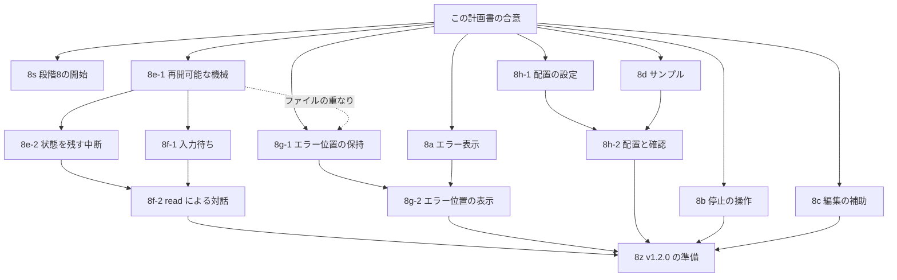

# 0030: 段階8(Web UI の本格化)の全体の計画

- 段階: 8(Web UI の本格化)。段階の作業項目と完了条件は [roadmap.md](../roadmap.md) の段階8の節が正
- 前身: [0021](0021-stage7-8-early-parts.md) の L7 の部分(スライス 8a から 8h)。この計画書は、0021 の 8a から 8h を、段階7までの実績を踏まえて組み直し、置き換える。0021 の L7 の記述は、この計画書の合意のあと、参照用に残す
- 対応する決定: [ADR-0009](../adr/0009-wasm-freestanding-and-zero-dependency-web-ui.md)(freestanding と依存ゼロの Web UI)、[ADR-0021](../adr/0021-no-github-pages-defer-hosting.md)(配置は段階8)、[ADR-0052](../adr/0052-repository-visibility-public-again.md)(public)、[ADR-0034](../adr/0034-release-shape.md)(リリースの形)、[ADR-0044](../adr/0044-machine-step-limit-not-catchable.md)(機械の歩数の上限)、[ADR-0031](../adr/0031-gc-at-machine-step-boundaries.md)(GC は機械の歩の境目)、[ADR-0048](../adr/0048-run-the-examples-of-the-user-documentation.md)(文書の例の実行)
- レーン: [0017](0017-parallel-lanes.md) の L7(Web UI)。機械に触れるスライスは L0 と L3 の所有ファイルに及ぶ(下の「ファイルの重なり」)
- 日付: 2026-11-21
- 状態: 合意待ち。「合意を求める点」の8項目に、勧める案を添えた。実装、`current_stage` の引き上げ、`build.zig.zon` の版の更新は、合意のあとの別の PR で行う

## 状態

| 項目 | 状態 |
| --- | --- |
| 計画書 | 合意待ち |
| スライスの実装 | 未着手(8s から 8z) |

## 次にやること

1. この計画書の「合意を求める点」に答えをもらう。答えは、スライスの表と roadmap の段階8の項目へ、答えを反映する PR の中で写す(AGENTS.md の規則)。
2. 合意のあと、8s(版を `1.2.0-dev` に進める作業と、`current_stage` を 8 に上げる作業。別々の PR)から着手する。
3. 8a から 8d は、機械に触れず、互いに独立なので、合意のあとすぐ並行して始められる。8e-1 と 8g-1 は、機械の設計を含むので、合意を求める点の2と5の答えを待つ。

## 解こうとしている問題

v1.1.0 の時点の Web UI は、次の制約を持つ(いずれも確かめた事実。根拠のファイルを添える)。

- 評価は、`sucheme_eval_begin` の1回の呼び出しで完了まで走る。`sucheme_step` も歩数の制限も WASM には無い(`web/sucheme.js` の冒頭、[design/platform-and-web.md](../design/platform-and-web.md) の「再開可能性」)。機械の歩数の上限は、制御を戻さずに形式を打ち切る形だけが入っていて、準拠スイートのランナーだけが置く([ADR-0044](../adr/0044-machine-step-limit-not-catchable.md))。`Machine.run` のレジスタは、`run` の中の局所変数である(`src/machine.zig`)。
- 停止は、Worker を `terminate()` で捨てて作り直す(`web/app.js`)。作り直した処理系は初期状態で、それまでの定義は失われる。
- 標準入力は最初から終わりにあり、`(read-char)` は EOF を返す([docs/manual/guide/06-web-ui.md](../manual/guide/06-web-ui.md))。
- エラーの表示は、出力の文字列に状態コードを足す程度で(`web/app.js` の `describeStatus`)、行と桁は無い。リーダは括弧で書いたリストの先頭のペアに位置を記録するが、副表は1つのトップレベルの形式を展開し終えるまでの作業表で、実行時の誤りへの位置は出ない([design/frontend.md](../design/frontend.md) の位置情報)。
- 入力欄に編集の補助が無く、サンプルは少ない(`web/samples.mjs`)。
- 配置先が無い。リリースの成果物は zip で、展開して `node serve.mjs` を実行する形である([ADR-0034](../adr/0034-release-shape.md))。画面の文言は日本語で、[AGENTS.md](../../AGENTS.md) の言語の表(UI ラベルは英語)と食い違う。
- `web/` のテストは、`tools/test-wasm/main.mjs` が Node.js から `.mjs` の部品と WASM のエクスポートを試す形である。ブラウザの自動テストは無い([docs/releases/v1.1.0.md](../releases/v1.1.0.md))。

段階7のスライスは、0021 のとき機械に触れない部品として作れた。段階8の中核(状態を残す中断、`read` による対話、エラー位置)は、機械と展開器に触れる。この計画書は、その違いを、スライスの分け方と階層の割り当てに反映する。

## 完了条件

[roadmap.md](../roadmap.md) の段階8の完了条件は、次の3つである。

1. ブラウザで R7RS のサンプルが一通り動く。「一通り」の線引きは、合意を求める点の6で決める。
2. 配置した URL でも動く。
3. リリース v1.2.0 を出す。

この計画書は、それを次の判定に分ける。

- 機能: 8e から 8g(状態を残す中断、`read` による対話、エラー位置)が完了し、利用者向けの文書の Web UI の節が実装と一致する。
- サンプル: 8d が完了し、合意を求める点の6で決めた検査が全コミットの CI で通る。
- 配置: 8h が完了し、配置した URL で、同じサンプルが動くことを確かめる。
- リリース: 8z。リリースを出す作業は、段階の完了条件には含めない(段階7と同じ扱い。公開はユーザーの確認を取る)。

## 範囲

含めるもの: 上の完了条件のもの。`src/machine.zig`、`src/context.zig`、`src/sucheme.zig`、`src/wasm.zig`、展開器と IR(位置の複写)、`web/*`、`tools/test-wasm/`、配置のワークフロー(承認のあと)、利用者向けの文書の更新。

含めないもの(送り先は括弧の中):

- 識別子の補完、REPL の差分読み取り、端末の高さを超える描画、貼り付けの描画の畳み込み、文字幅の表の差し替え、Windows と macOS の実機での確認の残り(roadmap の「段階7の後続の作業」。どれも REPL の行編集の作業で、Web UI の完了条件に入らない)。
- ネイティブの REPL の「評価だけを止める Ctrl-C」(同じ節。ネイティブ側の組み込みを含めるかは合意を求める点の7)。
- ブラウザの自動テストの CI への導入(合意を求める点の8)。
- roadmap に無い機能(オフライン対応、モバイル向けの最適化、アカウントや保存の機能)。

## 確かめた事実と、確かめられなかったこと

確かめた事実(`origin/main` の `8c15470` を読んだ)。

- `web/` は8ファイル(`app.js`、`index.html`、`samples.mjs`、`serve.mjs`、`share.mjs`、`style.css`、`sucheme.js`、`worker.js`)で、`tools/test-wasm/main.mjs` が `samples.mjs` と `share.mjs` を読んで検査している。
- `web/app.js` は、`sucheme.wasm` を `import.meta.url` からの相対パスで取る。サイトをサブパス(`/<リポジトリ名>/`)の下に置いても、取得先は変わらない。
- `preview.yml` が、PR ごとに `sucheme.wasm` と `web/` の中身を、成果物 `sucheme-web` として上げる(保存7日)。リリースの zip は `tools/release/package.py` が作る。
- `.github/dependabot.yml` と `.github/workflows/` の変更は、ユーザーの承認が要る(AGENTS.md のセキュリティの節)。
- 利用者向けの文書 `docs/manual/guide/06-web-ui.md` は、`read` による対話、エラーの位置の表示、配置した URL が「まだありません」と書く。L9 の計画は、これらの内容を、前提のスライスのあとに足すとしている([0027](0027-user-documentation.md)、roadmap の利用者向けの文書の節)。

確かめられなかったこと(合意のあと、各スライスの着手時に確かめる)。

- GitHub Pages が、`.wasm` を `application/wasm` で返すか。Pages の配置にシークレットが要らないか。Actions による配置の公式文書の記述。この環境から GitHub の文書に届かなかったので、確かめていない。確かめ方は、配置先の試験用の配置を作り、レスポンスの `Content-Type` を見る(8h-1)。
- Pages の配置を、タグの push かリリースの公開から起動できるか(環境の保護規則の既定が、既定のブランチに限られる、という記憶がある。未確認)。
- 再開可能な機械が、周回ごとの費用をどれだけ増やすか(測っていない。ADR-0044 の測定は、周回ごとの残りの比較だけを対象にしている)。
- WASM の大きさと、圧縮して配る場合の大きさ(測っていない。数値は文書に書かず、`zig build wasm` のあとに `zig-out/web/sucheme.wasm` を測って出す)。

## スライス

0021 の 8a から 8d は、独立で機械に触れない部品として、そのまま残す。0021 の 8e、8f、8g、8h は、機械と展開器の変更を含むので、機械側と画面側に分ける。識別子は、0021 を引き継ぎ、分けたものに枝番を付ける。

階層は [0017](0017-parallel-lanes.md) の T1(軽量)、T2(標準)、T3(上位)である。時間は下の「見積り」に分けて置く。

| スライス | 完了条件 | 所有するファイル | 階層 | 前提 | 並行 |
| --- | --- | --- | --- | --- | --- |
| 8s 段階8の開始 | 版を `1.2.0-dev` に進める PR と、`current_stage` を 8 に上げる PR(別々)。`check-docs` が新しい行を要求しないことを確かめる | `build.zig.zon`、`build.zig`(`current_stage`)、roadmap の「現在地」、handoff | T1 | この計画書の合意 | 8a から 8d と並行できる |
| 8a エラー表示 | 出力とエラーの説明を分けて表示する。エラーの前に出た出力を残す。状態コードごとの説明を `web/errors.mjs` に持ち、Node から試せる。画面の文言を、言語の表(UI ラベルは英語)に揃える | `web/errors.mjs`(新規)、`web/app.js`、`web/style.css`、`web/index.html`、`tools/test-wasm/main.mjs` | T2 | なし | 8b から 8d と並行できる |
| 8b 停止の操作 | `Esc` で停止できる。経過時間を表示する。停止すると、定義が失われることを、停止の前後に明示する(8e-2 のあと、定義が残る場合の表示に差し替える) | `web/app.js`、`web/index.html` | T1 | なし | 8a、8c、8d と並行できる |
| 8c 編集の補助 | 入力欄で、括弧の対応の強調、`Tab` の字下げ、`Ctrl-Enter` での実行(済み)、実行した入力の履歴(上下の移動)ができる。括弧の走査は `web/parens.mjs` に置き、Zig の `src/line_editor/parens.zig` と同じ入力の一覧で試す(一覧は `tests/parens/` に置き、両方が読む) | `web/parens.mjs`(新規)、`web/history.mjs`(新規)、`tests/parens/`(新規)、`web/app.js`、`web/index.html`、`web/style.css`、`tools/test-wasm/main.mjs`、`src/line_editor/parens.zig` のテスト | T2 | なし(7e は main にある) | 8a、8b、8d と並行できる |
| 8d サンプルの充実 | R7RS-small の機能を使うサンプルを足す(段階4から6が済んだので、数値塔、文字列、ポート、`dynamic-wind`、`call/cc`、ライブラリを含められる)。各サンプルが期待どおりに評価されることを `tools/test-wasm/main.mjs` が検査する。合意を求める点の6の答えに従い、利用者向けのプログラム集を WASM で走らせる検査を足す | `web/samples.mjs`、`tools/test-wasm/main.mjs`、(合意の答え次第で)`tools/check-examples/` | T1(サンプル)、T2(検査) | なし | 8a から 8c と並行できる |
| 8e-1 再開可能な機械 | 合意を求める点の2の答えに従う方式で、機械が歩数の予算を使い切ったときに、誤りでなく状態コードで制御を戻し、続きから再開できる。割り込みの要求(外から立てる印)を、歩の境目で見て、制御を戻せる。再開をまたいで、GC のルートと計上が保たれる。ストレスモードと、ヒープの上限のテストが通る。ネイティブの実行は、既定では歩数の上限を置かず、挙動を変えない | `src/machine.zig`、`src/context.zig`、`src/sucheme.zig`(`Interpreter` の入口)、設計文書 | T3 | 合意を求める点の2 | 8g-1 と、ファイルが重なる(下の「ファイルの重なり」)。8a から 8d とは独立 |
| 8e-2 状態を残す中断 | WASM に `sucheme_step(budget)` を足す(設計は [design/platform-and-web.md](../design/platform-and-web.md) の表)。Worker が、歩数ごとに制御を取り戻し、停止の要求を受けて評価を打ち切る。停止しても、それまでの定義が残る。長い評価の間も、画面が応答する。利用者向けの文書の Web UI の節を実装に合わせる | `src/wasm.zig`、`web/sucheme.js`、`web/worker.js`、`web/app.js`、`tools/test-wasm/main.mjs`、`docs/manual/guide/06-web-ui.md` | T2 | 8e-1 | 8f-1 とは、`src/wasm.zig` が重なる |
| 8f-1 入力待ち | 合意を求める点の3の答えに従う方式で、コンソールの入力ポートが、入力が無いときに状態コード 2 で制御を戻す。`sucheme_provide_input` と `sucheme_provide_eof` で再開する。渡したバイト列のうち、1回の読み取りより長い分は、WASM 側に保持する。入力バッファを計上の対象にする。終端のあとの読み取りは、すべて EOF を返す | `src/port.zig` と `src/prim/port.zig`(コンソール入力の部分)、`src/machine.zig`、`src/wasm.zig`、`tools/test-wasm/main.mjs` | T3 | 8e-1 | 8e-2 と並行できない(`src/wasm.zig`)。後にマージするほうが main を取り込む |
| 8f-2 `read` による対話 | `(read)`、`(read-line)`、`(read-char)` が、画面の入力欄から入力を受け取る。終端を送れる。入力待ちの間、入力欄の状態が分かる表示がある。利用者向けの文書(ユーザーズガイドの Web UI の対話)を足す | `web/app.js`、`web/worker.js`、`web/sucheme.js`、`web/index.html`、`web/style.css`、`docs/manual/guide/06-web-ui.md`、`tools/test-wasm/main.mjs` | T2 | 8f-1、8e-2 | 8g-2 とは `web/app.js` が重なる |
| 8g-1 エラー位置の保持 | 展開器が、コアIR の節点に、位置(ファイル、行、桁)を複写する。精度は、合意を求める点の5の答えに従う。実行時の誤りの診断に、誤りを起こした呼び出しの位置が入る(ネイティブでも出る)。IR の節点の増えた分が、ヒープの上限に計上される。マクロの展開後に位置が失われる場合は、位置なしで動く | `src/syntax/expand.zig`、`src/syntax/source.zig`、IR の定義、`src/machine.zig`(診断の部分)、`src/sucheme.zig`(`diagnostic`)、`src/positions.zig`、設計文書 | T3 | 合意を求める点の5 | 8e-1 と、`src/machine.zig` と `src/sucheme.zig` が重なる。8e-1 のあとに着手するか、重なる範囲を先に確かめる |
| 8g-2 エラー位置の表示 | WASM のエラー出力から、行と桁を取り出し、入力欄の該当の位置を示す(強調か、選択)。位置が無いエラーは、これまでどおり表示する。位置の取り出しを、Node から試せる `.mjs` に置く | `web/errors.mjs`、`web/app.js`、`web/style.css`、`tools/test-wasm/main.mjs`、`docs/manual/guide/06-web-ui.md` | T2 | 8g-1、8a | 8f-2 とは `web/app.js` が重なる |
| 8h-1 配置の設定 | 合意を求める点の1で選んだ配置先に、試験用の配置を作り、`.wasm` の `Content-Type` が `application/wasm` であることを確かめる。配置のワークフローを足す(`.github/workflows/` の変更を含むので、ユーザーの承認を得てから行う)。シークレットの扱いは、合意を求める点の1の答えに従う | `.github/workflows/`(承認のあと)、リポジトリの設定(ユーザーが行う)、`docs/adr/`(配置の決定を記録する新しい ADR) | T2 | 合意を求める点の1。承認 | 8a から 8g と並行できる(ファイルが重ならない) |
| 8h-2 配置と確認 | 配置した URL で、サンプルが動くことを確かめる。利用者向けの文書に、配置した URL を載せる。配置の運用(いつ配置するか)を、ADR と利用者向けの文書に書く。Unicode の表を含む WASM の大きさを測り、合意を求める点の4の答えに従って報告する | `docs/manual/guide/06-web-ui.md`、`docs/manual/guide/07-limitations.md`、`docs/adr/`、README | T2 | 8h-1、8d | 8f と並行できる |
| 8z v1.2.0 の準備 | 版を `1.2.0` にし、`docs/releases/v1.2.0.md` を書く。利用者向けの文書の既知の制限と、未実装の一覧を実装に合わせる。roadmap の「現在地」と段階8の項目を更新する。AGENTS.md の規則に沿い、第三者の表示が、段階8で足したもの(あれば)を覆っているかを確かめる | `build.zig.zon`、`docs/releases/`、`docs/manual/`、roadmap、handoff | T2 | 8a から 8h のうち、完了条件に含めたもの | 最後 |

8z の担当は、L7 の担当(段階8のスライスを持つ担当)である。親は、巡回のたびに、段階8の作業項目がすべてチェック済みなのに `docs/releases/v1.2.0.md` が無い状態を確かめる([0017](0017-parallel-lanes.md) の見張りの節)。

### ファイルの重なり

- `web/app.js`: 8a、8b、8c、8e-2、8f-2、8g-2 が触る。同時に開く PR は2件までにし、後からマージするほうが main を取り込む(0021 の取り決めの継続)。
- `src/machine.zig` と `src/sucheme.zig`: 8e-1、8f-1、8g-1 が触る。8e-1 を先にマージし、8f-1 と 8g-1 は、そのあとに main を取り込んで着手する。8g-1 が機械に触れる範囲は診断の経路に限られる見込みだが、確かめていない。着手の前に、変更するファイルの一覧を、8e-1 の PR と突き合わせる。
- `src/wasm.zig`: 8e-2 と 8f-1。後にマージするほうが main を取り込む。
- `tools/test-wasm/main.mjs`: ほとんどのスライスが、検査を足す。足す位置が離れていれば、競合は機械的に解ける。大きくなったら、同じ step から呼ぶ別の `.mjs` に分ける(`build.zig` の変更だけで済む)。
- `docs/manual/guide/06-web-ui.md`: 8e-2、8f-2、8g-2、8h-2 が、それぞれの機能を足す。出力を変える PR は、同じ PR で `docs/manual/` の期待する出力を直す([ADR-0048](../adr/0048-run-the-examples-of-the-user-documentation.md))。
- `.github/workflows/`: 8h-1 だけ。ほかのスライスは触れない。

実線は前提、点線はファイルの重なりによる順序の推奨である。8d の前提が無いのは、サンプルを、機械の変更を待たずに、今の WASM で動くものから足せるからである。`read` を使うサンプルは、8f-2 のあとに足す。

## 見積り

見積りは、時間単位で付ける。「ready まで」は、着手から、自前のレビューが収束して PR を ready にするまでの、エージェントの作業時間と待ちの合計である。「マージまで」は、ready のあと、層2(文書だけの PR では走らない)とユーザーのマージの判断を待つ時間を含む。

根拠は弱い。[0012](0012-schedule-estimates-and-actuals.md) は、段階7について、スライスごとの見積りと実績の比較を取れなかったと記録している。段階8の暦日は、0012 が段階7の後の補正として 3 から 7 日と置いている。段階7の実績は約8.7日で、その前の補正(3から8日)の幅を超えたので、段階の全体の暦日は、この幅の上側を見る。この幅にも、スライス単位の裏付けは無い。下の時間は、スライスの規模(0021 の小、中、大の相対と、機械に触れるか)から置いた概算で、実績が出たら補正する。ユーザーのマージの待ちは、時刻が読めないので、範囲を広く取る。

| スライス | ready まで(時間) | マージまで(時間) | 備考 |
| --- | --- | --- | --- |
| 8s | 1 から 2 | 3 から 8 | 2つの PR。版の更新は、文書とビルドだけ |
| 8a | 2 から 4 | 6 から 14 | |
| 8b | 1 から 2 | 5 から 12 | |
| 8c | 3 から 6 | 8 から 18 | 括弧の走査を JavaScript で書き直す。共有の入力の一覧を作る |
| 8d | 3 から 6 | 8 から 16 | 検査の範囲は、合意を求める点の6の答えで決まる |
| 8e-1 | 8 から 16 | 20 から 40 | 機械の設計。GC のルートと計上、ストレスモード。T3 |
| 8e-2 | 3 から 6 | 8 から 18 | |
| 8f-1 | 8 から 16 | 20 から 40 | 入力待ちのプリミティブの設計。T3 |
| 8f-2 | 3 から 6 | 8 から 18 | |
| 8g-1 | 8 から 16 | 20 から 40 | 展開器と IR。計上の確認を含む。T3 |
| 8g-2 | 2 から 4 | 6 から 14 | |
| 8h-1 | 2 から 4 | 12 から 48 | ユーザーの承認(ワークフローと設定)の待ちを含む |
| 8h-2 | 2 から 4 | 6 から 14 | |
| 8z | 2 から 4 | 6 から 16 | 公開はユーザーの確認を取る |

全体は、レーンを並行に進めたときの暦日で、0012 の補正(3から7日)に沿う。ただし、機械に触れる 8e-1、8f-1、8g-1 の3つは、この順にほぼ直列に進むので、段階の長さは、ここで決まる見込みである(見込み。直列の ready までの合計と、ユーザーの待ちから、約3日以上を見る)。8h-1 の承認の待ちは、機械側と並行して進める。

## 合意を求める点

勧める案を先に書く。勧める案でよいときは、そう返信する。設計、データ形式、依存関係、公開に関わる点だけを置く。範囲が小さく戻せる選択(画面の文言を英語に揃える、ファイルの切り方、内部の名前)は、勧める案で進めて、PR に書くだけにする。

1. Web UI の配置先と、配置の運用(8h-1)。リポジトリが public になった([ADR-0052](../adr/0052-repository-visibility-public-again.md))ので、[ADR-0021](../adr/0021-no-github-pages-defer-hosting.md) の要件のうち、private にアクセス制限できることは、必須でなくなった。残る要件は、静的ファイルだけで足りること、`.wasm` を `application/wasm`(パラメータなし)で返せること、`.wasm` を Web UI と同じオリジンから配れること(4つのうち後ろの3つ)である。
   - 勧める案: GitHub Pages を、GitHub Actions による配置で使う。リリースの Web UI の zip と同じ内容を配置する。配置のきっかけは、リリースの公開と、手動の起動(`workflow_dispatch`)にする。main への push ごとには配置しない(Actions の分数と、公開される内容が、リリースと食い違うのを避けるため)。
     - 利点: 追加のサービスやアカウントが要らない。配置用のトークンを、新しいシークレットとして置かずに済む見込みである(Actions の組み込みの権限で配置できるという記憶による。未確認)。リポジトリの中で完結する。public では無償で使える([ADR-0052](../adr/0052-repository-visibility-public-again.md) が引く公式文書の記述)。`web/app.js` が相対パスで WASM を取るので、サブパスの下でも動く。
     - 欠点: `.github/workflows/` の変更とリポジトリの設定の変更を伴い、どちらもユーザーの承認が要る。レスポンスヘッダを制御できないので、`application/wasm` が返るかは、実際に配置して確かめる必要がある(未確認。配置先が COOP と COEP を要求しない設計なので、ヘッダの制御が無いこと自体は問題にならない)。PR ごとのプレビューの URL は得られず、PR の確認は、これまでの成果物の zip のままである。タグやリリースからの配置を環境の保護規則が許すかは、未確認である。
   - 別案A: Cloudflare Pages。`_headers` でヘッダを制御でき、PR ごとのプレビューもある(0021 の調査で、`_headers` の存在を公式文書のソースで確かめた)。外部のアカウントが増え、配置にトークンが要る(CI のシークレットを増やすか、手元から配置する)。
   - 別案B: Azure Static Web Apps の Free。`mimeTypes` で `application/wasm` を指定できる(0021 の調査で確かめた)。アクセス制限の機能という、この候補の利点は、public では要らなくなった。外部のアカウントと、トークンが増える。
   - 別案C: Netlify と Vercel。公式文書に接続できず、比較していない(未確認)。
   - 別案D: 配置せず、リリースの zip だけにする。roadmap の完了条件(配置した URL でも動く)を満たさないので、完了条件の変更が要る。
   - シークレットは、勧める案では増やさない。別案A と B を選ぶと、[design/open-questions.md](../design/open-questions.md) の「配置にシークレットが必要な場合の扱い」の行に当たり、扱いを別に諮る。
2. 再開可能な機械の方式(8e-1)。[design/platform-and-web.md](../design/platform-and-web.md) は、`sucheme_step(budget)` が歩数制限で戻る設計を、段階8の目標として書いている。0021 は、この所有を L3 にしたが、段階5はそれを入れずに完了した。ここで改めて決める。
   - 勧める案: 設計文書のとおり、機械のレジスタを `Machine` の状態として持ち、`step(budget)` が、歩数を使い切るか、完了するか、入力待ち(8f-1)か、割り込みの要求を見たときに制御を戻す。ADR-0044 の歩数の上限は、同じ残りの数を使い、制御を戻す形を足す(ADR-0044 の決定の4が許す)。`Machine.run` は、`step` を完了まで呼ぶ薄い層にして、ネイティブの挙動を変えない。
     - 利点: 停止と `read` が、同じ仕組みで実現できる。設計文書が、すでにこの形で書いてある。GC は機械の歩の境目で走る([ADR-0031](../adr/0031-gc-at-machine-step-boundaries.md))ので、制御を戻す位置と一致する。
     - 欠点: 機械の中心に手を入れる。レジスタを局所変数から外すと、周回ごとの費用が変わりうる(測っていない)。再開をまたぐ間のルートの扱いと、ヒープの計上を、新しく設計する。
   - 別案A: 停止は今の `terminate()` のまま、それまでに実行した入力を、作り直した処理系で再生して、定義を復元する。機械は変わらない。ただし、副作用(出力、乱数、時刻)を再生すると結果が変わりうる。`read` の対話は実現できない。
   - 別案B: 歩数の予算だけを入れ、入力待ちは入れない。8e-2 は実現できるが、`read` による対話は、roadmap の項目が残る(完了条件の「`read` による対話」を外す判断になる)。
3. 入力待ちの方式(8f-1)。コンソールの入力ポートが、入力が無いときに、機械を止めて、ホストから入力を受け取って再開する。
   - 勧める案: 読み取りのプリミティブが「入力待ち」を返し、機械は、その呼び出しを保存して制御を戻す。入力が届いたら、同じプリミティブの呼び出しをやり直す。読み取りは、入力を消費する前に待つことを判断するので、やり直しで二重に消費しない。
     - 利点: 継続(`call/cc`)を使わず、機械の保存する状態が小さい。やり直しで済むことは、読み取りの手続きが、バッファの空を見てから消費する作りなら成り立つ(8f-1 の設計で確かめる)。
     - 欠点: 入力待ちを起こすプリミティブの実装に、「待つ前に何も消費しない」という不変条件を課す。ほかのプリミティブ(`read-string` など、複数回に分けて読むもの)に、同じ確認が要る。
   - 別案A: 継続として呼び出しを保存して再開する。不変条件は要らないが、機械が持つ状態が増え、ヒープの上限と GC のルートの扱いが複雑になる。
   - 別案B: 入力を、実行の前に全部、画面で渡す(標準入力の一括の渡し)。対話にならず、`read` が空のときの挙動が、今と同じになる。roadmap の項目の趣旨(対話)から外れる。
4. Unicode の表の大きさの許容基準([design/open-questions.md](../design/open-questions.md) の「段階8までに決める」の行)。この基準は、ユーザーが決める。
   - 勧める案: 今は数値を決めない。8h-2 で、配信される WASM の大きさ(圧縮転送の大きさを含む)を測り、数値を添えて、そのときに基準を諮る。配置のあとの、利用者の体感に影響する大きさなので、配置して測れる形で判断する。
   - 別案: 先に上限の数値を決める。測る前に決めると、根拠が薄い。
5. エラー位置の精度(8g-1)。位置情報の残り(2)の範囲を決める。
   - 勧める案: 手続き呼び出しの節点だけに位置を複写し、誤りを起こした最も内側の呼び出しの位置を、診断に載せる。マクロの展開で失われる位置は、無いものとして扱う。
     - 利点: 多くの実行時の誤り(型の誤り、未束縛の変数、引数の数)を、呼び出しの位置に結びつけられる。IR の節点の増え方が、呼び出しの数に比例する。
     - 欠点: 誤りが、呼び出しでない節点で起きたとき(変数の参照など)は、位置が出ない。位置をたどるための、節点ごとの追加の大きさは、測っていない。
   - 別案A: すべての節点に位置を複写する。精度は高いが、IR の大きさと計上の増え方が最も大きい。
   - 別案B: トップレベルの形式の位置だけを使う(IR を変えない)。実装は小さいが、「どの式で誤ったか」が分からず、roadmap の項目(エラー位置の表示)を弱い形で満たす。
   - 別案C: 呼び出しの連なり(スタックトレース)を出す。有用だが、機械の継続の走査が要り、範囲が大きい。段階8には含めない。
6. 完了条件の「R7RS のサンプルが一通り動く」の線引き(8d)。
   - 勧める案: (a) `web/samples.mjs` のすべてのサンプルが、`tools/test-wasm/main.mjs` で期待どおりの出力になる。(b) 利用者向けのプログラム集(`docs/manual/programs/`)のうち、ファイル、コマンドライン、標準入力を使わないものを、同じ WASM で走らせて、`.out` と比べる検査を、`zig build test-wasm` に足す。新しい step も、検証コマンドの表の新しい行も要らない。
     - 利点: ネイティブの実行ファイルと WASM の出力が、同じ例で食い違わないことを、機械で確かめられる。「一通り」の根拠が、文書の例になる。
     - 欠点: WASM で出力が食い違う例(時刻、乱数、ポートの扱い)が見つかったら、除外の一覧が要る。除外の理由を記録する。どの例が動くかは、確かめていない。
   - 別案A: `web/samples.mjs` のサンプルだけにする。検査は小さいが、「一通り」の根拠が弱い。
   - 別案B: 準拠スイート(`r7rs-tests.scm`)を、WASM でも走らせる。最も強い根拠だが、実行時間が長く、層2に入るかもしれず、ランナーの WASM 対応が大きい。
7. ネイティブの REPL の「評価だけを止める Ctrl-C」を、8e-1 に含めるか(roadmap の「段階7の後続の作業」の項目が、段階8の「状態を残す中断」と共通の部分がありうるとしている)。
   - 勧める案: 含めない。8e-1 は、割り込みの要求を、機械が歩の境目で見る形にし、ネイティブからも同じ仕組みを使える作りにする(信号ハンドラから印を立てる部分は、含めない)。ネイティブ側の組み込みは、段階7の後続の作業のまま残す。
     - 利点: 8e-1 の範囲が増えない。ネイティブは OS ごとの信号の扱い(Windows を含む)が別にあり、層2でしか確かめられない部分を、段階8に持ち込まない。
     - 欠点: 評価中の Ctrl-C で、定義が失われる制約が、v1.2.0 でも残る。
   - 別案: 含める。ネイティブの利用者にも、評価だけを止める操作が届く。8e-1 に、信号の扱いと、Windows の確認が加わる。
8. ブラウザの自動テストを CI に入れるか。
   - 勧める案: 入れない。0021 の方針(画面の操作は手で確かめて PR に書く。依存を増やさない)を継続し、`web/` の論理は `.mjs` に寄せて `test-wasm` で試す。
     - 利点: 依存(パッケージマネージャ、ブラウザの取得)と、CI の変更が増えない([ADR-0009](../adr/0009-wasm-freestanding-and-zero-dependency-web-ui.md) の依存ゼロの方針と合う)。
     - 欠点: 画面の操作(キー、強調の見た目、停止、入力待ち)は、自動では確かめられない。8e-2、8f-2、8g-2 は、画面の挙動が中心なので、手で確かめる範囲が広がる。
   - 別案: 配置のあとの確認(8h-2)だけに、ブラウザの自動化を使う。依存と手順が増える。

## 検証

- 各スライスの PR は、[AGENTS.md](../../AGENTS.md) の検証コマンドの表の「全コミット」の行を通す。新しい step と、検証コマンドの表の新しい行は、足さない(`web/` の論理と WASM のエクスポートは `zig build test-wasm` が試し、文書の例は `zig build check-examples` が試す)。合意を求める点の6の答えで、プログラム集を WASM で走らせる検査を足す場合も、`test-wasm` の中で足す。
- 8e-1、8f-1、8g-1 は、機械、ヒープ、展開器に触れるので、`zig build test -Dslow=true` と `zig build test-scheme -Dslow=true` を、ready にする前に通す(AGENTS.md)。ストレスモード(GC を頻繁に走らせる設定)で、再開をまたいだルートが保たれることを、テストで固定する。
- ミューテーションテストは、変更した判定の分岐ごとに代表的な書き換えを数件試す。重点は、歩数を使い切る境目、入力待ちで何も消費しないこと、位置の複写が節点の種類ごとに入ること、割り込みの要求を見る位置である。
- 画面の操作は、手で確かめて、PR に、確かめた範囲と、確かめていない範囲を書く(合意を求める点の8)。
- 配置(8h-1、8h-2)は、配置した URL で、レスポンスの `Content-Type` と、サンプルの実行を確かめ、結果を PR に書く。

## 割り当ての一覧

[roadmap.md](../roadmap.md) の段階8の項目と、この計画書のスライスの対応。割り当てのない項目は残さない。roadmap には、この計画書へのリンクを足す。チェックは、スライスのマージで入れる。

| roadmap の項目 | スライス |
| --- | --- |
| `read` による対話 | 8e-1、8f-1、8f-2 |
| エラー位置の表示と処理の中断(位置情報の残り(2)を含む) | エラー位置: 8g-1、8g-2。処理の中断: 8b、8e-1、8e-2 |
| 編集の補助とサンプルの充実 | 8c、8d(8a の表示の改善を含む) |
| Web UI の配置先の選定と配置 | 8h-1、8h-2 |
| リリース v1.2.0 | 8z |
| 開始(版と `current_stage`) | 8s |
| [design/open-questions.md](../design/open-questions.md) の「段階8までに決める」の3行(配置先、シークレットの扱い、Unicode の表の大きさ) | 配置先とシークレット: 合意を求める点の1、8h-1。表の大きさ: 合意を求める点の4、8h-2 |
| 利用者向けの文書のうち、前提のスライスのあとに足す内容(Web UI の対話と配置。roadmap の利用者向けの文書の節) | 対話: 8f-2。配置: 8h-2。実装と文書の一致の最終確認: 8z |
| 段階7の後続の作業の「評価だけを止める Ctrl-C」 | 合意を求める点の7。勧める案では、段階8に含めない |

## 進捗

| スライス | 状態 | PR |
| --- | --- | --- |
| この計画書 | 合意待ち | - |
| 8s から 8z | 未着手 | - |
